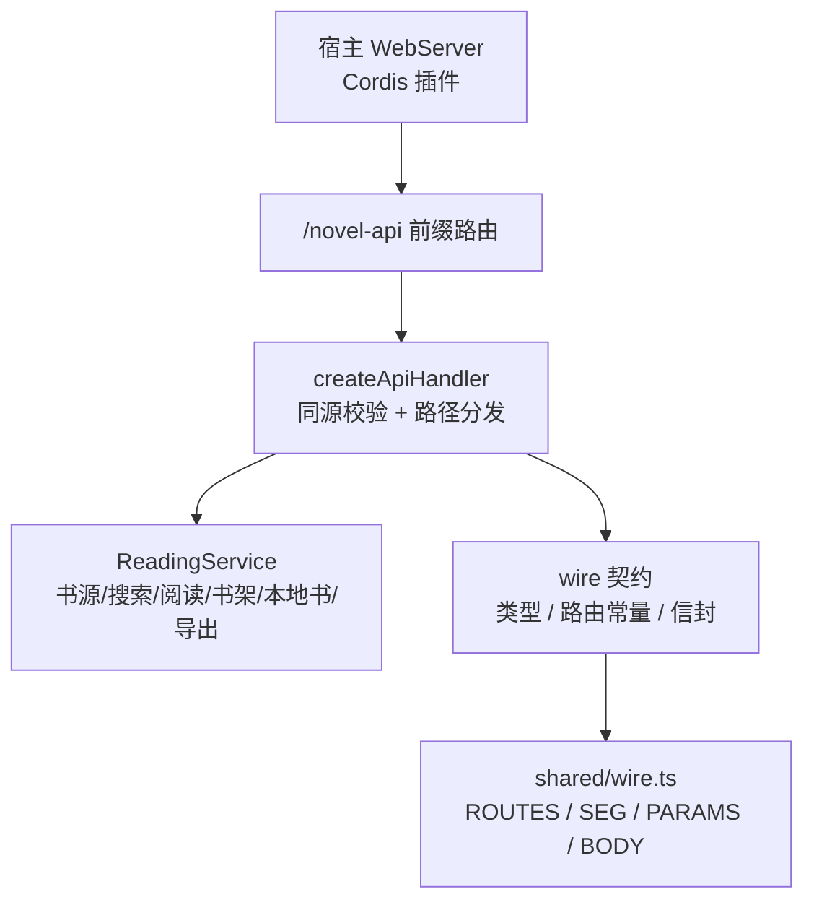
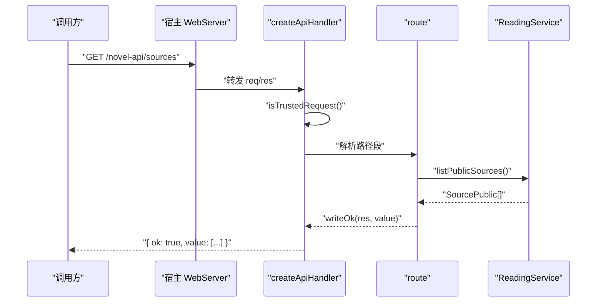
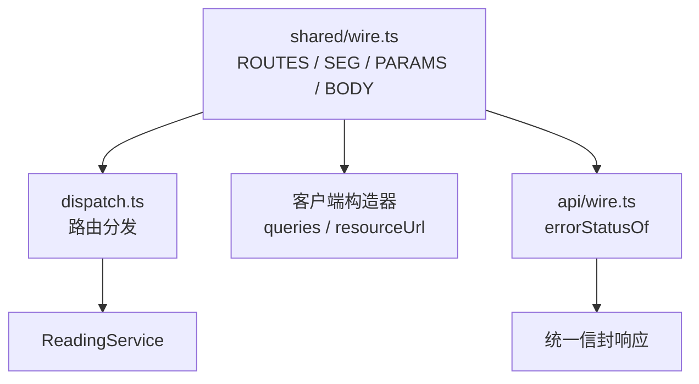

# HTTP API 参考

<cite>
**本文引用的文件**   
- [src/index.ts](file://src/index.ts)
- [src/api/dispatch.ts](file://src/api/dispatch.ts)
- [src/api/wire.ts](file://src/api/wire.ts)
- [src/shared/wire.ts](file://src/shared/wire.ts)
- [tests/api/helpers.ts](file://tests/api/helpers.ts)
- [tests/api/routes.test.ts](file://tests/api/routes.test.ts)
</cite>

## 目录
1. [简介](#简介)
2. [项目结构](#项目结构)
3. [核心组件](#核心组件)
4. [架构总览](#架构总览)
5. [路由与端点参考](#路由与端点参考)
6. [依赖关系分析](#依赖关系分析)
7. [性能与限制](#性能与限制)
8. [故障排查](#故障排查)
9. [结论](#结论)

## 简介
本文件是 dshnovel 插件对外暴露的 RESTful HTTP API 完整参考。所有端点统一以 `/novel-api` 为前缀，由 Cordis 宿主通过 `webServer.register({ kind: 'prefix', path })` 挂载；请求经 Node 原生 `http.Server` 进入分发器，再路由到 ReadingService 的具体业务面。

访问约束：
- 仅接受 loopback 来源（`127.0.0.1`、`::1`、`::ffff:127.0.0.1`）。
- 若请求携带 `Origin`，则必须与 `Host` 同源；若携带 `Referer`，其 host 也必须与 `Host` 同源。
- 不携带 `Origin`/`Referer` 的请求仍放行，以便本机工具或 curl 直接调用。

所有响应统一使用信封格式：成功 `{ ok: true, value }`，失败 `{ ok: false, error: { code, message, segment? } }`。错误状态码由分类表映射，而非任意手写。

**章节来源**
- [src/index.ts:220-242](file://src/index.ts#L220-L242)
- [src/api/wire.ts:26-47](file://src/api/wire.ts#L26-L47)
- [src/api/wire.ts:84-111](file://src/api/wire.ts#L84-L111)

## 项目结构
API 实现按三层组织：



- **宿主挂载**：插件在 `apply` 中创建 `ReadingService`，随后注册 `/novel-api` 前缀处理器。
- **分发器**：校验来源 → 校验前缀 → 切分 URL 段 → 根据 `SEG` 与 `ROUTES` 匹配具体分支。
- **服务层**：每个功能面（sources/search/explore/reading/shelf/export/local）由 ReadingService 门面方法承载。
- **Wire 契约**：JSON 形状、路由字面量、错误信封定义于共享文件，Node 半与浏览器半共用同一份事实。

**图表来源**
- [src/index.ts:220-242](file://src/index.ts#L220-L242)
- [src/api/dispatch.ts:59-107](file://src/api/dispatch.ts#L59-L107)
- [src/shared/wire.ts:545-754](file://src/shared/wire.ts#L545-L754)

**章节来源**
- [src/index.ts:201-242](file://src/index.ts#L201-L242)
- [src/api/dispatch.ts:59-107](file://src/api/dispatch.ts#L59-L107)
- [src/shared/wire.ts:545-754](file://src/shared/wire.ts#L545-L754)

## 核心组件
- **createApiHandler**：唯一入口处理器。先做同源检查，再判断是否以 `/novel-api` 开头，最后把剩余段交给 `route`。
- **openJobStream**：搜索与发现两类 SSE 流共用的机械——写头、逐帧推送 `{ job }`、到达终态关闭、客户端断连时退订。
- **writeOk / writeError**：统一 JSON 信封输出。
- **errorStatusOf**：将 domain 错误映射为 HTTP 状态码与 wire 错误码；`ApiError` 自带状态码直通。
- **readJsonBody / readCappedBody**：聚合请求体并带字节上限，超限返回 413。

**章节来源**
- [src/api/dispatch.ts:59-107](file://src/api/dispatch.ts#L59-L107)
- [src/api/dispatch.ts:18-56](file://src/api/dispatch.ts#L18-L56)
- [src/api/wire.ts:68-135](file://src/api/wire.ts#L68-L135)

## 架构总览
以下时序展示一次普通 GET 请求如何从宿主落到 ReadingService：



**图表来源**
- [src/api/dispatch.ts:59-107](file://src/api/dispatch.ts#L59-L107)
- [src/api/dispatch.ts:109-165](file://src/api/dispatch.ts#L109-L165)

**章节来源**
- [src/api/dispatch.ts:59-165](file://src/api/dispatch.ts#L59-L165)

## 路由与端点参考

### 通用约定
- 前缀：`/novel-api`
- 认证：无 Token；依赖 loopback + 同源 Origin/Referer。
- 成功响应：`{ ok: true, value }`
- 失败响应：`{ ok: false, error: { code, message, segment? } }`
- 分页游标：搜索 SSE/轮询使用 `since`，表示“已收到的分组数”；增量只回 `groups[since..]`。
- 大响应体：JSON 请求体默认上限 1 MiB；本地导入原始文件上限由 `service.localImportMaxBytes` 决定。

### 健康检查
| 项 | 说明 |
|---|---|
| 方法 | `GET` |
| URL | `/novel-api` |
| 请求体 | 无 |
| 查询参数 | 无 |
| 成功响应 | `{ ok: true, value: { name: "dsh-novel", apiVersion: 1 } }` |
| 错误码 | 非受信来源 403；未知前缀 404 |

curl 示例：
```bash
curl http://127.0.0.1:PORT/novel-api
```

TypeScript 示例：
```typescript
const res = await fetch(`${BASE}/novel-api`);
const data = await res.json(); // { ok: true, value: { name, apiVersion } }
```

**章节来源**
- [src/api/dispatch.ts:119-127](file://src/api/dispatch.ts#L119-L127)
- [tests/api/routes.test.ts:44-53](file://tests/api/routes.test.ts#L44-L53)

### 书源管理

#### 列出公开书源
| 项 | 说明 |
|---|---|
| 方法 | `GET` |
| URL | `/novel-api/sources` |
| 成功响应 | `{ ok: true, value: SourcePublic[] }` |
| 约束 | 仅 loopback + 同源 |

curl 示例：
```bash
curl http://127.0.0.1:PORT/novel-api/sources
```

TypeScript 示例：
```typescript
const { value } = await fetch(`${BASE}/novel-api/sources`).then(r => r.json());
// value: SourcePublic[]
```

#### 批量导入书源
| 项 | 说明 |
|---|---|
| 方法 | `POST` |
| URL | `/novel-api/sources/import` |
| Content-Type | `application/json` |
| 请求体 | `{ files: [{ name: string; text: string }] }` |
| 成功响应 | `{ ok: true, value: JobState }` |
| 错误码 | 400 非法 JSON 或 body 形状；413 超过 32 MiB |

curl 示例：
```bash
curl -X POST http://127.0.0.1:PORT/novel-api/sources/import \
  -H "Content-Type: application/json" \
  -d '{"files":[{"name":"demo.json","text":"[]"}]}'
```

TypeScript 示例：
```typescript
const { value } = await fetch(`${BASE}/novel-api/sources/import`, {
  method: 'POST',
  headers: { 'Content-Type': 'application/json' },
  body: JSON.stringify({ files: [{ name: 'demo.json', text: '[]' }] }),
}).then(r => r.json());
```

Wire 类型映射：
- `ImportFileBody.name` → JSON 字段 `name`
- `ImportFileBody.text` → JSON 字段 `text`
- `JobState` → 后台任务状态对象，含 `id/kind/phase/total/done/counts/issues/fileErrors/startedAt/finishedAt/error`

**章节来源**
- [src/api/dispatch.ts:131-140](file://src/api/dispatch.ts#L131-L140)
- [src/shared/wire.ts:60-92](file://src/shared/wire.ts#L60-L92)
- [src/shared/wire.ts:756-773](file://src/shared/wire.ts#L756-L773)

#### 查询导入任务状态
| 项 | 说明 |
|---|---|
| 方法 | `GET` |
| URL | `/novel-api/sources/job-status` |
| 成功响应 | `{ ok: true, value: { job: JobState | null } }` |
| 行为 | 任务结束后结果保留至下一个任务开始 |

curl 示例：
```bash
curl http://127.0.0.1:PORT/novel-api/sources/job-status
```

TypeScript 示例：
```typescript
const { value } = await fetch(`${BASE}/novel-api/sources/job-status`).then(r => r.json());
```

**章节来源**
- [src/api/dispatch.ts:141-146](file://src/api/dispatch.ts#L141-L146)

#### 批量试跑书源
| 项 | 说明 |
|---|---|
| 方法 | `POST` |
| URL | `/novel-api/sources/batch-probe` |
| 请求体 | `{ ids: string[] }` |
| 成功响应 | `{ ok: true, value: JobState }` |
| 错误码 | 400 空数组或非字符串元素 |

curl 示例：
```bash
curl -X POST http://127.0.0.1:PORT/novel-api/sources/batch-probe \
  -H "Content-Type: application/json" \
  -d '{"ids":["source-a","source-b"]}'
```

TypeScript 示例：
```typescript
const { value } = await fetch(`${BASE}/novel-api/sources/batch-probe`, {
  method: 'POST',
  headers: { 'Content-Type': 'application/json' },
  body: JSON.stringify({ ids: ['source-a'] }),
}).then(r => r.json());
```

**章节来源**
- [src/api/dispatch.ts:147-153](file://src/api/dispatch.ts#L147-L153)
- [tests/api/routes.test.ts:66-75](file://tests/api/routes.test.ts#L66-L75)

#### 单源试跑
| 项 | 说明 |
|---|---|
| 方法 | `POST` |
| URL | `/novel-api/sources/:id/probe` |
| 请求体 | 空对象或空体 |
| 成功响应 | `{ ok: true, value: ProbeResult }` |
| 错误码 | 404 源不存在 |

curl 示例：
```bash
curl -X POST http://127.0.0.1:PORT/novel-api/sources/my-source/probe
```

TypeScript 示例：
```typescript
const { value } = await fetch(`${BASE}/novel-api/sources/my-source/probe`, {
  method: 'POST',
}).then(r => r.json());
```

**章节来源**
- [src/api/dispatch.ts:154-158](file://src/api/dispatch.ts#L154-L158)
- [src/shared/wire.ts:43-58](file://src/shared/wire.ts#L43-L58)

#### 单源启用/禁用
| 项 | 说明 |
|---|---|
| 方法 | `POST` |
| URL | `/novel-api/sources/:id/enabled` |
| 请求体 | `{ enabled: boolean }` |
| 成功响应 | `{ ok: true, value: { enabled: boolean } }` |
| 错误码 | 404 源不存在 |

curl 示例：
```bash
curl -X POST http://127.0.0.1:PORT/novel-api/sources/my-source/enabled \
  -H "Content-Type: application/json" \
  -d '{"enabled":true}'
```

TypeScript 示例：
```typescript
const { value } = await fetch(`${BASE}/novel-api/sources/my-source/enabled`, {
  method: 'POST',
  headers: { 'Content-Type': 'application/json' },
  body: JSON.stringify({ enabled: true }),
}).then(r => r.json());
```

**章节来源**
- [src/api/dispatch.ts:159-170](file://src/api/dispatch.ts#L159-L170)

#### 批量启用/禁用
| 项 | 说明 |
|---|---|
| 方法 | `POST` |
| URL | `/novel-api/sources/batch-enabled` |
| 请求体 | `{ ids: string[], enabled: boolean }` |
| 成功响应 | `{ ok: true, value: { updated: number } }` |
| 错误码 | 400 空数组 |

curl 示例：
```bash
curl -X POST http://127.0.0.1:PORT/novel-api/sources/batch-enabled \
  -H "Content-Type: application/json" \
  -d '{"ids":["a","b"],"enabled":false}'
```

**章节来源**
- [src/api/dispatch.ts:171-180](file://src/api/dispatch.ts#L171-L180)
- [tests/api/routes.test.ts:66-75](file://tests/api/routes.test.ts#L66-L75)

#### 批量删除书源
| 项 | 说明 |
|---|---|
| 方法 | `POST` |
| URL | `/novel-api/sources/batch-delete` |
| 请求体 | `{ ids: string[] }` |
| 成功响应 | `{ ok: true, value: { removed: number } }` |

curl 示例：
```bash
curl -X POST http://127.0.0.1:PORT/novel-api/sources/batch-delete \
  -H "Content-Type: application/json" \
  -d '{"ids":["nope"]}'
```

**章节来源**
- [src/api/dispatch.ts:181-187](file://src/api/dispatch.ts#L181-L187)
- [tests/api/routes.test.ts:75-81](file://tests/api/routes.test.ts#L75-L81)

#### 删除单个书源
| 项 | 说明 |
|---|---|
| 方法 | `DELETE` |
| URL | `/novel-api/sources/:id` |
| 成功响应 | `{ ok: true, value: { removed: boolean } }` |

curl 示例：
```bash
curl -X DELETE http://127.0.0.1:PORT/novel-api/sources/nope
```

**章节来源**
- [src/api/dispatch.ts:188-193](file://src/api/dispatch.ts#L188-L193)

#### 书源认证
| 项 | 说明 |
|---|---|
| 方法 | `POST` |
| URL | `/novel-api/sources/:id/auth` |
| 请求体 | 支持登录表单、Cookie/Header 等形态，由 wire 读口判别 |
| 成功响应 | 由服务层返回认证结果 |
| 错误码 | 400 body 形状错误；404 源不存在 |

curl 示例：
```bash
curl -X POST http://127.0.0.1:PORT/novel-api/sources/my-source/auth \
  -H "Content-Type: application/json" \
  -d '{}'
```

TypeScript 示例：
```typescript
const { value } = await fetch(`${BASE}/novel-api/sources/my-source/auth`, {
  method: 'POST',
  headers: { 'Content-Type': 'application/json' },
  body: JSON.stringify({}),
}).then(r => r.json());
```

**章节来源**
- [src/api/dispatch.ts:161-166](file://src/api/dispatch.ts#L161-L166)
- [src/shared/wire.ts:776-785](file://src/shared/wire.ts#L776-L785)

### 搜索

#### 一次性搜索
| 项 | 说明 |
|---|---|
| 方法 | `GET` |
| URL | `/novel-api/search` |
| 查询参数 | `keyword`（必填）、`sourceIds`（可选，逗号分隔） |
| 成功响应 | `{ ok: true, value: SearchGroup[] }` |
| 错误码 | 400 缺 keyword |

curl 示例：
```bash
curl "http://127.0.0.1:PORT/novel-api/search?keyword=三体"
```

TypeScript 示例：
```typescript
const { value } = await fetch(`${BASE}/novel-api/search?keyword=${encodeURIComponent('三体')}`).then(r => r.json());
```

**章节来源**
- [src/api/dispatch.ts:229-239](file://src/api/dispatch.ts#L229-L239)
- [tests/api/routes.test.ts:86-95](file://tests/api/routes.test.ts#L86-L95)

#### 搜索参与计划
| 项 | 说明 |
|---|---|
| 方法 | `GET` |
| URL | `/novel-api/search/plan` |
| 成功响应 | `{ ok: true, value: { sourceIds: string[] } }` |

curl 示例：
```bash
curl http://127.0.0.1:PORT/novel-api/search/plan
```

**章节来源**
- [src/api/dispatch.ts:215-222](file://src/api/dispatch.ts#L215-L222)
- [tests/api/routes.test.ts:92-95](file://tests/api/routes.test.ts#L92-L95)

#### 提交搜索任务
| 项 | 说明 |
|---|---|
| 方法 | `POST` |
| URL | `/novel-api/search/job` |
| 请求体 | `{ keyword: string; sourceIds?: string[] }` |
| 成功响应 | `{ ok: true, value: SearchJobSnapshot }` |

curl 示例：
```bash
curl -X POST http://127.0.0.1:PORT/novel-api/search/job \
  -H "Content-Type: application/json" \
  -d '{"keyword":"三体"}'
```

**章节来源**
- [src/api/dispatch.ts:223-228](file://src/api/dispatch.ts#L223-L228)

#### 取消搜索任务
| 项 | 说明 |
|---|---|
| 方法 | `POST` |
| URL | `/novel-api/search/job-cancel` |
| 成功响应 | 由服务层返回取消结果 |
| 语义 | “停止”不等于放弃：不再开新源，已搜出分组仍可读取 |

curl 示例：
```bash
curl -X POST http://127.0.0.1:PORT/novel-api/search/job-cancel
```

**章节来源**
- [src/api/dispatch.ts:229-234](file://src/api/dispatch.ts#L229-L234)

#### 搜索进度 SSE
| 项 | 说明 |
|---|---|
| 方法 | `GET` |
| URL | `/novel-api/search/job-stream` |
| 查询参数 | `since`（可选，正整数游标） |
| 内容类型 | `text/event-stream; charset=utf-8` |
| 事件格式 | `data: {"job": SearchJobSnapshot}` |
| 行为 | 首帧为 baseline；每帧含 `added` 增量与 `next` 游标；终态关闭连接 |

curl 示例：
```bash
curl -N "http://127.0.0.1:PORT/novel-api/search/job-stream?since=0"
```

TypeScript 示例：
```typescript
const stream = new EventSource(`${BASE}/novel-api/search/job-stream?since=${cursor}`);
stream.onmessage = (e) => {
  const frame = JSON.parse(e.data);
  cursor = frame.job.next;
};
```

**章节来源**
- [src/api/dispatch.ts:235-249](file://src/api/dispatch.ts#L235-L249)
- [src/api/dispatch.ts:18-56](file://src/api/dispatch.ts#L18-L56)

#### 搜索任务快照轮询
| 项 | 说明 |
|---|---|
| 方法 | `GET` |
| URL | `/novel-api/search/job-status` |
| 查询参数 | `since`（可选，正整数） |
| 成功响应 | `{ ok: true, value: { job: SearchJobSnapshot | null } }` |

curl 示例：
```bash
curl "http://127.0.0.1:PORT/novel-api/search/job-status?since=3"
```

**章节来源**
- [src/api/dispatch.ts:250-256](file://src/api/dispatch.ts#L250-L256)

### 书城发现

#### 获取各源分类清单
| 项 | 说明 |
|---|---|
| 方法 | `GET` |
| URL | `/novel-api/explore/kinds` |
| 成功响应 | `{ ok: true, value: ExploreSources }` |
| 说明 | 零网络请求；只返回分类标题，不暴露地址模板 |

curl 示例：
```bash
curl http://127.0.0.1:PORT/novel-api/explore/kinds
```

**章节来源**
- [src/api/dispatch.ts:262-271](file://src/api/dispatch.ts#L262-L271)
- [src/shared/wire.ts:156-177](file://src/shared/wire.ts#L156-L177)

#### 提交分类书单抓取
| 项 | 说明 |
|---|---|
| 方法 | `POST` |
| URL | `/novel-api/explore/list` |
| 请求体 | `{ sourceId: string; kind: string }` |
| 成功响应 | `{ ok: true, value: ExploreSnapshot }` |

curl 示例：
```bash
curl -X POST http://127.0.0.1:PORT/novel-api/explore/list \
  -H "Content-Type: application/json" \
  -d '{"sourceId":"my-source","kind":"玄幻"}'
```

**章节来源**
- [src/api/dispatch.ts:272-281](file://src/api/dispatch.ts#L272-L281)

#### 续页
| 项 | 说明 |
|---|---|
| 方法 | `POST` |
| URL | `/novel-api/explore/list/more` |
| 成功响应 | `{ ok: true, value: ExploreSnapshot }` |
| 错误码 | 409 没有更多了 |

curl 示例：
```bash
curl -X POST http://127.0.0.1:PORT/novel-api/explore/list/more
```

**章节来源**
- [src/api/dispatch.ts:282-290](file://src/api/dispatch.ts#L282-L290)

#### 分类轮次快照
| 项 | 说明 |
|---|---|
| 方法 | `GET` |
| URL | `/novel-api/explore/list/job-status` |
| 成功响应 | `{ ok: true, value: { job: ExploreSnapshot | null } }` |

curl 示例：
```bash
curl http://127.0.0.1:PORT/novel-api/explore/list/job-status
```

**章节来源**
- [src/api/dispatch.ts:291-296](file://src/api/dispatch.ts#L291-L296)

#### 分类轮次 SSE
| 项 | 说明 |
|---|---|
| 方法 | `GET` |
| URL | `/novel-api/explore/list/job-stream` |
| 内容类型 | `text/event-stream; charset=utf-8` |
| 事件格式 | `data: {"job": ExploreSnapshot}` |
| 行为 | 每帧整份快照；终态关流；断连重连后重新订阅 |

curl 示例：
```bash
curl -N http://127.0.0.1:PORT/novel-api/explore/list/job-stream
```

**章节来源**
- [src/api/dispatch.ts:297-306](file://src/api/dispatch.ts#L297-L306)
- [src/api/dispatch.ts:18-56](file://src/api/dispatch.ts#L18-L56)

### 阅读与目录

#### 书籍详情
| 项 | 说明 |
|---|---|
| 方法 | `GET` |
| URL | `/novel-api/book` |
| 查询参数 | `sourceId`（必填）、`url`（必填） |
| 成功响应 | `{ ok: true, value: BookDetail }` |
| 错误码 | 400 缺参数；404 源不存在 |

curl 示例：
```bash
curl "http://127.0.0.1:PORT/novel-api/book?sourceId=x&url=https%3A%2F%2Fx%2Fb"
```

**章节来源**
- [src/api/dispatch.ts:308-316](file://src/api/dispatch.ts#L308-L316)
- [src/shared/wire.ts:235-248](file://src/shared/wire.ts#L235-L248)

#### 目录
| 项 | 说明 |
|---|---|
| 方法 | `GET` |
| URL | `/novel-api/toc` |
| 查询参数 | `sourceId`、`url`（必填）；`refresh=1` 可强制刷新 |
| 成功响应 | `{ ok: true, value: ChapterEntry[] }` |

curl 示例：
```bash
curl "http://127.0.0.1:PORT/novel-api/toc?sourceId=x&url=https%3A%2F%2Fx%2Fb"
```

**章节来源**
- [src/api/dispatch.ts:317-325](file://src/api/dispatch.ts#L317-L325)

#### 目录导航树
| 项 | 说明 |
|---|---|
| 方法 | `GET` |
| URL | `/novel-api/navigation` |
| 查询参数 | `sourceId`、`url`（必填） |
| 成功响应 | `{ ok: true, value: BookNavigation }` |
| 说明 | `chapters` 线性序列，`items` 展示树 |

curl 示例：
```bash
curl "http://127.0.0.1:PORT/novel-api/navigation?sourceId=x&url=https%3A%2F%2Fx%2Fb"
```

**章节来源**
- [src/api/dispatch.ts:326-334](file://src/api/dispatch.ts#L326-L334)
- [src/shared/wire.ts:308-340](file://src/shared/wire.ts#L308-L340)

#### 章节正文
| 项 | 说明 |
|---|---|
| 方法 | `GET` |
| URL | `/novel-api/chapter` |
| 查询参数 | `sourceId`、`url`（必填）、`index`（必填，非负整数）、`refresh=1`（可选） |
| 成功响应 | `{ ok: true, value: ChapterContent }` |
| 错误码 | 400 index 非法或缺失 |

curl 示例：
```bash
curl "http://127.0.0.1:PORT/novel-api/chapter?sourceId=x&url=https%3A%2F%2Fx%2Fb&index=0"
```

**章节来源**
- [src/api/dispatch.ts:335-345](file://src/api/dispatch.ts#L335-L345)
- [src/shared/wire.ts:341-377](file://src/shared/wire.ts#L341-L377)

### 书架

#### 列出书架
| 项 | 说明 |
|---|---|
| 方法 | `GET` |
| URL | `/novel-api/shelf` |
| 成功响应 | `{ ok: true, value: ShelfEntry[] }` |

curl 示例：
```bash
curl http://127.0.0.1:PORT/novel-api/shelf
```

**章节来源**
- [src/api/dispatch.ts:357-362](file://src/api/dispatch.ts#L357-L362)
- [src/shared/wire.ts:265-307](file://src/shared/wire.ts#L265-L307)

#### 加书/更新进度/打补丁
| 项 | 说明 |
|---|---|
| 方法 | `PUT` |
| URL | `/novel-api/shelf/:bookKey` |
| bookKey | 需 URL 编码 |
| 请求体 | 三选一：加书元数据、进度对象、patch 对象 |
| 成功响应 | 由服务层返回书架操作结果 |
| 错误码 | 400 非法百分号编码或 body 形状错误 |

curl 示例：
```bash
curl -X PUT "http://127.0.0.1:PORT/novel-api/shelf/%24key" \
  -H "Content-Type: application/json" \
  -d '{}'
```

**章节来源**
- [src/api/dispatch.ts:363-372](file://src/api/dispatch.ts#L363-L372)
- [tests/api/routes.test.ts:83-85](file://tests/api/routes.test.ts#L83-L85)

#### 删除书架条目
| 项 | 说明 |
|---|---|
| 方法 | `DELETE` |
| URL | `/novel-api/shelf/:bookKey` |
| 成功响应 | 由服务层返回删除结果 |

curl 示例：
```bash
curl -X DELETE "http://127.0.0.1:PORT/novel-api/shelf/%24key"
```

**章节来源**
- [src/api/dispatch.ts:373-377](file://src/api/dispatch.ts#L373-L377)

#### 批量删除书架条目
| 项 | 说明 |
|---|---|
| 方法 | `POST` |
| URL | `/novel-api/shelf/batch-delete` |
| 请求体 | `{ keys: string[] }` |
| 成功响应 | 由服务层返回批量删除结果 |

curl 示例：
```bash
curl -X POST http://127.0.0.1:PORT/novel-api/shelf/batch-delete \
  -H "Content-Type: application/json" \
  -d '{"keys":["k1","k2"]}'
```

**章节来源**
- [src/api/dispatch.ts:347-356](file://src/api/dispatch.ts#L347-L356)

### 本地书

#### 导入本地书
| 项 | 说明 |
|---|---|
| 方法 | `POST` |
| URL | `/novel-api/local/import` |
| 查询参数 | `name`（文件名，用于提示） |
| 请求体 | 原始二进制文本（TXT/EPUB 分流处理） |
| 成功响应 | `{ ok: true, value: LocalImportResponse }` |
| 错误码 | 400 本地部件未挂载；413 超过导入大小上限；503 本地书部件不可用 |

curl 示例：
```bash
curl -X POST "http://127.0.0.1:PORT/novel-api/local/import?name=demo.txt" \
  --data-binary @demo.txt
```

**章节来源**
- [src/api/dispatch.ts:417-428](file://src/api/dispatch.ts#L417-L428)
- [src/shared/wire.ts:379-404](file://src/shared/wire.ts#L379-L404)

#### 删除本地书
| 项 | 说明 |
|---|---|
| 方法 | `DELETE` |
| URL | `/novel-api/local` |
| 查询参数 | `id`（bookKey） |
| 成功响应 | 由服务层返回删除结果 |

curl 示例：
```bash
curl "http://127.0.0.1:PORT/novel-api/local?id=local%3Ax"
```

**章节来源**
- [src/api/dispatch.ts:456-461](file://src/api/dispatch.ts#L456-L461)

#### 补充文档正文
| 项 | 说明 |
|---|---|
| 方法 | `GET` |
| URL | `/novel-api/local/document` |
| 查询参数 | `id`（bookKey）、`documentId` |
| 成功响应 | `{ ok: true, value: ChapterContent }` |

curl 示例：
```bash
curl "http://127.0.0.1:PORT/novel-api/local/document?id=local%3Ax&documentId=d0"
```

**章节来源**
- [src/api/dispatch.ts:429-436](file://src/api/dispatch.ts#L429-L436)

#### 本地资源流
| 项 | 说明 |
|---|---|
| 方法 | `GET` |
| URL | `/novel-api/local/resource` |
| 查询参数 | `id`（bookKey）、`resourceId`（不透明 ID） |
| 成功响应 | 二进制流，`content-type` 由导入期验证结果决定 |
| 安全头 | `x-content-type-options: nosniff`、`cross-origin-resource-policy: same-origin`、私有缓存 |

curl 示例：
```bash
curl "http://127.0.0.1:PORT/novel-api/local/resource?id=local%3Ax&resourceId=r0" > cover.jpg
```

**章节来源**
- [src/api/dispatch.ts:437-455](file://src/api/dispatch.ts#L437-L455)

#### 导入说明
| 项 | 说明 |
|---|---|
| 方法 | `GET` |
| URL | `/novel-api/local/warnings` |
| 查询参数 | `id`（bookKey） |
| 成功响应 | `{ ok: true, value: LocalImportWarning[] }` |

curl 示例：
```bash
curl "http://127.0.0.1:PORT/novel-api/local/warnings?id=local%3Ax"
```

**章节来源**
- [src/api/dispatch.ts:437-445](file://src/api/dispatch.ts#L437-L445)
- [src/shared/wire.ts:379-404](file://src/shared/wire.ts#L379-L404)

### 导出

#### 导出章节范围
| 项 | 说明 |
|---|---|
| 方法 | `GET` |
| URL | `/novel-api/export` |
| 查询参数 | `sourceId`、`url`（必填）、`title`（可选，默认“未命名”）、`from`（可选，1 基）、`to`（可选） |
| 内容类型 | `text/plain; charset=utf-8` |
| 响应头 | `content-disposition`、`x-novel-total-chapters`、`x-novel-range` |
| 成功响应 | 流式文本 |
| 错误码 | 400 缺参数或范围非法；422 目录为空或范围倒置；409 范围越界 |

curl 示例：
```bash
curl "http://127.0.0.1:PORT/novel-api/export?sourceId=x&url=https%3A%2F%2Fx%2Fb&title=三体&from=1&to=10" > sanji.txt
```

TypeScript 示例：
```typescript
const res = await fetch(
  `${BASE}/novel-api/export?${new URLSearchParams({
    sourceId: 'x',
    url: 'https://x/b',
    title: '三体',
    from: '1',
    to: '10',
  }).toString()}`,
);
const writer = require('fs').createWriteStream('sanji.txt');
res.body.pipe(writer);
```

**章节来源**
- [src/api/dispatch.ts:379-416](file://src/api/dispatch.ts#L379-L416)

## 依赖关系分析



- **shared/wire.ts** 是跨半契约的唯一真相：路由名、参数名、body 字段、公共类型均在此声明。
- **dispatch.ts** 仅消费 `SEG`、`ROUTES`、`PARAMS`，不做硬编码字符串。
- **api/wire.ts** 集中错误映射与传输层辅助函数。
- **tests/api/routes.test.ts** 用 ROUTES/SEG 常量驱动端到端落点测试，确保重构不会让某条路由成为“孤儿”。

**图表来源**
- [src/shared/wire.ts:545-754](file://src/shared/wire.ts#L545-L754)
- [src/api/dispatch.ts:59-107](file://src/api/dispatch.ts#L59-L107)
- [src/api/wire.ts:84-135](file://src/api/wire.ts#L84-L135)
- [tests/api/routes.test.ts:1-39](file://tests/api/routes.test.ts#L1-L39)

**章节来源**
- [src/shared/wire.ts:545-754](file://src/shared/wire.ts#L545-L754)
- [tests/api/routes.test.ts:1-39](file://tests/api/routes.test.ts#L1-L39)

## 性能与限制

- **请求体上限**：
  - JSON 请求体默认 1 MiB。
  - `/sources/import` 允许放宽到 32 MiB。
  - `/local/import` 使用 `service.localImportMaxBytes`，超限返回 413。
- **SSE 流**：
  - 搜索与发现 SSE 共用 `openJobStream`。
  - 服务端在客户端断连时立即退订监听器，避免死连接与内存泄漏。
  - 搜索流首帧即 baseline，断线重连带上 `since` 可补增量。
- **导出流**：
  - 采用异步生成器逐章写出。
  - 遇到背压等待 `drain`；客户端取消或连接断开时通过 `AbortController` 终止后续章节。
  - 已在响应头附带 `x-novel-total-chapters` 与 `x-novel-range`。
- **任务互斥**：
  - 书源导入与批量试跑使用单任务槽，并发提交会返回 409 `JobRunning`。
- **搜索结果保留**：
  - 搜索任务快照保留 30 分钟；之后视为无任务。
- **命中上限**：
  - 每源搜索命中最多 50 条。
  - 按书归并视图最多 200 条。

**章节来源**
- [src/api/wire.ts:68-82](file://src/api/wire.ts#L68-L82)
- [src/api/dispatch.ts:18-56](file://src/api/dispatch.ts#L18-L56)
- [src/api/dispatch.ts:379-416](file://src/api/dispatch.ts#L379-L416)
- [src/shared/wire.ts:213-218](file://src/shared/wire.ts#L213-L218)
- [src/shared/wire.ts:208-212](file://src/shared/wire.ts#L208-L212)

## 故障排查

### 401/403 非受信来源
- 现象：任何 `/novel-api` 请求返回 403，错误消息指向非受信来源。
- 原因：
  - 请求来自非 loopback IP。
  - `Origin` 存在但与 `Host` 不同源。
  - `Referer` 存在且 host 与 `Host` 不同源。
- 解决：
  - 本机调试时使用 `http://127.0.0.1:PORT`。
  - 浏览器侧从同源页面发起请求。
  - curl 不带 `Origin`/`Referer` 可直接调用。

**章节来源**
- [src/api/wire.ts:26-47](file://src/api/wire.ts#L26-L47)
- [src/api/dispatch.ts:67-75](file://src/api/dispatch.ts#L67-L75)

### 404 未知路由或源不存在
- 未知路由：URL 不以 `/novel-api` 开头，或段匹配未落入 dispatch 已知分支。
- 源不存在：书源 CRUD 子路由传入的 `:id` 不在注册表中。
- 排查：对照 `ROUTES` 与 `paramRoutes`，确认路径段顺序正确。

**章节来源**
- [src/api/dispatch.ts:67-83](file://src/api/dispatch.ts#L67-L83)
- [src/api/dispatch.ts:159-170](file://src/api/dispatch.ts#L159-L170)
- [tests/api/routes.test.ts:150-167](file://tests/api/routes.test.ts#L150-L167)

### 405 方法不允许
- 现象：对仅 POST 的路径（如 `/sources/import`、`/search/job`）使用 GET。
- 原因：dispatch 内 `guard(method, ...)` 检测到方法不匹配。
- 解决：使用测试中列出的 POST-only 路由集合核对。

**章节来源**
- [tests/api/routes.test.ts:86-95](file://tests/api/routes.test.ts#L86-L95)

### 400 请求体或参数错误
- 常见触发：
  - JSON 不是合法对象。
  - 批路由传空 `ids` 或 `keys`。
  - `shelf/:key` 路径含非法百分号编码。
  - 缺少 `keyword`、`sourceId`、`url`、`index` 等必填参数。
- 排查：检查 body 是否为 `Record<string, unknown>`，以及 query 参数去空白后是否非空。

**章节来源**
- [src/api/wire.ts:84-102](file://src/api/wire.ts#L84-L102)
- [src/api/dispatch.ts:463-485](file://src/api/dispatch.ts#L463-L485)
- [tests/api/routes.test.ts:83-85](file://tests/api/routes.test.ts#L83-L85)

### 409 冲突或任务仍在运行
- 场景：
  - 同时提交两个导入/批量试跑任务。
  - 书城发现“加载更多”但当前轮次无可加载下一页。
- 排查：先轮询 `sources/job-status`，待上一任务结束后再提交。

**章节来源**
- [src/api/dispatch.ts:282-290](file://src/api/dispatch.ts#L282-L290)

### 413 请求体过大
- JSON 请求体超过默认 1 MiB。
- 本地导入超过 `localImportMaxBytes`。
- 解决：拆分导入文件或调大上传限制。

**章节来源**
- [src/api/wire.ts:84-102](file://src/api/wire.ts#L84-L102)
- [src/api/dispatch.ts:417-428](file://src/api/dispatch.ts#L417-L428)

### 422 规则或范围错误
- 引擎规则评估失败。
- 导出目录为空。
- 导出范围 `from > to`。
- 解决：检查书源规则、目录是否正常解析、导出范围是否合法。

**章节来源**
- [src/api/wire.ts:112-135](file://src/api/wire.ts#L112-L135)
- [src/api/dispatch.ts:393-405](file://src/api/dispatch.ts#L393-L405)

### 500 内部错误
- 未分类错误最终落入 `InternalError`。
- 建议查看宿主日志与 unhandledRejection 守卫留痕。

**章节来源**
- [src/api/wire.ts:112-135](file://src/api/wire.ts#L112-L135)

### 503 服务不可用
- 本地书部件未挂载时，所有 local 相关端点返回 Unavailable。
- 解决：确保 ReadingService 正常初始化并包含本地书能力。

**章节来源**
- [tests/api/routes.test.ts:119-148](file://tests/api/routes.test.ts#L119-L148)

### SSE 断连与游标失效
- 现象：SSE 客户端断连后重连，`since` 游标失效或丢帧。
- 机制：
  - SSE 不 replay 历史事件；`since` 用于跳过已收到的组。
  - 若 `since` 超出服务端累积完成序，服务端按 0 处理。
  - 搜索 SSE 首帧即为 baseline，客户端应据此重建状态。
- 建议：
  - 每次重连显式带上最新 `next`。
  - 对 SSE 消息解码失败时回退到 `search/job-status` 显式轮询。
  - 对发现面 SSE，整帧替换 `ExploreSnapshot`，不要叠加旧帧。

**章节来源**
- [src/api/dispatch.ts:18-56](file://src/api/dispatch.ts#L18-L56)
- [src/api/dispatch.ts:235-256](file://src/api/dispatch.ts#L235-L256)
- [src/shared/wire.ts:678-700](file://src/shared/wire.ts#L678-L700)

### 大响应体超时
- 导出接口为流式文本，浏览器或代理可能因长时间无响应而中断。
- 建议：
  - 合理设置 `from`/`to` 缩小范围。
  - 客户端实现 `AbortController`，用户取消时主动中止。
  - 注意服务端已在响应头返回 `x-novel-total-chapters`，便于前端显示进度。

**章节来源**
- [src/api/dispatch.ts:379-416](file://src/api/dispatch.ts#L379-L416)

## 结论
dshnovel 的 `/novel-api` 是一个面向本机宿主的前缀路由，通过单一分发器把请求落到 ReadingService 的功能面。Wire 契约集中管理路由、参数、body 与公共类型，使 Node 半与浏览器半保持同构。对外呈现上，所有成功响应使用 `{ ok, value }`，所有错误通过分类表映射到稳定状态码与错误码。生产集成时应重点关注同源约束、SSE 游标、任务互斥、请求体上限与大响应流取消。