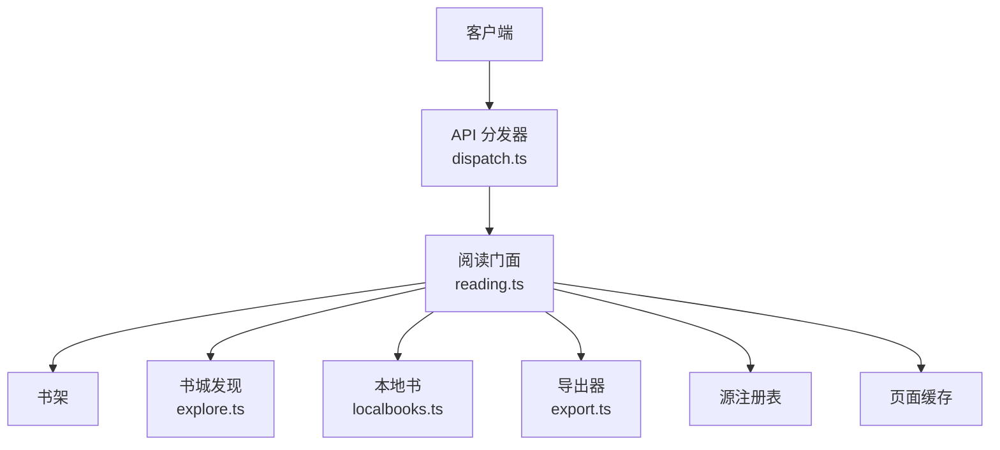
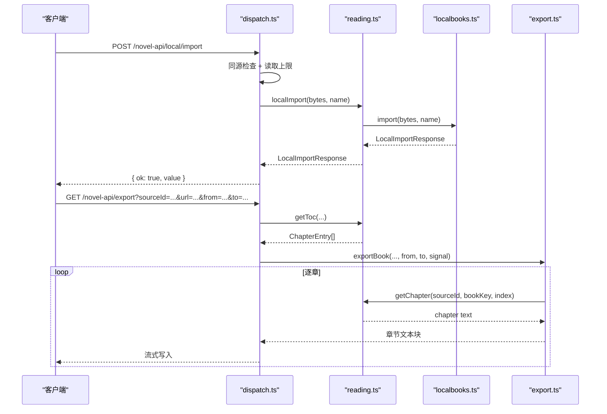
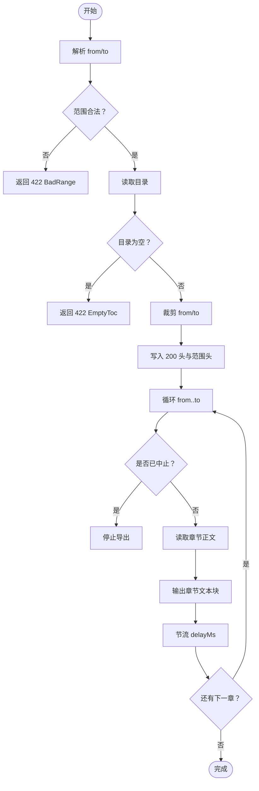
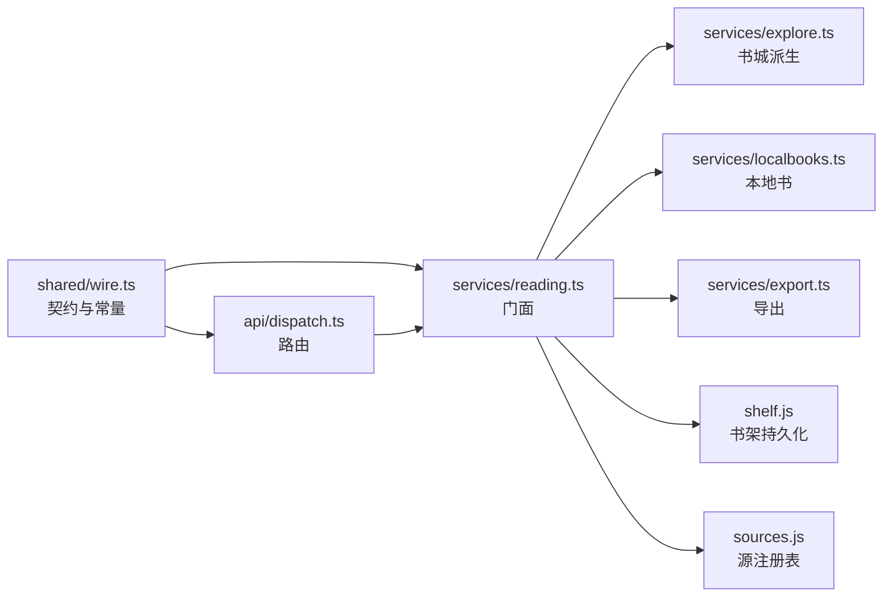

# 书架、书城、本地书与导出 API

<cite>
**本文引用的文件**
- [dispatch.ts](file://src/api/dispatch.ts)
- [wire.ts](file://src/api/wire.ts)
- [reading.ts](file://src/services/reading.ts)
- [explore.ts](file://src/services/explore.ts)
- [localbooks.ts](file://src/services/localbooks.ts)
- [export.ts](file://src/services/export.ts)
- [wire.ts（契约）](file://src/shared/wire.ts)
</cite>

## 目录
1. [引言](#引言)
2. [项目结构](#项目结构)
3. [核心组件](#核心组件)
4. [架构总览](#架构总览)
5. [详细端点说明](#详细端点说明)
6. [依赖关系分析](#依赖关系分析)
7. [性能与限制](#性能与限制)
8. [故障排查](#故障排查)
9. [结论](#结论)

## 引言
本文文档化四类常用但彼此独立的 API 子集：

- **书架**：增删查、批量删除、阅读进度。
- **书城分类浏览**：分类列表、书单分页、书籍详情。
- **本地书**：导入 TXT / EPUB、本地书列表、章节读取。
- **导出**：按章节范围流式导出，含进度事件与取消机制。

所有端点统一挂载在 `/novel-api` 前缀下，由 Node 侧 `createApiHandler` 分发到 `ReadingService` 门面；成功响应一律为 `{ ok: true, value }`，失败响应为 `{ ok: false, error }`，错误体包含 `code`、`message`，并可能附带段级 `segment`。

**章节来源**
- [dispatch.ts:1-90](file://src/api/dispatch.ts#L1-L90)
- [wire.ts:1-135](file://src/api/wire.ts#L1-L135)

## 项目结构
本仓库中与四类 API 直接相关的代码集中在三个层次：

- **传输层**：`src/api/dispatch.ts` 负责路由匹配、参数校验、同源校验、JSON 信封封装、SSE 任务流。
- **业务门面**：`src/services/reading.ts` 的 `ReadingService` 聚合书架、书城、搜索、本地书与导出。
- **领域服务**：`src/services/explore.ts`（书城派生）、`src/services/localbooks.ts`（本地书落盘）、`src/services/export.ts`（章节范围导出）。
- **跨半契约**：`src/shared/wire.ts` 定义 JSON 形状、常量如 `LOCAL_SOURCE_ID`、路由名等。



**图示来源**
- [dispatch.ts:1-90](file://src/api/dispatch.ts#L1-L90)
- [reading.ts:1-120](file://src/services/reading.ts#L1-L120)
- [explore.ts:1-75](file://src/services/explore.ts#L1-L75)
- [localbooks.ts:1-120](file://src/services/localbooks.ts#L1-L120)
- [export.ts:1-64](file://src/services/export.ts#L1-L64)

**章节来源**
- [dispatch.ts:1-90](file://src/api/dispatch.ts#L1-L90)
- [reading.ts:1-120](file://src/services/reading.ts#L1-L120)

## 核心组件

### API 信封与错误模型
- 成功响应：`{ ok: true, value }`。
- 失败响应：`{ ok: false, error }`，其中 `error` 包含：
  - `code`：例如 `BadRequest`、`NotFound`、`Unavailable`、`JobRunning`、`InternalError`、`EmptyToc`、`BadRange`。
  - `message`：面向用户的中文消息。
  - `segment`：引擎或规则相关错误时附加的段信息。
- HTTP 状态码由 `errorStatusOf` 决定：
  - 400：请求体非法、缺参数。
  - 403：非受信来源。
  - 404：未知路由或资源不存在。
  - 409：书城续页没有更多数据。
  - 413：请求体或上传文件过大。
  - 422：规则缺失、导出范围非法、目录为空。
  - 502：抓取失败。
  - 503：服务不可用。
  - 500：内部错误。

**章节来源**
- [wire.ts:1-135](file://src/api/wire.ts#L1-L135)
- [dispatch.ts:1-90](file://src/api/dispatch.ts#L1-L90)

### ReadingService 门面职责
`ReadingService` 是 HTTP、工具面与 UI 的共同入口，主要职责包括：

- 书架：列表、加书、补丁、保存进度、删除、批量删除。
- 书城：分类清单、提交分类浏览任务、续页、快照、SSE 流。
- 本地书：导入 TXT/EPUB、目录、导航、章节正文、补充文档、资源、导入警告、删除。
- 导出：按章节范围生成文本流。
- 搜索与源管理：聚合搜索、探针、启用状态、认证。

**章节来源**
- [reading.ts:1-120](file://src/services/reading.ts#L1-L120)
- [reading.ts:201-512](file://src/services/reading.ts#L201-L512)

## 架构总览



**图示来源**
- [dispatch.ts:201-495](file://src/api/dispatch.ts#L201-L495)
- [reading.ts:400-512](file://src/services/reading.ts#L400-L512)
- [localbooks.ts:201-360](file://src/services/localbooks.ts#L201-L360)
- [export.ts:1-64](file://src/services/export.ts#L1-L64)

## 详细端点说明

### 一、书架 API

#### 1. 获取书架
- **方法**：`GET`
- **URL**：`/novel-api/shelf`
- **请求体**：无
- **成功响应**：`ShelfEntry[]`，每项包含书架条目与来源投影。
- **错误**：无常规业务错误；异常走统一信封。

**curl 示例**
```bash
curl 'http://127.0.0.1:端口/novel-api/shelf'
```

**TypeScript 示例**
```typescript
const res = await fetch('/novel-api/shelf')
const data = await res.json()
if (!data.ok) throw new Error(data.error.message)
return data.value // ShelfEntry[]
```

#### 2. 加书
- **方法**：`PUT`
- **URL**：`/novel-api/shelf/:bookKey`
- **路径参数**：
  - `bookKey`：书架条目的稳定键。
- **请求体**：`ShelfMetaPatch & { title: string }`，至少包含 `title` 与 `sourceId`。
- **成功响应**：`ShelfBook`。
- **错误**：
  - 400 `BadRequest`：缺少必填字段。
  - 404 `NotFound`：书不在架上。

**curl 示例**
```bash
curl -X PUT \
  -H 'Content-Type: application/json' \
  -d '{"sourceId":"__local__","title":"示例书名"}' \
  'http://127.0.0.1:端口/novel-api/shelf/local:uuid'
```

**TypeScript 示例**
```typescript
await fetch(`/novel-api/shelf/${encodeURIComponent(bookKey)}`, {
  method: 'PUT',
  headers: { 'Content-Type': 'application/json' },
  body: JSON.stringify({ sourceId: '__local__', title }),
})
```

#### 3. 更新书架条目或进度
- **方法**：`PUT`
- **URL**：`/novel-api/shelf/:bookKey`
- **行为**：根据请求体形态区分“加书”“补丁”“保存进度”。
- **进度字段**：
  - `chapterIndex`：非负整数。
  - `offsetRatio`：有限数且位于 `[0, 1]`。
- **成功响应**：更新后的 `ShelfBook`，或 `null`（不在架）。
- **错误**：
  - 400 `BadRequest`：进度字段类型或值域非法。
  - 404 `NotFound`：不在架。

**curl 示例**
```bash
curl -X PUT \
  -H 'Content-Type: application/json' \
  -d '{"chapterIndex":10,"offsetRatio":0.35}' \
  'http://127.0.0.1:端口/novel-api/shelf/local:uuid'
```

**TypeScript 示例**
```typescript
const res = await fetch(`/novel-api/shelf/${encodeURIComponent(bookKey)}`, {
  method: 'PUT',
  headers: { 'Content-Type': 'application/json' },
  body: JSON.stringify({ chapterIndex, offsetRatio }),
})
const json = await res.json()
if (!json.ok) throw new Error(json.error.message)
return json.value // ShelfBook | null
```

#### 4. 删除单本书
- **方法**：`DELETE`
- **URL**：`/novel-api/shelf/:bookKey`
- **成功响应**：`{ removed: boolean }`。
- **本地书语义**：同时删除本地副本，防止孤儿文件。

**curl 示例**
```bash
curl -X DELETE 'http://127.0.0.1:端口/novel-api/shelf/local:uuid'
```

#### 5. 批量删除
- **方法**：`POST`
- **URL**：`/novel-api/shelf/batchDelete`
- **请求体**：`string[]`，即待删除的 `bookKey` 数组。
- **成功响应**：`{ removed: number }`，表示实际删除的条目数。
- **本地书语义**：仅对真实在架的本地书删除副本。

**curl 示例**
```bash
curl -X POST \
  -H 'Content-Type: application/json' \
  -d '["local:uuid-a","local:uuid-b"]' \
  'http://127.0.0.1:端口/novel-api/shelf/batchDelete'
```

#### bookKey 生成规则与阅读进度持久化
- 本地书 `bookKey` 固定为 `local:<uuid>`，其中 uuid 由随机 UUID 生成。
- `isLocalBookKey` 使用正则严格校验该格式，既防路径穿越也保证身份稳定。
- 阅读进度通过 `shelfSaveProgress` 持久化：先校验 `chapterIndex` 为非负整数、`offsetRatio` 为 `[0, 1]` 的有限数，再调用书架层的进度更新。
- 若书不在架，返回 `null`；不会静默创建书架条目。

**章节来源**
- [localbooks.ts:1-60](file://src/services/localbooks.ts#L1-L60)
- [reading.ts:400-512](file://src/services/reading.ts#L400-L512)
- [dispatch.ts:360-440](file://src/api/dispatch.ts#L360-L440)

---

### 二、书城分类浏览 API

#### 1. 分类清单
- **方法**：`GET`
- **URL**：`/novel-api/explore/kinds`
- **请求体**：无
- **成功响应**：`ExploreSources`，按源列出分类标题。
- **重要语义**：
  - 只返回分类标题，不返回原生方言地址。
  - 每个源的 `kinds` 是该源 `ruleExploreKinds` 中声明的标题顺序，同源内去重。
  - 两个方言的地址差异由服务端持有：
    - 原生方言：分类 slug 填入源级模板。
    - legado 方言：`exploreUrl` 本身就是完整地址模板。

**curl 示例**
```bash
curl 'http://127.0.0.1:端口/novel-api/explore/kinds'
```

**TypeScript 示例**
```typescript
const res = await fetch('/novel-api/explore/kinds')
const json = await res.json()
if (!json.ok) throw new Error(json.error.message)
return json.value.sources // 每个源有 id、name、kinds
```

#### 2. 提交分类书单
- **方法**：`POST`
- **URL**：`/novel-api/explore/list`
- **请求体**：`{ sourceId: string; kind: string }`。
- **成功响应**：`ExploreSnapshot`，表示一次分类浏览任务的提交结果。
- **错误**：
  - 400 `BadRequest`：缺 `sourceId` 或 `kind`。
  - 409 `Conflict`：已有任务运行中。

**curl 示例**
```bash
curl -X POST \
  -H 'Content-Type: application/json' \
  -d '{"sourceId":"某个源id","kind":"玄幻"}' \
  'http://127.0.0.1:端口/novel-api/explore/list'
```

#### 3. 续页
- **方法**：`POST`
- **URL**：`/novel-api/explore/list/more`
- **请求体**：无
- **成功响应**：下一页累积结果。
- **错误**：
  - 409 `Conflict`：没有更多数据。

**curl 示例**
```bash
curl -X POST 'http://127.0.0.1:端口/novel-api/explore/list/more'
```

#### 4. 分类任务快照
- **方法**：`GET`
- **URL**：`/novel-api/explore/list/status`
- **查询参数**：无
- **成功响应**：`{ job: ExploreSnapshot }`。

#### 5. 分类任务 SSE 流
- **方法**：`GET`
- **URL**：`/novel-api/explore/list/stream`
- **成功响应**：`text/event-stream`，每帧 `data: { job }`，终态自动关流。

#### 6. 书籍详情
- **方法**：`GET`
- **URL**：`/novel-api/book`
- **查询参数**：
  - `sourceId`：书源 ID。
  - `url`：该源上书籍的 URL。
- **成功响应**：`BookDetail`。

**curl 示例**
```bash
curl 'http://127.0.0.1:端口/novel-api/book?sourceId=某源&url=https%3A%2F%2F某站%2Fbook%2F123'
```

#### 书城分类发现的两方言
- `deriveExploreSources` 从启用的文本源中提取 `rules.ruleExploreKinds`，只输出标题，不输出地址。
- 分类地址的两种方言由服务端实现：
  - 原生 `ruleFind.kinds`：分类值是 slug，需套入源级模板。
  - legado `exploreUrl`：分类地址本身就是完整模板。
- 因此客户端应使用服务端返回的分类标题作为 `kind`，不应自行拼接地址。

**章节来源**
- [explore.ts:1-75](file://src/services/explore.ts#L1-L75)
- [dispatch.ts:201-320](file://src/api/dispatch.ts#L201-L320)
- [wire.ts（契约）:1-200](file://src/shared/wire.ts#L1-L200)

---

### 三、本地书 API

#### 1. 导入本地书
- **方法**：`POST`
- **URL**：`/novel-api/local/import?name=文件名`
- **请求体**：原始二进制文件。
- **分流逻辑**：
  - 文件头魔数为 ZIP 本地头签名则走 EPUB 路径。
  - 否则走 TXT 解码链：BOM → UTF-8 严格探测 → GBK 回退。
  - ZIP 魔数失败不会降级为 TXT。
- **成功响应**：`LocalImportResponse`，包含：
  - `bookKey`：`local:<uuid>`。
  - `title`、`chapterCount`、`format`、`encoding`、`warnings`、`book`。
- **错误**：
  - 400 `BadRequest`：文件为空、解析失败。
  - 413 `PayloadTooLarge`：超过 `localImportMaxBytes`。

**curl 示例**
```bash
curl -X POST \
  -H 'Content-Type: application/octet-stream' \
  --data-binary '@小说.txt' \
  'http://127.0.0.1:端口/novel-api/local/import?name=小说.txt'
```

**TypeScript 示例**
```typescript
const file = await Deno.readFile('小说.txt')
const res = await fetch(
  '/novel-api/local/import?name=' + encodeURIComponent('小说.txt'),
  { method: 'POST', body: file },
)
const json = await res.json()
if (!json.ok) throw new Error(json.error.message)
return json.value.bookKey
```

#### 2. 删除本地书
- **方法**：`DELETE`
- **URL**：`/novel-api/local?id=<bookKey>`
- **成功响应**：`{ removed: boolean }`。
- **语义**：删除本地文件与书架条目，任一命中即为成功。

**curl 示例**
```bash
curl -X DELETE 'http://127.0.0.1:端口/novel-api/local?id=local:uuid'
```

#### 3. 获取本地书目录
- **方法**：`GET`
- **URL**：`/novel-api/toc`
- **查询参数**：
  - `sourceId`：本地书固定为 `__local__`。
  - `url`：本地书键，即 `bookKey`。
  - `refresh=1`：可选，强制刷新目录缓存。
- **成功响应**：`ChapterEntry[]`。

**curl 示例**
```bash
curl 'http://127.0.0.1:端口/novel-api/toc?sourceId=__local__&url=local:uuid'
```

#### 4. 获取本地书导航
- **方法**：`GET`
- **URL**：`/novel-api/navigation`
- **查询参数**：同目录接口。
- **成功响应**：`BookNavigation`，包含线性 `chapters` 与展示树 `items`。

#### 5. 读取本地书章节
- **方法**：`GET`
- **URL**：`/novel-api/chapter`
- **查询参数**：
  - `sourceId`：`__local__`。
  - `url`：`local:<uuid>`。
  - `index`：非负整数。
  - `refresh=1`：可选。
- **成功响应**：`ChapterContent`。
- **错误**：
  - 400 `BadRequest`：缺 `index` 或不是非负整数。
  - 404 `NotFound`：章节不存在。

**curl 示例**
```bash
curl 'http://127.0.0.1:端口/novel-api/chapter?sourceId=__local__&url=local:uuid&index=0'
```

#### 6. 查看导入告警
- **方法**：`GET`
- **URL**：`/novel-api/local/warnings?id=<bookKey>`
- **成功响应**：`LocalImportWarning[]`。
- **语义**：非 EPUB 恒空数组；EPUB 可重新查看导入说明。

**curl 示例**
```bash
curl 'http://127.0.0.1:端口/novel-api/local/warnings?id=local:uuid'
```

#### 7. 读取本地书资源
- **方法**：`GET`
- **URL**：`/novel-api/local/resource?id=<bookKey>&resourceId=<id>`
- **响应**：按导入期验证的 MIME 返回文件流。
- **错误**：
  - 404 `NotFound`：资源 ID 不存在或文件缺失。
  - 其他 I/O 错误原样抛出。

**curl 示例**
```bash
curl 'http://127.0.0.1:端口/novel-api/local/resource?id=local:uuid&resourceId=图片资源id'
```

#### 本地书导入细节
- **TXT 导入**：
  - 编码检测：BOM → UTF-8 → GBK。
  - 章节切分：基于标题行正则，得到字符偏移表。
  - 元数据不含 schemaVersion，与旧格式兼容。
- **EPUB 导入**：
  - 按 ZIP 魔数分流，不走 TXT 兜底。
  - 先在 staging 目录构建产物，成功后 rename，再原子写顶层元数据。
  - 元数据包含 `schemaVersion: 2`、`format: 'epub'`、章节索引、文档表、资源表、原生导航与 `warnings`。
  - 有损导入产生的 `warnings.json` 对应 `LocalImportWarning[]`，用于阅读器按需查看。
- **bookKey**：本地书统一为 `local:<uuid>`，UUID 由 `randomUUID()` 生成。

**章节来源**
- [localbooks.ts:1-200](file://src/services/localbooks.ts#L1-L200)
- [localbooks.ts:201-498](file://src/services/localbooks.ts#L201-L498)
- [dispatch.ts:440-573](file://src/api/dispatch.ts#L440-L573)
- [reading.ts:400-512](file://src/services/reading.ts#L400-L512)

---

### 四、导出 API

#### 1. 章节范围导出
- **方法**：`GET`
- **URL**：`/novel-api/export`
- **查询参数**：
  - `sourceId`：书源 ID。
  - `url`：书籍 URL。
  - `title`：可选，用作文件名前缀。
  - `from`：可选，起始章，1 基含端。
  - `to`：可选，结束章，1 基含端。
- **默认行为**：
  - `from` 缺省为 1。
  - `to` 缺省为全书最后一章。
  - 越界值裁剪到 `[1, 目录长度]`。
- **响应**：
  - `content-type: text/plain; charset=utf-8`。
  - `content-disposition`：带 `title` 的附件下载。
  - `x-novel-total-chapters`：本次范围的章数。
  - `x-novel-range`：`from-to`。
- **取消机制**：
  - 客户端断开响应流会触发 `AbortController.abort()`。
  - 导出生成器收到中止信号后停止后续章节。
  - 若首包已发送，中断处追加提示文本，不再改状态码。

**curl 示例**
```bash
curl 'http://127.0.0.1:端口/novel-api/export?sourceId=某源&url=https%3A%2F%2F某站%2Fbook%2F123&from=1&to=50' \
  --output 小说_第1至50章.txt
```

**TypeScript 示例**
```typescript
const url = new URL('/novel-api/export', location.origin)
url.searchParams.set('sourceId', sourceId)
url.searchParams.set('url', bookUrl)
url.searchParams.set('from', String(from))
url.searchParams.set('to', String(to))

const res = await fetch(url)
if (!res.ok) {
  const json = await res.json().catch(() => null)
  if (json?.ok === false) throw new Error(json.error.message)
}
// 消费流
const reader = res.body!.getReader()
while (true) {
  const { done, value } = await reader.read()
  if (done) break
  // 将 value 写入文件
}
```

#### 导出流程


**图示来源**
- [dispatch.ts:360-495](file://src/api/dispatch.ts#L360-L495)
- [export.ts:1-64](file://src/services/export.ts#L1-L64)

**章节来源**
- [dispatch.ts:360-495](file://src/api/dispatch.ts#L360-L495)
- [export.ts:1-64](file://src/services/export.ts#L1-L64)

## 依赖关系分析



**图示来源**
- [dispatch.ts:1-90](file://src/api/dispatch.ts#L1-L90)
- [reading.ts:1-120](file://src/services/reading.ts#L1-L120)
- [explore.ts:1-75](file://src/services/explore.ts#L1-L75)
- [localbooks.ts:1-120](file://src/services/localbooks.ts#L1-L120)
- [export.ts:1-64](file://src/services/export.ts#L1-L64)
- [wire.ts（契约）:1-200](file://src/shared/wire.ts#L1-L200)

**章节来源**
- [dispatch.ts:1-90](file://src/api/dispatch.ts#L1-L90)
- [reading.ts:1-120](file://src/services/reading.ts#L1-L120)

## 性能与限制

- **JSON 请求体上限**：默认 1MiB，可通过 `readJsonBody` 自定义；本地书导入使用同一字节计数实现。
- **本地书导入上限**：默认 50MB，由 `DEFAULT_MAX_IMPORT_BYTES` 统一管理，传输层与服务层共用同一配置值。
- **书城分类清单**：纯本地派生，零网络请求。
- **书城分类单页**：命中进程内缓存则零请求；失败不缓存，避免把偶发故障钉死到 TTL。
- **导出节流**：默认 300ms 章间延迟，串行抓取，避免高频打站。
- **本地书 TXT 正文缓存**：最多缓存 3 本全文，LRU 淘汰。
- **SSE 任务流**：断连自动退订，不保留空闲连接。

**章节来源**
- [wire.ts:1-135](file://src/api/wire.ts#L1-L135)
- [localbooks.ts:120-200](file://src/services/localbooks.ts#L120-L200)
- [explore.ts:1-75](file://src/services/explore.ts#L1-L75)
- [export.ts:1-64](file://src/services/export.ts#L1-L64)

## 故障排查

### 书架同步冲突
- **现象**：多端同时修改同一 `bookKey` 的进度或元数据。
- **机制**：书架以 `bookKey` 为唯一键，更新走门面 `update`；并发写入可能覆盖最后一次写入。
- **处理建议**：
  - 客户端合并本地进度与服务端最新条目。
  - 先拉取当前条目，再提交补丁。
  - 对关键进度增加重试与版本号感知（若上层扩展了版本字段）。
- **定位线索**：
  - 确认 `bookKey` 一致。
  - 检查是否在不在架情况下误调进度接口。

**章节来源**
- [reading.ts:400-512](file://src/services/reading.ts#L400-L512)
- [dispatch.ts:360-440](file://src/api/dispatch.ts#L360-L440)

### 书城分类为空
- **原因**：
  - 源未启用。
  - 源不是文本源。
  - 源未声明 `ruleExploreKinds`。
  - 源关闭了发现能力。
- **表现**：`/novel-api/explore/kinds` 返回的源行中 `kinds` 为空。
- **处理建议**：
  - 检查源是否启用。
  - 检查书源格式是否声明分类入口。
  - 不要自行拼接分类地址；使用服务端返回的标题作为 `kind`。
- **注意**：`groups` 和 `status` 只是展示标签，不是浏览轴。

**章节来源**
- [explore.ts:1-75](file://src/services/explore.ts#L1-L75)
- [dispatch.ts:201-320](file://src/api/dispatch.ts#L201-L320)
- [wire.ts（契约）:1-200](file://src/shared/wire.ts#L1-L200)

### EPUB 解析失败
- **常见原因**：
  - 文件不是有效 EPUB。
  - ZIP 归档损坏。
  - EPUB 包元数据或 spine 不完整。
  - 导入期产生有损内容。
- **HTTP 表现**：
  - 400 `BadRequest`：解析失败。
  - 413 `PayloadTooLarge`：超过导入上限。
- **处理建议**：
  - 先用系统工具打开 EPUB 验证完整性。
  - 查看 `/novel-api/local/warnings` 中的 `LocalImportWarning[]`。
  - 对严重损坏的 EPUB，尝试修复或重新下载。
  - 若只需文字，可将 EPUB 转为 TXT 后导入。

**章节来源**
- [localbooks.ts:201-360](file://src/services/localbooks.ts#L201-L360)
- [dispatch.ts:440-520](file://src/api/dispatch.ts#L440-L520)

### 导出任务被中断
- **触发场景**：
  - 浏览器关闭页面。
  - 用户手动取消下载。
  - 网络连接断开。
- **服务端行为**：
  - 响应头已发送后不能改为 5xx。
  - 中断处追加提示文本，标记文件不完整。
  - 后续章节不再抓取。
- **处理建议**：
  - 客户端检测到不完整内容后重新导出缺失章节。
  - 记录上次成功导出的 `to`，增量补全。
  - 使用 `x-novel-range` 与 `x-novel-total-chapters` 判断范围。
- **调试要点**：
  - 检查网络日志中是否有连接提前关闭。
  - 检查目标站点是否限流导致章节抓取失败。

**章节来源**
- [dispatch.ts:360-495](file://src/api/dispatch.ts#L360-L495)
- [export.ts:1-64](file://src/services/export.ts#L1-L64)

## 结论
这四类 API 共享同一传输契约与错误模型，但在业务层面各自独立：

- 书架以 `bookKey` 为稳定身份，本地书采用 `local:<uuid>` 并连带清理文件。
- 书城分类清单只暴露标题，地址方言由服务端维护，客户端不应猜测。
- 本地书导入按魔数分流，TXT 与 EPUB 各有明确的编码、目录与资源语义。
- 导出采用流式输出，支持范围选择、节流、断连取消与不完整标记。

在实际集成时，应优先关注：
- 同源校验与可信来源。
- 请求体大小限制。
- 书城分类是否为空。
- EPUB 解析警告。
- 导出中断后的增量补全策略。