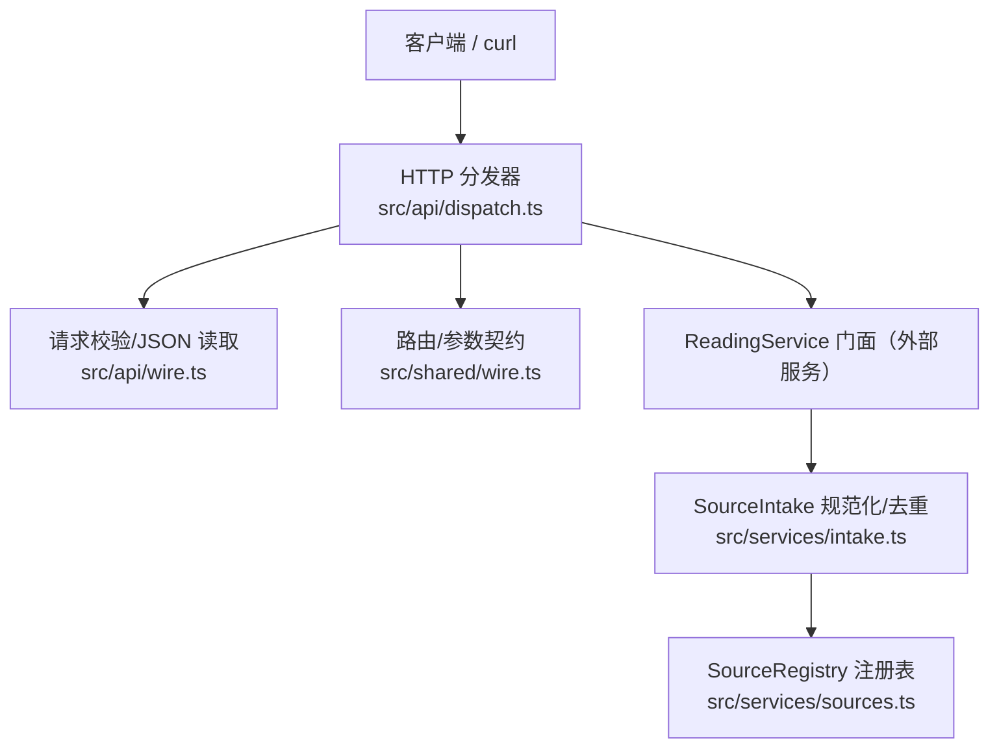
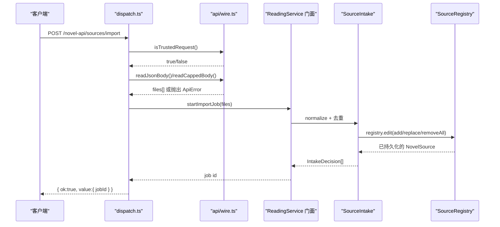
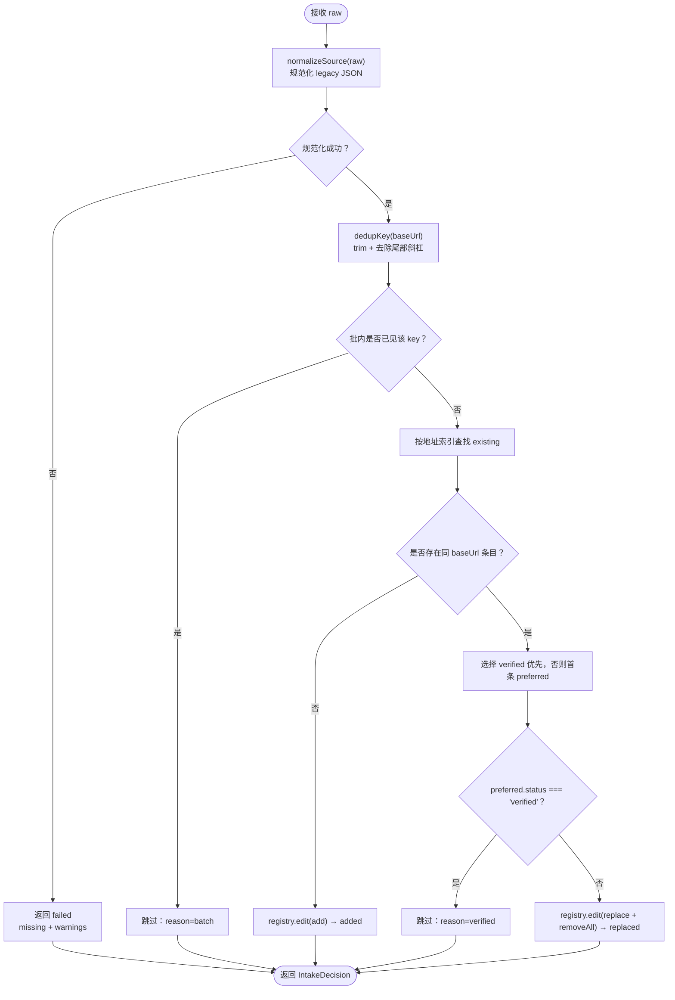
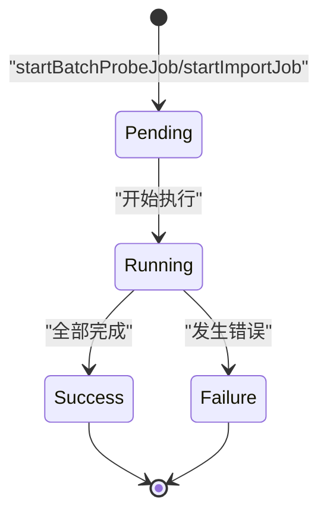
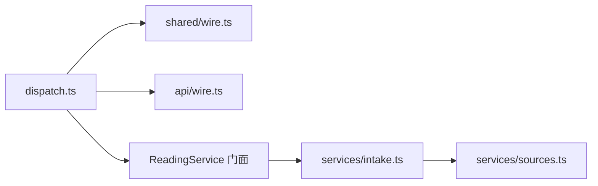

# 书源管理 API

<cite>
**本文引用的文件**
- [dispatch.ts](file://src/api/dispatch.ts)
- [wire.ts](file://src/api/wire.ts)
- [wire.ts](file://src/shared/wire.ts)
- [intake.ts](file://src/services/intake.ts)
- [sources.ts](file://src/services/sources.ts)
</cite>

## 目录
1. [引言](#引言)
2. [项目结构](#项目结构)
3. [核心组件](#核心组件)
4. [架构总览](#架构总览)
5. [端点规范](#端点规范)
6. SourceIntake 规范化与去重语义
7. [异步验证任务状态流转](#异步验证任务状态流转)
8. [依赖关系分析](#依赖关系分析)
9. [性能与体积约束](#性能与体积约束)
10. [故障排查](#故障排查)
11. [结论](#结论)

## 引言
本文文档化“书源管理”相关的所有 HTTP 端点，覆盖：导入 legacy JSON、获取书源列表、单源详情、更新启用/认证、删除、批量验证、一键验证、单源试跑、cookie/loginUrl 录入。同时解释 SourceIntake 的规范化流程、批内去重与按址去重语义，以及验证任务的异步状态流转，并给出 curl 与 TypeScript 调用示例和常见错误排查建议。

## 项目结构
书源管理的 HTTP 入口集中在 `src/api/dispatch.ts`；路由字面量、查询参数名与统一信封格式定义在 `src/shared/wire.ts`；请求体解析、同源校验与 JSON 上限逻辑在 `src/api/wire.ts`；SourceIntake 规范化与去重策略位于 `src/services/intake.ts`；书源注册表与持久化合并在 `src/services/sources.ts`。



**图示来源**
- [dispatch.ts:88-163](file://src/api/dispatch.ts#L88-L163)
- [wire.ts:28-78](file://src/api/wire.ts#L28-L78)
- [wire.ts:450-570](file://src/shared/wire.ts#L450-L570)
- [intake.ts:1-84](file://src/services/intake.ts#L1-L84)
- [sources.ts:1-120](file://src/services/sources.ts#L1-L120)

**章节来源**
- [dispatch.ts:88-163](file://src/api/dispatch.ts#L88-L163)
- [wire.ts:28-78](file://src/api/wire.ts#L28-L78)
- [wire.ts:450-570](file://src/shared/wire.ts#L450-L570)
- [intake.ts:1-84](file://src/services/intake.ts#L1-L84)
- [sources.ts:1-120](file://src/services/sources.ts#L1-L120)

## 核心组件
- **HTTP 分发器（dispatch.ts）**：根据共享路由表分段匹配，执行方法白名单守卫，委派到 ReadingService 门面，并用统一成功/失败信封返回。
- **请求管线（api/wire.ts）**：实现同源信任判定、带字节上限的流式 body 读取、JSON 解析与错误映射。
- **路由契约（shared/wire.ts）**：集中维护所有路由段、静态路由常量、参数路由构造器、查询参数名。
- **SourceIntake（services/intake.ts）**：对 legacy JSON 做 normalize → 批内去重 → 按 baseUrl 去重，产出 added/replaced/skipped/failed 决策。
- **SourceRegistry（services/sources.ts）**：加载 sources.json、原子 edit + 防抖落盘、公开只读投影。

**章节来源**
- [dispatch.ts:88-163](file://src/api/dispatch.ts#L88-L163)
- [wire.ts:28-78](file://src/api/wire.ts#L28-L78)
- [wire.ts:450-570](file://src/shared/wire.ts#L450-L570)
- [intake.ts:1-84](file://src/services/intake.ts#L1-L84)
- [sources.ts:1-120](file://src/services/sources.ts#L1-L120)

## 架构总览
书源管理的请求链路为：客户端 → dispatch 路由守卫 → ReadingService 门面 → intake/registry → 响应信封。所有错误经 writeError 转为 `{ ok:false, error:{code,message,...} }`；成功响应为 `{ ok:true, value:... }`。



**图示来源**
- [dispatch.ts:103-106](file://src/api/dispatch.ts#L103-L106)
- [wire.ts:28-78](file://src/api/wire.ts#L28-L78)
- [intake.ts:34-84](file://src/services/intake.ts#L34-L84)
- [sources.ts:96-120](file://src/services/sources.ts#L96-L120)

## 端点规范
以下端点均以 `/novel-api` 为前缀。

### 通用规则
- **鉴权约束**：仅允许 loopback（`127.0.0.1`、`::1`、`::ffff:127.0.0.1`），且当请求携带 Origin 时必须与 Host 同源；当携带 Referer 时也必须与 Host 同源。无 Origin 或无 Referer 的请求放行，以兼容本机工具/curl。
- **成功响应**：`{ ok: true, value: ... }`
- **失败响应**：`{ ok: false, error: { code, message, segment? } }`
- **方法约束**：非允许方法返回 405 Method Not Allowed，其中 sources 根路径禁止 GET 以外的写操作；GET 会提示“导入走 POST /sources/import”。

#### 1. 获取书源列表
- **方法**：GET
- **URL**：`/novel-api/sources`
- **请求体/参数**：无
- **成功响应**：`value` 为公开书源数组（不含 raw/rules/auth，仅含布尔 auth 状态位）
- **错误码**：无特定业务错误；异常经统一错误映射

**章节来源**
- [dispatch.ts:93-99](file://src/api/dispatch.ts#L93-L99)
- [sources.ts:1-20](file://src/services/sources.ts#L1-L20)

#### 2. 导入 legacy JSON（对象/数组/平铺/Native 方言）
- **方法**：POST
- **URL**：`/novel-api/sources/import`
- **请求体**：`{ files: ImportFileBody[] }`；每个 file 是 legacy JSON 载荷，支持对象、数组、平铺、Native 等方言，由 intake 侧 normalize 统一解析
- **成功响应**：`value.jobId`；后续通过 job-status 轮询结果
- **错误码**：
  - 403 Forbidden：非受信请求
  - 413 PayloadTooLarge：body 超过默认 1MiB
  - 400 BadRequest：JSON 不合法
  - 409 JobRunning：已有导入任务在进行
  - 400/404/503/500：其他 domain/引擎错误映射

**curl 示例**
```bash
curl -X POST http://localhost:PORT/novel-api/sources/import \
  -H "Content-Type: application/json" \
  -d '{"files":[{"name":"legacy.json","content":"..."}]}'
```

**TypeScript 示例**
```typescript
const res = await fetch("/novel-api/sources/import", {
  method: "POST",
  headers: { "Content-Type": "application/json" },
  body: JSON.stringify({
    files: [{ name: "legacy.json", content: "..." }]
  })
});
const { ok, value } = await res.json();
if (ok) return value.jobId;
throw new Error(value.error.message);
```

**章节来源**
- [dispatch.ts:103-106](file://src/api/dispatch.ts#L103-L106)
- [wire.ts:28-78](file://src/api/wire.ts#L28-L78)
- [intake.ts:1-84](file://src/services/intake.ts#L1-L84)

#### 3. 查看导入任务状态
- **方法**：GET
- **URL**：`/novel-api/sources/job-status`
- **请求体/参数**：无
- **成功响应**：`value.job`；包含任务阶段与进度
- **错误码**：无特定业务错误；异常经统一错误映射

**curl 示例**
```bash
curl http://localhost:PORT/novel-api/sources/job-status
```

**TypeScript 示例**
```typescript
const res = await fetch("/novel-api/sources/job-status");
const { ok, value } = await res.json();
return value.job;
```

**章节来源**
- [dispatch.ts:111-112](file://src/api/dispatch.ts#L111-L112)

#### 4. 批量验证（一键验证）
- **方法**：POST
- **URL**：`/novel-api/sources/batch-probe`
- **请求体**：`{ ids: string[] }`；省略或为空表示对所有已启用的参与集源进行验证
- **成功响应**：`value.jobId`；后续通过 job-status 轮询
- **错误码**：409 JobRunning（已有验证任务）、400/404/503/500 等 domain 映射

**curl 示例**
```bash
curl -X POST http://localhost:PORT/novel-api/sources/batch-probe \
  -H "Content-Type: application/json" \
  -d '{"ids":["sourceA","sourceB"]}'
```

**TypeScript 示例**
```typescript
const res = await fetch("/novel-api/sources/batch-probe", {
  method: "POST",
  headers: { "Content-Type": "application/json" },
  body: JSON.stringify({ ids: ["sourceA", "sourceB"] })
});
const { ok, value } = await res.json();
return value.jobId;
```

**章节来源**
- [dispatch.ts:116-118](file://src/api/dispatch.ts#L116-L118)

#### 5. 单源试跑（probe）
- **方法**：POST
- **URL**：`/novel-api/sources/:id/probe`
- **请求体**：无
- **成功响应**：`value` 为试跑结果摘要（具体字段由 ReadingService 门面决定）
- **错误码**：
  - 404 NotFound：源不存在
  - 502 Fetch/Decode 错误：网络或解析失败
  - 422 RuleMissing：规则缺失
  - 400/500/503：domain 映射

**curl 示例**
```bash
curl -X POST http://localhost:PORT/novel-api/sources/SOURCE_ID/probe
```

**TypeScript 示例**
```typescript
const res = await fetch(`/novel-api/sources/${sourceId}/probe`, { method: "POST" });
const { ok, value } = await res.json();
if (!ok) throw new Error(value.error.message);
return value;
```

**章节来源**
- [dispatch.ts:122-123](file://src/api/dispatch.ts#L122-L123)
- [wire.ts:450-570](file://src/shared/wire.ts#L450-L570)

#### 6. 登录脚本执行与 cookie/loginUrl 录入
- **方法**：POST
- **URL**：`/novel-api/sources/:id/auth`
- **请求体**：`{ mode, ... }`
  - `mode: "run-login"`：若源声明 loginUrl，返回手动登录 URL；否则进入 JS 沙箱执行登录脚本
  - 其他模式：直接写入 cookies/headers
- **成功响应**：
  - `mode: "manual"`：`value.loginUrl`
  - JS 登录成功：`value.auth: true`
  - 直接录入：`value.auth: true`
- **错误码**：
  - 404 NotFound：源不存在
  - 400 BadRequest：源未声明 loginUrl
  - 422 LoginFailed：loginUrl 未产出 cookie（脚本未 return 或为空）
  - 400/404/503/500：domain 映射

**curl 示例（手动登录 URL）**
```bash
curl -X POST http://localhost:PORT/novel-api/sources/SOURCE_ID/auth \
  -H "Content-Type: application/json" \
  -d '{"mode":"run-login"}'
```

**curl 示例（直接录入 cookie）**
```bash
curl -X POST http://localhost:PORT/novel-api/sources/SOURCE_ID/auth \
  -H "Content-Type: application/json" \
  -d '{"cookies":{"session":"abc"},"headers":{"Authorization":"Bearer xyz"}}'
```

**TypeScript 示例**
```typescript
// 获取登录 URL
let res = await fetch(`/novel-api/sources/${sourceId}/auth`, {
  method: "POST",
  headers: { "Content-Type": "application/json" },
  body: JSON.stringify({ mode: "run-login" })
});
let data = await res.json();
if (data.ok && data.value.mode === "manual") {
  window.open(data.value.loginUrl);
} else if (data.ok) {
  // JS 登录成功
} else {
  throw new Error(data.error.message);
}

// 直接写入 cookie
res = await fetch(`/novel-api/sources/${sourceId}/auth`, {
  method: "POST",
  headers: { "Content-Type": "application/json" },
  body: JSON.stringify({
    cookies: { session: "abc" },
    headers: { Authorization: "Bearer xyz" }
  })
});
```

**章节来源**
- [dispatch.ts:127-140](file://src/api/dispatch.ts#L127-L140)
- [wire.ts:28-78](file://src/api/wire.ts#L28-L78)

#### 7. 更新启用状态
- **方法**：POST
- **URL**：`/novel-api/sources/:id/enabled`
- **请求体**：`{ enabled: boolean }`
- **成功响应**：`value.enabled: boolean`
- **错误码**：404 NotFound、400/404/503/500 等 domain 映射

**curl 示例**
```bash
curl -X POST http://localhost:PORT/novel-api/sources/SOURCE_ID/enabled \
  -H "Content-Type: application/json" \
  -d '{"enabled":true}'
```

**TypeScript 示例**
```typescript
const res = await fetch(`/novel-api/sources/${sourceId}/enabled`, {
  method: "POST",
  headers: { "Content-Type": "application/json" },
  body: JSON.stringify({ enabled: true })
});
const { ok, value } = await res.json();
return value.enabled;
```

**章节来源**
- [dispatch.ts:133-141](file://src/api/dispatch.ts#L133-L141)
- [wire.ts:450-570](file://src/shared/wire.ts#L450-L570)

#### 8. 批量启用
- **方法**：POST
- **URL**：`/novel-api/sources/batch-enabled`
- **请求体**：`{ ids: string[], enabled: boolean }`
- **成功响应**：`value.updated: number`
- **错误码**：400/404/503/500 等 domain 映射

**curl 示例**
```bash
curl -X POST http://localhost:PORT/novel-api/sources/batch-enabled \
  -H "Content-Type: application/json" \
  -d '{"ids":["A","B"],"enabled":false}'
```

**TypeScript 示例**
```typescript
const res = await fetch("/novel-api/sources/batch-enabled", {
  method: "POST",
  headers: { "Content-Type": "application/json" },
  body: JSON.stringify({ ids: ["A", "B"], enabled: false })
});
const { ok, value } = await res.json();
return value.updated;
```

**章节来源**
- [dispatch.ts:145-150](file://src/api/dispatch.ts#L145-L150)

#### 9. 批量删除
- **方法**：POST
- **URL**：`/novel-api/sources/batch-delete`
- **请求体**：`{ ids: string[] }`
- **成功响应**：`value.removed: number`
- **错误码**：400/404/503/500 等 domain 映射

**curl 示例**
```bash
curl -X POST http://localhost:PORT/novel-api/sources/batch-delete \
  -H "Content-Type: application/json" \
  -d '{"ids":["A","B"]}'
```

**TypeScript 示例**
```typescript
const res = await fetch("/novel-api/sources/batch-delete", {
  method: "POST",
  headers: { "Content-Type: "application/json" },
  body: JSON.stringify({ ids: ["A", "B"] })
});
const { ok, value } = await res.json();
return value.removed;
```

**章节来源**
- [dispatch.ts:155-158](file://src/api/dispatch.ts#L155-L158)

#### 10. 删除单个书源
- **方法**：DELETE
- **URL**：`/novel-api/sources/:id`
- **请求体**：无
- **成功响应**：`value.removed: boolean`
- **错误码**：404 NotFound、400/404/503/500 等 domain 映射

**curl 示例**
```bash
curl -X DELETE http://localhost:PORT/novel-api/sources/SOURCE_ID
```

**TypeScript 示例**
```typescript
const res = await fetch(`/novel-api/sources/${sourceId}`, { method: "DELETE" });
const { ok, value } = await res.json();
return value.removed;
```

**章节来源**
- [dispatch.ts:162-163](file://src/api/dispatch.ts#L162-L163)
- [wire.ts:450-570](file://src/shared/wire.ts#L450-L570)

## SourceIntake 规范化与去重语义
SourceIntake 是“书源进入系统”的唯一入口，处理 legacy JSON 的规范化与去重，确保同一 baseUrl 不会重复入库。



**图示来源**
- [intake.ts:1-84](file://src/services/intake.ts#L1-L84)
- [sources.ts:96-120](file://src/services/sources.ts#L96-L120)

关键语义：
- **批内去重**：同一 SourceIntake 实例生命周期内，同一 dedupKey 留首条，其余 skipped batch。
- **按址去重**：以 baseUrl 作为键（trim 后去掉尾部斜杠），库内已有同键条目时：
  - 存在 verified 状态 → 跳过，保留 verified 那条；
  - 无可用者 → 用新条替换 preferred，并清理其余同键历史脏数据。
- **normalized 名称兜底**：无法提取 bookSourceName 时使用“(未命名)”作为诊断名称。

**章节来源**
- [intake.ts:1-84](file://src/services/intake.ts#L1-L84)

## 异步验证任务状态流转
验证任务（batch-probe / import）由后端异步运行，客户端通过 job-status 轮询。状态机如下：



- **Pending**：任务刚提交，尚未执行。
- **Running**：任务正在执行中。
- **Success/Failure**：任务结束的最终态。

客户端应持续轮询 `/novel-api/sources/job-status`，直到返回的 job.phase 不再是 running，再读取最终结果。

**章节来源**
- [dispatch.ts:103-118](file://src/api/dispatch.ts#L103-L118)

## 依赖关系分析


- **dispatch.ts** 依赖 shared/wire.ts 的路由常量与参数构造器，依赖 api/wire.ts 的同源校验与 JSON 解析。
- **intake.ts** 依赖 services/sources.ts 的 SourceRegistry 进行 add/replace/removeAll。
- **sources.ts** 提供 source list、edit 事务与 flush 持久化。

**图示来源**
- [dispatch.ts:88-163](file://src/api/dispatch.ts#L88-L163)
- [wire.ts:450-570](file://src/shared/wire.ts#L450-L570)
- [wire.ts:28-78](file://src/api/wire.ts#L28-L78)
- [intake.ts:1-84](file://src/services/intake.ts#L1-L84)
- [sources.ts:1-120](file://src/services/sources.ts#L1-L120)

**章节来源**
- [dispatch.ts:88-163](file://src/api/dispatch.ts#L88-L163)
- [wire.ts:450-570](file://src/shared/wire.ts#L450-L570)
- [wire.ts:28-78](file://src/api/wire.ts#L28-L78)
- [intake.ts:1-84](file://src/services/intake.ts#L1-L84)
- [sources.ts:1-120](file://src/services/sources.ts#L1-L120)

## 性能与体积约束
- **JSON 信封体上限**：默认 1MiB；超限返回 413 PayloadTooLarge。
- **流式读取**：使用流式 body 聚合，避免一次性内存爆炸。
- **批处理优化**：批量启用/删除、批量验证减少多次往返；SourceRegistry 内部有阈值合并与尾沿防抖落盘。
- **大体积 legacy JSON 上传注意事项**：
  - 控制单个 file.content 大小，必要时分多个文件上传；
  - 如确实需要更大体积，需调整 readCappedBody 上限（但须评估内存风险）。

**章节来源**
- [wire.ts:28-78](file://src/api/wire.ts#L28-L78)
- [sources.ts:1-120](file://src/services/sources.ts#L1-L120)

## 故障排查
- **JSON 解析失败**：
  - 现象：400 BadRequest，message 提示 body 不是合法 JSON。
  - 原因：请求体不是有效 JSON 或超过默认 1MiB。
  - 排查：检查 Content-Type 是否为 application/json，确认 payload 合法。
- **重复 sourceName**：
  - 现象：可能看到 skipped batch 或 replaced。
  - 原因：同一 baseUrl 已被去重策略处理；verified 优先保留。
  - 排查：确认 baseUrl 是否一致；如需替换旧源，请确保目标不是 verified。
- **登录脚本执行超时/未生效**：
  - 现象：422 LoginFailed，提示 loginUrl 未产出 cookie。
  - 原因：JS 登录脚本未 return 或返回空值。
  - 排查：检查 loginUrl 是否声明；确认脚本逻辑正确产出 cookie。
- **cookie 未生效**：
  - 现象：登录后访问仍被拒绝。
  - 原因：cookie 未正确设置或域名/path 不匹配。
  - 排查：使用 run-login 获取手动登录 URL，或通过 auth 接口直接传入 cookies/headers。
- **网络/解析错误**：
  - 现象：502 Fetch/Decode 错误。
  - 原因：站点不可达、反爬、编码异常。
  - 排查：检查代理配置、网络连通性、源 rules 是否正确。

**章节来源**
- [wire.ts:28-78](file://src/api/wire.ts#L28-L78)
- [dispatch.ts:127-140](file://src/api/dispatch.ts#L127-L140)
- [intake.ts:1-84](file://src/services/intake.ts#L1-L84)

## 结论
书源管理 API 通过统一的 dispatch 层、共享路由契约与严格的同源校验，提供安全的本地服务接口。SourceIntake 确保 legacy JSON 规范化与去重，避免重复入库；异步验证任务通过 job-status 轮询获得稳定状态。客户端应遵循统一信封格式、注意体积限制，并在登录失败时区分 run-login 与直接 cookie 录入两种模式。