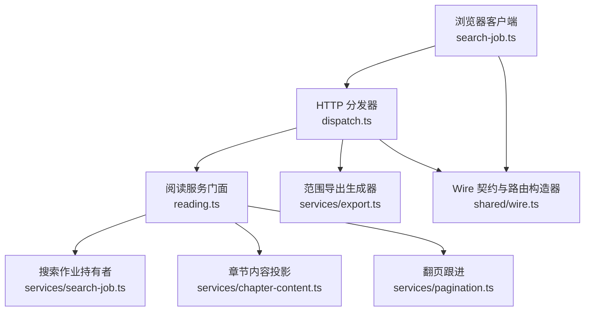
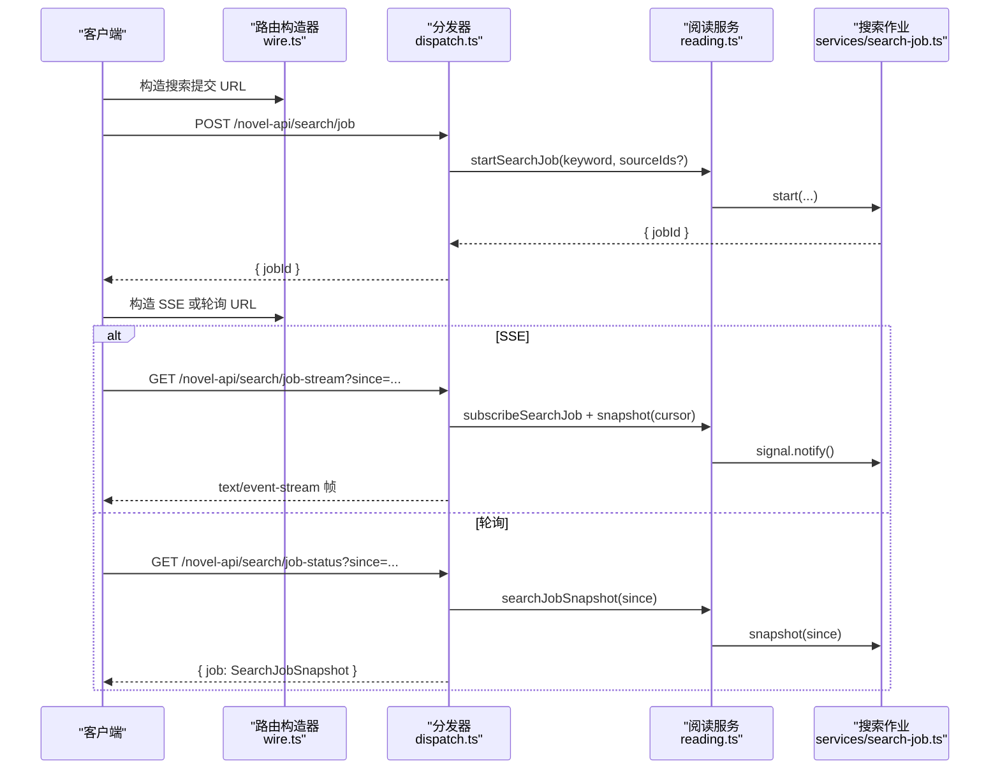
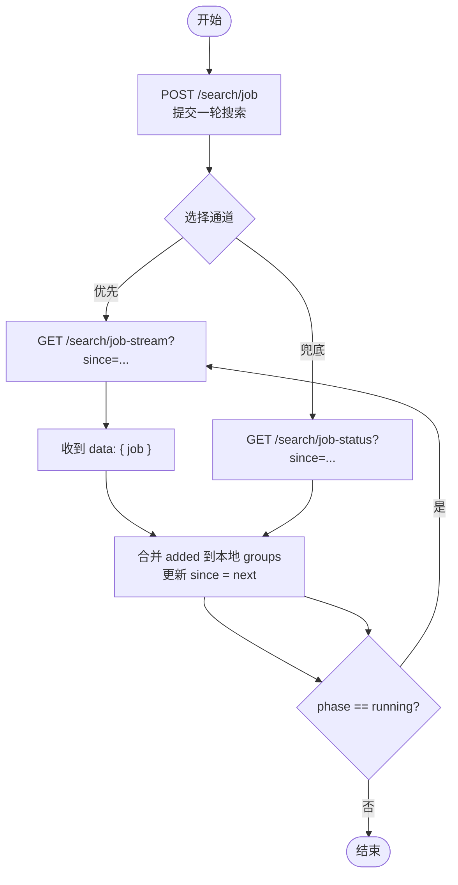
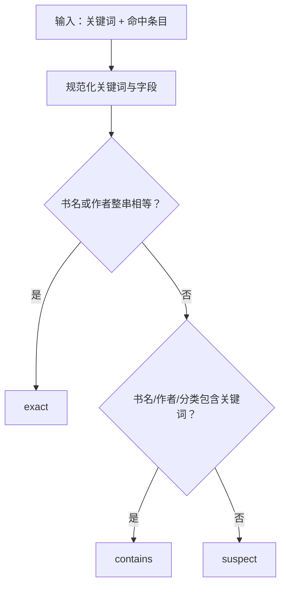
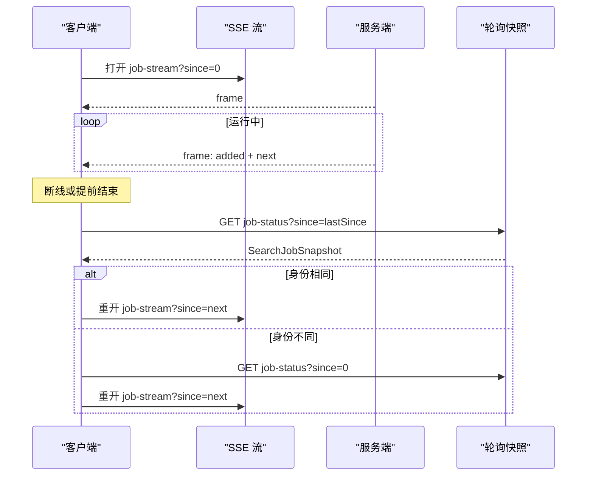
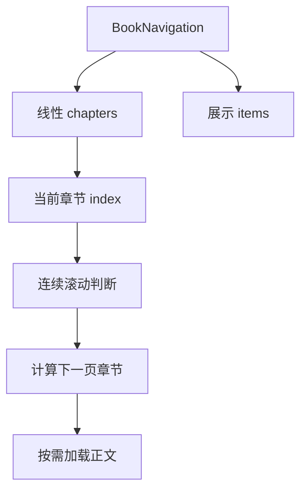
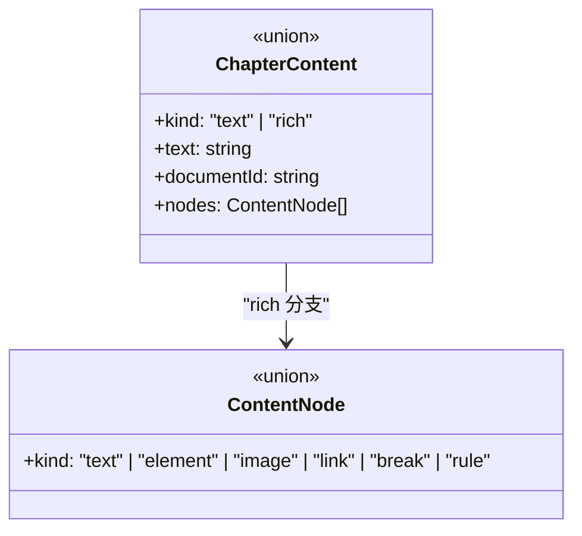
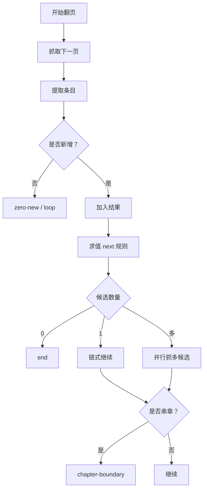
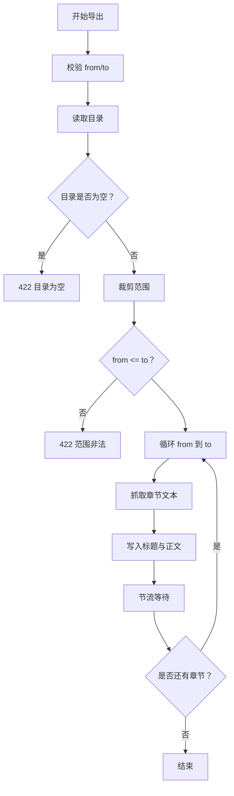
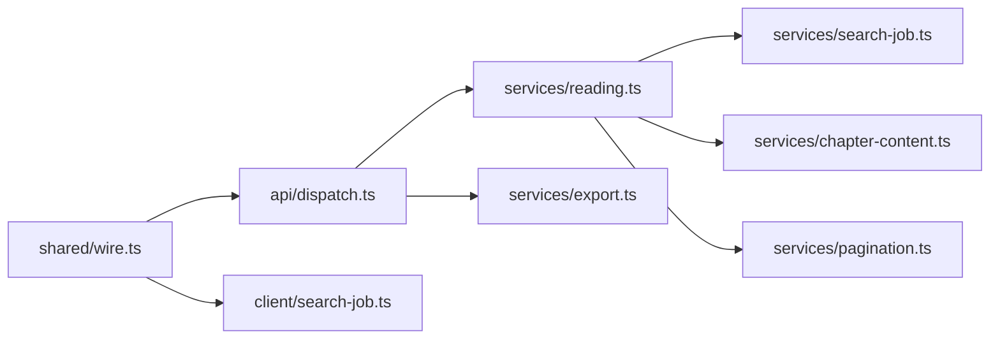

# 搜索与阅读 API

<cite>
**本文引用的文件**
- [dispatch.ts](file://src/api/dispatch.ts)
- [wire.ts](file://src/shared/wire.ts)
- [search-job.ts（服务端）](file://src/services/search-job.ts)
- [reading.ts](file://src/services/reading.ts)
- [chapter-content.ts](file://src/services/chapter-content.ts)
- [pagination.ts](file://src/services/pagination.ts)
- [export.ts](file://src/services/export.ts)
- [search-job.ts（客户端）](file://src/client/search-job.ts)
- [search-view-model.ts](file://src/client/search-view-model.ts)
- [0032-search-relevance-partition.md](file://docs/adr/0032-search-relevance-partition.md)
- [relevance.test.ts](file://tests/shared/relevance.test.ts)
</cite>

## 目录
1. [简介](#简介)
2. [项目结构](#项目结构)
3. [核心组件](#核心组件)
4. [架构总览](#架构总览)
5. [详细组件分析](#详细组件分析)
6. [依赖关系分析](#依赖关系分析)
7. [性能考虑](#性能考虑)
8. [故障排查指南](#故障排查指南)
9. [结论](#结论)

## 简介
本文文档化搜索与阅读相关端点，覆盖：
- 关键词搜索：一次性、SSE 推送、轮询回退三种模式。
- 章节目录与章节正文。
- 分页机制与连续滚动页码计算。
- 章节范围导出：流式响应、进度与取消。

重点说明一次性搜索请求参数、`SearchJobSnapshot` 响应结构与相关性分档；SSE 连接建立、事件类型、增量数据格式与断线重连；轮询 URL 与游标语义；`ChapterContent`、`Pagination` 数据结构；目录树、章节偏移、连续滚动页码算法；并提供 curl 与 TypeScript 客户端示例及常见错误排查。

## 项目结构
搜索与阅读能力由四层协作实现：
- HTTP 路由层：`src/api/dispatch.ts`，负责校验、路由、SSE 头、流式导出与错误信封。
- 服务门面：`src/services/reading.ts`，聚合书源、目录、正文、搜索任务、本地书等。
- 领域服务：`src/services/search-job.ts`、`src/services/chapter-content.ts`、`src/services/pagination.ts`、`src/services/export.ts`。
- Wire 契约与客户端：`src/shared/wire.ts` 定义跨半形状与路由构造器；`src/client/search-job.ts` 负责 SSE 与轮询消费。



**图示来源**
- [dispatch.ts:201-450](file://src/api/dispatch.ts#L201-L450)
- [reading.ts:1-120](file://src/services/reading.ts#L1-L120)
- [search-job.ts（服务端）:1-174](file://src/services/search-job.ts#L1-L174)
- [chapter-content.ts:1-182](file://src/services/chapter-content.ts#L1-L182)
- [pagination.ts:1-91](file://src/services/pagination.ts#L1-L91)
- [export.ts:1-64](file://src/services/export.ts#L1-L64)
- [wire.ts:500-745](file://src/shared/wire.ts#L500-L745)

**节来源**
- [dispatch.ts:201-450](file://src/api/dispatch.ts#L201-L450)
- [wire.ts:500-745](file://src/shared/wire.ts#L500-L745)

## 核心组件
- 搜索任务持有者：在 Node 侧持有整轮结果、完成序游标与终态；向读面暴露 `snapshot(since)`。
- 搜索结果快照：`SearchJobSnapshot`，包含身份、状态、游标、增量分组、时间戳与可选失败信息。
- 章节内容：`ChapterContent` 支持纯文本与规范化图文树两种形态。
- 分页跟进：`followPages` 统一处理目录与正文翻页，支持链式下一页、多候选并列页、串章闸、去重与上限。
- 范围导出：按 1 基含端 `[from, to]` 串行逐章输出，带节流、取消与中断标记。

**节来源**
- [search-job.ts（服务端）:1-174](file://src/services/search-job.ts#L1-L174)
- [wire.ts:200-500](file://src/shared/wire.ts#L200-L500)
- [chapter-content.ts:1-182](file://src/services/chapter-content.ts#L1-L182)
- [pagination.ts:1-91](file://src/services/pagination.ts#L1-L91)
- [export.ts:1-64](file://src/services/export.ts#L1-L64)

## 架构总览
搜索与阅读的端到端流程如下：



**图示来源**
- [dispatch.ts:201-270](file://src/api/dispatch.ts#L201-L270)
- [wire.ts:600-745](file://src/shared/wire.ts#L600-L745)
- [search-job.ts（服务端）:40-174](file://src/services/search-job.ts#L40-L174)

## 详细组件分析

### 关键词搜索：一次性、SSE、轮询

#### 一次性搜索
- 路径：`GET /novel-api/search`
- 查询参数：
  - `keyword`：必填，去空白后非空才生效。
  - `sourceIds`：可选，逗号分隔的源 id 列表，用于限制参与集。
- 响应：直接返回本轮聚合搜索结果。
- 典型 curl：
  ```bash
  curl "http://host/novel-api/search?keyword=关键词&sourceIds=s1,s2"
  ```

#### 后台搜索任务：提交、取消、快照、SSE
- 提交任务：
  - 路径：`POST /novel-api/search/job`
  - Body：`{ keyword, sourceIds? }`。
  - 响应：`{ jobId }`。
- 取消任务：
  - 路径：`POST /novel-api/search/job-cancel`
  - 行为：立即停止未出发的源，已搜出的命中保留。
- 快照轮询：
  - 路径：`GET /novel-api/search/job-status?since=`
  - `since`：客户端已收到的组数；缺省为全量快照。
- SSE 推送：
  - 路径：`GET /novel-api/search/job-stream?since=`
  - 首部：`content-type: text/event-stream; charset=utf-8`、`cache-control: no-cache`、`connection: keep-alive`、`x-accel-buffering: no`。
  - 帧体：`data: {"job": SearchJobSnapshot}`。
  - 首帧：带 `since` 的 baseline 快照；每次状态变化补一帧；终态关闭流。



**图示来源**
- [dispatch.ts:201-270](file://src/api/dispatch.ts#L201-L270)
- [search-job.ts（服务端）:40-174](file://src/services/search-job.ts#L40-L174)
- [search-job.ts（客户端）:1-229](file://src/client/search-job.ts#L1-L229)

#### 一次性搜索请求参数
- `keyword`：必填字符串；若为空则不产生有效搜索。
- `sourceIds`：可选字符串数组；若提供则仅对指定源执行聚合搜索。
- 建议：前端先通过 `/novel-api/search/plan` 获取真实参与源集合，再决定是否限制 `sourceIds`。

#### SearchJobSnapshot 响应结构
字段含义：
- `id`：本轮搜索任务身份。
- `keyword`：本次搜索关键词。
- `phase`：`running`、`done`、`failed`。
- `cancelled`：用户主动停止；不是失败，UI 不应报红条。
- `total`：本轮真实参搜源数。
- `done`：已完成源数，等于服务端累积的组数。
- `added`：自 `since` 之后的增量分组。
- `next`：下一次应带的游标值。
- `startedAt`：启动时间戳。
- `finishedAt`：可选完成时间戳。
- `error`：可选错误消息。

注意：
- 任务结束后超过保留期会被视为“无任务”；返回 `null`，而非空 `groups`。
- 每源命中在服务端最多截断至固定上限；原始数量可在过程行中体现，但快照只携带截断后的命中。

**节来源**
- [wire.ts:200-320](file://src/shared/wire.ts#L200-L320)
- [search-job.ts（服务端）:1-174](file://src/services/search-job.ts#L1-L174)
- [dispatch.ts:201-270](file://src/api/dispatch.ts#L201-L270)

#### 相关性分档：exact、contains、suspect
相关性判据基于忽略大小写的包含比较，并做 NFKC 规范化与书名号类括号剥除：
- `exact`：书名或作者整串等于规范化关键词。
- `contains`：书名、作者、分类任一包含关键词；复合关键词时任一 token 被书名包含也计入。
- `suspect`：三者都不含；默认视野折叠但不丢弃，一条不落。

重要规则：
- 分类命中只放行、不升成 `exact`。
- 空关键词表示“这一维不生效”，全部归入默认视野。
- 分档是呈现层派生，不写入持久契约。



**图示来源**
- [0032-search-relevance-partition.md:1-26](file://docs/adr/0032-search-relevance-partition.md#L1-L26)
- [relevance.test.ts:1-95](file://tests/shared/relevance.test.ts#L1-L95)

**节来源**
- [0032-search-relevance-partition.md:1-26](file://docs/adr/0032-search-relevance-partition.md#L1-L26)
- [relevance.test.ts:1-95](file://tests/shared/relevance.test.ts#L1-L95)
- [search-view-model.ts:1-156](file://src/client/search-view-model.ts#L1-L156)

#### SSE 事件类型与增量数据格式
SSE 帧体为 JSON 包裹的 `job` 字段：
```text
data: {"job": SearchJobSnapshot}
```

事件语义：
- `start`：首次连接即推送 baseline 快照，作为增量起点。
- `increment`：每次服务端状态变化推送新帧，客户端用 `added` 追加本地组。
- `complete`：当 `phase` 不再是 `running` 时，SSE 关闭流。
- `error`：如果快照携带 `error`，客户端将其映射为读面错误；`cancelled` 不为失败。

断线重连策略：
- 客户端优先使用 SSE；断连、连不上或提前结束时，自动切换轮询。
- 重连时带上上次已收到的 `since`，以补回错过的增量。
- 若服务端返回的新快照 `id` 与本地轮次不同，则换轮：丢弃旧累积、以 `since=0` 重新拉取当前槽位的完整基线。



**图示来源**
- [dispatch.ts:201-270](file://src/api/dispatch.ts#L201-L270)
- [search-job.ts（客户端）:1-229](file://src/client/search-job.ts#L1-L229)

**节来源**
- [dispatch.ts:201-270](file://src/api/dispatch.ts#L201-L270)
- [search-job.ts（客户端）:1-229](file://src/client/search-job.ts#L1-L229)

#### 轮询回退的 URL 与游标
- 快照 URL：`GET /novel-api/search/job-status?since=`
- SSE URL：`GET /novel-api/search/job-stream?since=`
- 游标语义：
  - `since` 是客户端已收到的组数。
  - 服务端返回 `added` 为 `groups[since..]`。
  - 下次请求应使用 `next` 作为新的 `since`。
  - 若 `since` 非法或为 0，则返回完整基线。

**节来源**
- [wire.ts:600-745](file://src/shared/wire.ts#L600-L745)
- [dispatch.ts:201-270](file://src/api/dispatch.ts#L201-L270)

#### 客户端示例：curl 与 TypeScript
curl 一次性搜索：
```bash
curl "http://host/novel-api/search?keyword=冰魔女"
```

curl 提交后台搜索：
```bash
curl -X POST \
  -H "Content-Type: application/json" \
  -d '{"keyword":"冰魔女","sourceIds":["s1","s2"]}' \
  "http://host/novel-api/search/job"
```

TypeScript 客户端示例要点：
- 提交：调用 `POST /search/job`，拿到 `jobId`。
- SSE：打开 `GET /search/job-stream?since=0`，解析 `data` 中的 `job`。
- 轮询：间隔调用 `GET /search/job-status?since=since`。
- 断线重连：SSE 抛错或结束且 `phase === 'running'` 时切换到轮询；轮询失败时重试。
- 换轮：当快照 `id` 与本地不一致时，清空累积、以 `since=0` 重拉基线。

参考实现位置：
- [search-job.ts（客户端）:1-229](file://src/client/search-job.ts#L1-L229)
- [wire.ts:600-745](file://src/shared/wire.ts#L600-L745)

**节来源**
- [search-job.ts（客户端）:1-229](file://src/client/search-job.ts#L1-L229)
- [wire.ts:600-745](file://src/shared/wire.ts#L600-L745)

### 章节目录与目录树

#### 书籍详情与目录
- 书籍详情：`GET /novel-api/book?sourceId=&url=`
- 目录：`GET /novel-api/toc?sourceId=&url=`
- 目录导航：`GET /novel-api/navigation?sourceId=&url=`

`BookNavigation` 提供两表：
- `chapters`：线性阅读序列，用于进度、逐章 API、导出范围。
- `items`：展示用树，EPUB 原生目录来自导入期构建；其他书由线性目录派生平面树。

`NavigationItem`：
- `id`：稳定标识。
- `label`：显示名称。
- `target`：可空；有子节点的分组标题可为空。
- `children`：子节点列表。

#### 目录树、章节偏移与连续滚动页码
- 目录树根：`items`。
- 线性章节：`chapters`，索引从 0 开始。
- 章节偏移：阅读器根据当前可视区域计算下一个加载目标；偏移超过阈值时向前预加载。
- 连续滚动页码：结合 `chapters` 长度、当前章节索引、视口高度与预加载窗口决定下一页目标；若已到末尾则不再加载。



**图示来源**
- [wire.ts:320-420](file://src/shared/wire.ts#L320-L420)
- [reading.ts:200-400](file://src/services/reading.ts#L200-L400)

**节来源**
- [wire.ts:320-420](file://src/shared/wire.ts#L320-L420)
- [dispatch.ts:300-360](file://src/api/dispatch.ts#L300-L360)

### 章节正文与 ChapterContent

#### 章节正文接口
- 路径：`GET /novel-api/chapter?sourceId=&url=&index=`
- 参数：
  - `sourceId`：书源 id。
  - `url`：书籍地址。
  - `index`：非负整数，线性章节索引。
  - `refresh`：可选，值为 `1` 时强制刷新缓存。
- 响应：`ChapterContent`。

`ChapterContent`：
- `kind: 'text'`：纯文本，适合 TXT、在线书、存量缓存。
- `kind: 'rich'`：规范化图文树，包含元素、图片、链接、换行与分隔线。

文字投影：
- 服务层提供 `chapterContentToText`，将图文树转换为纯文本，保证导出、AI 工具与阅读器读取一致。
- 块级元素断行，表格行以制表符分列，图片输出替代文字占位，pre 子树逐字保留。



**图示来源**
- [wire.ts:320-420](file://src/shared/wire.ts#L320-L420)
- [chapter-content.ts:1-182](file://src/services/chapter-content.ts#L1-L182)

**节来源**
- [dispatch.ts:300-360](file://src/api/dispatch.ts#L300-L360)
- [wire.ts:320-420](file://src/shared/wire.ts#L320-L420)
- [chapter-content.ts:1-182](file://src/services/chapter-content.ts#L1-L182)

### 分页与连续滚动

#### 分页跟进接口
分页逻辑集中在 `followPages`，供目录与正文共用：
- 输入：起始 URL、页面抓取函数、提取函数、下一页规则、键函数、选项、求值上下文。
- 输出：`FollowResult`，包含条目列表、页数、停止原因。

停止原因：
- `end`：队列耗尽，正常结束。
- `zero-new`：本页零新增，终止链式翻页。
- `loop`：整页零新增，疑似软 404 或重复页。
- `cap`：达到最大页数上限。
- `chapter-boundary`：下一页属于其他章节，防止串章。

防环与去重：
- URL 去重：已访问 URL 不入队。
- 条目去重：按 `keyOf` 去重。
- 多候选下一页：一次列出多个候选时不递归翻页，避免越界。

串章判断：
- 优先使用已知其他章节 URL 集合判定。
- 若无目录知识，回退到启发式：候选 URL 是否与当前章节同页。



**图示来源**
- [pagination.ts:1-91](file://src/services/pagination.ts#L1-L91)

**节来源**
- [pagination.ts:1-91](file://src/services/pagination.ts#L1-L91)

### 章节范围导出

#### 导出接口
- 路径：`GET /novel-api/export?sourceId=&url=&title=&from=&to=`
- 参数：
  - `sourceId`：书源 id。
  - `url`：书籍地址。
  - `title`：文件名标题；缺省为“未命名”。
  - `from`：起始章，1 基含端；缺省为 1。
  - `to`：结束章，1 基含端；缺省为全书末尾。
- 响应：`text/plain; charset=utf-8`，带 `content-disposition` 附件头。
- 额外头：
  - `x-novel-total-chapters`：本次范围章数。
  - `x-novel-range`：`from-to`。

行为：
- 若目录为空，返回 422 错误信封。
- 越界参数被裁剪到 `[1, toc.length]`；裁剪后仍倒置返回 422。
- 串行逐章抓取，章节间节流。
- 支持取消：客户端关闭连接或主动中止时，后续章节停止。
- 失败章节：在文件中插入中断标记，便于重跑补缺。



**图示来源**
- [dispatch.ts:360-450](file://src/api/dispatch.ts#L360-L450)
- [export.ts:1-64](file://src/services/export.ts#L1-L64)

**节来源**
- [dispatch.ts:360-450](file://src/api/dispatch.ts#L360-L450)
- [export.ts:1-64](file://src/services/export.ts#L1-L64)

#### 客户端示例：大章节导出的进度回调与取消
- 进度回调：监听流式响应的字节数与已写内容，计算已导出章节比例。
- 取消：使用 `AbortController` 中止 fetch；服务端检测到连接断开后会停止后续章节。
- 中断恢复：若某章失败，文件会包含中断标记；重新导出时可跳过已成功章节。

参考实现位置：
- [client/export-run.ts](file://src/client/export-run.ts)
- [dispatch.ts:360-450](file://src/api/dispatch.ts#L360-L450)

**节来源**
- [export.ts:1-64](file://src/services/export.ts#L1-L64)
- [dispatch.ts:360-450](file://src/api/dispatch.ts#L360-L450)

## 依赖关系分析



**图示来源**
- [wire.ts:500-745](file://src/shared/wire.ts#L500-L745)
- [dispatch.ts:201-450](file://src/api/dispatch.ts#L201-L450)
- [reading.ts:1-120](file://src/services/reading.ts#L1-L120)
- [search-job.ts（服务端）:1-174](file://src/services/search-job.ts#L1-L174)
- [chapter-content.ts:1-182](file://src/services/chapter-content.ts#L1-L182)
- [pagination.ts:1-91](file://src/services/pagination.ts#L1-L91)
- [export.ts:1-64](file://src/services/export.ts#L1-L64)
- [search-job.ts（客户端）:1-229](file://src/client/search-job.ts#L1-L229)

**节来源**
- [wire.ts:500-745](file://src/shared/wire.ts#L500-L745)
- [dispatch.ts:201-450](file://src/api/dispatch.ts#L201-L450)
- [reading.ts:1-120](file://src/services/reading.ts#L1-L120)

## 性能考虑

### 并发探针限制
- 搜索并发默认 5，可通过配置调整。
- 建议保持较小并发以避免压垮远端站点。

### 结果合并上限
- 每源命中上限为 50 条。
- 一轮搜索结果合并上限为 200 本。
- 这些上限在服务端截断，客户端不应假设能拿到更多。

### SSE 心跳与超时
- SSE 头部设置 `no-cache`、`keep-alive`、禁用代理缓冲。
- 客户端应在 SSE 空闲超时后主动切换轮询。
- 轮询间隔建议动态调整，避免高频刷服务器。

### 导出节流
- 章节间默认节流 300ms，避免批量请求远端站点。
- 大章节导出应启用取消与进度回调，避免长时间阻塞。

**节来源**
- [reading.ts:1-120](file://src/services/reading.ts#L1-L120)
- [wire.ts:200-320](file://src/shared/wire.ts#L200-L320)
- [export.ts:1-64](file://src/services/export.ts#L1-L64)
- [dispatch.ts:201-270](file://src/api/dispatch.ts#L201-L270)

## 故障排查指南

### 搜索结果为空
- 检查 `keyword` 是否为空或仅空白。
- 确认书源已启用且参与聚合搜索。
- 查看 `SearchJobSnapshot.phase` 与 `error`，区分“无命中”和“任务失败”。
- 相关性分档不会丢弃条目，但 `suspect` 可能被折叠。

### SSE 断连
- 检查网络与代理是否允许长连接。
- 确认客户端在断连后切换到轮询。
- 重连时带上正确 `since`，避免重复累积。
- 若服务端返回新 `job.id`，说明已换轮，需重置累积。

### 分页游标失效
- 确保 `since` 为非负整数。
- 若 `since` 大于当前组数，服务端会裁剪到末尾。
- 轮询与 SSE 共享同一游标语义，混用时要同步本地 `since`。

### 章节加载超时
- 检查 `refresh` 参数是否必要。
- 查看章节内容是否为空或图文树异常。
- 对于 EPUB，确认资源 ID 与文档 ID 正确。
- 若连续失败，检查目录翻页是否串章。

### 导出失败
- 检查 `from`、`to` 是否在有效范围内。
- 确认目录不为空。
- 查看文件是否包含中断标记，必要时重跑补缺。
- 检查连接是否被客户端主动取消。

**节来源**
- [search-job.ts（服务端）:1-174](file://src/services/search-job.ts#L1-L174)
- [dispatch.ts:201-450](file://src/api/dispatch.ts#L201-L450)
- [pagination.ts:1-91](file://src/services/pagination.ts#L1-L91)
- [export.ts:1-64](file://src/services/export.ts#L1-L64)

## 结论
搜索与阅读 API 通过明确的分层设计，将后台搜索任务、目录正文、分页与导出解耦。客户端应优先使用 SSE 获取实时增量，并以轮询作为可靠回退；服务端通过游标与快照保证一致性。相关性分档在不丢弃任何命中的前提下提供默认降噪。导出采用串行节流与取消支持，适合大章节场景。实际部署时应关注并发上限、结果截断、SSE 稳定性与分页游标一致性。