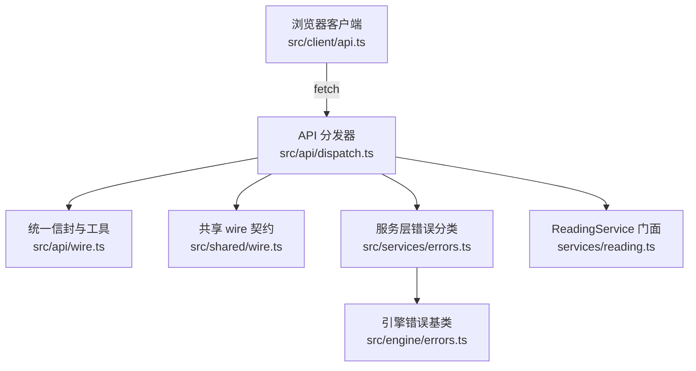
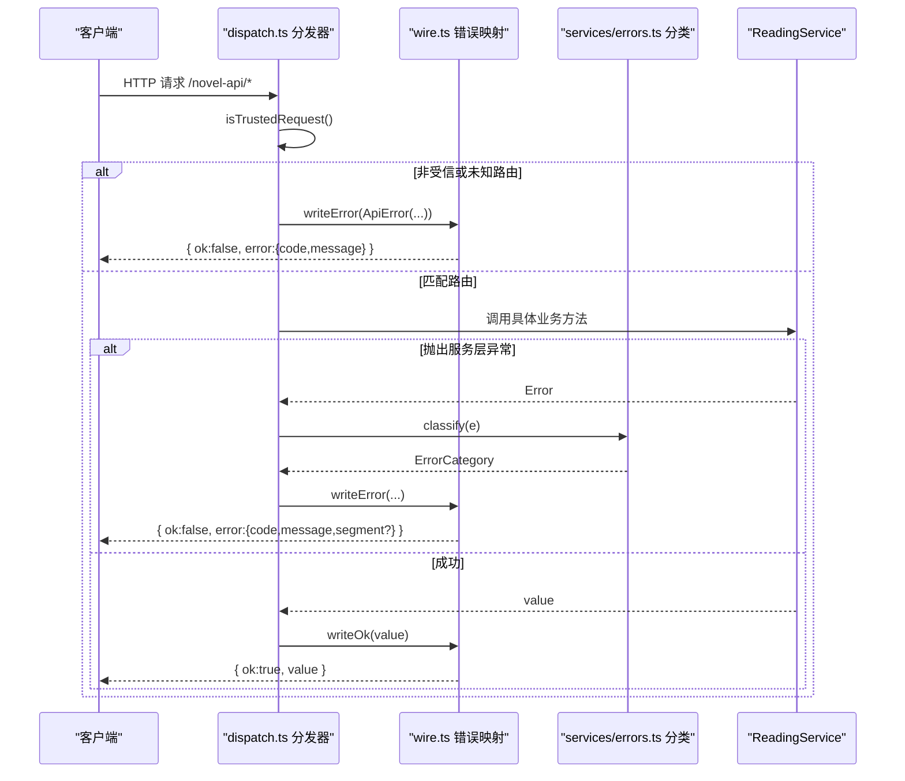
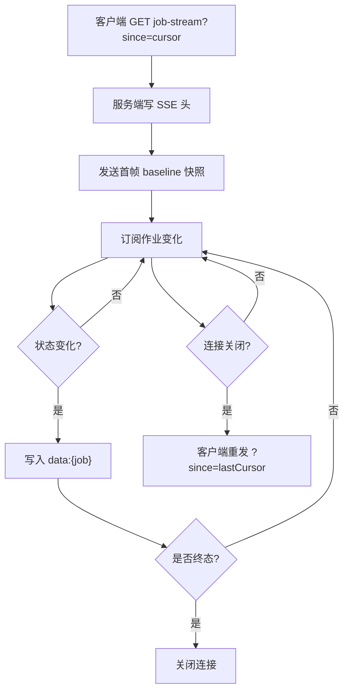
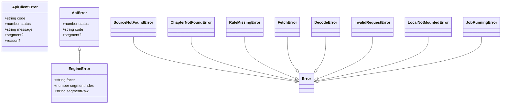

# 统一响应与错误码

<cite>
**本文引用的文件**   
- [src/api/wire.ts](file://src/api/wire.ts)
- [src/api/dispatch.ts](file://src/api/dispatch.ts)
- [src/shared/wire.ts](file://src/shared/wire.ts)
- [src/services/errors.ts](file://src/services/errors.ts)
- [src/engine/errors.ts](file://src/engine/errors.ts)
- [src/client/api.ts](file://src/client/api.ts)
- [tests/api/routes.test.ts](file://tests/api/routes.test.ts)
- [tests/api/wire.test.ts](file://tests/api/wire.test.ts)
</cite>

## 目录
1. [引言](#引言)
2. [项目结构](#项目结构)
3. [核心组件](#核心组件)
4. [架构总览](#架构总览)
5. [详细组件分析](#详细组件分析)
6. [依赖关系分析](#依赖关系分析)
7. [性能与可靠性特征](#性能与可靠性特征)
8. [故障排查指南](#故障排查指南)
9. [结论](#结论)
10. [附录：Wire 类型映射表与调用示例](#附录wire-类型映射表与调用示例)

## 引言
本文面向 `/novel-api` 的客户端与服务端契约，说明：
- 成功响应 `Result<T>`（统一信封 `{ ok: true, value }`）与失败响应 `{ ok: false, error }` 的结构差异。
- 所有业务错误码、HTTP 状态码及其来源分类。
- SSE 事件的消息头、payload 形状与断连重放策略。
- Wire 类型到 JSON 的字段定义：分页游标、搜索结果快照、书城发现快照、本地书条目等。
- 客户端错误处理最佳实践与用户提示建议。
- curl 与 TypeScript 调用示例，覆盖正常路径与常见错误路径。

## 项目结构
`/novel-api` 是 Node 侧 HTTP 前缀路由，由 `createApiHandler` 分发；跨半 wire 契约集中在 `shared/wire.ts`；错误分类集中在 `services/errors.ts`；引擎层错误在 `engine/errors.ts`；浏览器客户端封装在 `client/api.ts`。



**图示来源**
- [src/api/dispatch.ts:1-120](file://src/api/dispatch.ts#L1-L120)
- [src/api/wire.ts:1-135](file://src/api/wire.ts#L1-L135)
- [src/shared/wire.ts:1-120](file://src/shared/wire.ts#L1-L120)
- [src/services/errors.ts:1-129](file://src/services/errors.ts#L1-L129)
- [src/engine/errors.ts:1-38](file://src/engine/errors.ts#L1-L38)

**章节来源**
- [src/api/dispatch.ts:1-120](file://src/api/dispatch.ts#L1-L120)
- [src/shared/wire.ts:1-120](file://src/shared/wire.ts#L1-L120)

## 核心组件
- **统一信封**：成功返回 `{ ok: true, value }`；失败返回 `{ ok: false, error: { code, message, segment? } }`。
- **错误分类学**：将具体异常归为有限类目，再映射为 HTTP 状态码与错误码。
- **SSE 作业流**：搜索进度与发现进度共用 `openJobStream`，首帧为 baseline 快照，之后推送增量，终态自动关闭连接。
- **客户端封装**：解析信封、包装网络错误、提供 `apiEventStream` 以低耦合方式消费 SSE。

**章节来源**
- [src/api/wire.ts:1-135](file://src/api/wire.ts#L1-L135)
- [src/services/errors.ts:1-129](file://src/services/errors.ts#L1-L129)
- [src/client/api.ts:1-146](file://src/client/api.ts#L1-L146)

## 架构总览
请求进入 `/novel-api` 后，先做同源信任校验与路由匹配；匹配成功后调用 `ReadingService` 对应动词；任何异常最终经 `writeError` → `errorStatusOf` 转为统一信封。



**图示来源**
- [src/api/dispatch.ts:1-120](file://src/api/dispatch.ts#L1-L120)
- [src/api/wire.ts:60-135](file://src/api/wire.ts#L60-L135)
- [src/services/errors.ts:80-129](file://src/services/errors.ts#L80-L129)

## 详细组件分析

### 统一响应信封
- 成功：`{ ok: true, value }`，HTTP 200。
- 失败：`{ ok: false, error: { code, message, segment? } }`，`segment` 仅在引擎错误时携带 `{ facet, segmentIndex, segmentRaw }`。
- 信封类型来自共享契约 `ApiEnvelope<T>` 与 `ApiErrorBody`。

| 场景 | HTTP 状态 | `ok` | `value` | `error.code` | 说明 |
|---|---:|---:|---|---|---|
| 健康检查、普通查询 | 200 | `true` | 业务值 | 无 | 所有成功走 `writeOk` |
| 参数非法 | 400 | `false` | 无 | `BadRequest` | JSON 不合法、body 校验失败 |
| 资源不存在 | 404 | `false` | 无 | `NotFound` | 源不存在、章节不存在、本地产物不存在 |
| 方法不允许 | 405 | `false` | 无 | `MethodNotAllowed` | POST-only 路由使用 GET 等 |
| 非受信来源 | 403 | `false` | 无 | `Forbidden` | 非 loopback 或 Origin/Referer 跨源 |
| 任务冲突 | 409 | `false` | 无 | `JobRunning` | 单任务槽互斥 |
| 规则缺失 | 422 | `false` | 无 | `RuleMissing` | 书源缺某面规则 |
| 引擎求值错误 | 422 | `false` | 无 | 引擎类名如 `RuleEvalError` | 带 `segment` |
| 远站抓取失败 | 502 | `false` | 无 | `FetchError` 或 `DecodeError` | 出站请求失败、编码不可解 |
| 本地服务未挂载 | 503 | `false` | 无 | `Unavailable` | 本地书能力未启用 |
| 服务端异常 | 500 | `false` | 无 | `InternalError` | 未分类异常兜底 |

**章节来源**
- [src/api/wire.ts:60-135](file://src/api/wire.ts#L60-L135)
- [src/services/errors.ts:1-129](file://src/services/errors.ts#L1-L129)
- [tests/api/wire.test.ts:1-98](file://tests/api/wire.test.ts#L1-L98)

### 错误分类与业务错误码
服务层错误分类入口为 `classify`，其映射如下：

| 异常类型 | 分类 | HTTP | 错误码 | 典型含义 |
|---|---|---:|---|---|
| `EngineError` 子类 | `rule-eval` | 422 | 引擎类名 | 规则求值失败、不支持的规则、沙箱错误 |
| `RuleMissingError` | `rule-missing` | 422 | `RuleMissing` | 书源缺少某面规则 |
| `FetchError` / `DecodeError` | `fetch` | 502 | `FetchError` / `DecodeError` | 远站超时、非 2xx、字符集解码失败 |
| `SourceNotFoundError` / `ChapterNotFoundError` | `not-found` | 404 | `NotFound` | 源不存在、章节不存在 |
| `LocalArtifactNotFoundError` | `not-found` | 404 | `NotFound` | 本地文档/资源/警告不存在 |
| `InvalidRequestError` | `bad-request` | 400 | `BadRequest` | 值域非法 |
| `LocalImportError` / `EpubImportError` | `local-import` | 400 | `BadRequest` | EPUB/TXT 导入失败 |
| `LocalFileTooLargeError` | `local-too-large` | 413 | `PayloadTooLarge` | 本地导入文件过大 |
| `LocalNotMountedError` | `unavailable` | 503 | `Unavailable` | 本地书功能未挂载 |
| `JobRunningError` | `job-running` | 409 | `JobRunning` | 后台任务仍在运行 |
| 其他未分类异常 | `other` | 500 | `InternalError` | 未预期异常 |

注意：路由侧直接抛出的 `ApiError`（如 400/403/404/405/413）不走分类表，直通自身 `status` 与 `code`。

**章节来源**
- [src/services/errors.ts:1-129](file://src/services/errors.ts#L1-L129)
- [src/engine/errors.ts:1-38](file://src/engine/errors.ts#L1-L38)
- [tests/api/wire.test.ts:35-98](file://tests/api/wire.test.ts#L35-L98)

### SSE 事件协议与断连重放
- 响应头：`content-type: text/event-stream; charset=utf-8`，`cache-control: no-cache`，`connection: keep-alive`，并禁用反向代理缓冲。
- payload：每条事件只写 `data:` 行，内容为 `{ job: ... }` 的 JSON 字符串；无自定义 `event/type` 字段。
- 语义：
  - 首帧即 baseline 快照（例如搜索快照含 `since` 游标），后续帧为增量。
  - 到达终态时服务端主动 `res.end()`。
  - 客户端断连后应重新发起同一路径，并把上次收到的游标作为 `since` 查询参数继续。
  - 官方口径：**SSE 推送只是加速器，显式查询才是真相**；推送不 replay，必须提供 baseline/cursor/query。



**图示来源**
- [src/api/dispatch.ts:1-120](file://src/api/dispatch.ts#L1-L120)
- [src/client/api.ts:90-146](file://src/client/api.ts#L90-L146)

**章节来源**
- [src/api/dispatch.ts:1-120](file://src/api/dispatch.ts#L1-L120)
- [src/client/api.ts:90-146](file://src/client/api.ts#L90-L146)

### 客户端错误处理最佳实践
- 信封解析：仅当 `ok === true` 时取 `value`；否则构造 `ApiClientError`，包含 `code`、`status`、`message`、可选 `segment`。
- 网络错误：捕获 fetch 异常、非 JSON 响应、SSE 初始响应不可用，分别标记 `reason`：
  - `request-failed`：网络请求失败。
  - `not-json`：响应不是 JSON。
  - `stream-unavailable`：SSE 初始连接失败。
- 文案展示：通过 `describeError` 对 `reason` 进行本地化翻译；服务端错误消息保持原文。
- 重试与降级：
  - 401/403：优先引导认证恢复；不要盲目重试。
  - 404：视为确定性失败，停止重试；可提示资源不存在。
  - 409：短暂退避后重试一次；若仍 409，提示“任务仍在运行”。
  - 422/502：可指数退避重试，上限后降级为“请稍后再试”。
  - 500：建议快速失败 + 上报错误上下文，避免无限重试。
  - SSE 断连：立即以 `since` 重新拉流；若连续失败则回落到显式快照轮询。

**章节来源**
- [src/client/api.ts:1-90](file://src/client/api.ts#L1-L90)

## 依赖关系分析


**图示来源**
- [src/client/api.ts:1-60](file://src/client/api.ts#L1-L60)
- [src/api/wire.ts:1-35](file://src/api/wire.ts#L1-L35)
- [src/engine/errors.ts:1-38](file://src/engine/errors.ts#L1-L38)
- [src/services/errors.ts:1-79](file://src/services/errors.ts#L1-L79)

**章节来源**
- [src/client/api.ts:1-60](file://src/client/api.ts#L1-L60)
- [src/api/wire.ts:1-35](file://src/api/wire.ts#L1-L35)
- [src/engine/errors.ts:1-38](file://src/engine/errors.ts#L1-L38)
- [src/services/errors.ts:1-79](file://src/services/errors.ts#L1-L79)

## 性能与可靠性特征
- 信封体默认最大 1 MiB；超出返回 413。
- 部分导入接口放宽至 32 MiB。
- SSE 连接在客户端关闭或服务端终态时及时释放，避免死连接。
- 搜索与发现任务的中间结果在服务端持有，客户端通过快照与游标对齐，降低一致性风险。
- 错误分类集中一处，避免文案匹配导致的误判。

[本节为通用指导，不直接分析具体文件]

## 故障排查指南
- 收到 400 `BadRequest`：检查 JSON 是否合法、必填字段是否完整、数值是否在值域内。
- 收到 403 `Forbidden`：确认请求来自 localhost 且 Origin/Referer 同源；curl 无需 Origin/Referer。
- 收到 404 `NotFound`：确认源已启用、章节索引有效、本地文档 ID 存在。
- 收到 405 `MethodNotAllowed`：对照路由要求的方法；例如搜索提交必须是 POST。
- 收到 409 `JobRunning`：等待上一个任务结束或取消后再提交。
- 收到 422：查看 `segment.facet`、`segmentIndex`、`segmentRaw`，定位书源规则问题。
- 收到 502：远站不可达或返回非 2xx；检查目标站点与代理设置。
- 收到 503 `Unavailable`：确认本地书功能已启用。
- 收到 500 `InternalError`：收集错误日志与 `segment`，优先复现最小请求。

**章节来源**
- [tests/api/routes.test.ts:1-200](file://tests/api/routes.test.ts#L1-L200)
- [tests/api/wire.test.ts:1-98](file://tests/api/wire.test.ts#L1-L98)

## 结论
`/novel-api` 采用单一信封、单一分类、单一错误映射的设计：
- 成功与失败形态严格区分。
- 业务错误通过类型分类稳定映射到 HTTP 状态与错误码。
- SSE 推送明确为加速器，游标与显式查询共同保证一致性。
- 客户端封装统一处理网络层与业务层错误，便于本地化与降级。

[本节为总结性内容，不直接分析具体文件]

## 附录：Wire 类型映射表与调用示例

### 关键 Wire 类型到 JSON 字段

| 类型 | 关键字段 | 说明 |
|---|---|---|
| `SearchJobSnapshot` | `id`, `keyword`, `phase`, `cancelled`, `total`, `done`, `added`, `next`, `startedAt`, `finishedAt`, `error` | 搜索任务读面快照；`added` 为增量分组，`next` 为下次 `since` 游标 |
| `ExploreSnapshot` | `id`, `sourceId`, `sourceName`, `kind`, `phase`, `cancelled`, `page`, `hasMore`, `books`, `startedAt`, `finishedAt`, `error` | 书城发现按源快照；整帧替换，`page` 记录当前页 |
| `ShelfBook` | `sourceId`, `bookKey`, `title`, `author?`, `coverUrl?`, `intro?`, `lastChapterName?`, `kind?`, `wordCount?`, `totalChapters?`, `progress`, `addedAt` | 书架条目；`progress.chapterIndex`、`offsetRatio`、`updatedAt` |
| `JobState` | `id`, `kind`, `phase`, `total`, `done`, `counts`, `issues`, `fileErrors`, `startedAt`, `finishedAt`, `error` | 后台任务状态（import/batch-probe） |
| `SearchHit` | `title`, `author?`, `url?`, `coverUrl?`, `intro?`, `lastChapterName?`, `kind?`, `wordCount?` | 聚合搜索命中项 |
| `ExploreBook` | `name`, `author?`, `bookUrl?`, `coverUrl?`, `kind?`, `lastChapter?`, `intro?`, `wordCount?` | 书城发现中某一源的一条书 |
| `ChapterContent` | `kind`, `text?`, `documentId?`, `nodes?` | 文本章或富媒体 EPUB 正文 |
| `BookNavigation` | `chapters`, `items` | 线性目录与展示树 |

**章节来源**
- [src/shared/wire.ts:120-510](file://src/shared/wire.ts#L120-L510)

### curl 示例

- 健康检查
  ```bash
  curl -s http://127.0.0.1:3000/novel-api | jq .
  ```
  成功响应体示例：
  ```json
  { "ok": true, "value": { "name": "dsh-novel", "apiVersion": 1 } }
  ```

- 获取公开书源
  ```bash
  curl -s http://127.0.0.1:3000/novel-api/sources | jq .
  ```

- 提交搜索任务
  ```bash
  curl -s -X POST http://127.0.0.1:3000/novel-api/search/job \
    -H 'Content-Type: application/json' \
    -d '{"keyword":"三体"}' | jq .
  ```

- 读取搜索进度（SSE）
  ```bash
  curl -N http://127.0.0.1:3000/novel-api/search/job-stream?since=0
  ```
  每行形如：
  ```
  data: {"job":{"id":"...","keyword":"三体","phase":"running","next":1,...}}
  ```

- 常见错误示例

  400 参数非法：
  ```json
  { "ok": false, "error": { "code": "BadRequest", "message": "..." } }
  ```

  404 源不存在：
  ```json
  { "ok": false, "error": { "code": "NotFound", "message": "源不存在: xxx" } }
  ```

  409 任务冲突：
  ```json
  { "ok": false, "error": { "code": "JobRunning", "message": "..." } }
  ```

  422 规则缺失：
  ```json
  { "ok": false, "error": { "code": "RuleMissing", "message": "..." } }
  ```

  502 远站抓取失败：
  ```json
  { "ok": false, "error": { "code": "FetchError", "message": "..." } }
  ```

  503 本地服务未挂载：
  ```json
  { "ok": false, "error": { "code": "Unavailable", "message": "本地书服务未挂载" } }
  ```

**章节来源**
- [tests/api/routes.test.ts:1-200](file://tests/api/routes.test.ts#L1-L200)
- [src/api/dispatch.ts:1-120](file://src/api/dispatch.ts#L1-L120)

### TypeScript 调用示例

- 正常路径：提交搜索并读取 SSE
  ```typescript
  import { apiSend, apiEventStream, describeError } from './client/api';

  async function run() {
    const jobId = await apiSend('POST', '/search/job', { keyword: '三体' });
    let cursor = 0;
    await apiEventStream(`/search/job-stream?since=${cursor}`, (raw) => {
      const frame = JSON.parse(raw);
      if (frame.job.next > cursor) cursor = frame.job.next;
      console.log(frame.job);
    }, new AbortController().signal);
  }
  ```

- 错误路径：401/403/404/500 处理
  ```typescript
  try {
    await apiSend('POST', '/shelf/key', { key: 'invalid%enc' });
  } catch (err) {
    const msg = describeError(err);
    if (err.status === 401 || err.status === 403) {
      // 引导认证，不重试
    } else if (err.status === 404) {
      // 资源不存在，停止重试
    } else if (err.status >= 500) {
      // 服务端异常，快速失败并上报
    } else {
      // 其他错误按业务重试策略处理
    }
  }
  ```

**章节来源**
- [src/client/api.ts:1-146](file://src/client/api.ts#L1-L146)