# 决策记录（ADR）

<cite>
**本文引用的文件**   
- [docs/adr/README.md](file://docs/adr/README.md)
- [docs/adr/0001-fail-loud-at-parse-time.md](file://docs/adr/0001-fail-loud-at-parse-time.md)
- [docs/adr/0002-reduction-never-collapses.md](file://docs/adr/0002-reduction-never-collapses.md)
- [docs/adr/0006-self-implemented-subsets.md](file://docs/adr/0006-self-implemented-subsets.md)
- [docs/adr/0007-usage-axis-single.md](file://docs/adr/0007-usage-axis-single.md)
- [docs/adr/0008-no-speculative-storage.md](file://docs/adr/0008-no-speculative-storage.md)
- [docs/adr/0013-single-atomic-write-queue.md](file://docs/adr/0013-single-atomic-write-queue.md)
- [docs/adr/0015-one-door-for-request-and-outbound.md](file://docs/adr/0015-one-door-for-request-and-outbound.md)
- [docs/adr/0016-error-two-tier-and-origin-fence.md](file://docs/adr/0016-error-two-tier-and-origin-fence.md)
- [docs/adr/0017-degrade-with-boundary.md](file://docs/adr/0017-degrade-with-boundary.md)
- [docs/adr/0018-server-side-jobs-and-progress.md](file://docs/adr/0018-server-side-jobs-and-progress.md)
- [docs/adr/0021-platform-modules-intersection.md](file://docs/adr/0021-platform-modules-intersection.md)
- [docs/adr/0023-client-disposable-projection.md](file://docs/adr/0023-client-disposable-projection.md)
- [docs/adr/0032-search-relevance-partition.md](file://docs/adr/0032-search-relevance-partition.md)
- [docs/adr/0035-plugin-config-page-live-refs.md](file://docs/adr/0035-plugin-config页活引用.md)
- [docs/adr/0036-extract-mechanics-not-forwarding-shells.md](file://docs/adr/0036-extract-mechanics-not-forwarding-shells.md)
- [docs/adr/0037-modal-contract-and-single-reader-surface.md](file://docs/adr/0037-modal-contract-and-single-reader-surface.md)
- [docs/adr/0038-client-copy-host-locale.md](file://docs/adr/0038-client-copy-host-locale.md)
- [src/engine/parse.ts](file://src/engine/parse.ts)
- [src/engine/select.ts](file://src/engine/select.ts)
- [src/engine/jsonpath.ts](file://src/engine/jsonpath.ts)
- [src/engine/xpath.ts](file://src/engine/xpath.ts)
- [src/engine/types.ts](file://src/engine/types.ts)
- [src/engine/combine.ts](file://src/engine/combine.ts)
- [src/engine/evaluate.ts](file://src/engine/evaluate.ts)
- [src/engine/js-sandbox.ts](file://src/engine/js-sandbox.ts)
- [src/services/storage.ts](file://src/services/storage.ts)
- [src/services/request.ts](file://src/services/request.ts)
- [src/services/fetcher.ts](file://src/services/fetcher.ts)
- [src/services/errors.ts](file://src/services/errors.ts)
- [src/api/wire.ts](file://src/api/wire.ts)
- [src/api/dispatch.ts](file://src/api/dispatch.ts)
- [src/services/import-job.ts](file://src/services/import-job.ts)
- [src/services/search-job.ts](file://src/services/search-job.ts)
- [src/client/search-job.ts](file://src/client/search-job.ts)
- [src/client/store.ts](file://src/client/store.ts)
- [src/client/transient.ts](file://src/client/transient.ts)
- [src/shared/relevance.ts](file://src/shared/relevance.ts)
- [src/shared/wire.ts](file://src/shared/wire.ts)
- [src/config.ts](file://src/config.ts)
- [src/client/config-page.tsx](file://src/client/config-page.tsx)
- [src/client/views/dialog.tsx](file://src/client/views/dialog.tsx)
- [src/client/reader-surfaces.ts](file://src/client/reader-surfaces.ts)
- [src/client/copy/index.tsx](file://src/client/copy/index.tsx)
</cite>

## 目录

1. [引言](#引言)
2. [项目结构](#项目结构)
3. [核心组件](#核心组件)
4. [架构总览](#架构总览)
5. [逐条决策分析](#逐条决策分析)
6. [依赖关系分析](#依赖关系分析)
7. [性能与可维护性约束](#性能与可维护性约束)
8. [故障排查指南](#故障排查指南)
9. [结论](#结论)

## 引言

`dsh-novel` 的决策记录集中存放在 `docs/adr`。索引文档说明：每条 ADR 只记录“难逆、无上下文会让人惊讶、曾经真有过替代方案”的决定；编号只追加不重排，翻案要标 superseded 或就地补订正；总体形状放在仓库顶层架构文档里，不在 ADR 重复。

本索引按编号梳理解析期失败优先、reduce 从不塌陷、自实现子集、单使用轴、无推测存储、单原子写队列、请求与出站共用一扇门、双层错误与 Origin 围栏、边界降级、服务端任务与进度、平台模块交集、客户端可丢弃投影、搜索相关性分区、插件配置页活引用、抽取机制而非转发壳、模态契约与单阅读器表面、客户端复制文案走宿主 locale 等关键决策，并给出对当前代码实现的约束。

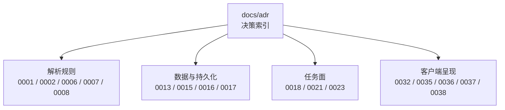

**章节来源**
- [docs/adr/README.md:1-78](file://docs/adr/README.md#L1-L78)

## 项目结构

仓库把 ADR 集中在 `docs/adr`，由 README 按主题分组：规则引擎、引擎与宿主之间、数据契约与存储、抓取与对外接口、任务面与客户端、与宿主和生态的边界、legado 兼容判据。

```mermaid
flowchart TD
    Root["仓库根目录"] --> Docs["docs/adr"]
    Docs --> Index["README.md<br/>分类索引"]
    Docs --> Parse["0001 解析期抛错"]
    Docs --> Reduce["0002 reduce 不折叠"]
    Docs --> Subset["0006 自实现子集"]
    Docs --> Usage["0007 单 usage 轴"]
    Docs --> StorageNoSpec["0008 无推测存储"]
    Docs --> AtomicWrite["0013 单原子写队列"]
    Docs --> RequestDoor["0015 请求与出站一扇门"]
    Docs --> ErrorFence["0016 双层错误与 Origin 围栏"]
    Docs --> Degrade["0017 边界降级"]
    Docs --> Jobs["0018 服务端任务与进度"]
    Docs --> Platform["0021 平台模块交集"]
    Docs --> ClientProj["0023 客户端可丢弃投影"]
    Docs --> Relevance["0032 搜索相关性分区"]
    Docs --> LiveConfig["0035 插件配置页活引用"]
    Docs --> Extract["0036 抽取机械不抽转发壳"]
    Docs --> Modal["0037 模态契约与单阅读器表面"]
    Docs --> Locale["0038 客户端文案走宿主 locale"]
```

**图示来源**
- [docs/adr/README.md:1-78](file://docs/adr/README.md#L1-L78)

**章节来源**
- [docs/adr/README.md:1-78](file://docs/adr/README.md#L1-L78)

## 核心组件

这些 ADR 对应到代码中的稳定锚点：

| 决策编号 | 主要代码位置 | 承担职责 |
|---|---|---|
| 0001 | `src/engine/parse.ts` | 解析未知规则语法时抛 `UnsupportedRuleError`，带面、段序与原文 |
| 0002 | `src/engine/select.ts` | `reducePicked` 区分 Miss 与空 List，`applyIndex` / `getValue` 统一消费 |
| 0006 | `src/engine/jsonpath.ts`、`src/engine/xpath.ts` | 手写 JSONPath/XPath 子集，越界语法在解析期抛错 |
| 0007 | `src/engine/types.ts`、`src/engine/combine.ts`、`src/engine/evaluate.ts` | `RuleUsage` 贯穿链尾选择器、组合符合并形状与 js 段 result |
| 0008 | `src/engine/js-sandbox.ts`、`src/engine/variables.ts` | 进程内变量表、两级作用域、桥接 fetcher |
| 0013 | `src/services/storage.ts` | 单写通道、临时件与备份件命名约定、读侧 ENOENT 与损坏分流 |
| 0015 | `src/services/request.ts`、`src/services/fetcher.ts` | `assembleRequest`、`absUrlKeepOption`、守门 fetcher |
| 0016 | `src/services/errors.ts`、`src/api/wire.ts` | `classify`、`ErrorCategory`、`ApiError`、同源 fence |
| 0017 | `src/services/bridge.ts`、`src/services/search-face.ts`、`src/services/probe.ts` | URL 选项、bookUrlPattern、动态头、详情页嗅探、正文零命中 |
| 0018 | `src/services/import-job.ts`、`src/services/search-job.ts`、`src/client/search-job.ts` | 分槽、停止语义、游标快照、SSE 与查询共用游标 |
| 0021 | `tsdown.config.ts`、`src/shared/wire.ts` | `PLATFORM_MODULES`、构建期纯度门、client 半零运行时依赖 |
| 0023 | `src/client/store.ts`、`src/client/transient.ts` | 可丢弃投影、轮次身份校验、行级反馈 |
| 0032 | `src/shared/relevance.ts`、`src/shared/wire.ts` | `relevanceOf`、`partitionByRelevance`、三档分区 |
| 0035 | `src/config.ts`、`src/client/config-page.tsx` | volatile 活配置、getter 读取、代理 dispatcher 替换 |
| 0036 | `src/shared/wire.ts`、`src/services/job-holder.ts`、`src/api/dispatch.ts` | bodies/readBodies、HostTie/ChangeSignal、unknownRoute/methodNotAllowed |
| 0037 | `src/client/views/dialog.tsx`、`src/client/reader-surfaces.ts` | Dialog 焦点契约、阅读器至多一角 |
| 0038 | `src/client/copy/index.tsx`、`src/client/api.ts` | ZH/EN 字典、createTranslate、describeError |

**章节来源**
- [docs/adr/0001-fail-loud-at-parse-time.md:1-9](file://docs/adr/0001-fail-loud-at-parse-time.md#L1-L9)
- [docs/adr/0002-reduction-never-collapses.md:1-9](file://docs/adr/0002-reduction-never-collapses.md#L1-L9)
- [docs/adr/0006-self-implemented-subsets.md:1-9](file://docs/adr/0006-self-implemented-subsets.md#L1-L9)
- [docs/adr/0007-usage-axis-single.md:1-9](file://docs/adr/0007-usage-axis-single.md#L1-L9)
- [docs/adr/0008-no-speculative-storage.md:1-14](file://docs/adr/0008-no-speculative-storage.md#L1-L14)
- [docs/adr/0013-single-atomic-write-queue.md:1-15](file://docs/adr/0013-single-atomic-write-queue.md#L1-L15)
- [docs/adr/0015-one-door-for-request-and-outbound.md:1-14](file://docs/adr/0015-one-door-for-request-and-outbound.md#L1-L14)
- [docs/adr/0016-error-two-tier-and-origin-fence.md:1-10](file://docs/adr/0016-error-two-tier-and-origin-fence.md#L1-L10)
- [docs/adr/0017-degrade-with-boundary.md:1-13](file://docs/adr/0017-degrade-with-boundary.md#L1-L13)
- [docs/adr/0018-server-side-jobs-and-progress.md:1-13](file://docs/adr/0018-server-side-jobs-and-progress.md#L1-L13)
- [docs/adr/0021-platform-modules-intersection.md:1-16](file://docs/adr/0021-platform-modules-intersection.md#L1-L16)
- [docs/adr/0023-client-disposable-projection.md:1-13](file://docs/adr/0023-client-disposable-projection.md#L1-L13)
- [docs/adr/0032-search-relevance-partition.md:1-26](file://docs/adr/0032-search-relevance-partition.md#L1-L26)
- [docs/adr/0035-plugin-config-page-live-refs.md:1-15](file://docs/adr/0035-plugin-config-page-live-refs.md#L1-L15)
- [docs/adr/0036-extract-mechanics-not-forwarding-shells.md:1-10](file://docs/adr/0036-extract-mechanics-not-forwarding-shells.md#L1-L10)
- [docs/adr/0037-modal-contract-and-single-reader-surface.md:1-28](file://docs/adr/0037-modal-contract-and-single-reader-surface.md#L1-L28)
- [docs/adr/0038-client-copy-host-locale.md:1-12](file://docs/adr/0038-client-copy-host-locale.md#L1-L12)

## 架构总览

下图把 ADR 映射到真实子系统：解析与求值、网络与错误、持久化、任务与客户端呈现。

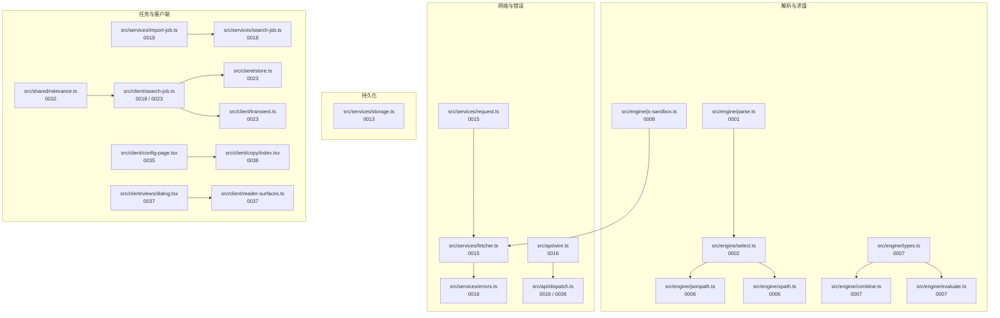

**图示来源**
- [docs/adr/0001-fail-loud-at-parse-time.md:1-9](file://docs/adr/0001-fail-loud-at-parse-time.md#L1-L9)
- [docs/adr/0002-reduction-never-collapses.md:1-9](file://docs/adr/0002-reduction-never-collapses.md#L1-L9)
- [docs/adr/0006-self-implemented-subsets.md:1-9](file://docs/adr/0006-self-implemented-subsets.md#L1-L9)
- [docs/adr/0007-usage-axis-single.md:1-9](file://docs/adr/0007-usage-axis-single.md#L1-L9)
- [docs/adr/0008-no-speculative-storage.md:1-14](file://docs/adr/0008-no-speculative-storage.md#L1-L14)
- [docs/adr/0013-single-atomic-write-queue.md:1-15](file://docs/adr/0013-single-atomic-write-queue.md#L1-L15)
- [docs/adr/0015-one-door-for-request-and-outbound.md:1-14](file://docs/adr/0015-one-door-for-request-and-outbound.md#L1-L14)
- [docs/adr/0016-error-two-tier-and-origin-fence.md:1-10](file://docs/adr/0016-error-two-tier-and-origin-fence.md#L1-L10)
- [docs/adr/0018-server-side-jobs-and-progress.md:1-13](file://docs/adr/0018-server-side-jobs-and-progress.md#L1-L13)
- [docs/adr/0023-client-disposable-projection.md:1-13](file://docs/adr/0023-client-disposable-projection.md#L1-L13)
- [docs/adr/0032-search-relevance-partition.md:1-26](file://docs/adr/0032-search-relevance-partition.md#L1-L26)
- [docs/adr/0035-plugin-config-page-live-refs.md:1-15](file://docs/adr/0035-plugin-config-page-live-refs.md#L1-L15)
- [docs/adr/0036-extract-mechanics-not-forwarding-shells.md:1-10](file://docs/adr/0036-extract-mechanics-not-forwarding-shells.md#L1-L10)
- [docs/adr/0037-modal-contract-and-single-reader-surface.md:1-28](file://docs/adr/0037-modal-contract-and-single-reader-surface.md#L1-L28)
- [docs/adr/0038-client-copy-host-locale.md:1-12](file://docs/adr/0038-client-copy-host-locale.md#L1-L12)

## 逐条决策分析

### 0001：解析期失败优先

**背景**  
书源规则是社区手写物，形态多样。如果让不认识的字串继续走到求值期，普查工具会漏掉族类错误，错误阶段和错误类也会失真。

**权衡**  
- 宽容猜测会把“没找到”伪装成“成功”。
- 透传到求值期会让登记在册的普查与导入预检失去真入口。
- 同一条链混用 `||`、`&&`、`%%` 时对面允许但生效细节模糊，本仓选择拒绝。

**结论**  
白名单之外且构不成选择器的段一律在 `parseRule` 阶段抛出 `UnsupportedRuleError`，携带面、段序与原文。

**影响范围**  
- 解析器必须维护 `KNOWN_MODES`、隐式 CSS 判断与 CSS 词链判断。
- 测试矩阵必须覆盖未知段、隐式 CSS、混合组合符。
- 新增规则模式不能靠“静默忽略”获得兼容性。

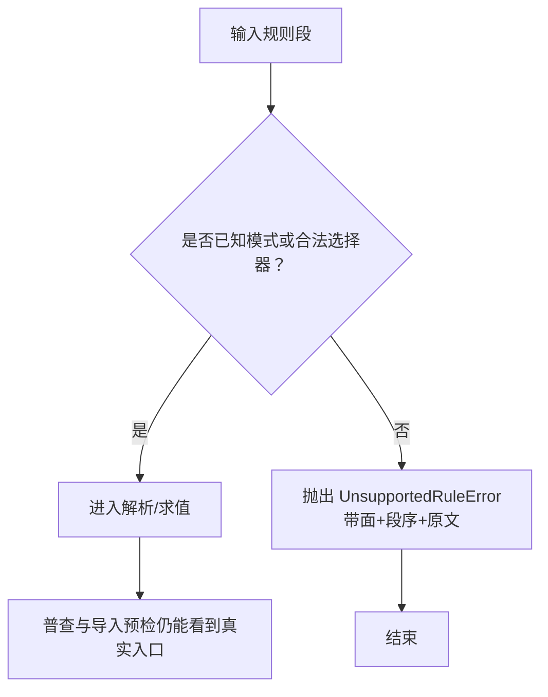

**图示来源**
- [docs/adr/0001-fail-loud-at-parse-time.md:1-9](file://docs/adr/0001-fail-loud-at-parse-time.md#L1-L9)

**章节来源**
- [docs/adr/0001-fail-loud-at-parse-time.md:1-9](file://docs/adr/0001-fail-loud-at-parse-time.md#L1-L9)
- [src/engine/parse.ts](file://src/engine/parse.ts)

### 0002：reduce 从不塌陷

**背景**  
“没取到”和“取到空集合”语义不同：前者支持链上右移与 `||` 短路，后者是合法零条目。

**权衡**  
- 把切片为空当成 Miss 会破坏中链节点集假设。
- 取值段自己持空态逻辑会让同一规则因顺序产生不同结果。
- JSONPath 用合并后条目数判断 Miss 会使兜底分支随链长漂移。

**结论**  
只在 `select.ts` 的 `reducePicked` 一处做判定；Miss 与空 List 互不折叠；JSONPath 侧采用同口径。

**影响范围**  
- 任何新组合符或取值路径必须从 `reducePicked` 取结论。
- 多条目取位按写入序，与对面插入序同形。
- 把空集合当失败属于回归。

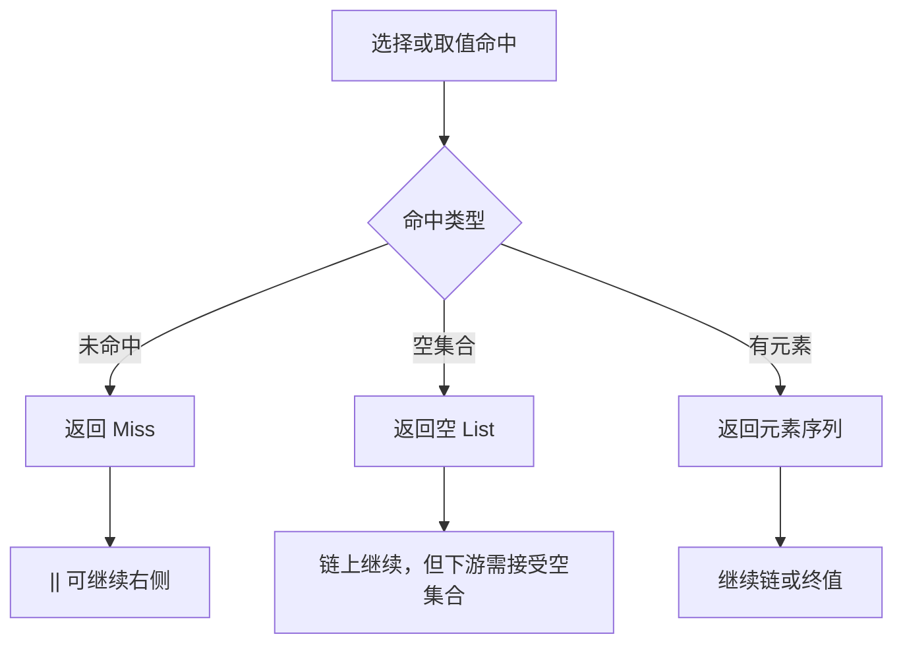

**图示来源**
- [docs/adr/0002-reduction-never-collapses.md:1-9](file://docs/adr/0002-reduction-never-collapses.md#L1-L9)

**章节来源**
- [docs/adr/0002-reduction-never-collapses.md:1-9](file://docs/adr/0002-reduction-never-collapses.md#L1-L9)
- [src/engine/select.ts](file://src/engine/select.ts)
- [src/engine/jsonpath.ts](file://src/engine/jsonpath.ts)

### 0006：自实现子集（CSS/XPath/JSONPath）

**背景**  
真实书源里的 JSONPath/XPath 形态不在轻量库子集内；完整库还会引入过滤器、脚本表达式等明确不支持的语义；HTML→XML 重解析会导致 XPath 错位。

**权衡**  
- 引库省事，但会带入未知语义，并把“不支持”变成静默错值。
- 补齐 ancestor 等轴或聚合函数没有需求方。
- 把文档根当 html 的特判会让越界规则静默出数。

**结论**  
JSONPath 与 XPath 都是手写子集；越界语法在解析期抛错，XPath 直接在 domhandler 节点树上按白名单求值。

**影响范围**  
- `jsonpath.ts` 的 `reject` / `tokenize` 是子集边界。
- `xpath.ts` 的 `AXIS_NAMES` 与头注是裁决处。
- 新增能力必须先证明真实需求，否则保持为解析期错误。

**章节来源**
- [docs/adr/0006-self-implemented-subsets.md:1-9](file://docs/adr/0006-self-implemented-subsets.md#L1-L9)
- [src/engine/jsonpath.ts](file://src/engine/jsonpath.ts)
- [src/engine/xpath.ts](file://src/engine/xpath.ts)

### 0007：单使用轴

**背景**  
`getString` 与 `getElements` 天然形状不同；若按值 kind 猜或在 combine/sandbox 各写一份判据，同一个分派会随链长与分支顺序漂移。

**权衡**  
- 链尾未知词一律按属性终端会误伤列表规则的选择器。
- 中链串化节点集会污染上游状态。
- 服务层把“结果是节点集”当引擎失败会污染判据分母。

**结论**  
通过 `ParsedRule.usage` 显式声明用途；链尾节点集在取值用途下换行拼接，取值出口不因剩节点集失败。

**影响范围**  
- `types.ts` 的 `RuleUsage` 是唯一判据来源。
- `combine.ts` 的 `CombineOpts.usage` 决定合并形状与驱动长度。
- `evaluate.ts` 与 `js-sandbox.ts` 根据 usage 绑定 result。

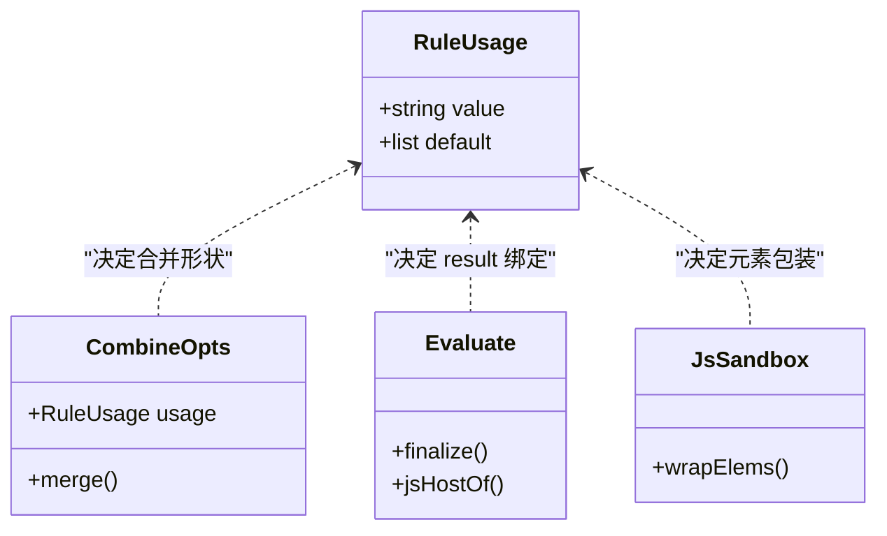

**图示来源**
- [docs/adr/0007-usage-axis-single.md:1-9](file://docs/adr/0007-usage-axis-single.md#L1-L9)

**章节来源**
- [docs/adr/0007-usage-axis-single.md:1-9](file://docs/adr/0007-usage-axis-single.md#L1-L9)
- [src/engine/types.ts](file://src/engine/types.ts)
- [src/engine/combine.ts](file://src/engine/combine.ts)
- [src/engine/evaluate.ts](file://src/engine/evaluate.ts)
- [src/engine/js-sandbox.ts](file://src/engine/js-sandbox.ts)

### 0008：无推测存储

**背景**  
对面有 CookieStore、四级作用域变量表、磁盘缓存层级与 `JavaImporter`；本仓在修复形状阶段不应为不存在的需求发明行为。

**权衡**  
- 共享一张 Map 会让 source 层、cache 互相可见，甚至清空已写键。
- 空壳 CookieJar/文件系统不会解决 URL 客户端的真实阻塞点。
- 落盘需要数据根、删除策略与清理口径，不在本次形状修复范围内。

**结论**  
变量表是进程内表；作用域只接两次调用与 source 层 peek；cookie/source/cache 按源建档但不落盘；网络出口统一注入到 `EvalContext`。

**影响范围**  
- `js-sandbox.ts` 的 `SourceSession` / `processSession` 是会话边界。
- `variables.ts` 与 `types.ts` 的 `EvalContext.sourceVar` 是作用域模型。
- `isPutOnlyRule` 必须是结构判据，不能依赖中文文案。

**章节来源**
- [docs/adr/0008-no-speculative-storage.md:1-14](file://docs/adr/0008-no-speculative-storage.md#L1-L14)
- [src/engine/js-sandbox.ts](file://src/engine/js-sandbox.ts)
- [src/engine/variables.ts](file://src/engine/variables.ts)
- [src/engine/types.ts](file://src/engine/types.ts)
- [src/engine/parse.ts](file://src/engine/parse.ts)

### 0013：单原子写队列

**背景**  
并发 rename 同一目标在 Windows 上会 EPERM；缓存曾自抄无排队写；先删再写窗口内并发读会把缺失当作空数据。

**权衡**  
- 有限重试会隐藏逃逸窗口，且可能掩盖真实失败。
- 各消费方各自拼 `.tmp` / `.bak` 会成为第三份实现。
- 不设轮次上限等于避免注释藏窗口。

**结论**  
低层只有一个 `writeFileAtomic`，按文件名串行；读侧严格区分 ENOENT 与损坏，损坏备份 `.bak` 并抛 `CorruptJsonError`。

**影响范围**  
- 所有 JSON 写与页面缓存共用该队列。
- 入队必须在任何 `await` 之前。
- 临时件与备份件只能由 `tempPathOf` / `backupPathOf` / `isAtomicTemp` 管理。

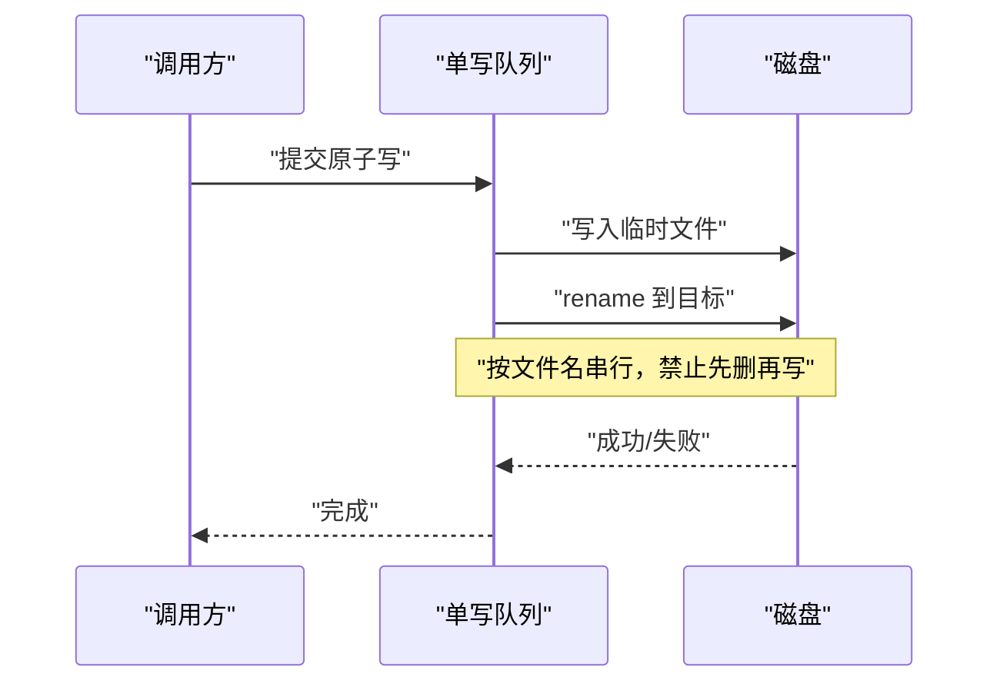

**图示来源**
- [docs/adr/0013-single-atomic-write-queue.md:1-15](file://docs/adr/0013-single-atomic-write-queue.md#L1-L15)

**章节来源**
- [docs/adr/0013-single-atomic-write-queue.md:1-15](file://docs/adr/0013-single-atomic-write-queue.md#L1-L15)
- [src/services/storage.ts](file://src/services/storage.ts)

### 0015：请求与出站共用一扇门

**背景**  
此前请求组装在搜索面与引擎桥各写一份；POST API 源的 book_id 藏在选项 body 里，剥掉后详情/目录/正文全部退化成裸 GET。

**权衡**  
- 两处 init 组装容易漂移。
- 把 `{option}` 当纯 URL 会把站点 404 误判为失败原因。
- 默认 UTF-8 硬解会把乱码冒充正文。

**结论**  
`assembleRequest` 是唯一组装入口；URL 构造前切分选项；落库与求值出口保留 `,{option}`；守门 fetcher 唯一处理超时、网络异常与 HTTP 非 2xx。

**影响范围**  
- `request.ts` 的 `assembleRequest` / `parseUrlOption` / `absUrlKeepOption` / `canonUrl` 是唯一主人。
- `fetcher.ts` 收口所有出站。
- `engine-fetch.ts` 复用同一出口，桥不自建 fetch。
- HEAD 探测通过 `manual: true` 放行非 2xx，是这条门的唯一例外。

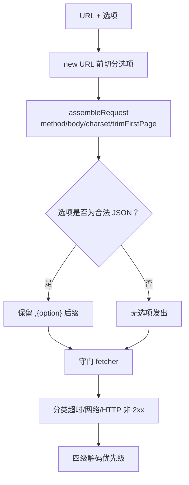

**图示来源**
- [docs/adr/0015-one-door-for-request-and-outbound.md:1-14](file://docs/adr/0015-one-door-for-request-and-outbound.md#L1-L14)

**章节来源**
- [docs/adr/0015-one-door-for-request-and-outbound.md:1-14](file://docs/adr/0015-one-door-for-request-and-outbound.md#L1-L14)
- [src/services/request.ts](file://src/services/request.ts)
- [src/services/fetcher.ts](file://src/services/fetcher.ts)
- [src/services/engine-fetch.ts](file://src/services/engine-fetch.ts)

### 0016：双层错误与 Origin 围栏

**背景**  
路由自检错误、domain 错误、引擎错误混在一起会污染分类学；只看 Referer 会被 meta referrer 绕过，跨源 simple POST 可 CSRF。

**权衡**  
- 把所有状态码塞进一张表会把路由自检错误拖进 domain 分类。
- 要求 Referer 在场会打死本机 curl 与工具面。

**结论**  
domain 与引擎错误经 `classify` 分类；路由自检错误用 `ApiError` 直通；同源 fence 看 Origin 与 Referer，两者都缺席视为合法。

**影响范围**  
- `errors.ts` 的 `classify` / `ErrorCategory` 是分类单点。
- `wire.ts` 的 `ApiError` / `isTrustedRequest` / `STATUS_OF` / `readCappedBody` 是路由层契约。
- 新增 HTTP 错误应改类型，不改 message 前缀。

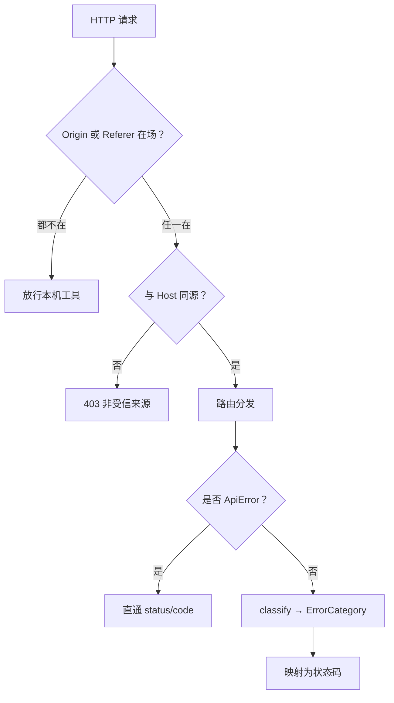

**图示来源**
- [docs/adr/0016-error-two-tier-and-origin-fence.md:1-10](file://docs/adr/0016-error-two-tier-and-origin-fence.md#L1-L10)

**章节来源**
- [docs/adr/0016-error-two-tier-and-origin-fence.md:1-10](file://docs/adr/0016-error-two-tier-and-origin-fence.md#L1-L10)
- [src/services/errors.ts](file://src/services/errors.ts)
- [src/api/wire.ts](file://src/api/wire.ts)
- [src/api/dispatch.ts](file://src/api/dispatch.ts)

### 0017：边界降级

**背景**  
“留痕但不放大故障”容易被推成“什么都吞”；辅助元数据、逐章回退、正文零命中的边界必须一起读。

**权衡**  
- 全吞坏规则会让整源不可用。
- 每一条都回退等于 ruleChapterUrl 整体失效。
- 空正文冒充成功比报错更危险。

**结论**  
仅对 URL 选项、bookUrlPattern 编译失败、动态请求头求值失败做降级；name/author/bookUrl/tocUrl 不吞；正文零命中首屏抛错且不写缓存。

**影响范围**  
- `bridge.ts` 的 `metaFieldOf` / `detailFieldsOf` / `detailContextOf` / `resolveHeaders`。
- `search-face.ts` 的 `patternOf` / `canInfo`。
- `probe.ts` 的 via 分岔。
- `reading.ts` 的 toc/chapter 回退与空正文处理。

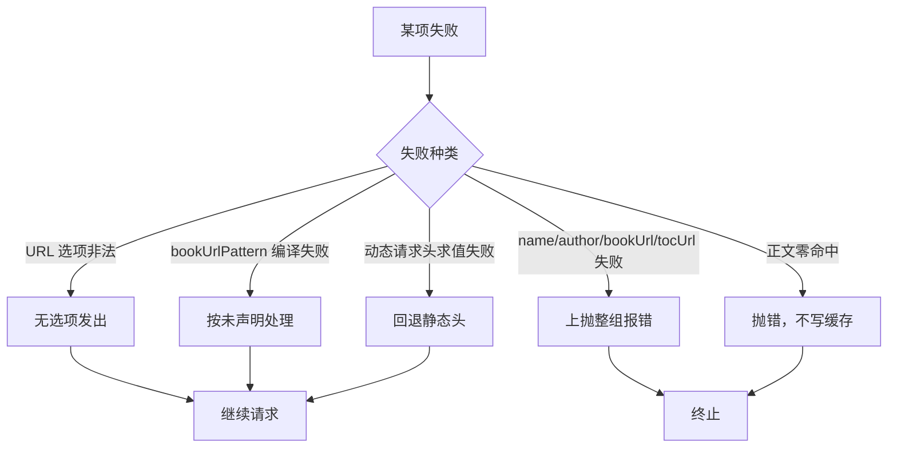

**图示来源**
- [docs/adr/0017-degrade-with-boundary.md:1-13](file://docs/adr/0017-degrade-with-boundary.md#L1-L13)

**章节来源**
- [docs/adr/0017-degrade-with-boundary.md:1-13](file://docs/adr/0017-degrade-with-boundary.md#L1-L13)
- [src/services/bridge.ts](file://src/services/bridge.ts)
- [src/services/search-face.ts](file://src/services/search-face.ts)
- [src/services/probe.ts](file://src/services/probe.ts)
- [src/services/reading.ts](file://src/services/reading.ts)

### 0018：服务端任务与进度

**背景**  
搜索是探索动作，不应挡住导入；宿主只有 label 与 detail，装不下几百源规模的业务明细；停止不是失败。

**权衡**  
- 搜索占写任务槽会惩罚探索。
- 以错误呈现停止会混淆 UI 语义。
- 给 wire 加 killed 态会动跨半契约，收益为零。
- EventSource 自带重连，会把游标交给浏览器。

**结论**  
写任务一个槽，搜索另开读槽；停止只结算本轮，已搜命中保留；进度以带游标的快照为准，SSE 与查询共用游标。

**影响范围**  
- `import-job.ts` 的 `JobRunningError` / `cancelledOut` / `settle`。
- `search-job.ts` 的分槽、shouldStop、subscribe。
- `client/search-job.ts` 的轮次身份与游标校验。
- 宿主 job 面只展示 label/detail，业务明细在本仓快照。

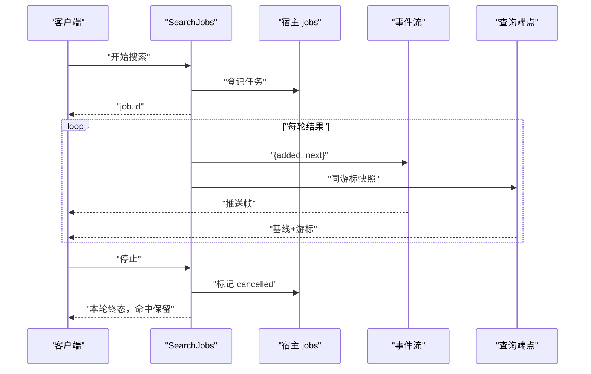

**图示来源**
- [docs/adr/0018-server-side-jobs-and-progress.md:1-13](file://docs/adr/0018-server-side-jobs-and-progress.md#L1-L13)

**章节来源**
- [docs/adr/0018-server-side-jobs-and-progress.md:1-13](file://docs/adr/0018-server-side-jobs-and-progress.md#L1-L13)
- [src/services/import-job.ts](file://src/services/import-job.ts)
- [src/services/search-job.ts](file://src/services/search-job.ts)
- [src/client/search-job.ts](file://src/client/search-job.ts)

### 0021：平台模块交集

**背景**  
浏览器半是 CJS 单文件闭包工厂，bundle 内每个 require 由宿主冻结模块表解答；并集会放宽纯度门，让守卫变成共犯。

**权衡**  
- 收录 cordis 或新代 dockkit 会让老宿主 require 落空。
- 把纯度检查放到运行时会错过构建期拦截。
- client 半 inline 进 bundle，运行时依赖会撞自己的门。

**结论**  
`PLATFORM_MODULES` 取交集；构建期 resolveId 直接 throw；`src/shared/wire.ts` 必须零运行时依赖。

**影响范围**  
- `tsdown.config.ts` 的 `PLATFORM_MODULES` 与纯度守卫。
- `tests/packaging-build.test.ts` 验证 require 白名单外零泄漏。
- shared/wire.ts 不能 import 任何运行时依赖。

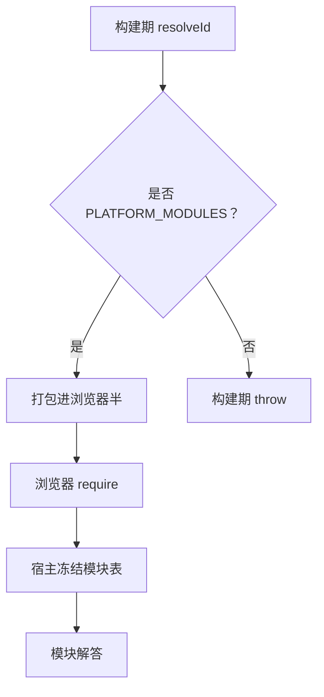

**图示来源**
- [docs/adr/0021-platform-modules-intersection.md:1-16](file://docs/adr/0021-platform-modules-intersection.md#L1-L16)

**章节来源**
- [docs/adr/0021-platform-modules-intersection.md:1-16](file://docs/adr/0021-platform-modules-intersection.md#L1-L16)
- [src/shared/wire.ts](file://src/shared/wire.ts)

### 0023：客户端可丢弃投影

**背景**  
批循环留在组件 state 会在中央座位切走时卸载，导致结果清零且站点继续收到剩余请求。

**权衡**  
- 中央 model 与官方分层规则动机一致，但手段冲突：不留第二份真相的方式是不建 client model，只建可丢弃投影。
- 轮次身份与游标必须同时校验，否则混轮或缺组。
- 全局状态条若是流内元素，会触发布局闪烁。

**结论**  
业务真相在服务端；浏览器半只持有可丢弃投影；轮次变更时丢弃旧累积并以 `since=0` 重建；点击位置即反馈位置。

**影响范围**  
- `client/search-job.ts` 负责轮次身份、游标与中止。
- `store.ts` 保存跨卸载要活下来的视图现场。
- `transient.ts` 提供 pending/settle/ok/error 三种生命周期。

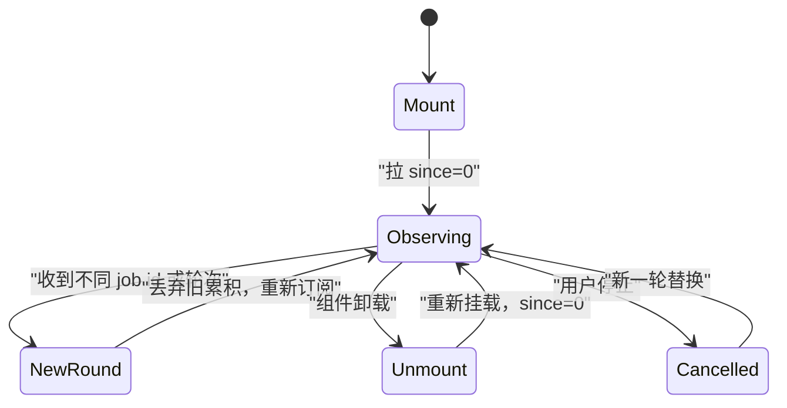

**图示来源**
- [docs/adr/0023-client-disposable-projection.md:1-13](file://docs/adr/0023-client-disposable-projection.md#L1-L13)

**章节来源**
- [docs/adr/0023-client-disposable-projection.md:1-13](file://docs/adr/0023-client-disposable-projection.md#L1-L13)
- [src/client/search-job.ts](file://src/client/search-job.ts)
- [src/client/store.ts](file://src/client/store.ts)
- [src/client/transient.ts](file://src/client/transient.ts)

### 0032：搜索相关性分区

**背景**  
聚合搜索的默认视野只摆与关键词相关的命中；对面按 contains 过滤并丢弃不匹配者；本仓认为“空结果冒充失败”是最高罪。

**权衡**  
- 自造相似度阈值会引入魔法数。
- 把 relevance 字段放进 SearchHit/SearchGroup 会把“这一轮关键词函数”存成陈旧快照。
- 全局显示全部开关会产生第二个判据主人。

**结论**  
按 exact / contains / suspect 分三档；suspect 只折叠不丢弃；规范化用于比较，不净化书目字段；分类命中不升档。

**影响范围**  
- `shared/relevance.ts` 的 `relevanceOf` / `partitionByRelevance` / RELEVANCE_RANK / RANKED。
- `shared/wire.ts` 的 Relevance 形状。
- SearchView、CityBookSheet、tools.searchBooks 三个落点决定 suspect 去处。
- merge-by-book 只收 kept，不替 suspect 定去处。

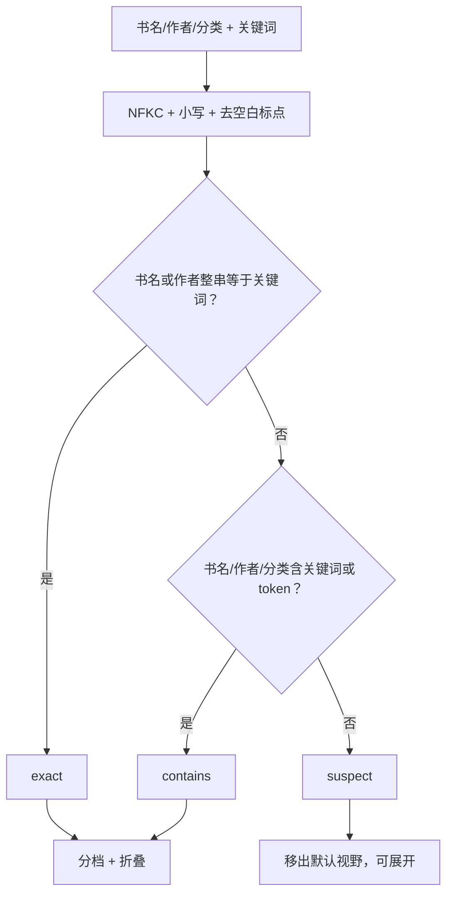

**图示来源**
- [docs/adr/0032-search-relevance-partition.md:1-26](file://docs/adr/0032-search-relevance-partition.md#L1-L26)

**章节来源**
- [docs/adr/0032-search-relevance-partition.md:1-26](file://docs/adr/0032-search-relevance-partition.md#L1-L26)
- [src/shared/relevance.ts](file://src/shared/relevance.ts)
- [src/shared/wire.ts](file://src/shared/wire.ts)

### 0035：插件配置页活引用

**背景**  
七项运行参数放进宿主 plugins.bundle.config；整插件重载代价大，dataDir 又确实不能热更。

**权衡**  
- 八个字段全可编辑会制造第二配置主人与兼容面。
- 把 dataDir 也标 volatile 会造成“保存了但不生效”的静默失败。
- 代理清空后重探测系统代理会增加热更新路径复杂度。

**结论**  
schema 标 `.volatile()`，Loader 返回稳定 ref；`resolveConfig` 返回只读 getter；每次操作读当前值；dataDir 仍需重启。

**影响范围**  
- `config.ts` 的 Config / resolveConfig / ResolvedConfig。
- `reading.ts` 的 staticLiveConfig 与 localImportMaxBytes。
- `fetcher.ts` 在 proxyUrl 变更时替换 undici dispatcher。
- `client/config-page.tsx` 注册配置卡片。

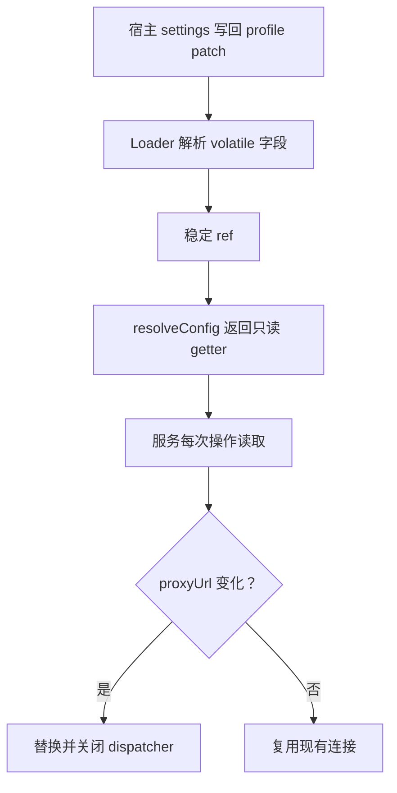

**图示来源**
- [docs/adr/0035-plugin-config-page-live-refs.md:1-15](file://docs/adr/0035-plugin-config-page-live-refs.md#L1-L15)

**章节来源**
- [docs/adr/0035-plugin-config-page-live-refs.md:1-15](file://docs/adr/0035-plugin-config-page-live-refs.md#L1-L15)
- [src/config.ts](file://src/config.ts)
- [src/client/config-page.tsx](file://src/client/config-page.tsx)

### 0036：抽取机制而非转发壳

**背景**  
四处重复被归到 bridge.hitFieldsOf、shared/wire.ts 的 bodies/readBodies、explore-url.usableKind、job-holder.ts 的 HostTie/ChangeSignal；但顺手的泛型 route 注册壳与任务运行器泛型被否决。

**权衡**  
- route 注册壳臂里只剩转发，deletion test 会判它出局。
- 任务运行器泛型会把“只有 explore 用的注入位”塞进壳，使壳再次退化为转发。
- 传输层分派与业务判据必须分开。

**结论**  
只抽机械：挂点、信号、body 形状；不抽转发壳；status 码归属 guard/wire 分类表，不新建第三面。

**影响范围**  
- `bridge.ts` 的 hitFieldsOf。
- `shared/wire.ts` 的 bodies / readBodies / BODY。
- `explore-url.ts` 的 usableKind / usableText。
- `job-holder.ts` 的 HostTie / ChangeSignal。
- `dispatch.ts` 的 unknownRoute / methodNotAllowed。

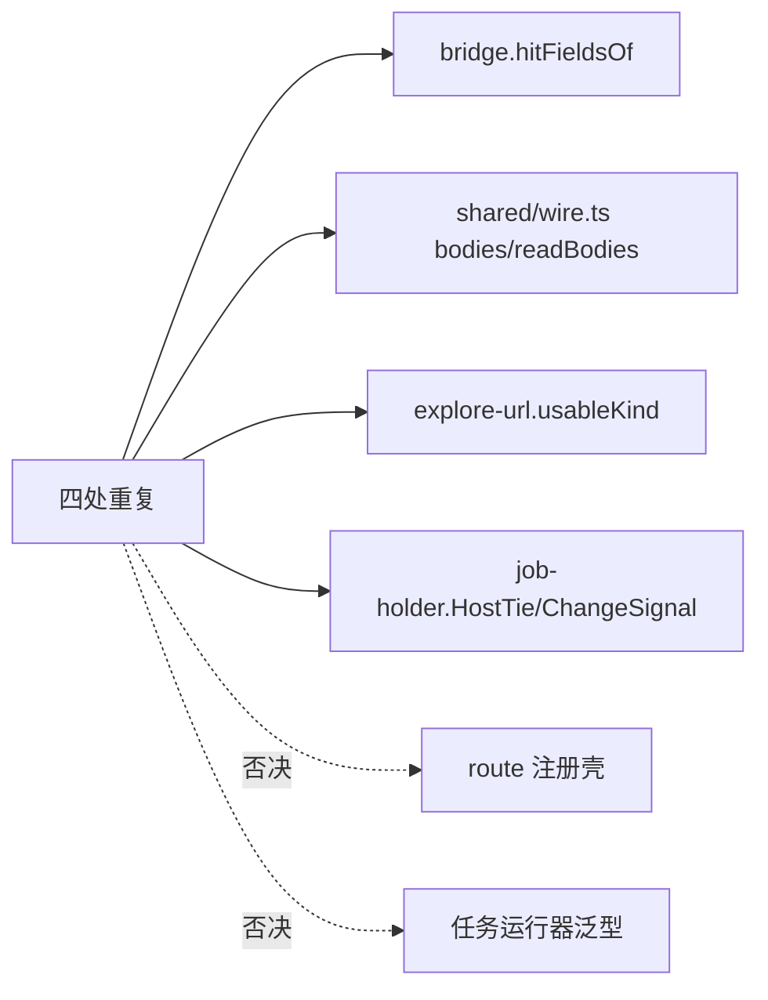

**图示来源**
- [docs/adr/0036-extract-mechanics-not-forwarding-shells.md:1-10](file://docs/adr/0036-extract-mechanics-not-forwarding-shells.md#L1-L10)

**章节来源**
- [docs/adr/0036-extract-mechanics-not-forwarding-shells.md:1-10](file://docs/adr/0036-extract-mechanics-not-forwarding-shells.md#L1-L10)
- [src/services/bridge.ts](file://src/services/bridge.ts)
- [src/shared/wire.ts](file://src/shared/wire.ts)
- [src/services/explore-url.ts](file://src/services/explore-url.ts)
- [src/services/job-holder.ts](file://src/services/job-holder.ts)
- [src/api/dispatch.ts](file://src/api/dispatch.ts)

### 0037：模态契约与单阅读器表面

**背景**  
五条浮层此前被手写五遍，已经漂出两种 Tab 圈行为；阅读器角落的多个面板也可能叠压。

**权衡**  
- 把 Dialog 塞进 bits 会让呈现小件同时成为键盘接管主人。
- 抽屉与模态几何不同族，variant 只选标记，不接管内部排版。
- 阅读浮层若做成状态机框架，会把判据住址从问题移到调度形式。

**结论**  
带遮罩浮层统一走 `Dialog`；阅读器角落面至多一角；入场焦点只认面板内第一颗未禁用钮；Tab 圈认面板内全部可聚焦件。

**影响范围**  
- `client/views/dialog.tsx` 的 Dialog / FOCUSABLE。
- `client/reader-surfaces.ts` 的 openSurface / closeAll / dismissSurface / maskFor。
- 书架删书、源删书、阅读器入架一问、导入弹层、书籍详情浮层统一契约。

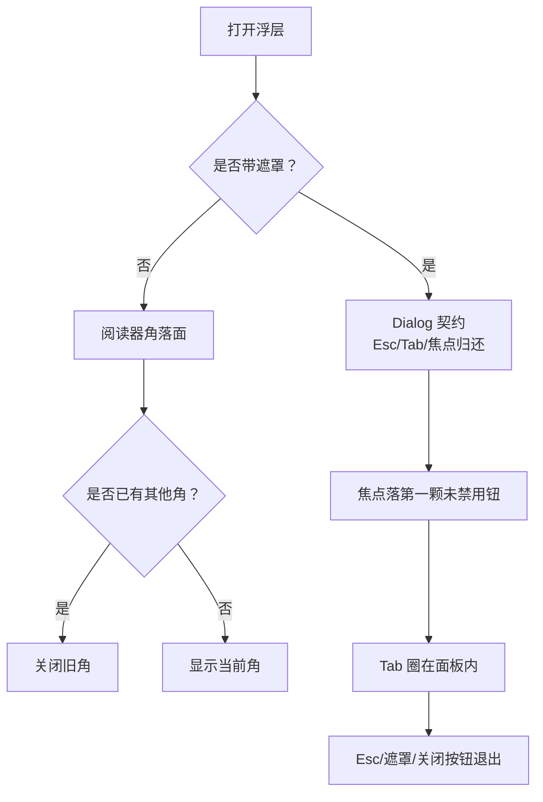

**图示来源**
- [docs/adr/0037-modal-contract-and-single-reader-surface.md:1-28](file://docs/adr/0037-modal-contract-and-single-reader-surface.md#L1-L28)

**章节来源**
- [docs/adr/0037-modal-contract-and-single-reader-surface.md:1-28](file://docs/adr/0037-modal-contract-and-single-reader-surface.md#L1-L28)
- [src/client/views/dialog.tsx](file://src/client/views/dialog.tsx)
- [src/client/reader-surfaces.ts](file://src/client/reader-surfaces.ts)

### 0038：客户端复制文案走宿主 locale

**背景**  
浏览器半原先中文散在各组件；i18n 运行时增加纯度门解释成本；旧宿主不一定提供 locale 服务。

**权衡**  
- JSON 字典与 i18n 运行时增加依赖与加载面。
- 硬 inject locale 会让旧宿主无法激活插件。
- slot 声明 locale 席位在未安装 face 的宿主上会抛。
- 按 message 前缀猜来源会回到 0016 否掉的判据。

**结论**  
TS 字典 ZH/EN 合成单一键类型；可选读 locale 服务，缺席回退 zhTranslate；错误只翻客户端自造的那一类；AST 守卫扫描客户端中文文案。

**影响范围**  
- `client/copy/index.tsx` 的 ZH / EN / createTranslate / zhTranslate / CopyProvider / useCopy。
- `client/api.ts` 的 describeError / NetworkReason。
- `client/index.tsx` 的 inject 缝。
- 测试用 AST 扫字符串、模板串与 JSX 文本中的中文。

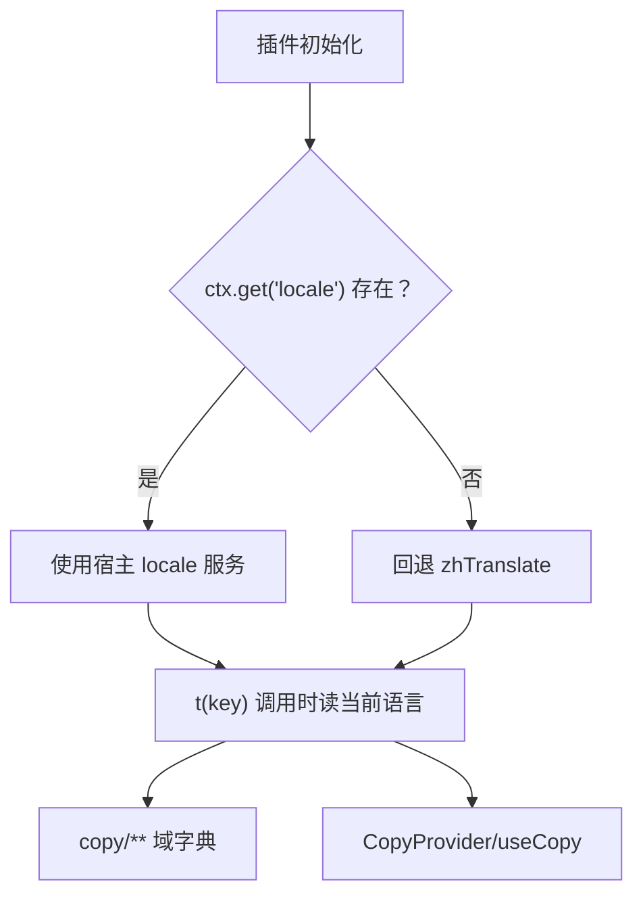

**图示来源**
- [docs/adr/0038-client-copy-host-locale.md:1-12](file://docs/adr/0038-client-copy-host-locale.md#L1-L12)

**章节来源**
- [docs/adr/0038-client-copy-host-locale.md:1-12](file://docs/adr/0038-client-copy-host-locale.md#L1-L12)
- [src/client/copy/index.tsx](file://src/client/copy/index.tsx)
- [src/client/api.ts](file://src/client/api.ts)
- [src/client/index.tsx](file://src/client/index.tsx)

## 依赖关系分析

ADR 之间的强依赖如下：

| 上层决策 | 依赖的底层决策 | 原因 |
|---|---|---|
| 0017 边界降级 | 0001 解析期失败优先 | 解析期错误不走降级，必须上抛 |
| 0017 边界降级 | 0002 reduce 从不塌陷 | Miss 与空 List 不能折叠，零命中不得静默 |
| 0015 请求门 | 0016 双层错误 | 守门 fetcher 必须分类所有出站异常 |
| 0018 任务进度 | 0023 客户端投影 | 客户端轮次身份与游标依赖服务端快照语义 |
| 0032 搜索分区 | 0023 客户端投影 | suspect 折叠发生在客户端呈现层 |
| 0036 抽取机制 | 0016 双层错误 | unknownRoute/methodNotAllowed 归属路由层，不抽转发壳 |
| 0038 客户端文案 | 0016 双层错误 | describeError 只翻客户端错误，服务端错误原文透传 |

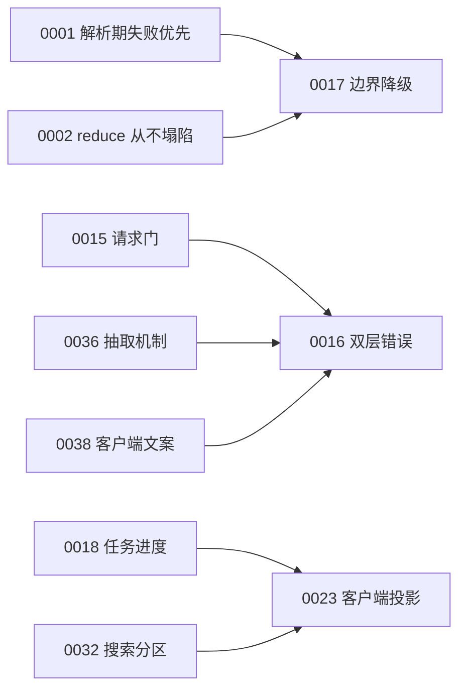

**图示来源**
- [docs/adr/0001-fail-loud-at-parse-time.md:1-9](file://docs/adr/0001-fail-loud-at-parse-time.md#L1-L9)
- [docs/adr/0002-reduction-never-collapses.md:1-9](file://docs/adr/0002-reduction-never-collapses.md#L1-L9)
- [docs/adr/0015-one-door-for-request-and-outbound.md:1-14](file://docs/adr/0015-one-door-for-request-and-outbound.md#L1-L14)
- [docs/adr/0016-error-two-tier-and-origin-fence.md:1-10](file://docs/adr/0016-error-two-tier-and-origin-fence.md#L1-L10)
- [docs/adr/0017-degrade-with-boundary.md:1-13](file://docs/adr/0017-degrade-with-boundary.md#L1-L13)
- [docs/adr/0018-server-side-jobs-and-progress.md:1-13](file://docs/adr/0018-server-side-jobs-and-progress.md#L1-L13)
- [docs/adr/0023-client-disposable-projection.md:1-13](file://docs/adr/0023-client-disposable-projection.md#L1-L13)
- [docs/adr/0032-search-relevance-partition.md:1-26](file://docs/adr/0032-search-relevance-partition.md#L1-L26)
- [docs/adr/0036-extract-mechanics-not-forwarding-shells.md:1-10](file://docs/adr/0036-extract-mechanics-not-forwarding-shells.md#L1-L10)
- [docs/adr/0038-client-copy-host-locale.md:1-12](file://docs/adr/0038-client-copy-host-locale.md#L1-L12)

## 性能与可维护性约束

这些 ADR 共同形成一组可检验约束：

1. **解析期必须早于求值期**：新增规则语法不能在求值期才暴露，否则普查与导入预检读数失真。
2. **reduce 契约只有一处**：`reducePicked` 是 Miss 与空 List 的唯一裁决点。
3. **JSONPath/XPath 子集边界可审计**：越界语法必须有定位抛错，不能静默错值。
4. **usage 轴是唯一分派依据**：不得新增按值 kind 猜测的第二判据。
5. **不凭空造存储层**：变量、cookie、source 键值、cache 必须按源建档，不提前实现持久化。
6. **落盘只有一条队列**：并发 rename 必须串行；临时件与备份件命名约定唯一。
7. **URL 选项不可剥离**：bookKey 包含 `,{option}`，剥选项等于改写请求规格。
8. **错误分类与路由自检错误分家**：HTTP 状态码改类型，不改 message 前缀。
9. **降级有边界**：name/author/bookUrl/tocUrl 不吞，正文零命中首屏抛错。
10. **任务槽与进度语义不可互换**：停止不等于失败，游标快照是真相。
11. **platform modules 取交集**：构建期纯度门不能退化。
12. **客户端投影可丢弃**：批循环不驻组件 state，轮次变更必须重基线。
13. **相关性分区只有一份判据**：suspect 折叠不改变命中本身。
14. **配置热更不重载插件**：dataDir 除外。
15. **只抽机械不抽转发壳**：status 码归属 guard/wire，不新建 shell。
16. **浮层行为只有一份契约**：Dialog 与阅读器角落面不再手写焦点逻辑。
17. **文案走宿主 locale**：TS 字典、可选回退、AST 中文守卫共同守门。

[本节为总结性指导，不直接分析具体源码文件]

## 故障排查指南

| 现象 | 优先检查的 ADR | 排查要点 |
|---|---|---|
| 规则语法识别不一致 | 0001 | 查看 parseRule 是否把未知段提前抛出；确认普查与导入预检走真实入口 |
| `||` 兜底意外失效 | 0002 | 检查 reducePicked 是否把空 List 误当 Miss |
| JSONPath/XPath 行为漂移 | 0006 | 确认是否在解析期拒绝越界语法，而不是依赖外部库 |
| 同一规则在不同链位置结果不同 | 0007 | 检查 usage 轴是否被绕过，或中链提前串化节点集 |
| 变量/cookie 跨源污染 | 0008 | 确认 SourceSession 是否按源建档，作用域是否只有两级 |
| 注册表或缓存损坏后整库消失 | 0013 | 检查 readJson 是否区分 ENOENT 与损坏；不要自行拼 .bak |
| POST API 章节 405 | 0015 | 检查 URL 是否被 strip 掉 `,{option}` |
| 500 与 404 混在一起 | 0016 | 改用 ErrorCategory，不要按 message 前缀猜状态 |
| 某个源搜索可用但详情不可用 | 0017 | 检查 name/author/bookUrl/tocUrl 是否被吞；正文零命中是否首屏抛错 |
| 停止后刷新看到“失败” | 0018 | 检查 cancelled 是否走契约字段，而不是比对中文 |
| 浏览器 bundle 引入宿主不支持模块 | 0021 | 检查 PLATFORM_MODULES 与 resolveId 纯度门 |
| 切换页面后搜索结果丢失 | 0023 | 检查批循环是否留在组件 state；轮次身份与游标是否校验 |
| 搜索结果误判相关性 | 0032 | 检查 relevanceOf / partitionByRelevance，不要新增阈值 |
| 修改配置不生效 | 0035 | 检查 dataDir 是否需要重启；proxyUrl 是否替换 dispatcher |
| 新增路由报 404/405 但测试找不到证据 | 0036 | 检查 unknownRoute/methodNotAllowed 是否同步更新 |
| 浮层焦点混乱 | 0037 | 确认走 Dialog 契约，或阅读器角落面只开一角 |
| 界面出现中文硬编码 | 0038 | 检查 copy 字典与 AST 中文守卫；describeError 是否按 reason 分类 |

**章节来源**
- [docs/adr/0001-fail-loud-at-parse-time.md:1-9](file://docs/adr/0001-fail-loud-at-parse-time.md#L1-L9)
- [docs/adr/0002-reduction-never-collapses.md:1-9](file://docs/adr/0002-reduction-never-collapses.md#L1-L9)
- [docs/adr/0006-self-implemented-subsets.md:1-9](file://docs/adr/0006-self-implemented-subsets.md#L1-L9)
- [docs/adr/0007-usage-axis-single.md:1-9](file://docs/adr/0007-usage-axis-single.md#L1-L9)
- [docs/adr/0008-no-speculative-storage.md:1-14](file://docs/adr/0008-no-speculative-storage.md#L1-L14)
- [docs/adr/0013-single-atomic-write-queue.md:1-15](file://docs/adr/0013-single-atomic-write-queue.md#L1-L15)
- [docs/adr/0015-one-door-for-request-and-outbound.md:1-14](file://docs/adr/0015-one-door-for-request-and-outbound.md#L1-L14)
- [docs/adr/0016-error-two-tier-and-origin-fence.md:1-10](file://docs/adr/0016-error-two-tier-and-origin-fence.md#L1-L10)
- [docs/adr/0017-degrade-with-boundary.md:1-13](file://docs/adr/0017-degrade-with-boundary.md#L1-L13)
- [docs/adr/0018-server-side-jobs-and-progress.md:1-13](file://docs/adr/0018-server-side-jobs-and-progress.md#L1-L13)
- [docs/adr/0021-platform-modules-intersection.md:1-16](file://docs/adr/0021-platform-modules-intersection.md#L1-L16)
- [docs/adr/0023-client-disposable-projection.md:1-13](file://docs/adr/0023-client-disposable-projection.md#L1-L13)
- [docs/adr/0032-search-relevance-partition.md:1-26](file://docs/adr/0032-search-relevance-partition.md#L1-L26)
- [docs/adr/0035-plugin-config-page-live-refs.md:1-15](file://docs/adr/0035-plugin-config-page-live-refs.md#L1-L15)
- [docs/adr/0036-extract-mechanics-not-forwarding-shells.md:1-10](file://docs/adr/0036-extract-mechanics-not-forwarding-shells.md#L1-L10)
- [docs/adr/0037-modal-contract-and-single-reader-surface.md:1-28](file://docs/adr/0037-modal-contract-and-single-reader-surface.md#L1-L28)
- [docs/adr/0038-client-copy-host-locale.md:1-12](file://docs/adr/0038-client-copy-host-locale.md#L1-L12)

## 结论

这组 ADR 的共同主线是：**尽早暴露错误、减少静默成功、收敛唯一主人、把呈现层与业务真相分离**。解析期抛错与 reduce 不折叠保证数据流可诊断；自实现子集与单 usage 轴保证求值语义可审计；单原子写队列与请求门保证持久化与网络副作用可控；双层错误与 Origin 围栏保护 HTTP 契约；边界降级、任务分槽、平台模块交集、客户端投影、相关性分区、活配置、抽取机制、模态契约与宿主 locale 则把复杂系统拆成可维护的边界。

对后续开发者的硬性约束可概括为：

- 新增规则语法必须能解析或解析期抛错。
- 新增取值路径必须走 reducePicked 与 usage 轴。
- 新增存储必须证明真实需求，不得预先造层。
- 新增写操作必须走单原子队列。
- 新增网络请求不得绕过 assembleRequest 与守门 fetcher。
- 新增错误不得按 message 前缀分类。
- 新增降级不得扩大吞错范围。
- 新增任务不得抢占写槽，停止不得伪装失败。
- 新增浏览器依赖必须通过 PLATFORM_MODULES 纯度门。
- 新增客户端状态不得在组件 state 中长期持有批循环。
- 新增搜索相关性不得引入阈值或额外契约字段。
- 新增配置不得假热更。
- 新增重复代码必须先查是否已是转发壳。
- 新增浮层必须遵守 Dialog 或阅读器角落面契约。
- 新增客户端文案必须走 copy 字典与 locale 回退。

[本节为总结性内容，不直接分析具体源码文件]