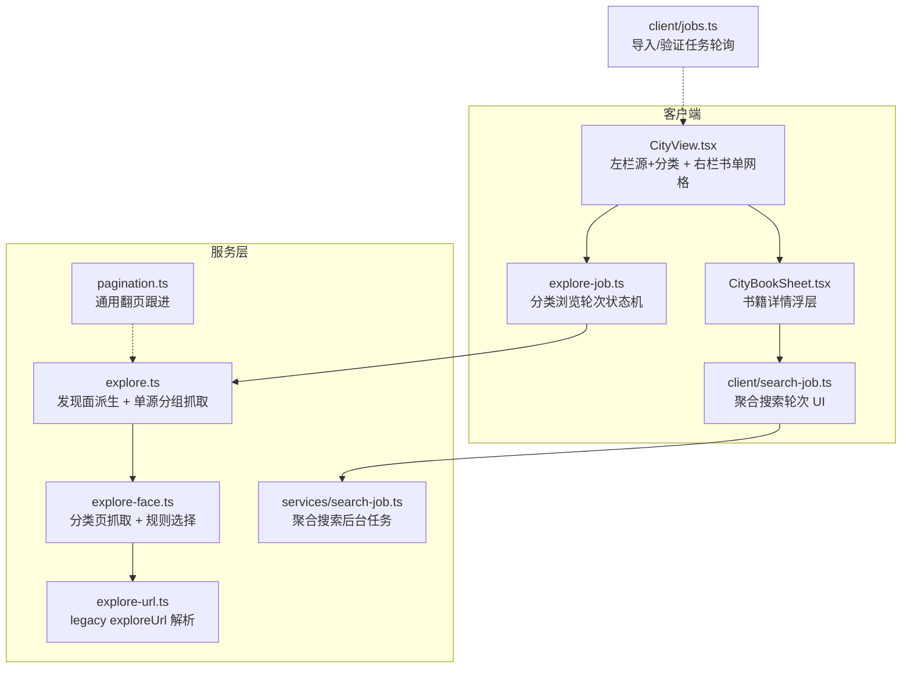
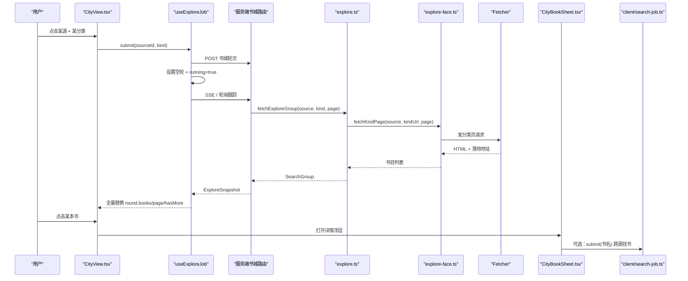
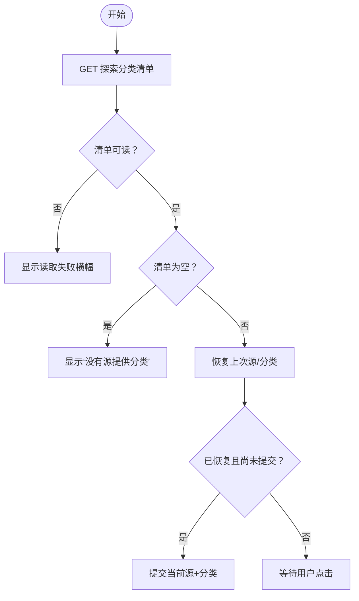
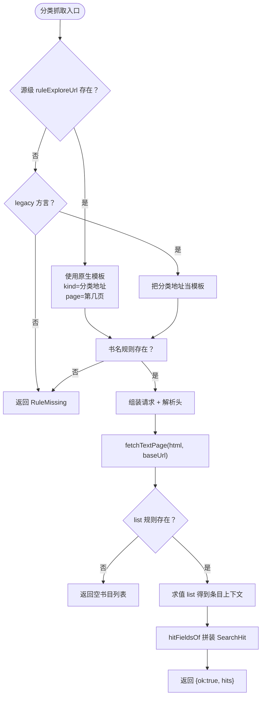
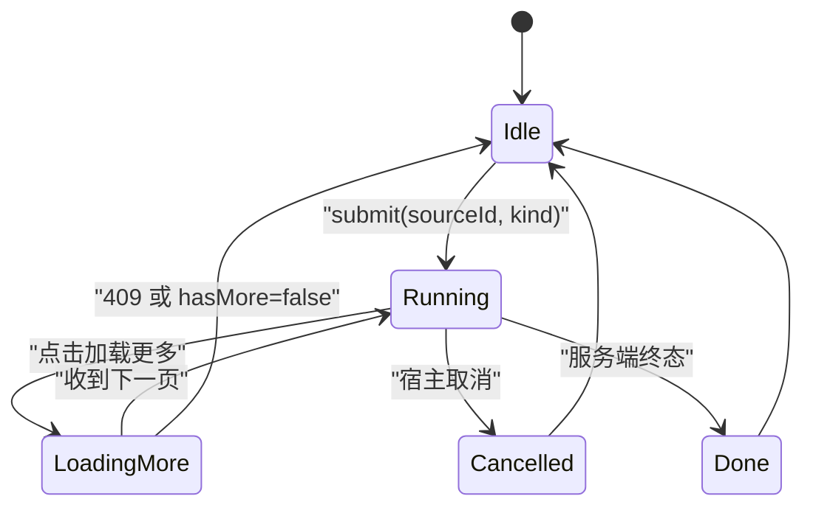
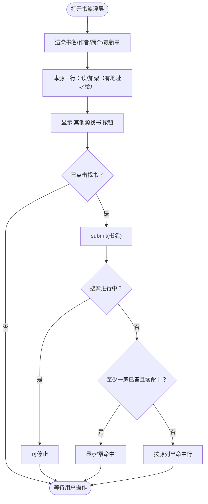
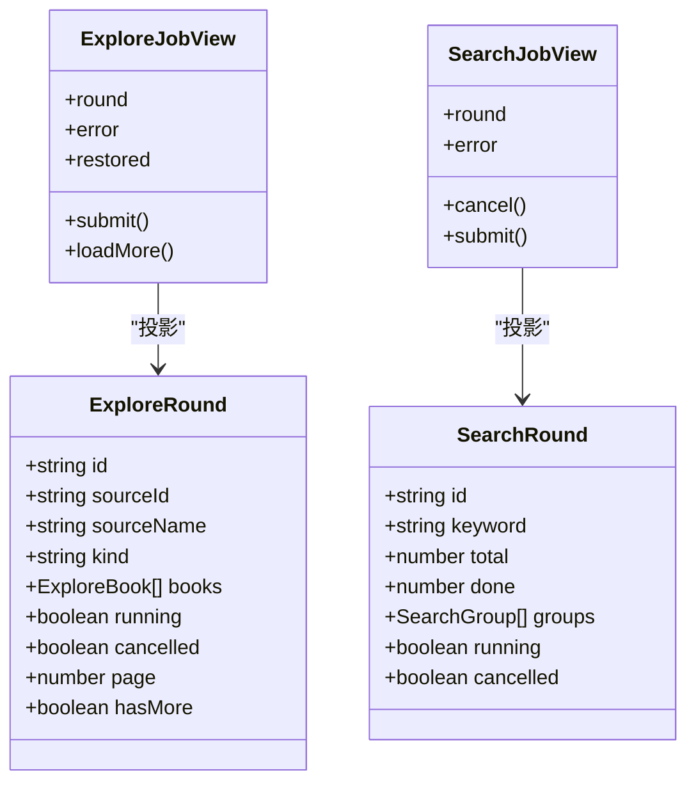
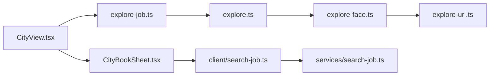
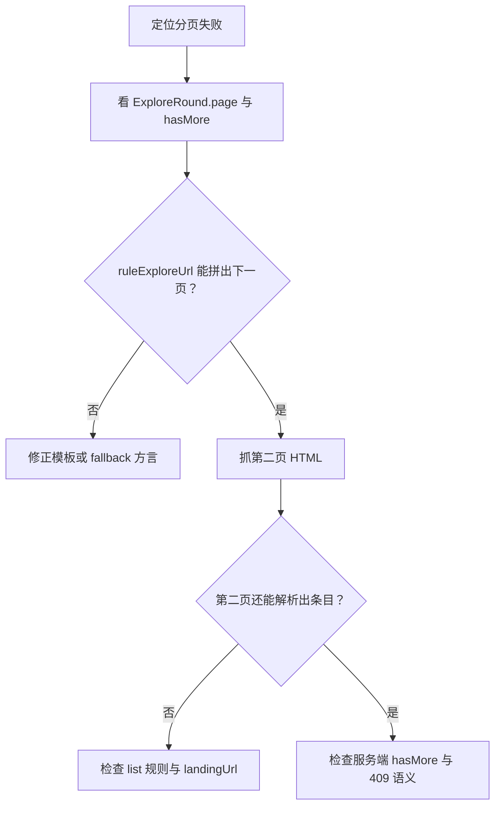

# 书城（分类浏览）

<cite>
**本文引用的文件**   
- [explore.ts](file://src/services/explore.ts)
- [explore-face.ts](file://src/services/explore-face.ts)
- [explore-url.ts](file://src/services/explore-url.ts)
- [pagination.ts](file://src/services/pagination.ts)
- [search-job.ts](file://src/services/search-job.ts)
- [CityView.tsx](file://src/client/views/CityView.tsx)
- [CityBookSheet.tsx](file://src/client/views/CityBookSheet.tsx)
- [explore-job.ts](file://src/client/explore-job.ts)
- [search-job.ts](file://src/client/search-job.ts)
</cite>

## 目录
1. [简介](#简介)
2. [项目结构](#项目结构)
3. [核心组件](#核心组件)
4. [架构总览](#架构总览)
5. [详细组件分析](#详细组件分析)
6. [依赖关系分析](#依赖关系分析)
7. [性能考虑](#性能考虑)
8. [故障排查指南](#故障排查指南)
9. [扩展书城源实现步骤](#扩展书城源实现步骤)
10. [结论](#结论)

## 简介
本文件文档化“书城”分类浏览功能：用户在左栏选择一个书城源与一个分类入口，右栏按该源自己声明的分类展示书籍卡片；支持分页加载；点击书籍弹出详情浮层，展示简介并提供“读/加架/其他源找书”。书城走的是“按分类拉取书单”，区别于搜索面“按关键词聚合全文”。

书城的关键设计点包括：
- 左栏来源可以是原生 `ruleFind.kinds`，也可以是 legacy `exploreUrl` 方言。
- 右栏分类由参与书城的那个源自己声明，不做跨源合并或同义词归一。
- 书单网格默认 4 列，窄面板 2 列；支持服务端驱动的“加载更多”。
- 详情浮层不重新请求详情页，复用分类命中里的简介、封面等字段。
- 空分类关闭、错误源折叠、分页游标完全跟随服务端快照。

## 项目结构
书城相关代码分布在服务层与客户端视图层两个层次：

**图表来源**
- [CityView.tsx:1-200](file://src/client/views/CityView.tsx#L1-L200)
- [CityBookSheet.tsx:1-200](file://src/client/views/CityBookSheet.tsx#L1-L200)
- [explore-job.ts:1-200](file://src/client/explore-job.ts#L1-L200)
- [search-job.ts:1-200](file://src/client/search-job.ts#L1-L200)
- [explore.ts:1-75](file://src/services/explore.ts#L1-L75)
- [explore-face.ts:1-105](file://src/services/explore-face.ts#L1-L105)
- [explore-url.ts:1-119](file://src/services/explore-url.ts#L1-L119)
- [pagination.ts:1-91](file://src/services/pagination.ts#L1-L91)

**章节来源**
- [CityView.tsx:1-200](file://src/client/views/CityView.tsx#L1-L200)
- [CityBookSheet.tsx:1-200](file://src/client/views/CityBookSheet.tsx#L1-L200)
- [explore-job.ts:1-200](file://src/client/explore-job.ts#L1-L200)
- [explore.ts:1-75](file://src/services/explore.ts#L1-L75)
- [explore-face.ts:1-105](file://src/services/explore-face.ts#L1-L105)
- [explore-url.ts:1-119](file://src/services/explore-url.ts#L1-L119)

## 核心组件
- **发现面派生**：从参与书城的源中派生“每个源有哪些分类标题”，保留源内顺序并去重。
- **单源分组抓取**：对某个源的一个分类发起一次抓取，返回一组书目；失败或规则缺失以带 `error` 的组表示，不抛错。
- **分类模板与方言**：优先使用源级 `ruleExploreUrl`（原生分页语义），否则回落到 legacy `exploreUrl`；两者规则不可混用。
- **书城轮次**：客户端维护一轮 = 一个源 + 一个分类的全量快照，含页码、是否还有更多、是否在运行、是否被停止。
- **书籍详情浮层**：复用分类命中的简介等元信息，提供读、加架、跨源找书三个动作。
- **搜索轮次**：服务端持有聚合搜索结果，客户端按游标增量累积。

**章节来源**
- [explore.ts:1-75](file://src/services/explore.ts#L1-L75)
- [explore-face.ts:1-105](file://src/services/explore-face.ts#L1-L105)
- [explore-job.ts:1-200](file://src/client/explore-job.ts#L1-L200)
- [CityBookSheet.tsx:1-200](file://src/client/views/CityBookSheet.tsx#L1-L200)
- [search-job.ts:1-174](file://src/services/search-job.ts#L1-L174)

## 架构总览
书城是“按源 + 按分类”的单向浏览流；搜索是“按关键词 + 多源聚合”的增量结果流。

**图表来源**
- [CityView.tsx:1-200](file://src/client/views/CityView.tsx#L1-L200)
- [explore-job.ts:1-200](file://src/client/explore-job.ts#L1-L200)
- [explore.ts:1-75](file://src/services/explore.ts#L1-L75)
- [explore-face.ts:1-105](file://src/services/explore-face.ts#L1-L105)
- [CityBookSheet.tsx:1-200](file://src/client/views/CityBookSheet.tsx#L1-L200)
- [search-job.ts:1-200](file://src/client/search-job.ts#L1-L200)

## 详细组件分析

### 分类发现与源清单
- 书城只让参与方进城：启用、文本源、有分类入口、未关闭发现。
- 每个源的分类标题来自 `ruleFind.kinds`；若源提供了 legacy `exploreUrl`，它也能提供分类入口，但解析形态必须是 JSON 或文本档。
- 分类标题按源声明顺序输出，同源内去重；不做跨源合并、不排序、不带计数。
- 如果所有源都没有可用分类，左栏会显示“没有源提供分类浏览”的空态。

**图表来源**
- [CityView.tsx:1-200](file://src/client/views/CityView.tsx#L1-L200)

**章节来源**
- [explore.ts:1-75](file://src/services/explore.ts#L1-L75)
- [explore-url.ts:1-119](file://src/services/explore-url.ts#L1-L119)
- [CityView.tsx:1-200](file://src/client/views/CityView.tsx#L1-L200)

### 分类模板优先级与方言
书城分类抓取有两个入口形态：

| 形态 | 说明 | 分页语义 |
|---|---|---|
| 原生 `ruleFind.kinds` | 每个条目是 `{title, url}`，`url` 是分类入口地址 | 需要由 `ruleExploreUrl` 指定首页裁页与分页变量 |
| legacy `exploreUrl` | 值可声明为 JS、JSON 或文本档 | JSON/文本档直接给出分类标题和地址；JS 档由调用方处理 |

分类模板选择优先级：
1. 先检查源级 `ruleExploreUrl` 是否存在。
2. 存在时，把它当作原生模板，传入 `{kind: 分类地址, page}`，并用 `trimFirstPage=true` 走首页裁页。
3. 不存在时，只有 legacy 方言才兜底把 `kindUrl` 本身当模板；原生方言缺失即报 `RuleMissing`。
4. 无论哪种模板，书名规则都必须存在；否则整次分类结果为“规则缺失”，不是空书单。

**图表来源**
- [explore-face.ts:1-105](file://src/services/explore-face.ts#L1-L105)

**章节来源**
- [explore-face.ts:1-105](file://src/services/explore-face.ts#L1-L105)
- [explore-url.ts:1-119](file://src/services/explore-url.ts#L1-L119)

### 分页游标与加载更多
书城分页是“按轮续页”，不是“按源分页”。关键规则：

- 每轮携带 `page` 与 `hasMore`。
- 客户端**不自己给 page 加 1**，只读服务端传回的页码。
- “加载更多”按钮只在 `hasMore` 为真时出现。
- 按钮本地禁用态由 `running` 控制：正在加载时不能重复点。
- 续页调用 `loadMore()`，向同一轮 id 再打一页；服务端返回 409 表示“此刻没得可加载”，不算失败，只收起按钮。
- 分类页的分页链接解析失败属于抓取或规则问题，应落在错误泳道；不应伪装成“正常空分类”。

**图表来源**
- [explore-job.ts:1-200](file://src/client/explore-job.ts#L1-L200)
- [CityView.tsx:201-280](file://src/client/views/CityView.tsx#L201-L280)

**章节来源**
- [explore-job.ts:1-200](file://src/client/explore-job.ts#L1-L200)
- [CityView.tsx:201-280](file://src/client/views/CityView.tsx#L201-L280)

### 书籍详情浮层
书籍详情浮层只做三件事：

1. **阅读**：跳转到阅读器，使用该书在该源上的地址。
2. **加入书架**：通过搜索面的入架路径写入书架；重复调用幂等。
3. **其他源找书**：触发聚合搜索，关键词为该书的标题；结果进入搜索面最近一轮。

浮层行为要点：
- 如果该书在本源上缺少地址，则不提供“读”和“加架”。
- 简介直接使用分类命中中的 `intro`，不再额外请求详情页。
- 跨源搜索结果区分：进行中、已停止、无源、零命中、各源命中、未响应。
- 浮层内的代表行由相关性判据决定，疑似无关条目折叠在下方。

**图表来源**
- [CityBookSheet.tsx:1-200](file://src/client/views/CityBookSheet.tsx#L1-L200)
- [CityBookSheet.tsx:201-281](file://src/client/views/CityBookSheet.tsx#L201-L281)

**章节来源**
- [CityBookSheet.tsx:1-200](file://src/client/views/CityBookSheet.tsx#L1-L200)
- [CityBookSheet.tsx:201-281](file://src/client/views/CityBookSheet.tsx#L201-L281)

### ExploreJob 与 SearchJob 的差异
书城分类浏览与搜索是两个不同任务模型：

| 维度 | 书城分类浏览（ExploreJob） | 聚合搜索（SearchJob） |
|---|---|---|
| 入口 | 源 + 分类 | 关键词 |
| 数据模型 | 全量快照：每帧整体替换 `round` | 游标增量：客户端累积 `groups` |
| 身份 | 不需要客户端保留身份副本 | 需要比较 `job.id`，换轮则 `since=0` 重基线 |
| 分页 | 续页在同一轮里追加书目，不改轮 id | 搜索完成即结束，没有“加载更多” |
| 停止 | 宿主取消后保留结果，文案说“已停止” | 用户主动停止也保留已搜分组 |
| 观察通道 | SSE 优先 + 轮询兜底 | SSE 优先 + 轮询兜底 |
| 典型失败 | 分类规则缺失、抓取失败、409 续页 | 源未响应、整轮失败、无命中 |

**图表来源**
- [explore-job.ts:1-200](file://src/client/explore-job.ts#L1-L200)
- [search-job.ts:1-200](file://src/client/search-job.ts#L1-L200)
- [search-job.ts:1-174](file://src/services/search-job.ts#L1-L174)

**章节来源**
- [explore-job.ts:1-200](file://src/client/explore-job.ts#L1-L200)
- [search-job.ts:1-200](file://src/client/search-job.ts#L1-L200)
- [search-job.ts:1-174](file://src/services/search-job.ts#L1-L174)

## 依赖关系分析
书城的主要依赖链如下：

**图表来源**
- [CityView.tsx:1-200](file://src/client/views/CityView.tsx#L1-L200)
- [explore-job.ts:1-200](file://src/client/explore-job.ts#L1-L200)
- [explore.ts:1-75](file://src/services/explore.ts#L1-L75)
- [explore-face.ts:1-105](file://src/services/explore-face.ts#L1-L105)
- [explore-url.ts:1-119](file://src/services/explore-url.ts#L1-L119)
- [CityBookSheet.tsx:1-200](file://src/client/views/CityBookSheet.tsx#L1-L200)
- [search-job.ts:1-200](file://src/client/search-job.ts#L1-L200)
- [search-job.ts:1-174](file://src/services/search-job.ts#L1-L174)

耦合特点：
- 分类发现与执行分离：`deriveExploreSources` 是纯函数，网络逻辑集中在 `fetchExploreGroup`。
- 分类模板与 legacy 方言解析集中到 `explore-face.ts` 与 `explore-url.ts`，避免多处判断分叉。
- 书城轮次是单源快照，不共享搜索游标；但浮层内的跨源搜索会占用搜索面槽位。
- 分页逻辑在书城侧表现为 `page`/`hasMore`，而通用翻页引擎 `pagination.ts` 主要服务于目录/正文翻页。

**章节来源**
- [explore.ts:1-75](file://src/services/explore.ts#L1-L75)
- [explore-face.ts:1-105](file://src/services/explore-face.ts#L1-L105)
- [explore-url.ts:1-119](file://src/services/explore-url.ts#L1-L119)
- [pagination.ts:1-91](file://src/services/pagination.ts#L1-L91)

## 性能考虑
- 首屏骨架卡最多 8 张，避免把“还在加载”误读为“有大量内容”。
- 分类页缓存键包含 `sourceId`、`kind`、`epoch`、`page`；成功结果才写缓存，失败不缓存以免钉住偶发错误。
- 书城轮次是全量快照，不累积；列表规模较小时代价可忽略，同时保证读面不会说谎。
- 搜索结果是增量游标，服务端对每源命中做上限截断，避免内存无限增长。
- 分类抓取只抓一次分类页，再由模板求值出条目；不要误以为每次都要逐条请求详情页。
- 图片失败表按行 key 记录，换轮清空，避免坏封面永久降级。

[本节为通用性能讨论，不直接分析具体代码片段]

## 故障排查指南

### 如何查看某分类的原始 HTML
定位链路：
1. 确认左栏选中的源与分类。
2. 在 `explore-face.ts` 的分类抓取流程中，分类 URL 由 `buildSearchRequest(template, { kind, page }, ...)` 生成。
3. 真实请求落点是 `fetchTextPage(fetcher, plan.url, ...)`，返回 `text` 与 `landedUrl`。
4. 调试时可关注：
   - 最终请求 URL 是否正确拼接了 `{{kind}}` 与 `{{page}}`。
   - `landedUrl` 是否作为相对链接基准。
   - 返回的 `text` 是否符合预期分类页结构。
   - `R.list` 求值后的上下文数量是否为 0。

常见原因：
- 使用了原生方言但未写 `ruleExploreUrl`，导致模板为空。
- 用了 legacy 方言却把分类地址当成模板，遗漏分页变量。
- `list` 选择器匹配不到条目，但书名规则仍存在，因此返回空结果而不是规则缺失。

**章节来源**
- [explore-face.ts:1-105](file://src/services/explore-face.ts#L1-L105)

### 如何定位分页链接解析失败
书城续页由 `ExploreRound.page` 与 `hasMore` 驱动，而不是由页面内的 `next` 选择器自动发现。因此：

- 如果是书城分类浏览，重点检查 `ruleExploreUrl` 是否能正确构造下一页 URL。
- 如果怀疑是站点自身分页结构异常，注意书城并不像目录/正文那样调用 `pagination.ts` 的 `followPages`；后者用于目录/正文翻页，不是书城分类分页。
- 如果分页链接解析失败，通常表现为：
  - `hasMore` 提前为假。
  - 续页返回 409。
  - 分类页能抓到首页，但第二页内容为空。
- 排查时应对比：
  - 第一页与第二页 URL 差异。
  - 模板是否带 `trimFirstPage=true`。
  - 分类地址是否被当作模板而非参数。
  - 站点是否要求特定请求头或 Cookie。

**图表来源**
- [explore-job.ts:1-200](file://src/client/explore-job.ts#L1-L200)
- [explore-face.ts:1-105](file://src/services/explore-face.ts#L1-L105)
- [pagination.ts:1-91](file://src/services/pagination.ts#L1-L91)

**章节来源**
- [explore-job.ts:1-200](file://src/client/explore-job.ts#L1-L200)
- [explore-face.ts:1-105](file://src/services/explore-face.ts#L1-L105)
- [pagination.ts:1-91](file://src/services/pagination.ts#L1-L91)

### 空分类与错误源交互
- **空分类**：分类命中为空是正常结果，不应伪装成抓取失败。如果分类规则缺失，则返回 `RuleMissing`，由上层显示为错误泳道。
- **错误源折叠**：在浮层跨源找书时，某个源返回错误会折叠展开，显示错误码与消息；未响应的源也不冒充“零命中”。
- **书城左栏错误源**：源状态为 broken 时，左栏会显示错误提示；用户仍可切换其他源。

**章节来源**
- [CityBookSheet.tsx:201-281](file://src/client/views/CityBookSheet.tsx#L201-L281)
- [explore-face.ts:1-105](file://src/services/explore-face.ts#L1-L105)
- [CityView.tsx:1-200](file://src/client/views/CityView.tsx#L1-L200)

## 扩展书城源实现步骤

### 第一步：选择分类入口形态
书城源可以选择以下两种之一：

| 方案 | 适合场景 | 必须实现的内容 |
|---|---|---|
| 原生 `ruleFind.kinds` | 站点分类入口稳定、可按标题与地址组织 | 提供若干 `{title, url}`，其中 `url` 是分类页入口 |
| legacy `exploreUrl` | 旧版书源格式迁移 | 提供 JS、JSON 或文本档分类入口 |

实现建议：
- 优先使用原生 `ruleFind.kinds`，因为它的分类标题与地址更清晰。
- 如果使用 legacy `exploreUrl`，确保 JSON 项包含 `title` 与 `url`；文本档每条形如“标题::地址”，用 `&&` 或换行分隔。
- JS 分类入口不会被本模块直接执行；它会以 `form:'js'` 返回，由调用方决定是否重新计算。

**章节来源**
- [explore-url.ts:1-119](file://src/services/explore-url.ts#L1-L119)

### 第二步：实现分类模板
如果选择了原生分类入口，还需要提供 `ruleExploreUrl`：

- 模板中必须支持 `{{kind}}` 与 `{{page}}`。
- `kind` 就是分类入口地址。
- `page` 由客户端递增，第一页通常是 1。
- 源级模板开启首页裁页语义，即首页不视为普通分页条目。
- 模板应该能返回该分类的书目列表页；不要拼出一个静态 slug，而是真正指向分类列表。

注意：
- 如果源级模板缺失，原生方言不会退化成“根地址 + slug”。
- 如果 legacy 方言存在，`kindUrl` 会被当作模板，但此时不要再依赖首页裁页语义。

**章节来源**
- [explore-face.ts:1-105](file://src/services/explore-face.ts#L1-L105)

### 第三步：实现分类模板与书单模板
书城分类抓取需要两套模板：

1. **分类模板**：由 `ruleExploreUrl` 提供，负责生成分类列表页 URL。
2. **书单模板**：由分类面规则提供，负责从分类页 HTML 中提取书目条目。

书单模板字段对应：
- 书名
- 作者
- 书籍地址
- 封面地址
- 简介
- 最新章节
- 分类
- 字数

规则选择优先级：
- 如果源提供了分类面覆盖规则，则整套使用分类面规则。
- 否则回落通用搜索规则。
- 不允许半套混合，例如列表用分类面、书名用通用搜索。

**章节来源**
- [explore-face.ts:1-105](file://src/services/explore-face.ts#L1-L105)

### 第四步：调试分类抓取
推荐调试顺序：

1. 确认分类入口是否出现在左栏。
2. 确认分类标题是否与原站一致，不要假设同义词。
3. 检查分类 URL 是否能手动访问到书目列表。
4. 检查 `ruleExploreUrl` 能否构造第二页。
5. 检查分类页 `list` 选择器是否能命中条目容器。
6. 检查书名规则是否仍能读到标题；书名缺失会直接判定为规则缺失。
7. 如果分页失败，区分是模板 URL 错误还是站点分页结构变化。

**章节来源**
- [explore-face.ts:1-105](file://src/services/explore-face.ts#L1-L105)
- [explore-url.ts:1-119](file://src/services/explore-url.ts#L1-L119)

## 结论
书城分类浏览是一个“源 + 分类”驱动的轻量浏览入口。它把分类发现、分类模板、分类页抓取、分页游标与书籍详情浮层拆成清晰的职责边界：

- 分类发现只关心“哪些源声明了哪些分类”。
- 分类抓取只关心“这个源的这个分类这一页是什么”。
- 书城轮次只关心“这一轮有没有更多、现在在第几页、是否还在跑”。
- 书籍详情浮层复用分类命中，不引入新的详情页请求。
- 搜索面独立承担关键词聚合，与书城分页互不影响。

扩展书城源时，最关键的约束是：**模板与规则不能混用、分页游标由服务端主导、空结果与规则缺失要区分、错误源与零命中要有不同文案**。遵循这些约束，就能让新源稳定接入书城。