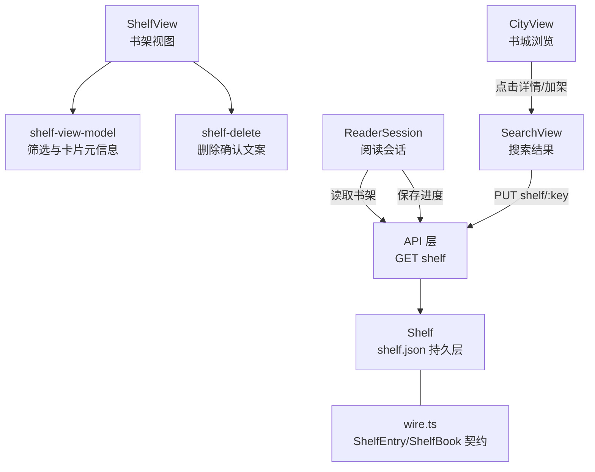
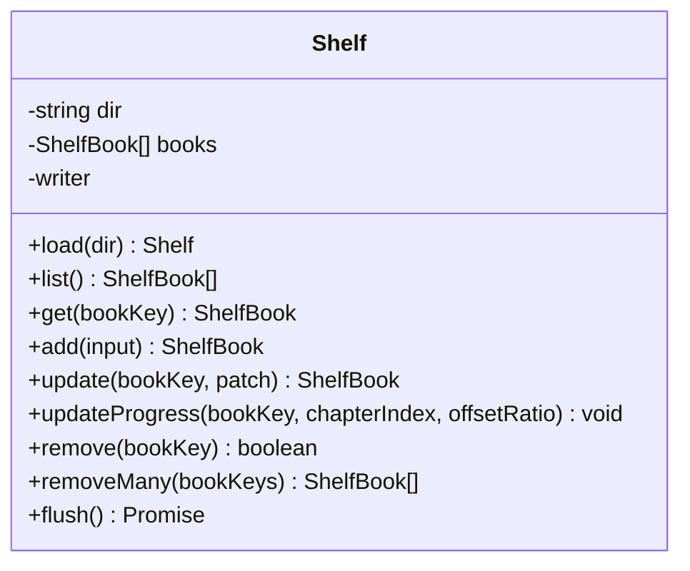
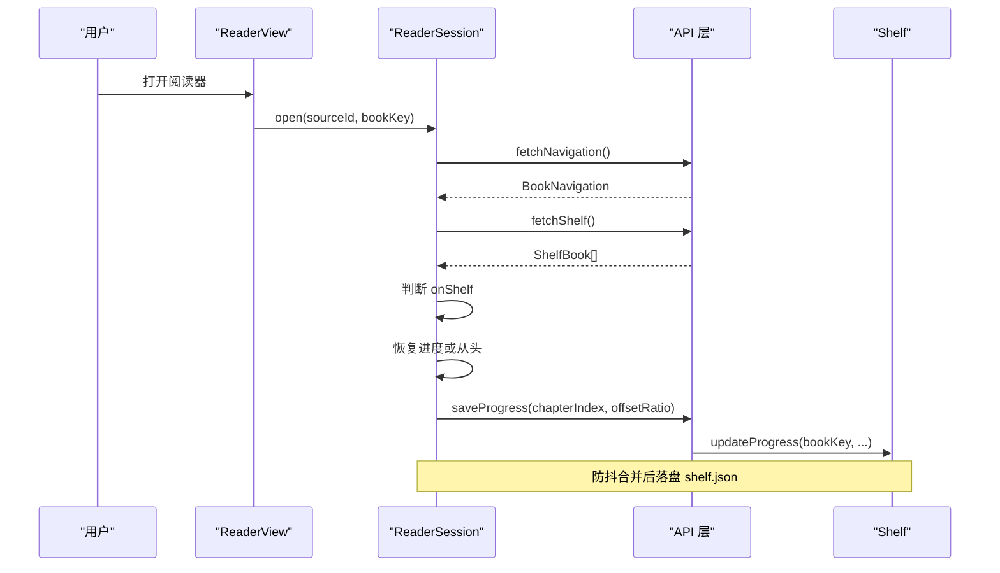
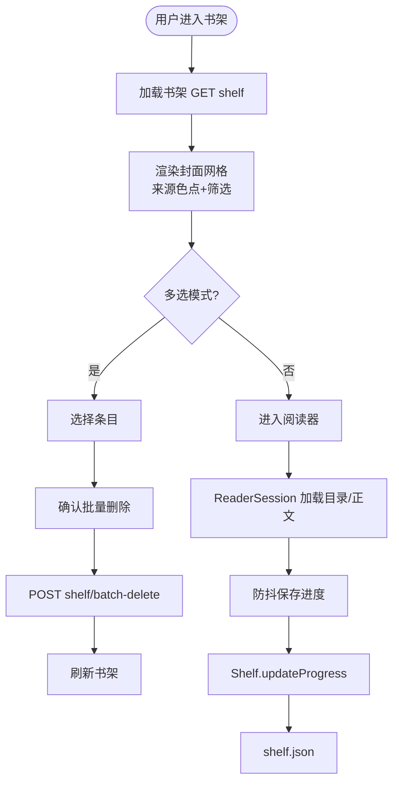
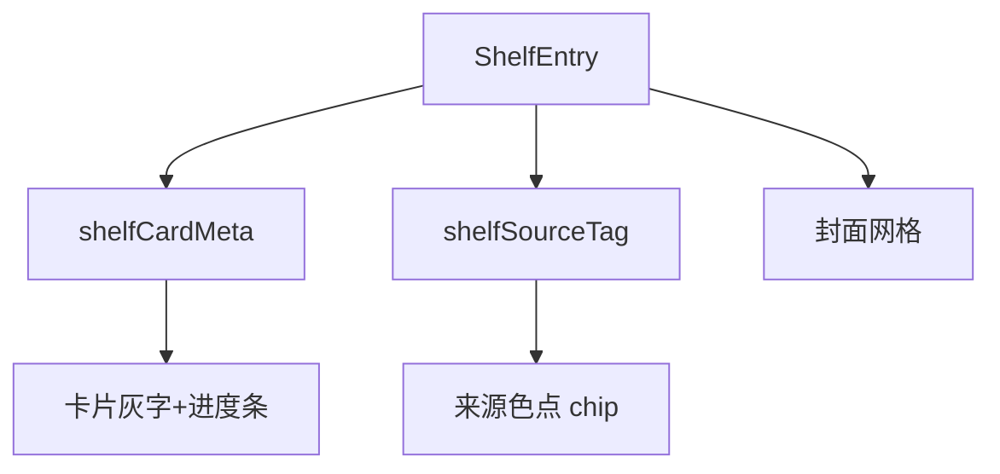
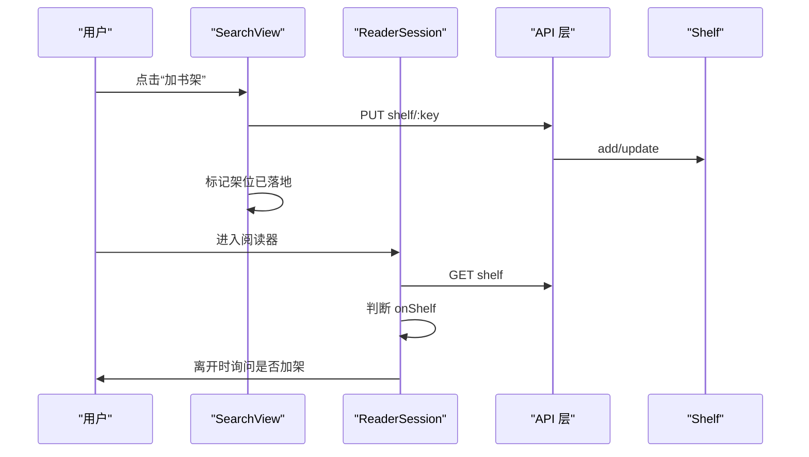
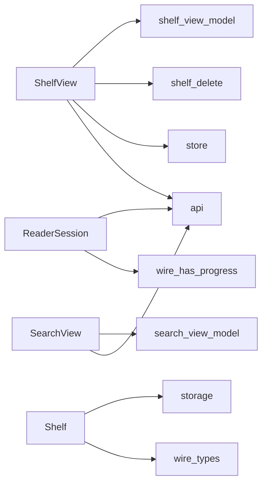

# 书架管理

<cite>
**本文引用的文件**
- [shelf-view-model.ts](file://src/client/shelf-view-model.ts)
- [ShelfView.tsx](file://src/client/views/ShelfView.tsx)
- [shelf-delete.ts](file://src/client/shelf-delete.ts)
- [shelf.ts](file://src/services/shelf.ts)
- [reading.ts](file://src/services/reading.ts)
- [reader-session.ts](file://src/client/reader-session.ts)
- [search-view-model.ts](file://src/client/search-view-model.ts)
- [SearchView.tsx](file://src/client/views/SearchView.tsx)
- [CityView.tsx](file://src/client/views/CityView.tsx)
- [wire.ts](file://src/shared/wire.ts)
- [types.ts](file://src/client/views/types.ts)
- [index.tsx](file://src/client/copy/index.tsx)
</cite>

## 目录
1. [引言](#引言)
2. [项目结构](#项目结构)
3. [核心组件](#核心组件)
4. [架构总览](#架构总览)
5. [详细组件分析](#详细组件分析)
6. [依赖关系分析](#依赖关系分析)
7. [性能与可扩展性](#性能与可扩展性)
8. [故障排查](#故障排查)
9. [结论](#结论)

## 引言
本文件面向“书架”这一持久化收藏能力，说明以下目标：
- ShelfEntry 的数据字段、来源色点与封面网格展示；
- 阅读进度如何持久化，离开阅读器时如何询问加架；
- 多选批量删除的交互与服务端调用；
- ShelfService（服务层的 Shelf）的 CRUD 接口；
- ShelfViewModel 与 ShelfView 的状态同步；
- 书架与搜索结果的区别：书架是持久化收藏，搜索结果是临时快照；
- 加架、移除、批量操作的代码示例路径；
- 书架损坏恢复策略；
- UI 定制选项与无障碍提示。

## 项目结构
书架相关代码横跨客户端视图、视图模型、会话层和服务端持久层：
- 客户端视图层：ShelfView 负责网格渲染、筛选、多选与本地书导入回执。
- 客户端逻辑层：shelf-view-model 提供筛选、卡片元信息、来源标签等纯函数。
- 客户端会话层：reader-session 负责目录加载、存档恢复、防抖落盘、在架状态判断与离页加架询问。
- 服务端数据层：services/shelf.ts 的 Shelf 类维护 shelf.json 内存镜像与防抖写盘。
- Wire 契约：shared/wire.ts 定义 ShelfProgress、ShelfBook、ShelfEntry、SHELF_META 等类型与 LOCAL_SOURCE_ID。
- 其他视图：SearchView、CityView 通过 PUT shelf/:key 与书架协作，但本身不持有书架状态。

**图示来源**
- [ShelfView.tsx:1-120](file://src/client/views/ShelfView.tsx#L1-L120)
- [shelf-view-model.ts:1-93](file://src/client/shelf-view-model.ts#L1-L93)
- [shelf-delete.ts:1-46](file://src/client/shelf-delete.ts#L1-L46)
- [reader-session.ts:1-120](file://src/client/reader-session.ts#L1-L120)
- [shelf.ts:1-122](file://src/services/shelf.ts#L1-L122)
- [wire.ts:1-120](file://src/shared/wire.ts#L1-L120)
- [SearchView.tsx:1-120](file://src/client/views/SearchView.tsx#L1-L120)
- [CityView.tsx:1-120](file://src/client/views/CityView.tsx#L1-L120)

**章节来源**
- [ShelfView.tsx:1-200](file://src/client/views/ShelfView.tsx#L1-L200)
- [shelf-view-model.ts:1-93](file://src/client/shelf-view-model.ts#L1-L93)
- [shelf-delete.ts:1-46](file://src/client/shelf-delete.ts#L1-L46)
- [reader-session.ts:1-200](file://src/client/reader-session.ts#L1-L200)
- [shelf.ts:1-122](file://src/services/shelf.ts#L1-L122)
- [wire.ts:1-200](file://src/shared/wire.ts#L1-L200)
- [SearchView.tsx:1-200](file://src/client/views/SearchView.tsx#L1-L200)
- [CityView.tsx:1-200](file://src/client/views/CityView.tsx#L1-L200)

## 核心组件
本节聚焦书架数据模型、UI 行为与服务端接口。

### ShelfEntry 与 ShelfBook
- ShelfEntry 是书架条目在服务端与客户端之间传递的投影，包含 bookKey、sourceId、sourceName、title、addedAt、progress 等字段；sourceName 可能为 null，表示源已不可用。
- ShelfBook 是持久化的书架记录，包含 progress.chapterIndex、progress.offsetRatio、progress.updatedAt、totalChapters 等可空字段。
- hasProgress 是判定“有实质阅读进度”的单点判据，阅读器与书架卡片共用。
- LOCAL_SOURCE_ID 标识本地书，用于区分在线书与本地书。

这些类型由 shared/wire.ts 统一声明，并在 client/views/types.ts 再导出，保证两端形状一致。

**章节来源**
- [wire.ts:1-200](file://src/shared/wire.ts#L1-L200)
- [types.ts:1-22](file://src/client/views/types.ts#L1-L22)
- [shelf-view-model.ts:1-40](file://src/client/shelf-view-model.ts#L1-L40)

### ShelfService（Shelf）
Shelf 是服务端书架的持久层实现，职责包括：
- load：从 shelf.json 读取，若文件不存在或损坏则按空架起步。
- list：返回当前内存镜像。
- get：按 bookKey 查找。
- add：不在架则插入并初始化进度；已在架则按 patch 语义更新。
- update：对已在架的书打补丁，缺席键保值。
- updateProgress：按 bookKey 更新进度并防抖落盘。
- remove / removeMany：单删与批量删除，返回被删条目供调用方处理连带副作用。
- flush：测试或进程退出前等待防抖写落地。

**图示来源**
- [shelf.ts:1-122](file://src/services/shelf.ts#L1-L122)

**章节来源**
- [shelf.ts:1-122](file://src/services/shelf.ts#L1-L122)

### ShelfViewModel
shelf-view-model 提供与 React 无关的纯函数：
- filterShelfBooks：按 all、reading、unread、local 筛选。
- shelfCardMeta：计算卡片灰字与进度条百分比；未读书 pct 为 null。
- shelfSourceTag：显示来源 chip；本地书不显示；sourceName 缺失显示“来源已删除”。
- localImportLabel / localImportNote：本地书导入回执标签与警告数补充。

这些函数是 ShelfView 渲染的唯一口径，避免视图里散落算式。

**章节来源**
- [shelf-view-model.ts:1-93](file://src/client/shelf-view-model.ts#L1-L93)

### ShelfView
ShelfView 是书架页面的主入口，承担：
- 网格渲染：每个 ShelfEntry 以封面卡展示，左下角带来源色点；封面失败回退为首字符块。
- 筛选：全部、正在读、未读、本地书；切换时只影响派生可见列表。
- 多选批量删除：进入选择态后，“全选”基于当前筛选可见项；“删除所选”走一次 POST shelf/batch-delete；成功才本地过滤与清勾选。
- 本地书导入：隐藏 file input，接受 .txt/.epub；服务端按内容分流；有持久告警时留在本页展示回执，不自动进阅读器。
- 错误处理：加载失败不伪装成空架；删除失败在模态内呈现并可重试。

无障碍方面：
- 筛选簇使用 role="group" 与 aria-pressed；
- 搜索表单有 aria-label；
- 导入引导卡设置 aria-label；
- 多选栏标题与按钮文案来自 copy 字典，避免硬编码。

**章节来源**
- [ShelfView.tsx:1-200](file://src/client/views/ShelfView.tsx#L1-L200)
- [copy/index.tsx:1-90](file://src/client/copy/index.tsx#L1-L90)

### ReaderSession 与书架协作
ReaderSession 负责阅读会话的生命周期：
- open：加载目录 → 拉取书架 → 根据 bookKey 判断是否在架 → 若有存档则恢复位置 → 加载正文。
- onShelf：标记“unknown/on/off”，视图据此在离开阅读器时询问是否加架。
- saveProgress：防抖保存 chapterIndex 与 offsetRatio；会话侧还负责 saveTotalChapters。
- 离开阅读器时：若 onShelf 为 off，且用户有进度，则弹出对话框询问是否加架；加架成功后再进入阅读器，避免 NOT_ON_SHELF。

**图示来源**
- [reader-session.ts:1-200](file://src/client/reader-session.ts#L1-L200)
- [shelf.ts:1-122](file://src/services/shelf.ts#L1-L122)

**章节来源**
- [reader-session.ts:1-200](file://src/client/reader-session.ts#L1-L200)
- [reading.ts:1-120](file://src/services/reading.ts#L1-L120)

### SearchView、CityView 与书架
- SearchView：搜索结果不是书架；它通过 PUT shelf/:key 把命中加入书架，并在会话内跟踪哪些架位已经成功落架。
- CityView：书城浏览是分类发现轴，不直接持有书架状态；选中书籍后进入详情或搜索结果，再由 SearchView 的加架流程与书架协作。
- 关键区别：搜索结果是一轮后台任务的临时快照；书架是 shelf.json 中的持久收藏。

**章节来源**
- [SearchView.tsx:1-200](file://src/client/views/SearchView.tsx#L1-L200)
- [search-view-model.ts:1-156](file://src/client/search-view-model.ts#L1-L156)
- [CityView.tsx:1-200](file://src/client/views/CityView.tsx#L1-L200)

## 架构总览
书架系统的控制流可以概括为三层：
- 表现层：ShelfView 渲染网格、筛选与多选；ReaderView 承载阅读体验；SearchView/CityView 作为发现入口。
- 会话层：ReaderSession 协调目录、正文、进度与书架查询。
- 持久层：Shelf 维护 shelf.json，提供 CRUD 与批量操作。

**图示来源**
- [ShelfView.tsx:1-200](file://src/client/views/ShelfView.tsx#L1-L200)
- [reader-session.ts:1-200](file://src/client/reader-session.ts#L1-L200)
- [shelf.ts:1-122](file://src/services/shelf.ts#L1-L122)

## 详细组件分析

### 书架条目数据结构与 UI 行为
- 封面网格：每个 ShelfEntry 渲染一张卡片；封面失败时回退到首字符块；来源色点由 sourceTintClass 决定。
- 来源色点：shelfSourceTag 输出 sourceName；本地书不显示来源 tag；sourceName 为空时显示“来源已删除”。
- 进度条：shelfCardMeta 根据 totalChapters 与 progress.chapterIndex、offsetRatio 计算百分比；未读书 pct 为 null。
- 本地书：本地书的进度文案只显示“本地”或“本地 x%”，不暴露格式细节；格式信息由 LocalImportResponse.format 决定。

**图示来源**
- [shelf-view-model.ts:1-93](file://src/client/shelf-view-model.ts#L1-L93)
- [ShelfView.tsx:1-200](file://src/client/views/ShelfView.tsx#L1-L200)

**章节来源**
- [shelf-view-model.ts:1-93](file://src/client/shelf-view-model.ts#L1-L93)
- [ShelfView.tsx:1-200](file://src/client/views/ShelfView.tsx#L1-L200)

### ShelfService 的 CRUD 接口
- 新增：add({ bookKey, sourceId, title, ...optional }) 会创建 ShelfBook，并写入 addedAt 与初始进度。
- 查询：list()、get(bookKey)。
- 更新：update(bookKey, patch)，缺席键保值。
- 进度：updateProgress(bookKey, chapterIndex, offsetRatio)。
- 删除：remove(bookKey)、removeMany(bookKeys[])，后者返回被删条目。

这些方法都通过 createDebouncedWriter 防抖合并写入 shelf.json，避免高频进度更新造成频繁 IO。

**章节来源**
- [shelf.ts:1-122](file://src/services/shelf.ts#L1-L122)

### 与 ShelfViewModel 的状态同步
ShelfView 使用 useState 维护 books、filter、selectMode、selected 等现场状态；filterShelfBooks 派生 shown 列表；所有文案与元信息来自 shelf-view-model。  
这意味着：
- 书架数据变化只通过 setBooks 更新；
- 筛选与多选是现场状态，不参与跨页面 store；
- 卡片元信息与来源标签保持纯函数，便于测试与复用。

**章节来源**
- [ShelfView.tsx:1-200](file://src/client/views/ShelfView.tsx#L1-L200)
- [shelf-view-model.ts:1-93](file://src/client/shelf-view-model.ts#L1-L93)

### 与 SearchView / CityView / ReaderView 的协作
- SearchView 提交搜索任务，结果行上提供“加书架”和“都加架”；加架走 PUT shelf/:key，成功后在会话内标记该架位已落地。
- CityView 负责分类浏览，不直接操作书架；最终加架仍通过 SearchView 的加架逻辑。
- ReaderView 通过 ReaderSession 拉取书架，判断是否在架；离开阅读器时若不在架且有进度，则询问是否加架。

**图示来源**
- [SearchView.tsx:1-200](file://src/client/views/SearchView.tsx#L1-L200)
- [reader-session.ts:1-200](file://src/client/reader-session.ts#L1-L200)
- [shelf.ts:1-122](file://src/services/shelf.ts#L1-L122)

**章节来源**
- [SearchView.tsx:1-200](file://src/client/views/SearchView.tsx#L1-L200)
- [reader-session.ts:1-200](file://src/client/reader-session.ts#L1-L200)
- [CityView.tsx:1-200](file://src/client/views/CityView.tsx#L1-L200)

### 书架与搜索结果的区别
- 书架：持久化收藏，落在 shelf.json，具有 bookKey、sourceId、title、progress、addedAt 等字段；支持筛选、本地书、来源标签、批量删除。
- 搜索结果：一轮搜索的临时快照，包含 SearchGroup、SearchHit、MergedBook 等；不会持久化，切走或重启后可重新恢复，但不保留用户加架状态之外的任何业务状态。

search-view-model 明确强调：RoundView 是“一轮搜索的现场”，而书架身份仍是 (sourceId, bookKey)。

**章节来源**
- [search-view-model.ts:1-156](file://src/client/search-view-model.ts#L1-L156)
- [wire.ts:1-200](file://src/shared/wire.ts#L1-L200)

### 加架、移除、批量操作示例
以下示例以“调用路径”形式给出，不粘贴具体代码：

- 加架一个搜索结果：
  - 在 SearchView 中调用 apiSend('PUT', paramRoutes.shelfKey(hit.url), bodies.shelfAdd(sourceId, hit))。
  - 成功后在视图层标记该 rowId 已落地。
  - 参考路径：[SearchView.tsx:1-200](file://src/client/views/SearchView.tsx#L1-L200)

- 从书架移除一本书：
  - 单本：调用 DELETE shelf/:bookKey；成功后从本地 books 过滤掉该 key。
  - 参考路径：[ShelfView.tsx:1-200](file://src/client/views/ShelfView.tsx#L1-L200)

- 批量删除：
  - 多选模式下，点击“删除所选”发送 POST shelf/batch-delete，载荷为 keys 数组。
  - 成功后清空 selectMode 与 selected，并过滤本地 books。
  - 参考路径：[ShelfView.tsx:1-200](file://src/client/views/ShelfView.tsx#L1-L200)

- 服务端批量删除：
  - Shelf.removeMany(bookKeys[]) 返回被删条目，调用方可据此处理本地书副本连删等副作用。
  - 参考路径：[shelf.ts:1-122](file://src/services/shelf.ts#L1-L122)

**章节来源**
- [SearchView.tsx:1-200](file://src/client/views/SearchView.tsx#L1-L200)
- [ShelfView.tsx:1-200](file://src/client/views/ShelfView.tsx#L1-L200)
- [shelf.ts:1-122](file://src/services/shelf.ts#L1-L122)

### 书架损坏恢复策略
- Shelf.load 使用 readJson 读取 shelf.json；若文件不存在或解析失败，按空架起步，不阻断应用。
- Shelf 构造器持有内存镜像 books；所有写操作通过 createDebouncedWriter 调度落盘。
- 若 shelf.json 损坏：
  - 应用仍可启动；
  - 书架显示为空；
  - 用户可通过搜索或本地导入重新加架；
  - 建议配合备份工具恢复 shelf.json，或在确认无重要进度后重建。
- 进度更新采用防抖合并，减少损坏风险与 IO 压力。

**章节来源**
- [shelf.ts:1-122](file://src/services/shelf.ts#L1-L122)

### UI 定制选项与无障碍提示
- 多语言：ShelfView、shelf-view-model、shelf-delete 均通过 useCopy 与 zhTranslate 获取文案，支持宿主 locale 注册。
- 筛选与计数：SHELF_FILTERS 定义全部、正在读、未读、本地书；plural 负责单复数。
- 无障碍：
  - 筛选组 role="group"，aria-label 指向“书架筛选”；
  - 各筛选项 aria-pressed；
  - 搜索表单 aria-label；
  - 导入引导卡 aria-label；
  - 多选栏文案来自 copy 字典。
- 主题与颜色：封面色点使用 coverTintClass，来源色点使用 sourceTintClass；样式类集中在 CSS 类名中，视图不写内联样式。

**章节来源**
- [copy/index.tsx:1-90](file://src/client/copy/index.tsx#L1-L90)
- [shelf-view-model.ts:1-93](file://src/client/shelf-view-model.ts#L1-L93)
- [ShelfView.tsx:1-200](file://src/client/views/ShelfView.tsx#L1-L200)

## 依赖关系分析
书架系统的关键依赖如下：
- ShelfView 依赖 shelf-view-model（纯函数）、shelf-delete（文案）、store（导航）、api（GET/DELETE/POST）。
- ReaderSession 依赖 API 层（fetchNavigation/fetchShelf/saveProgress/saveTotalChapters），并通过 hasProgress 与 wire 契约保持一致。
- Shelf 依赖 storage（readJson、createDebouncedWriter）与 wire 的类型定义。
- SearchView 依赖 search-view-model 与 API 层，但不直接持有 Shelf 实例。

**图示来源**
- [ShelfView.tsx:1-200](file://src/client/views/ShelfView.tsx#L1-L200)
- [shelf-view-model.ts:1-93](file://src/client/shelf-view-model.ts#L1-L93)
- [shelf-delete.ts:1-46](file://src/client/shelf-delete.ts#L1-L46)
- [reader-session.ts:1-200](file://src/client/reader-session.ts#L1-L200)
- [shelf.ts:1-122](file://src/services/shelf.ts#L1-L122)
- [search-view-model.ts:1-156](file://src/client/search-view-model.ts#L1-L156)
- [wire.ts:1-200](file://src/shared/wire.ts#L1-L200)

**章节来源**
- [ShelfView.tsx:1-200](file://src/client/views/ShelfView.tsx#L1-L200)
- [shelf-view-model.ts:1-93](file://src/client/shelf-view-model.ts#L1-L93)
- [shelf-delete.ts:1-46](file://src/client/shelf-delete.ts#L1-L46)
- [reader-session.ts:1-200](file://src/client/reader-session.ts#L1-L200)
- [shelf.ts:1-122](file://src/services/shelf.ts#L1-L122)
- [search-view-model.ts:1-156](file://src/client/search-view-model.ts#L1-L156)
- [wire.ts:1-200](file://src/shared/wire.ts#L1-L200)

## 性能与可扩展性
- 进度落盘防抖：Shelf.updateProgress 与 ReaderSession.saveProgress 共同降低高频滚动导致的写盘压力。
- 书架内存镜像：Shelf.books 常驻内存，读写 O(1)/O(n) 取决于操作；批量删除一趟扫描去重。
- 搜索结果派生：search-view-model 将 deriveRound、sumRound、rowKeys 等放在纯函数层，避免视图重复计算。
- 扩展点：
  - 新增筛选：在 SHELF_FILTERS 与 filterShelfBooks 中扩展；
  - 新增卡片字段：在 shelfCardMeta 或 ShelfEntry 投影中扩展；
  - 新增批量动作：在 Shelf.removeMany 基础上增加后端路由与前端批量调用。

[本节为通用指导，不涉及具体文件片段]

## 故障排查
常见问题与定位建议：
- 书架为空但预期有书：
  - 检查 shelf.json 是否存在且可读；
  - 查看 Shelf.load 是否按空架起步；
  - 确认是否有网络错误导致 GET shelf 失败。
- 阅读进度丢失：
  - 检查 ReaderSession 是否在开书时拉取书架；
  - 确认 hasProgress 判据是否成立；
  - 检查 saveProgress 防抖是否 flush。
- 来源名称消失：
  - sourceName 可能为 null，表示源已删除；
  - 使用 shelfSourceTag 显示“来源已删除”。
- 批量删除无效：
  - 确认 selected 是否基于当前筛选可见项；
  - 检查 batch-delete 请求是否携带正确 keys；
  - 查看 Shelf.removeMany 返回的被删条目。

**章节来源**
- [shelf.ts:1-122](file://src/services/shelf.ts#L1-L122)
- [reader-session.ts:1-200](file://src/client/reader-session.ts#L1-L200)
- [shelf-view-model.ts:1-93](file://src/client/shelf-view-model.ts#L1-L93)
- [ShelfView.tsx:1-200](file://src/client/views/ShelfView.tsx#L1-L200)

## 结论
书架管理围绕 ShelfEntry 数据模型展开，ShelfView 负责网格与多选交互，shelf-view-model 提供纯函数口径，ReaderSession 协调阅读与书架状态，Shelf 提供持久化 CRUD。书架与搜索结果严格区分：前者持久，后者临时。系统在性能、可测性与无障碍方面做了明确分工：纯函数负责算式，视图负责装配，服务层负责存储。对于书架损坏，系统采取空架起步的安全策略，同时允许用户通过搜索与导入重新建立收藏。

[本节为总结性内容，不涉及具体文件片段]