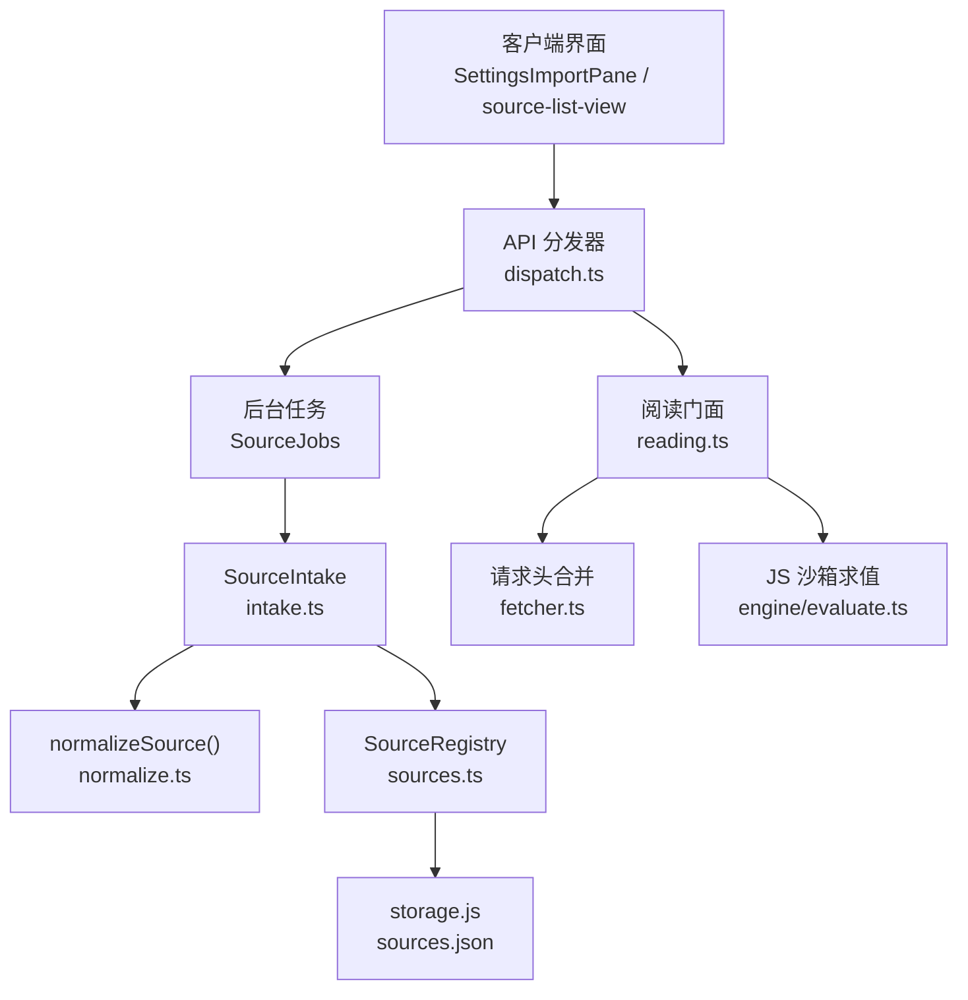
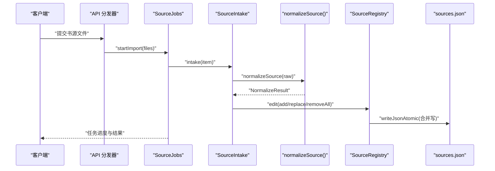
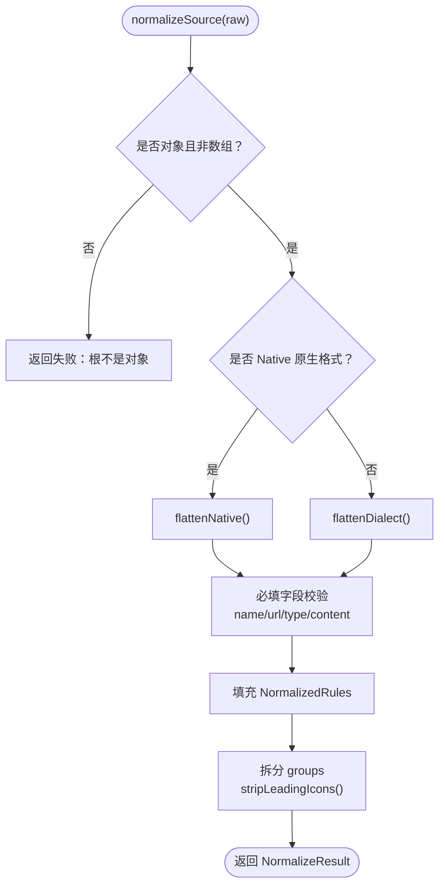
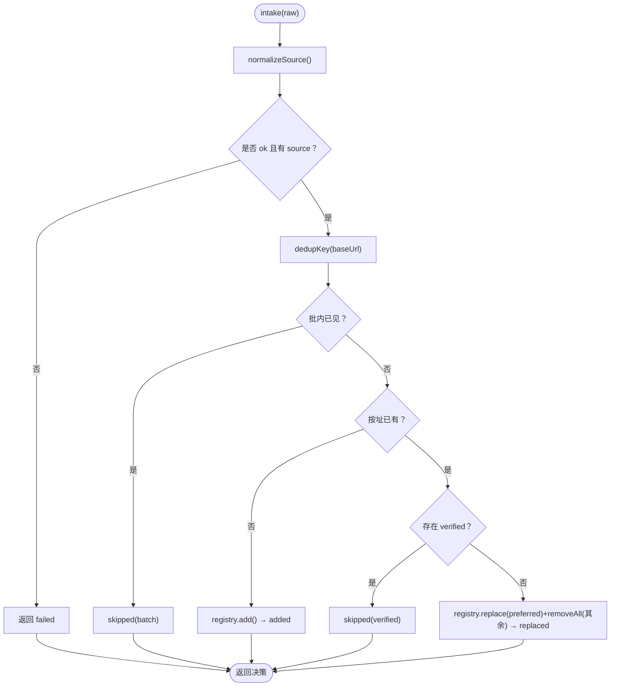
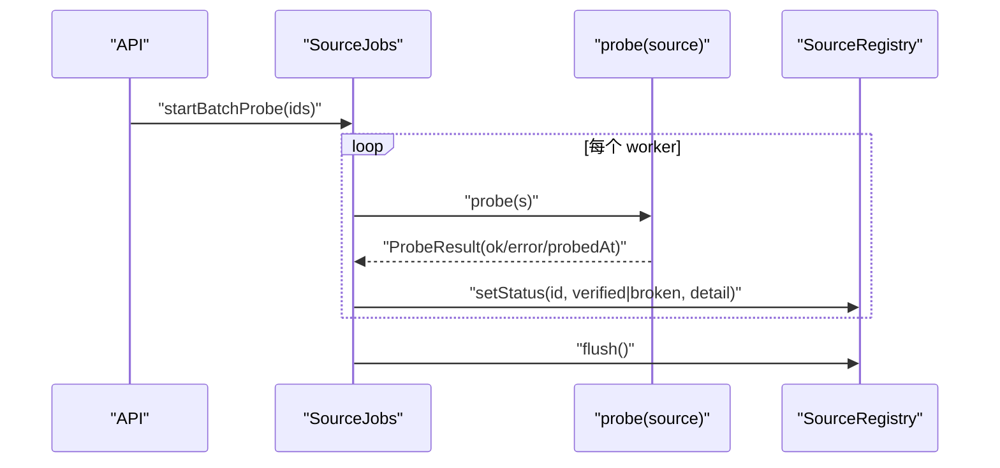
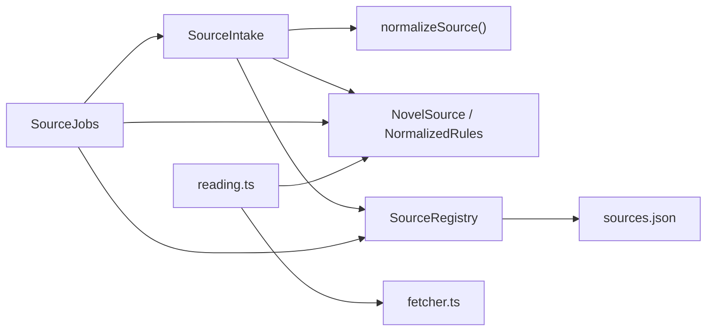

# 书源导入与治理

<cite>
**本文引用的文件**   
- [intake.ts](file://src/services/intake.ts)
- [normalize.ts](file://src/services/normalize.ts)
- [types.ts](file://src/services/types.ts)
- [sources.ts](file://src/services/sources.ts)
- [import-job.ts](file://src/services/import-job.ts)
- [reading.ts](file://src/services/reading.ts)
- [fetcher.ts](file://src/services/fetcher.ts)
- [dispatch.ts](file://src/api/dispatch.ts)
- [importer.ts](file://src/client/importer.ts)
- [source-inbox.ts](file://src/client/source-inbox.ts)
- [0010-intake-dedup-by-address.md](file://docs/adr/0010-intake-dedup-by-address.md)
</cite>

## 目录
1. [引言](#引言)
2. [项目结构](#项目结构)
3. [核心组件](#核心组件)
4. [架构总览](#架构总览)
5. [详细流程分析](#详细流程分析)
6. [依赖关系分析](#依赖关系分析)
7. [性能特性](#性能特性)
8. [故障诊断指南](#故障诊断指南)
9. [扩展点](#扩展点)
10. [结论](#结论)

## 引言
本文围绕“书源导入与治理”的全链路展开，覆盖从 legacy JSON 三种方言（平铺数组、对象、Native）进入系统，到 `SourceIntake.normalize()` 规范化、批内去重、按址去重、`add/replace`、写入 `sources.json`，再到待办收件箱、批量验证、一键验证、单源试跑、cookie/loginUrl 鉴权脚本执行、状态过滤、分组以及批量启停/删除。文末给出导入失败诊断步骤和新增方言/动作的扩展点。

## 项目结构
书源导入与治理涉及三层：
- 服务层：负责解析、规范化、注册表持久化、后台任务编排。
- API 层：暴露批量验证、启用/停用、登录计划等入口。
- 客户端：提供粘贴预检、待办收件箱视图及交互。



**图示来源**
- [dispatch.ts:118-149](file://src/api/dispatch.ts#L118-L149)
- [import-job.ts:1-120](file://src/services/import-job.ts#L1-L120)
- [intake.ts:1-84](file://src/services/intake.ts#L1-L84)
- [normalize.ts:1-120](file://src/services/normalize.ts#L1-L120)
- [sources.ts:1-120](file://src/services/sources.ts#L1-L120)
- [reading.ts:313-346](file://src/services/reading.ts#L313-L346)
- [fetcher.ts:257-282](file://src/services/fetcher.ts#L257-L282)

**章节来源**
- [dispatch.ts:118-149](file://src/api/dispatch.ts#L118-L149)
- [import-job.ts:1-120](file://src/services/import-job.ts#L1-L120)
- [intake.ts:1-84](file://src/services/intake.ts#L1-L84)
- [normalize.ts:1-120](file://src/services/normalize.ts#L1-L120)
- [sources.ts:1-120](file://src/services/sources.ts#L1-L120)
- [reading.ts:313-346](file://src/services/reading.ts#L313-L346)
- [fetcher.ts:257-282](file://src/services/fetcher.ts#L257-L282)

## 核心组件
- `SourceIntake`：唯一入库规则实现，统一 normalize → 批内去重 → 按址去重 → add/replace。
- `normalizeSource()`：legacy JSON 归一化为 `NormalizedRules`，输出缺失项与警告。
- `SourceRegistry`：加载 `sources.json`、原子编辑、延迟落盘、对外投影剥离凭据。
- `SourceJobs`：后台导入与批量验证任务，并发探针限流、协作式取消。
- `reading.ts` 登录面：loginUrl JS 脚本执行、cookie 解析与保存。
- `source-inbox.ts`：坏源与未验证源的纯派生与忽略签名。
- `importer.ts`：客户端粘贴预检，仅做即时反馈，权威校验在服务端。

**章节来源**
- [intake.ts:1-84](file://src/services/intake.ts#L1-L84)
- [normalize.ts:1-120](file://src/services/normalize.ts#L1-L120)
- [sources.ts:1-120](file://src/services/sources.ts#L1-L120)
- [import-job.ts:1-120](file://src/services/import-job.ts#L1-L120)
- [reading.ts:313-346](file://src/services/reading.ts#L313-L346)
- [source-inbox.ts:1-69](file://src/client/source-inbox.ts#L1-L69)
- [importer.ts:1-47](file://src/client/importer.ts#L1-L47)

## 架构总览
书源导入与治理的主路径如下：
- 客户端粘贴 → `validateSourceJson()` 预检 → API 提交文件 → `SourceJobs.startImport()` → 逐条 `SourceIntake.intake()` → `normalizeSource()` → `SourceRegistry.edit()` → 原子写 `sources.json`。
- 治理入口：批量验证通过 `startBatchProbe()`；单源试跑通过 `probe()`；登录通过 `loginPlan()` + `runLogin()`。
- 状态与展示：`SourceRegistry.toPublic()` 剥离凭据；`sourceInbox()` 按 `status` 拆分坏源与未验证源。



**图示来源**
- [import-job.ts:120-200](file://src/services/import-job.ts#L120-L200)
- [intake.ts:20-84](file://src/services/intake.ts#L20-L84)
- [normalize.ts:1-120](file://src/services/normalize.ts#L1-L120)
- [sources.ts:120-200](file://src/services/sources.ts#L120-L200)

## 详细流程分析

### 1. Legacy JSON 三种方言识别与映射
`normalizeSource()` 在开始阶段即决定走 Native 还是对象方言展平：
- 若顶层是 Native 原生格式（例如 android-ebook 原生规则），走 `flattenNative()`。
- 否则走 `flattenDialect()`，将 legacy 对象中的嵌套字段映射到统一的模型键。
- 同时支持“字符串化的 JSON 容器”，通过 `ruleContainer()` 解析并聚合警告。

映射要点：
- 搜索上下文：`ruleSearch` 映射为 `ruleBookList/ruleBookName/ruleAuthor/ruleBookUrl/ruleCoverUrl/ruleIntro/ruleLastChapter/ruleKind/ruleWordCount/probeKeyword`。
- 详情上下文：`ruleBookInfo` 映射为 `ruleDetail*` 系列。
- 目录与正文：`ruleToc`、`ruleContent` 分别映射至目录与正文字段。
- 发现面：`ruleExploreKinds`、`ruleExplore*` 十一键由原生 `ruleFind` 或 legado `ruleExplore` 共用同一组模型键。
- 名称前缀图标剥离与分组串拆分：`stripLeadingIcons()`、`splitGroups()`。
- 内容形态判定：`kindOfSourceValue()` 只允许文本源，非文本直接拒绝。



**图示来源**
- [normalize.ts:1-120](file://src/services/normalize.ts#L1-L120)
- [normalize.ts:450-715](file://src/services/normalize.ts#L450-L715)

**章节来源**
- [normalize.ts:1-120](file://src/services/normalize.ts#L1-L120)
- [normalize.ts:450-715](file://src/services/normalize.ts#L450-L715)
- [types.ts:1-88](file://src/services/types.ts#L1-L88)

### 2. 规范化后的 `NovelSource` 结构与 legacy 原始结构映射
规范化产物包含：
- 基础信息：`id/name/baseUrl/enabled/groups/type/raw/rules/auth/status/statusDetail/importedAt/lastProbedAt`。
- 规则集：`NormalizedRules`，包括搜索、详情、目录、正文、发现面、动态头、登录地址等。
- 原始数据：`raw` 保留原 JSON，供存量迁移与派生字段补推。

映射关系摘要：
- 书名/作者/封面/简介/最新章节/分类/字数：来自 `ruleSearch` 或 `ruleBookInfo`，最终落到 `ruleBookName/ruleAuthor/ruleCoverUrl/ruleIntro/ruleLastChapter/ruleKind/ruleWordCount`。
- 详情页专用字段：`ruleDetailName/ruleDetailAuthor/ruleDetailCoverUrl/ruleDetailIntro/ruleDetailLastChapter/ruleDetailKind/ruleDetailWordCount/ruleDetailInit`。
- 目录与翻页：`ruleChapterList/ruleChapterName/ruleChapterUrl/nextTocUrl`。
- 正文：`ruleContent/nextPageUrl`。
- 动态头：`headerRule` 与 `header` 互斥同源。
- 登录地址：`loginUrl`（可为 URL 或 JS 表达式）。
- JS 全局库：`jsLib`。

**章节来源**
- [types.ts:1-88](file://src/services/types.ts#L1-L88)
- [normalize.ts:1-120](file://src/services/normalize.ts#L1-L120)

### 3. 入库决策：批内去重、按址去重、add/replace
`SourceIntake` 维护一个地址索引快照与批内键集合：
- 批内去重：同 `baseUrl` 只留首条。
- 按址去重：若已有可用源（`verified`），则跳过新条；若无可用者，则替换首选条目并复用旧 id，同时清理其余历史脏条目。
- 决策输出：`failed/added/replaced/skipped`，调用方只做呈现映射。



**图示来源**
- [intake.ts:20-84](file://src/services/intake.ts#L20-L84)
- [0010-intake-dedup-by-address.md:1-11](file://docs/adr/0010-intake-dedup-by-address.md#L1-L11)

**章节来源**
- [intake.ts:1-84](file://src/services/intake.ts#L1-L84)
- [0010-intake-dedup-by-address.md:1-11](file://docs/adr/0010-intake-dedup-by-address.md#L1-L11)

### 4. 写入 sources.json：原子写与合并防抖
`SourceRegistry` 内部持有活体列表与调度器：
- `edit(recipe)` 原子执行变更，finally 触发 `schedule()`。
- `schedule()` 累计 20 次变更立即写一次，否则 100ms 尾沿防抖。
- `flush()` 等待全部待写落盘，用于任务收尾与测试断言。
- `toPublic()` 剥离 `raw/rules/auth`，仅暴露对外字段与布尔状态位。

**章节来源**
- [sources.ts:1-200](file://src/services/sources.ts#L1-L200)
- [sources.ts:200-322](file://src/services/sources.ts#L200-L322)

### 5. 后台导入与批量验证
- 导入：`startImport(files)` 逐文件 JSON.parse → 扁平化条目 → `SourceIntake.intake()` → 统计 counts/issues → flush。
- 批量验证：`startBatchProbe(ids)` 有效 id 并发 5 路探针，逐个更新 `verified/broken` 并记录错误消息；运行中删除的 id 跳过。



**图示来源**
- [import-job.ts:120-238](file://src/services/import-job.ts#L120-L238)
- [sources.ts:200-322](file://src/services/sources.ts#L200-L322)

**章节来源**
- [import-job.ts:120-238](file://src/services/import-job.ts#L120-L238)

### 6. 待办收件箱：坏源与未验证任务卡
- `sourceInbox()` 按 `status` 拆出 `broken` 与 `unverified`。
- `inboxCards()` 生成可见卡；`signatureOf()` 用排序 id 拼接签名；`visibleInboxCards()` 按忽略记录切分。
- 卡片是提示而非工单：成员变化会重新出现；读数不印在卡上，归属列表头状态带。

**章节来源**
- [source-inbox.ts:1-69](file://src/client/source-inbox.ts#L1-L69)

### 7. cookie/loginUrl 鉴权脚本执行
- `reading.loginPlan(id)` 判别 loginUrl 形态：URL 模式手动打开，JS 模式沙箱执行。
- `runLogin()` 对 JS 表达式求值，解析 `k=v;` 串，产出空时不写 auth，否则保存 `acquiredAt`。
- 请求头合并：静态头打底 → auth.headers 覆盖同名 → Cookie 段合并（auth.cookies 名占优在后）。

```mermaid
sequenceDiagram
    participant UI as "客户端"
    participant Reading as "reading.ts"
    participant Eval as "evaluate('@js:...')"
    participant Cookies as "parseCookieString()"
    participant Reg as "SourceRegistry"

    UI->>Reading: "loginPlan(id)"
    Reading-->>UI: "{mode:'js'|'manual'}"
    alt JS 模式
      UI->>Reading: "runLogin(id)"
      Reading->>Eval: "evaluate(loginUrl)"
      Eval-->>Reading: "cookie string"
      Reading->>Cookies: "解析 k=v;"
      Cookies-->>Reading: "cookies map"
      Reading->>Reg: "setAuth(id, {cookies, acquiredAt})"
    else 手动模式
      UI-->>UI: "打开 loginUrl"
    end
```

**图示来源**
- [reading.ts:320-346](file://src/services/reading.ts#L320-L346)
- [fetcher.ts:257-282](file://src/services/fetcher.ts#L257-L282)

**章节来源**
- [reading.ts:320-346](file://src/services/reading.ts#L320-L346)
- [fetcher.ts:257-282](file://src/services/fetcher.ts#L257-L282)

### 8. 状态过滤、分组、批量启停/删除
- 状态过滤：`sourceInbox()` 只看 `status`，不受 `enabled` 影响；停用源仍可能出现在收件箱。
- 分组：`splitGroups()` 兼容逗号/反斜杠/全角逗号，去空白、去重复；`stripLeadingIcons()` 剥名称前缀装饰符号。
- 批量启停/删除：`setEnabledMany()` 与 `removeAll()` 在注册表中原子执行，减少多次重写 `sources.json`。

**章节来源**
- [source-inbox.ts:1-69](file://src/client/source-inbox.ts#L1-L69)
- [normalize.ts:120-200](file://src/services/normalize.ts#L120-L200)
- [sources.ts:200-322](file://src/services/sources.ts#L200-L322)

## 依赖关系分析



**图示来源**
- [intake.ts:1-84](file://src/services/intake.ts#L1-L84)
- [normalize.ts:1-120](file://src/services/normalize.ts#L1-L120)
- [types.ts:1-88](file://src/services/types.ts#L1-L88)
- [sources.ts:1-200](file://src/services/sources.ts#L1-L200)
- [import-job.ts:1-120](file://src/services/import-job.ts#L1-L120)
- [reading.ts:313-346](file://src/services/reading.ts#L313-L346)
- [fetcher.ts:257-282](file://src/services/fetcher.ts#L257-L282)

**章节来源**
- [intake.ts:1-84](file://src/services/intake.ts#L1-L84)
- [normalize.ts:1-120](file://src/services/normalize.ts#L1-L120)
- [types.ts:1-88](file://src/services/types.ts#L1-L88)
- [sources.ts:1-200](file://src/services/sources.ts#L1-L200)
- [import-job.ts:1-120](file://src/services/import-job.ts#L1-L120)
- [reading.ts:313-346](file://src/services/reading.ts#L313-L346)
- [fetcher.ts:257-282](file://src/services/fetcher.ts#L257-L282)

## 性能特性
- 导入幂等：同一 baseUrl 可重复导入，但按址去重保证不污染库。
- 合并写：每 20 次变更强制写一次，100ms 尾沿防抖避免频繁 I/O。
- 批量验证并发：限制 5 路探针，对齐搜索并行度，避免压垮站点。
- 协作式取消：在取下一条前检查取消标志，不落盘中间态即可收工。

[本节为通用性能讨论，不直接分析具体代码行]

## 故障诊断指南
当导入失败时，建议按以下顺序排查：

1. **URL 可达性**
   - 确认 `bookSourceUrl` 能正常访问；若站点需要登录或代理，先完成鉴权流程。
   - 使用浏览器或 curl 测试目标 URL，观察 HTTP 状态码与响应体。

2. **登录态**
   - 若声明了 `loginUrl`，优先执行登录：URL 模式手动登录，JS 模式确保脚本返回合法 `k=v;` 串。
   - 检查 `hasAuth/authExpired` 状态，确认 cookie 是否过期。

3. **正则匹配与规则字段**
   - 检查 `ruleContent` 是否为非空字符串或对象形态含非空 `content`。
   - 检查搜索、详情、目录、正文选择器是否正确；容器字段是否为合法 JSON 对象或字符串化 JSON。
   - 检查 `ruleExploreKinds` 是否为有效数组；`bookUrlPattern` 是否命中详情页逻辑。

4. **JS 沙箱错误**
   - 动态头 `headerRule` 与 `loginUrl` 均为 JS 表达式，注意语法错误与依赖函数是否定义。
   - 若有 `jsLib`，确保全局函数已注入；否则 `@js:` 块可能报 not defined。

5. **任务明细与问题计数**
   - 查看导入任务的 `counts.failed/dupSkipped/replaced` 与 `issues` 明细。
   - 批量验证的 `broken` 源对应探针错误消息，关注 `error.code` 与 `detail`。

**章节来源**
- [importer.ts:1-47](file://src/client/importer.ts#L1-L47)
- [import-job.ts:120-238](file://src/services/import-job.ts#L120-L238)
- [reading.ts:320-346](file://src/services/reading.ts#L320-L346)
- [normalize.ts:1-120](file://src/services/normalize.ts#L1-L120)

## 扩展点
- 新增方言
  - 在 `normalizeSource()` 的方言判定处增加分支，或在 `flattenDialect()`/`flattenNative()` 中添加映射。
  - 如需新增派生字段，遵循“单一读口”纪律：通过 `deriveRuleField()` 或新增 `rawXxxFields()`，并在 `SourceRegistry.load()` 存量收敛处调用。
  - 对发现面等新族字段，补充 `rawExploreFields()` 与对应的常量键集。

- 新增治理动作
  - 新增后台任务：在 `SourceJobs` 增加新的 `startXxx()` 与 `runXxx()`，复用 `PROBE_CONCURRENCY` 与协作式取消。
  - 新增登记/取消：在 `begin()` 与 `settle()` 处接入宿主任务接口。
  - 新增 UI 待办：在 `source-inbox.ts` 扩展 `SourceInbox` 与卡片派生逻辑。

- 新增鉴权机制
  - 在 `reading.ts` 扩展登录流程，保持 cookie 解析与 `setAuth()` 契约一致。
  - 在 `fetcher.ts` 的 `headerOf()` 中追加新凭据合并策略，确保 auth 优先级正确。

**章节来源**
- [normalize.ts:1-120](file://src/services/normalize.ts#L1-L120)
- [normalize.ts:450-715](file://src/services/normalize.ts#L450-L715)
- [sources.ts:120-200](file://src/services/sources.ts#L120-L200)
- [import-job.ts:120-238](file://src/services/import-job.ts#L120-L238)
- [source-inbox.ts:1-69](file://src/client/source-inbox.ts#L1-L69)
- [reading.ts:320-346](file://src/services/reading.ts#L320-L346)
- [fetcher.ts:257-282](file://src/services/fetcher.ts#L257-L282)

## 结论
本仓库将书源导入与治理的关键路径收敛到少数核心模块：`SourceIntake` 统一入库语义，`normalizeSource()` 承担方言归一，`SourceRegistry` 负责持久化与对外投影，`SourceJobs` 编排导入与验证任务，`reading.ts` 管理鉴权流程。该设计保证了幂等导入、按址去重、可靠落盘、有限并发验证与清晰的凭据边界，便于后续扩展方言与治理动作。