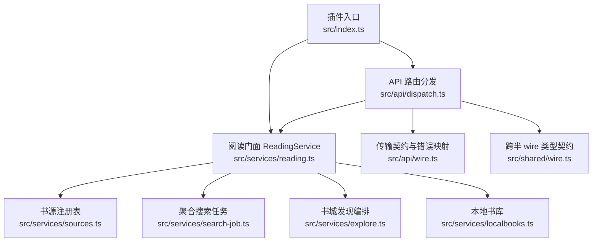
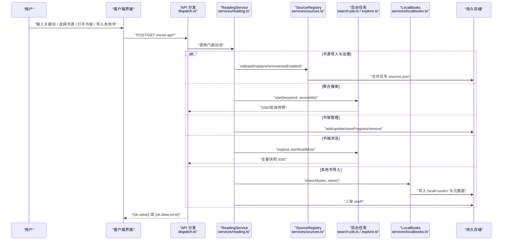
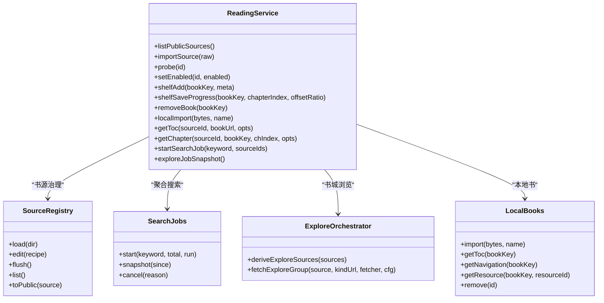

# 功能特性文档

<cite>
**本文引用的文件**   
- [package.json](file://package.json)
- [src/index.ts](file://src/index.ts)
- [src/api/dispatch.ts](file://src/api/dispatch.ts)
- [src/api/wire.ts](file://src/api/wire.ts)
- [src/shared/wire.ts](file://src/shared/wire.ts)
- [src/services/reading.ts](file://src/services/reading.ts)
- [src/services/sources.ts](file://src/services/sources.ts)
- [src/services/search-job.ts](file://src/services/search-job.ts)
- [src/services/explore.ts](file://src/services/explore.ts)
- [src/services/localbooks.ts](file://src/services/localbooks.ts)
</cite>

## 目录
1. [引言](#引言)
2. [项目结构](#项目结构)
3. [核心组件](#核心组件)
4. [架构总览](#架构总览)
5. [详细能力分析](#详细能力分析)
6. [依赖关系分析](#依赖关系分析)
7. [性能调优建议](#性能调优建议)
8. [故障排查指南](#故障排查指南)
9. [结论](#结论)

## 引言
本文件为 dsh-novel 插件的功能特性文档，面向用户与开发者，系统性覆盖六大能力域：书源导入与治理、聚合搜索、书架管理、阅读器、书城分类浏览、本地书导入。文档统一术语：

- **书源**：legado 风格的站点解析配方，包含规则、可选凭据、分组与状态。
- **取值链**：引擎对规则求值时按字段逐段求值的过程，贯穿详情、目录、正文与搜索面。
- **面 facet**：取值链的分类维度，如 `toc`（目录）、正文相关领域错误等，用于错误定位。
- **按书归并**：聚合搜索结果中把同一本书的多条命中合并为一行，键为规范化后的书名与作者。
- **相关性分档**：`exact`（精确匹配）、`contains`（包含匹配）、`suspect`（可疑）；`suspect` 默认折叠但不丢弃。
- **本/家/条**：本地书 / 一个书源 / 一条书目条目。
- **书城**：按书源内声明的分类标题浏览的“发现面”。
- **本地书**：TXT 与 EPUB 两类由本机上传或预置的文件型书源。

## 项目结构
dsh-novel 是 DeepSeek Harness 插件，主入口在组合根 `src/index.ts`，HTTP API 挂载在 `/novel-api`，业务入口集中在 `ReadingService`，UI 通过宿主注入的 React 前端消费服务。

**图表来源**
- [src/index.ts:1-200](file://src/index.ts#L1-L200)
- [src/api/dispatch.ts:1-120](file://src/api/dispatch.ts#L1-L120)
- [src/services/reading.ts:1-200](file://src/services/reading.ts#L1-L200)
- [src/api/wire.ts:1-135](file://src/api/wire.ts#L1-L135)
- [src/shared/wire.ts:1-120](file://src/shared/wire.ts#L1-L120)

**章节来源**
- [package.json:1-125](file://package.json#L1-L125)
- [src/index.ts:1-200](file://src/index.ts#L1-L200)

## 核心组件
- **ReadingService**：业务门面，封装书源、书架、缓存、抓取器、后台任务、本地书、搜索与书城。所有外部调用（HTTP、工具、UI）必须经其公开动词。
- **SourceRegistry**：书源注册表，负责加载、归一化、原子编辑、批量落盘与对外投影。
- **SearchJobs**：聚合搜索后台持有者，服务端持有整轮结果，提供增量游标快照。
- **Explore 编排**：派生书城清单并执行单源分页抓取，使用分类快照缓存。
- **LocalBooks**：本地 TXT/EPUB 导入、索引、导航、资源读取与删除。
- **Wire 层**：跨 Node 与浏览器半的 JSON 类型、路由常量、错误信封与可信请求校验。

**章节来源**
- [src/services/reading.ts:1-200](file://src/services/reading.ts#L1-L200)
- [src/services/sources.ts:1-120](file://src/services/sources.ts#L1-L120)
- [src/services/search-job.ts:1-174](file://src/services/search-job.ts#L1-L174)
- [src/services/explore.ts:1-75](file://src/services/explore.ts#L1-L75)
- [src/services/localbooks.ts:1-120](file://src/services/localbooks.ts#L1-L120)
- [src/shared/wire.ts:1-120](file://src/shared/wire.ts#L1-L120)

## 架构总览
从用户输入到持久化的端到端流程如下。不同能力域共用 `ReadingService`，但数据最终落盘位置不同：书源进入 `sources.json`，书架条目进入书架存储，本地书进入本地目录与元数据。

**图表来源**
- [src/api/dispatch.ts:1-120](file://src/api/dispatch.ts#L1-L120)
- [src/services/reading.ts:200-600](file://src/services/reading.ts#L200-L600)
- [src/services/sources.ts:120-322](file://src/services/sources.ts#L120-L322)
- [src/services/search-job.ts:1-174](file://src/services/search-job.ts#L1-L174)
- [src/services/explore.ts:1-75](file://src/services/explore.ts#L1-L75)
- [src/services/localbooks.ts:120-532](file://src/services/localbooks.ts#L120-L532)

## 详细能力分析

### 一、书源导入与治理
**业务目标**  
允许用户以 legado 风格配置导入书源，完成规则归一、去重、启停、批量验证与登录凭据管理，并最终持久化为 `sources.json`。

**用户流程**
1. 通过设置页或工具调用导入原始书源。
2. 系统归一化规则、推导内容形态、迁移旧字段。
3. 按 `baseUrl` 去重：已有可用源则跳过，否则新增或替换。
4. 可选触发探针验证；更新源状态 `unverified/verified/broken`。
5. 批量启用/停用、批量删除、批量验证。
6. 支持按源的 JS 登录脚本或手动 Cookie 录入。

**核心数据结构**
- `NovelSource`：完整书源（含 `raw`、`rules`、`auth`），仅内部与落盘使用。
- `SourcePublic`：对外投影，不含凭据与原文。
- `ProbeResult`：单次探针结论，含错误码与首条标题。
- `JobState`：导入/批量验证任务状态，含计数与截断明细。

**服务层实现**
- `ReadingService.importSource/importOne`：统一走 `SourceIntake`，返回呈现层 `ImportOutcome`。
- `SourceRegistry.load/edit/persist`：读路做存量归一，写路用 edit recipe 原子化，阈值合并 + 尾沿防抖落盘。
- `ReadingService.probe`：与搜索同超时与 js 预算，成功后回写状态。
- `ReadingService.setEnabled/setEnabledMany/removeSource/removeSources`：全部经 registry.edit。
- `ReadingService.saveAuth/runLogin/loginPlan`：JS 登录产出 cookie 串，空产出视为未登录。

**UI 表现**
- 书源列表展示名称、地址、分组、内容类型、状态、是否带静态头/认证。
- 批量操作返回实际变更数，未知 id 静默跳过。
- 登录面根据 `loginPlan` 决定 JS 模式或手动跳转。

**错误处理**
- 导入失败项不拖垮整批；缺失字段记录为 `missing`，非致命问题记为 `warnings`。
- 探针失败写入 `broken` 状态与错误信息。
- 方法不允许、未知路由、非受信来源统一走 `ApiError` 与 `writeError`。

**常见用例与参考路径**
- 导入单个书源：[src/services/reading.ts:201-300](file://src/services/reading.ts#L201-L300)
- 批量导入任务接口：[src/api/dispatch.ts:120-220](file://src/api/dispatch.ts#L120-L220)
- 批量启停与删除：[src/api/dispatch.ts:220-320](file://src/api/dispatch.ts#L220-L320)
- 登录计划与脚本登录：[src/services/reading.ts:300-420](file://src/services/reading.ts#L300-L420)

**章节来源**
- [src/services/reading.ts:201-420](file://src/services/reading.ts#L201-L420)
- [src/services/sources.ts:1-322](file://src/services/sources.ts#L1-L322)
- [src/api/dispatch.ts:120-320](file://src/api/dispatch.ts#L120-L320)

### 二、聚合搜索
**业务目标**  
对多个启用书源并行发起搜索，按源输出分组，再按书名+作者进行“按书归并”，给出相关性分档，并通过 SSE 流推送增量进度。

**用户流程**
1. 输入关键词，可选限定参与书源。
2. 提交搜索任务，后端 Node 半持有整轮结果。
3. 前端轮询或订阅 SSE，看到每个源完成即显示一组命中。
4. 前端按书归并，`exact` 与 `contains` 正常显示，`suspect` 折叠。
5. 可取消本轮搜索；已搜出的分组保留。

**核心数据结构**
- `SearchHit`：一条命中，含标题、作者、地址、封面、简介、末章、分类、字数。
- `SearchGroup`：一个书源的命中组，含状态与错误。
- `MergedBook`：按书一行，含 `exact/contains` 与多源 `MergedSource`。
- `Relevance`：`exact` / `contains` / `suspect`。
- `SearchJobSnapshot`：服务端持有的增量快照，含 `since/next` 游标。

**服务层实现**
- `ReadingService.searchProgressive`：唯一聚合实现，并发参搜，按完成序交付组。
- `SearchJobs.start/snapshot/cancel`：持有当前轮次，协作式停止，游标只增不减。
- 搜索面统一走 `fetchSearchPage`，支持列表形态与详情页 `info` 形态。
- 每源命中上限截断，截断数量附于过程日志。

**UI 表现**
- 搜索进度以 SSE 流为主，断线重连用 `since` 游标。
- 搜索结果按书归并，最多展示固定数量的书行。
- 取消按钮将本轮置为 `cancelled`，UI 不报红错误。

**错误处理**
- 单源失败只在该组写 `error`，不影响其他源。
- 规则缺失、抓取失败、解码失败统一映射为错误码。
- 取消后快照仍保留结果，直到保留期过期。

**常见用例与参考路径**
- 提交搜索任务：[src/api/dispatch.ts:320-420](file://src/api/dispatch.ts#L320-L420)
- SSE 进度流：[src/api/dispatch.ts:420-520](file://src/api/dispatch.ts#L420-L520)
- 聚合搜索实现与 info 形态：[src/services/reading.ts:601-760](file://src/services/reading.ts#L601-L760)
- 搜索任务持有者：[src/services/search-job.ts:1-174](file://src/services/search-job.ts#L1-L174)

**章节来源**
- [src/api/dispatch.ts:320-520](file://src/api/dispatch.ts#L320-L520)
- [src/services/reading.ts:601-760](file://src/services/reading.ts#L601-L760)
- [src/services/search-job.ts:1-174](file://src/services/search-job.ts#L1-L174)
- [src/shared/wire.ts:120-260](file://src/shared/wire.ts#L120-L260)

### 三、书架管理
**业务目标**  
管理用户的书架：加书、打补丁、保存阅读进度、删除书籍；对在线书与本地书采用统一 `bookKey` 身份，本地书删除连带清理文件。

**用户流程**
1. 从搜索结果或书城点击加入书架，传入 `title` 与 `sourceId`。
2. 查看书架列表，显示书名、来源名、进度。
3. 修改书名、作者、封面等元数据。
4. 保存阅读章节索引与偏移比例。
5. 删除单本或多本；本地书同时删除本地副本。

**核心数据结构**
- `ShelfEntry`：书架条目 + 来源投影。
- `ShelfBook`：持久化书架模型。
- `ShelfMetaPatch`：可更新字段集合。
- `LOCAL_SOURCE_ID`：本地书保留源标识。

**服务层实现**
- `shelfList`：实时 join 注册表，删除源后来源名为 `null`。
- `shelfAdd/shelfPatch/shelfSaveProgress`：参数门在门面层，非法值直接抛错。
- `removeBook/removeBooks`：本地书键自动联动 `LocalBooks.remove`。
- 本地书删除还暴露 `removeLocalBook`，任一成功即算移除。

**UI 表现**
- 书架视图显示来源名，本地书来源名恒为空。
- 进度保存需校验章节索引为非负整数、偏移比为 `[0,1]` 有限数。
- 不在架时 patch/saveProgress 返回空，路由映射为 400。

**错误处理**
- 缺少必填字段抛出无效请求错误。
- 删除不存在条目静默成功或返回零。
- 本地书未挂载时抛 `LocalNotMountedError`。

**常见用例与参考路径**
- 书架读取与来源投影：[src/services/reading.ts:420-520](file://src/services/reading.ts#L420-L520)
- 加书与进度保存门：[src/services/reading.ts:520-600](file://src/services/reading.ts#L520-L600)
- 删除与本地联动：[src/services/reading.ts:520-600](file://src/services/reading.ts#L520-L600)

**章节来源**
- [src/services/reading.ts:420-600](file://src/services/reading.ts#L420-L600)
- [src/shared/wire.ts:260-360](file://src/shared/wire.ts#L260-L360)

### 四、阅读器
**业务目标**  
在线阅读书的目录、正文与补充图文；对在线书走文本面，对本地 EPUB 走规范化图文树，对本地 TXT 走文字章。

**用户流程**
1. 打开一本书，先拉取目录。
2. 选择章节，获取正文。
3. 本地 EPUB 可能附带脚注/附录等资源。
4. 阅读器侧维护会话、滚动位置、笔记与导航。

**核心数据结构**
- `ChapterEntry`：目录项，含名称与 URL。
- `ChapterContent`：文字或图文正文。
- `BookNavigation`：线性章节序列与平面展示树。
- `LocalResource`：本地资源的 MIME、字节数与可读流。

**服务层实现**
- `getToc/getNavigation`：在线书缓存目录并按翻页规则跟进；本地 EPUB 读持久化导航。
- `getChapter/getChapterContent`：在线书返回文字，本地 EPUB 返回图文树。
- `getLocalSupplement/getLocalResource`：本地 EPUB 专有资源访问。
- 目录与正文取值链统一走引擎上下文，相对链接基准与 `book` 变量一致。

**UI 表现**
- 阅读器视图依赖会话与滚动口，渲染章节标题与正文。
- 导航栏由 `planarNavigation` 派生，避免重复计算。
- 本地 EPUB 可展示导入告警，提示格式兼容性问题。

**错误处理**
- 目录规则缺失抛 `RuleMissingError`。
- 章节 URL 全部回退目录页抛 `RuleEvalError`。
- 本地资源不存在抛 `LocalArtifactNotFoundError`。

**常见用例与参考路径**
- 目录获取与缓存：[src/services/reading.ts:760-920](file://src/services/reading.ts#L760-L920)
- 正文与图文面分流：[src/services/reading.ts:920-1000](file://src/services/reading.ts#L920-L1000)
- 本地资源与补充文档：[src/services/reading.ts:520-600](file://src/services/reading.ts#L520-L600)

**章节来源**
- [src/services/reading.ts:760-1000](file://src/services/reading.ts#L760-L1000)
- [src/services/localbooks.ts:120-532](file://src/services/localbooks.ts#L120-L532)

### 五、书城分类浏览
**业务目标**  
展示每个书源自己声明的分类标题，让用户按源浏览分类下的书目；不再跨源摊平分类，也不替用户发明同义词。

**用户流程**
1. 打开书城，列出参与的书源及其分类标题。
2. 选择一个源和一个分类，加载第一页。
3. 继续加载更多页，直到无下一页。
4. 观察 SSE 全量快照，刷新分类清单或书目。

**核心数据结构**
- `ExploreSources`：按源列出的分类标题清单。
- `ExploreBook`：单源单分类下的一条书目。
- `ExploreSnapshot`：分类轮次的快照，含更多页标志。

**服务层实现**
- `deriveExploreSources`：纯函数派生参与源与其分类标题。
- `fetchExploreGroup`：查进程内分类缓存 → 抓站 → 成功才缓存。
- `pickEntry/runExplorePage`：校验源参与、生成入口地址与代际、执行一页。
- `loadMoreExploreJob/exploreJobSnapshot`：续页与全量快照。

**UI 表现**
- 书城左侧显示源与分类，右侧显示书目。
- 分类标题原样展示，不做跨站合并。
- 加载失败以分组错误形式展示，不中断整轮。

**错误处理**
- 点不到源或分类时，提交报错，续页返回 null。
- 抓取失败或规则缺失以分组错误返回。
- 分类快照保留期结束后返回 null，避免空结果伪装成无命中。

**常见用例与参考路径**
- 分类清单派生：[src/services/explore.ts:1-40](file://src/services/explore.ts#L1-L40)
- 单源分页抓取：[src/services/explore.ts:40-75](file://src/services/explore.ts#L40-L75)
- 门面轮次控制：[src/services/reading.ts:601-760](file://src/services/reading.ts#L601-L760)

**章节来源**
- [src/services/explore.ts:1-75](file://src/services/explore.ts#L1-L75)
- [src/services/reading.ts:601-760](file://src/services/reading.ts#L601-L760)
- [src/shared/wire.ts:360-460](file://src/shared/wire.ts#L360-L460)

### 六、本地书导入
**业务目标**  
支持 TXT 与 EPUB 两类本地书导入，自动切章、解析元数据、生成导航，并上架书架；删除本地书时同步清理磁盘文件。

**用户流程**
1. 上传本地文件。
2. 系统判断魔数：ZIP 本地头签名走 EPUB，否则走 TXT。
3. TXT：BOM/UTF-8 严格/GKB 回退解码，按标题正则切章。
4. EPUB：归档解析、包元数据、文档与资源索引。
5. 暂存目录一次 rename 发布，再原子写元数据，最后上架。
6. 可在书架中阅读、查看导入告警、删除本地书。

**核心数据结构**
- `LocalTextMeta`：TXT 元数据，含编码、章节跨度与长度。
- `LocalEpubMeta`：EPUB 元数据，含章节引用、文档表、资源表与导航。
- `LocalImportResult`：导入结果，含格式、编码、告警与书元数据。
- `LocalResource`：本地资源流、MIME 与真实字节数。

**服务层实现**
- `decodeLocalText`：优先 BOM，其次 UTF-8 严格，再 GBK 回退。
- `splitChapters`：中文章标题正则切分，缺标题时整体作为“正文”。
- `LocalBooks.import`：分流、校验大小、暂存、发布、入架。
- `LocalBooks.getToc/getNavigation/getResource`：本地阅读与资源读取。
- `removeLocalBook`：文件与书架任一命中即算删除。

**UI 表现**
- 导入响应返回书名、章节数、格式、编码与告警。
- 本地书在书架中来源名恒为空。
- EPUB 导入告警可用于提示图片缺失、编码异常等问题。

**错误处理**
- 空文件或无法解析章节抛 `LocalImportError`。
- 文件大小超限抛 `LocalFileTooLargeError`。
- 已发布产物缺失抛 `LocalArtifactNotFoundError`。
- 传输层与 domain 层共享同一大小上限，避免“读进却不解析”的错觉。

**常见用例与参考路径**
- 本地书类定义与常量：[src/services/localbooks.ts:1-120](file://src/services/localbooks.ts#L1-L120)
- 解码与切章逻辑：[src/services/localbooks.ts:120-220](file://src/services/localbooks.ts#L120-L220)
- 导入门面与上架：[src/services/reading.ts:520-600](file://src/services/reading.ts#L520-L600)

**章节来源**
- [src/services/localbooks.ts:1-532](file://src/services/localbooks.ts#L1-L532)
- [src/services/reading.ts:520-600](file://src/services/reading.ts#L520-L600)

## 依赖关系分析

**图表来源**
- [src/services/reading.ts:1-200](file://src/services/reading.ts#L1-L200)
- [src/services/sources.ts:1-200](file://src/services/sources.ts#L1-L200)
- [src/services/search-job.ts:1-174](file://src/services/search-job.ts#L1-L174)
- [src/services/explore.ts:1-75](file://src/services/explore.ts#L1-L75)
- [src/services/localbooks.ts:1-200](file://src/services/localbooks.ts#L1-L200)

**章节来源**
- [src/services/reading.ts:1-200](file://src/services/reading.ts#L1-L200)
- [src/services/sources.ts:1-200](file://src/services/sources.ts#L1-L200)
- [src/services/search-job.ts:1-174](file://src/services/search-job.ts#L1-L174)
- [src/services/explore.ts:1-75](file://src/services/explore.ts#L1-L75)
- [src/services/localbooks.ts:1-200](file://src/services/localbooks.ts#L1-L200)

## 性能调优建议
- **并发数**：聚合搜索默认并发为 `DEFAULT_SEARCH_PARALLEL = 5`；可按站点负载调整，但必须为正整数，否则会挂死循环。
- **超时与预算**：搜索超时与 JS 沙箱预算默认分别为网络超时与 15000ms；探针、搜索、目录与详情应共用相同耐心值，避免同一源在不同路径得到不同结论。
- **缓存失效**：目录与正文缓存按规则代际失效；分类浏览缓存按分类代际与页号失效。规则变更后不应仅靠 TTL，而应让代际变化驱动失效。
- **分页阈值**：目录最大页数默认 200，正文分页默认 50；过大阈值会放大内存与 DOM 渲染压力，过小会导致频繁翻页。
- **本地导入大小**：默认 50MB，传输层与 domain 层共用同一上限，避免上传通过但解析拒绝。
- **结果截断**：每源搜索命中有上限，按书归并也有书行上限；大站首页命中过多时应优先优化取值链，而不是无限扩大 UI 展示。
- **代理连接池**：出站代理在 `ReadingService.dispose` 时关闭，热更代理地址后会重建；注意代理日志中的密码脱敏。
- **任务互斥**：导入任务槽互斥，搜索任务独立槽；不要因搜索阻塞导入，也不要让导入任务长时间占用宿主配额。

**章节来源**
- [src/services/reading.ts:1-200](file://src/services/reading.ts#L1-L200)
- [src/services/localbooks.ts:1-120](file://src/services/localbooks.ts#L1-L120)
- [src/api/dispatch.ts:1-120](file://src/api/dispatch.ts#L1-L120)

## 故障排查指南
- **403 Forbidden**：请求不是受信来源，检查 referer/origin/host 同源，或确认本机工具直连。
- **400 BadRequest**：body 不是合法 JSON、参数校验失败、规则缺失或本地导入失败。
- **404 NotFound**：未知路由、书源不存在、本地产物不存在。
- **409 JobRunning**：导入任务已在运行，需要等待或取消前一轮。
- **413 PayloadTooLarge**：JSON body 或本地导入文件超过上限。
- **422 RuleEval/RuleMissing**：取值链规则缺失或求值失败，关注 `facet` 与 `segmentRaw`。
- **502 Fetch/Decode**：站点抓取失败或编码不可解。
- **503 Unavailable**：本地书未挂载或后端服务不可用。
- **500 InternalError**：未分类错误或上游错误。

**调试要点**
- 通过 SSE 游标 `since` 与 `next` 检查进度是否推进。
- 查看任务状态 `phase/counts/issues`，确认是成功、失败还是被新一轮替换。
- 检查书源状态是否为 `verified`，探针错误码是否指向规则缺失或 JS 沙箱。
- 本地书导入失败时区分“导入失败”“文件太大”“产物不存在”。

**章节来源**
- [src/api/wire.ts:1-135](file://src/api/wire.ts#L1-L135)
- [src/services/search-job.ts:1-174](file://src/services/search-job.ts#L1-L174)
- [src/services/localbooks.ts:1-200](file://src/services/localbooks.ts#L1-L200)

## 结论
dsh-novel 以 `ReadingService` 为中心，把书源治理、聚合搜索、书架、阅读器、书城与本地书整合成一套一致的领域模型。其关键设计原则包括：

- 业务动词集中在门面，HTTP 与工具不得绕过。
- 取值链统一由引擎驱动，错误按 facet 与 segment 定位。
- 跨半契约集中在 `shared/wire.ts`，Node 与浏览器共享类型。
- 后台任务在服务端持有，避免浏览器切换丢失结果。
- 本地书与在线书通过 `LOCAL_SOURCE_ID` 与 `bookKey` 统一书架身份。
- 错误分类与 HTTP 状态映射集中一处，便于统一诊断。

在实际使用中，应优先保证书源规则质量、合理设置并发与分页阈值，并借助探针与任务状态持续观察稳定性。对于大站或慢站，应结合分类缓存、代理与超时策略逐步收敛成本。