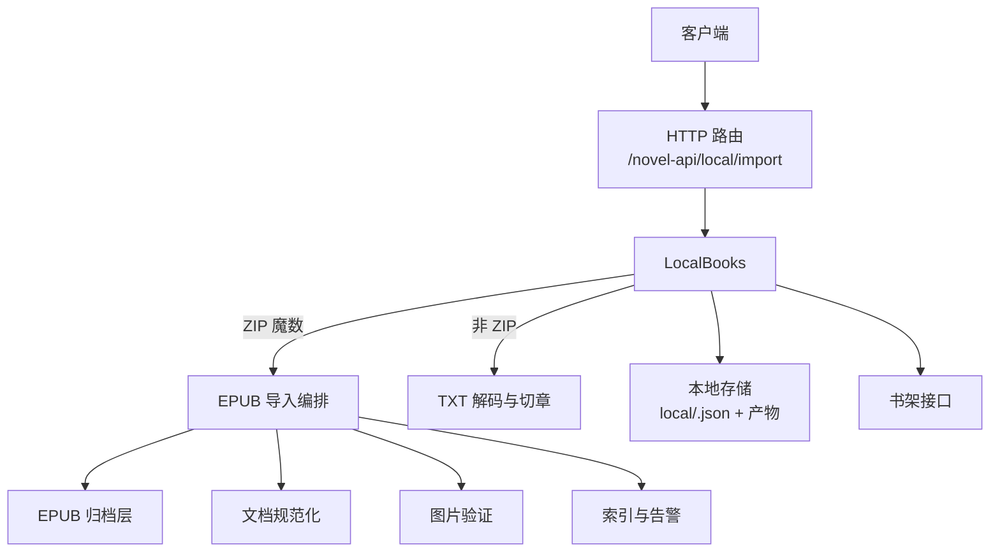
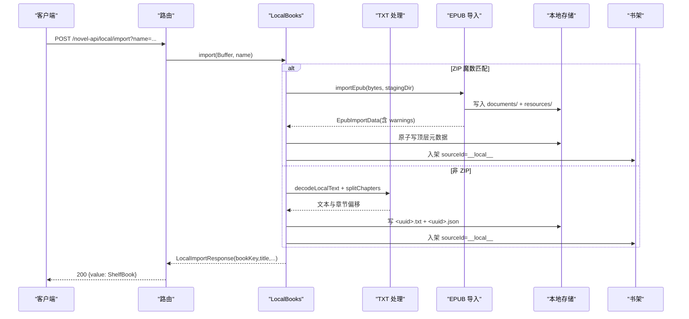
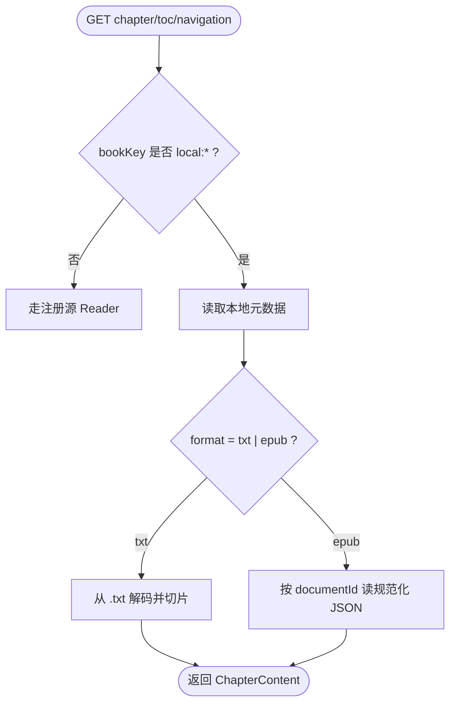
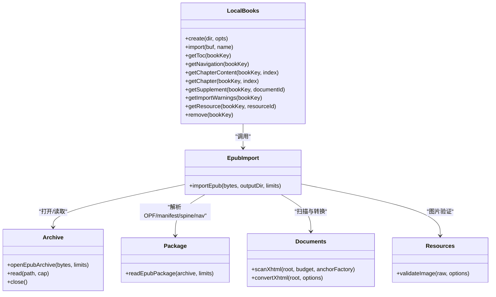

# 本地书（TXT / EPUB）

<cite>
**本文引用的文件**   
- [localbooks.ts](file://src/services/localbooks.ts)
- [import.ts](file://src/services/epub/import.ts)
- [archive.ts](file://src/services/epub/archive.ts)
- [documents.ts](file://src/services/epub/documents.ts)
- [package.ts](file://src/services/epub/package.ts)
- [resources.ts](file://src/services/epub/resources.ts)
- [dispatch-local.test.ts](file://tests/api/dispatch-local.test.ts)
- [localbooks.test.ts](file://tests/services/localbooks.test.ts)
</cite>

## 目录
1. [简介](#简介)
2. [项目结构](#项目结构)
3. [核心组件](#核心组件)
4. [架构总览](#架构总览)
5. [详细组件分析](#详细组件分析)
6. [依赖关系分析](#依赖关系分析)
7. [性能与内存控制](#性能与内存控制)
8. [排障清单](#排障清单)
9. [高级用法：自定义切章与资源替换](#高级用法自定义切章与资源替换)
10. [结论](#结论)

## 简介
本文说明“本地书”导入与阅读路径，重点回答以下问题：

- `POST /novel-api/local/import?name=...` 如何分流 ZIP → EPUB，否则走 TXT。
- TXT 路径的编码探测链、标题行切章规则、偏移表落盘与 LRU 缓存。
- EPUB 路径的流式读取、spine 计章、封面/插图/脚注/附录/目录树解析、CRC 校验、有损导入说明持久化到 `warnings.json`。
- `LocalBooks` 与 Shelf、Reader 的集成方式。
- 大文件与大图资源的内存占用控制策略。
- 常见问题排查与自定义切章、EPUB 资源替换的高级用法。

## 项目结构
本地书能力集中在服务层两个模块：

- `src/services/localbooks.ts`：本地书门面。负责上传分流、TXT/EPUB 发布协议、元数据落盘、正文/导航/资源读取与删除。
- `src/services/epub/import.ts`：EPUB 导入编排。串联包层、文档层、资源层，产出规范化文档 JSON、资源表、目录树与告警。

测试覆盖两条关键路径：

- `tests/api/dispatch-local.test.ts`：HTTP 路由契约，包括导入、书架联动、GBK 解码、400/405/413 错误、本地文档/资源端口行为。
- `tests/services/localbooks.test.ts`：`LocalBooks` 内部行为，包括 BOM/UTF-8/GBK 解码、切章、LRU、格式判定、EPUB 发布与读取。

**图表来源**
- [localbooks.ts:1-532](file://src/services/localbooks.ts#L1-L532)
- [import.ts:1-501](file://src/services/epub/import.ts#L1-L501)
- [dispatch-local.test.ts:1-90](file://tests/api/dispatch-local.test.ts#L1-L90)

**章节来源**
- [localbooks.ts:1-532](file://src/services/localbooks.ts#L1-L532)
- [import.ts:1-501](file://src/services/epub/import.ts#L1-L501)
- [dispatch-local.test.ts:1-90](file://tests/api/dispatch-local.test.ts#L1-L90)

## 核心组件
- `LocalBooks`：本地书门面类。提供 `import`、`getToc`、`getNavigation`、`getChapterContent`、`getChapter`、`getSupplement`、`getImportWarnings`、`getResource`、`remove`。
- `decodeLocalText`：TXT 解码链，BOM 优先，严格 UTF-8，回退 GBK。
- `splitChapters`：按钉死正则切章，生成字符偏移表。
- `importEpub`：EPUB 导入入口，返回章节、文档、资源、导航与警告。
- EPUB 子模块：`archive`（归档与预算）、`package`（容器/OPF/NCX/manifest/spine/nav）、`documents`（XHTML 扫描与转换）、`resources`（图片验证）。

**章节来源**
- [localbooks.ts:1-532](file://src/services/localbooks.ts#L1-L532)
- [import.ts:1-501](file://src/services/epub/import.ts#L1-L501)

## 架构总览
### 导入请求流程

**图表来源**
- [dispatch-local.test.ts:1-90](file://tests/api/dispatch-local.test.ts#L1-L90)
- [localbooks.ts:1-532](file://src/services/localbooks.ts#L1-L532)
- [import.ts:1-501](file://src/services/epub/import.ts#L1-L501)

### 本地读流程

**图表来源**
- [localbooks.ts:1-532](file://src/services/localbooks.ts#L1-L532)

## 详细组件分析

### LocalBooks：分流、发布与读取
`LocalBooks.import` 是统一入口：

- 空 Buffer → 抛出 `LocalImportError`。
- 超过当前 `maxImportBytes` → 抛出 `LocalFileTooLargeError`，消息使用 `formatByteLimit`，确保文案单位与限额口径一致。
- 通过 `hasZipMagic` 判断 ZIP 本地头签名 `PK\x03\x04`：
  - ZIP：调用 `publishEpub`。
  - 非 ZIP：调用 `publishText`。

#### TXT 发布路径
- 调用 `decodeLocalText`：
  - UTF-8 BOM → 剥 BOM，encoding=`utf-8-bom`。
  - UTF-16LE/BE BOM → 相应解码。
  - 严格 UTF-8 → encoding=`utf-8`。
  - 失败回退 GBK → encoding=`gbk`。
- 调用 `splitChapters`：
  - 识别中文数字/阿拉伯数字/大写数字 + 卷回节集部篇。
  - 支持序章、楔子、番外、尾声、后记。
  - 支持英文 `Chapter N`。
  - 标题前引言自动成为首章“正文”。
  - 无标题整本作为单章“正文”。
- 落盘 `<uuid>.txt` 与 `<uuid>.json`，元数据包含 chapters、length、encoding、title、originalName、importedAt。
- 返回 `LocalImportResult`：`format='txt'`，`encoding` 为实际编码，`warnings=[]`。

#### EPUB 发布路径
- 先建 staging 目录 `<uuid>.importing/`。
- 调用 `importEpub`：
  - 打开归档。
  - 解析 package（container/OPF/NCX/manifest/spine/nav）。
  - 两遍扫描：第一遍收集文档、锚点、链接、图片；第二遍逐份转换并落盘。
  - 将原字节另存为 `original.epub`。
- rename staging 到最终目录 `<uuid>/`。
- 原子写顶层元数据 `local/<uuid>.json`，其中包含 `schemaVersion=2`、`format='epub'`、chapters、documents、resources、navigation、warnings。
- 返回 `LocalImportResult`：`format='epub'`，`encoding=null`（各文档可能各自编码），`warnings` 来自导入器。

#### 读取与删除
- `getToc`：TXT 用偏移表 name，EPUB 用 spine 序列 label。
- `getNavigation`：TXT 平面导航；EPUB 使用持久化的原生目录树。
- `getChapterContent`：TXT 走 LRU 全文缓存切片；EPUB 按需读对应文档 JSON。
- `getChapter`：对图文面文字投影，保证导出、AI、阅读器一致。
- `getResource`：只认不透明 resourceId，查资源表后打开真实流，`bytes` 取 stat 结果。
- `remove`：删除 TXT 两件或 EPUB 整棵目录 + 顶层元数据，并清理 LRU 缓存。

**章节来源**
- [localbooks.ts:1-532](file://src/services/localbooks.ts#L1-L532)

### EPUB 导入编排
`importEpub` 的编排要点：

- 归档层 `openEpubArchive` 负责 ZIP 解压、CRC 校验、加密检测、预算控制。
- 包层 `readEpubPackage` 解析 container、OPF、NCX、manifest、spine、nav，并产生包级告警。
- 文档层 `scanXhtml` / `convertXhtml`：
  - 第一遍扫描 XHTML：锚点映射、内链、图片 src、被剥离内容（如内联 SVG、活动内容）。
  - 第二遍转换：注入资源 ID、宽度高度、目标锚点，输出 `ChapterContent`。
- 资源层 `validateImage`：
  - 光栅图魔数与容器核对。
  - SVG 作为 XML 走 XML 预算。
  - 拒绝远程图片、损坏图片、超预算图片、被加密图片。
  - 记录显示宽高与扩展名。
- 封面：EPUB3 `cover-image` 优先，其次 EPUB2 `meta name="cover"`。
- 目录树：原生 nav/NCX 转为 wire `NavigationItem[]`。
- 有损导入：活动链接移除、外部链接取消可点击、锚点降级等以 `LocalImportWarning` 记录，并随顶层元数据持久化。

**章节来源**
- [import.ts:1-501](file://src/services/epub/import.ts#L1-L501)
- [archive.ts:1-200](file://src/services/epub/archive.ts#L1-L200)
- [package.ts:1-200](file://src/services/epub/package.ts#L1-L200)
- [documents.ts:1-200](file://src/services/epub/documents.ts#L1-L200)
- [resources.ts:1-200](file://src/services/epub/resources.ts#L1-L200)

### HTTP 路由契约
`tests/api/dispatch-local.test.ts` 明确契约：

- `POST /novel-api/local/import?name=...`：
  - 成功 200，信封 `value` 为 `ShelfBook`，`sourceId=__local__`，已自动加入书架。
  - 空 Body 400。
  - 超过 `localImportMaxBytes` 413，错误体 message 与限额同一读数。
- `/novel-api/toc?sourceId=__local__&url=...`：本地书目录。
- `/novel-api/chapter?sourceId=__local__&url=...&index=...`：本地书章节，返回 `{kind:'text', text:...}`。
- `/novel-api/local/warnings?id=...`：TXT 恒空数组；未知 bookKey 404。
- `/novel-api/local/document?id=...&documentId=...`：TXT 返回 404。
- `/novel-api/local/resource?id=...&resourceId=...`：TXT 返回 404。
- 缺参 400，方法不对 405。
- `DELETE /novel-api/local?id=...`：删文件 + 书架条目消失。
- 书架 DELETE 对 `local:` 书连带删文件。

**章节来源**
- [dispatch-local.test.ts:1-90](file://tests/api/dispatch-local.test.ts#L1-L90)

## 依赖关系分析

**图表来源**
- [localbooks.ts:1-532](file://src/services/localbooks.ts#L1-L532)
- [import.ts:1-501](file://src/services/epub/import.ts#L1-L501)
- [archive.ts:1-200](file://src/services/epub/archive.ts#L1-L200)
- [package.ts:1-200](file://src/services/epub/package.ts#L1-L200)
- [documents.ts:1-200](file://src/services/epub/documents.ts#L1-L200)
- [resources.ts:1-200](file://src/services/epub/resources.ts#L1-L200)

**章节来源**
- [localbooks.ts:1-532](file://src/services/localbooks.ts#L1-L532)
- [import.ts:1-501](file://src/services/epub/import.ts#L1-L501)

## 性能与内存控制

### 大文件限制
- `DEFAULT_MAX_IMPORT_BYTES = 50 * 1024 * 1024`。
- `maxImportBytes` 是活值，每次导入重新读取快照，避免限额与报错口径不一致。
- 传输层与服务层共享同一限额读数：测试中通过 `ReadingService.create({ localImportMaxBytes })` 与 `LocalBooks.create({ maxImportBytes })` 对齐。

### TXT 内存模型
- 导入期：完整 Buffer 进入 `import`，随后写出 `.txt` 与 `.json`。
- 读取期：最多缓存 3 本书的全文字符串，LRU Map；越界读取穿透磁盘。
- 切片边界夹紧，避免相邻标题行导致负长度切片。

### EPUB 内存模型
- 归档层按预算逐项读取，不归一整个 EPUB 到内存。
- 文档层两遍走：第一遍扫描，第二遍逐份转换并释放 DOM。
- 资源在第一遍与第二遍之间预取并验证，避免同步转换中再读盘。
- 封面与正文图片分别登记，SVG 重建后落盘，`bytes` 取落盘大小。
- 顶层 `warnings.json` 持久化有损导入信息，不影响正常章节。

### 资源读取安全
- `getResource` 只认不透明 resourceId，打开后才返回流，`bytes` 取自 stat。
- ENOENT → 404；其他 I/O 或产物损坏 → 500，保持“不存在”和“损坏”语义分离。

**章节来源**
- [localbooks.ts:1-532](file://src/services/localbooks.ts#L1-L532)
- [import.ts:1-501](file://src/services/epub/import.ts#L1-L501)

## 排障清单

### GBK 乱码
**现象**：导入后正文出现乱码。  
**原因**：
- 文件不是 UTF-8，也没有 UTF-16 BOM。
- 严格 UTF-8 探测失败后回退 GBK，若文件实际并非 GBK，则可能出现误判。

**定位步骤**：
1. 检查导入结果中的 `encoding`。
2. 对 TXT 书，确认原始文件确实为 GBK。
3. 若仍乱码，建议先转换为 UTF-8 再导入。

**依据**：
- `decodeLocalText` 顺序：BOM → 严格 UTF-8 → GBK。
- 测试断言 GBK 回退与正文还原。

**章节来源**
- [localbooks.ts:1-120](file://src/services/localbooks.ts#L1-L120)
- [localbooks.test.ts:1-60](file://tests/services/localbooks.test.ts#L1-L60)

### 无目录或目录不完整
**现象**：TXT 无章节；EPUB 目录缺失。  
**原因**：
- TXT 没有符合切章规则的标题行，整本成为“正文”单章。
- EPUB 缺少原生 nav/NCX，或目录目标指向不可读文档。

**定位步骤**：
1. TXT：检查是否存在“第 X 章/卷/回/节”等标题行。
2. EPUB：检查 OPF spine 是否有序列；检查 nav/NCX 是否存在且目标可达。
3. 查看 `getImportWarnings` 是否有“导航目标降级”相关告警。

**依据**：
- `splitChapters` 无标题时返回单章“正文”。
- EPUB 导航解析失败会降级或报错。

**章节来源**
- [localbooks.ts:120-220](file://src/services/localbooks.ts#L120-L220)
- [import.ts:200-420](file://src/services/epub/import.ts#L200-L420)

### EPUB 缺少 manifest
**现象**：导入失败，提示文档或资源不在 manifest。  
**原因**：
- 文档或图片未在 OPF manifest 声明。
- 链接或图片引用了未登记条目。

**定位步骤**：
1. 查看错误消息中具体 path。
2. 检查 OPF manifest 是否包含该文档或资源。
3. 修复 EPUB 打包配置，确保所有正文、图片、CSS、JS 均登记。

**依据**：
- 包层与导入编排对 manifest 缺失直接抛错。

**章节来源**
- [import.ts:200-320](file://src/services/epub/import.ts#L200-L320)
- [package.ts:1-200](file://src/services/epub/package.ts#L1-L200)

### 图片缺失
**现象**：EPUB 导入失败或图片无法加载。  
**原因**：
- 图片在书外（远程 data/file/javascript scheme）。
- 图片损坏、超限、被加密。
- SVG 缺少可用宽高。
- 资源 ID 与实际文件不匹配。

**定位步骤**：
1. 查看 `warnings.json` 与导入错误消息，确认是否“书外图片”“图片宽高未知”“资源被加密”。
2. 检查资源是否在 manifest 中登记。
3. 检查图片是否为支持的栅格格式或有效 SVG。
4. 若资源 ID 存在但文件缺失，属于 404 场景。

**依据**：
- 资源层拒绝远程、加密、损坏、超预算图片。
- `getResource` 区分 ENOENT 与其余 I/O 错误。

**章节来源**
- [import.ts:300-485](file://src/services/epub/import.ts#L300-L485)
- [resources.ts:1-200](file://src/services/epub/resources.ts#L1-L200)
- [localbooks.ts:320-420](file://src/services/localbooks.ts#L320-L420)

## 高级用法：自定义切章与资源替换

### 自定义 TXT 切章规则
当前切章规则由 `splitChapters` 的钉死正则决定，适合常见中文小说格式。若需要更灵活规则：

- **推荐方式**：在导入前预处理 TXT，把标题行标准化为“第 X 章/卷/回/节”或“Chapter N”形态。
- **注意事项**：
  - 切章基于字符偏移，不要混用多字节编码导致的偏移错位。
  - 保留空行分隔有助于稳定分节。
  - 若无标题，整本会被归为“正文”单章。

**参考实现位置**：
- [localbooks.ts:120-220](file://src/services/localbooks.ts#L120-L220)

### EPUB 资源替换
EPUB 导入会：

- 扫描正文中的图片 src。
- 要求图片在 manifest 中登记。
- 仅接受书内资源，拒绝远程与不可跟随 scheme。
- 将资源落盘到 `resources/<opaque-id>.ext`，并在文档中绑定 resourceId。

若需要替换资源：

1. 使用 EPUB 编辑工具调整 manifest 与资源文件。
2. 确保所有图片都有正确媒体类型与尺寸信息。
3. 重新打包后再次导入，系统会重新生成 opaque resource ID。
4. 注意：替换不会改变已持久化的旧书；需重新导入新文件。

**参考实现位置**：
- [import.ts:200-485](file://src/services/epub/import.ts#L200-L485)
- [resources.ts:1-200](file://src/services/epub/resources.ts#L1-L200)

### 自定义目录树
EPUB 的原生目录树会持久化为 `navigation`。若目录不准确：

- 检查 EPUB3 nav 或 EPUB2 NCX。
- 修正文档标题与锚点。
- 重新导入后，`getNavigation` 会使用新的目录树。

**参考实现位置**：
- [import.ts:400-485](file://src/services/epub/import.ts#L400-L485)
- [package.ts:1-200](file://src/services/epub/package.ts#L1-L200)

## 结论
本地书能力以 `LocalBooks` 为中心，用 ZIP 魔数做唯一分流判据：ZIP 走 EPUB 路径，否则走 TXT 路径。TXT 路径强调编码健壮性与稳定切章；EPUB 路径强调结构化解析、资源安全与有损导入可观测。通过 staging、原子写、LRU、预算与枚举 ID，系统在易用性、安全性与大文件可控性之间取得平衡。排障时应优先区分“输入不成立”“目标不存在”“产物损坏”三类语义，并结合 `warnings.json` 与测试断言定位问题。