# 聚合搜索

<cite>
**本文引用的文件**   
- [search-job.ts](file://src/services/search-job.ts)
- [merge-by-book.ts](file://src/shared/merge-by-book.ts)
- [relevance.ts](file://src/shared/relevance.ts)
- [wire.ts](file://src/shared/wire.ts)
- [dispatch.ts](file://src/api/dispatch.ts)
- [search-job.ts（客户端）](file://src/client/search-job.ts)
- [search-view-model.ts](file://src/client/search-view-model.ts)
- [SearchView.tsx](file://src/client/views/SearchView.tsx)
- [0032-search-relevance-partition.md](file://docs/adr/0032-search-relevance-partition.md)
- [relevance.test.ts](file://tests/shared/relevance.test.ts)
- [search-job.test.ts](file://tests/services/search-job.test.ts)
</cite>

## 目录
1. [引言](#引言)
2. [项目结构](#项目结构)
3. [核心组件](#核心组件)
4. [架构总览](#架构总览)
5. [详细组件分析](#详细组件分析)
6. [依赖关系分析](#依赖关系分析)
7. [性能考虑](#性能考虑)
8. [故障排查指南](#故障排查指南)
9. [结论](#结论)
10. [附录：消费模式示例](#附录消费模式示例)

## 引言
本文件围绕「聚合搜索」这条链路，完整解释从搜索计划、并发搜索、逐源结果、按书归并、相关性分区、快照写入，到 SSE 实时推送与轮询回退的全过程。重点说明搜索结果视图模型如何把「条 / 本 / 家」三条轴呈现给 UI，失败源的折叠交互、相关性判据、最多 200 本上限与如实总数保留策略，以及调试单源失败的方法与性能优化建议。

## 项目结构
聚合搜索横跨 Node 半服务端、共享契约与浏览器半前端三个层次：

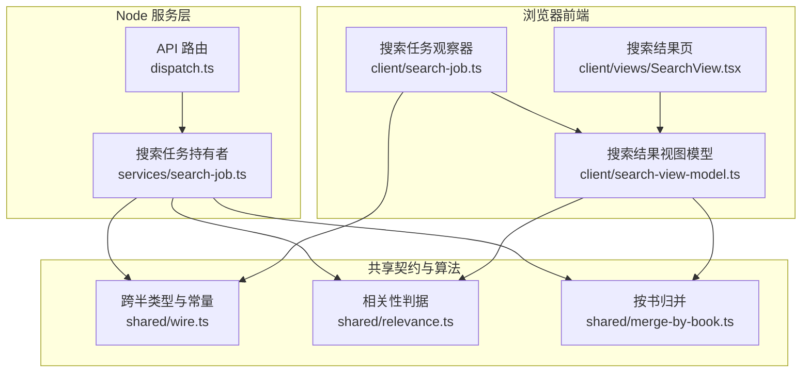

**图表来源**
- [dispatch.ts:115-170](file://src/api/dispatch.ts#L115-L170)
- [search-job.ts](file://src/services/search-job.ts#L1-L174)
- [wire.ts](file://src/shared/wire.ts#L1-L200)
- [relevance.ts](file://src/shared/relevance.ts#L1-L59)
- [merge-by-book.ts](file://src/shared/merge-by-book.ts#L1-L59)
- [search-job.ts（客户端）](file://src/client/search-job.ts#L1-L200)
- [search-view-model.ts](file://src/client/search-view-model.ts#L1-L156)
- [SearchView.tsx](file://src/client/views/SearchView.tsx#L1-L200)

**章节来源**
- [dispatch.ts:115-170](file://src/api/dispatch.ts#L115-L170)
- [search-job.ts](file://src/services/search-job.ts#L1-L174)
- [wire.ts](file://src/shared/wire.ts#L1-L200)
- [relevance.ts](file://src/shared/relevance.ts#L1-L59)
- [merge-by-book.ts](file://src/shared/merge-by-book.ts#L1-L59)
- [search-job.ts（客户端）](file://src/client/search-job.ts#L1-L200)
- [search-view-model.ts](file://src/client/search-view-model.ts#L1-L156)
- [SearchView.tsx](file://src/client/views/SearchView.tsx#L1-L200)

## 核心组件
| 组件 | 职责 | 关键行为 |
|---|---|---|
| API 路由 `dispatch.ts` | 暴露 `/novel-api/search/*`，转发搜索计划、提交、取消、SSE 流与快照查询 | 把关键词与可选 `sourceIds` 交给 `ReadingService`；SSE 首帧带游标基线 |
| 搜索任务持有者 `SearchJobs` | 在 Node 半持有整轮结果、游标与生命周期 | 并发 `probe` + `search`，默认 5 路；每源 `emit` 一个 `SearchGroup`；按源命中截断；写入宿主任务面板；提供增量快照 |
| 相关性判据 `relevance.ts` | 对一条命中判断 `exact` / `contains` / `suspect` | NFKC、小写、去书名号等装饰字符；空关键词视为“不生效” |
| 按书归并 `merge-by-book.ts` | 把多源命中合并为“一本书一行” | 键为规范化后的 `(书名, 作者)`；取最好档；按档序、去重家数、到达序排序；最多 200 本 |
| 客户端任务观察器 `client/search-job.ts` | 发起 POST、订阅 SSE、断线回退轮询、累积增量 | 以 `job.id` 防陈旧帧；`since` 游标来自服务端 |
| 搜索结果视图模型 `search-view-model.ts` | 纯函数派生：组分区、归并、行身份索引、收口计数 | 维护条 / 本 / 家三轴一致口径 |
| 搜索结果页 `SearchView.tsx` | 渲染进度、按书主视图、逐源折叠区、失败详情 | 失败源仍可见但降级到页尾折叠区 |

**章节来源**
- [dispatch.ts:115-170](file://src/api/dispatch.ts#L115-L170)
- [search-job.ts](file://src/services/search-job.ts#L1-L174)
- [relevance.ts](file://src/shared/relevance.ts#L1-L59)
- [merge-by-book.ts](file://src/shared/merge-by-book.ts#L1-L59)
- [search-job.ts（客户端）](file://src/client/search-job.ts#L1-L200)
- [search-view-model.ts](file://src/client/search-view-model.ts#L1-L156)
- [SearchView.tsx](file://src/client/views/SearchView.tsx#L1-L200)

## 架构总览
聚合搜索的生命周期由服务端持有，浏览器只读：

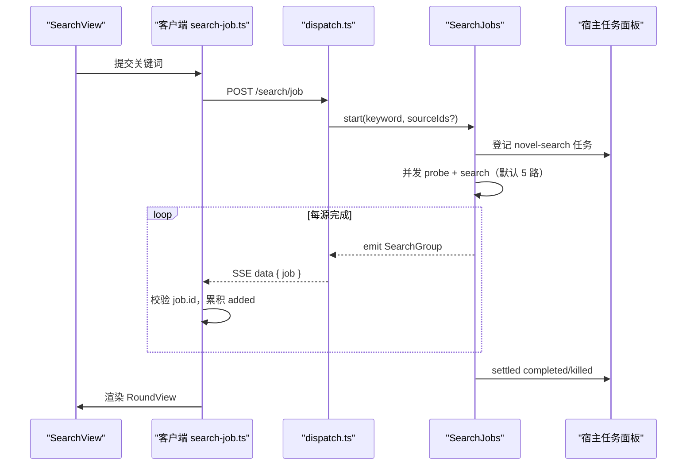

**图表来源**
- [dispatch.ts:115-170](file://src/api/dispatch.ts#L115-L170)
- [search-job.ts](file://src/services/search-job.ts#L1-L174)
- [search-job.ts（客户端）](file://src/client/search-job.ts#L1-L200)
- [SearchView.tsx](file://src/client/views/SearchView.tsx#L1-L200)

## 详细组件分析

### 搜索计划与参搜源集
- 搜索参与计划通过 `GET /novel-api/search/plan` 获取。
- 参与集是启用且内容为文本的源集合；非文本或未知编码源不参与聚合搜索。
- 客户端可显式传入 `sourceIds` 缩小范围，否则由服务端按计划计算。

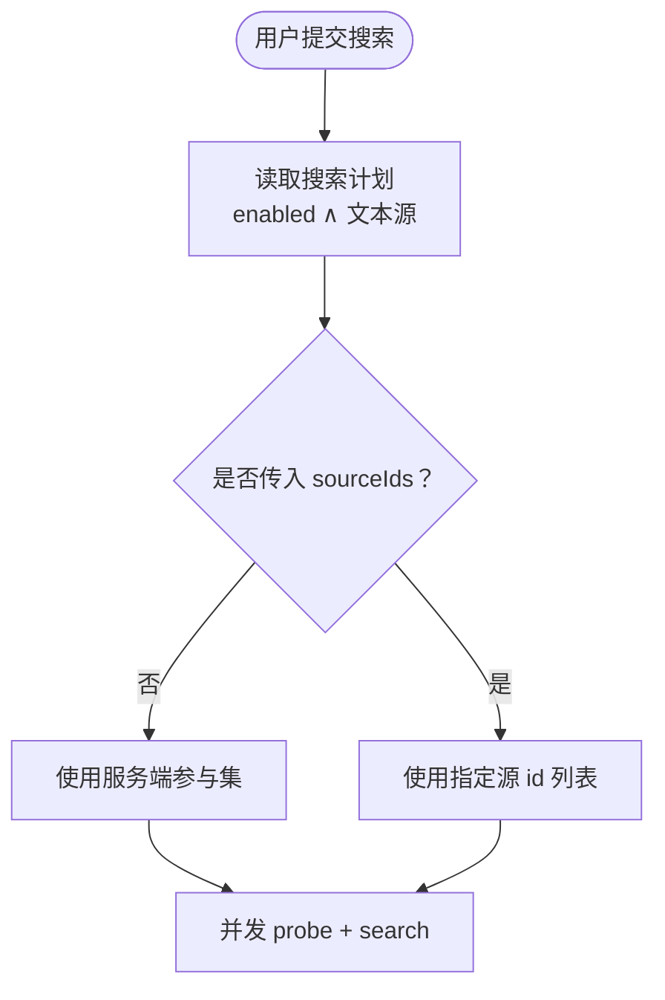

**图表来源**
- [dispatch.ts:140-152](file://src/api/dispatch.ts#L140-L152)
- [wire.ts](file://src/shared/wire.ts#L1-L200)

**章节来源**
- [dispatch.ts:140-152](file://src/api/dispatch.ts#L140-L152)
- [wire.ts](file://src/shared/wire.ts#L1-L200)

### 并发搜索与逐源结果
- `SearchJobs.start` 启动一轮搜索：旧轮若仍在运行则协作式终止，新轮替换旧结果。
- 运行器通过 `emit(group)` 逐个报告源结果；每源命中先按 `SEARCH_HITS_CAP_PER_SOURCE` 截断，避免无界内存。
- 每个 `SearchGroup` 携带 `sourceId`、`sourceName`、`status`、`hits` 和可选 `error`。
- 过程行把“源状态”和“实际命中的条数”分轴记录；命中被截断时附原始数量。

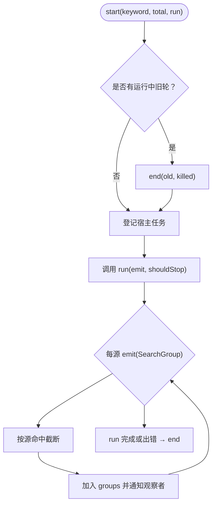

**图表来源**
- [search-job.ts](file://src/services/search-job.ts#L1-L174)

**章节来源**
- [search-job.ts](file://src/services/search-job.ts#L1-L174)
- [search-job.test.ts](file://tests/services/search-job.test.ts#L1-L200)

### 相关性分区：exact / contains / suspect
相关性判据是唯一实现，浏览器端与服务端共享：

| 档位 | 含义 | 行为 |
|---|---|---|
| `exact` | 规范化后的书名或作者整串等于关键词 | 排在最前 |
| `contains` | 书名、作者、分类任一包含关键词，或复合关键词“书名 作者”的任一 token 被书名含 | 排在 exact 之后 |
| `suspect` | 都不满足 | 移出默认视野，但绝不丢弃 |

- 规范化包括 NFKC、小写、去除空白与书名号类括号及常见标点。
- 空关键词被视为“这一维不生效”，返回 `contains`，因此不会误判全部为 suspect。
- 分类命中只放行为 `contains`，不升档。

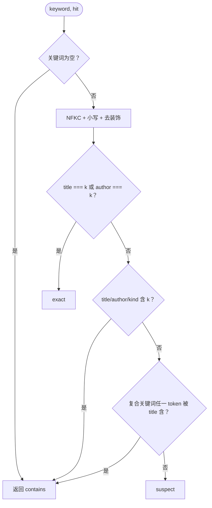

**图表来源**
- [relevance.ts](file://src/shared/relevance.ts#L1-L59)
- [0032-search-relevance-partition.md](file://docs/adr/0032-search-relevance-partition.md#L1-L26)

**章节来源**
- [relevance.ts](file://src/shared/relevance.ts#L1-L59)
- [relevance.test.ts](file://tests/shared/relevance.test.ts#L1-L95)
- [0032-search-relevance-partition.md](file://docs/adr/0032-search-relevance-partition.md#L1-L26)

### 按书归并与最多 200 本上限
`mergeBooks` 把一轮所有 `kept` 命中合并成“一本书一行”：

- 归并键：规范化后的 `(书名, 作者)`，用不可见控制符分隔，避免拼接歧义。
- 同键下收集多个 `MergedSource`，并统计去重后的 `sourceIds`。
- 排序规则：先按最好档序，再按去重家数降序，最后按到达先后。
- 默认最多输出 200 本；超限时 `total` 仍如实反映真实本数，不谎报“已截断”。
- `suspect` 不进入归并，防止假阳性把无关条目混成一本。

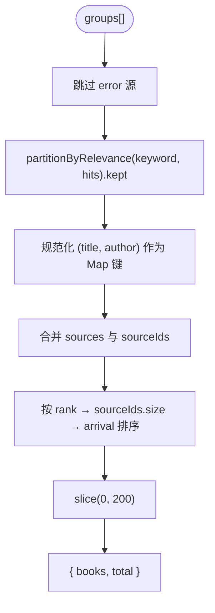

**图表来源**
- [merge-by-book.ts](file://src/shared/merge-by-book.ts#L1-L59)
- [wire.ts](file://src/shared/wire.ts#L1-L200)

**章节来源**
- [merge-by-book.ts](file://src/shared/merge-by-book.ts#L1-L59)
- [wire.ts](file://src/shared/wire.ts#L1-L200)

### 搜索结果视图模型：条 / 本 / 家三轴
`deriveRound` 在一轮输入上派生三份数据：

| 轴 | 数据来源 | 语义 |
|---|---|---|
| 条 | `SearchHit[]` | 每源每行一条命中；同一地址可能有两行 |
| 本 | `MergedBook[]` | 按规范化书名+作者合并后的书目，最多 200 本 |
| 家 | `SearchGroup[]` | 每源一组，含状态、命中与错误 |

视图模型还负责：
- 每组的 `partitionByRelevance` 现场，保证 UI 与工具面共用同一判据。
- 行身份 `rowId = JSON.stringify([sourceId, url])`，用于 React key、加架回执去重。
- 收口计数：`sources` 为真搜完并回来的组数，`hits` 为逐源命中之和，`found` 为有命中的源数，`failed` 为失败源数，`relevant` 为默认视野条数。

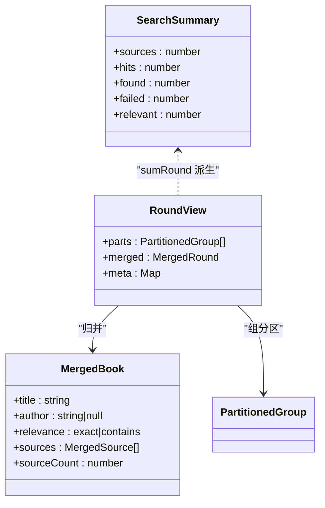

**图表来源**
- [search-view-model.ts](file://src/client/search-view-model.ts#L1-L156)
- [merge-by-book.ts](file://src/shared/merge-by-book.ts#L1-L59)
- [wire.ts](file://src/shared/wire.ts#L1-L200)

**章节来源**
- [search-view-model.ts](file://src/client/search-view-model.ts#L1-L156)

### 失败源的折叠与展开交互
- 按书主视图优先展示合并后的书籍；失败源本身不贡献书目。
- 逐源分组始终保留，但降级到页面底部的 `
` 折叠区。
- 失败源在该折叠区内仍显示一行 `details`，包含错误码与消息。
- 这样既降噪默认视野，又保留排查轴：不是删除，而是降级。

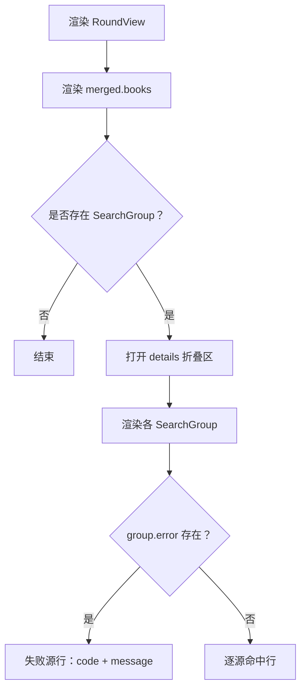

**图表来源**
- [SearchView.tsx](file://src/client/views/SearchView.tsx#L1-L200)
- [search-view-model.ts](file://src/client/search-view-model.ts#L1-L156)

**章节来源**
- [SearchView.tsx](file://src/client/views/SearchView.tsx#L1-L200)
- [search-view-model.ts](file://src/client/search-view-model.ts#L1-L156)

### SSE 与轮询两种消费模式
- **SSE 是加速器**：`GET /search/job-stream?since=`，首帧即带游标的基线快照，随后每次变化补一帧，终态自动关流。
- **轮询是地基**：`GET /search/job-status?since=`，断开、连不上、无推送时继续推进游标。
- 任一时刻只有一条通道在推进游标；二者共用同一份合并逻辑，避免重复累积。
- 客户端以 `job.id` 做身份闸：回调落地时若轮次已换，则丢弃旧帧并重新基线化。

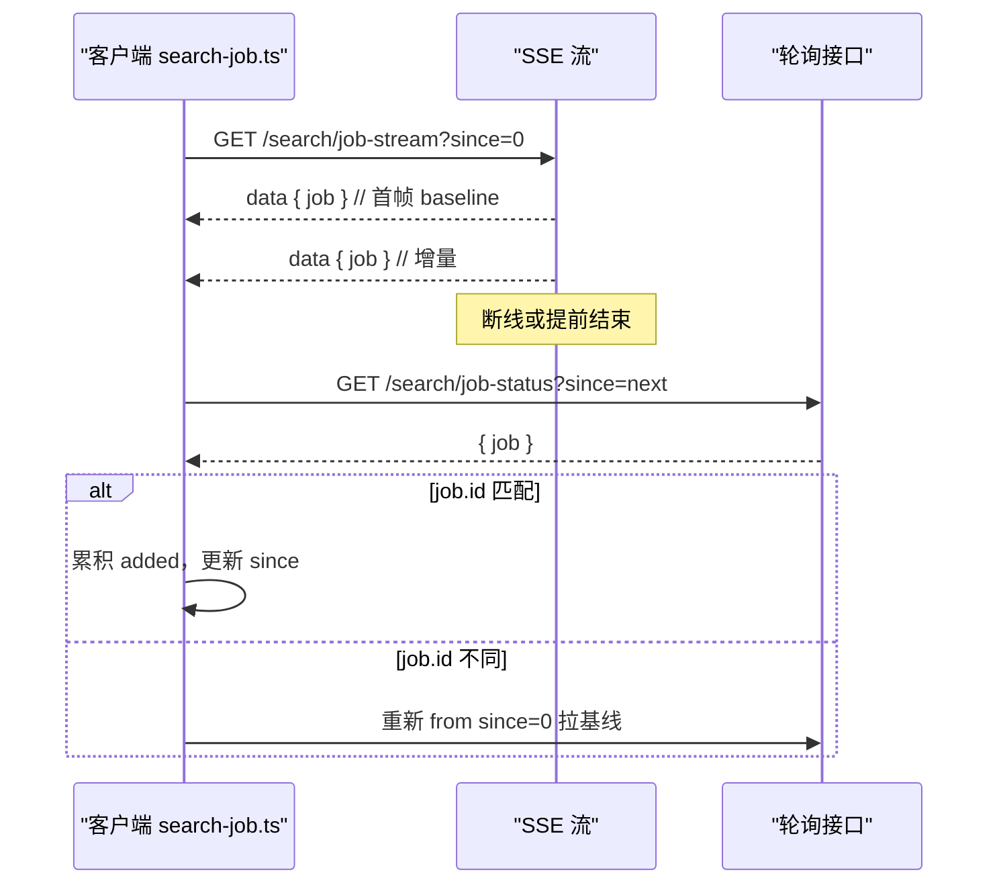

**图表来源**
- [search-job.ts（客户端）](file://src/client/search-job.ts#L1-L200)
- [dispatch.ts:152-170](file://src/api/dispatch.ts#L152-L170)

**章节来源**
- [search-job.ts（客户端）](file://src/client/search-job.ts#L1-L200)
- [dispatch.ts:152-170](file://src/api/dispatch.ts#L152-L170)

## 依赖关系分析

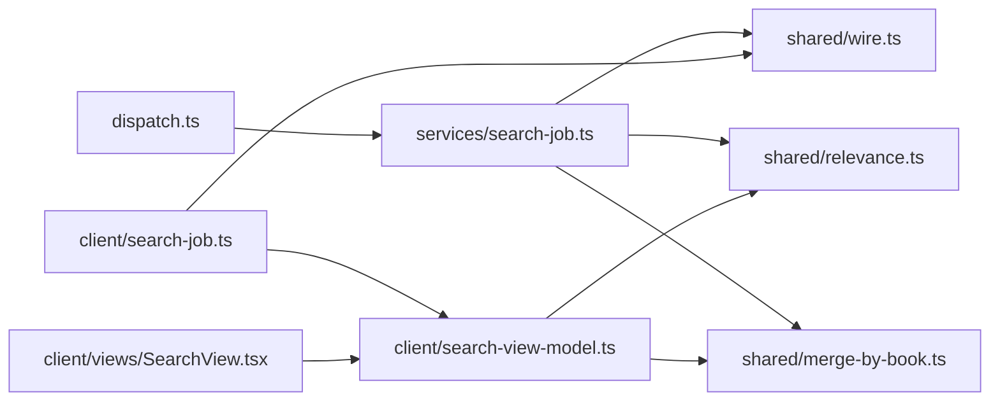

**图表来源**
- [dispatch.ts:115-170](file://src/api/dispatch.ts#L115-L170)
- [search-job.ts](file://src/services/search-job.ts#L1-L174)
- [wire.ts](file://src/shared/wire.ts#L1-L200)
- [relevance.ts](file://src/shared/relevance.ts#L1-L59)
- [merge-by-book.ts](file://src/shared/merge-by-book.ts#L1-L59)
- [search-job.ts（客户端）](file://src/client/search-job.ts#L1-L200)
- [search-view-model.ts](file://src/client/search-view-model.ts#L1-L156)
- [SearchView.tsx](file://src/client/views/SearchView.tsx#L1-L200)

**章节来源**
- [dispatch.ts:115-170](file://src/api/dispatch.ts#L115-L170)
- [search-job.ts](file://src/services/search-job.ts#L1-L174)
- [search-job.ts（客户端）](file://src/client/search-job.ts#L1-L200)
- [search-view-model.ts](file://src/client/search-view-model.ts#L1-L156)
- [SearchView.tsx](file://src/client/views/SearchView.tsx#L1-L200)

## 性能考虑
| 方向 | 现状与建议 |
|---|---|
| 并发度调节 | 当前并发 `probe` + `search` 默认 5 路；若网络或站点限流明显，应降低并发；若后端吞吐充足而 I/O 为主，可适当提高。需在 `searchPlan` 或任务调度处暴露可调参数。 |
| 重复词去重 | 同一轮关键词内部未显式去重；建议在 `startSearchJob` 前对 `sourceIds` 去重，并对关键词 token 做归一化缓存，减少重复 `normalizeRelevance` 计算。 |
| 缓存命中判断 | 搜索请求可基于 `(keyword, sourceIds)` 做短期缓存；注意关键词规范化、时间窗口与失效策略，避免 stale 结果污染 `SearchJobSnapshot.total`。 |
| 每源命中截断 | 已在 Node 侧按 `SEARCH_HITS_CAP_PER_SOURCE` 截断，防止无界增长；应监控该值是否过大导致单源响应体膨胀。 |
| 最多 200 本 | `SEARCH_BOOKS_CAP = 200` 仅裁剪输出数组，`total` 如实保留；当 `total > 200` 时应在 UI 提示“仅显示前 200 本，真实本数为 X”。 |
| SSE 与轮询切换 | 已避免双通道同时推进游标；建议在上层增加连接健康检查，缩短断线到轮询恢复的延迟。 |
| 视图派生开销 | `deriveRound` 实测在大源集下约数十毫秒；应确保调用方 memo 轮次身份，避免 SSE 每帧全量重算。 |

[本节为通用性能讨论，不直接分析具体代码片段]

## 故障排查指南

### 某源搜索失败的定位步骤
1. 查看服务端过程行：`SearchJobs` 的 emit 会把失败源写成 `${sourceName}：失败（${error.code}）`。
2. 查看 `SearchGroup.error`：包含 `code` 与 `message`，区分引擎错误、抓取错误或解码错误。
3. 在客户端底部“逐源”折叠区展开失败源行，确认其错误码是否与过程行一致。
4. 对照探针错误分类：`ProbeErrorCode` 包括规则评估错误、JS 沙箱错误、抓取错误、解码错误等。
5. 若失败源属于未验证源，先执行单源探针；`unverified` 不代表聚合搜索失败，只代表尚未探测。

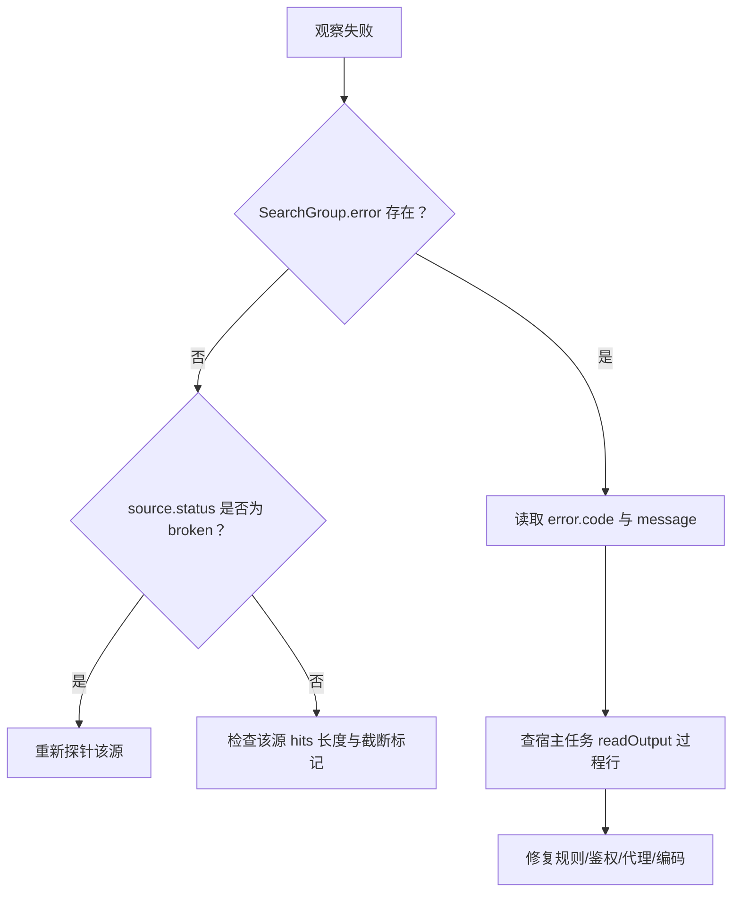

**图表来源**
- [search-job.ts](file://src/services/search-job.ts#L1-L174)
- [wire.ts](file://src/shared/wire.ts#L1-L200)
- [SearchView.tsx](file://src/client/views/SearchView.tsx#L1-L200)

**章节来源**
- [search-job.ts](file://src/services/search-job.ts#L1-L174)
- [wire.ts](file://src/shared/wire.ts#L1-L200)
- [SearchView.tsx](file://src/client/views/SearchView.tsx#L1-L200)
- [search-job.test.ts](file://tests/services/search-job.test.ts#L1-L200)

### 常见问题速查
| 现象 | 可能原因 | 处理 |
|---|---|---|
| 搜索结果为空 | 参与集为空，或所有源均失败 | 检查 `total` 是否为 0；检查失败源 |
| 看到大量 suspect | 关键词过短或泛词命中分类 | 调整关键词；展开 suspect 折叠区人工筛选 |
| 结果超过 200 本但只显示 200 | 正常截断 | 看 `merged.total` 与 UI 提示 |
| SSE 不断开 | 终态未正确关闭或宿主连接异常 | 检查 `openJobStream` 与宿主事件 |
| 切界面后结果丢失 | 客户端不应自持批循环 | 确认结果由 `SearchJobs` 持有 |

**章节来源**
- [search-job.ts](file://src/services/search-job.ts#L1-L174)
- [search-job.ts（客户端）](file://src/client/search-job.ts#L1-L200)
- [SearchView.tsx](file://src/client/views/SearchView.tsx#L1-L200)

## 结论
聚合搜索的核心是把“多源、多命中、多形态”收敛为一次可观察、可回溯、可排错的阅读级结果。它通过：
- 服务端持有整轮结果与游标，解决界面卸载导致的在途丢失；
- 默认 5 路并发提升吞吐；
- 按书名+作者规范化归并，呈现“一本书一行”；
- 三档相关性分区，折叠 suspect 但不丢弃；
- 最多 200 本输出上限，同时如实保留真实总数；
- SSE 加速 + 轮询兜底，保证断网与重连下的稳定恢复；
- 失败源降级到折叠区，保留排查轴。

这套设计的关键纪律是：**判据唯一、游标唯一、身份唯一、展示轴与排查轴分离**。

[本节为总结性内容，不直接分析具体文件]

## 附录：消费模式示例

### SSE 消费示例（概念流程）
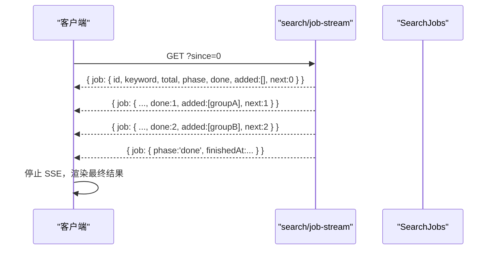

**图表来源**
- [dispatch.ts:152-170](file://src/api/dispatch.ts#L152-L170)
- [search-job.ts（客户端）](file://src/client/search-job.ts#L1-L200)

### 轮询消费示例（概念流程）
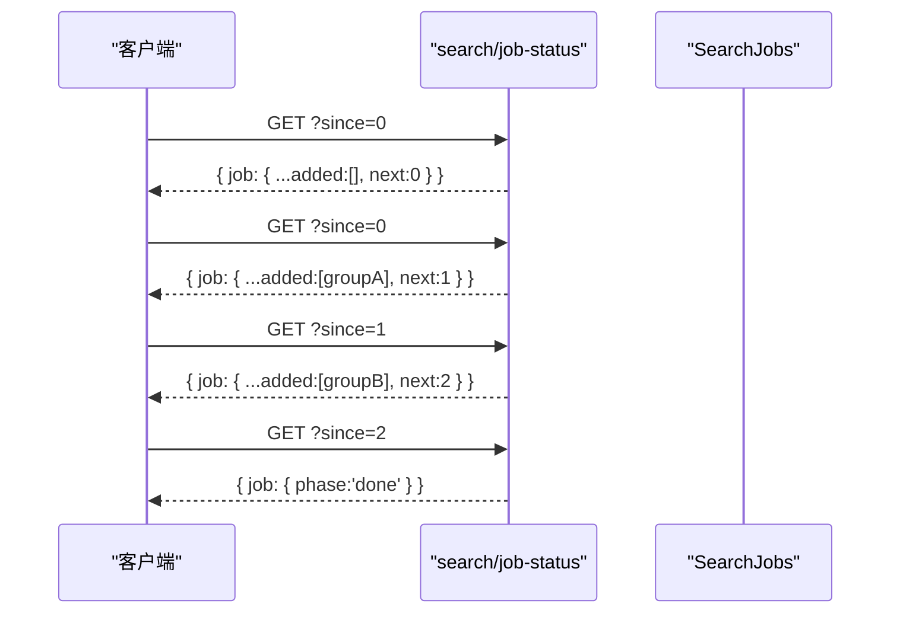

**图表来源**
- [dispatch.ts:152-170](file://src/api/dispatch.ts#L152-L170)
- [search-job.ts（客户端）](file://src/client/search-job.ts#L1-L200)