# 阅读器与章节流

<cite>
**本文引用的文件**   
- [chapter-content.ts](file://src/services/chapter-content.ts)
- [pagination.ts](file://src/services/pagination.ts)
- [export.ts](file://src/services/export.ts)
- [reader-session.ts](file://src/client/reader-session.ts)
- [reader-load.ts](file://src/client/reader-load.ts)
- [ReaderView.tsx](file://src/client/views/ReaderView.tsx)
- [documents.ts](file://src/services/epub/documents.ts)
- [package.ts](file://src/services/epub/package.ts)
- [ShelfView.tsx](file://src/client/views/ShelfView.tsx)
- [CityView.tsx](file://src/client/views/CityView.tsx)
- [SearchView.tsx](file://src/client/views/SearchView.tsx)
</cite>

## 目录
1. [引言](#引言)
2. [项目结构](#项目结构)
3. [核心能力总览](#核心能力总览)
4. [架构总览](#架构总览)
5. [详细组件分析](#详细组件分析)
6. [依赖关系分析](#依赖关系分析)
7. [性能优化](#性能优化)
8. [导出使用示例](#导出使用示例)
9. [EPUB spine 计数异常排查](#epub-spine-计数异常排查)
10. [故障排查指南](#故障排查指南)
11. [结论](#结论)

## 引言
本文围绕阅读器的核心能力展开：连续滚动、预取下一章、目录抽屉跳章、字号/行距/栏宽/纸张色可调、深浅主题自适应、章节范围流式导出（可取消），以及 EPUB 图文阅读（spine 计章、原书目录、脚注附录）。重点说明五个关键模块的职责边界与协作方式，并给出面向用户的操作说明和面向开发者的性能、排错建议。

## 项目结构
本项目把“服务层”和“客户端视图层”分开：
- `src/services/*`：服务端或平台无关的阅读逻辑，包括章节正文投影、分页翻页、流式导出、EPUB 包结构与文档转换。
- `src/client/*`：浏览器侧的 React 视图、阅读会话、懒加载决策、进度保存与 UI 装配。

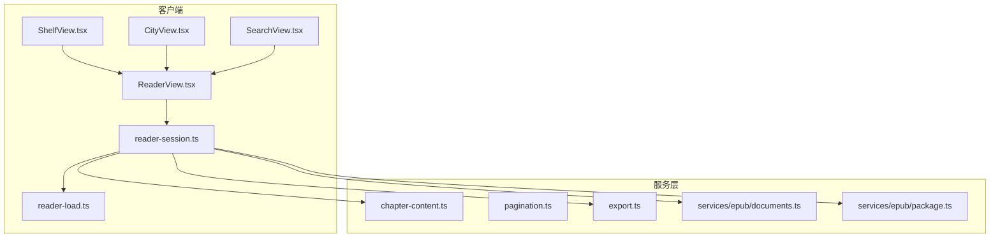

**图示来源**
- [ReaderView.tsx:1-200](file://src/client/views/ReaderView.tsx#L1-L200)
- [reader-session.ts:1-200](file://src/client/reader-session.ts#L1-L200)
- [reader-load.ts:1-50](file://src/client/reader-load.ts#L1-L50)
- [chapter-content.ts:1-182](file://src/services/chapter-content.ts#L1-L182)
- [pagination.ts:1-91](file://src/services/pagination.ts#L1-L91)
- [export.ts:1-64](file://src/services/export.ts#L1-L64)
- [documents.ts:1-200](file://src/services/epub/documents.ts#L1-L200)
- [package.ts:1-200](file://src/services/epub/package.ts#L1-L200)

**章节来源**
- [ReaderView.tsx:1-200](file://src/client/views/ReaderView.tsx#L1-L200)
- [reader-session.ts:1-200](file://src/client/reader-session.ts#L1-L200)
- [reader-load.ts:1-50](file://src/client/reader-load.ts#L1-L50)

## 核心能力总览
| 能力 | 主要实现位置 | 行为要点 |
|---|---|---|
| 连续滚动 | `reader-session.ts`、`scrollport.ts` | 滚动时防抖落盘；跨章立即落盘；未载章不进 DOM。 |
| 预取下一章 | `reader-load.ts`、`reader-session.ts` | 以哨兵元素为边界，进入视口底 + 2 屏即加载下一个未载章；单在途去重。 |
| 目录抽屉跳章 | `reader-session.ts`、`ReaderNavigation.tsx` | 选中即落盘；目标章未载则走同一加载路径；定位后补真实比例。 |
| 字号/行距/栏宽/纸张色可调 | `ReaderView.tsx` 中的 `PrefsPanel` | 通过 `prefsStore` 驱动样式；纸张色决定正文文字色；支持深色控制器开关。 |
| 深浅主题自适应 | `ReaderView.tsx`、`styles.tsx` | 面板按 `darkController` 切换类名；纸张色与正文色由纯函数计算。 |
| 章节范围流式导出 | `export.ts`、`ReaderView.tsx` 中的 `ExportPanel` | 串行逐章、章间节流、失败即停、AbortSignal 可取消；TXT/PDF 由上层下载器消费生成。 |
| EPUB 图文阅读 | `documents.ts`、`package.ts` | spine 作为阅读主序列；nav/NCX 作为导航树；图片绑定、锚点映射、内联 SVG 降级告警。 |

**章节来源**
- [reader-session.ts:201-481](file://src/client/reader-session.ts#L201-L481)
- [reader-load.ts:1-50](file://src/client/reader-load.ts#L1-L50)
- [ReaderView.tsx:1-200](file://src/client/views/ReaderView.tsx#L1-L200)
- [export.ts:1-64](file://src/services/export.ts#L1-L64)
- [documents.ts:1-200](file://src/services/epub/documents.ts#L1-L200)
- [package.ts:1-200](file://src/services/epub/package.ts#L1-L200)

## 架构总览
阅读流程从三个入口汇聚到 `ReaderView`，再由 `ReaderSession` 统一持有目录、已载正文、当前位置与待定位跳转。

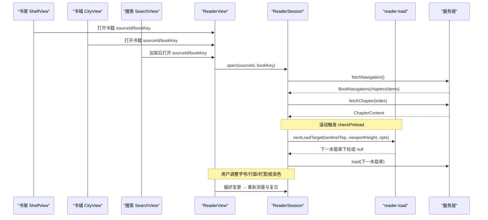

**图示来源**
- [ShelfView.tsx:1-244](file://src/client/views/ShelfView.tsx#L1-L244)
- [CityView.tsx:1-244](file://src/client/views/CityView.tsx#L1-L244)
- [SearchView.tsx:1-229](file://src/client/views/SearchView.tsx#L1-L229)
- [ReaderView.tsx:1-200](file://src/client/views/ReaderView.tsx#L1-L200)
- [reader-session.ts:1-200](file://src/client/reader-session.ts#L1-L200)
- [reader-load.ts:1-50](file://src/client/reader-load.ts#L1-L50)

## 详细组件分析

### 章节正文求值：`chapter-content.ts`
该模块是“图文节点树 → 纯文本”的唯一投影。它同时服务于：
- 普通章节的 `text` 出口；
- TXT 导出；
- AI 工具输入；
- 阅读器的文字面展示。

核心规则如下：
- 块级元素形成换行边界；链接只输出内部文字，不展开目标地址。
- 表格行用制表符分隔列；` ` 产生硬断行。
- `<pre>` 子树逐字保留空白与换行。
- 图片输出 `[图片]` 或 `[图片：替代文字]`。
- 非 pre 内容会折叠源码空白、trim 空行；pre 子树绕过这些规约。

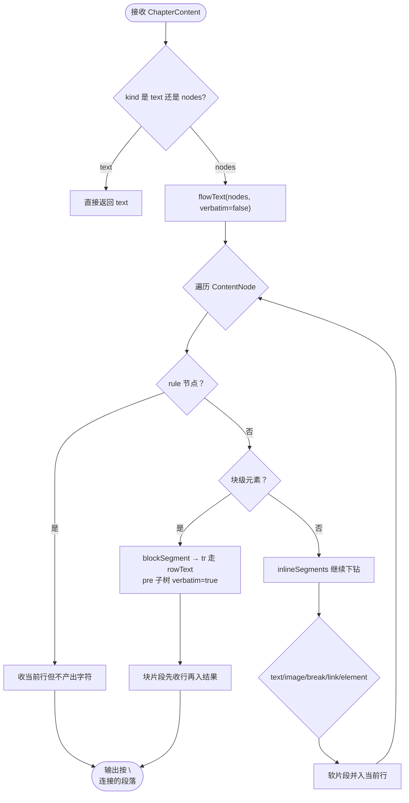

**图示来源**
- [chapter-content.ts:1-182](file://src/services/chapter-content.ts#L1-L182)

**章节来源**
- [chapter-content.ts:1-182](file://src/services/chapter-content.ts#L1-L182)

### 分页与偏移：`pagination.ts`
`followPages` 负责“翻页到底”：
- 按 `nextRule` 求下一页 URL，链式跟进。
- 多候选下一页不再递归翻页，而是全部抓取后统一去重。
- 五态停止：结束、本页零新增、回环、上限、串章边界。
- 串章保护优先使用 `stopUrls`，否则回退到启发式 `isSameChapterPage`。

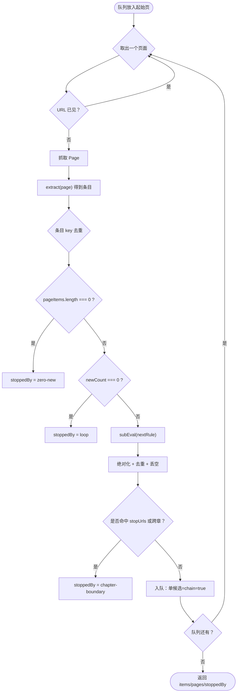

**图示来源**
- [pagination.ts:1-91](file://src/services/pagination.ts#L1-L91)

**章节来源**
- [pagination.ts:1-91](file://src/services/pagination.ts#L1-L91)

### 流式导出：`export.ts`
`exportBook` 是一个异步生成器，用于 PDF/TXT 等格式的分章写入：
- 首字节输出 BOM，兼容 Windows 记事本。
- 校验 `from/to` 必须在 `[1, toc.length]` 且 `from <= to`。
- 逐章调用 `getChapter`，失败即停并在文件中插入中断标记。
- 每章之间默认延迟 300ms，避免连续抓站。
- 可通过 `AbortSignal` 取消。

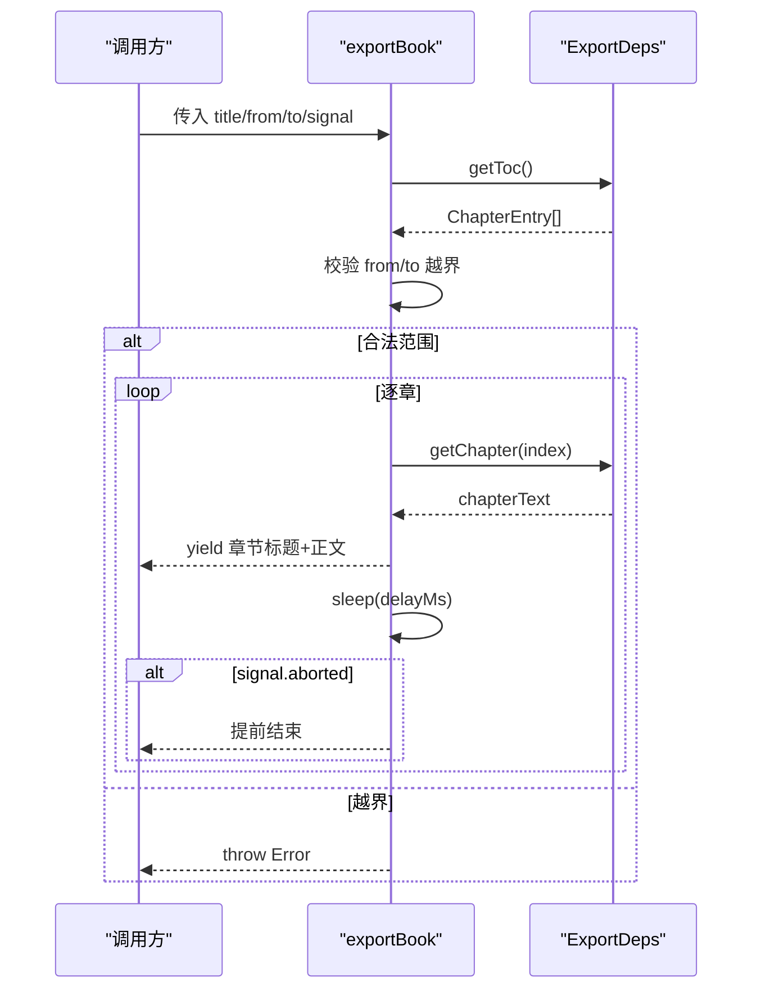

**图示来源**
- [export.ts:1-64](file://src/services/export.ts#L1-L64)

**章节来源**
- [export.ts:1-64](file://src/services/export.ts#L1-L64)

### 阅读会话与进度：`reader-session.ts`
`ReaderSession` 是阅读时序的唯一持有者，职责包括：
- 打开一本书：拉目录、恢复存档位置、初始化已载数组。
- 加载单章：单在途槽，并发与滚动风暴去重。
- 预取下一章：委托 `reader-load.ts` 判断是否需要加载。
- 位置提交：`restore/jump/cross/scroll` 四种原因控制是否立即落盘。
- 跳转落地：等待目标挂载后按像素偏移定位，并补写真实比例。
- 返回栈：正文链接、脚注、补充文档关闭都复用同一条返回语义。

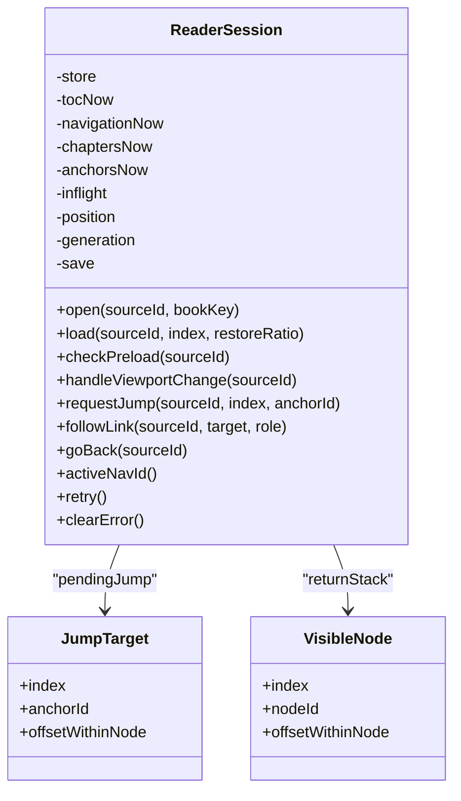

**图示来源**
- [reader-session.ts:1-200](file://src/client/reader-session.ts#L1-L200)
- [reader-session.ts:201-481](file://src/client/reader-session.ts#L201-L481)

**章节来源**
- [reader-session.ts:1-200](file://src/client/reader-session.ts#L1-L200)
- [reader-session.ts:201-481](file://src/client/reader-session.ts#L201-L481)

### 内容加载策略：`reader-load.ts`
`reader-load.ts` 提供两个纯函数：
- `nextChapterIndex`：从视口所在章向后找第一个未载章。
- `nextLoadTarget`：若已有在途章则拒绝新请求；若未载边界尚未进入预取区则返回 null。

预取窗口固定为 **2 屏**：当未载边界哨兵进入“视口底部 + 2 屏”以内时，发起加载。

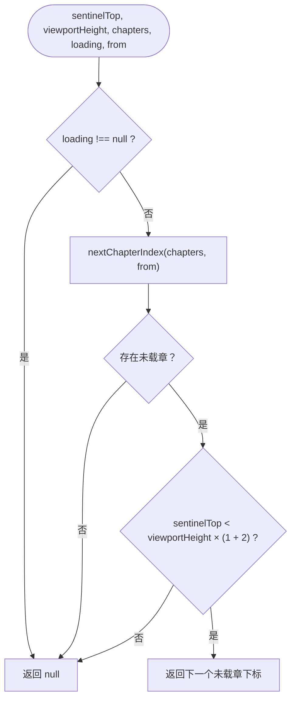

**图示来源**
- [reader-load.ts:1-50](file://src/client/reader-load.ts#L1-L50)

**章节来源**
- [reader-load.ts:1-50](file://src/client/reader-load.ts#L1-L50)

### ReaderView 与 Shelf、Search、City 的衔接
三个入口最终都通过路由跳转到 `reader` 页面，并携带 `sourceId`、`bookKey`、`title`：
- 书架 `ShelfView`：本地导入成功后直接进入阅读器；有持久警告时留在书架页展示。
- 书城 `CityView`：点击卡片后进入阅读器。
- 搜索 `SearchView`：命中行“直接阅读”会先尝试加架，再进入阅读器。

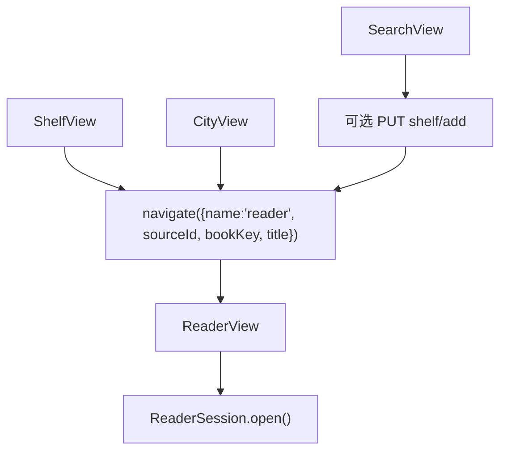

**图示来源**
- [ShelfView.tsx:1-244](file://src/client/views/ShelfView.tsx#L1-L244)
- [CityView.tsx:1-244](file://src/client/views/CityView.tsx#L1-L244)
- [SearchView.tsx:1-229](file://src/client/views/SearchView.tsx#L1-L229)
- [ReaderView.tsx:1-200](file://src/client/views/ReaderView.tsx#L1-L200)

**章节来源**
- [ShelfView.tsx:1-244](file://src/client/views/ShelfView.tsx#L1-L244)
- [CityView.tsx:1-244](file://src/client/views/CityView.tsx#L1-L244)
- [SearchView.tsx:1-229](file://src/client/views/SearchView.tsx#L1-L229)
- [ReaderView.tsx:1-200](file://src/client/views/ReaderView.tsx#L1-L200)

### EPUB 图文阅读：spine 计章、原书目录、脚注附录
EPUB 读取分两层：
- 包层 `package.ts`：解析 mimetype、container、OPF、manifest、spine、nav/NCX，构建 `EpubPackage`。
- 文档层 `documents.ts`：扫描 XHTML 建锚点映射，转换白名单节点，绑定图片与链接。

关键规则：
- spine 是阅读主序列；nav/NCX 是导航树，二者不是 1:1 对应。
- spine 中 `linear="false"` 属于补充文档，不参与主阅读流。
- 文档层两遍走：第一遍建锚点与链接集合，第二遍铸节点。
- 活动元素、脚本、样式等被剥离并记告警；内联 SVG 可能整页降级为封面图。
- 重复锚点报错；被剥离子树中的锚点只能降级而不能让整本书静默不可读。

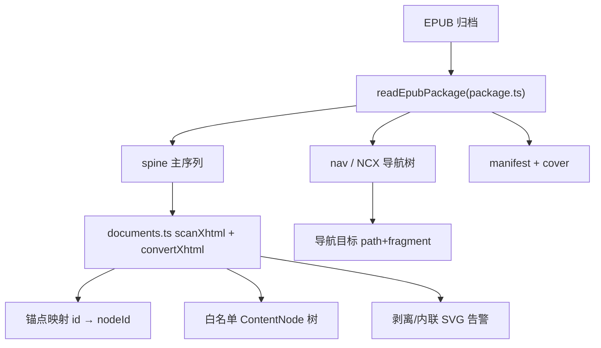

**图示来源**
- [package.ts:1-200](file://src/services/epub/package.ts#L1-L200)
- [documents.ts:1-200](file://src/services/epub/documents.ts#L1-L200)

**章节来源**
- [package.ts:1-200](file://src/services/epub/package.ts#L1-L200)
- [documents.ts:1-200](file://src/services/epub/documents.ts#L1-L200)

## 依赖关系分析
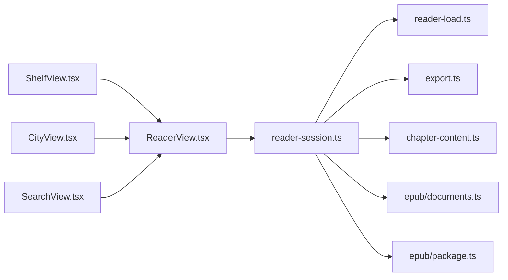

**图示来源**
- [ReaderView.tsx:1-200](file://src/client/views/ReaderView.tsx#L1-L200)
- [reader-session.ts:1-200](file://src/client/reader-session.ts#L1-L200)
- [reader-load.ts:1-50](file://src/client/reader-load.ts#L1-L50)
- [export.ts:1-64](file://src/services/export.ts#L1-L64)
- [chapter-content.ts:1-182](file://src/services/chapter-content.ts#L1-L182)
- [documents.ts:1-200](file://src/services/epub/documents.ts#L1-L200)
- [package.ts:1-200](file://src/services/epub/package.ts#L1-L200)
- [ShelfView.tsx:1-244](file://src/client/views/ShelfView.tsx#L1-L244)
- [CityView.tsx:1-244](file://src/client/views/CityView.tsx#L1-L244)
- [SearchView.tsx:1-229](file://src/client/views/SearchView.tsx#L1-L229)

**章节来源**
- [ReaderView.tsx:1-200](file://src/client/views/ReaderView.tsx#L1-L200)
- [reader-session.ts:1-200](file://src/client/reader-session.ts#L1-L200)

## 性能优化

### 预取窗口
- 预取距离：2 屏。
- 触发条件：未载边界哨兵进入“视口底部 + 2 屏”。
- 去重：`loading !== null` 时拒绝新加载；失败章不会自动反复预取。
- 推荐配置：若网络慢或站点限频，可在业务层扩大 `PRELOAD_SCREENS` 或增加导出节流时间。

**章节来源**
- [reader-load.ts:1-50](file://src/client/reader-load.ts#L1-L50)
- [reader-session.ts:201-481](file://src/client/reader-session.ts#L201-L481)

### 图片懒加载
- 书架、书城、阅读器封面均使用 HTML `loading="lazy"`。
- 封面失败时降级为首字占位，并维护 `imgFailed` 键避免误伤同名不同轮次条目。
- EPUB 图片在文档层通过资源绑定获取宽高，避免布局抖动。

**章节来源**
- [ShelfView.tsx:1-244](file://src/client/views/ShelfView.tsx#L1-L244)
- [CityView.tsx:1-244](file://src/client/views/CityView.tsx#L1-L244)
- [documents.ts:1-200](file://src/services/epub/documents.ts#L1-L200)

### 滚动节流
- 阅读进度保存使用防抖，默认 2 秒；跨章滚动立即 flush。
- 导出章节间默认 300ms 节流，避免连续抓站。
- 视图渲染只包含已载章节，未载章通过哨兵表达边界，减少 DOM 体积。

**章节来源**
- [reader-session.ts:1-200](file://src/client/reader-session.ts#L1-L200)
- [export.ts:1-64](file://src/services/export.ts#L1-L64)

## 导出使用示例

### 导出 TXT
1. 在阅读器界面打开导出面板。
2. 设置起止章节：
   - “全部”导出整本书。
   - “剩余”从当前章导到末尾。
   - 也可手动输入起止章号。
3. 确认前系统会校验范围合法性；非法范围禁止下载。
4. 点击“下载”，系统开始流式导出；进行中可“取消”或“收起面板”。
5. 生成的文本首字节含 BOM，Windows 记事本可直接识别。

注意：
- 导出是**纯文本**；EPUB 中的图片会以 `[图片]` 或 `[图片：替代文字]` 形式出现。
- 如果中途某章抓取失败，文件会插入中断标记，后续重跑只补缺章。

**章节来源**
- [ReaderView.tsx:1-200](file://src/client/views/ReaderView.tsx#L1-L200)
- [export.ts:1-64](file://src/services/export.ts#L1-L64)
- [chapter-content.ts:1-182](file://src/services/chapter-content.ts#L1-L182)

### 导出 PDF
PDF 由上层下载器消费 `exportBook` 的异步生成器，将章节流写入 PDF 流。用户交互与 TXT 一致，区别在于：
- 文件扩展名与 MIME 类型由宿主决定。
- 图表、插图不会变成图片对象，只会保留替代文字。
- 大书导出时仍受章间节流保护，避免对源站造成压力。

**章节来源**
- [ReaderView.tsx:1-200](file://src/client/views/ReaderView.tsx#L1-L200)
- [export.ts:1-64](file://src/services/export.ts#L1-L64)

## EPUB spine 计数异常排查

### 常见现象
- 阅读器显示的总章数与 OPF spine 长度不一致。
- 某些章节出现在目录里，但不在阅读顺序中。
- 导入后提示导航降级或资源被加密。

### 排查步骤
1. 确认 spine 主序列：
   - 阅读单元数量应基于 spine 中的线性条目，而不是 ZIP 条目顺序或文件名排序。
   - `linear="false"` 的 spine 项属于补充文档，不计入阅读主序列。
2. 检查导航来源：
   - 优先使用 nav 文档；无 nav 时用 NCX；两者都缺才降级为按 spine 合成。
   - 声明了导航文档却读不出目录，属于坏目录，不应静默降级。
3. 检查加密资源：
   - spine 中任意文档被加密 → 整本拒绝。
   - spine 之外的资源被加密 → 保留告警，实际用到时报“被加密”。
4. 检查文档层问题：
   - 重复锚点会直接报错。
   - 内联 SVG 若整页唯一内容，可能被当作封面候选；其余内联 SVG 会被剥离并记录告警。
   - 被剥离子树中的锚点只能降级，不能视为锚点不存在。

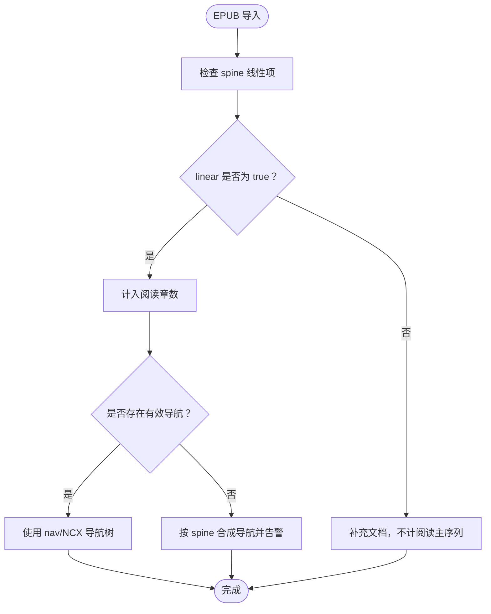

**图示来源**
- [package.ts:1-200](file://src/services/epub/package.ts#L1-L200)

**章节来源**
- [package.ts:1-200](file://src/services/epub/package.ts#L1-L200)
- [documents.ts:1-200](file://src/services/epub/documents.ts#L1-L200)

## 故障排查指南

| 问题 | 可能原因 | 处理建议 |
|---|---|---|
| 阅读器卡在第一页 | 目录未加载成功或存档恢复失败 | 调用 `retry()` 重试；查看错误信息；确认书架可拉取。 |
| 跳章后进度没更新 | 跳章发生在加载在途期间，读数被 `pendingJump` 屏蔽 | 等待 settleJump 落位；若目标章失败，先重试该章。 |
| 导出范围报越界 | `from/to` 不在 `[1, total]` 或 `from > to` | 由路由层裁剪后再传；不要自己再次 clip。 |
| 导出中途失败 | 某章抓取失败 | 检查网络与源站限频；重跑可补缺章；查看文件中中断标记。 |
| EPUB 无法导入 | spine 文档加密、固定版式、脚本主内容、mimetype 不正确 | 查看导入告警 code；解密或移除限制后重试。 |
| EPUB 目录错位 | nav/NCX 指向错误或 spine 与目录不一致 | 检查 OPF spine 与导航文档；必要时接受 spine 合成导航。 |
| 滚动卡顿 | 已载章节过多、图片未懒加载、滚动未节流 | 确认未载章不入 DOM；封面使用 `loading="lazy"`；使用会话防抖。 |
| 章节文字丢失 | 自定义 CSS 或主题覆盖导致内容被隐藏 | 检查纸张色与正文色对比；还原默认主题验证。 |

**章节来源**
- [reader-session.ts:201-481](file://src/client/reader-session.ts#L201-L481)
- [export.ts:1-64](file://src/services/export.ts#L1-L64)
- [package.ts:1-200](file://src/services/epub/package.ts#L1-L200)
- [documents.ts:1-200](file://src/services/epub/documents.ts#L1-L200)

## 结论
阅读器以 `ReaderSession` 为中心，把目录、正文、位置、预取、导出、EPUB 图文统一到一个可测的时序模型中。`chapter-content.ts` 保证文字面唯一投影，`pagination.ts` 保证翻页到底的安全终止，`export.ts` 保证导出可控、可中断、可续跑，`reader-load.ts` 保证预取只在正确时机触发，而 EPUB 层把 spine 主序列与原书导航解耦，使阅读顺序稳定、导航可诊断。对用户而言，最关键的体验是：滚动流畅、预取自然、导出可靠、主题可调、EPUB 可读。对开发者而言，最重要的纪律是：**不并行抓章、不静默丢弃可见内容、不复制越界判据、不在异步续作上污染旧会话**。