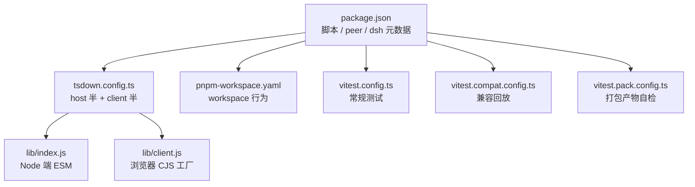
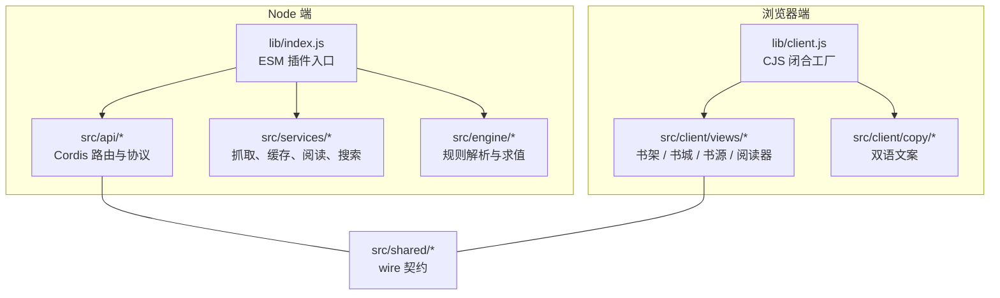
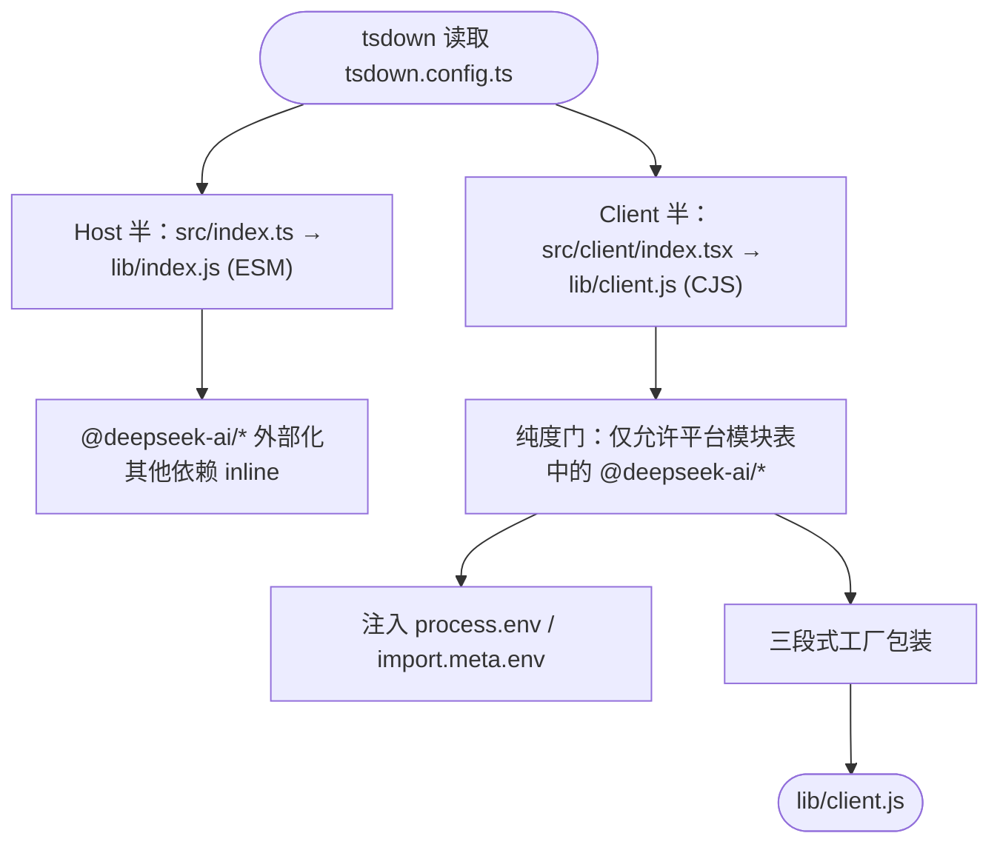
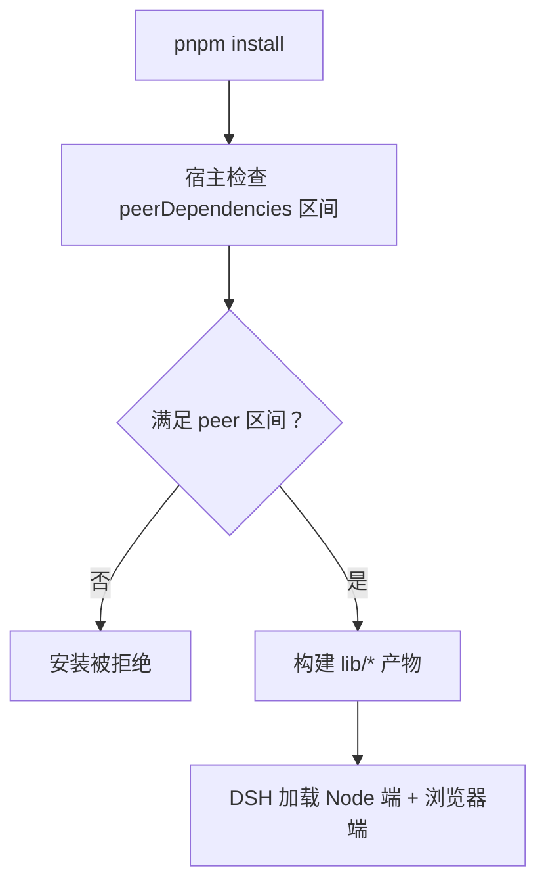
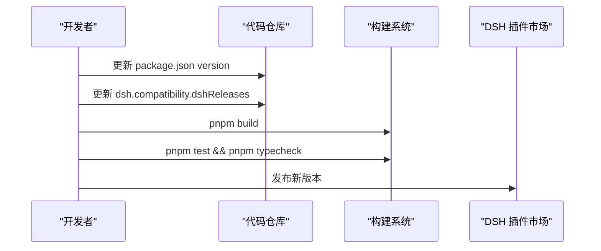
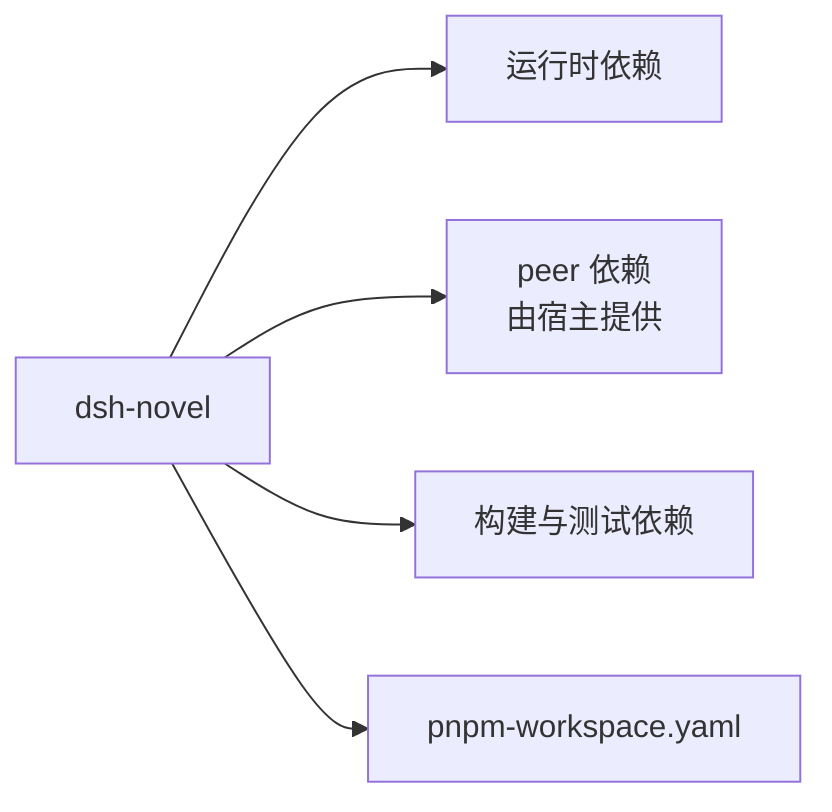

# 开发与部署

<cite>
**本文引用的文件**   
- [package.json](file://package.json)
- [pnpm-workspace.yaml](file://pnpm-workspace.yaml)
- [tsdown.config.ts](file://tsdown.config.ts)
- [vitest.config.ts](file://vitest.config.ts)
- [vitest.compat.config.ts](file://vitest.compat.config.ts)
- [vitest.pack.config.ts](file://vitest.pack.config.ts)
- [AGENTS.md](file://AGENTS.md)
- [README.md](file://README.md)
</cite>

## 目录
1. [简介](#简介)
2. [项目结构](#项目结构)
3. [核心组件](#核心组件)
4. [架构总览](#架构总览)
5. [详细组件分析](#详细组件分析)
6. [依赖分析](#依赖分析)
7. [性能与构建特性](#性能与构建特性)
8. [常见问题排查](#常见问题排查)
9. [结论](#结论)

## 简介
本指南面向 dsh-novel（DeepSeek Harness 小说插件）的贡献者，覆盖本地环境搭建、依赖安装、开发命令、双半产物构建、测试矩阵、热重载与调试、发版流程以及 Agent 工作须知。目标是让第一次参与的人也能按步骤完成构建、跑通测试、理解兼容性矩阵并安全发布到 DSH 插件市场。

## 项目结构
仓库是单一 npm 包 + pnpm workspace 配置：

| 路径 | 职责 |
|---|---|
| `src/` | 源码：Node 端（引擎、服务、API、工具）、浏览器端（客户端 UI）、共享契约 |
| `lib/` | 构建产物（不入库），由 `tsdown` 生成 host 与 client 两个半产物 |
| `tests/` | 单元测试、兼容回放、打包链路校验、服务与引擎用例 |
| `compat/` | 兼容性快照与 fixture |
| `locale/` | 宿主注入的国际化文案资源 |
| `package.json` | 包名、版本、scripts、peerDependencies、DSH 兼容性元信息 |
| `pnpm-workspace.yaml` | pnpm 工作区策略与冷却期豁免 |
| `tsdown.config.ts` | 双半产物构建配置 |
| `vitest*.config.ts` | 三套测试入口：常规、兼容、打包产物自检 |
| `AGENTS.md` | Agent 工作须知与硬约束 |

**图表来源**
- [package.json:1-125](file://package.json#L1-L125)
- [tsdown.config.ts:1-97](file://tsdown.config.ts#L1-L97)
- [pnpm-workspace.yaml:1-9](file://pnpm-workspace.yaml#L1-L9)
- [vitest.config.ts:1-21](file://vitest.config.ts#L1-L21)
- [vitest.compat.config.ts:1-11](file://vitest.compat.config.ts#L1-L11)
- [vitest.pack.config.ts:1-10](file://vitest.pack.config.ts#L1-L10)

**章节来源**
- [package.json:1-125](file://package.json#L1-L125)
- [pnpm-workspace.yaml:1-9](file://pnpm-workspace.yaml#L1-L9)
- [tsdown.config.ts:1-97](file://tsdown.config.ts#L1-L97)
- [vitest.config.ts:1-21](file://vitest.config.ts#L1-L21)
- [vitest.compat.config.ts:1-11](file://vitest.compat.config.ts#L1-L11)
- [vitest.pack.config.ts:1-10](file://vitest.pack.config.ts#L1-L10)

## 核心组件
- **包元数据与脚本**：`package.json` 定义包名、主入口、导出映射、DSH 插件元数据、`build`/`dev`/`test`/`test:compat`/`test:pack` 等脚本，以及运行时 peer 依赖区间。
- **双半构建**：`tsdown.config.ts` 输出 Node 端 ESM（`lib/index.js`）与浏览器端 CJS 工厂（`lib/client.js`）。
- **测试入口**：`vitest.config.ts`、`vitest.compat.config.ts`、`vitest.pack.config.ts` 分别驱动常规测试、兼容回放、打包产物自检。
- **Workspace 行为**：`pnpm-workspace.yaml` 允许 esbuild 构建，并对 `@deepseek-ai/dsh-*` 及个别依赖做最小发行冷却期豁免。
- **Agent 约束**：`AGENTS.md` 规定 wire 单点、纯度门、文案单点、提交规范、真机门控与文档纪律。

**章节来源**
- [package.json:1-125](file://package.json#L1-L125)
- [tsdown.config.ts:1-97](file://tsdown.config.ts#L1-L97)
- [vitest.config.ts:1-21](file://vitest.config.ts#L1-L21)
- [vitest.compat.config.ts:1-11](file://vitest.compat.config.ts#L1-L11)
- [vitest.pack.config.ts:1-10](file://vitest.pack.config.ts#L1-L10)
- [pnpm-workspace.yaml:1-9](file://pnpm-workspace.yaml#L1-L9)
- [AGENTS.md:1-61](file://AGENTS.md#L1-L61)

## 架构总览
dsh-novel 以“Node 插件端 + 浏览器面板端”的双半形态运行：Node 端通过 Cordis 暴露 `/novel-api`，浏览器端作为左侧栏全局面板；两者共享 wire 契约与部分服务逻辑，并由 tsdown 把 npm 依赖 inline 进浏览器 bundle，同时保留 `@deepseek-ai/*` 平台模块为外部 require。

**图表来源**
- [tsdown.config.ts:1-97](file://tsdown.config.ts#L1-L97)
- [package.json:1-125](file://package.json#L1-L125)

**章节来源**
- [tsdown.config.ts:1-97](file://tsdown.config.ts#L1-L97)
- [package.json:1-125](file://package.json#L1-L125)

## 详细组件分析

### 环境与依赖安装
- **前置环境**
  - Node.js：使用当前 LTS 或仓库锁定的 devDependencies 所兼容的版本（由 pnpm lockfile 决定）。
  - pnpm：用于安装依赖与工作区行为。
  - DSH 宿主：用于本地调试、插件加载、浏览器面板与 `/novel-api` 调用。
- **安装依赖**
  - 在项目根目录执行一次依赖安装即可。
- **可选宿主环境**
  - 若只需要单元测试，可只装依赖并运行测试。
  - 若需要本地源码调试与热更新，需启动 DSH 宿主并把源码目录挂载为插件。

**章节来源**
- [package.json:1-125](file://package.json#L1-L125)
- [AGENTS.md:44-61](file://AGENTS.md#L44-L61)

### 开发命令
| 命令 | 含义 | 说明 |
|---|---|---|
| `pnpm build` | 构建双半产物 | 调用 tsdown，产出 `lib/index.js` 与 `lib/client.js` |
| `pnpm dev` | 监听模式构建 | 修改源码后重新生成 `lib/*`，便于 DSH 热更新 |
| `pnpm test` | 运行常规测试 | 排除兼容回放与打包产物自检用例 |
| `pnpm test:watch` | 交互式测试 | 适合调试单个测试文件 |
| `pnpm test:compat` | 运行兼容回放 | 基于 `tests/compat/**` 与 `compat/fixtures/**` |
| `pnpm test:pack` | 构建 + 打包产物自检 | 先 `pnpm build`，再跑 `tests/packaging-build.test.ts` |
| `pnpm typecheck` | TypeScript 类型检查 | tsc 无输出模式 |

注意事项：
- `pnpm test` 默认不包含 `tests/compat/**` 与 `tests/packaging-build.test.ts`。
- `pnpm test:pack` 会先触发 `pnpm build`，确保后续测试基于最新产物。
- AGENTS.md 强调：`pnpm test` 全绿不等于真实站点可用，也不等于安装链路可用；类型检查必须与测试同批验证。

**章节来源**
- [package.json:48-70](file://package.json#L48-L70)
- [vitest.config.ts:1-21](file://vitest.config.ts#L1-L21)
- [vitest.compat.config.ts:1-11](file://vitest.compat.config.ts#L1-L11)
- [vitest.pack.config.ts:1-10](file://vitest.pack.config.ts#L1-L10)
- [AGENTS.md:28-31](file://AGENTS.md#L28-L31)

### 双半产物构建：`tsdown.config.ts`
tsdown 导出一个数组配置，表示两次并行构建：

| 半产物 | 入口 | 输出 | 格式 | 平台 | 关键行为 |
|---|---|---|---|---|---|
| Node 端 | `src/index.ts` | `lib/index.js` + `lib/index.d.ts` | ESM | node | `@deepseek-ai/*` 不 inline，其余依赖 inline；生成类型声明 |
| 浏览器端 | `src/client/index.tsx` | `lib/client.js` | CJS | browser | 平台模块表外的 `@deepseek-ai/*` 全部 inline；生成 sourcemap；三段式 banner 包裹工厂函数 |

构建关键点：
- **平台模块表**：只有 React、React DOM、`@deepseek-ai/cordis`、`@deepseek-ai/dsh-client-store`、`-ui-slots`、`-ui-primitives` 被允许作为外部 require，其他 `@deepseek-ai/*` 会被视为违规。
- **Node 内建保护**：浏览器端禁止 Node 内建模块进入 bundle。
- **浏览器条件导出**：通过 `resolve.conditionNames` 强制浏览器优先解析传递依赖。
- **环境变量占位**：用 `process.env`、`import.meta.env` 占位避免浏览器启动时 ReferenceError。
- **三段式工厂**：banner/intro/footer 构造官方要求的 `window.__ModuleLoader__.load({ id, factory })` 形式，id 必须等于包名。

**图表来源**
- [tsdown.config.ts:1-97](file://tsdown.config.ts#L1-L97)

**章节来源**
- [tsdown.config.ts:1-97](file://tsdown.config.ts#L1-L97)

### package.json 的 scripts 与 peer 依赖
- **scripts**
  - `build`：直接调用 tsdown。
  - `dev`：tsdown 监听模式。
  - `prepare`：在 install 阶段自动构建，便于从源码目录引用。
  - `test` / `test:watch` / `test:compat` / `test:pack` / `typecheck`：分别对应 Vitest 与 tsc。
- **exports**
  - `.` 指向 `lib/index.js` 与 `lib/index.d.ts`。
  - `./client` 指向 `lib/client.js`。
  - `./locale/*.json`、`./icon`、`./package.json` 单独导出。
- **peerDependencies**
  - `@deepseek-ai/cordis`、`@deepseek-ai/dsh-tools`、`@deepseek-ai/schemastery`、`react`、`react-dom`。
  - `react`、`react-dom` 标记为可选 peer 依赖。
- **dsh.compatibility.dshReleases**
  - 记录实际跑过的 DSH 宿主版本与兼容性状态。

**图表来源**
- [package.json:1-125](file://package.json#L1-L125)

**章节来源**
- [package.json:1-125](file://package.json#L1-L125)

### pnpm-workspace.yaml 的工作区配置
- `allowBuilds.esbuild: true`：允许 esbuild 构建。
- `minimumReleaseAgeExclude`：对 `@deepseek-ai/dsh-*` 及几个依赖跳过最小发行冷却期检查，原因是测试和兼容链依赖这些尚未过冷却期的包；supply-chain 校验由冻结 lockfile 兜底。

这条配置的语义不是“忽略依赖”，而是“允许在工作区中引入刚发布的宿主生态包”。

**章节来源**
- [pnpm-workspace.yaml:1-9](file://pnpm-workspace.yaml#L1-L9)

### 测试体系与调试
- **常规测试**：`vitest.config.ts` 设置测试范围为 `tests/**/*.test.{ts,tsx}`，排除 `tests/compat/**` 与 `tests/packaging-build.test.ts`，并 alias `@deepseek-ai/dsh-client-ui-primitives` 到本地 stub，使配置页相关测试能在 vitest 中运行。
- **兼容回放**：`vitest.compat.config.ts` 仅包含 `tests/compat/**`，与常规测试互斥。
- **打包产物自检**：`vitest.pack.config.ts` 仅包含 `tests/packaging-build.test.ts`，并通过 `pnpm test:pack` 在构建之后运行。
- **调试建议**
  - 使用 `pnpm test:watch` 调试单个测试。
  - 浏览器端调试依赖 DSH 宿主：修改 `lib/client.js` 后由 `dsh-client-hmr` 推送热更新。
  - Node 端不热重载，改完需重启宿主。

**章节来源**
- [vitest.config.ts:1-21](file://vitest.config.ts#L1-L21)
- [vitest.compat.config.ts:1-11](file://vitest.compat.config.ts#L1-L11)
- [vitest.pack.config.ts:1-10](file://vitest.pack.config.ts#L1-L10)
- [AGENTS.md:53-61](file://AGENTS.md#L53-L61)

### 发版流程
发版涉及版本号、兼容性矩阵、DSH 宿主版本矩阵与发布到插件市场四个环节。

#### 1. 更新版本号
- 编辑 `package.json` 的 `version` 字段。
- 如果改动影响用户可见行为，补充 README 或 ADR；如果是内部构建或依赖调整，使用 `chore` 或 `fix`。

#### 2. 刷新兼容性矩阵
- 维护 `package.json` 中 `dsh.compatibility.dshReleases`，新增已实测的 DSH 宿主版本。
- 若 peer 依赖区间发生变化，需要同步评估旧宿主是否仍满足区间。

#### 3. 维护 DSH 宿主版本矩阵
- 每次 bump 宿主版本或 peer 区间后，应在实际宿主环境中安装并冒烟测试。
- 将结果写入 `dsh.compatibility.dshReleases`，而不是只停留在本地。

#### 4. 构建与测试
- 执行 `pnpm build`。
- 执行 `pnpm test` 与 `pnpm typecheck`。
- 若改动抓取、规则引擎、打包链路或相关性判据，还要按 AGENTS.md 要求跑相应真链路门控。

#### 5. 发布到 DSH 插件市场
- 根据 README 与 AGENTS.md，最终发布物依赖 `lib/` 产物；从源码目录安装不会自动构建，因此必须先 `pnpm build`。
- 发布前确认 `files` 列表包含 `lib`、`locale`、`icon.svg`、`cordis.patch.yml`、`README.md`、`LICENSE`。

**图表来源**
- [package.json:1-125](file://package.json#L1-L125)
- [AGENTS.md:28-31](file://AGENTS.md#L28-L31)

**章节来源**
- [package.json:1-125](file://package.json#L1-L125)
- [AGENTS.md:28-31](file://AGENTS.md#L28-L31)
- [README.md:56-59](file://README.md#L56-L59)

### Agent 工作须知：代码质量与提交规范
AGENTS.md 中与代码质量和提交规范相关的硬约束包括：

- **wire 单点**：路由名、值形状与写路由 body 形状集中在 `src/shared/wire.ts`，浏览器端类型只是再导出桶。
- **书目字段集**：书架元数据字段变更只能改 `shared/wire.ts` 的对应结构与选择器，不允许各实现各自筛选键。
- **宁炸不猜**：无法识别的规则语法必须在解析期抛错，空结果不能冒充失败。
- **取值规约**：取位失败返回 Miss，解析到空集合返回空 List，二者不可混为一谈。
- **纯度门**：浏览器端运行时 import 仅限平台模块表；`src/shared/wire.ts` 保持零运行时依赖。
- **客户端文案单点**：中文原文与英文译文集中在 `src/client/copy/**`，组件与非 React 函数通过统一方式取词。
- **提交规范**：conventional commits，格式为 `feat|fix|test|docs|refactor|chore(scope): 中文说明`，正文讲为什么。
- **文档纪律**：过程文档不入仓；ADR 只追加；注释承担“为什么/口径/裁决/证据”；同一事实只住一个家；文档面引用必须有活性。

**章节来源**
- [AGENTS.md:1-61](file://AGENTS.md#L1-L61)

## 依赖分析
dsh-novel 的依赖关系可以分成四层：

| 层级 | 内容 | 作用 |
|---|---|---|
| 运行时依赖 | `cheerio`、`undici`、`yauzl`、`iconv-lite`、`dom-serializer`、`domhandler`、`image-size`、`buffer-crc32` | 页面抓取、HTML 处理、EPUB 解压、编码转换等 |
| peer 依赖 | `@deepseek-ai/cordis`、`@deepseek-ai/dsh-tools`、`@deepseek-ai/schemastery`、`react`、`react-dom` | 宿主侧提供，插件通过外部 require 接入 |
| 构建依赖 | `tsdown`、`typescript`、`vitest`、Playwright、jsdom、testing-library 等 | 构建、类型检查、测试与浏览器模拟 |
| workspace 策略 | `pnpm-workspace.yaml` | 控制 esbuild 构建权限与宿主生态包的冷却期豁免 |

**图表来源**
- [package.json:71-125](file://package.json#L71-L125)
- [pnpm-workspace.yaml:1-9](file://pnpm-workspace.yaml#L1-L9)

**章节来源**
- [package.json:71-125](file://package.json#L71-L125)
- [pnpm-workspace.yaml:1-9](file://pnpm-workspace.yaml#L1-L9)

## 性能与构建特性
- **浏览器端体积优化**：除平台模块表外的 npm 依赖全部 inline，减少浏览器端模块数量。
- **平台模块外置**：React、React DOM、cordis、dsh-client-store 等由宿主提供，避免重复打包。
- **sourcemap**：浏览器端开启 sourcemap，便于调试。
- **clean 策略**：host 半 clean，client 半不清理，避免两个配置互相删除产物。
- **浏览器条件导出**：通过 conditionNames 防止浏览器解析到 Node 入口。
- **类型声明直出**：Node 端输出 `.d.ts`，供宿主或二次消费方使用。

[本节为通用构建特性说明，未直接分析具体行]

## 常见问题排查

### 端口冲突
现象：
- 启动 DSH 宿主或开发服务器时报端口占用。
- 浏览器端热更新失效，但 Node 端仍可运行。

处理：
- 确认 DSH 宿主的 Web 端口未被其他进程占用。
- 关闭占用该端口的进程或更换宿主端口。
- 若使用代理，注意 DSH 的 Node 端走 undici，不读系统代理，需在宿主配置中显式设置代理地址。

**章节来源**
- [AGENTS.md:53-61](file://AGENTS.md#L53-L61)

### peer 依赖未安装
现象：
- 安装或加载插件时报 `installation rejected` 或模块找不到。
- 浏览器端报 React、react-dom 或 cordis 相关模块缺失。

原因：
- 宿主版本不在 peer 依赖区间。
- 宿主未安装或未暴露对应的 `@deepseek-ai/*` 模块。
- 从源码目录安装但未先生成 `lib/`。

处理：
- 检查 `package.json` 的 `peerDependencies` 区间是否与宿主版本匹配。
- 检查 `dsh.compatibility.dshReleases` 是否包含当前宿主版本。
- 先从源码目录安装宿主依赖，再执行 `pnpm build`。

**章节来源**
- [package.json:1-125](file://package.json#L1-L125)
- [README.md:56-59](file://README.md#L56-L59)
- [AGENTS.md:53-61](file://AGENTS.md#L53-L61)

### 构建产物未更新
现象：
- 修改了 `src/client/**` 但浏览器界面没有热更新。
- 从源码目录安装后插件树拒绝挂载。

原因：
- 未运行 `pnpm dev` 或手动 `pnpm build`。
- `lib/client.js` 的 mtime 或 size 没有变化。
- 浏览器端热更新只作用于 client 半，Node 端需要重启宿主。

处理：
- 开发时优先使用 `pnpm dev`。
- 若只运行 `pnpm build`，也要确保产物确实重生成。
- 修改 Node 端代码后重启 DSH 宿主。

**章节来源**
- [AGENTS.md:53-61](file://AGENTS.md#L53-L61)

### EPUB 真机测试失败
现象：
- 单元测试通过，但本地 EPUB 在真机或浏览器中渲染异常。
- 正文可读性、排版、几何尺寸不符合预期。

处理：
- 使用 AGENTS.md 提到的 `DSH_EPUB_BROWSER` 门控在本机浏览器中量渲染与几何。
- 区分“搜索面可用性”“正文可读性”“安装包链路”：reprobe 不证明正文可读，正文审计是报告而非通过率断言。
- 将真机读数如实记录到矩阵行的 note，不要静默跳过。

**章节来源**
- [AGENTS.md:30-36](file://AGENTS.md#L30-L36)

### 兼容回放与快照问题
现象：
- `pnpm test:compat` 红，但常规测试通过。
- 上游快照缺失导致门禁失败。

处理：
- 使用 `pnpm test:compat` 专门运行兼容回放。
- 如需采集上游快照，按 AGENTS.md 指引使用 `DSH_CAPTURE_UPSTREAM=1` 与 `DSH_LEGADO_REF`。
- 不要因快照缺失而改为 skip；快照不存在即应失败。

**章节来源**
- [vitest.compat.config.ts:1-11](file://vitest.compat.config.ts#L1-L11)
- [AGENTS.md:32-43](file://AGENTS.md#L32-L43)

### 测试假红或前端测试报错
现象：
- 前端测试报 `Cannot find module`。
- 管道过滤后退出码看似全绿。

处理：
- 安装完整依赖，特别是 `jsdom`、`@testing-library/react`。
- 不要只看 grep 输出，要单独打印退出码。
- 跑门与提交必须是两条命令。

**章节来源**
- [AGENTS.md:28-36](file://AGENTS.md#L28-L36)

## 结论
dsh-novel 的开发体验围绕“双半产物 + 宿主生态 + 严格 purity 门”展开：Node 端负责抓取与服务，浏览器端负责面板与交互；构建产物必须先生成，peer 依赖必须由宿主提供，兼容性矩阵必须随宿主版本更新。贡献者应优先遵循 AGENTS.md 的 wire 单点、纯度门、文案单点与提交规范，并用 `pnpm build`、`pnpm test`、`pnpm test:compat`、`pnpm test:pack`、`pnpm typecheck` 构成完整的本地验证闭环。发布前务必更新版本号、刷新 `dsh.compatibility.dshReleases`，并在真实宿主环境中完成冒烟测试后再发布到 DSH 插件市场。