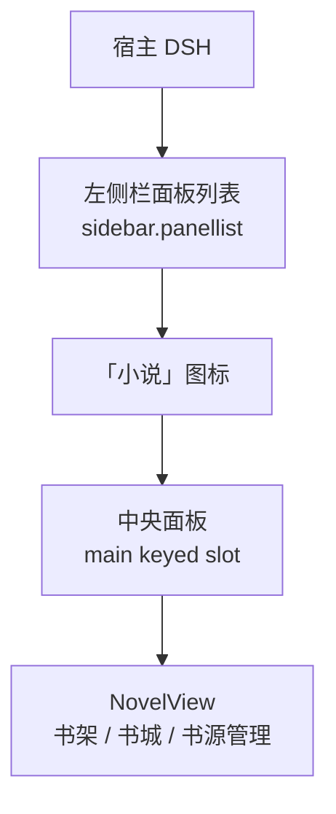
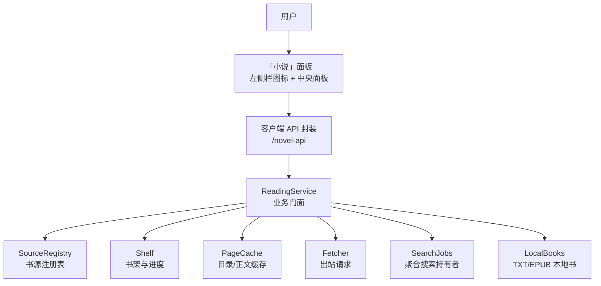
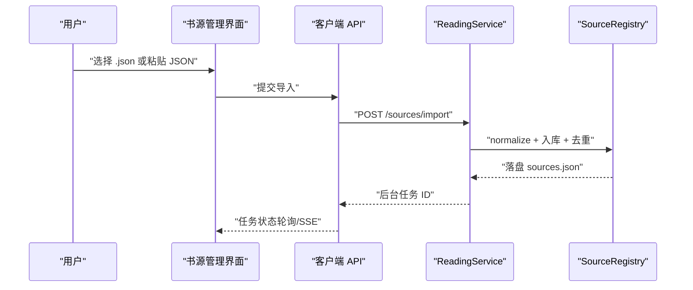
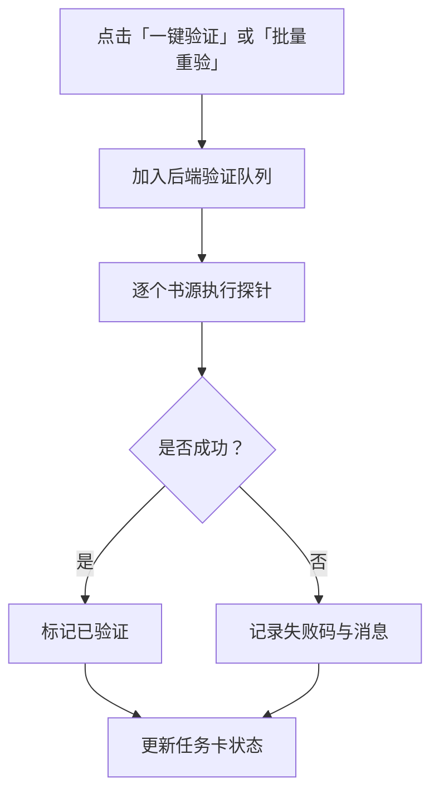
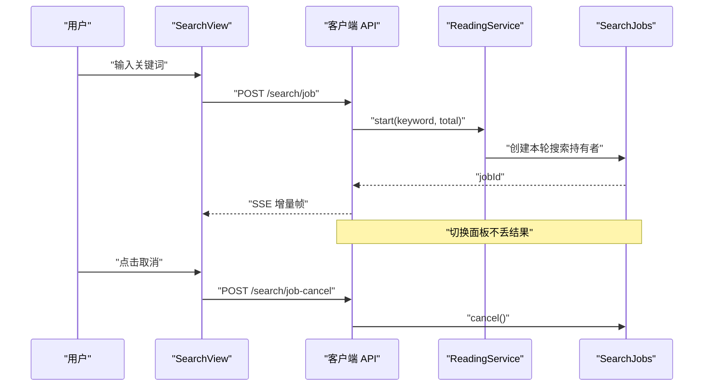
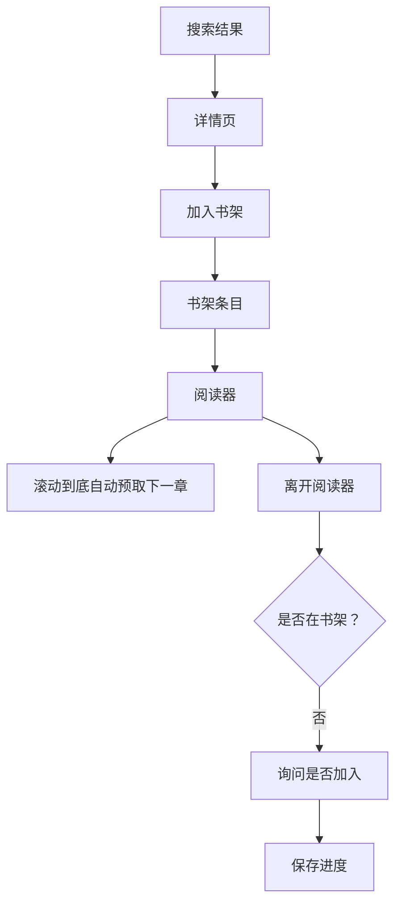
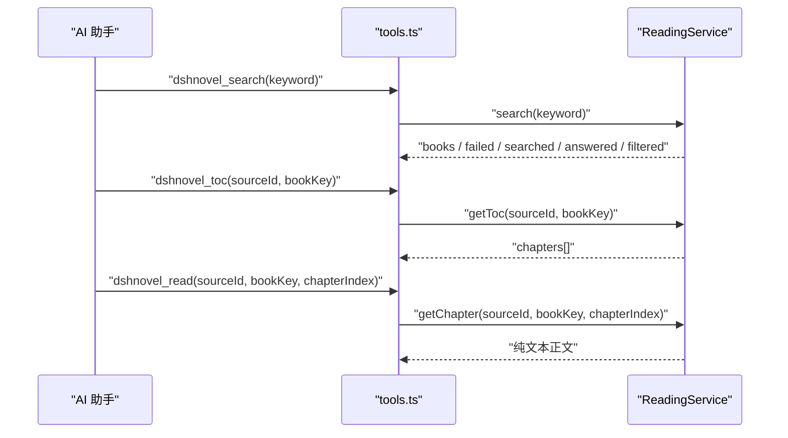
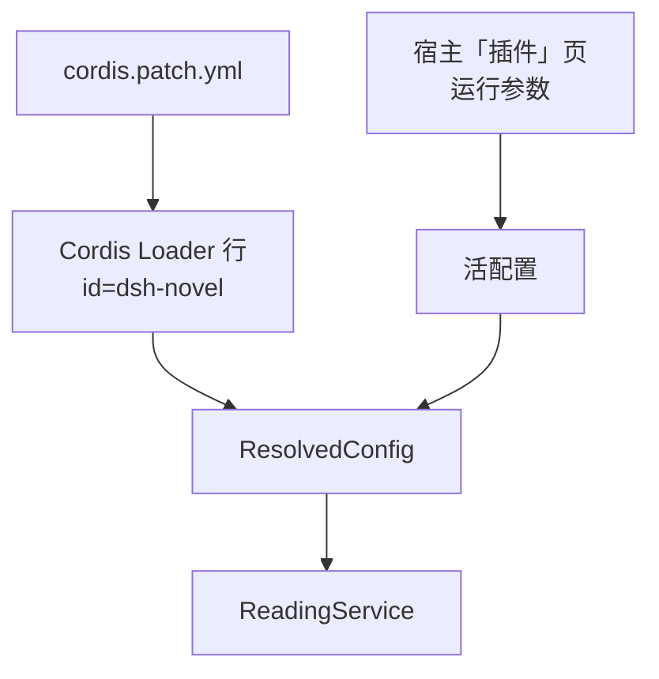
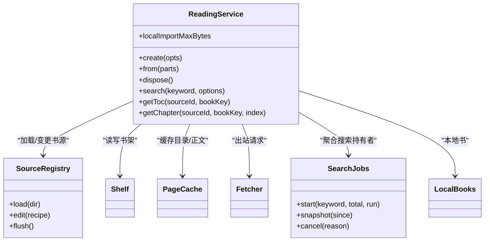

# 快速开始

<cite>
**本文引用的文件**   
- [cordis.patch.yml](file://cordis.patch.yml)
- [README.md](file://README.md)
- [src/client/index.tsx](file://src/client/index.tsx)
- [src/client/config-page.tsx](file://src/client/config-page.tsx)
- [src/client/importer.ts](file://src/client/importer.ts)
- [src/client/api.ts](file://src/client/api.ts)
- [src/services/sources.ts](file://src/services/sources.ts)
- [src/services/search-job.ts](file://src/services/search-job.ts)
- [src/services/reading.ts](file://src/services/reading.ts)
- [src/services/proxy.ts](file://src/services/proxy.ts)
- [src/services/epub/import.ts](file://src/services/epub/import.ts)
- [src/tools/tools.ts](file://src/tools/tools.ts)
</cite>

## 目录
1. [简介](#简介)
2. [项目结构与入口](#项目结构与入口)
3. [三类用户的快速步骤](#三类用户的快速步骤)
4. [架构总览](#架构总览)
5. [核心流程详解](#核心流程详解)
6. [AI 助手工具用法](#ai-助手工具用法)
7. [配置与常用键值](#配置与常用键值)
8. [依赖与服务关系](#依赖与服务关系)
9. [性能与容量特性](#性能与容量特性)
10. [常见问题排查](#常见问题排查)
11. [结论](#结论)

## 简介
dsh-novel 是一个运行在 DeepSeek Harness（DSH）中的小说插件：把 legado 书源导入 DSH，做聚合搜索、加入书架、连续翻页阅读；同时暴露 `dshnovel_search`、`dshnovel_read` 等 AI 助手工具，让“找书 + 读第 N 章”可以在对话里完成。它不内置任何书源，数据默认留在本机 `~/.dsh/novel/`。

本指南按用户角色拆分步骤，所有界面元素和调用方式均对应仓库中真实实现。

**章节来源**
- [README.md:1-6](file://README.md#L1-L6)
- [README.md:31-60](file://README.md#L31-L60)

## 项目结构与入口
插件通过 Cordis 注册为 DSH 的「全局面板」：左侧栏出现一个图标行，点击后在中央面板打开书架、书城与书源管理。主面板 id/key 统一为 `novel`，侧栏图标使用 SVG 字形，颜色跟随宿主前景色。

**图表来源**
- [src/client/index.tsx:14-108](file://src/client/index.tsx#L14-L108)

**章节来源**
- [src/client/index.tsx:14-108](file://src/client/index.tsx#L14-L108)

## 三类用户的快速步骤

### DSH 普通用户
1. **安装插件**  
   在目标 profile 中执行：  
   `dsh plugin --profile <profile> add @xrn1997/dsh-novel`  
   重启宿主后，左侧栏会出现「小说」图标。

2. **打开面板**  
   点击左侧栏「小说」图标，中央面板打开书架、书城与书源管理 tab。

3. **首次导入书源**  
   - 进入「书源管理」tab。  
   - 选择 legacy JSON 文件（可多选），或粘贴 legado 书源 JSON。  
   - 导入在服务端后台执行，关闭页面不会中断。

4. **批量验证书源**  
   - 新导入的书源默认是「未验证」。  
   - 顶部「待办收件箱」会把坏源或未验证源置顶成任务卡。  
   - 点击「一键验证」「批量重验」，服务端并发限流执行。

5. **聚合搜索**  
   - 在书架 tab 顶部输入书名/作者关键词。  
   - 服务端对已启用的文本书源并行搜索，结果按（书名，作者）归并，每本书展示多家源行。

6. **加入书架**  
   - 搜索结果中点某条源行的详情页地址，或点击「都加架」逐条入架。  
   - 书架条目记录封面、阅读进度与来源书源名。

7. **阅读器连续翻页**  
   - 点封面进入阅读器。  
   - 支持连续滚动；滚动到底自动预取下一章；支持目录抽屉跳章。  
   - 字号、行距、栏宽、纸张色可调，深浅主题自适应。

8. **导入本地书**  
   - 书架末位有「导入本地书籍」卡片，支持 TXT 与 EPUB。  
   - EPUB 封面缺失时，导入说明会持久化提示，可在阅读器内重看。

**章节来源**
- [README.md:31-60](file://README.md#L31-L60)
- [src/client/index.tsx:14-108](file://src/client/index.tsx#L14-L108)

### 插件开发者
1. **了解面板契约**  
   插件通过 `slots.inject('sidebar.panellist', ...)` 注册图标，并通过 `slots.inject('main', ...)` 注册中央面板；两个座位必须同批注册。

2. **接入配置页（可选）**  
   若宿主提供 `configForms`，插件会注册「运行参数」表单，保存后立即生效，无需重启。

3. **复用服务层**  
   UI、HTTP API 与 AI 工具共用同一个 `ReadingService`；不要另写一套搜索或阅读逻辑。

4. **关注错误文案入口**  
   客户端网络错误统一经 `describeError` 翻译，服务端错误原文透传。

**章节来源**
- [src/client/index.tsx:14-108](file://src/client/index.tsx#L14-L108)
- [src/client/config-page.tsx:18-44](file://src/client/config-page.tsx#L18-L44)
- [src/client/api.ts:12-61](file://src/client/api.ts#L12-L61)

### legado 书源作者
1. **确认字段存在**  
   粘贴校验会检查：  
   - `bookSourceName`（非空字符串）  
   - `bookSourceUrl`（非空字符串）  
   - `ruleContent`（非空字符串，或对象形态且 `content` 非空）

2. **优先使用文本面**  
   当前聚合搜索仅支持文本类书源；漫画/短剧等类型不参与聚合搜索。

3. **注意分类发现面**  
   书城只展示声明了分类入口且启用、未发现脚本型发现入口的文本源。

4. **调试建议**  
   - 先在「书源管理」中对单个源执行探针。  
   - 用「一键验证」观察任务卡状态。  
   - 通过搜索结果是否出现来定位规则命中问题。

**章节来源**
- [src/client/importer.ts:5-47](file://src/client/importer.ts#L5-L47)
- [src/services/sources.ts:56-130](file://src/services/sources.ts#L56-L130)

## 架构总览

**图表来源**
- [src/services/reading.ts:104-210](file://src/services/reading.ts#L104-L210)
- [src/services/sources.ts:56-130](file://src/services/sources.ts#L56-L130)
- [src/services/search-job.ts:35-120](file://src/services/search-job.ts#L35-L120)
- [src/client/api.ts:63-146](file://src/client/api.ts#L63-L146)

**章节来源**
- [src/services/reading.ts:104-210](file://src/services/reading.ts#L104-L210)
- [src/services/search-job.ts:1-174](file://src/services/search-job.ts#L1-L174)
- [src/client/api.ts:1-146](file://src/client/api.ts#L1-L146)

## 核心流程详解

### 导入书源与去重
- 客户端先做轻量预检：JSON 是否可解析、是否为对象或数组、是否缺关键字段。  
- 真正导入走服务端后台任务；同址可用源优先保留，坏源或未验证源被新条替换。  
- 加载存量 `sources.json` 时会做多项幂等迁移：`enabled`、`type`、分组、名称前缀、header、详情初始化、分类发现面等。

**图表来源**
- [src/client/importer.ts:5-47](file://src/client/importer.ts#L5-L47)
- [src/services/sources.ts:56-130](file://src/services/sources.ts#L56-L130)

**章节来源**
- [src/client/importer.ts:5-47](file://src/client/importer.ts#L5-L47)
- [src/services/sources.ts:56-130](file://src/services/sources.ts#L56-L130)

### 批量验证
- 新导入书源默认未验证；「待办收件箱」将其置顶。  
- 批量验证由服务端并发限流执行，结果汇总后可回看。  
- 验证失败的书源会带失败码与消息，便于排查。

**图表来源**
- [README.md:31-60](file://README.md#L31-L60)
- [src/services/search-job.ts:35-120](file://src/services/search-job.ts#L35-L120)

**章节来源**
- [README.md:31-60](file://README.md#L31-L60)

### 聚合搜索
- 服务端对已启用的文本书源并行搜索，默认并发 5。  
- 结果按（书名，作者）归并为一本书，逐源保留一行。  
- 失败源点名，过滤掉不相关的行数如实上报。  
- SSE 推送增量，不可用时回落轮询；取消搜索只停止后续搜索，已搜出结果保留。

**图表来源**
- [src/services/search-job.ts:35-174](file://src/services/search-job.ts#L35-L174)
- [src/client/api.ts:106-146](file://src/client/api.ts#L106-L146)

**章节来源**
- [src/services/search-job.ts:1-174](file://src/services/search-job.ts#L1-L174)
- [src/client/api.ts:106-146](file://src/client/api.ts#L106-L146)

### 加入书架与阅读器
- 搜索结果中的详情页 URL 可直接作为其他工具的 `bookKey`。  
- 书架记录书名、作者、来源书源名与阅读进度。  
- 阅读器按连续滚动翻页，自动预取下一章；不在书架上的书离开阅读器时会询问是否加入。

**图表来源**
- [README.md:31-60](file://README.md#L31-L60)
- [src/services/reading.ts:104-210](file://src/services/reading.ts#L104-L210)

**章节来源**
- [README.md:31-60](file://README.md#L31-L60)

## AI 助手工具用法

### 推荐调用顺序
1. 调用 `dshnovel_search`，传入关键词。  
2. 从返回结果的某条源的 `url` 取出 `bookKey`，并记住对应的 `sourceId`。  
3. 调用 `dshnovel_toc` 查看目录，确定第 N 章的 `chapterIndex`。  
4. 调用 `dshnovel_read`，传入 `sourceId`、`bookKey`、`chapterIndex`。

**图表来源**
- [src/tools/tools.ts:1-200](file://src/tools/tools.ts#L1-L200)
- [src/services/reading.ts:104-210](file://src/services/reading.ts#L104-L210)

### 返回值要点
- `dshnovel_search` 返回的是按书归并后的视图；`failed` 列出未答话的源；`searched`、`answered`、`filtered` 区分“没人答话”和“答话但都不相关”。  
- `dshnovel_read` 返回纯文本正文，图文书插图投影为 `[图片：替代文字]` 占位。  
- 工具参数缺失会直接抛错，避免弱模型猜参写出无效 `bookKey`。

**章节来源**
- [src/tools/tools.ts:1-200](file://src/tools/tools.ts#L1-L200)

## 配置与常用键值

### 配置文件来源
- 主配置位于 profile 的 `cordis.patch.yml` 中该插件行的 `config` 字段。  
- 除 `dataDir` 外，其余字段还可在宿主「插件」页 → `@xrn1997/dsh-novel` 详情里的「运行参数」编辑，保存后立即生效。  
- 旧宿主没有配置页时，仍写在 `cordis.patch.yml`。  
- `dataDir` 始终需要修改 `cordis.patch.yml` 并重启。

**图表来源**
- [cordis.patch.yml:1-3](file://cordis.patch.yml#L1-L3)
- [src/client/config-page.tsx:18-44](file://src/client/config-page.tsx#L18-L44)
- [src/services/reading.ts:104-210](file://src/services/reading.ts#L104-L210)

### 常用键值
| 键 | 默认行为 | 用途 |
|---|---|---|
| `dataDir` | `$DSH_HOME/novel/` | 数据根目录，含 `sources.json`、`shelf.json`、缓存与本地书 |
| `searchTimeoutMs` | `15000` | 单源搜索超时毫秒 |
| `searchParallel` | `5` | 搜索并发书源数 |
| `jsTimeoutMs` | `15000` | js 沙箱预算，阅读/搜索/探针/登录共用 |
| `cacheMaxBytes` | `200MB` | 目录/正文缓存上限，LRU 淘汰 |
| `exportDelayMs` | `300` | 范围导出章节间串行间隔 |
| `localImportMaxBytes` | `50MB` | 本地 TXT/EPUB 导入大小上限 |
| `proxyUrl` | 启动时自动探测 | 出站代理；`direct` 强制直连，或显式 http(s) 地址 |

数值项按整数校验；`proxyUrl` 只接受 `direct`、空串或 http(s) 地址，裸 `host:port` 会补 `http://`。非法值在插件加载期报错，配置页保存时同样拒绝。

**章节来源**
- [README.md:61-110](file://README.md#L61-L110)
- [src/client/config-page.tsx:46-110](file://src/client/config-page.tsx#L46-L110)

## 依赖与服务关系

**图表来源**
- [src/services/reading.ts:104-210](file://src/services/reading.ts#L104-L210)
- [src/services/sources.ts:56-130](file://src/services/sources.ts#L56-L130)
- [src/services/search-job.ts:35-174](file://src/services/search-job.ts#L35-L174)

**章节来源**
- [src/services/reading.ts:104-210](file://src/services/reading.ts#L104-L210)
- [src/services/sources.ts:56-130](file://src/services/sources.ts#L56-L130)
- [src/services/search-job.ts:35-174](file://src/services/search-job.ts#L35-L174)

## 性能与容量特性
- 聚合搜索默认并发 5，可通过 `searchParallel` 调整。  
- 搜索命中截断有内存上限，避免无界增长。  
- 目录/正文缓存默认 200MB，超过上限 LRU 淘汰。  
- 本地书导入默认 50MB；EPUB 解析分两遍，逐份文档转换，不把整本 DOM 常驻内存。  
- 范围导出串行限速，默认章节间隔 300ms。

**章节来源**
- [README.md:61-110](file://README.md#L61-L110)
- [src/services/search-job.ts:35-70](file://src/services/search-job.ts#L35-L70)
- [src/services/epub/import.ts:1-80](file://src/services/epub/import.ts#L1-L80)

## 常见问题排查

### 无法连接书源
**现象**  
搜索结果为空，或书源探针失败。

**排查步骤**
1. 检查书源是否启用：`enabled` 缺省归一为 true，老数据会迁移补齐。  
2. 在「书源管理」中对单源执行探针，查看失败码与消息。  
3. 确认书源类型是文本类；漫画/短剧不参与聚合搜索。  
4. 如果是站点对直连外网出口 302 跳转，检查代理是否生效。

**章节来源**
- [src/services/sources.ts:56-130](file://src/services/sources.ts#L56-L130)
- [README.md:31-60](file://README.md#L31-L60)

### 代理未生效
**原因**  
插件使用 Node 的 fetch，undici 不读系统代理；浏览器能开不代表插件也能访问。

**取值优先级**
1. `config.proxyUrl`  
2. 环境变量 `HTTPS_PROXY`/`HTTP_PROXY`/`ALL_PROXY`  
3. Windows 系统代理（HKCU Internet Settings）  
4. 直连

**修复建议**
- 显式设置 `proxyUrl`，如 `http://127.0.0.1:7897`。  
- 想强制不走代理，设为 `direct`。  
- 裸 `host:port` 会自动补 `http://`；非法地址会被拒绝。  
- 日志中的代理地址会脱敏，避免泄露密码。

**章节来源**
- [src/services/proxy.ts:1-124](file://src/services/proxy.ts#L1-L124)

### EPUB 封面缺失
**现象**  
导入 EPUB 后书架没有封面，或阅读器找不到封面。

**原因**
- 封面资源不存在是正常情况，不是导入失败。  
- 如果封面资源损坏、超预算或被加密，导入会失败并点名具体资源。  
- EPUB 解析只读取 spine 主序列与可达补充文档；未使用的 manifest 条目不受影响。

**处理建议**
- 查看书架导入说明或 `GET /local/warnings`，确认是否有损告警。  
- 检查 EPUB 包中封面资源是否存在且可读。  
- 若是内联 SVG 封面，只有当它是该文档唯一内容时才可能按图片页处理。

**章节来源**
- [src/services/epub/import.ts:1-120](file://src/services/epub/import.ts#L1-L120)

### 搜索结果为空
**可能原因**
- 没有启用可用的文本书源。  
- 关键词太严格，命中都被判为不相关。  
- 书源规则未命中书名/作者/分类。  
- 书源失败但未响应，计入 `failed`。  
- 结果超过上限被截断，但仍有总数信息。

**排查建议**
1. 先跑「一键验证」，排除坏源。  
2. 缩小关键词范围，例如只输书名关键字。  
3. 查看 `dshnovel_search` 返回的 `searched`、`answered`、`filtered`、`failed`。  
4. 对单个源试跑，确认其搜索面是否可达。  
5. 如果是分页站点，注意当前实现主要命中首页结果，未必覆盖全站。

**章节来源**
- [src/tools/tools.ts:1-200](file://src/tools/tools.ts#L1-L200)
- [src/services/search-job.ts:35-174](file://src/services/search-job.ts#L35-L174)

## 结论
dsh-novel 的核心价值是把 legacy 书源搬进 DSH，并提供统一的搜索、书架、阅读与 AI 工具链路。普通用户通过左侧栏「小说」面板即可完成导入、搜索、加架与阅读；插件开发者应复用 `ReadingService`，不要维护第二套业务逻辑；legado 书源作者需确保文本面规则有效，并善用探针与批量验证。常见问题多数落在书源类型、代理配置与 EPUB 结构上，按本文排查路径通常能快速定位。