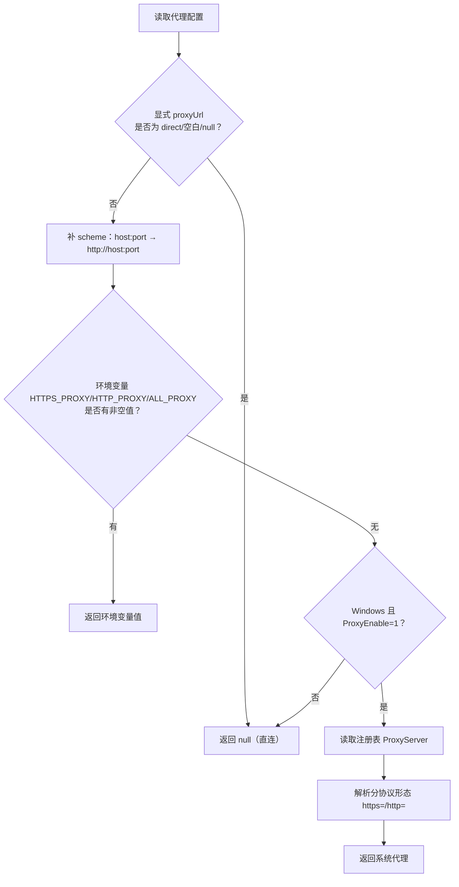
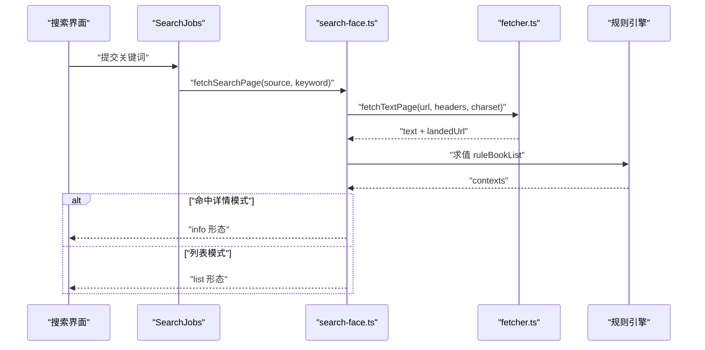
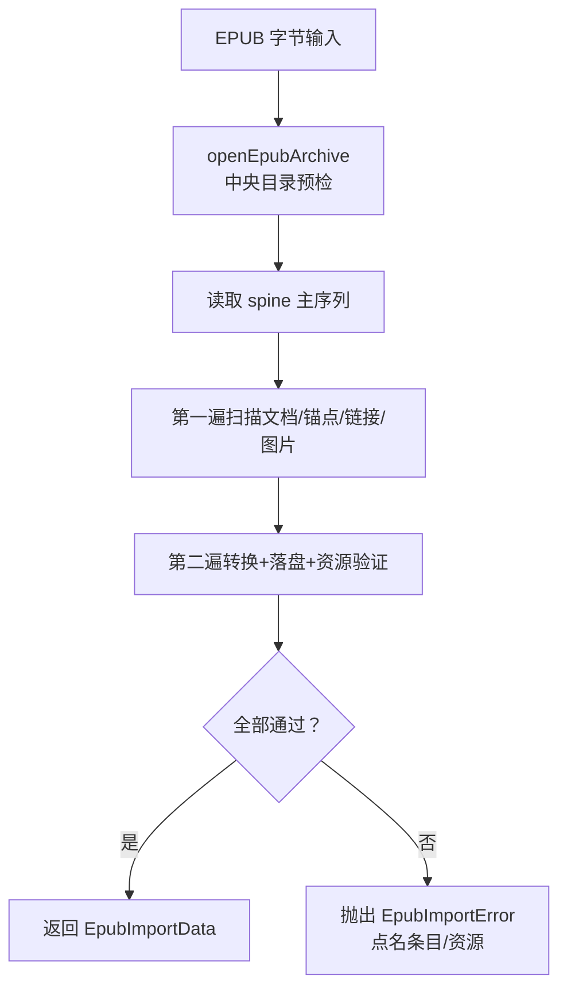
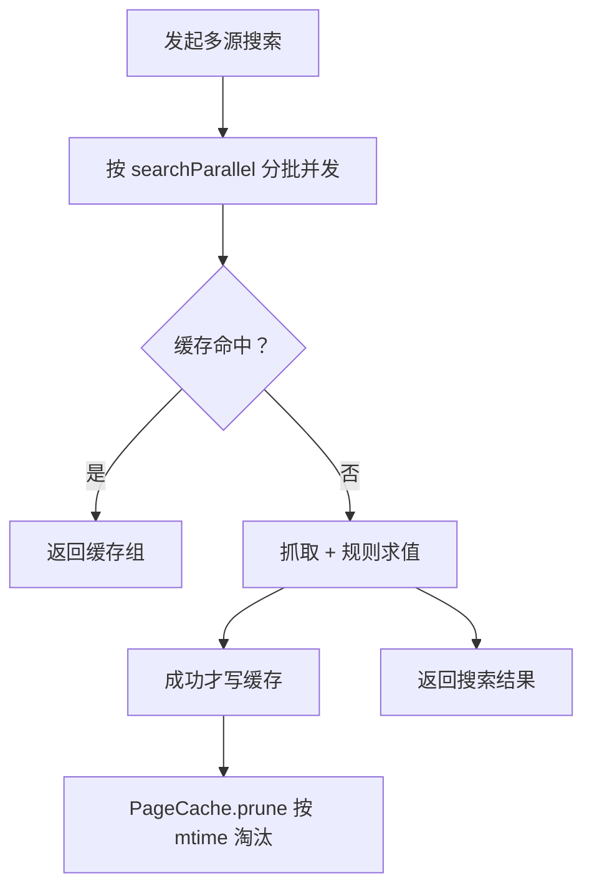

# 故障排除

<cite>
**本文引用的文件**   
- [src/services/log.ts](file://src/services/log.ts)
- [src/services/errors.ts](file://src/services/errors.ts)
- [src/services/proxy.ts](file://src/services/proxy.ts)
- [package.json](file://package.json)
- [src/services/fetcher.ts](file://src/services/fetcher.ts)
- [src/services/request.ts](file://src/services/request.ts)
- [src/services/search-face.ts](file://src/services/search-face.ts)
- [src/services/explore.ts](file://src/services/explore.ts)
- [src/services/reading.ts](file://src/services/reading.ts)
- [src/services/cache.ts](file://src/services/cache.ts)
- [src/services/chapter-content.ts](file://src/services/chapter-content.ts)
- [src/services/content.ts](file://src/services/content.ts)
- [src/services/epub/import.ts](file://src/services/epub/import.ts)
- [src/services/epub/archive.ts](file://src/services/epub/archive.ts)
</cite>

## 目录
1. [引言](#引言)
2. [日志与错误基础设施](#日志与错误基础设施)
3. [安装失败](#安装失败)
4. [书源连接失败](#书源连接失败)
5. [代理与网络配置](#代理与网络配置)
6. [搜索结果为空](#搜索结果为空)
7. [阅读器异常](#阅读器异常)
8. [性能问题](#性能问题)
9. [排查清单](#排查清单)
10. [结论](#结论)

## 引言
本指南面向 dsh-novel（DeepSeek Harness 小说插件）的实际排障。内容按“症状 → 可能原因 → 排查步骤 → 日志定位 → 修复建议”组织，覆盖安装、网络、搜索、阅读器和性能五大类。所有判断依据均来自仓库源码与测试矩阵说明，不引入外部假设。

## 日志与错误基础设施
dsh-novel 的排障入口是统一的日志出口和错误分类表。理解它们能避免把“站点返回 404”误判为“服务器内部错误”，也能区分“规则缺失”和“抓取失败”。

### 两态日志：`src/services/log.ts`
- 所有服务层日志统一经过 `log.info / log.warn / log.error`，并带 `[dsh-novel]` 前缀。
- 默认 sink 是 `console`：离线模式、测试以及宿主 logger 尚未注入时，日志仍可见。
- 运行时可替换 sink（组合根通过 `setLogSink` 装配）：同时保留 console 输出和宿主 ring buffer；但宿主 exporter 默认只放行 error/info，warn/debug 会被过滤。因此“console 腿保本机可见性”不是冗余。
- 引擎层不直接 import 该模块；沙箱未处理 rejection 的防线通过注入 sink 输出，前缀由注入方负责。

使用方式
- 需要确认某个动作是否执行：在关键分支加 `log.warn`。
- 用户可见的错误必须走 `log.error`，否则宿主侧可能被静默过滤。
- 检查宿主 logger 级别阈值，若 warn 不出，先调高阈值或挂 console exporter。

**章节来源**
- [src/services/log.ts:1-30](file://src/services/log.ts#L1-L30)

### 错误分类：`src/services/errors.ts`
核心类型与类目映射如下：

| 异常类 | 含义 | 分类 | HTTP 行为（参考注释） |
|---|---|---|---|
| `SourceNotFoundError` | 书源不存在 | `not-found` | 404 |
| `ChapterNotFoundError` | 目录中没有第 N 章 | `not-found` | 404 |
| `RuleMissingError` | 缺规则（如 `ruleChapterList`） | `rule-missing` | 422 |
| `FetchError` | 出站请求失败（超时/网络非 2xx） | `fetch` | 由调用面映射 |
| `DecodeError` | charset 解码失败 | `fetch` | 由调用面映射 |
| `InvalidRequestError` | 参数值域非法 | `bad-request` | 400 |
| `LocalNotMountedError` | 本地书服务未挂载 | `unavailable` | 503 |
| `LocalImportError` / `EpubImportError` | 本地导入失败 | `local-import` | 400 |
| `LocalFileTooLargeError` | 本地文件过大 | `local-too-large` | — |
| `JobRunningError` | 任务互斥 | `job-running` | 409 |

分类函数 `classify` 是唯一分类入口：HTTP 状态码映射与探针错误码都是它的投影。修改错误类后，只要继承关系不变，分类就不会被文案错别字影响。

**章节来源**
- [src/services/errors.ts:1-129](file://src/services/errors.ts#L1-L129)

### 代理调试：`src/services/proxy.ts`
代理取值优先级（从高到低）：
1. 显式配置 `config.proxyUrl`（`direct` 表示直连）。
2. 环境变量 `HTTPS_PROXY/HTTP_PROXY/ALL_PROXY`（大小写两种键都认，首个非空者胜）。
3. Windows 系统代理（注册表 `HKCU\Software\Microsoft\Windows\CurrentVersion\Internet Settings`，`ProxyEnable=1` 时取 `ProxyServer`）。
4. 直连（`null`）。

关键实现要点
- undici 不读系统代理；浏览器能开而插件打不开，通常是这个差异。
- 裸 host:port 会补 `http://`；只接受 `http:` 或 `https:`。
- 代理 URL 中的密码会脱敏（最后一个 `@` 前替换为 `***@`），防止配置错误把密码写入日志。
- `normalizeProxyUrl` 用于 fetcher 每请求前的归一；`parseProxyUrl` 是构造 ProxyAgent 前的严格校验。

**图表来源**
- [src/services/proxy.ts:1-124](file://src/services/proxy.ts#L1-L124)

**章节来源**
- [src/services/proxy.ts:1-124](file://src/services/proxy.ts#L1-L124)

## 安装失败

### 症状
- pnpm/npm/yarn 安装时报 peer dependency 冲突。
- 宿主提示插件与 DSH 版本不兼容。
- 打包或加载插件时报 `dshReleases` 不支持当前宿主版本。

### 可能原因
1. **peerDependencies 不满足**：插件声明 React、React DOM、schemastery、cordis、dsh-tools 等 peer 依赖。
2. **DSH 版本不在兼容性列表**：`package.json` 中 `dsh.compatibility.dshReleases` 仅列出受支持版本。
3. **宿主工具链版本过旧或过新**：例如 dsh-tools 要求 `<0.3.0-0`。

### 排查步骤
1. 查看宿主的 React、React DOM、schemastery、cordis、dsh-tools 版本是否与插件声明一致。
2. 查看宿主实际运行的 DSH 版本是否在 `dshReleases` 列表中。
3. 若宿主版本较新但未列入，属于兼容性声明滞后，不是代码 bug；应等待更新或降级宿主。
4. 若 peer 依赖冲突，优先升级宿主环境再装插件；不要强行忽略 peer 依赖。

### 日志定位方法
安装阶段通常没有 dsh-novel 日志；重点看包管理器输出与宿主插件加载日志。若插件已加载，再用 `[dsh-novel]` 前缀过滤。

### 修复建议
- 将宿主升级到 `package.json` 中标明的兼容 DSH 版本之一。
- 确保 peer 依赖版本落在插件声明范围内。
- 若你是插件维护者而非用户，更新 `dshReleases` 并验证编译与实测名单。

**章节来源**
- [package.json:1-125](file://package.json#L1-L125)

## 书源连接失败

### 症状
- 搜索、详情页、目录、正文全部报网络错误。
- 浏览器中能访问的页面，插件报超时或 403/404。
- 某些页面正常，另一些页面 404。
- 正文出现乱码，尤其是 GBK/GB2312 站点。

### 可能原因
1. DNS 解析失败。
2. 未启用代理，但站点对直连出口 302 跳转或封禁。
3. SSL/TLS 握手失败。
4. UA 被 WAF 拦截。
5. Cookie 缺失导致登录态失效。
6. charset 声明与实际不符。

### 排查步骤
1. 用系统 curl 或浏览器抓包，确认目标 URL 本身可达。
2. 检查是否启用了代理；若浏览器走系统代理而插件直连，优先按“代理与网络配置”一节处理。
3. 检查 UA：默认 UA 是 Chrome 风格；如果源自定义了 UA，确认它没有被合并逻辑破坏。
4. 检查 Cookie：插件不自动回发 Cookie jar，需源规则显式设置 `Cookie` 头或使用授权字段。
5. 检查响应编码：优先以源声明的 `charset` 为准；若仍乱码，记录 DecodeError 中的 url 与 charset。

### 日志定位方法
- 网络层失败统一包装为 `FetchError`，消息包含 URL 和状态码。
- 编码失败抛出 `DecodeError`，包含 `url` 与 `charset`。
- 日志带 `[dsh-novel]` 前缀；注意宿主 logger 默认不过滤 warn/debug 时需调整级别。
- 代理地址非法时会抛 TypeError，但消息已被脱敏，不会泄露密码。

### 修复建议
- DNS 问题：检查系统 DNS、防火墙、DNS 代理。
- 代理问题：见下一节。
- SSL 问题：检查系统证书、代理中间人解密、Node 环境。
- UA 问题：确认源规则中 `User-Agent` 生效；避免小写键名与默认 UA 并存。
- Cookie 问题：在源规则或 auth 中显式携带 Cookie。
- 编码问题：在 URL 选项中指定 `charset`，或在源规则修正响应编码。

**章节来源**
- [src/services/fetcher.ts:1-200](file://src/services/fetcher.ts#L1-L200)
- [src/services/errors.ts:1-129](file://src/services/errors.ts#L1-L129)
- [src/services/request.ts:1-200](file://src/services/request.ts#L1-L200)

## 代理与网络配置

### 症状
- 浏览器能打开小说网站，插件报“网络错误”或搜索结果零命中。
- 配置了代理后反而更慢或直接失败。
- Windows 上系统代理生效，Linux/macOS 无效。
- 设置了 `proxyUrl: 'direct'` 仍走了代理。
- 日志中出现“代理地址非法”。

### 可能原因
1. undici 不读系统代理；浏览器能开不代表插件能开。
2. 代理 URL 缺少 scheme（未补 `http://`）。
3. 代理 URL 含非法协议、空主机、或带密码的地址被脱敏后难以识别。
4. 环境变量覆盖了显式配置。
5. Windows 注册表中 `ProxyEnable≠1` 或未设 `ProxyServer`。
6. 代理连接池复用导致“A 通 → B 坏 → 换回 A”时仍用旧 dispatcher。

### 排查步骤
1. 在配置页设置 `proxyUrl`，优先用 `http://host:port` 或 `https://host:port`。
2. 想强制直连时使用 `direct`（大小写与首尾空白不敏感）。
3. 检查环境变量是否意外传入 `HTTPS_PROXY`/`HTTP_PROXY`/`ALL_PROXY`。
4. Windows 用户可用命令行或注册表检查 `ProxyEnable` 与 `ProxyServer`。
5. 观察日志中是否出现“代理地址非法”“代理地址只支持 http(s):”“代理地址缺少主机”。
6. 切换代理后确认 fetcher 重建了 dispatcher；插件会在代理 URL 变化时关闭旧实例并缓存新实例。

### 日志定位方法
- 代理地址解析失败会抛 `TypeError`，消息含脱敏后的原始值。
- fetcher 构造 ProxyAgent 失败会包装成 `FetchError`，URL 也脱敏。
- 系统代理读取失败或非 win32 平台返回 `null`，不会报错。

### 修复建议
- 显式配置 `proxyUrl`，避免依赖系统代理。
- 对 socks/http proxy，先确认其对外暴露的是标准 HTTP CONNECT 代理；undici `ProxyAgent` 期望 http(s) URL。
- 若站点对直连出口 302，请启用代理；若代理反而被拒，尝试直连。
- 不要把明文密码放在日志里；插件已做最后一处 `@` 脱敏。

**章节来源**
- [src/services/proxy.ts:1-124](file://src/services/proxy.ts#L1-L124)
- [src/services/fetcher.ts:1-200](file://src/services/fetcher.ts#L1-L200)

## 搜索结果为空

### 症状
- 搜索关键词后，每个源都显示 0 条结果。
- 探针显示某源 broken，但其他源正常。
- 书城发现分类点击后为空。
- 同一源有时有结果，有时没有。

### 可能原因
1. 规则不匹配：`ruleBookList`、`ruleBookName`、`searchUrl`、`bookUrlPattern` 等缺失或求值为空。
2. 源被禁用：参与判定包括启用状态、文本源、分类入口、是否关闭发现。
3. 相关性过滤：搜索结果正文/简介净化后不符合预期。
4. 站点被停用关键词：探针会换词重试，但聚合搜索只搜一次首页。
5. 详情回落路径误判：列表 0 条且未声明 pattern 时，搜索面会把响应当详情页处理。
6. 缓存命中陈旧快照：分类浏览按 epoch/page 缓存，代际过期才重新抓取。

### 排查步骤
1. 先用探针测试单源：探针会尝试多个关键词，并分别报告 `RuleMissing`、`RuleEvalError`、抓取错误。
2. 检查源是否启用且声明了必要规则。
3. 检查 `searchUrl` 是否能单独发出请求并返回可解析 HTML。
4. 检查 `ruleBookList` 是否能取出至少一条上下文。
5. 检查 `ruleBookName` 是否能从第一条上下文取值。
6. 检查 `bookUrlPattern` 是否是合法正则；非法正则会 warn 并降级为未声明。
7. 对书城分类，检查 epoch 与 page 缓存键。

### 日志定位方法
- 规则缺失返回 `{ ok: false, code: 'RuleMissing', message }`，探针据此标记 `RuleMissing`。
- 引擎错误、抓取错误、解码错误经 `searchErrorCodeOf` 归类。
- `bookUrlPattern` 编译失败会写 warn，不影响其他规则。
- 分类浏览失败组会带 `error.code` 与 `message`，不会向上抛错。

### 修复建议
- 补齐缺失规则；尤其 `searchUrl` 与 `ruleBookName`。
- 修正 `ruleBookList` 选择器，使其至少匹配一条书目条目。
- 修正 `bookUrlPattern`，确保全串锚定语义。
- 若源对通用词 0 命中，改用源自有的 `probeKeyword`。
- 刷新分类缓存 epoch，使 stale 快照失效。

**图表来源**
- [src/services/search-face.ts:1-146](file://src/services/search-face.ts#L1-L146)
- [src/services/fetcher.ts:1-200](file://src/services/fetcher.ts#L1-L200)

**章节来源**
- [src/services/search-face.ts:1-146](file://src/services/search-face.ts#L1-L146)
- [src/services/probe.ts:1-71](file://src/services/probe.ts#L1-L71)
- [src/services/explore.ts:1-75](file://src/services/explore.ts#L1-L75)

## 阅读器异常

### 症状
- EPUB 导入失败，提示 spine 缺失或文档不可读。
- 阅读器中图片显示 404 或空白。
- 正文出现乱码。
- 纯文本导出与阅读器正文不一致。
- 大 EPUB 导入时内存暴涨或 OOM。

### 可能原因
1. EPUB spine 不包含预期 XHTML 文档。
2. 导航或正文链接指向的锚点随被剥离内容消失。
3. 图片资源缺失、损坏、超像素预算或被加密。
4. 响应 charset 声明不正确。
5. 正文是 HTML 但未被正确转为纯文本。
6. 章节内容树结构复杂，纯文本投影产生大量行。
7. EPUB 归档条目数、总字节、XML 深度、节点数超过安全预算。

### 排查步骤
1. 用 ZIP 工具检查 OPF spine 是否指向有效的 XHTML 文档。
2. 检查导航 NCX/nav 与正文内链是否指向存在且受支持的锚点。
3. 检查图片 mediaType、尺寸、EXIF 旋转、CRC 与解压预算。
4. 检查响应 Content-Type 与 charset，必要时在 URL 选项中显式指定。
5. 对比“章节正文”和“TXT 导出”的输出，确认是否走同一投影函数。
6. 对超大 EPUB，检查 `DEFAULT_EPUB_LIMITS` 是否合理。

### 日志定位方法
- EPUB 导入异常统一为 `EpubImportError`，消息应点名具体条目、文档路径、资源 ID。
- 归档层对中央目录重名、加密条目、压缩方式、条目数、单条目大小、累计大小均有限制。
- 解码失败为 `DecodeError`，包含 url 与 charset。
- 正文转换走 `contentToText`；HTML 像 HTML 就转纯文本，否则解码实体后原样返回。
- 章节纯文本投影走 `chapterContentToText`，保证文字面与图文面同源。

### 修复建议
- 修复 EPUB spine，使其包含可读 XHTML。
- 修复断链、错锚点、缺失图片。
- 对图片型章节，确保图片可加载；404 图片会让章节正文空洞。
- 对乱码章节，修正源响应编码或显式声明 charset。
- 对 OOM，降低 EPUB 预算、拆分导入或限制图片像素。
- 对正文不一致，不要绕过 `chapterContentToText` 自行投影。

**图表来源**
- [src/services/epub/archive.ts:1-200](file://src/services/epub/archive.ts#L1-L200)
- [src/services/epub/import.ts:1-200](file://src/services/epub/import.ts#L1-L200)

**章节来源**
- [src/services/epub/archive.ts:1-200](file://src/services/epub/archive.ts#L1-L200)
- [src/services/epub/import.ts:1-200](file://src/services/epub/import.ts#L1-L200)
- [src/services/content.ts:1-114](file://src/services/content.ts#L1-L114)
- [src/services/chapter-content.ts:1-182](file://src/services/chapter-content.ts#L1-L182)
- [src/services/errors.ts:1-129](file://src/services/errors.ts#L1-L129)

## 性能问题

### 症状
- 搜索多家源时 CPU/网络占用过高。
- 重复搜索很慢。
- 书城分类翻页卡顿。
- 导入大 EPUB 时内存飙升甚至 OOM。
- 缓存文件越来越多。

### 可能原因
1. 并发过高：`searchParallel` 过大导致同时打多家源。
2. 缓存未命中：epoch 未更新、key 变化、TTL 过期。
3. 大文件 OOM：EPUB 总字节、单条目、XML 深度/节点、图片像素超限。
4. 代理连接池频繁重建：每次换代理都重建 dispatcher。
5. 目录/正文页数上限过高。

### 排查步骤
1. 检查 `searchParallel` 是否大于实际需要；默认值为 5。
2. 检查 `cacheMaxBytes`；默认 200MB，采用 LRU 近似淘汰。
3. 检查 EPUB 预算：条目数、entryBytes、totalBytes、xmlBytes、xmlDepth、xmlNodes、imagePixels。
4. 检查代理 URL 是否频繁变化；稳定代理可复用连接池。
5. 检查 tocMaxPages 与 contentMaxPages；这些不是热配置，构建时确定。

### 日志定位方法
- 搜索任务持有者在 `SearchJobs` 中维护进度、取消、截断；每源结果带条数与截断信息。
- 分类浏览失败组带 error 字段，不会污染成功结果。
- PageCache prune 会扫描 toc/content 目录并按 mtime 删除旧文件。
- EPUB 归档层在中央目录扫描、逐条读取时累计真实字节并校验 CRC。

### 修复建议
- 将 `searchParallel` 设为适合宿主并发配额的正整数。
- 增大 `cacheMaxBytes` 或清理旧缓存目录。
- 对超大 EPUB，降低预算或拒绝导入。
- 固定代理 URL，避免每次请求重建 ProxyAgent。
- 对频繁搜索的站，保持规则稳定，减少 epoch 变化。

**图表来源**
- [src/services/search-job.ts:1-174](file://src/services/search-job.ts#L1-L174)
- [src/services/explore.ts:1-75](file://src/services/explore.ts#L1-L75)
- [src/services/cache.ts:1-113](file://src/services/cache.ts#L1-L113)

**章节来源**
- [src/services/reading.ts:1-200](file://src/services/reading.ts#L1-L200)
- [src/services/search-job.ts:1-174](file://src/services/search-job.ts#L1-L174)
- [src/services/explore.ts:1-75](file://src/services/explore.ts#L1-L75)
- [src/services/cache.ts:1-113](file://src/services/cache.ts#L1-L113)
- [src/services/epub/archive.ts:1-200](file://src/services/epub/archive.ts#L1-L200)

## 排查清单

### 快速对照表
| 类别 | 先看哪里 | 常见标志 | 首选修复 |
|---|---|---|---|
| 安装失败 | `package.json` | peerDependency 冲突、`dshReleases` 不匹配 | 升级宿主到兼容版本 |
| 连接失败 | `fetcher.ts`、`errors.ts` | `FetchError`、`DecodeError` | 查 DNS/代理/SSL/UA/Cookie/charset |
| 代理问题 | `proxy.ts` | “代理地址非法”、浏览器通插件不通 | 显式配置 `proxyUrl` |
| 搜索为空 | `search-face.ts`、`probe.ts` | `RuleMissing`、0 contexts | 修规则、换 probeKeyword |
| 阅读器异常 | `epub/*`、`content.ts`、`chapter-content.ts` | `EpubImportError`、乱码、404 图片 | 修 spine/链接/编码/图片 |
| 性能问题 | `reading.ts`、`cache.ts`、`epub/archive.ts` | 高并发、缓存未命中、OOM | 降并发、清缓存、降预算 |

### 日志检索建议
1. 全局搜索 `[dsh-novel]`。
2. 网络问题优先搜 `FetchError`、`DecodeError`、`代理地址`。
3. 规则问题搜 `RuleMissing`、`ruleBookList`、`ruleBookName`、`ruleDetailName`。
4. EPUB 问题搜 `EpubImportError`、`spine`、`OPF`、`manifest`。
5. 性能问题搜 `searchParallel`、`cacheMaxBytes`、`DEFAULT_EPUB_LIMITS`。

**章节来源**
- [src/services/log.ts:1-30](file://src/services/log.ts#L1-L30)
- [src/services/errors.ts:1-129](file://src/services/errors.ts#L1-L129)
- [src/services/proxy.ts:1-124](file://src/services/proxy.ts#L1-L124)
- [src/services/fetcher.ts:1-200](file://src/services/fetcher.ts#L1-L200)
- [src/services/search-face.ts:1-146](file://src/services/search-face.ts#L1-L146)
- [src/services/epub/import.ts:1-200](file://src/services/epub/import.ts#L1-L200)
- [src/services/cache.ts:1-113](file://src/services/cache.ts#L1-L113)

## 结论
dsh-novel 的排障核心在于三条线：  
- 日志线：统一 `[dsh-novel]` 前缀的两态 sink。  
- 错误线：类型化异常 + `classify` 分类，让 HTTP 状态和探针错误码保持一致。  
- 网络线：fetcher 守门 + proxy 代理解析 + request 模板组装。  

遇到故障时，先确定它属于安装、网络、搜索、阅读器还是性能类别，再从对应入口定位日志与错误类，最后按修复建议收敛到“规则、配置、环境、数据质量”四个可操作维度。