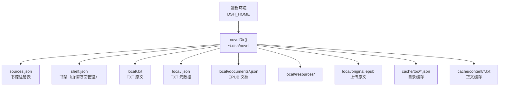
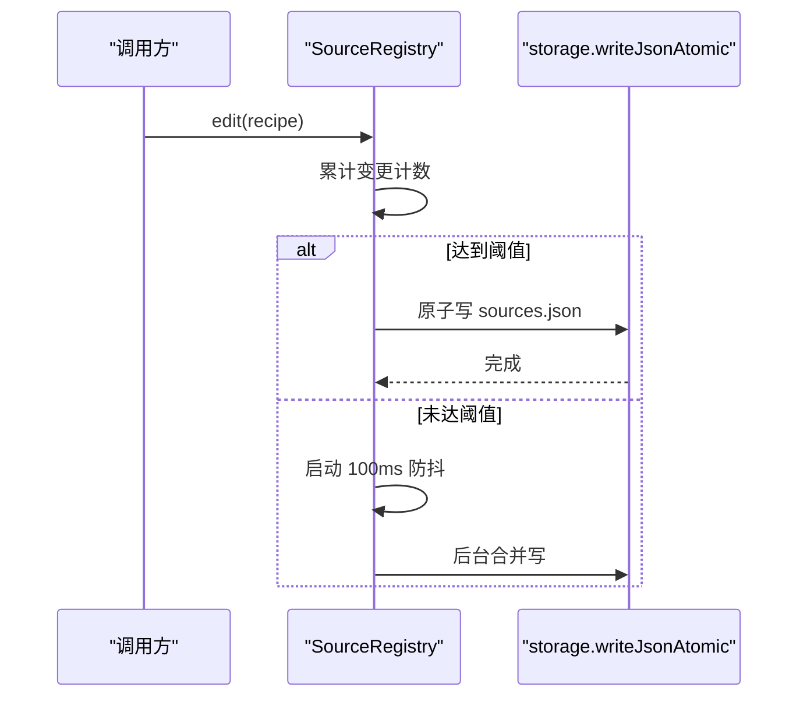
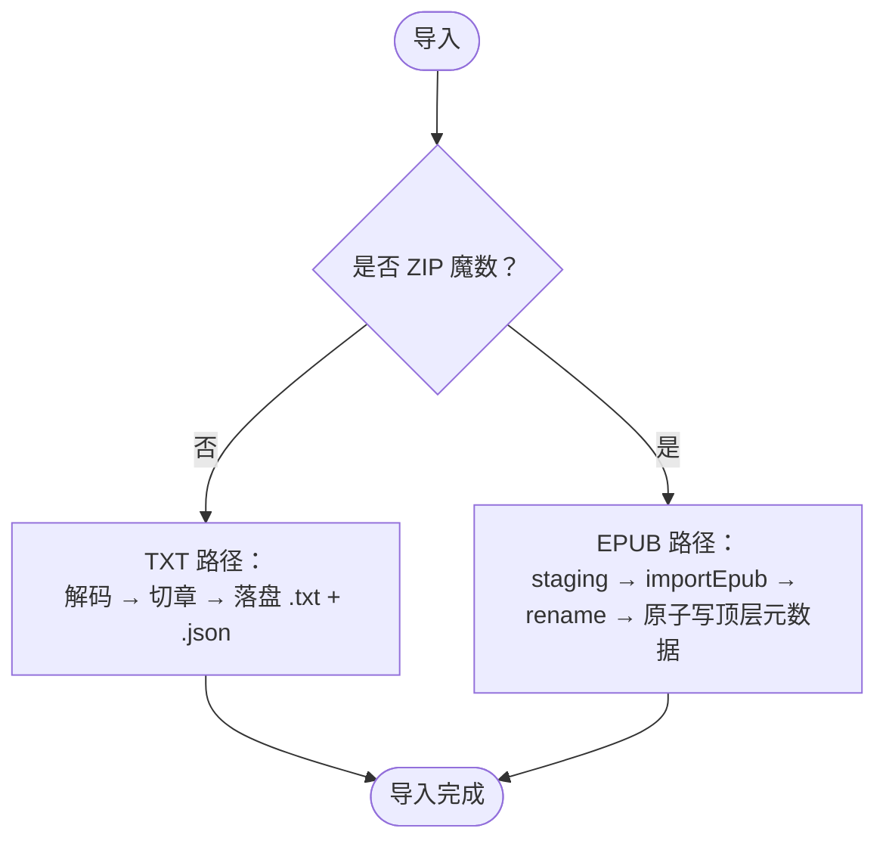
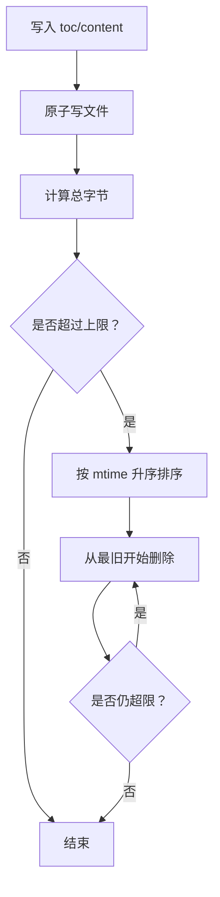
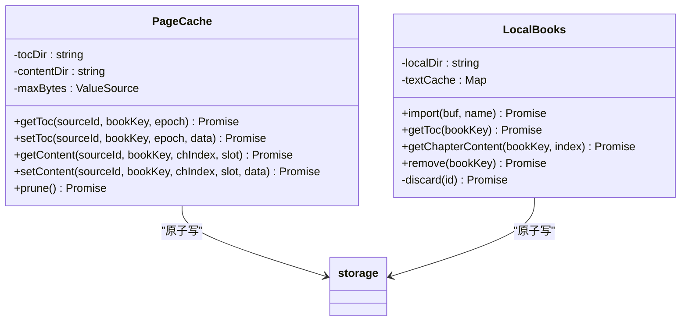
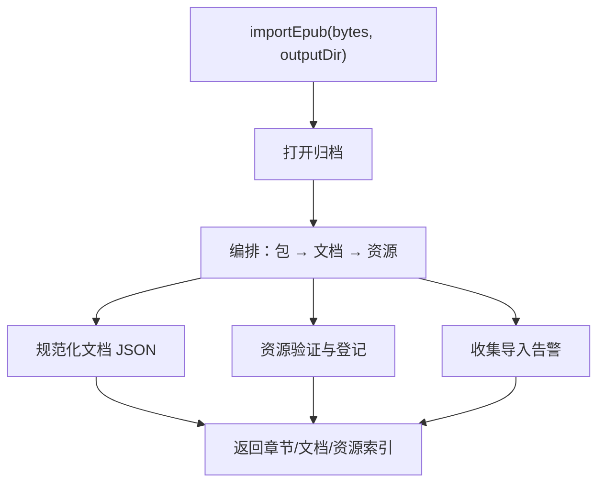
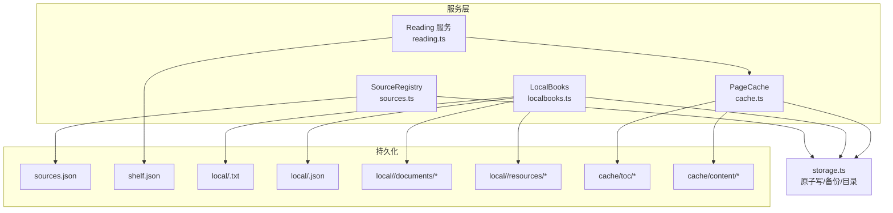

# 数据存储设计

<cite>
**本文引用的文件**   
- [storage.ts](file://src/services/storage.ts)
- [cache.ts](file://src/services/cache.ts)
- [localbooks.ts](file://src/services/localbooks.ts)
- [sources.ts](file://src/services/sources.ts)
- [wire.ts](file://src/shared/wire.ts)
- [reading.ts](file://src/services/reading.ts)
- [import.ts](file://src/services/epub/import.ts)
- [resources.ts](file://src/services/epub/resources.ts)
</cite>

## 目录
1. [引言](#引言)
2. [项目结构与持久化布局](#项目结构与持久化布局)
3. [核心数据文件与生命周期](#核心数据文件与生命周期)
4. [缓存设计与 LRU 策略](#缓存设计与-lru-策略)
5. [本地书存储模型](#本地书存储模型)
6. [依赖关系与数据流](#依赖关系与数据流)
7. [性能考虑](#性能考虑)
8. [故障排查](#故障排查)
9. [结论](#结论)

## 引言
本文档聚焦 dsh-novel 的数据存储层，覆盖 `~/.dsh/novel/` 持久化布局、`sources.json`、书架（shelf）数据、本地书目录、正文与目录缓存文件的结构、索引策略、读写路径、备份恢复机制，以及缓存淘汰、本地书偏移表与 EPUB 资源目录的维护规则。文档同时给出数据迁移、向后兼容、性能优化与常见故障的处理方案。

## 项目结构与持久化布局
数据根目录由环境变量 `DSH_HOME` 决定；未设置时回退到用户主目录下的 `.dsh`，并固定拼接 `novel` 子目录。该路径是“布局钉死”的唯一入口：所有持久化文件都位于 `novel/` 下。

**图示来源**
- [storage.ts:10-18](file://src/services/storage.ts#L10-L18)
- [localbooks.ts:201-238](file://src/services/localbooks.ts#L201-L238)
- [cache.ts:23-43](file://src/services/cache.ts#L23-L43)

关键约定如下：
- 数据根目录：`novelDir()` 返回 `$DSH_HOME/novel`，默认 `~/.dsh/novel`。
- 原子写临时后缀 `.tmp`、损坏备份后缀 `.bak`，均由低层模块集中声明。
- 本地书目录：`local/`，按 UUID 分桶；构建期使用 `<uuid>.importing/`，成功后一次 rename。
- 缓存目录：`cache/toc/` 与 `cache/content/`，按源 ID、书籍键、代际/槽位命名。

**章节来源**
- [storage.ts:10-18](file://src/services/storage.ts#L10-L18)
- [localbooks.ts:201-238](file://src/services/localbooks.ts#L201-L238)
- [cache.ts:23-43](file://src/services/cache.ts#L23-L43)

## 核心数据文件与生命周期

### sources.json：书源注册表
`sources.json` 由 `SourceRegistry` 管理。加载失败或不存在时的行为不同：不存在视为空列表；存在但解析失败则抛出 `CorruptJsonError` 并备份原文件，不会静默降级为空注册表。

| 维度 | 说明 |
|---|---|
| 文件位置 | `novel/sources.json` |
| 数据结构 | `NovelSource[]`，每个源含标识、名称、基础地址、分组、类型、状态、认证等字段 |
| 写入方式 | 通过 `edit()` 提交变更，内部合并后调用 `writeJsonAtomic()` 原子落盘 |
| 合并策略 | 累计 20 次变更立即落盘；否则进入 100ms 尾沿防抖，后台合并 |
| 并发安全 | 同文件 rename 排队；Windows 上避免 EPERM |
| 备份策略 | 仅由 `readJson()` 在 JSON 解析失败时生成 `<file>.bak`；`sources.json` 自身不自动备份 |
| 迁移策略 | 读路对存量数据进行幂等收敛：补齐 `enabled`、`type`、派生规则字段、分组拆分、图标前缀清理等 |

**图示来源**
- [sources.ts:14-28](file://src/services/sources.ts#L14-L28)
- [sources.ts:116-170](file://src/services/sources.ts#L116-L170)
- [storage.ts:68-105](file://src/services/storage.ts#L68-L105)

**章节来源**
- [sources.ts:14-28](file://src/services/sources.ts#L14-L28)
- [sources.ts:116-170](file://src/services/sources.ts#L116-L170)
- [sources.ts:201-322](file://src/services/sources.ts#L201-L322)
- [storage.ts:68-105](file://src/services/storage.ts#L68-L105)

### shelf.json：书架数据
书架条目类型为 `ShelfBook`，包含来源 ID、书籍键、标题、作者、封面、简介、最近章节名、分类、字数、全书章数、阅读进度和加书时间。其中书目元数字段集由 `SHELF_META` 统一管理，确保新增字段只在单点生效，客户端与服务端共享同一份契约。

| 维度 | 说明 |
|---|---|
| 文件位置 | `novel/shelf.json` |
| 数据结构 | `ShelfBook[]`，每项含 `sourceId`、`bookKey`、`title`、`progress`、`addedAt` 等 |
| 元数据字段 | 由 `SHELF_META` 定义：标题、作者、封面、简介、最近章节名、分类、字数、全书章数 |
| 写入方式 | 通过服务层的书架接口更新；底层同样走原子写 |
| 读取投影 | `ShelfEntry` 在服务端 list 时附加 `sourceName`，不持久化 |
| 进度判定 | `hasProgress()` 以“章节号大于零或偏移比例大于零”为“在读” |

注意：当前仓库中书架的具体读写实现并未直接引用本文件；书架契约由 `shared/wire.ts` 统一描述，并由上层服务装配。

**章节来源**
- [wire.ts:270-340](file://src/shared/wire.ts#L270-L340)

### 本地书目录：`local/`
本地书分为 TXT 与 EPUB 两类，导入时按文件头魔数分流：ZIP 签名走 EPUB 路径，否则走 TXT 解码链。

#### TXT 本地书
- 原文：`local/<uuid>.txt`
- 元数据：`local/<uuid>.json`
- 元数据字段：标题、原始文件名、导入时间、编码、章节偏移表、文本长度
- 章节偏移表：`ChapterSpan[]`，每项含标题行原文与字符区间 `[start, end)`
- 读取正文：按偏移切片，并经过 UTF-8 严格检测与 GBK 回退解码

#### EPUB 本地书
- 目录：`local/<uuid>/`
- 文档表：`documents/<id>.json`
- 资源目录：`resources/<path>`
- 上传原文：`original.epub`
- 顶层元数据：`local/<uuid>.json`，字段包括 `schemaVersion`、`format`、章节序列、文档表、资源表、导航树、导入告警
- 发布协议：先在 `<uuid>.importing/` 构建全部产物，再 rename 成最终目录，最后原子写顶层 JSON

**图示来源**
- [localbooks.ts:201-238](file://src/services/localbooks.ts#L201-L238)
- [localbooks.ts:238-302](file://src/services/localbooks.ts#L238-L302)
- [import.ts:150-160](file://src/services/epub/import.ts#L150-L160)

**章节来源**
- [localbooks.ts:201-302](file://src/services/localbooks.ts#L201-L302)
- [localbooks.ts:498-532](file://src/services/localbooks.ts#L498-L532)
- [import.ts:150-220](file://src/services/epub/import.ts#L150-L220)

### 缓存文件：`cache/toc/` 与 `cache/content/`
PageCache 负责正文与目录缓存。文件名由源 ID、安全化的书籍键、代际/槽位组成；内容过期与有效性由调用方（如 reading 层）控制，缓存只负责落盘与容量淘汰。

| 维度 | 说明 |
|---|---|
| 目录 | `cache/toc/`、`cache/content/` |
| 文件名 | `sourceId-safeKey(bookKey)-epoch.json`、`sourceId-safeKey(bookKey)-chIndex-slot.txt` |
| 安全键 | 对书籍键进行 URL 编码；超过 100 字符时用前 60 字符加 SHA1 前 10 位截断 |
| 上限 | 默认 200MB，由 `DEFAULT_CACHE_MAX_BYTES` 提供 |
| 淘汰策略 | 两目录总字节超上限时，按 mtime 升序删除，直到低于上限 |
| 写入路径 | 通过 `writeFileAtomic()`，与其他 JSON 落盘共用 rename 队列 |
| 有效期 | 由 epoch/slot 机制决定；旧代际文件保留但不被新写入命中 |

**图示来源**
- [cache.ts:12-113](file://src/services/cache.ts#L12-L113)
- [storage.ts:68-105](file://src/services/storage.ts#L68-L105)

**章节来源**
- [cache.ts:12-113](file://src/services/cache.ts#L12-L113)

## 缓存设计与 LRU 策略

### PageCache：磁盘缓存
PageCache 不是内存 LRU，而是磁盘文件缓存。其淘汰近似 LRU：按文件修改时间从小到大删除。注释明确承认这不是精确 LRU，因为读操作不会刷新 mtime，长期热数据可能先于旧代际被淘汰。

| 属性 | 值/策略 |
|---|---|
| 最大容量 | 200MB（可配置） |
| 淘汰顺序 | 最旧 mtime 优先 |
| 总容量范围 | toc 与 content 两个目录合计 |
| 容量变化 | 动态读取 `ValueSource<number>`，下次 prune 即生效 |
| 文件命名 | 安全键 + epoch/slot，不解释有效期语义 |
| 错误处理 | stat/unlink 失败跳过，继续尝试更旧文件 |

### LocalBooks：TXT 全文内存缓存
LocalBooks 对 TXT 全文维护一个进程内 `Map`，容量上限为 3 本书。LRU 提升方式是 `delete` 后再 `set`，从而让迭代器尾部成为最新项；淘汰时删除迭代器第一个键。EPUB 不使用整本缓存，而是按需读取规范化文档 JSON。

| 属性 | 值/策略 |
|---|---|
| 目标 | TXT 全文解码结果 |
| 上限 | 3 本书 |
| 淘汰方式 | Map 插入顺序作为 LRU 标记 |
| 适用格式 | 仅 TXT；EPUB 走逐文档读取 |
| 正文切片 | 偏移夹紧到 `[0, text.length]`，防止负长度 |

**图示来源**
- [cache.ts:23-113](file://src/services/cache.ts#L23-L113)
- [localbooks.ts:201-238](file://src/services/localbooks.ts#L201-L238)
- [localbooks.ts:302-498](file://src/services/localbooks.ts#L302-L498)
- [storage.ts:68-105](file://src/services/storage.ts#L68-L105)

**章节来源**
- [cache.ts:12-113](file://src/services/cache.ts#L12-L113)
- [localbooks.ts:201-238](file://src/services/localbooks.ts#L201-L238)
- [localbooks.ts:302-498](file://src/services/localbooks.ts#L302-L498)

## 本地书存储模型

### TXT 偏移表
TXT 章节切分基于正则匹配标题行，支持中文“第 X 章/卷/回/节/集/部/篇”及其变体，也支持“Chapter N”。首段无标题时命名为“正文”，无标题行时整本为单章。偏移表记录每章标题行之后的起始位置与下一标题行之前的结束位置。

| 字段 | 含义 |
|---|---|
| `name` | 标题行原文或兜底“正文” |
| `start` | 章节起始字符偏移 |
| `end` | 章节结束字符偏移（左闭右开语义） |

切分过程按行扫描，遇到标题行时关闭上一段并开启新段；文末残留标题会单独收尾。读取正文时对偏移做边界夹紧，保证即使相邻标题或末尾孤标题导致 `start > end`，也只返回空字符串而非异常。

**章节来源**
- [localbooks.ts:38-78](file://src/services/localbooks.ts#L38-L78)
- [localbooks.ts:302-498](file://src/services/localbooks.ts#L302-L498)

### EPUB 资源目录与 warnings.json
EPUB 导入由 `services/epub/import.ts` 编排，将文档与资源写到输出目录，并返回结构化索引。资源验证由 `resources.ts` 负责，图片必须满足声明 MIME、魔数一致、容器完整、像素预算与 EXIF 旋转后的显示宽高正确。

关于 `warnings.json`：
- 代码中存在 `EpubWarningLog` 与资源验证警告收集逻辑，且 EPUB 元数据包含 `warnings` 字段。
- 但本地书顶层元数据中的 `warnings` 直接来自导入结果，并未单独落地为 `warnings.json`。
- 因此，当前实现中导入说明保存在本地书顶层 JSON 的 `warnings` 数组里，而不是独立的 `warnings.json` 文件。

**图示来源**
- [import.ts:150-220](file://src/services/epub/import.ts#L150-L220)
- [resources.ts:1-60](file://src/services/epub/resources.ts#L1-L60)

**章节来源**
- [localbooks.ts:238-302](file://src/services/localbooks.ts#L238-L302)
- [import.ts:150-220](file://src/services/epub/import.ts#L150-L220)
- [resources.ts:1-60](file://src/services/epub/resources.ts#L1-L60)

## 依赖关系与数据流

**图示来源**
- [sources.ts:116-170](file://src/services/sources.ts#L116-L170)
- [reading.ts:8-12](file://src/services/reading.ts#L8-L12)
- [reading.ts:123-174](file://src/services/reading.ts#L123-L174)
- [localbooks.ts:201-302](file://src/services/localbooks.ts#L201-L302)
- [cache.ts:23-43](file://src/services/cache.ts#L23-L43)
- [storage.ts:10-18](file://src/services/storage.ts#L10-L18)

## 性能考虑

### 大书架检索
书架数据量增长时，应避免全量扫描造成的卡顿。建议：
- 对高频查询字段建立轻量索引，例如按 `sourceId`、`title`、`author` 建立倒排或哈希索引。
- 分页与增量同步：首次加载只取必要字段，后续按需拉取详情。
- 避免每次搜索都重建 `ShelfEntry` 的 `sourceName` 投影；可在服务端 list 阶段一次性拼装。

### 频繁写入合并
当前系统已有多层合并机制：
- `SourceRegistry`：20 次变更阈值 + 100ms 尾沿防抖。
- `createDebouncedWriter`：通用进程内去重写，窗口内同文件多次 schedule 只落最后一次。
- `writeFileAtomic`：同文件 rename 排队，避免 Windows EPERM。

推荐实践：
- 批量导入时复用同一个 `edit()` 事务，减少中间写。
- 任务收尾调用 `flush()` 等待落盘，但不要把它误用为“捕获调用瞬间快照”的屏障。
- 导出与工具并发抓正文时，应等待 PageCache 的异步写入完成，避免与导出竞争。

### 缓存命中率优化
- 合理调优 `cacheMaxBytes`：阅读密集场景可适当提高上限，降低重复抓取成本。
- 利用 epoch/slot 失效机制：在章节或版本变更后主动淘汰旧缓存，避免脏数据长期驻留。
- 避免热文件被“只读热条目”假象保护：PageCache 的 mtime 近似淘汰意味着长期只读的热条目可能被更早淘汰，需接受这一限制并在业务层做二次缓存或预热。

[本节为通用性能建议，不直接分析具体代码片段]

## 故障排查

### 文件损坏
- `sources.json` 解析失败：`readJson()` 会复制到 `<file>.bak` 并抛出 `CorruptJsonError`，不会静默降级为空注册表。
- EPUB 文档错位：若元数据说文档存在，但读取内容与 `documentId` 不一致，会显式报错，而不是伪装成 404。
- 本地资源缺失：资源 ID 查不到或文件缺失时抛 404；打开成功但 stat 失败则原样上抛，避免把损坏误报为缺失。

**章节来源**
- [storage.ts:20-66](file://src/services/storage.ts#L20-L66)
- [localbooks.ts:302-498](file://src/services/localbooks.ts#L302-L498)

### 权限不足
- `readJson()` 在 ENOENT 之外抛错，不会把权限错误伪装成空结果。
- `writeFileAtomic()` 会在 mkdir 与 writeFile 时产生权限相关异常；调用方应检查日志并提示用户修复数据目录权限。

**章节来源**
- [storage.ts:40-66](file://src/services/storage.ts#L40-L66)
- [storage.ts:68-105](file://src/services/storage.ts#L68-L105)

### 磁盘满
- PageCache 的 `prune()` 在统计或删除失败时跳过单个文件，继续尝试更旧文件；若磁盘持续满，可能需要外部清理。
- 本地书导入失败时会调用 `discard()` 清理本次 UUID 的全部产物，包括 staging 目录、已发布目录、同名 TXT、元数据及其备份和原子写临时残留。

**章节来源**
- [cache.ts:63-113](file://src/services/cache.ts#L63-L113)
- [localbooks.ts:498-532](file://src/services/localbooks.ts#L498-L532)

### 备份与恢复
- 损坏 JSON：`<file>.bak` 可作为恢复起点；恢复后应删除 `.bak`，避免误判。
- 本地书删除：`remove()` 只看元数据是否存在，不解析；`discard()` 清理所有关联文件，不触碰其他书。
- 导入中途强杀：可能留下已发布但未入架的目录与元数据，本轮不自动删除，需要人工检查 `local/` 下残留。

**章节来源**
- [storage.ts:20-66](file://src/services/storage.ts#L20-L66)
- [localbooks.ts:498-532](file://src/services/localbooks.ts#L498-L532)

## 结论
dsh-novel 的数据存储层围绕三个核心展开：`sources.json` 的书源注册表、本地书目录中的 TXT/EPUB 产物与元数据、以及 `cache/toc` 与 `cache/content` 的正文与目录缓存。整体设计强调原子写、并发 rename 串行、损坏备份、导入 staging 与一次提交、以及多种层级的写入合并。对于 LRU，系统区分了内存级 TXT 全文缓存与磁盘级 PageCache：前者是精确 Map LRU，后者是近似 mtime LRU。数据迁移由 `SourceRegistry.load()` 在读取时幂等收敛，EPUB 元数据通过 `schemaVersion` 明确版本。未来扩展时应遵循“单一数据主人”原则，新增字段集中维护，并通过原子写与合并策略保障高并发下的数据一致性。