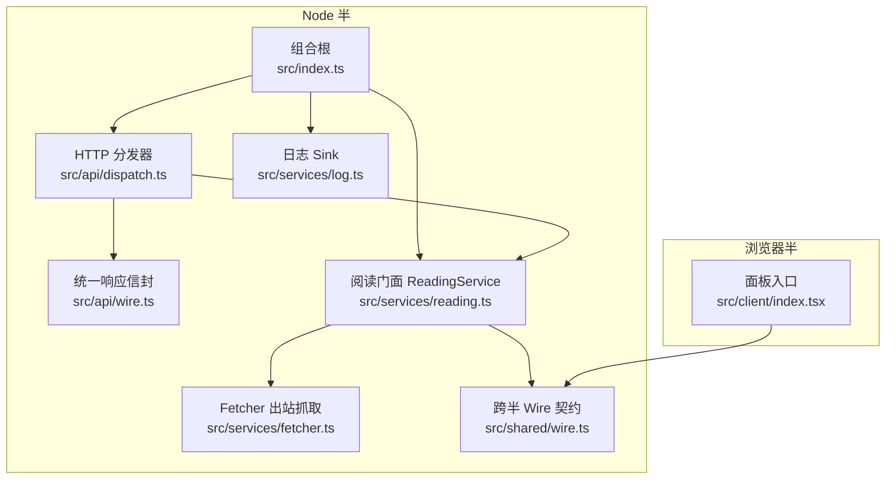
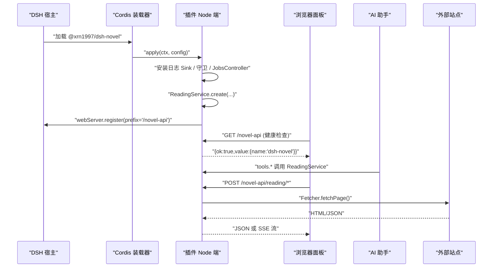
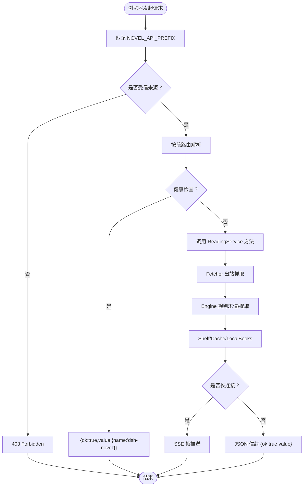
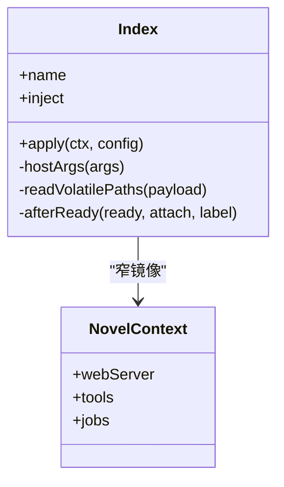
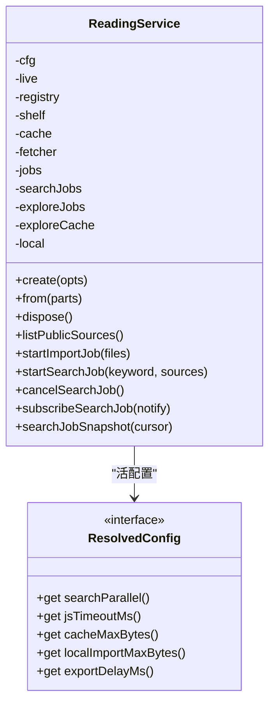
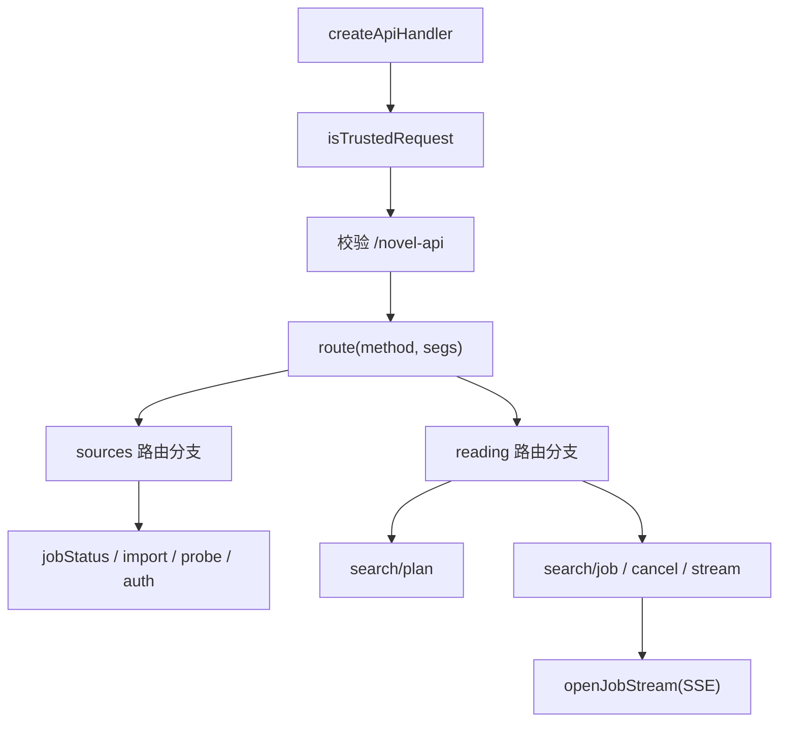
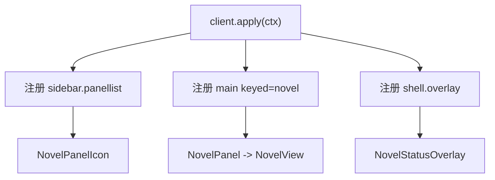
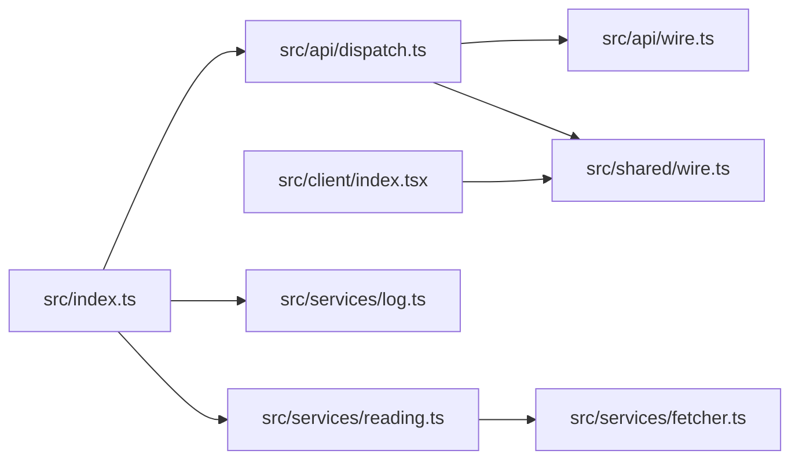
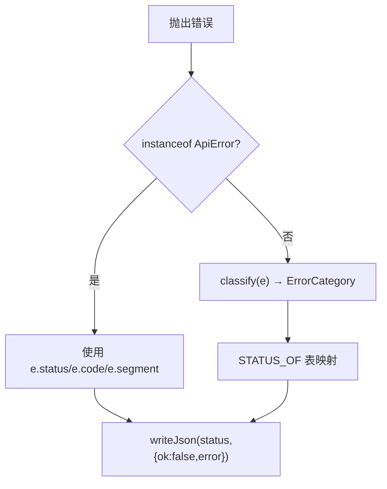

# 架构总览

<cite>
**本文引用的文件**   
- [src/index.ts](file://src/index.ts)
- [src/api/dispatch.ts](file://src/api/dispatch.ts)
- [src/api/wire.ts](file://src/api/wire.ts)
- [src/services/reading.ts](file://src/services/reading.ts)
- [src/services/fetcher.ts](file://src/services/fetcher.ts)
- [src/services/log.ts](file://src/services/log.ts)
- [src/shared/wire.ts](file://src/shared/wire.ts)
- [src/client/index.tsx](file://src/client/index.tsx)
</cite>

## 目录
1. [引言](#引言)
2. [项目结构](#项目结构)
3. [核心组件](#核心组件)
4. [系统上下文](#系统上下文)
5. [请求链路](#请求链路)
6. [详细组件分析](#详细组件分析)
7. [依赖关系分析](#依赖关系分析)
8. [错误处理与日志](#错误处理与日志)
9. [扩展点](#扩展点)
10. [性能考量](#性能考量)
11. [故障排查](#故障排查)
12. [结论](#结论)

## 引言
dsh-novel 是 DSH（DeepSeek Shell）中的一个“小说”插件，同时运行在 Node 半和浏览器半：Node 端提供 HTTP API、书源抓取、缓存、书架、后台任务；浏览器端提供全局面板、搜索/发现/阅读器 UI。文档目标是给出系统边界、组件关系、数据流、门面模式、Wire-first 契约、活配置以及扩展方式，帮助读者快速定位新增路由、面板、书源语法或导出格式的接入位置。

## 项目结构
仓库按“服务层 + API 层 + 共享契约 + 客户端 + 引擎”划分：

**图示来源**
- [src/index.ts:1-200](file://src/index.ts#L1-L200)
- [src/api/dispatch.ts:1-200](file://src/api/dispatch.ts#L1-L200)
- [src/api/wire.ts:1-135](file://src/api/wire.ts#L1-L135)
- [src/services/reading.ts:1-200](file://src/services/reading.ts#L1-L200)
- [src/services/fetcher.ts:1-200](file://src/services/fetcher.ts#L1-L200)
- [src/services/log.ts:1-30](file://src/services/log.ts#L1-L30)
- [src/shared/wire.ts:1-200](file://src/shared/wire.ts#L1-L200)
- [src/client/index.tsx:1-110](file://src/client/index.tsx#L1-L110)

**章节来源**
- [src/index.ts:1-200](file://src/index.ts#L1-L200)
- [src/api/dispatch.ts:1-200](file://src/api/dispatch.ts#L1-L200)
- [src/shared/wire.ts:1-200](file://src/shared/wire.ts#L1-L200)
- [src/client/index.tsx:1-110](file://src/client/index.tsx#L1-L110)

## 核心组件
- **组合根 `src/index.ts`**：Cordis 插件 `apply`，装配 WebServer 路由、ToolsRuntime、JobsRuntime、ReadingService，并安装双态日志 Sink、未处理拒绝守卫、热更监听。通过窄接口镜像宿主能力，避免强依赖未安装的 dsh-host-webserver。
- **门面 `ReadingService`**：HTTP/AI 工具/UI 三方共享的业务入口。对外只暴露动词方法；内部持有 SourceRegistry、Shelf、PageCache、Fetcher、SearchJobs、ExploreJobs、LocalBooks 等部件。
- **HTTP 分发器 `dispatch.ts`**：`/novel-api` 前缀路由的单一入口，按 segment 分派到 ReadingService 方法，返回 JSON 信封或 SSE 流。
- **Wire 契约 `shared/wire.ts`**：Node 半与浏览器半之间的唯一真相——API 值形状、路由段名、枚举、状态、错误信封。构建时会被浏览器端 inline，禁止运行时 Node 依赖。
- **Fetcher**：守门网络出口，负责 UA、代理、超时、非 2xx 分类为 FetchError、Cookie/Headers 透传。
- **日志 Sink**：模块级 `log`，默认直写 console；运行时由组合根替换为 console + ctx.logger 复合 sink，卸载后复位。
- **浏览器面板入口 `client/index.tsx`**：注册全局面板图标、中央面板、常驻状态层，并通过 CopyProvider 注入翻译。

**章节来源**
- [src/index.ts:1-200](file://src/index.ts#L1-L200)
- [src/services/reading.ts:1-200](file://src/services/reading.ts#L1-L200)
- [src/api/dispatch.ts:1-200](file://src/api/dispatch.ts#L1-L200)
- [src/shared/wire.ts:1-200](file://src/shared/wire.ts#L1-L200)
- [src/services/fetcher.ts:1-200](file://src/services/fetcher.ts#L1-L200)
- [src/services/log.ts:1-30](file://src/services/log.ts#L1-L30)
- [src/client/index.tsx:1-110](file://src/client/index.tsx#L1-L110)

## 系统上下文
DSH 宿主装载 Cordis 插件，插件 Node 端挂载 `/novel-api`，浏览器侧打开“小说”全局面板；AI 助手通过 Cordis ToolsRuntime 调用 ReadingService；外部站点通过 Fetcher 被访问。

**图示来源**
- [src/index.ts:1-200](file://src/index.ts#L1-L200)
- [src/api/dispatch.ts:1-200](file://src/api/dispatch.ts#L1-L200)
- [src/services/reading.ts:1-200](file://src/services/reading.ts#L1-L200)
- [src/services/fetcher.ts:1-200](file://src/services/fetcher.ts#L1-L200)
- [src/client/index.tsx:1-110](file://src/client/index.tsx#L1-L110)

## 请求链路
浏览器 UI → `/novel-api` → dispatch → ReadingService → Fetcher/Engine/Storage → 返回 JSON 或 SSE。

**图示来源**
- [src/api/dispatch.ts:1-200](file://src/api/dispatch.ts#L1-L200)
- [src/api/wire.ts:1-135](file://src/api/wire.ts#L1-L135)
- [src/services/reading.ts:1-200](file://src/services/reading.ts#L1-L200)
- [src/services/fetcher.ts:1-200](file://src/services/fetcher.ts#L1-L200)

**章节来源**
- [src/api/dispatch.ts:1-200](file://src/api/dispatch.ts#L1-L200)
- [src/api/wire.ts:1-135](file://src/api/wire.ts#L1-L135)
- [src/services/reading.ts:1-200](file://src/services/reading.ts#L1-L200)
- [src/services/fetcher.ts:1-200](file://src/services/fetcher.ts#L1-L200)

## 详细组件分析

### 组合根 `src/index.ts`
- 定义窄接口 `WebServerLike` / `ToolsRuntimeLike` / `JobsRuntimeLike`，仅镜像宿主用到的成员，避免对未安装的 dsh-host-webserver 产生编译期依赖。
- `inject = ['webServer','tools','jobs']` 声明 Cordis 前置能力；重复 apply 通过 `applied` 标志防止重复注册 `/novel-api`。
- 安装双态日志 Sink：console 保本机可见性，ctx.logger 进 ring buffer；effect dispose 时复位为 console。
- 监听 `loader/volatile-update`，打印热更路径并在 `proxyUrl` 变化时重新计算代理。
- 使用 `afterReady` 封装 ready 失败吞掉、dispose 复位 applied、取消检测，确保路由/工具注册顺序稳定。
- 安装 unhandledRejection 守卫，保护 Node 进程不被脚本异步 rejection 杀死。
- 通过 `jobs.attachController('dsh-novel')` 让本地 job controller 对全局 owner 生效。

**图示来源**
- [src/index.ts:1-200](file://src/index.ts#L1-L200)

**章节来源**
- [src/index.ts:1-200](file://src/index.ts#L1-L200)

### 门面 `ReadingService`
- 公开类型集中 re-export 自 shared wire，保证 HTTP/Tools/UI 三端只消费一套契约。
- `create` 构造目录、Fetcher、SourceRegistry、Shelf、PageCache、LocalBooks；`from` 接受已组装部件，便于测试注入内存 adapter。
- 所有可热改字段走 `ResolvedConfig` getter（如 searchParallel、jsTimeoutMs、cacheMaxBytes、localImportMaxBytes），每次使用时读当前值，而非启动快照。
- 后台任务槽分离：`jobs`（导入/批量探针）、`searchJobs`（聚合搜索）、`exploreJobs`（分类浏览）。
- 本地书导入上限、代理 URL、抓取超时等关键数值都来自 live config 或常量单点。

**图示来源**
- [src/services/reading.ts:1-200](file://src/services/reading.ts#L1-L200)

**章节来源**
- [src/services/reading.ts:1-200](file://src/services/reading.ts#L1-L200)

### HTTP 分发器 `src/api/dispatch.ts`
- `createApiHandler(service)` 返回 `(req,res)` 处理器：校验受信来源、校验 `/novel-api` 前缀、解析 segment，再交给 `route`。
- 健康检查直接返回 `{name:'dsh-novel',apiVersion:1}`。
- 书源面：列出公开源、导入任务、任务状态、批量探测、逐源 probe/auth、启用/批量启用/删除。
- 阅读面：搜索计划、提交搜索任务、取消、SSE 进度流；后续继续覆盖探索、导出、本地书等路由。
- 所有成功响应经 `writeOk`，失败经 `writeError`；body 形状错误先转成 ApiError。
- SSE 通用机械 `openJobStream`：写头、周期性推帧、终态关流、断连退订。

**图示来源**
- [src/api/dispatch.ts:1-200](file://src/api/dispatch.ts#L1-L200)

**章节来源**
- [src/api/dispatch.ts:1-200](file://src/api/dispatch.ts#L1-L200)

### 浏览器面板入口 `src/client/index.tsx`
- 通过 Cordis `slots` 注册两个座位：`sidebar.panellist`（图标行）与 `main`（中央 keyed 面板），id/key 均为 `novel`。
- 同时注册 `shell.overlay` 常驻状态层，用于展示任务状态与跳转回面板。
- 使用 CopyProvider 包裹 NovelView，把翻译函数传给子树；若无 locale slot 则回退中文。
- 旧宿主无 `configForms` 时安全跳过配置页注册。

**图示来源**
- [src/client/index.tsx:1-110](file://src/client/index.tsx#L1-L110)

**章节来源**
- [src/client/index.tsx:1-110](file://src/client/index.tsx#L1-L110)

## 依赖关系分析
- 组合根依赖 `createApiHandler`、`resolveConfig`、`ensureUnhandledGuard`、`setLogSink`、`ReadingService`、`novelDir`、`NOVEL_API_PREFIX`、`registerTools`。
- Dispatch 依赖 `exportBook`、`errors`、`size`、`value-source`、`wire`、`shared/wire`。
- ReadingService 依赖 engine、bridge、cache、fetcher、explore、import、intake、localbooks、pagination、participation、probe、request、search-face、shelf、sources、types、value-source。
- Fetcher 依赖 undici ProxyAgent、iconv-lite、services/errors、services/proxy、services/value-source。
- 浏览器 client 依赖 React/Cordis slots、CopyProvider、views。

**图示来源**
- [src/index.ts:1-200](file://src/index.ts#L1-L200)
- [src/api/dispatch.ts:1-200](file://src/api/dispatch.ts#L1-L200)
- [src/api/wire.ts:1-135](file://src/api/wire.ts#L1-L135)
- [src/services/reading.ts:1-200](file://src/services/reading.ts#L1-L200)
- [src/services/fetcher.ts:1-200](file://src/services/fetcher.ts#L1-L200)
- [src/shared/wire.ts:1-200](file://src/shared/wire.ts#L1-L200)
- [src/client/index.tsx:1-110](file://src/client/index.tsx#L1-L110)

**章节来源**
- [src/index.ts:1-200](file://src/index.ts#L1-L200)
- [src/api/dispatch.ts:1-200](file://src/api/dispatch.ts#L1-L200)
- [src/services/reading.ts:1-200](file://src/services/reading.ts#L1-L200)
- [src/services/fetcher.ts:1-200](file://src/services/fetcher.ts#L1-L200)
- [src/shared/wire.ts:1-200](file://src/shared/wire.ts#L1-L200)
- [src/client/index.tsx:1-110](file://src/client/index.tsx#L1-L110)

## 错误处理与日志

### 两态日志 Sink
- 默认 sink 是 console，离线/测试可用。
- 运行时由组合根 `setLogSink` 替换为复合 sink：info 走 console.log + ctx.logger，warn/error 走 console.warn/error + ctx.logger。
- 卸载 effect 将 sink 复位为 console，避免指向已卸载实例。
- 引擎层不直接依赖 services/log，unhandledRejection 守卫通过注入 warn 回调进入日志缝。

**章节来源**
- [src/services/log.ts:1-30](file://src/services/log.ts#L1-L30)
- [src/index.ts:1-200](file://src/index.ts#L1-L200)

### 统一响应信封
- 成功：`{ ok: true, value }`，由 `writeOk` 统一输出。
- 失败：`{ ok: false, error: { code, message, segment? } }`，由 `writeError` 输出。
- `errorStatusOf` 区分两类错误：
  1. `ApiError`：自带 status/code/segment，直通。
  2. domain/引擎错误：经 `classify` 映射到 ErrorCategory，查表得到 status/code，引擎错误附带 facet/segmentIndex/raw。
- body 读取限制在 `readCappedBody` / `readJsonBody`，超限 413，非法 JSON 400。

**图示来源**
- [src/api/wire.ts:1-135](file://src/api/wire.ts#L1-L135)

**章节来源**
- [src/api/wire.ts:1-135](file://src/api/wire.ts#L1-L135)

## 扩展点

### 新增 HTTP 路由
- 在 `src/api/dispatch.ts` 的 `route` 中增加 segment 分支，调用 `guard` 校验方法，调用 `ReadingService` 对应方法，并以 `writeOk`/`writeError` 返回。
- 若需要新的跨半类型，先在 `src/shared/wire.ts` 声明，再由 service 与 client 共同引用。

**章节来源**
- [src/api/dispatch.ts:1-200](file://src/api/dispatch.ts#L1-L200)
- [src/shared/wire.ts:1-200](file://src/shared/wire.ts#L1-L200)

### 新增 UI 面板
- 在 `src/client/index.tsx` 的 `apply` 中通过 `slots.inject('sidebar.panellist' | 'main' | 'shell.overlay')` 注册新面板、图标或状态层。
- 保持 id/key 一致，并把翻译函数通过 inject 注入给组件。

**章节来源**
- [src/client/index.tsx:1-110](file://src/client/index.tsx#L1-L110)

### 新增书源语法
- 书源规则由 engine 层解析与求值；新增语法应放在 `src/engine/*` 相关模块，并在 `src/services/bridge.ts` 或 `src/services/request.ts` 暴露必要上下文。
- 如果涉及跨半契约的值形状，修改 `src/shared/wire.ts`；如果仅是 Node 内部模型，优先放 services 层。

**章节来源**
- [src/services/reading.ts:1-200](file://src/services/reading.ts#L1-L200)
- [src/shared/wire.ts:1-200](file://src/shared/wire.ts#L1-L200)

### 新增导出格式
- 导出逻辑集中在 `src/services/export.ts`；HTTP 面由 dispatch 调用 `exportBook`。
- 如需新增导出参数，先在 `src/shared/wire.ts` 扩展请求/响应类型，再在 dispatch 与 export 实现中接入。

**章节来源**
- [src/api/dispatch.ts:1-200](file://src/api/dispatch.ts#L1-L200)
- [src/shared/wire.ts:1-200](file://src/shared/wire.ts#L1-L200)

## 性能考量
- 聚合搜索并发 `DEFAULT_SEARCH_PARALLEL` 与 JS 沙箱预算 `DEFAULT_JS_BUDGET_MS` 在 ReadingService 与 fetcher 默认处统一，避免散落字面量导致批循环挂死或目录脚本超时。
- Fetcher 对代理 dispatcher 做 URL 级缓存与 dispose 清理，避免连接池泄漏；代理地址非法转为 FetchError，并脱敏日志。
- SSE 流用 `openJobStream` 统一收尾，断连即退订，避免积压与僵尸连接。
- 本地导入与信封体共用 `readCappedBody`，字节上限唯一主人，避免重复计数逻辑。

[本节为一般性指导，无需具体文件分析]

## 故障排查
- 重复启用导致路由崩溃：检查 `applied` 标志与 Cordis unload/load 流程，确认 dispose 已复位。
- 本机日志不可见：确认组合根已设置 log sink；注意 host logger 缺省级别可能过滤 warn/debug，console 腿是保底。
- 外部站点 403/重置：检查代理配置与 `proxyUrl` 热更；Fetcher 会记录脱敏后的代理地址。
- 请求体过大：确认上传文件大小不超过 `readCappedBody` 上限；本地导入与 JSON 信封共享该限制。
- SSE 连接不关闭：检查 `openJobStream` 是否收到终态、前端是否主动断开。

**章节来源**
- [src/index.ts:1-200](file://src/index.ts#L1-L200)
- [src/services/log.ts:1-30](file://src/services/log.ts#L1-L30)
- [src/services/fetcher.ts:1-200](file://src/services/fetcher.ts#L1-L200)
- [src/api/dispatch.ts:1-200](file://src/api/dispatch.ts#L1-L200)

## 结论
dsh-novel 以 ReadingService 作为唯一业务门面，以 shared/wire.ts 作为跨半契约，以组合根完成宿主窄接口装配与生命周期管理；HTTP 层只负责路由与安全信封，浏览器层只负责面板与交互。扩展时应优先遵循“Wire-first、门面动词、窄接口镜像”的原则，避免在服务层、HTTP 层、UI 层各自维护一份形状或行为。