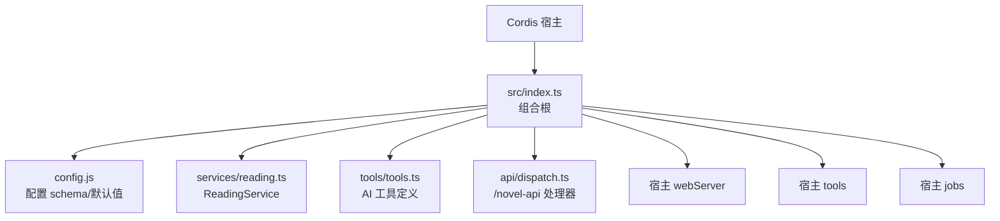
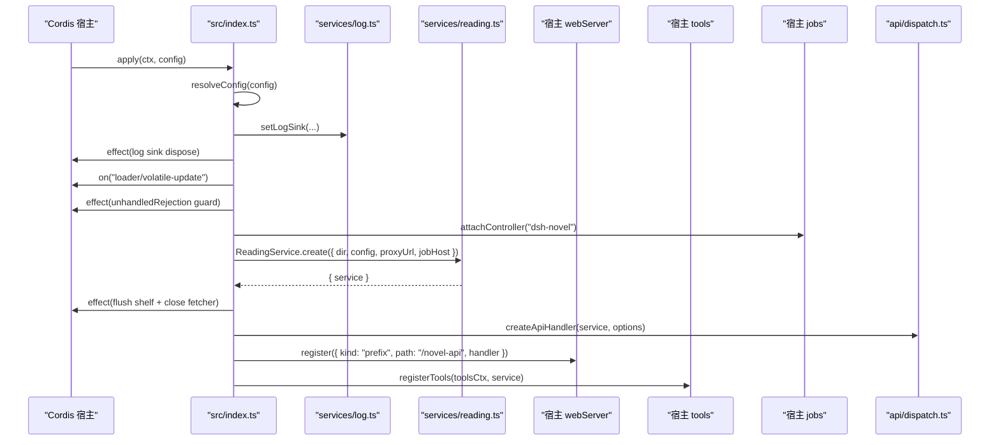
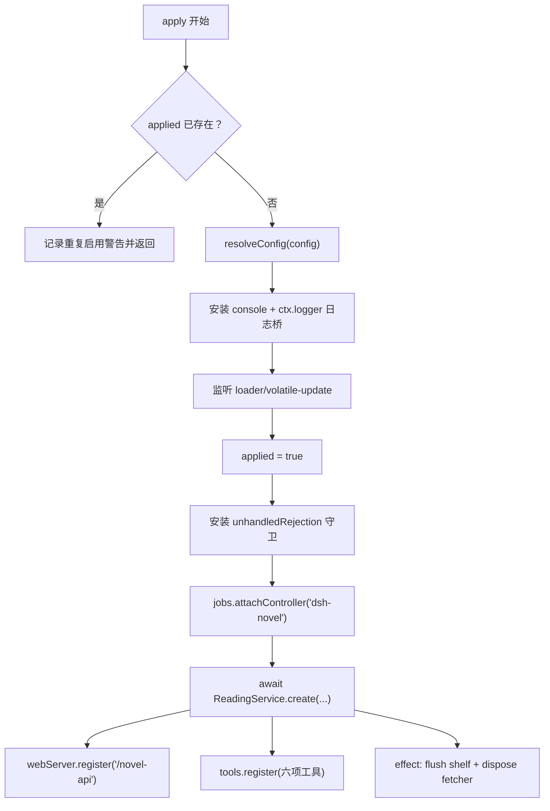
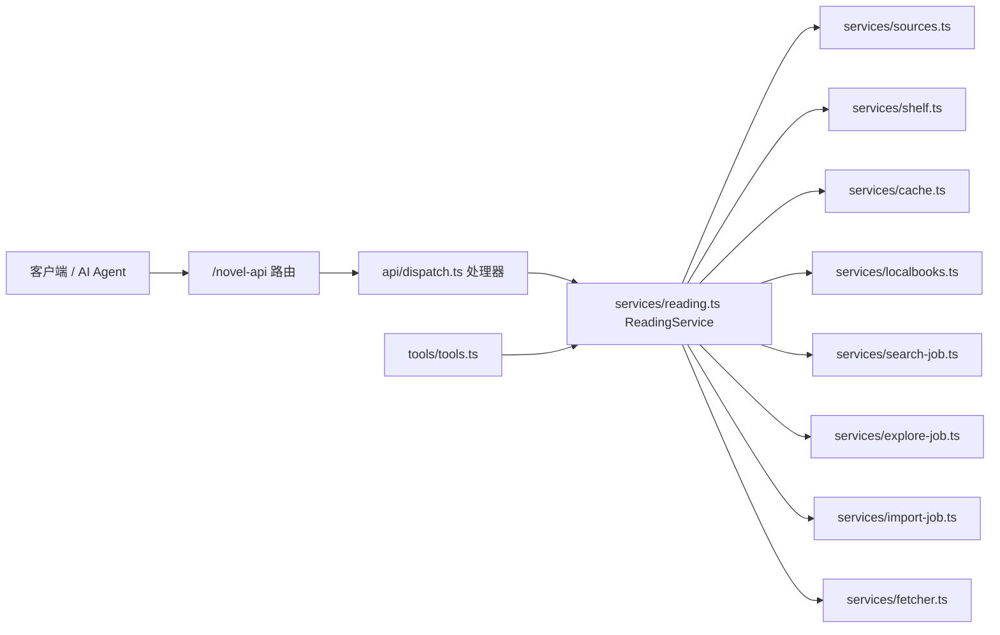
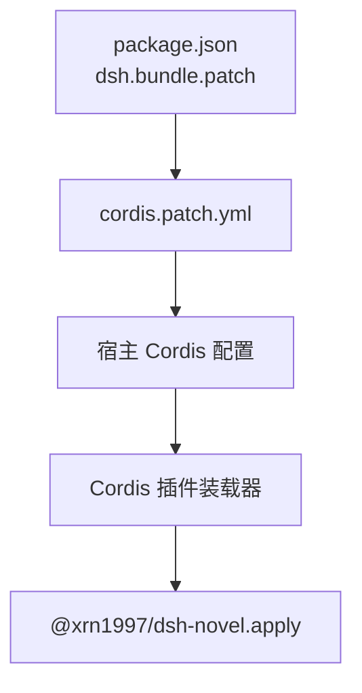

# 主入口与插件生命周期

<cite>
**本文引用的文件**   
- [src/index.ts](file://src/index.ts)
- [cordis.patch.yml](file://cordis.patch.yml)
- [package.json](file://package.json)
- [tests/index.test.ts](file://tests/index.test.ts)
- [src/services/reading.ts](file://src/services/reading.ts)
- [src/tools/tools.ts](file://src/tools/tools.ts)
</cite>

## 目录
1. [引言](#引言)
2. [项目结构定位](#项目结构定位)
3. [核心组件总览](#核心组件总览)
4. [架构总览](#架构总览)
5. `apply(ctx, config)` 生命周期详解
6. [依赖装配顺序与窄镜像接口](#依赖装配顺序与窄镜像接口)
7. [HTTP 路由与 AI 工具注册](#http-路由与-ai-工具注册)
8. [错误处理、资源清理与热替换](#错误处理资源清理与热替换)
9. [与 cordis.patch.yml 和包元信息的关系](#与-cordispatchyml-和包元信息的关系)
10. [添加新服务的装配步骤](#添加新服务的装配步骤)
11. [测试中 mock ctx 的要点](#测试中-mock-ctx-的要点)
12. [性能与可观测性](#性能与可观测性)
13. [故障排查](#故障排查)
14. [结论](#结论)

## 引言
`src/index.ts` 是 `@xrn1997/dsh-novel` 插件的组合根：它不直接实现抓取、解析、书架或搜索逻辑，而是接收 Cordis 宿主提供的 `Context` 与可选配置，组装出 `ReadingService` 及其依赖（WebServer、ToolsRuntime、JobsRuntime、Fetcher、Sources、Shelf、Cache、LocalBooks、SearchJob、ExploreJob、ImportJob 等），然后向宿主暴露 `/novel-api` HTTP 前缀路由与六个以 `dshnovel_` 为前缀的 AI 工具。

该文件同时承担以下职责：
- 解析并校验配置；
- 把日志缝接入宿主 logger 与 console；
- 监听配置热更新；
- 安装未处理 Promise rejection 守卫；
- 注册任务控制器准入闸；
- 在异步服务就绪后注册 HTTP 路由与 AI 工具；
- 在卸载时 flush 书架进度、关闭 Fetcher、摘除监听与守卫；
- 防止重复启用导致路由与工具重复注册。

## 项目结构定位
本仓库是一个 DSH/Cordis 插件，主入口导出 `name`、`inject`、`apply` 以及 `Config`、`ResolvedConfig` 类型门面。`package.json` 通过 `main` 指向编译产物，并通过 `dsh.bundle.patch` 指定打包阶段插入 `cordis.patch.yml`，从而让宿主把本插件纳入其插件图。



**图表来源**
- [src/index.ts:1-242](file://src/index.ts#L1-L242)
- [package.json:1-125](file://package.json#L1-L125)

**章节来源**
- [package.json:1-125](file://package.json#L1-L125)
- [src/index.ts:1-20](file://src/index.ts#L1-L20)

## 核心组件总览
| 组件 | 位置 | 主要职责 | 是否由 `src/index.ts` 直接构造 |
|---|---|---|---|
| `Config` / `ResolvedConfig` | `src/config.js` | 配置 schema、默认值、值域校验、合并 | 否；仅 re-export |
| `ReadingService` | `src/services/reading.ts` | 聚合 Fetcher、Sources、Shelf、Cache、LocalBooks、SearchJob、ExploreJob、ImportJob 等业务能力 | 否；通过 `create` 构建 |
| `Fetcher` | `src/services/fetcher.ts` | 出站 HTTP 请求、代理、超时、解码 | 否；由 `ReadingService` 内部创建 |
| `Sources` | `src/services/sources.ts` | 已启用书源注册表 | 否；由 `ReadingService` 管理 |
| `Shelf` | `src/services/shelf.ts` | 书架条目、阅读进度防抖写盘 | 否；由 `ReadingService` 管理 |
| `Cache` | `src/services/cache.ts` | 页面内容缓存 | 否；由 `ReadingService` 管理 |
| `LocalBooks` | `src/services/localbooks.ts` | 本地书 EPUB/TXT 导入与存储 | 否；由 `ReadingService` 管理 |
| `SearchJob` | `src/services/search-job.ts` | 搜索后台任务 | 否；由 `ReadingService` 管理 |
| `ExploreJob` | `src/services/explore-job.ts` | 探索后台任务 | 否；由 `ReadingService` 管理 |
| `ImportJob` | `src/services/import-job.ts` | 书源导入后台任务 | 否；由 `ReadingService` 管理 |
| `Tools` | `src/tools/tools.ts` | 六项 AI 工具定义 | 否；由 `registerTools` 注册 |
| HTTP 路由 | `src/api/dispatch.ts` | `/novel-api` 请求分发 | 否；由 `createApiHandler` 生成 handler |

**章节来源**
- [src/index.ts:1-242](file://src/index.ts#L1-L242)
- [src/services/reading.ts:1-80](file://src/services/reading.ts#L1-L80)
- [src/tools/tools.ts:1-60](file://src/tools/tools.ts#L1-L60)

## 架构总览
下图展示 `apply` 启动后的关键时序：从配置解析到服务就绪、再到路由与工具挂载。



**图表来源**
- [src/index.ts:60-242](file://src/index.ts#L60-L242)
- [src/services/reading.ts:1-80](file://src/services/reading.ts#L1-L80)
- [src/tools/tools.ts:1-60](file://src/tools/tools.ts#L1-L60)
- [src/api/dispatch.ts](file://src/api/dispatch.ts)

## `apply(ctx, config)` 生命周期详解

### 阶段一：入口防御与日志装配
`apply` 首先检查模块级 `applied` 标志，避免 bundles 与插槽双启用造成 `/novel-api` 与工具重复注册。随后解析配置、构造命名 logger，并把日志 sink 同时桥接到 console 与宿主 logger。这个 bridge 层会把尾随 Error 转成文本，适配宿主 printf 风格的 severity 方法。

关键点：
- `inject = ['webServer', 'tools', 'jobs']` 声明三个宿主插槽；
- `applied` 用于双重启用防护；
- 日志 sink 通过 `ctx.effect` 返回 disposer，确保卸载时复位到 console；
- 宿主 logger 缺省级别可能吞 warn，因此本机可见性必须走 console 腿。

**章节来源**
- [src/index.ts:21-59](file://src/index.ts#L21-L59)
- [tests/index.test.ts:1-100](file://tests/index.test.ts#L1-L100)

### 阶段二：配置热更新监听
插件监听 `loader/volatile-update` 事件，解析载荷中的变更路径并记录日志。若变更包含 `proxyUrl`，会重新计算当前代理地址并输出脱敏日志。载荷按 `unknown` 收编，支持顶层数组、字符串、嵌套段等形态，目的是兼容旧代次 Loader，而不是猜测现行形状。

**章节来源**
- [src/index.ts:60-115](file://src/index.ts#L60-L115)
- [tests/index.test.ts:100-200](file://tests/index.test.ts#L100-L200)

### 阶段三：常驻防线与任务控制器
在宿主成员同步调用完成后才设置 `applied = true`，这样如果旧代次缺少成员导致同步抛错，`applied` 不会误置位。随后安装 unhandled rejection 守卫，保护脚本在 vm realm 中 fire-and-forget 的异步工作；再向宿主 jobs 注册 controller，使 `start` 能接受来自 `dsh-novel` 的任务。

**章节来源**
- [src/index.ts:115-170](file://src/index.ts#L115-L170)

### 阶段四：异步服务初始化
`ready` 是一个异步闭包：
1. 确定数据目录；
2. 计算初始代理地址；
3. 构造 `proxyUrl` getter；
4. 创建 `ReadingService`；
5. 失败时 log error 并返回 null，不向上抛；
6. 返回 `{ service }`。

这个 Promise 被多处消费：afterReady 注册、dispose flush、unhandled rejection 链等。

**章节来源**
- [src/index.ts:170-220](file://src/index.ts#L170-L220)
- [src/services/reading.ts:1-80](file://src/services/reading.ts#L1-L80)

### 阶段五：后置注册与卸载钩子
服务 ready 后：
- 创建 `/novel-api` 路由 handler；
- 向 webServer 注册 prefix 路由；
- 向 tools 注册六个 AI 工具；
- 在卸载时 flush Shelf、调用 service.dispose 关闭 Fetcher。

**章节来源**
- [src/index.ts:220-242](file://src/index.ts#L220-L242)

## 依赖装配顺序与窄镜像接口

### 注入顺序
`inject` 明确依赖 `webServer`、`tools`、`jobs`。这意味着 Cordis 必须先提供这三个插槽，插件才会执行 `apply`。该顺序保证：
- 路由可以立即调用 `webServer.register`；
- 工具可以立即调用 `tools.register`；
- 任务控制器可以立即调用 `jobs.attachController`。

### 窄镜像接口
`src/index.ts` 没有直接 import `@deepseek-ai/dsh-tools` 或宿主 WebServer 的类型，而是定义 `WebServerLike`、`ToolsRuntimeLike`、`JobsRuntimeLike` 和 `NovelContext` 这几个窄接口。原因是：
- `dsh-host-webserver`、`dsh-jobs-local` 等宿主包是 peer 依赖，运行时由宿主提供；
- 对未安装宿主包的 d.ts 强引用会导致构建期失败；
- `ToolsRuntimeLike` 只镜像 `register(tool)`，不继承 `@deepseek-ai/dsh-tools` 的更宽增强，避免交叉冲突；
- `JobsRuntimeLike` 只镜像 `attachController` 和 `start` 相关语义，真正的 `JobHostSpec` 形状由 `services/job-holder.ts` 持有。

这种“窄接口 + 类型强转”的设计，使插件可以在不强制宿主包出现在 devDependencies 的情况下完成类型装配。



**图表来源**
- [src/index.ts:21-242](file://src/index.ts#L21-L242)

**章节来源**
- [src/index.ts:21-59](file://src/index.ts#L21-L59)
- [src/index.ts:115-242](file://src/index.ts#L115-L242)

## HTTP 路由与 AI 工具注册

### HTTP 路由
`createApiHandler` 基于 `ReadingService` 生成统一 handler，并以 `{ kind: 'prefix', path: '/novel-api' }` 形式注册到宿主 webServer。所有业务端点（本地书、搜索、阅读、源管理、导入、探索、导出等）都经由这个前缀进入。

### AI 工具
`registerTools` 使用 `@deepseek-ai/dsh-tools` 的 `defineTool` 注册六项工具，名称均以 `dshnovel_` 开头，包括：
- `dshnovel_search`：聚合搜索并按书分组；
- `dshnovel_read`：读取某书某一章正文；
- `dshnovel_toc`：获取书籍目录；
- `dshnovel_shelf`：操作书架；
- `dshnovel_sources`：查看与管理书源；
- `dshnovel_project`：工程相关能力。

这些工具共享同一个 `ReadingService`，保证 HTTP 面与 AI 面的数据口径一致。



**图表来源**
- [src/index.ts:220-242](file://src/index.ts#L220-L242)
- [src/tools/tools.ts:1-60](file://src/tools/tools.ts#L1-L60)
- [src/services/reading.ts:1-80](file://src/services/reading.ts#L1-L80)

**章节来源**
- [src/index.ts:220-242](file://src/index.ts#L220-L242)
- [src/tools/tools.ts:1-120](file://src/tools/tools.ts#L1-L120)

## 错误处理、资源清理与热替换

### 错误处理
- 配置校验失败：在 `apply` 早期抛出，阻止后续装配；
- `ReadingService.create` 失败：catch 后 log error，返回 null，不炸宿主 profile；
- afterReady 内的注册失败：在 then/catch 分支内捕获，记录注册失败日志；
- unhandled rejection：通过 `ensureUnhandledGuard` 将脚本侧未处理 rejection 转为 warn，避免 Node 20+ 致命退出；
- 日志格式化：`hostArgs` 把 Error 转成文本，避免宿主 logger 把对象 JSON 化后丢失堆栈。

### 资源清理时机
- 日志 sink：通过 `ctx.effect` 返回 disposer，卸载时恢复为 console；
- volatile 监听：每个 listener 返回 off 函数，卸载时移除；
- unhandled rejection 守卫：卸载时 detach；
- 任务控制器：`jobs.attachController` 返回 disposer，随 fiber 卸载；
- Shelf 与 Fetcher：最后一个 effect 等待 ready 结果，flush 书架进度并调用 `service.dispose()`；
- 路由与工具：各自的 register 返回 disposer，afterReady 在取消或卸载时调用。

### 热替换与重复启用
`applied` 标志防止同一进程内重复注册。dispose 后该标志复位，使 HMR 或 cordis unload/load 后可再次正常挂载。测试覆盖了：
- 第二次 apply 零注册；
- dispose 后再 apply 可注册；
- ready 前 dispose 不补注册；
- 初始化失败不阻塞后续实例。

**章节来源**
- [src/index.ts:59-242](file://src/index.ts#L59-L242)
- [tests/index.test.ts:100-454](file://tests/index.test.ts#L100-L454)

## 与 cordis.patch.yml 和包元信息的关系

`cordis.patch.yml` 在打包阶段被插入宿主 Cordis 配置，声明插件 id 与 name：

```yaml
- insert:
    - id: dsh-novel
      name: '@xrn1997/dsh-novel'
```

`package.json` 的 `dsh.bundle.patch` 字段告诉打包器使用该 patch 文件；`dsh.client.inject` 注入宿主 locale；`dsh.compatibility.dshReleases` 列出兼容的 DSH 版本。



**图表来源**
- [package.json:1-125](file://package.json#L1-L125)
- [cordis.patch.yml:1-3](file://cordis.patch.yml#L1-L3)

**章节来源**
- [cordis.patch.yml:1-3](file://cordis.patch.yml#L1-L3)
- [package.json:1-125](file://package.json#L1-L125)

## 添加新服务的装配步骤

假设要新增一个名为 `NewService` 的服务，并希望在 `/novel-api` 与 AI 工具中暴露能力：

1. **实现服务**  
   在 `src/services/new-service.ts` 中实现类或工厂函数，保持与其他服务一致的错误分类与可观察性。

2. **集成到 ReadingService**  
   在 `src/services/reading.ts` 中：
   - 如果需要持久化或后台任务，考虑传入 `jobHost`；
   - 在构造函数或 `create` 中初始化依赖；
   - 对外暴露稳定方法，供 api 与 tools 调用；
   - 在 `dispose` 中释放连接池、定时器、缓存等。

3. **扩展入口装配**  
   在 `src/index.ts` 的 `ReadingService.create` 选项中传入必要依赖，例如新的 `ValueSource`、`JobHost` 或外部配置。

4. **扩展 HTTP 路由**  
   在 `src/api/dispatch.ts` 中添加对应端点，复用 `ReadingService` 的方法，不要绕过服务层直接访问底层。

5. **扩展 AI 工具**  
   在 `src/tools/tools.ts` 中使用 `defineTool` 注册新工具，确保：
   - 名称以 `dshnovel_` 开头；
   - 参数用 schema 校验；
   - 返回值经 `project` 投影，保持规范 JSON；
   - render 文案与规范值保持一致。

6. **更新测试**  
   在 `tests/index.test.ts` 中验证：
   - 新工具确实注册；
   - dispose 后 disposer 被调用；
   - 如果涉及 jobs，验证宿主 `ctx.jobs.start` 收到正确 kind；
   - 如果涉及代理或配置热更，验证日志与行为。

7. **检查依赖注入顺序**  
   - 如果新服务依赖 webServer，确认它只在 afterReady 后注册；
   - 如果新服务依赖 jobs，确认 `attachController` 已在服务初始化前调用；
   - 如果新服务依赖 tools，确认 `registerTools` 在 service ready 后调用。

**章节来源**
- [src/index.ts:170-242](file://src/index.ts#L170-L242)
- [src/services/reading.ts:1-80](file://src/services/reading.ts#L1-L80)
- [src/tools/tools.ts:1-120](file://src/tools/tools.ts#L1-L120)
- [tests/index.test.ts:100-454](file://tests/index.test.ts#L100-L454)

## 测试中 mock ctx 的要点

`tests/index.test.ts` 提供了完整的 fake ctx 构造方式，适用于模拟 Cordis 宿主：

| 成员 | mock 要求 | 说明 |
|---|---|---|
| `logger(name)` | 返回带 `info`、`warn`、`error` 的对象 | 入口把变参传给宿主 printf 风格方法 |
| `on(event, listener)` | 返回 disposer | 必须真实移除 handler，否则卸载后仍留痕 |
| `effect(fn, label?)` | 立即执行 fn 并保存 disposer | 测试收集 calls 并批量 disposeAll |
| `webServer.register(route)` | 记录 route 并返回 disposer | 验证 `/novel-api` 前缀路由 |
| `tools.register(tool)` | 记录 tool 并返回 disposer | 验证六项工具 |
| `jobs.attachController(name)` | 记录 name 并返回 disposer | 验证任务准入闸 |
| `jobs.start(spec)` | 返回 job id | 端到端验证 novel-import/novel-probe/novel-search |

注意事项：
- 不要只 mock `on` 而不返回 disposer，否则会污染后续用例；
- 不要提前 await 固定时长，应使用轮询等到条件成立；
- 测试结束后务必调用 `disposeAll()`，否则 `applied` 可能永久置位；
- 若断言失败，finally 中也要 dispose，避免 cascade failure。

**章节来源**
- [tests/index.test.ts:1-200](file://tests/index.test.ts#L1-L200)
- [tests/index.test.ts:200-454](file://tests/index.test.ts#L200-L454)

## 性能与可观测性

### 性能特征
- `ReadingService.create` 是异步初始化，但路由与工具只在 ready 成功后注册；
- Shelf 写盘使用防抖窗口，避免高频进度写入造成 I/O 抖动；
- Fetcher 连接池随插件 dispose 关闭，避免跨实例泄漏；
- 代理 URL 在启动期计算 fallback，显式配置覆盖环境变量与系统代理；
- 配置热更不重建服务，只重算代理并留痕。

### 可观测性
- 日志分两路：console 保本机可见，ctx.logger 进宿主 ring buffer；
- 代理地址日志始终经 `redactProxyUrl` 脱敏；
- unhandled rejection 守卫把脚本侧异常转 warn，避免进程崩溃；
- 配置热更事件逐段记录，便于排查 Loader 载荷变化。

**章节来源**
- [src/index.ts:60-242](file://src/index.ts#L60-L242)
- [tests/index.test.ts:200-454](file://tests/index.test.ts#L200-L454)

## 故障排查

| 现象 | 可能原因 | 排查方向 |
|---|---|---|
| 第二次 apply 无注册 | `applied` 未复位 | 检查上一个实例是否 disposeAll |
| 启动时报 missing webServer/tools/jobs | Cordis 未注入所需插槽 | 检查 `inject` 与宿主补丁 |
| 后台任务报 unavailable | 未调用 `jobs.attachController` | 确认 controller 已注册 |
| 路由重复注册 | bundles 与插槽双启用 | 检查 `applied` 守卫与 dispose 行为 |
| 代理不通 | 未走系统代理或显式代理错误 | 检查 `proxyUrl` 与 volatile 热更日志 |
| 日志不出宿主 | 宿主 logger 级别过滤或 sink 未复位 | 检查 console 腿与 dispose 后 sink |
| 脚本异步报错导致进程退出 | unhandled rejection 未生效 | 检查 ensureUnhandledGuard 安装时机 |
| 新工具未出现 | registerTools 未执行或名称冲突 | 检查 tool 名是否 `dshnovel_` 前缀 |

**章节来源**
- [src/index.ts:21-242](file://src/index.ts#L21-L242)
- [tests/index.test.ts:100-454](file://tests/index.test.ts#L100-L454)

## 结论
`src/index.ts` 的核心价值不是实现业务逻辑，而是作为组合根把宿主能力、插件配置与业务服务安全地装配在一起。它通过窄镜像接口避免对未安装宿主包的强依赖，通过 `applied` 标志与 effect disposer 保障热替换安全，通过日志桥接与 unhandled rejection 守卫提升可观测性与鲁棒性。

扩展该插件时，应优先维护 `ReadingService` 的稳定接口，再分别扩展 HTTP 路由与 AI 工具，并确保依赖注入顺序、错误处理、资源清理和测试 mock 口径保持一致。