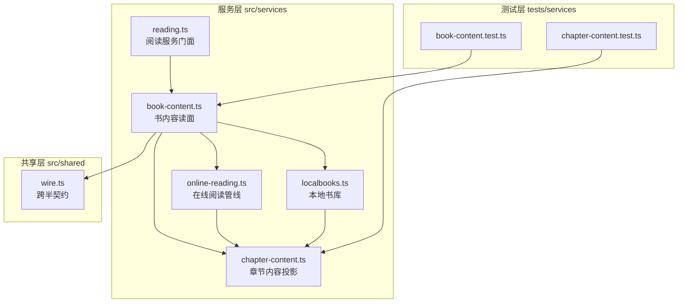
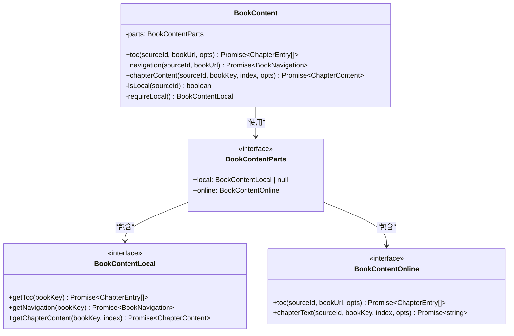
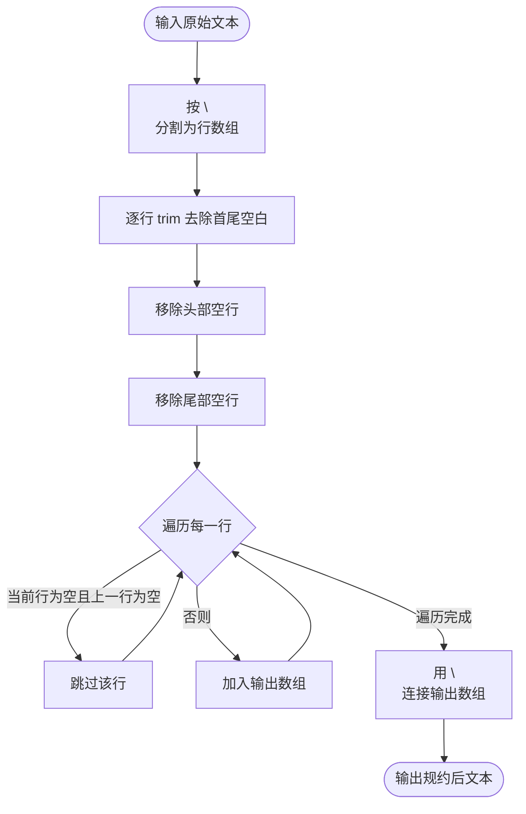
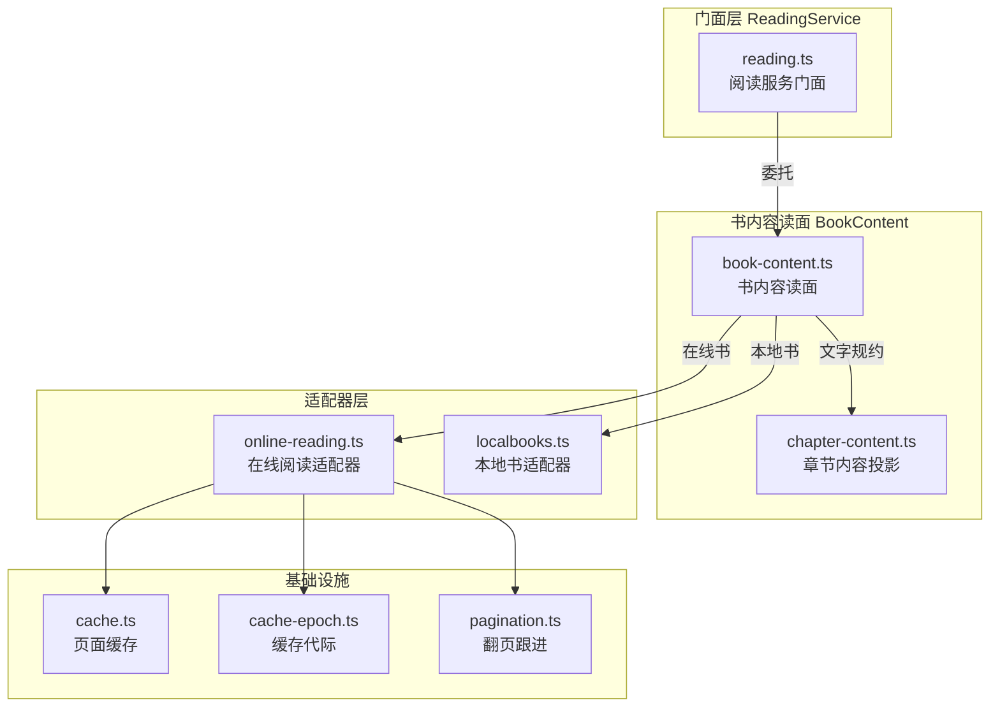
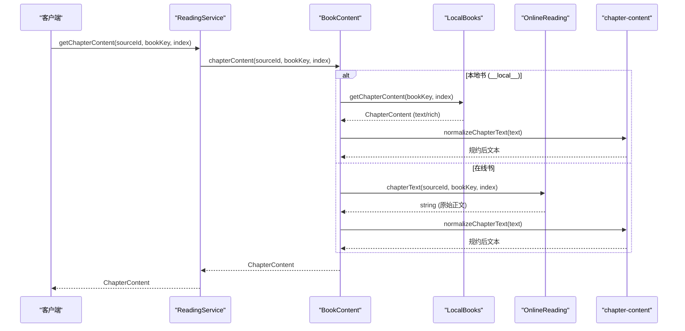
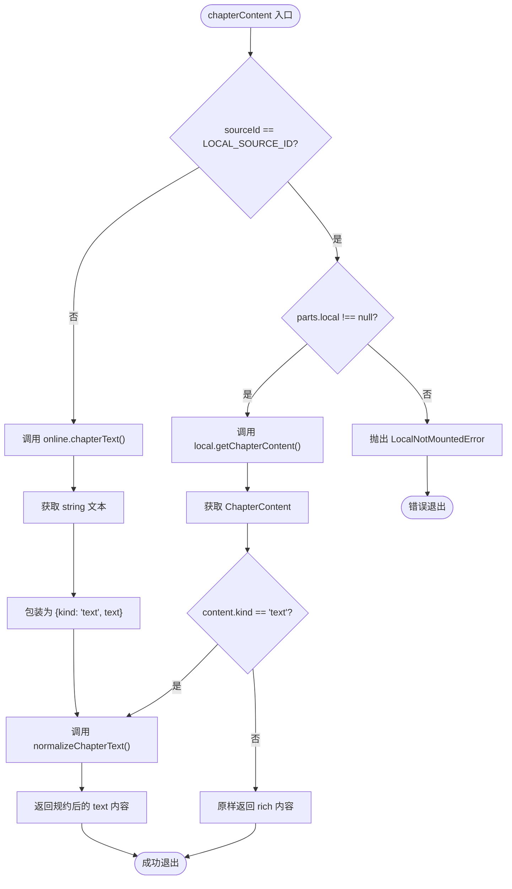
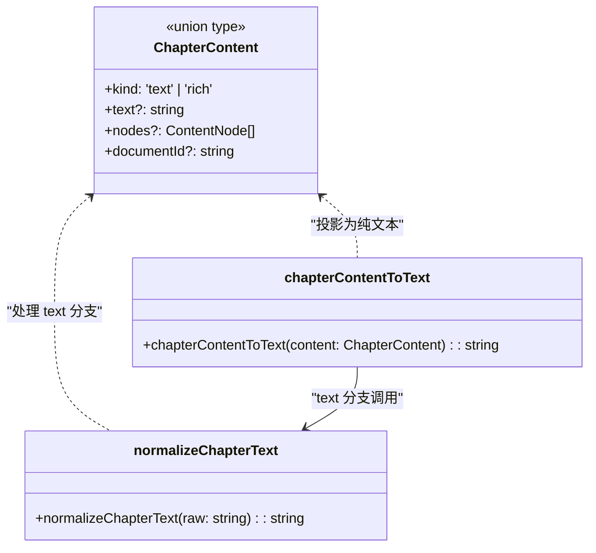
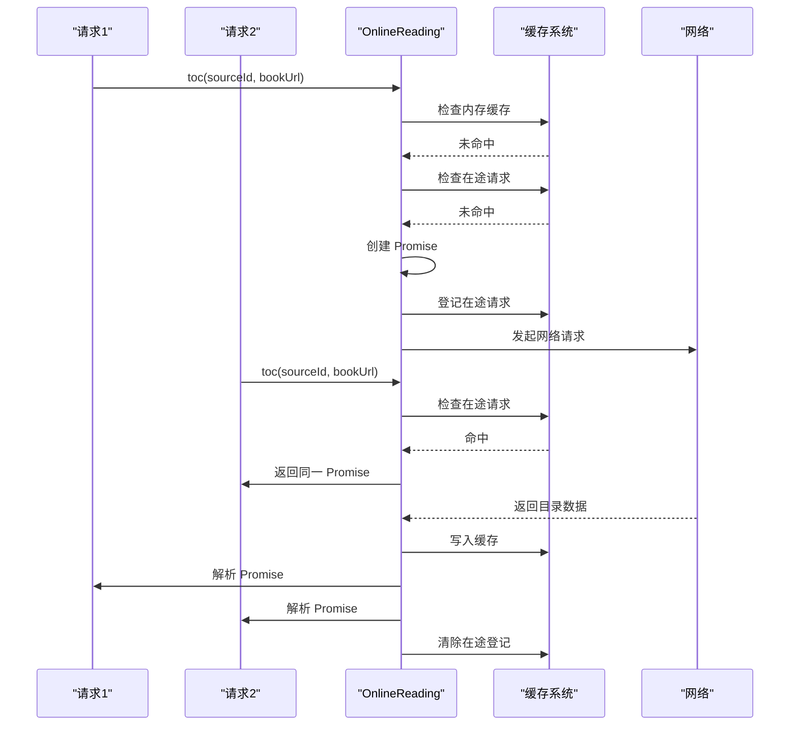
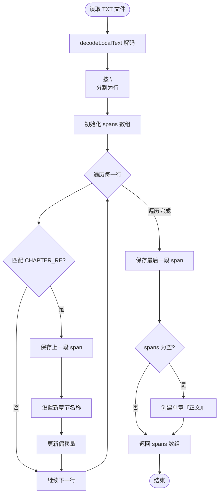
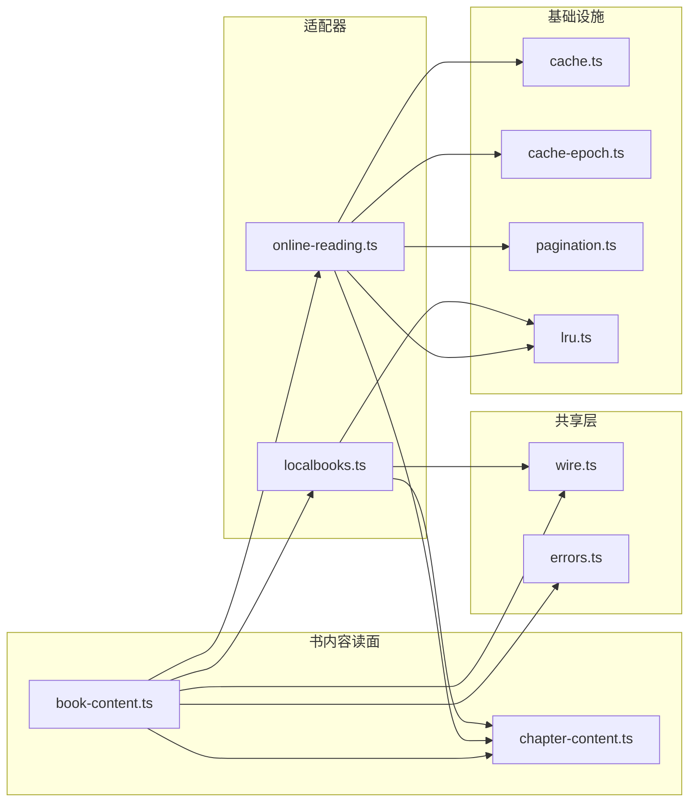

# 书内容读面模块

<cite>
**Referenced Files in This Document **
- [book-content.ts](file://src/services/book-content.ts)
- [chapter-content.ts](file://src/services/chapter-content.ts)
- [reading.ts](file://src/services/reading.ts)
- [online-reading.ts](file://src/services/online-reading.ts)
- [localbooks.ts](file://src/services/localbooks.ts)
- [wire.ts](file://src/shared/wire.ts)
- [errors.ts](file://src/services/errors.ts)
- [0047-book-content-module.md](file://docs/adr/0047-book-content-module.md)
- [0043-online-reading-module.md](file://docs/adr/0043-online-reading-module.md)
- [book-content.test.ts](file://tests/services/book-content.test.ts)
- [chapter-content.test.ts](file://tests/services/chapter-content.test.ts)
</cite>

## Table of Contents
1. [引言](#引言)
2. [项目结构](#项目结构)
3. [核心组件](#核心组件)
4. [架构概览](#架构概览)
5. [详细组件分析](#详细组件分析)
6. [依赖分析](#依赖分析)
7. [性能考量](#性能考量)
8. [故障排除指南](#故障排除指南)
9. [结论](#结论)

## 引言

书内容读面模块（`BookContent`）是阅读系统中负责目录、导航与正文读取的**唯一业务入口**。该模块的设计目标是统一本地 TXT/EPUB 与在线内容的文字规约出口，消除 `ReadingService` 门面中三处读动词（`getToc`、`getNavigation`、`getChapterContent`）的重复分流逻辑。

在 ADR 0047 之前，本地书与在线书的分流逻辑散落在门面的三个读动词中，且正文文字规约仅应用于在线阅读路径，导致本地 TXT 文件的 CRLF 换行符与连续空行会原样传递给导出功能与 AI 工具。通过将分流逻辑与文字规约收口到 `BookContent` 模块，系统实现了以下目标：

- **单一职责**：目录、导航与正文的本地/在线分流只在一处实现
- **统一规约**：本地 TXT 与在线正文使用同一份行规约算法，确保输出一致性
- **边界清晰**：门面层保留跨面动词（搜索、发现、书架等），内容读取完全委托给本模块

## 项目结构

**Diagram sources **
- [book-content.ts:1-80](file://src/services/book-content.ts#L1-L80)
- [reading.ts:856-888](file://src/services/reading.ts#L856-L888)
- [online-reading.ts:1-50](file://src/services/online-reading.ts#L1-L50)
- [localbooks.ts:1-50](file://src/services/localbooks.ts#L1-L50)

**Section sources**
- [book-content.ts:1-80](file://src/services/book-content.ts#L1-L80)
- [reading.ts:1-100](file://src/services/reading.ts#L1-L100)
- [0047-book-content-module.md:1-24](file://docs/adr/0047-book-content-module.md#L1-L24)

## 核心组件

### BookContent 类

`BookContent` 是书内容读面的核心类，它通过适配器模式整合本地书与在线书两种内容来源。该类不拥有取数语义，仅负责按来源分流与文字规约。

#### 接口定义

**Diagram sources **
- [book-content.ts:20-80](file://src/services/book-content.ts#L20-L80)

#### 关键方法

**目录读取（toc）**
- 本地书：调用 `LocalBooks.getToc()` 读取持久化目录
- 在线书：调用 `OnlineReading.toc()` 走缓存优先、在途去重、翻页跟进的管线
- 所有读动词均为异步，将分流逻辑与「本地书未挂载」的抛错收成 rejection

**导航读取（navigation）**
- 本地 EPUB：读取原生 nav/NCX 导航树
- 其他情况：按线性目录派生平面树（派生单点在 `wire.ts` 的 `planarNavigation`）

**章节正文读取（chapterContent）**
- 返回图文面数据（`ChapterContent`）
- text 类型一律经过 `normalizeChapterText` 进行行规约
- rich 类型（EPUB）原样通过，不解释结构

**Section sources**
- [book-content.ts:38-75](file://src/services/book-content.ts#L38-L75)

### normalizeChapterText 函数

这是正文文字的行规约函数，是本地 TXT 与在线正文的共同出口契约。该函数具有以下特性：

- **幂等性**：对已规约文本重复处理无害
- **逐行 trim**：去除每行首尾空白
- **去首尾空行**：移除开头和结尾的空行
- **折叠连续空行**：相邻空行合并为一个
- **不解释标签**：尖括号、实体串、行内空白原样保留

**Diagram sources **
- [chapter-content.ts:62-72](file://src/services/chapter-content.ts#L62-L72)

**Section sources**
- [chapter-content.ts:62-72](file://src/services/chapter-content.ts#L62-L72)
- [book-content.test.ts:42-46](file://tests/services/book-content.test.ts#L42-L46)

## 架构概览

### 整体架构

**Diagram sources **
- [reading.ts:130-180](file://src/services/reading.ts#L130-L180)
- [book-content.ts:15-80](file://src/services/book-content.ts#L15-L80)

### 数据流向

**Diagram sources **
- [reading.ts:886-888](file://src/services/reading.ts#L886-L888)
- [book-content.ts:58-68](file://src/services/book-content.ts#L58-L68)
- [online-reading.ts:120-180](file://src/services/online-reading.ts#L120-L180)

## 详细组件分析

### BookContent 类的分流逻辑

`BookContent` 通过 `isLocal()` 方法判断来源，该方法检查 `sourceId` 是否等于 `LOCAL_SOURCE_ID`（`__local__`）。这是一个关键的边界判据：

- **来源展示判据**：门面的 `sourceNameOf`、书架的本地筛选仍按 `LOCAL_SOURCE_ID` 判来源身份，这是呈现层事实
- **内容读取分流**：`BookContent` 内部的分流是业务逻辑，两者不应混淆

当本地书服务未挂载时（`parts.local === null`），调用本地书相关方法会抛出 `LocalNotMountedError`，该错误在 API 层映射为 503 Unavailable。

**Diagram sources **
- [book-content.ts:58-75](file://src/services/book-content.ts#L58-L75)
- [errors.ts:98-105](file://src/services/errors.ts#L98-L105)

**Section sources**
- [book-content.ts:38-80](file://src/services/book-content.ts#L38-L80)
- [errors.ts:98-105](file://src/services/errors.ts#L98-L105)

### 文字规约的唯一实现

`chapter-content.ts` 中的 `normalizeChapterText` 是文字规约的唯一实现点。这种设计避免了多处实现导致的漂移问题。

#### 规约规则

1. **逐行 trim**：去除每行首尾空白字符
2. **去首尾空行**：移除结果开头和结尾的空行
3. **折叠连续空行**：相邻的空行合并为一个空行
4. **保留标签**：不解释尖括号，不把 `&amp;` 解成实体
5. **幂等性**：对已规约文本再次处理结果不变

#### 为什么需要唯一实现

文字面（`getChapter` 的返回、TXT 导出、AI 工具）与图文面（阅读器）是同一批内容的两个出口。如果各写一份投影，同一本书的导出与 AI 读到的正文就会分叉。通过唯一实现，确保了：

- 本地 TXT 与在线正文使用同一份行规约
- 导出功能与 AI 工具读取到的正文格式一致
- 避免维护多份规约逻辑导致的同步问题

**Diagram sources **
- [chapter-content.ts:50-72](file://src/services/chapter-content.ts#L50-L72)
- [wire.ts:400-450](file://src/shared/wire.ts#L400-L450)

**Section sources**
- [chapter-content.ts:50-72](file://src/services/chapter-content.ts#L50-L72)
- [chapter-content.test.ts:28-35](file://tests/services/chapter-content.test.ts#L28-L35)

### OnlineReading 适配器

`OnlineReading` 是在线阅读的适配器实现，负责在线书的目录与正文读取。它实现了 `BookContentOnline` 接口，提供以下能力：

- **缓存优先**：进程内缓存 + 磁盘缓存
- **在途去重**：同源同书同代际的请求共享同一Promise
- **翻页跟进**：支持多页串接的正文提取
- **代际管理**：规则变更时自动失效旧缓存

#### 目录在途去重机制

目录读取使用 `tocReadKey` 生成唯一键，该键包含源ID、书URL、代际和刷新标志。相同身份的并发请求会 join 到同一个 Promise，避免重复抓取。

**Diagram sources **
- [online-reading.ts:55-110](file://src/services/online-reading.ts#L55-L110)

**Section sources**
- [online-reading.ts:1-120](file://src/services/online-reading.ts#L1-L120)

### LocalBooks 适配器

`LocalBooks` 是本地书的适配器实现，负责 TXT 与 EPUB 文件的解析与读取。它实现了 `BookContentLocal` 接口，提供以下能力：

- **TXT 解码链**：BOM 优先 → UTF-8 严格探测 → GBK 回退
- **章节切分**：按标题行正则切分章节
- **EPUB 解析**：复用导入层的索引类型
- **资源读取**：提供文件流与 MIME 类型

#### TXT 章节切分

使用 `CHAPTER_RE` 正则匹配章节标题行，包括：
- 第X章/卷/回/节/集/部/篇（中文数字含大写）
- 序章、楔子、番外、尾声、后记
- Chapter N（英文格式）

**Diagram sources **
- [localbooks.ts:30-60](file://src/services/localbooks.ts#L30-L60)

**Section sources**
- [localbooks.ts:1-100](file://src/services/localbooks.ts#L1-L100)

## 依赖分析

### 模块依赖关系

**Diagram sources **
- [book-content.ts:1-10](file://src/services/book-content.ts#L1-L10)
- [online-reading.ts:1-20](file://src/services/online-reading.ts#L1-L20)
- [localbooks.ts:1-15](file://src/services/localbooks.ts#L1-L15)

### 外部依赖

- **iconv-lite**：用于 GBK 编码解码（本地 TXT 回退方案）
- **node:fs**：文件系统操作
- **node:crypto**：UUID 生成

**Section sources**
- [book-content.ts:1-5](file://src/services/book-content.ts#L1-L5)
- [localbooks.ts:1-10](file://src/services/localbooks.ts#L1-L10)

## 性能考量

### 缓存策略

`BookContent` 本身不维护缓存，而是委托给底层适配器：

- **OnlineReading**：使用进程内 LRU 缓存（上限8个目录）+ 磁盘缓存
- **LocalBooks**：使用 LRU 缓存同时顾及多本本地书（上限3本）

### 内存优化

- **目录内存缓存**：`TOC_MEMO_LIMIT = 8`，读一本留几本给换书/返回
- **本地书缓存**：`MAX_CACHED_BOOKS = 3`，正文全文与元数据两张表各按此数收

### 文字规约性能

`normalizeChapterText` 的时间复杂度为 O(n)，其中 n 为文本行数。由于采用逐行处理，空间复杂度也为 O(n)。该函数的幂等性允许重复调用而不产生额外开销。

## 故障排除指南

### 常见问题

#### 1. LocalNotMountedError

**现象**：调用本地书相关方法时抛出 `LocalNotMountedError`

**原因**：`BookContent` 构造时 `parts.local` 为 `null`，表示本地书服务未挂载

**解决方案**：
- 检查 `ReadingService.from()` 调用时是否传入了 `local` 参数
- 确认 `LocalBooks.create()` 成功执行

**Section sources**
- [errors.ts:98-105](file://src/services/errors.ts#L98-L105)
- [book-content.ts:72-75](file://src/services/book-content.ts#L72-L75)

#### 2. 文字规约不一致

**现象**：导出的 TXT 文件与阅读器显示的正文格式不同

**原因**：可能存在多处文字规约实现，或某条路径未经过 `normalizeChapterText`

**解决方案**：
- 确认所有 text 类型的 `ChapterContent` 都经过 `normalizeChapterText` 处理
- 检查是否有代码直接操作原始文本而绕过规约函数

**Section sources**
- [chapter-content.ts:62-72](file://src/services/chapter-content.ts#L62-L72)
- [book-content.ts:77-79](file://src/services/book-content.ts#L77-L79)

#### 3. 目录缓存未更新

**现象**：规则变更后，目录仍返回旧数据

**原因**：缓存代际未正确更新

**解决方案**：
- 确认 `rulesEpoch` 在规则变更后正确计算
- 检查 `tocReadKey` 是否包含代际参数

**Section sources**
- [online-reading.ts:35-45](file://src/services/online-reading.ts#L35-L45)
- [cache-epoch.ts:1-50](file://src/services/cache-epoch.ts#L1-L50)

### 调试技巧

#### 测试用例参考

`book-content.test.ts` 提供了完整的测试用例，覆盖以下场景：
- 本地 TXT 与在线正文的文字规约一致性
- 本地 rich 内容原样通过
- 目录与导航的分流逻辑
- 本地书未挂载的错误处理
- refresh 参数的透传行为

**Section sources**
- [book-content.test.ts:1-96](file://tests/services/book-content.test.ts#L1-L96)

## 结论

书内容读面模块（`BookContent`）通过适配器模式成功统一了本地书与在线书的内容读取逻辑，实现了以下核心价值：

1. **单一职责**：目录、导航与正文的分流逻辑集中在一处，消除了门面层的重复代码
2. **统一规约**：本地 TXT 与在线正文使用同一份行规约算法，确保输出一致性
3. **边界清晰**：模块只负责分流与规约，不拥有取数语义，保持了良好的关注点分离
4. **可测试性**：通过接口抽象，适配器的逻辑可以独立测试，无需拼凑整部门面部件

该模块的设计遵循了 ADR 0047 的决策，取代了之前的 ADR 0043，为阅读系统提供了更加清晰和可维护的内容读取架构。

**Section sources**
- [0047-book-content-module.md:1-24](file://docs/adr/0047-book-content-module.md#L1-L24)
- [0043-online-reading-module.md:1-16](file://docs/adr/0043-online-reading-module.md#L1-L16)