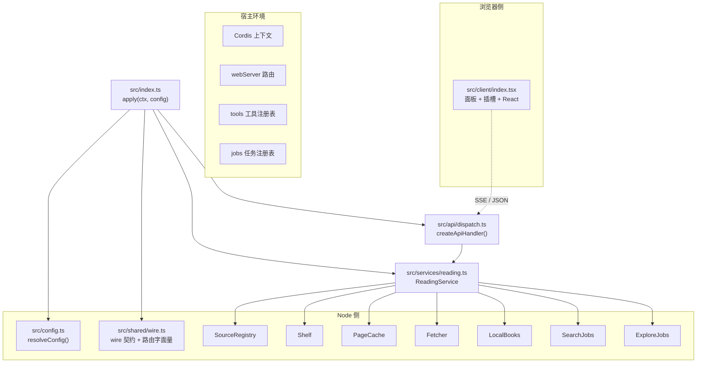
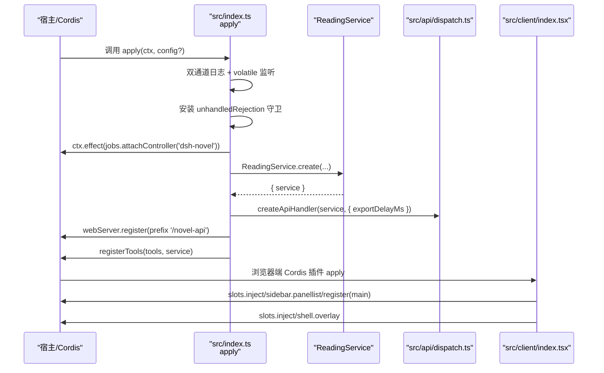
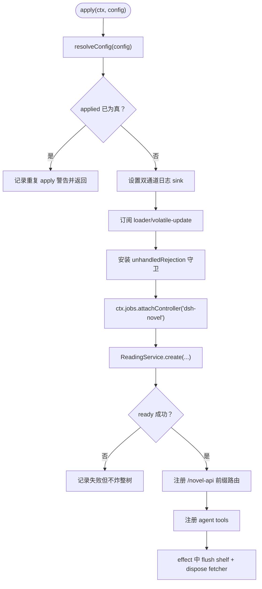
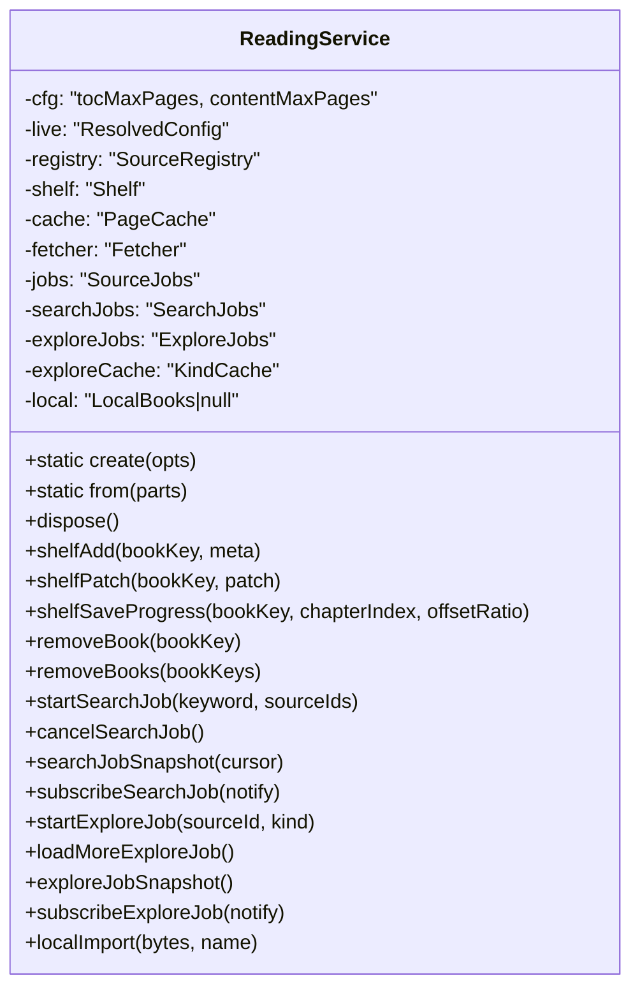
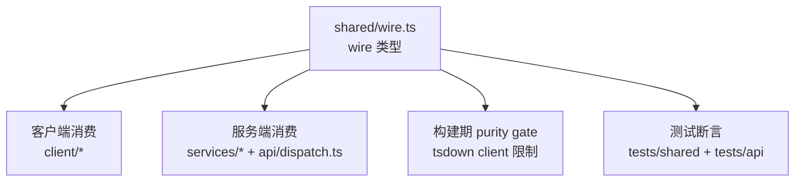
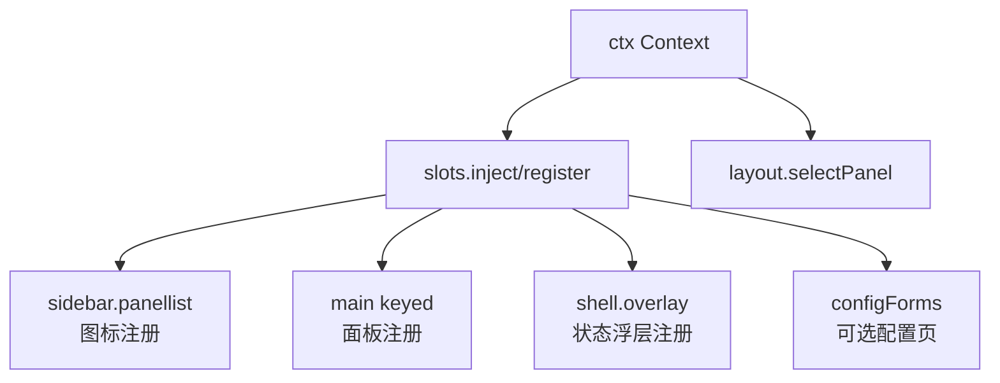
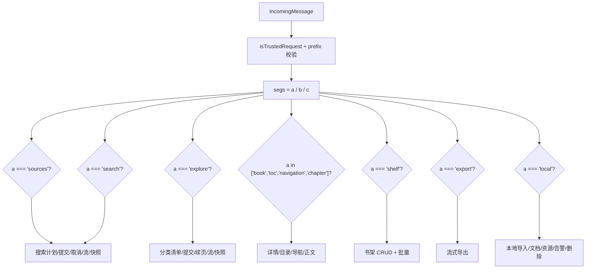
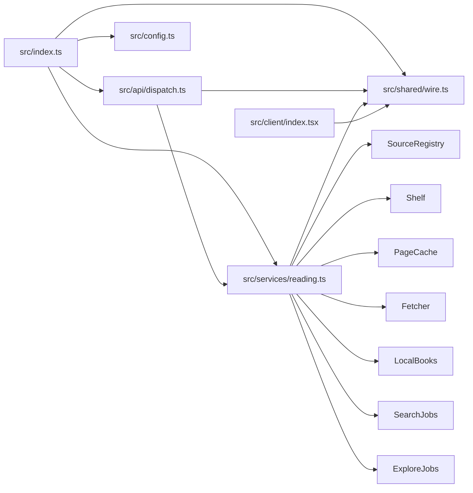

# 核心模块详解

<cite>
**本文引用的文件**   
- [src/index.ts](file://src/index.ts)
- [src/services/reading.ts](file://src/services/reading.ts)
- [src/shared/wire.ts](file://src/shared/wire.ts)
- [src/config.ts](file://src/config.ts)
- [src/client/index.tsx](file://src/client/index.tsx)
- [src/api/dispatch.ts](file://src/api/dispatch.ts)
</cite>

## 目录
1. [引言](#引言)
2. [项目结构](#项目结构)
3. [核心组件](#核心组件)
4. [架构总览](#架构总览)
5. [详细组件分析](#详细组件分析)
6. [依赖关系分析](#依赖关系分析)
7. [性能考量](#性能考量)
8. [故障排查指南](#故障排查指南)
9. [结论](#结论)
10. [附录：常见调用与扩展约定](#附录常见调用与扩展约定)

## 引言
本文件围绕 dsh-novel 的五个核心模块展开，目标是让读者在不深入源码的情况下理解：插件如何接入 Cordis、业务门面如何组织生命周期、跨半契约如何约束 Node 与浏览器两侧、配置如何从 schema 校验落到活配置、前端如何注册面板并渲染，以及 HTTP 路由如何把请求分发到 ReadingService。文档同时给出组合根（组合装配）约定和测试覆盖线索，帮助扩展新模块时遵循既有纪律。

## 项目结构
dsh-novel 采用“入口 → 门面服务 → 子服务 + 共享契约”的分层结构：

- `src/index.ts`：Cordis 插件入口，负责日志缝、代理热更、ReadingService 异步初始化、API 路由与工具挂载。
- `src/services/reading.ts`：阅读链路门面 ReadingService，持有 SourceRegistry、Shelf、PageCache、Fetcher、SearchJobs、ExploreJobs、LocalBooks 等持有者。
- `src/shared/wire.ts`：Node 与浏览器两侧的 wire 契约与路由字面量，承担构建期 client 纯度门禁。
- `src/config.ts`：以字段表驱动的 schema 校验与 ResolvedConfig 活配置生成器。
- `src/client/index.tsx`：浏览器端 Cordis 插件入口，注册全局面板、状态浮层与可选配置页。
- `src/api/dispatch.ts`：/novel-api 前缀的路由分发器，把 35 条路由映射到 ReadingService 动词。

**图表来源**
- [src/index.ts:1-242](file://src/index.ts#L1-L242)
- [src/services/reading.ts:1-250](file://src/services/reading.ts#L1-L250)
- [src/shared/wire.ts:1-250](file://src/shared/wire.ts#L1-L250)
- [src/config.ts:1-137](file://src/config.ts#L1-L137)
- [src/client/index.tsx:1-110](file://src/client/index.tsx#L1-L110)
- [src/api/dispatch.ts:1-120](file://src/api/dispatch.ts#L1-L120)

**章节来源**
- [src/index.ts:1-242](file://src/index.ts#L1-L242)
- [src/services/reading.ts:1-250](file://src/services/reading.ts#L1-L250)
- [src/shared/wire.ts:1-250](file://src/shared/wire.ts#L1-L250)
- [src/config.ts:1-137](file://src/config.ts#L1-L137)
- [src/client/index.tsx:1-110](file://src/client/index.tsx#L1-L110)
- [src/api/dispatch.ts:1-120](file://src/api/dispatch.ts#L1-L120)

## 核心组件
本节概述六个关键构件的职责、对外接口、关键数据结构、生命周期与测试覆盖。

| 模块 | 职责 | 主要对外接口 | 关键数据或结构 | 生命周期要点 | 测试覆盖线索 |
|---|---|---|---|---|---|
| 主入口 `src/index.ts` | 装配 Cordis 插件、日志双通道、代理热更、ReadingService 启动、/novel-api 路由与 agent tools 挂载 | `name`、`inject`、`apply(ctx, config?)` | NovelContext 窄镜像、applied 标志、afterReady 闭包 | 先装日志与 unhandledRejection 守卫；ready 失败不炸树；dispose 时 flush shelf 并关闭 fetcher | [tests/index.test.ts](file://tests/index.test.ts) |
| 阅读门面 `src/services/reading.ts` | 聚合搜索、分类浏览、书架、本地书、源管理、导出与登录流程的门面 | `create()`、`from()`、`shelfAdd/patch/saveProgress/removeBook(s)`、`startSearchJob/cancelSearchJob/searchJobSnapshot/subscribeSearchJob`、`explore*`、`localImport*` | registry/shelf/cache/fetcher/searchJobs/exploreJobs/local 持有者；DEFAULT_SEARCH_PARALLEL、DEFAULT_JS_BUDGET_MS | create 建目录并加载部件；from 接受已构造部件；dispose 关闭 fetcher；flush 卸载时落盘 | [tests/services/reading.test.ts](file://tests/services/reading.test.ts)、[tests/services/reading-text.test.ts](file://tests/services/reading-text.test.ts)、[tests/services/reading-explore.test.ts](file://tests/services/reading-explore.test.ts) |
| 跨半契约 `src/shared/wire.ts` | 定义 API 值形状、错误信封、路由段字面量、NOVEL_API_PREFIX、ROUTES/SEG/paramRoutes | `ROUTES.*`、`SEG.*`、`NOVEL_API_PREFIX`、`hasProgress`、`planarNavigation`、`pickShelfMeta` 等纯函数 | SearchHit/SearchGroup/ExploreSnapshot/ChapterContent/BookNavigation/ShelfBook 等 | 无运行时依赖，被 client 与 server 共同 import；构建期 purity gate 禁止 Node 内建与平台模块 | [tests/shared/wire-builders.test.ts](file://tests/shared/wire-builders.test.ts)、[tests/api/wire.test.ts](file://tests/api/wire.test.ts) |
| 配置体系 `src/config.ts` | 以 CONFIG_FIELDS 驱动 schema 校验与 ResolvedConfig 活配置 | `Config`、`resolveConfig(raw?)` | VolatileConfigFieldName、NovelConfig、ResolvedConfig | resolveConfig 对 ref 输入走快路径；返回 getter 对象；dataDir 非 volatile | [tests/config.test.ts](file://tests/config.test.ts)、[tests/services/live-config.test.ts](file://tests/services/live-config.test.ts) |
| 前端入口 `src/client/index.tsx` | 注册 sidebar.panellist 与 main keyed 槽、shell.overlay 常驻状态层、可选 configForms | `apply(ctx)`、`NovelStatusOverlay`、`NovelView` | NOVEL_PANEL_ID='novel' | 同批注册 sidebar 图标与 main 面板；effect 中注入 shell.overlay；可选 inject configForms | [tests/client/panel-registration.test.tsx](file://tests/client/panel-registration.test.tsx)、[tests/client/config-page-old-host.test.tsx](file://tests/client/config-page-old-host.test.tsx)、[tests/client/smoke.test.tsx](file://tests/client/smoke.test.tsx) |
| 路由分发 `src/api/dispatch.ts` | /novel-api 前缀下的 35 条路由解析、参数校验、SSE 流、流式导出 | `createApiHandler(service, opts)` | SSE_HEADERS、ApiHandlerOptions | 首层 isTrustedRequest；BodyShapeError 转 BadRequest；export 流背压与 close 中断；资源流销毁 | [tests/api/dispatch-*.test.ts](file://tests/api/dispatch-reading.test.ts)、[tests/api/routes.test.ts](file://tests/api/routes.test.ts) |

**章节来源**
- [src/index.ts:1-242](file://src/index.ts#L1-L242)
- [src/services/reading.ts:1-250](file://src/services/reading.ts#L1-L250)
- [src/shared/wire.ts:1-250](file://src/shared/wire.ts#L1-L250)
- [src/config.ts:1-137](file://src/config.ts#L1-L137)
- [src/client/index.tsx:1-110](file://src/client/index.tsx#L1-L110)
- [src/api/dispatch.ts:1-120](file://src/api/dispatch.ts#L1-L120)

## 架构总览
下图展示 Cordis 装载期到运行期的控制流：入口在 apply 中完成日志、unhandledRejection 守卫、jobs controller、ReadingService 异步 ready、/novel-api 路由与 agent tools 两条 effect 注册；浏览器端通过 slots 注册全局面板与状态浮层。

**图表来源**
- [src/index.ts:60-242](file://src/index.ts#L60-L242)
- [src/api/dispatch.ts:40-120](file://src/api/dispatch.ts#L40-L120)
- [src/client/index.tsx:60-110](file://src/client/index.tsx#L60-L110)

## 详细组件分析

### 主入口 `src/index.ts`：apply 装配流程与 Cordis 生命周期

#### 职责
- re-export `Config`、`NovelConfig`、`ResolvedConfig`，使 Cordis 装载期能拿到类型与 `apply`。
- 建立 console 与 ctx.logger 的双通道日志 sink，并在 effect 中复位。
- 订阅 `loader/volatile-update`，仅对 proxyUrl 变更重算代理地址。
- 安装 Node 脚本 unhandledRejection 常驻防线，防止沙箱 Promise rejection 导致进程退出。
- 向宿主 jobs 注册 global layer controller，避免本机 profile 下后台任务被拒。
- 异步启动 ReadingService：创建数据目录、计算代理、加载 SourceRegistry/Shelf/PageCache/LocalBooks。
- 在 ready 成功后注册 `/novel-api` 前缀路由与 agent tools。
- 在 dispose 时 flush shelf 并关闭 fetcher dispatcher。

#### 关键流程

**图表来源**
- [src/index.ts:60-242](file://src/index.ts#L60-L242)

#### 生命周期语义
- `applied` 标记防止同一实例重复注册；dispose effect 会复位，使 cordis unload/load 后新实例可注册。
- afterReady 闭包统一处理“等待 ready、取消、attach 返回 disposer、finally 复位 applied”，避免路由与工具两条 effect 各自维护时序。
- 日志 sink 与 unhandledRejection 守卫必须在脚本执行之前挂好，否则旧实例 logger 残留或沙箱异常不可观测。

**章节来源**
- [src/index.ts:1-242](file://src/index.ts#L1-L242)

### 阅读门面 `src/services/reading.ts`：ReadingService 持有者与语义

#### 职责
- 作为 HTTP API、agent 工具与 UI 三个面的唯一业务入口。
- 封装规则求值、抓取、缓存、书架、本地书、搜索、分类浏览、导出与登录。
- 提供 `create` 与 `from` 两种装配方式：前者面向生产，后者面向测试直装部件。

#### 关键持有者语义
- `registry`：SourceRegistry，持久化与查询书源；凭据红线，外部不得直接访问 raw/rules/auth。
- `shelf`：Shelf，书架条目与进度读写，带防抖落盘。
- `cache`：PageCache，页面级缓存，容量由活配置 live.cacheMaxBytes 驱动。
- `fetcher`：Fetcher，出站抓取与代理连接池；dispose 由组合根在卸载时调用。
- `jobs`：SourceJobs，导入与批量验证任务，单任务槽互斥。
- `searchJobs`：SearchJobs，聚合搜索后台持有者，读任务槽。
- `exploreJobs`：ExploreJobs，分类浏览后台持有者，读任务槽。
- `exploreCache`：KindCache，逐源分类快照，一份实例服务全部轮次。
- `local`：LocalBooks，本地 TXT/EPUB 导入与资源读取，删除书时连带清理文件。

**图表来源**
- [src/services/reading.ts:100-250](file://src/services/reading.ts#L100-L250)

#### 构造与装配
- `create`：主动创建数据目录，按 opts.config 或 staticLiveConfig 组装 ResolvedConfig，再调用 `from`。
- `from`：校验 searchParallel，组装 SourceJobs/SearchJobs/ExploreJobs，传入 jobHost 窄面；未传 jobHost 则不登记宿主任务。

#### 常见调用方式
- 生产装配：由 src/index.ts 调用 ReadingService.create，传入 dir、resolved、proxyUrl、jobHost。
- 测试装配：由 tests 调用 ReadingService.from，注入内存 registry、确定性 fetcher、内存 shelf。
- 书架加书：`service.shelfAdd(bookKey, { title, sourceId, ...meta })`。
- 保存进度：`service.shelfSaveProgress(bookKey, chapterIndex, offsetRatio)`。
- 搜索：`service.startSearchJob(keyword, sourceIds)`，随后用 `searchJobSnapshot` 或 `subscribeSearchJob` 拉取进度。
- 分类浏览：`service.startExploreJob(sourceId, kind)`，续页用 `loadMoreExploreJob`，快照用 `exploreJobSnapshot`。
- 本地导入：`await service.localImport(bytes, name)`。

**章节来源**
- [src/services/reading.ts:1-250](file://src/services/reading.ts#L1-L250)
- [src/services/reading.ts:201-450](file://src/services/reading.ts#L201-L450)

### 跨半契约 `src/shared/wire.ts`：wire 类型与构建期 client 纯度门禁

#### 职责
- 定义 Node 与浏览器两侧共用的值形状：书源公开投影、探针结果、任务状态、搜索命中与分组、分类浏览快照、章节正文、目录导航、书架元数据、本地导入回执等。
- 集中路由段字面量 SEG、静态路由表 ROUTES、/novel-api 前缀 NOVEL_API_PREFIX。
- 提供纯函数 hasProgress、planarNavigation、pickShelfMeta，供两端复用。
- 禁引运行时依赖，保证 tsdown 构建期 client 纯度门能通过。

#### 关键类型分组
- 身份与状态：SourceStatus、SourceContentKind、ProbeErrorCode、LOCAL_SOURCE_ID。
- 任务与探针：JobState、JobIssue、ProbeResult。
- 阅读与搜索：SearchHit、SearchGroup、MergedBook、SearchJobSnapshot、SearchPlan。
- 分类浏览：ExploreSources、ExploreBook、ExploreSnapshot。
- 正文与目录：ChapterContent、ContentTag、LinkRole、ContentNode、NavigationItem、BookNavigation。
- 书架：ShelfProgress、ShelfBook、ShelfEntry、ShelfMetaPatch、SHELF_META。
- 本地书：LocalImportWarning、LocalImportResponse。
- 错误与信封：ApiErrorBody、ApiEnvelope<T>。

#### 路由与常量
- NOVEL_API_PREFIX = '/novel-api'。
- SEG 包含 sources/search/explore/book/toc/chapter/navigation/shelf/export/local/document/resource 等段。
- ROUTES 声明 30 条静态路由；另有 paramRoutes 承载参数路由；总计 35 条。

**图表来源**
- [src/shared/wire.ts:1-250](file://src/shared/wire.ts#L1-L250)

**章节来源**
- [src/shared/wire.ts:1-836](file://src/shared/wire.ts#L1-L836)

### 配置体系 `src/config.ts`：schema 校验与 ResolvedConfig 活配置

#### 设计原则
- 所有配置字段集中在 CONFIG_FIELDS：字段名 × 默认值 × 值域 × 是否 volatile。
- 新增字段只需加一行，避免在 Schema、输入类型、输出类型、读数面多处复制。
- 数值位使用 numberField，强制整数与下界；textField 用于 dataDir 等非 volatile 字段；proxyField 匹配 direct 或 http(s) 地址。
- 通过 maybeVolatile 兼容旧 schemastery 版本；volatile 字段才挂 .volatile()。

#### 关键类型
- NovelConfig：用户原始配置，字段可选。
- ResolvedConfig：只读 getter 视图，volatile 字段每次读当前 ref。
- VolatileConfigFieldName：可从配置页编辑的字段集合。
- OptionalFieldKey / MandatoryFieldKey：区分 dataDir/proxyUrl 等可缺席字段与其他必填字段。

#### 生命周期
- resolveConfig 对含 volatile ref 的输入走快路径，不再跑 schema 值域校验——宿主写入时已校验。
- 返回的对象属性都是 getter，读的是 out[name] 当前值，未显式赋值时回退 CONFIG_FIELDS[name].default。
- dataDir 非 volatile：改它等价于重启；proxyUrl 是 volatile，热更会触发入口处的代理重算日志。

**章节来源**
- [src/config.ts:1-137](file://src/config.ts#L1-L137)

### 前端入口 `src/client/index.tsx`：面板注册、插槽挂载与 React 渲染入口

#### 职责
- 将“小说”注册为全局面板：sidebar.panellist 图标行 + main keyed 中央面板。
- 注册 shell.overlay 常驻状态层，用于在任何面板显示任务读数与跳转。
- 可选注册 configForms 配置页；旧宿主没有该能力时不抛错。
- 提供 translate 入口，locale 缺失时回退 zhTranslate。

#### 面板注册顺序
1. 从 ctx.slots 窄镜像出 inject/register。
2. 用 ctx.layout.selectPanel 打开面板（宿主负责选中态）。
3. 同 id/key 'novel' 在 sidebar.panellist 与 main 中成对注册。
4. 在 shell.overlay 中注册 NovelStatusOverlay，并把 t 注入进去。
5. 可选 inject(['configForms'], ...) 注册配置页。

**图表来源**
- [src/client/index.tsx:1-110](file://src/client/index.tsx#L1-L110)

**章节来源**
- [src/client/index.tsx:1-110](file://src/client/index.tsx#L1-L110)

### 路由分发 `src/api/dispatch.ts`：35 条路由策略

#### 总体策略
- 首层校验可信来源 with isTrustedRequest。
- 校验 pathname 以 NOVEL_API_PREFIX 开头。
- 将 rest 拆分为 segs[a,b,c]，按 a/b/c 三段分派。
- 所有 body 解析失败统一归 BodyShapeError → ApiError(400, BadRequest)。
- 所有方法非法归 methodNotAllowed；未知路径归 unknownRoute。
- SSE 流与流式导出都关注 res.close/destroyed/drain，避免死连接与背压阻塞。

#### 路由族
- sources：sources、import、job-status、batch-probe、probe、auth、enabled、batch-enabled、batch-delete。
- search：plan、job、job-cancel、job-stream、job-status。
- explore：kinds、list、list/more、list/job-status、list/job-stream。
- book/toc/navigation/chapter：书籍详情、目录、平面导航、章节正文。
- shelf：列表、PUT/:key、DELETE/:key、batch-delete。
- export：流式导出。
- local：import、document、warnings、resource、DELETE。

**图表来源**
- [src/api/dispatch.ts:120-495](file://src/api/dispatch.ts#L120-L495)
- [src/shared/wire.ts:470-836](file://src/shared/wire.ts#L470-L836)

#### 典型调用示例（以路径描述代替代码）
- 健康检查：GET /novel-api。
- 列出公开源：GET /novel-api/sources。
- 提交聚合搜索：POST /novel-api/search/job，body 含 keyword 与可选 sourceIds。
- 观察搜索流：GET /novel-api/search/job-stream?since=...。
- 获取书城分类清单：GET /novel-api/explore/kinds。
- 提交分类浏览：POST /novel-api/explore/list，body 含 sourceId 与 kind。
- 续页：POST /novel-api/explore/list/more。
- 查看书籍详情：GET /novel-api/book?sourceId=...&url=...。
- 获取目录：GET /novel-api/toc?sourceId=...&url=...&refresh=1。
- 获取章节正文：GET /novel-api/chapter?sourceId=...&url=...&index=N&refresh=1。
- 书架加书/补丁/进度：PUT /novel-api/shelf/:key。
- 删除书架项：DELETE /novel-api/shelf/:key。
- 流式导出：GET /novel-api/export?sourceId=...&url=...&title=...&from=...&to=...。
- 本地导入：POST /novel-api/local?name=...，body 为字节流。
- 读取本地补充文档：GET /novel-api/local/document?id=...&documentId=...。
- 读取本地资源：GET /novel-api/local/resource?id=...&resourceId=...。
- 删除本地书：DELETE /novel-api/local?id=...。

**章节来源**
- [src/api/dispatch.ts:1-573](file://src/api/dispatch.ts#L1-L573)

## 依赖关系分析

**图表来源**
- [src/index.ts:1-242](file://src/index.ts#L1-L242)
- [src/api/dispatch.ts:1-120](file://src/api/dispatch.ts#L1-L120)
- [src/services/reading.ts:1-250](file://src/services/reading.ts#L1-L250)
- [src/shared/wire.ts:1-250](file://src/shared/wire.ts#L1-L250)
- [src/client/index.tsx:1-110](file://src/client/index.tsx#L1-L110)

**章节来源**
- [src/index.ts:1-242](file://src/index.ts#L1-L242)
- [src/api/dispatch.ts:1-120](file://src/api/dispatch.ts#L1-L120)
- [src/services/reading.ts:1-250](file://src/services/reading.ts#L1-L250)
- [src/shared/wire.ts:1-250](file://src/shared/wire.ts#L1-L250)
- [src/client/index.tsx:1-110](file://src/client/index.tsx#L1-L110)

## 性能考量
- 聚合搜索并发数 searchParallel 有明确下界校验，避免批循环步长非法导致挂起；每轮重新读取 live.searchParallel，防止配置页热改造成批次重叠。
- jsTimeoutMs 与 searchTimeoutMs 是搜索与探针的统一耐心值，避免导入期与门面探针口径不一致。
- PageCache 容量由 live.cacheMaxBytes 动态决定，避免固定大小在低内存场景过度占用。
- /novel-api/export 流式导出根据 res.writableEnded/res.destroyed 与 drain 事件处理背压，并在浏览器关闭时 AbortController 中断后续章节。
- SSE 流 openJobStream 在 close 时退订，避免断连后仍攒帧。
- 代理连接池通过 ReadingService.dispose 在插件卸载时关闭，防止连接池跨越实例存活。

[本节为通用性能建议，不直接分析具体代码片段]

## 故障排查指南
- 重复启用：当 applied 已为真时，apply 会记录重复 apply 警告并跳过注册。若 HMR 或 cordis reload 后仍无法注册，确认 dispose effect 是否已将 applied 复位。
- 配置热更无效：dataDir 非 volatile，修改需重启；proxyUrl 是 volatile，但需要 Loader 推送 volatile-update 且 payload 中包含 proxyUrl 才会重算。
- 搜索挂死：检查 searchParallel 是否为正整数；入口 requireParallelStep 会在 from 装配期抛出 RangeError。
- 任务被拒：确保入口已调用 ctx.jobs.attachController('dsh-novel')；本机 profile 中宿主 tool-jobs disabled 时，这一句必须由插件自己挂。
- 沙箱脚本崩溃导致进程退出：入口安装的 unhandledRejection 守卫会捕获 vm realm 中 fire-and-forget Promise 的 rejection，避免 Node 20+ 致命行为。
- 路由 400：BodyShapeError 会被统一转为 BadRequest；确认 query 参数或 JSON body 是否符合 wire.readBodies 校验。
- 本地资源 404：资源 ID 查不到或文件不在都会发头之前抛错；注意资源流 close/error 事件会 destroy 流，避免 FileHandle 泄漏。

**章节来源**
- [src/index.ts:60-242](file://src/index.ts#L60-L242)
- [src/services/reading.ts:100-250](file://src/services/reading.ts#L100-L250)
- [src/api/dispatch.ts:120-495](file://src/api/dispatch.ts#L120-L495)

## 结论
dsh-novel 的核心以 ReadingService 为业务中心，src/index.ts 负责 Cordis 生命周期与外部装配，src/api/dispatch.ts 承担传输层路由，src/shared/wire.ts 提供跨半契约与构建期纯度门禁，src/config.ts 以字段表驱动 schema 与活配置，src/client/index.tsx 负责面板与插槽注册。扩展新模块时应遵循以下组合根约定：
- 新增 wire 类型放在 shared/wire.ts，保持两端共用。
- 新增配置字段在 CONFIG_FIELDS 加一行，并决定是否 volatile。
- 业务逻辑收敛到 ReadingService 动词，HTTP 与工具面不直接操作内部持有者。
- 路由只负责参数校验与信封，业务配方留在门面。
- 前端插槽注册必须同批完成，避免中间状态被宿主选中。

[本节总结不直接分析具体文件]

## 附录：常见调用与扩展约定

### 常见调用路径
- 组合根装配：  
  入口调用 ReadingService.create({ dir, config, proxyUrl, jobHost })，再由 src/index.ts 注册 /novel-api 与 tools。
- 测试装配：  
  使用 ReadingService.from({ registry, shelf, cache, fetcher, local, config, jobHost }) 注入内存实现。
- 书架加书：  
  service.shelfAdd(bookKey, { title, sourceId, ...meta })。
- 搜索：  
  service.startSearchJob(keyword, sourceIds) → subscribeSearchJob 或 searchJobSnapshot。
- 分类浏览：  
  service.startExploreJob(sourceId, kind) → loadMoreExploreJob / exploreJobSnapshot。
- 本地导入：  
  await service.localImport(bytes, name)。

### 扩展新模块的组合根约定
- 新增 Node 业务：优先增加 ReadingService 动词，保持外部只经门面。
- 新增 HTTP 路由：在 dispatch.ts 新增分支，参数校验放 wire.readBodies，错误统一 ApiError。
- 新增 wire 类型：放入 shared/wire.ts，并确保不被 client 引入 Node 内建模块。
- 新增配置：在 config.ts 的 CONFIG_FIELDS 加一行，决定是否 volatile，并在 ReadingService.from 中消费。
- 新增前端插槽：在 client/index.tsx 的 apply 中用 slots.inject/register 同批注册，并使用 CopyProvider 包裹翻译。

**章节来源**
- [src/index.ts:200-242](file://src/index.ts#L200-L242)
- [src/services/reading.ts:201-450](file://src/services/reading.ts#L201-L450)
- [src/shared/wire.ts:470-836](file://src/shared/wire.ts#L470-L836)
- [src/config.ts:1-137](file://src/config.ts#L1-L137)
- [src/client/index.tsx:1-110](file://src/client/index.tsx#L1-L110)
- [src/api/dispatch.ts:120-573](file://src/api/dispatch.ts#L120-L573)