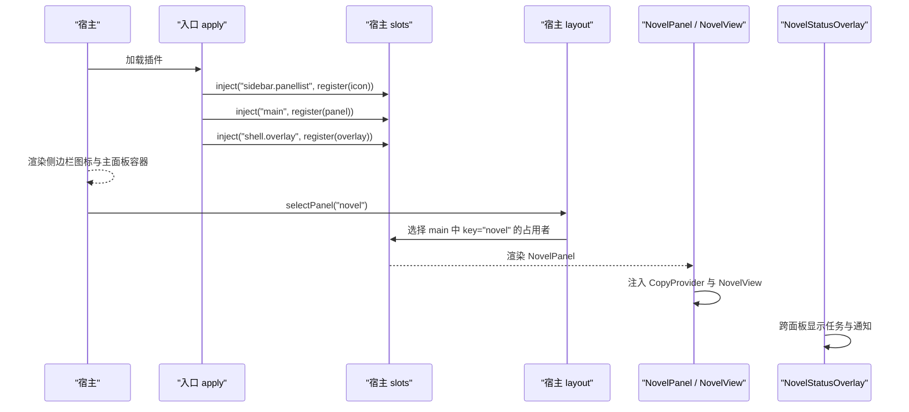
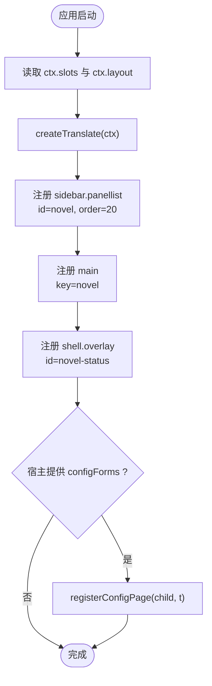
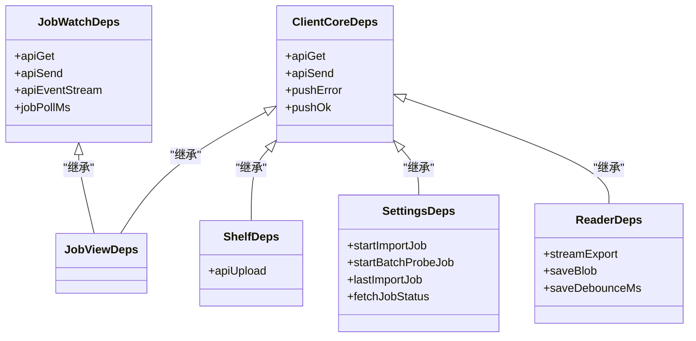
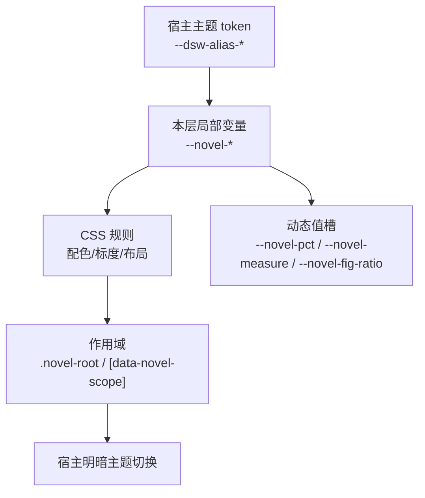
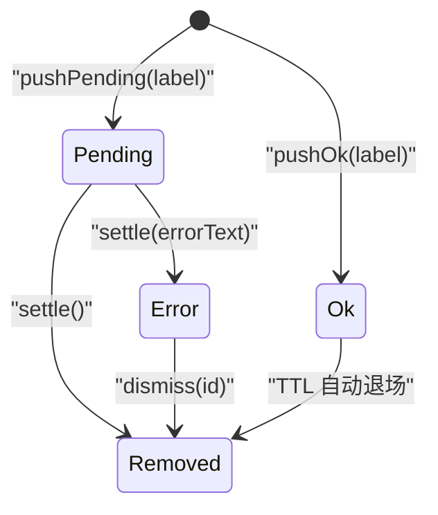
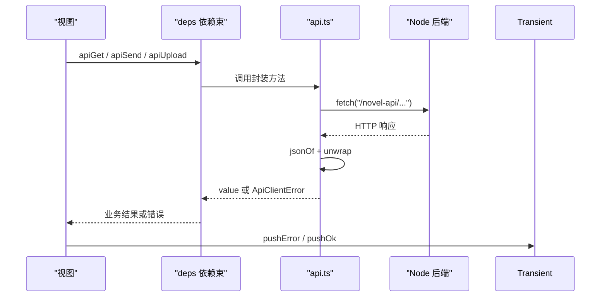
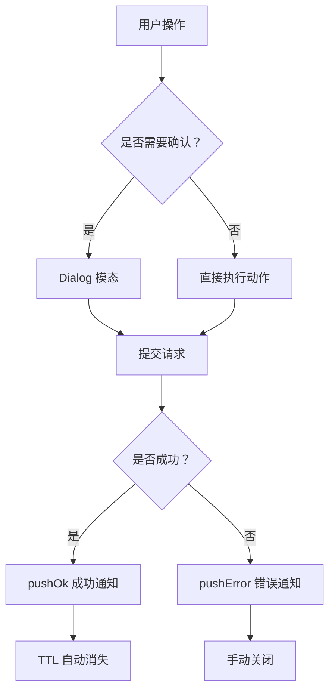
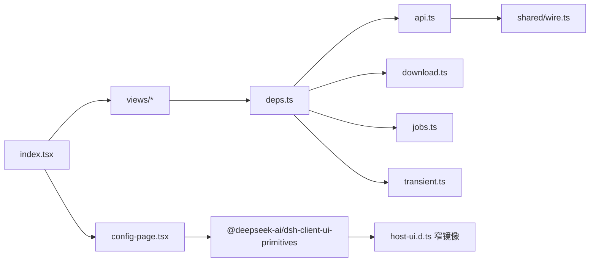

# 浏览器前端入口

<cite>
**本文引用的文件**   
- [src/client/index.tsx](file://src/client/index.tsx)
- [src/client/deps.ts](file://src/client/deps.ts)
- [src/client/styles.tsx](file://src/client/styles.tsx)
- [src/client/transient.ts](file://src/client/transient.ts)
- [src/client/api.ts](file://src/client/api.ts)
- [src/client/config-page.tsx](file://src/client/config-page.tsx)
- [src/client/host-ui.d.ts](file://src/client/host-ui.d.ts)
- [src/client/views/NovelView.tsx](file://src/client/views/NovelView.tsx)
- [src/client/views/ShelfView.tsx](file://src/client/views/ShelfView.tsx)
- [src/client/views/CityView.tsx](file://src/client/views/CityView.tsx)
- [src/client/source-list-view.ts](file://src/client/source-list-view.ts)
- [src/client/views/dialog.tsx](file://src/client/views/dialog.tsx)
</cite>

## 目录
1. [引言](#引言)
2. [项目结构](#项目结构)
3. [核心组件](#核心组件)
4. [架构总览](#架构总览)
5. [详细组件分析](#详细组件分析)
6. [依赖分析](#依赖分析)
7. [性能考量](#性能考量)
8. [故障排查指南](#故障排查指南)
9. [扩展新面板步骤](#扩展新面板步骤)
10. [无障碍与响应式布局注意事项](#无障碍与响应式布局注意事项)
11. [结语](#结语)

## 引言
本文聚焦浏览器端入口 `src/client/index.tsx`，解释它如何把「小说」功能以全局面板形式接入宿主：加载 React peer 依赖、初始化样式与主题、注册侧边栏图标和主面板、挂载常驻状态层、并通过 API 客户端与 Node 后端半通信。同时说明 `deps.ts` 的 peer 依赖拆分策略、`styles.tsx` 的主题 token 与 CSS-in-JS 方案、`transient.ts` 的全局瞬态通知模型，以及面板文案与图标如何随宿主语言切换。最后给出新增面板的完整步骤和无障碍、响应式布局注意事项。

## 项目结构
浏览器端代码集中在 `src/client`，入口是 `index.tsx`；视图在 `views`，样式在 `styles.tsx`，临时通知在 `transient.ts`，API 封装在 `api.ts`，依赖切面在 `deps.ts`，配置页在 `config-page.tsx`。

```mermaid
graph TB
  Entry["src/client/index.tsx<br/>插件入口"] --> Styles["src/client/styles.tsx<br/>主题与全局样式"]
  Entry --> NovelView["src/client/views/NovelView.tsx<br/>顶部 Tab + 路由分发"]
  NovelView --> Shelf["src/client/views/ShelfView.tsx<br/>书架视图"]
  NovelView --> City["src/client/views/CityView.tsx<br/>书城视图"]
  NovelView --> Sources["src/client/source-list-view.ts<br/>书源列表派生逻辑"]
  Entry --> ConfigPage["src/client/config-page.tsx<br/>运行参数表单"]
  Shelf --> Deps["src/client/deps.ts<br/>peer 依赖束"]
  City --> Deps
  Sources --> Deps
  Shelf --> API["src/client/api.ts<br">同源 fetch 封装"]
  City --> API
  Shelf --> Transient["src/client/transient.ts<br/>全局通知队列"]
  Entry --> Dialog["src/client/views/dialog.tsx<br/>模态对话框契约"]
```

**图表来源**
- [src/client/index.tsx:1-110](file://src/client/index.tsx#L1-L110)
- [src/client/views/NovelView.tsx:1-65](file://src/client/views/NovelView.tsx#L1-L65)
- [src/client/views/ShelfView.tsx:1-200](file://src/client/views/ShelfView.tsx#L1-L200)
- [src/client/views/CityView.tsx:1-200](file://src/client/views/CityView.tsx#L1-L200)
- [src/client/source-list-view.ts:1-86](file://src/client/source-list-view.ts#L1-L86)
- [src/client/deps.ts:1-105](file://src/client/deps.ts#L1-L105)
- [src/client/api.ts:1-146](file://src/client/api.ts#L1-L146)
- [src/client/transient.ts:1-89](file://src/client/transient.ts#L1-L89)
- [src/client/views/dialog.tsx:1-112](file://src/client/views/dialog.tsx#L1-L112)

**章节来源**
- [src/client/index.tsx:1-110](file://src/client/index.tsx#L1-L110)
- [src/client/views/NovelView.tsx:1-65](file://src/client/views/NovelView.tsx#L1-L65)

## 核心组件
- **入口 `apply`**：声明宿主注入项 `slots` 与 `layout`，创建翻译函数，批量注册三个插槽，并可选注册配置表单。
- **侧边栏图标**：`NovelPanelIcon` 只负责 SVG 图标，前景色由宿主行控制。
- **主面板**：`NovelPanel` 包裹 `CopyProvider` 与 `NovelView`，作为 keyed 槽占用者。
- **常驻状态层**：`shell.overlay` 中注册 `NovelStatusOverlay`，用于跨面板展示任务进度、错误与成功通知。
- **配置表单**：通过 `ctx.inject(['configForms'], ...)` 按需挂接，旧宿主缺失时不报错。

这些职责共同保证「小说」功能在宿主中以一个独立全局面板存在，且与宿主会话、主题、语言解耦。

**章节来源**
- [src/client/index.tsx:1-110](file://src/client/index.tsx#L1-L110)

## 架构总览
入口通过宿主提供的 `slots` 服务，把「小说」能力挂到三个位置：

| 宿主插槽 | 类型 | 用途 | 键或 id |
|---|---|---|---|
| `sidebar.panellist` | root 作用域 list | 侧边栏一行图标 + label | `novel` |
| `main` | root 作用域 keyed | 选中后渲染中央面板 | `novel` |
| `shell.overlay` | root 作用域 list | 常驻浮层状态条 | `novel-status` |

点击侧边栏图标时，宿主调用 `ctx.layout.selectPanel('novel')`；主面板按 key 匹配并渲染 `NovelView`。



**图表来源**
- [src/client/index.tsx:1-110](file://src/client/index.tsx#L1-L110)
- [src/client/views/NovelView.tsx:1-65](file://src/client/views/NovelView.tsx#L1-L65)

**章节来源**
- [src/client/index.tsx:1-110](file://src/client/index.tsx#L1-L110)

## 详细组件分析

### 入口与宿主插槽注册
入口做了四件事：
1. 窄镜像宿主上下文，仅取 `slots.inject/register` 与 `layout.selectPanel`。
2. 用 `createTranslate(ctx)` 构造翻译函数，老宿主缺失 locale 时回退中文。
3. 同批注册 `sidebar.panellist` 与 `main`，id/key 均为 `novel`，避免官方契约所禁止的“选中缺失主面板”异常。
4. 注册 `shell.overlay` 常驻状态层，并把 `layout.selectPanel` 暴露给状态层，以便从任意面板把「小说」面板带到前台。
5. 可选注册 `configForms`，让运行参数出现在宿主插件详情页。



**图表来源**
- [src/client/index.tsx:1-110](file://src/client/index.tsx#L1-L110)

**章节来源**
- [src/client/index.tsx:1-110](file://src/client/index.tsx#L1-L110)

### 依赖加载策略：`deps.ts`
`deps.ts` 不是单一“大依赖包”，而是按读者职责拆成多个依赖接口和生产常量：

| 依赖束 | 包含能力 | 典型消费者 |
|---|---|---|
| `ClientCoreDeps` | `apiGet`、`apiSend`、`pushError`、`pushOk` | 通用视图与浮层 |
| `JobWatchDeps` | 核心能力 + SSE 事件流 | 搜索任务、探索任务观察 |
| `JobViewDeps` | 核心能力 + 任务观察 | 搜索结果页、书城 |
| `ShelfDeps` | 核心能力 + `apiUpload` | 书架本地导入 |
| `SettingsDeps` | 核心能力 + 任务提交/轮询 | 设置区与常驻状态层 |
| `ReaderDeps` | 核心能力 + 导出流 | 阅读器 |

这种设计的好处是：测试可以只注入读者真正需要的能力，而不是为每个用例构造完整 API 对象；生产打包则直接暴露对应 `prodXxxDeps`。



**图表来源**
- [src/client/deps.ts:1-105](file://src/client/deps.ts#L1-L105)

**章节来源**
- [src/client/deps.ts:1-105](file://src/client/deps.ts#L1-L105)

### 样式与主题：`styles.tsx`
`styles.tsx` 使用模板字符串导出 CSS，并由 `NovelStyles` 组件注入。其主题方案要点如下：

- 所有颜色通过宿主语义 token（如 `--dsw-alias-bg-base`、`--dsw-alias-brand-primary`）引入，插件自身不判断深浅主题。
- 自定义变量统一收在 `.novel-root` 或 `[data-novel-scope]` 下，形成局部 token 词表；视觉规则只读这些变量。
- brand 派生色通过 `color-mix` 计算，确保宿主换品牌色时自动跟随。
- 定义间距、字号、圆角、阴影、层级、动效等标度，避免散写像素值。
- 通过 `box-sizing: border-box` 限定在本插件两棵树内，防止 padding 撑破布局。
- 根容器 `.novel-root` 固定高度、隐藏溢出；`.novel-main` 自适应滚动。
- 当「小说」视图在场时，隐藏宿主对话区的默认输入框和宽度拖拽把手。
- 浮层状态条放在宿主 `shell.overlay` 上，默认 `pointer-events: none`，条目自身恢复可点击。



**图表来源**
- [src/client/styles.tsx:1-200](file://src/client/styles.tsx#L1-L200)

**章节来源**
- [src/client/styles.tsx:1-200](file://src/client/styles.tsx#L1-L200)

### 临时状态管理：`transient.ts`
`transient.ts` 实现全局瞬态通知队列，基于模块级 store 与 React `useSyncExternalStore`：

- 条目类型包括 `pending`、`ok`、`error`。
- `ok` 通知默认 2.5 秒自动消失；`error` 需要手动关闭并可带锚点。
- `pushPending` 返回幂等的结算函数，成功或失败路径都收敛到一条路。
- 提供 React Hook `useTransient` 和非 React 读口 `transientEntries`。
- 提供 `useTransientFlag`，供 642 行书架列表等细粒度订阅，避免全量重渲染。
- 测试专用 `resetTransient` 清理定时器与队列。



**图表来源**
- [src/client/transient.ts:1-89](file://src/client/transient.ts#L1-L89)

**章节来源**
- [src/client/transient.ts:1-89](file://src/client/transient.ts#L1-L89)

### API 客户端与 Node 半通信
`api.ts` 是对 `/novel-api` 的同源 fetch 封装，承担以下职责：

- 统一信封解析：`{ ok, value }` 正常返回，`{ ok, error }` 抛出 `ApiClientError`。
- 网络错误分类：非 JSON、请求失败、SSE 不可用三类原因。
- 错误描述：只翻译客户端产生的网络原因，服务端错误原文透传。
- 提供 `apiGet`、`apiSend`、`apiUpload` 和 SSE 读流 `apiEventStream`。
- SSE 自行解码 `data:` 帧，游标握在客户端，避免浏览器 EventSource 的重连语义破坏进度一致性。



**图表来源**
- [src/client/api.ts:1-146](file://src/client/api.ts#L1-L146)
- [src/client/deps.ts:1-105](file://src/client/deps.ts#L1-L105)
- [src/client/transient.ts:1-89](file://src/client/transient.ts#L1-L89)

**章节来源**
- [src/client/api.ts:1-146](file://src/client/api.ts#L1-L146)

### 语言切换与宿主插槽
- 入口在 `apply` 中通过 `createTranslate(ctx)` 创建翻译函数，并将该函数作为 `CopyProvider` 的值传给 `NovelPanel` 与 `shell.overlay`。
- 侧边栏图标 label 使用回调 `() => t('nav.panel')`，这样每次渲染都会读取当前语言，而不缓存旧文案。
- `main` 槽通过 `inject: () => ({ t })` 把翻译函数注入 `NovelPanel`；若宿主槽位没有 inject，则回退到 `zhTranslate`，保证测试和老宿主仍输出中文。
- 配置页也通过 `CopyProvider` 和 `useCopy()` 获取当前语言，字段 label、单位、提示、预设值标签都由字典驱动。
- 侧边栏图标的 SVG 使用 `fill="currentColor"`，因此图标前景色跟随宿主行的前景色，不需要插件自己处理明暗。

**章节来源**
- [src/client/index.tsx:1-110](file://src/client/index.tsx#L1-L110)
- [src/client/config-page.tsx:1-200](file://src/client/config-page.tsx#L1-L200)

### 三个面板与路由
`NovelView` 是「小说」全局面板的根，负责：
- 注入一次 `NovelStyles`。
- 渲染顶部 tab：书架、书城、书源管理。
- 根据 `routeStore` 分发到 `ShelfView`、`CityView`、`SearchView`、`ReaderView` 或 `SettingsSection`。
- 用 `data-novel`、`data-novel-root`、`data-novel-scope` 标记作用域，便于样式与宿主识别。

| 路由名称 | 面板 | 主要职责 |
|---|---|---|
| `shelf` | `ShelfView` | 书架浏览、筛选、多选删除、本地导入 |
| `city` | `CityView` | 书城分类浏览、源与分类选择、分页加载 |
| `sources` | `SettingsSection` | 书源管理，复用原宿主设置区块 |
| `reader` | `ReaderView` | 阅读界面 |
| `search` | `SearchView` | 聚合搜索 |

**章节来源**
- [src/client/views/NovelView.tsx:1-65](file://src/client/views/NovelView.tsx#L1-L65)

### 模态对话框、通知与进度条契约
- **模态对话框**：`views/dialog.tsx` 是唯一契约住址，统一处理遮罩、Esc 关闭、Tab 焦点环、入场焦点、关闭后焦点归还。支持 `modal`、`wide`、`drawer` 三种形态。
- **通知**：全局通知走 `transient.ts`，由 `pushError`、`pushOk`、`pushPending` 写入队列，并在宿主 `shell.overlay` 中集中展示。
- **进度条**：进度值槽 `--novel-pct` 定义在样式层，具体进度 UI 由 `bits.ProgressBar` 等组件消费；阅读器章节进度也遵循同一 token 口径。



**图表来源**
- [src/client/views/dialog.tsx:1-112](file://src/client/views/dialog.tsx#L1-L112)
- [src/client/transient.ts:1-89](file://src/client/transient.ts#L1-L89)
- [src/client/styles.tsx:1-200](file://src/client/styles.tsx#L1-L200)

**章节来源**
- [src/client/views/dialog.tsx:1-112](file://src/client/views/dialog.tsx#L1-L112)
- [src/client/transient.ts:1-89](file://src/client/transient.ts#L1-L89)

## 依赖分析
入口本身不直接持有 API、下载、任务轮询等实现，而是通过宿主注入和模块依赖组织边界：

- `index.tsx` 依赖 `config-page.tsx`、`copy/index.js`、`novel-glyph.js`、`views/NovelView.js`。
- 视图依赖 `deps.ts` 暴露的生产依赖对象。
- `deps.ts` 再依赖 `api.ts`、`download.ts`、`jobs.ts`、`transient.ts`、`util.js`。
- `api.ts` 依赖共享 wire 契约 `shared/wire.ts`。
- 配置页依赖宿主原语 `@deepseek-ai/dsh-client-ui-primitives`，但通过 `host-ui.d.ts` 做窄类型镜像，避免绑定宿主包版本。



**图表来源**
- [src/client/index.tsx:1-110](file://src/client/index.tsx#L1-L110)
- [src/client/deps.ts:1-105](file://src/client/deps.ts#L1-L105)
- [src/client/api.ts:1-146](file://src/client/api.ts#L1-L146)
- [src/client/host-ui.d.ts:1-58](file://src/client/host-ui.d.ts#L1-L58)

**章节来源**
- [src/client/deps.ts:1-105](file://src/client/deps.ts#L1-L105)
- [src/client/host-ui.d.ts:1-58](file://src/client/host-ui.d.ts#L1-L58)

## 性能考量
- **依赖拆分减少测试成本**：不同读者只注入所需依赖，避免为无关能力构造假对象。
- **SSE 作为加速器**：事件流用于推送进度，断线时回落到显式快照轮询，避免单通道成为瓶颈。
- **瞬态通知最小化重渲染**：`useTransientFlag` 允许细粒度订阅，避免 642 行书架每行都因通知队列变化而重渲染。
- **CSS 自足守卫**：token 定义与引用在同一词表中，配合测试守护未定义的 CSS 变量，降低运行时静默降级风险。
- **布局链收敛**：`.novel-root` 与 `.novel-main` 明确滚动归属，避免把滚动交给宿主 scrollport 导致正文无法滚动。

[本节为一般性指导，不直接分析具体代码片段]

## 故障排查指南
- **侧边栏图标不显示或文案不变**
  - 检查入口是否同时注册了 `sidebar.panellist` 和 `main`，官方契约要求两者同批注册。
  - 检查 `label` 是否使用回调 `() => t('nav.panel')`，而非静态字符串。
  - 确认宿主已正确调用 `layout.selectPanel('novel')`。

- **主面板空白**
  - 检查 `main` 槽的 `key` 是否为 `novel`，并与侧边栏 id 一致。
  - 检查 `CopyProvider` 是否传入翻译函数；若宿主没有 inject，会回退中文。

- **网络错误文案乱码或不翻译**
  - 确认错误来自 `ApiClientError.reason` 才走翻译分支；服务端错误原文透传。
  - 检查 SSE 连接是否被拒绝，`stream-unavailable` 会进入特定错误路径。

- **通知不消失或重复**
  - 检查是否调用 `pushPending` 的 settle 函数；重复调用 settle 应幂等。
  - 检查 `pushOk` 是否被 TTL 自动清除；测试环境可用 `resetTransient` 清理。

- **样式 token 失效或主题不跟随**
  - 确认使用的 `--novel-*` 变量已在 `.novel-root` 或 `[data-novel-scope]` 中定义。
  - 不要硬编码 hex 主题色，应引用宿主 alias token。

**章节来源**
- [src/client/index.tsx:1-110](file://src/client/index.tsx#L1-L110)
- [src/client/api.ts:1-146](file://src/client/api.ts#L1-L146)
- [src/client/transient.ts:1-89](file://src/client/transient.ts#L1-L89)
- [src/client/styles.tsx:1-200](file://src/client/styles.tsx#L1-L200)

## 扩展新面板步骤
假设要新增一个名为 `my-panel` 的面板：

1. **注册面板组件**
   - 新建或复用 React 组件，例如 `MyPanel`，并通过 `CopyProvider` 提供翻译函数。
   - 如果面板需要图标，新建一个小型图标组件，SVG 使用 `fill="currentColor"`。

2. **声明宿主插槽**
   - 在入口 `apply` 中，使用 `slots.inject('sidebar.panellist', ...)` 注册侧边栏图标。
   - 使用 `slots.inject('main', ...)` 注册 keyed 主面板，key 必须与侧边栏 id 一致。
   - 如果需要跨面板通知，使用 `slots.inject('shell.overlay', ...)` 注册常驻状态层。

3. **定义路由**
   - 在 `NovelView` 的 `TABS` 中添加新 tab，或在现有路由分发中增加分支。
   - 使用 `navigate({ name: 'my-panel' })` 跳转，并在 `routeStore` 中维护状态。

4. **绑定 `ReadingService` 或其他服务**
   - 如果面板需要读写阅读数据，通过 `deps.ts` 中的依赖束注入服务方法。
   - 对写操作使用 `apiSend`，对查询使用 `apiGet`，对长任务使用 SSE 或轮询。
   - 成功与失败分别走 `pushOk` 与 `pushError`，保持通知契约一致。

5. **样式与作用域**
   - 为新面板添加 `data-novel-scope` 或复用 `novel-root` 作用域，使其继承主题 token。
   - 如需自定义布局，优先使用 `--novel-sp-*`、`--novel-fs-*`、`--novel-z-*` 等标度变量。

6. **无障碍与测试**
   - 为交互控件添加 `aria-label`、`aria-pressed`、`role` 等属性。
   - 为模态弹窗使用统一的 `Dialog` 组件。
   - 为面板行为编写单元测试，尤其覆盖路由切换、依赖注入、错误路径和通知生命周期。

**章节来源**
- [src/client/index.tsx:1-110](file://src/client/index.tsx#L1-L110)
- [src/client/views/NovelView.tsx:1-65](file://src/client/views/NovelView.tsx#L1-L65)
- [src/client/deps.ts:1-105](file://src/client/deps.ts#L1-L105)
- [src/client/views/dialog.tsx:1-112](file://src/client/views/dialog.tsx#L1-L112)

## 无障碍与响应式布局注意事项
- **侧边栏图标**
  - 图标本身应 `aria-hidden="true"`，无障碍名由宿主行 label 提供。
  - 图标前景色通过 `currentColor` 跟随宿主，无需额外处理明暗。

- **面板导航**
  - 顶部 tab 使用按钮组，并为选中项设置 `aria-pressed`。
  - 分组区域使用 `role="group"` 并提供 `aria-label`。

- **模态对话框**
  - 使用 `Dialog` 组件保证 Esc 关闭、Tab 焦点环、入场焦点和焦点归还。
  - 面板使用 `role="dialog"` 与 `aria-modal="true"`，标题通过 `aria-labelledby` 或 `aria-label` 提供。

- **通知与进度**
  - 成功通知采用“少而淡”策略，避免打断用户。
  - 错误通知需可定位，必要时携带 `anchor` 供 DOM 定位。
  - 进度条使用 `--novel-pct` 等 token，避免硬编码动画值。

- **响应式布局**
  - 使用 `--novel-sp-*` 间距变量，避免散写像素。
  - 网格列数应通过 CSS 媒体查询或宿主布局控制，不在 JS 中复制布局数量。
  - 阅读器正文宽度通过 `--novel-measure` 控制，与字号缩放联动。
  - 注意 `.novel-root` 与 `.novel-main` 的 overflow 链，不要让宿主 scrollport 接管滚动。

**章节来源**
- [src/client/index.tsx:1-110](file://src/client/index.tsx#L1-L110)
- [src/client/views/dialog.tsx:1-112](file://src/client/views/dialog.tsx#L1-L112)
- [src/client/styles.tsx:1-200](file://src/client/styles.tsx#L1-L200)

## 结语
`src/client/index.tsx` 的职责不是实现具体业务逻辑，而是把「小说」功能安全地装配到宿主：注册侧边栏图标、主面板和常驻状态层，初始化样式与主题，提供翻译上下文，并按需挂接配置表单。真正的书架、书城、书源管理等业务由 `views` 下的视图组件承载，通过 `deps.ts` 的依赖束访问 API 与任务能力，并通过 `transient.ts` 与 `Dialog` 维持一致的 UI 契约。扩展新面板时，应严格遵循宿主插槽契约、路由约定、依赖注入方式和无障碍规范，确保主题、语言和宿主壳层都能稳定协作。