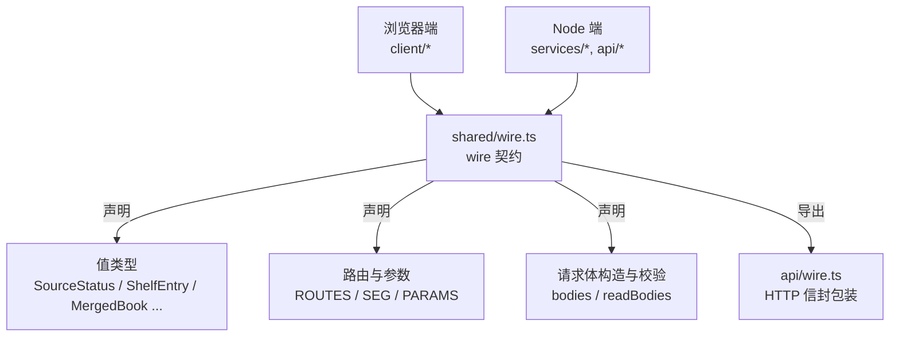
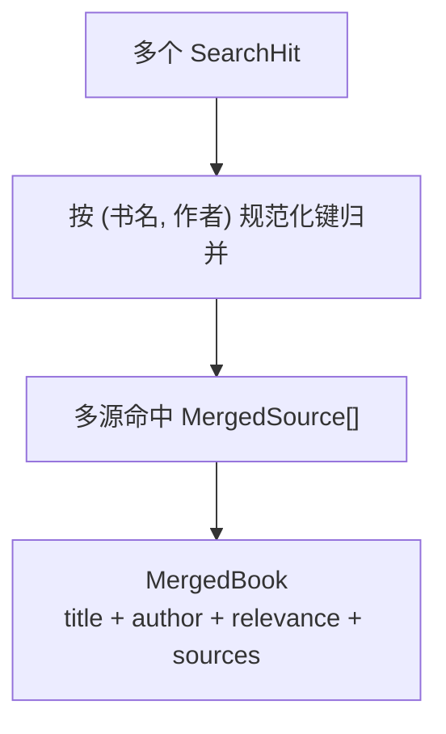
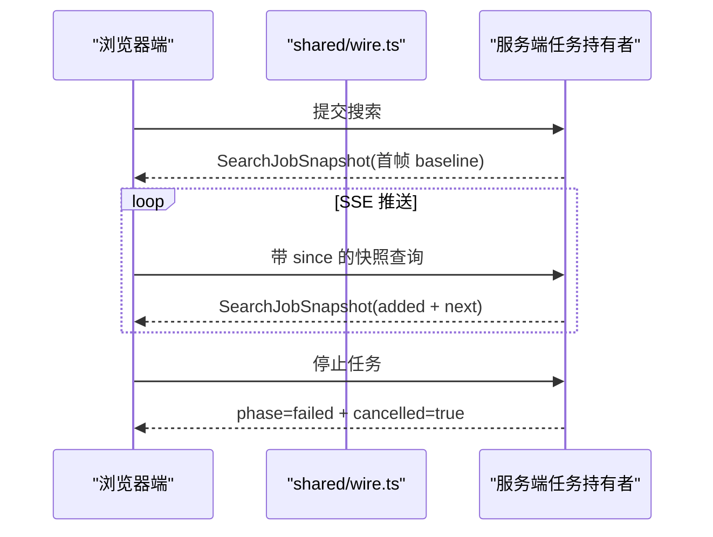
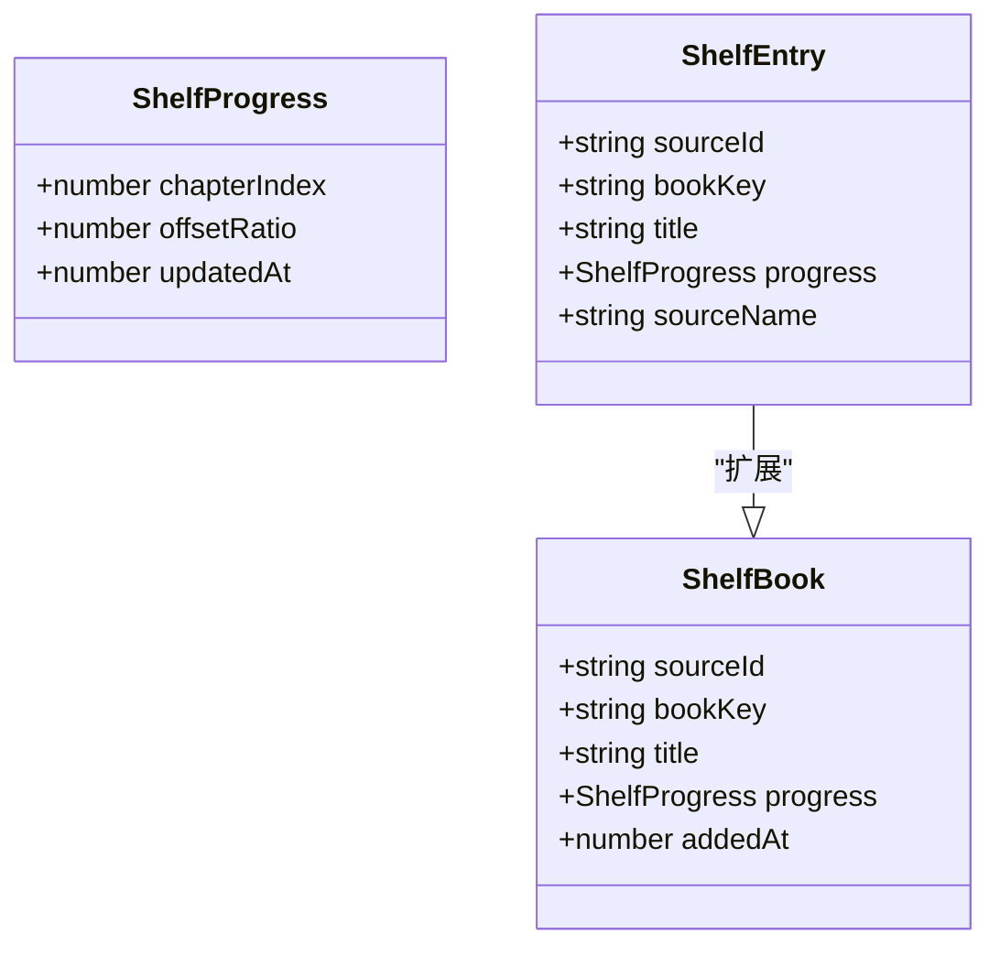
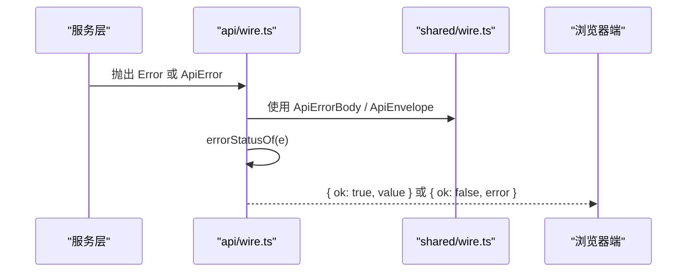
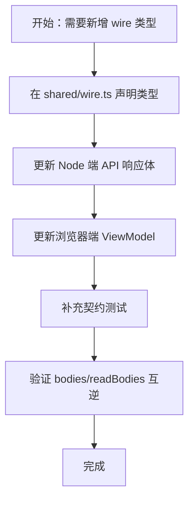
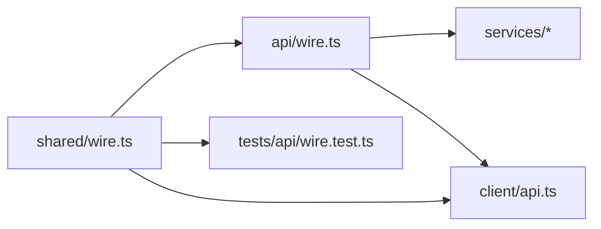

# 跨半 Wire 契约

<cite>
**本文引用的文件**
- [src/shared/wire.ts](file://src/shared/wire.ts)
- [src/api/wire.ts](file://src/api/wire.ts)
- [tests/api/wire.test.ts](file://tests/api/wire.test.ts)
</cite>

## 目录
1. [引言](#引言)
2. [项目结构定位](#项目结构定位)
3. [核心类型与语义](#核心类型与语义)
4. [Wire-first 策略与构建期门禁](#wire-first-策略与构建期门禁)
5. [序列化/反序列化工具链](#序列化反序列化工具链)
6. [新增 Wire 类型的步骤](#新增-wire-类型的步骤)
7. [依赖关系分析](#依赖关系分析)
8. [性能与体积特性](#性能与体积特性)
9. [常见陷阱与排错](#常见陷阱与排错)
10. [结论](#结论)

## 引言
本文件文档化 `src/shared/wire.ts` 定义的跨 Node 半与浏览器半的 wire 契约。该文件是 `/novel-api` 的值形状、路由段名、错误信封与请求体构造器的唯一权威来源：Node 端把业务对象投影为 JSON，浏览器端只消费这些纯数据，不持有 DOM、宿主 API 或运行时副作用。

“wire-first”的核心思想是：**先写跨半契约，再分别实现服务端投影与客户端消费**。这样可以在编译期和测试期同时保证两端不会悄悄分叉。

## 项目结构定位
`src/shared/wire.ts` 处于共享层，既不被浏览器端直接调用运行时逻辑，也不被 Node 端当作服务实现；它只做三件事：
1. 声明跨半值类型（如 `ShelfEntry`、`MergedBook`、`SearchJobSnapshot`、`ExploreJobSnapshot` 等）。
2. 声明跨半常量（如 `SEARCH_BOOKS_CAP`、`LOCAL_SOURCE_ID`、`NOVEL_API_PREFIX`）。
3. 提供零运行时依赖的路由与 body 构造器，供两端复用字段名与参数名。

**图示来源**
- [src/shared/wire.ts:1-25](file://src/shared/wire.ts#L1-L25)
- [src/api/wire.ts:1-15](file://src/api/wire.ts#L1-L15)

**章节来源**
- [src/shared/wire.ts:1-25](file://src/shared/wire.ts#L1-L25)

## 核心类型与语义

### 基础枚举与状态
- `SourceStatus`：书源状态，取值为未验证、已验证、损坏。
- `SourceContentKind`：书源内容形态，包括文本、图片、音频、文件与未知编码。
- `ProbeErrorCode`：探针失败原因，涵盖引擎规则错误、抓取错误、解码错误、规则缺失与兜底错误。

这些枚举是持久化与 wire 共用的最小语义单元，避免在两端各自用字符串字面量判断。

**章节来源**
- [src/shared/wire.ts:27-58](file://src/shared/wire.ts#L27-L58)

### 任务与问题模型
- `JobIssue`：后台任务明细条目，包含名称、种类与详情。
- `JobState`：单任务槽状态，包含任务标识、阶段、进度、计数、错误与时间戳。
- `Relevance`：搜索命中与关键词的关系，用于聚合搜索的可见性控制。

它们共同表达“任务是否还在跑”“是否被用户停止”“结果是否失败”。

**章节来源**
- [src/shared/wire.ts:60-98](file://src/shared/wire.ts#L60-L98)
- [src/shared/wire.ts:100-112](file://src/shared/wire.ts#L100-L112)

### 搜索面类型
- `SearchHit`：一条搜索命中，可空字段一律使用 `string | null`，而不是可选属性。
- `SearchGroup`：按源分组的结果，允许单个源失败而不拖垮整批。
- `MergedSource`：一本书在某个源上的原始命名片段。
- `MergedBook`：按书名和作者规范化键归并后的呈现行，包含来源列表与来源数。

注意：`MergedBook` 是呈现层派生视图，不落盘，也不改变书架身份 `(sourceId, bookKey)`。

**图示来源**
- [src/shared/wire.ts:114-160](file://src/shared/wire.ts#L114-L160)

**章节来源**
- [src/shared/wire.ts:114-160](file://src/shared/wire.ts#L114-L160)

### 搜索结果快照
- `SearchJobSnapshot`：聚合搜索任务的读面快照，包含任务标识、关键词、阶段、取消标记、参与源数、已完成组数、增量分组、游标与时间戳。
- `ExploreSources`：发现面按源列出的分类入口清单。
- `ExploreBook`：某源某分类下的一条浏览项。
- `ExploreSnapshot`：单源分类轮次的读面快照，包含页码、是否有更多页、书籍列表与错误信息。

关键约束：
- `phase` 与 `JobState` 使用同一套词汇，表示“仍在运行、完成、失败”。
- `cancelled` 不是失败：用户主动停止时保留已有结果，UI 不报红条。
- `next` 作为游标，客户端将其作为下次查询的 `since`。
- `ExploreSnapshot` 是全量快照，不是增量流；分页累积在服务端持有者中。

**图示来源**
- [src/shared/wire.ts:162-200](file://src/shared/wire.ts#L162-L200)
- [src/shared/wire.ts:201-250](file://src/shared/wire.ts#L201-L250)

**章节来源**
- [src/shared/wire.ts:162-250](file://src/shared/wire.ts#L162-L250)

### 书架类型
- `ShelfProgress`：阅读进度，包含章索引、偏移比例与更新时间。
- `hasProgress`：判断“是否读过”的单点函数，口径是“章号大于 0 或偏移比例大于 0”。
- `ShelfBook`：落盘的书架条目，包含元数据与进度。
- `SHELF_META`：书目元数据字段表，是“名称 × wire 类型判别 × 归一化”的唯一主人。
- `ShelfEntry`：书架读取面类型，是 `ShelfBook` 加上来源投影 `sourceName`。
- `ShelfMetaPatch`：对书架条目打补丁的可空映射。
- `pickShelfMeta`：从任意记录中提取合法元数据字段，过滤非法类型、空值与未知键。

重要约束：
- `ShelfEntry.sourceName` 不可 patch，不落盘。
- `bookKey`、`progress`、`addedAt` 不属于元数据写口。
- `ShelfProgress` 是 type 别名而非 interface，避免工具输出 schema 推断出问题。

**图示来源**
- [src/shared/wire.ts:251-350](file://src/shared/wire.ts#L251-L350)

**章节来源**
- [src/shared/wire.ts:251-350](file://src/shared/wire.ts#L251-L350)

### 本地图文与阅读目标
- `ContentTag`：图文节点白名单标签集合。
- `ReadingTarget`：阅读目标，区分主序列章节与补充文档。
- `ContentNode`：图文树节点，包含文本、元素、图片、链接、换行与分隔线。
- `ChapterContent`：章节正文，分为纯文本与富文本两种形态。
- `NavigationItem`：目录条目。
- `BookNavigation`：线性目录与展示树的组合。
- `LocalImportWarning`：导入告警。
- `LocalImportResponse`：本地导入回执，包含书架条目、章节数、格式、编码与告警。

安全边界：
- `ContentNode` 不携带任意属性字典，防止原书未净化属性进入客户端 DOM。
- `resourceId` 是不透明 ID，不走磁盘路径。

**章节来源**
- [src/shared/wire.ts:351-510](file://src/shared/wire.ts#L351-L510)

### 统一信封与错误
- `ApiErrorBody`：统一失败信封的错误载荷，包含错误码、消息与可选段级定位。
- `ApiEnvelope<T>`：成功 `{ ok: true, value }` 与失败 `{ ok: false, error }` 的统一信封。

**章节来源**
- [src/shared/wire.ts:511-540](file://src/shared/wire.ts#L511-L540)

### 路由、参数与请求体
- `SEG`：路由段字面量的单一来源。
- `Route`：双形态路由，包含 path 与 segs。
- `ROUTES`：静态路由表。
- `paramRoutes`：参数路由构造器。
- `PARAMS`：query 参数名的单一来源。
- `encodeQuery`：参数序列化，丢弃 undefined 与 null。
- `queries`：查询路径构造器。
- `BODY`：请求体字段名。
- `bodies`：请求体构造器。
- `readBodies`：请求体解析器。
- `ShelfPutBody`：书架 PUT 的三种模式。

这些构造器保证“写路由的 body 与读路由的 body 同源”，避免两端各自手写字段名。

**章节来源**
- [src/shared/wire.ts:541-836](file://src/shared/wire.ts#L541-L836)

## Wire-first 策略与构建期门禁

### 为什么选择 wire-first
1. **浏览器端只消费纯数据**：wire 类型不包含 DOM、宿主 API、网络栈或运行时副作用。
2. **构建期纯度门禁**：tsdown 会检查 client 侧 import 是否落在 Node 内建与平台模块表外的 `@deepseek-ai/*` 值模块；wire 本身不引入任何运行时依赖，因此可以安全 inline 到浏览器 bundle。
3. **契约即测试目标**：API 响应体必须满足 `ApiEnvelope`，错误必须满足 `ApiErrorBody`；类型系统能捕获字段遗漏或类型错误。
4. **双向校验**：`bodies.x` 与 `readBodies.x` 必须互为逆操作，否则 round-trip 测试失败。

### 两条硬约束
- 构建期禁止浏览器端引入 Node 内建与平台模块。
- 仅允许 type-only 依赖，因为类型定义会在构建期擦除。

**章节来源**
- [src/shared/wire.ts:1-25](file://src/shared/wire.ts#L1-L25)

## 序列化与反序列化工具链

### `src/api/wire.ts` 的角色
`src/api/wire.ts` 是 Node 端的 HTTP 传输层包装，负责：
- re-export `ApiErrorBody` 与 `ApiEnvelope`，保持 import 路径可用。
- 定义 `ApiError`，承载 HTTP 状态码、错误码与可选 segment。
- 实现可信请求检查、JSON 体上限读取、JSON 写入、成功信封与错误信封。
- 将 domain 错误映射为 HTTP 状态码与错误码。

**图示来源**
- [src/api/wire.ts:1-40](file://src/api/wire.ts#L1-L40)
- [src/api/wire.ts:80-135](file://src/api/wire.ts#L80-L135)
- [src/shared/wire.ts:511-540](file://src/shared/wire.ts#L511-L540)

### `src/client/copy/common.ts` 的定位
需要澄清一个常见误解：`src/client/copy/common.ts` 并不是 wire 的序列化/反序列化工具。它是共享文案资源，定义中英文界面文案，例如按钮文字、单位、网络错误提示与复数形式。它与 wire 的关联在于：
- 浏览器端收到 `ApiEnvelope` 后，根据错误码或消息显示用户可读文案。
- 文案与 wire 类型解耦：wire 描述数据结构，文案描述用户界面。

因此，真正的 wire 序列化/反序列化职责集中在：
- `shared/wire.ts` 中的 `encodeQuery`、`bodies`、`readBodies`。
- `api/wire.ts` 中的 `writeJson`、`writeOk`、`writeError`。
- 浏览器端基于 `ApiEnvelope` 的分支处理逻辑。

**章节来源**
- [src/client/copy/common.ts:1-36](file://src/client/copy/common.ts#L1-L36)
- [src/api/wire.ts:100-135](file://src/api/wire.ts#L100-L135)
- [src/shared/wire.ts:620-755](file://src/shared/wire.ts#L620-L755)

## 新增 Wire 类型的步骤

### 标准流程
1. **在 `src/shared/wire.ts` 声明类型**：定义字段、可空性、约束与注释。
2. **更新 API 响应体**：Node 端服务返回的数据必须符合新类型，并通过 `ApiEnvelope` 包装。
3. **更新 UI ViewModel**：浏览器端消费新类型，并在视图中正确分支。
4. **补充契约测试**：至少覆盖 round-trip、信封形状、错误映射与边界条件。

### 新增字段时的注意事项
如果新增的是书架元数据字段，必须同步修改 `SHELF_META`，因为它是所有书架写入口的唯一主人。新增普通业务字段则只需更新类型、响应体、ViewModel 与测试。

### 新增路由时的注意事项
如果新增的是查询参数，应优先复用 `PARAMS`；如果是请求体字段，应复用 `BODY`。新增路由段应放在 `SEG`，新增静态路由应加入 `ROUTES`，新增参数路由应加入 `paramRoutes`。

**图示来源**
- [src/shared/wire.ts:251-350](file://src/shared/wire.ts#L251-L350)
- [src/shared/wire.ts:620-836](file://src/shared/wire.ts#L620-L836)
- [tests/api/wire.test.ts:1-98](file://tests/api/wire.test.ts#L1-L98)

**章节来源**
- [src/shared/wire.ts:251-350](file://src/shared/wire.ts#L251-L350)
- [src/shared/wire.ts:620-836](file://src/shared/wire.ts#L620-L836)
- [tests/api/wire.test.ts:1-98](file://tests/api/wire.test.ts#L1-L98)

## 依赖关系分析

- `shared/wire.ts` 是根依赖，被 `api/wire.ts`、浏览器端 dispatch 与测试引用。
- `api/wire.ts` 依赖 `shared/wire.ts` 的类型定义，但不反向被其依赖。
- 测试通过类型断言与运行时断言双重校验契约。

**图示来源**
- [src/api/wire.ts:1-15](file://src/api/wire.ts#L1-L15)
- [tests/api/wire.test.ts:1-20](file://tests/api/wire.test.ts#L1-L20)

**章节来源**
- [src/api/wire.ts:1-15](file://src/api/wire.ts#L1-L15)
- [tests/api/wire.test.ts:1-20](file://tests/api/wire.test.ts#L1-L20)

## 性能与体积特性

### 浏览器端体积
`shared/wire.ts` 被浏览器端 inline 进 bundle，因此必须保持零运行时依赖。路由段、参数名、body 字段名都以字面量或纯函数形式存在，避免引入额外库。

### 快照与游标
- `SearchJobSnapshot` 使用 `added` 与 `next` 增量推进，避免每次全量重传。
- `ExploreSnapshot` 仍是全量快照，但分页由服务端持有，客户端只替换当前帧。
- `SEARCH_JOB_RETENTION_MS` 控制任务结果保留期，避免无限增长。

### 错误映射
`errorStatusOf` 将 domain 错误映射为 HTTP 状态码与错误码，减少浏览器端猜测错误语义的成本。

**章节来源**
- [src/shared/wire.ts:162-250](file://src/shared/wire.ts#L162-L250)
- [src/api/wire.ts:80-135](file://src/api/wire.ts#L80-L135)

## 常见陷阱与排错

### 陷阱一：循环引用
wire 类型不应出现循环引用。例如 `MergedBook` 引用 `MergedSource`，而 `MergedSource` 不再引用 `MergedBook`，避免浏览器端序列化或渲染时陷入死循环。

排查方法：
- 检查类型是否互相引用。
- 确认快照类型只包含稳定数据，不包含回调或实例方法。

**章节来源**
- [src/shared/wire.ts:114-200](file://src/shared/wire.ts#L114-L200)

### 陷阱二：host-only 对象泄漏到 wire
不要直接把 Node 端的 `IncomingMessage`、`ServerResponse`、DOM 元素、宿主 API 对象放入 wire。wire 只能承载 JSON 可序列化的纯数据。

排查方法：
- 检查 `ApiErrorBody.segment` 是否只包含 facet、segmentIndex、segmentRaw。
- 检查 `LocalImportWarning.resource` 是否只包含书内逻辑名，不含主机绝对路径。

**章节来源**
- [src/shared/wire.ts:511-540](file://src/shared/wire.ts#L511-L540)
- [src/shared/wire.ts:480-510](file://src/shared/wire.ts#L480-L510)
- [src/api/wire.ts:100-135](file://src/api/wire.ts#L100-L135)

### 陷阱三：非幂等字段误入快照
快照应该只包含可重复消费的读面数据。不要把正在运行的副作用、临时缓存、DOM 引用或会话句柄放进 `SearchJobSnapshot` 或 `ExploreSnapshot`。

排查方法：
- 检查快照字段是否可以从服务端重新推导或稳定存储。
- 检查 `cancelled`、`phase`、`error` 的语义是否与执行状态一致。

**章节来源**
- [src/shared/wire.ts:162-250](file://src/shared/wire.ts#L162-L250)

### 陷阱四：body 字段名与 query 参数名不一致
`bodies.x` 与 `readBodies.x` 必须成对维护。若只改一端，round-trip 测试会失败。

排查方法：
- 确保新增字段同时出现在 `BODY`、`bodies` 与 `readBodies`。
- 确保 `readBodies.x(bodies.x(v))` 返回原始输入。

**章节来源**
- [src/shared/wire.ts:620-836](file://src/shared/wire.ts#L620-L836)

### 陷阱五：混淆 `null` 与可选字段
wire 契约规定：可空字段用 `| null`，可能缺键的字段才用 `?:`。例如 `author` 可能是“源没给这条信息”，所以是 `string | null`；而 `lastProbedAt` 可能整键缺席，所以是 `?: number`。

排查方法：
- 检查 JSON.stringify 是否会丢弃 undefined 键。
- 检查 UI 是否把 `null` 当成“字段不存在”。

**章节来源**
- [src/shared/wire.ts:1-25](file://src/shared/wire.ts#L1-L25)
- [src/shared/wire.ts:114-160](file://src/shared/wire.ts#L114-L160)

### 陷阱六：把呈现层投影当持久化模型
`MergedBook` 是呈现层投影，不是书架持久化模型。书架身份仍是 `(sourceId, bookKey)`，不能因为 `MergedBook` 有 `sources` 就把它写入 `SHELF_META`。

排查方法：
- 确认落盘类型是 `ShelfBook` 或 `ShelfEntry`。
- 确认 `MergedBook` 只在聚合搜索结果中使用。

**章节来源**
- [src/shared/wire.ts:114-200](file://src/shared/wire.ts#L114-L200)
- [src/shared/wire.ts:251-350](file://src/shared/wire.ts#L251-L350)

## 结论
`src/shared/wire.ts` 是跨 Node 半与浏览器半的单一真相来源。它通过 wire-first 策略把值形状、路由、参数与请求体约束集中管理，让浏览器端只消费纯数据，让 Node 端只负责投影与校验。新增类型时，应优先维护这份契约，再通过 API 响应体与 UI ViewModel 两侧落地，并用契约测试钉住 round-trip、信封形状与错误映射。常见风险包括循环引用、宿主对象泄漏、非幂等字段误入快照、body 字段名分叉以及对 null 与可选字段的误用。只要守住这些边界，wire 就能长期保持稳定。