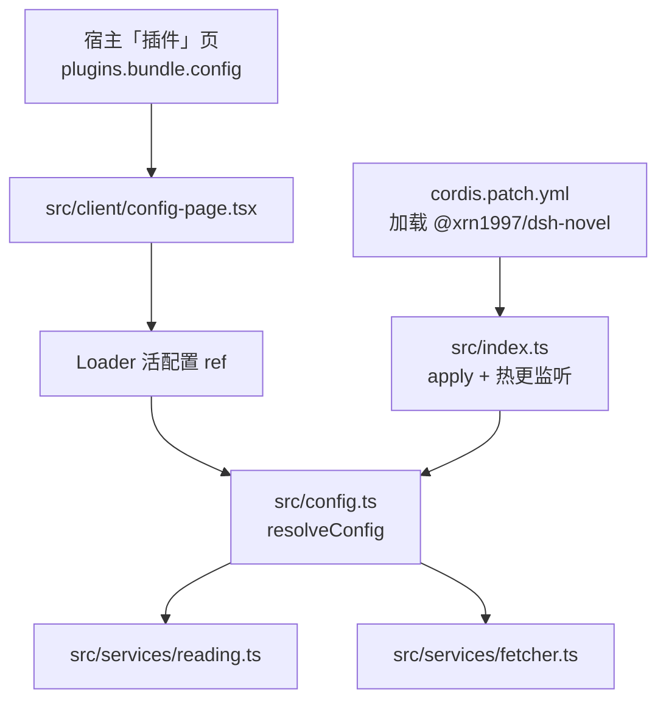
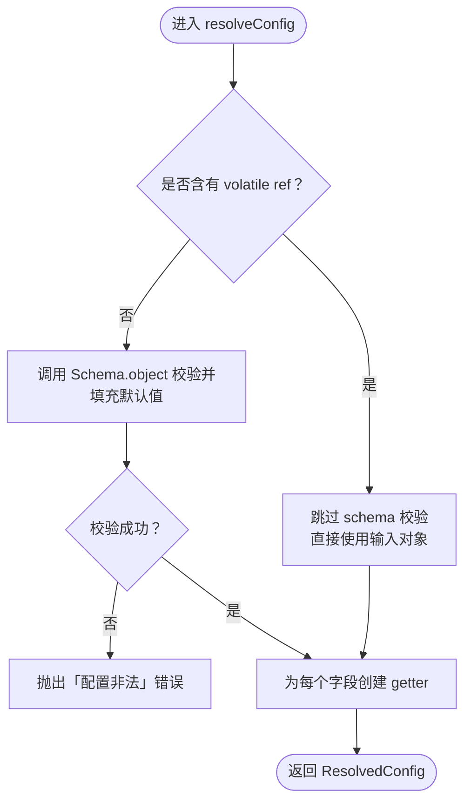
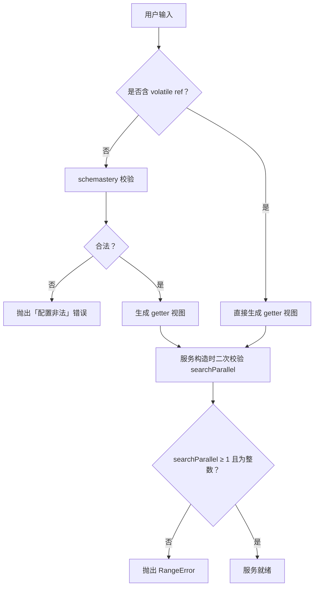
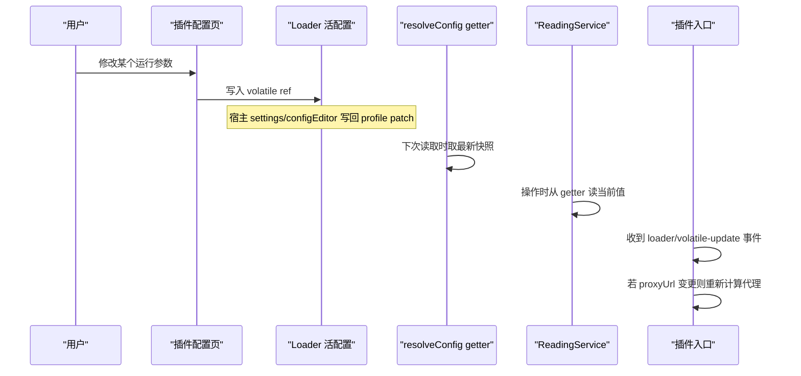
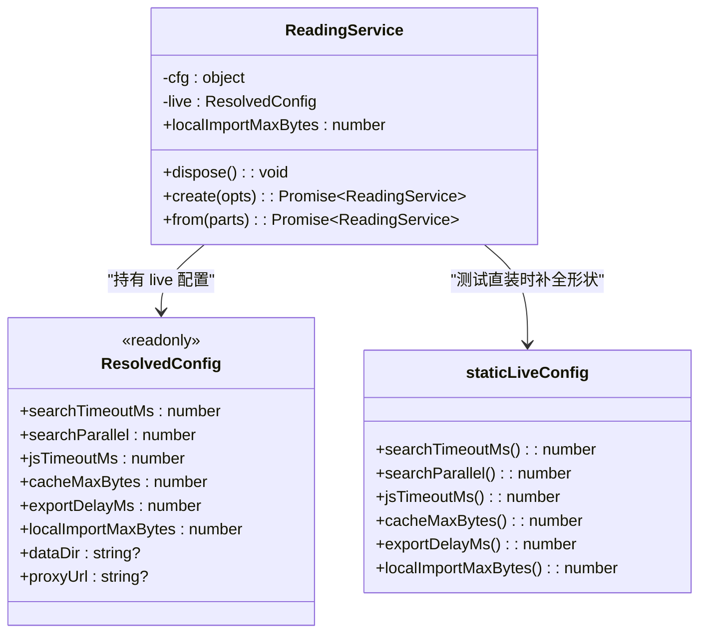

# 配置体系

<cite>
**本文引用的文件**   
- [cordis.patch.yml](file://cordis.patch.yml)
- [src/config.ts](file://src/config.ts)
- [src/index.ts](file://src/index.ts)
- [src/client/config-page.tsx](file://src/client/config-page.tsx)
- [src/services/reading.ts](file://src/services/reading.ts)
- [src/services/fetcher.ts](file://src/services/fetcher.ts)
- [src/services/cache.ts](file://src/services/cache.ts)
- [src/services/localbooks.ts](file://src/services/localbooks.ts)
- [src/services/export.ts](file://src/services/export.ts)
- [docs/adr/0035-plugin-config-page-live-refs.md](file://docs/adr/0035-plugin-config-page-live-refs.md)
- [tests/config.test.ts](file://tests/config.test.ts)
</cite>

## 目录

1. [引言](#引言)
2. [项目结构中的配置位置](#项目结构中的配置位置)
3. [配置来源与合并流程](#配置来源与合并流程)
4. [配置键总表](#配置键总表)
5. [Schema 校验机制与非法配置报错路径](#schema-校验机制与非法配置报错路径)
6. [活配置与热更新行为](#活配置与热更新行为)
7. [各服务如何消费 ResolvedConfig](#各服务如何消费-resolvedconfig)
8. [新增配置键的迁移指南](#新增配置键的迁移指南)
9. [常用配置示例](#常用配置示例)
10. [调试技巧](#调试技巧)
11. [结论](#结论)

## 引言

dsh-novel 的配置体系围绕 `src/config.ts` 构建：它既是所有配置键的定义处，也是类型、默认值、值域、热更新语义和解析入口的唯一主人。运行时，宿主「插件」页面的表单通过 Loader 提供的 volatile ref 写入同一份配置；服务在每次使用时读取 getter，从而在不重启插件的情况下生效。

本仓库根目录的 `cordis.patch.yml` 只是 Cordis 加载 dsh-novel 包的补丁入口，不直接定义业务配置；真正的业务配置由宿主以 `plugins.bundle.config` 槽暴露，或用户自行维护 profile patch。

## 项目结构中的配置位置

| 文件 | 角色 |
|---|---|
| [cordis.patch.yml](file://cordis.patch.yml) | 声明 Cordis 应加载 `@xrn1997/dsh-novel` 包；不是业务配置载体 |
| [src/config.ts](file://src/config.ts) | 唯一配置主人：字段清单、默认值、schema、Volatile 标记、`resolveConfig` |
| [src/index.ts](file://src/index.ts) | Cordis 插件入口：调用 `resolveConfig`，监听 `loader/volatile-update`，建立代理重算逻辑 |
| [src/client/config-page.tsx](file://src/client/config-page.tsx) | 宿主「插件」页面中 dsh-novel 的运行参数表单 |
| [src/services/reading.ts](file://src/services/reading.ts) | 阅读门面，消费搜索并发、JS 预算、缓存上限、本地书导入上限等 |
| [src/services/fetcher.ts](file://src/services/fetcher.ts) | HTTP 抓取层，持有 `DEFAULT_TIMEOUT_MS` |
| [src/services/cache.ts](file://src/services/cache.ts) | 页面缓存，持有 `DEFAULT_CACHE_MAX_BYTES` |
| [src/services/localbooks.ts](file://src/services/localbooks.ts) | 本地书模块，持有 `DEFAULT_MAX_IMPORT_BYTES` |
| [src/services/export.ts](file://src/services/export.ts) | 导出模块，持有 `DEFAULT_EXPORT_DELAY_MS` |
| [docs/adr/0035-plugin-config-page-live-refs.md](file://docs/adr/0035-plugin-config-page-live-refs.md) | ADR 说明为何只让七个运行参数走 volatile 活配置 |



**图表来源**
- [cordis.patch.yml:1-3](file://cordis.patch.yml#L1-L3)
- [src/index.ts:1-200](file://src/index.ts#L1-L200)
- [src/client/config-page.tsx:1-120](file://src/client/config-page.tsx#L1-L120)
- [src/config.ts:1-137](file://src/config.ts#L1-L137)

**章节来源**
- [cordis.patch.yml:1-3](file://cordis.patch.yml#L1-L3)
- [docs/adr/0035-plugin-config-page-live-refs.md:1-15](file://docs/adr/0035-plugin-config-page-live-refs.md#L1-L15)

## 配置来源与合并流程

### 三个同源输入

dsh-novel 的用户配置来自三个地方，它们最终都落到同一个 schema 口径：

1. **宿主「插件」页面**：通过 `plugins.bundle.config` 槽把可编辑字段交给 Loader 管理。
2. **profile patch**：用户直接编辑宿主保存的配置。
3. **cordis.patch.yml 的 config 段**：由 Cordis 装载期注入（当前仓库仅注册包 id，未写业务 config）。

### 合并顺序

宿主负责把三处配置合并为 Loader 的输出对象；dsh-novel 不实现自己的合并策略。该输出对象可能包含两种值：

- **纯值**：用于测试、直装路径或没有 volatile 的字段。
- **volatile ref**：由 Loader 包装的可写引用，形如 `{ get(): T; [cosmokit.volatile.write]: (next: T) => void }`。

`resolveConfig` 会检测字段是否为 volatile ref：

- 如果任一字段是 ref，则跳过 schema 校验，直接把输入当作已解析对象处理。
- 否则对纯输入调用 `Config(...)`，由 schemastery 完成默认值填充和值域校验。



**图表来源**
- [src/config.ts:76-137](file://src/config.ts#L76-L137)
- [tests/config.test.ts:1-86](file://tests/config.test.ts#L1-L86)

### 关键约束

- `dataDir` 不是活值：修改它等价于重建书架、缓存和本地书数据目录，因此必须重启。
- 其他六个数值字段加上 `proxyUrl` 是活值：保存后下一次读取即可生效。
- `resolveConfig` 返回的对象是只读视图：外部不能直接赋值，只能改 Loader 持有的 ref。

**章节来源**
- [src/config.ts:1-137](file://src/config.ts#L1-L137)
- [docs/adr/0035-plugin-config-page-live-refs.md:1-15](file://docs/adr/0035-plugin-config-page-live-refs.md#L1-L15)
- [tests/config.test.ts:1-86](file://tests/config.test.ts#L1-L86)

## 配置键总表

| 配置键 | 默认值 | 类型 | 作用域 | 是否热更新 | 含义与范围 |
|---|---:|---|---|---:|---|
| `dataDir` | `undefined` | `string \| undefined` | 全局 | 否 | 书架、缓存、本地书的落盘根目录；不进入表单，修改需重启 |
| `searchTimeoutMs` | `15000` | `number` | 全局 | 是 | 搜索与探针请求超时毫秒数 |
| `jsTimeoutMs` | `15000` | `number` | 全局 | 是 | js 沙箱预算（同步闸与异步总时长共用） |
| `searchParallel` | `5` | `number` | 全局 | 是 | 聚合搜索并发步长；必须为正整数 |
| `cacheMaxBytes` | `200 * 1024 * 1024` | `number` | 全局 | 是 | 页面缓存最大字节数；允许 `0` 关闭 |
| `exportDelayMs` | `300` | `number` | 全局 | 是 | 导出延迟毫秒数；允许 `0` |
| `localImportMaxBytes` | `50 * 1024 * 1024` | `number` | 全局 | 是 | 本地书导入传输层和本地书域的最大字节数 |
| `proxyUrl` | `undefined` | `string \| undefined` | 全局 | 是 | 出站代理地址；空串表示直连，`direct` 强制直连 |

### 默认值来源

| 配置键 | 默认值常量 | 定义位置 |
|---|---|---|
| `searchTimeoutMs` | `DEFAULT_TIMEOUT_MS = 15000` | [src/services/fetcher.ts:52](file://src/services/fetcher.ts#L52) |
| `jsTimeoutMs` | `DEFAULT_JS_BUDGET_MS = 15000` | [src/services/reading.ts:56](file://src/services/reading.ts#L56) |
| `searchParallel` | `DEFAULT_SEARCH_PARALLEL = 5` | [src/services/reading.ts:55](file://src/services/reading.ts#L55) |
| `cacheMaxBytes` | `DEFAULT_CACHE_MAX_BYTES = 200 * 1024 * 1024` | [src/services/cache.ts:9](file://src/services/cache.ts#L9) |
| `exportDelayMs` | `DEFAULT_EXPORT_DELAY_MS = 300` | [src/services/export.ts:11](file://src/services/export.ts#L11) |
| `localImportMaxBytes` | `DEFAULT_MAX_IMPORT_BYTES = 50 * 1024 * 1024` | [src/services/localbooks.ts:174](file://src/services/localbooks.ts#L174) |

### 注意

- 这些默认值都是“全局级”配置：它们影响整个插件实例，而不是按书源单独覆盖。
- 当前仓库没有实现“书源级配置覆盖”；若将来扩展，应在 `resolveConfig` 之上增加按 sourceId 合并的逻辑，而不能破坏现有 getter 语义。
- 所有数值字段单位均为整数：schema 使用 `.step(1)`，拒绝小数、`NaN`、`Infinity`。
- `cacheMaxBytes` 与 `exportDelayMs` 的最小值为 `0`，其余数值最小值大于 `0`。

**章节来源**
- [src/config.ts:23-75](file://src/config.ts#L23-L75)
- [src/services/fetcher.ts:52](file://src/services/fetcher.ts#L52)
- [src/services/reading.ts:55-56](file://src/services/reading.ts#L55-L56)
- [src/services/cache.ts:9](file://src/services/cache.ts#L9)
- [src/services/export.ts:11](file://src/services/export.ts#L11)
- [src/services/localbooks.ts:174](file://src/services/localbooks.ts#L174)

## Schema 校验机制与非法配置报错路径

### 校验入口

所有纯输入都经过 `src/config.ts` 导出的 `Config`，它是基于 `@deepseek-ai/schemastery` 的 `Schema.object`：

- 对带 `volatile` 的字段调用 `.volatile()`，让 Loader 能识别并替换为 ref。
- 对不带 `volatile` 的字段保持普通 schema（例如 `dataDir`）。
- 最后调用 `.default({})` 兜底，使 undefined 输入被填充为空对象。

### 数值字段校验

数值字段统一由 `numberField(defaultValue, min)` 生成：

- 类型为 `number`。
- 默认值来自对应服务的 `DEFAULT_*` 常量。
- 下界由 `min` 决定。
- 使用 `.step(1)` 保证整数，并避免 `NaN`、`Infinity` 绕过 `.min`。

### 文本字段校验

- `dataDir`：普通字符串，可为 `undefined`。
- `proxyUrl`：接受空串、`direct`、裸主机或 `http(s)://` 开头的地址；不允许空格、非 http(s) scheme、非法 host 形态。

### 非法配置的报错路径

| 场景 | 行为 | 错误信息特征 |
|---|---|---|
| 字段类型错误 | 抛错 | 包含「配置非法」 |
| 数值小于最小值 | 抛错 | 包含「配置非法」 |
| 数值是小数、`NaN`、`Infinity` | 抛错 | 包含「配置非法」 |
| `proxyUrl` 格式非法 | 抛错 | 包含「配置非法」 |
| `searchParallel ≤ 0` | 启动时除 schema 外还会经 `requireParallelStep` 再次检查 | `RangeError`，提示必须为正整数 |



**图表来源**
- [src/config.ts:76-137](file://src/config.ts#L76-L137)
- [src/services/reading.ts:102-210](file://src/services/reading.ts#L102-L210)
- [tests/config.test.ts:40-86](file://tests/config.test.ts#L40-L86)

**章节来源**
- [src/config.ts:1-137](file://src/config.ts#L1-L137)
- [src/services/reading.ts:102-210](file://src/services/reading.ts#L102-L210)
- [tests/config.test.ts:40-86](file://tests/config.test.ts#L40-L86)

## 活配置与热更新行为

### 哪些字段可以热更新

只有标了 `volatile: true` 的字段才会出现在宿主「插件」页的表单中：

- `searchTimeoutMs`
- `jsTimeoutMs`
- `searchParallel`
- `cacheMaxBytes`
- `exportDelayMs`
- `localImportMaxBytes`
- `proxyUrl`

`dataDir` 明确排除在表单之外，因为它是数据根目录，热改会造成新旧数据分家。

### 热更新的数据流



**图表来源**
- [src/client/config-page.tsx:1-120](file://src/client/config-page.tsx#L1-L120)
- [src/config.ts:92-137](file://src/config.ts#L92-L137)
- [src/index.ts:1-200](file://src/index.ts#L1-L200)
- [docs/adr/0035-plugin-config-page-live-refs.md:1-15](file://docs/adr/0035-plugin-config-page-live-refs.md#L1-L15)

### 热更新的副作用

| 修改项 | 立即生效的行为 | 是否需要重启 |
|---|---|---:|
| `searchTimeoutMs` | 后续搜索和探针使用新超时 | 否 |
| `jsTimeoutMs` | 后续脚本预算使用新值 | 否 |
| `searchParallel` | 后续批量循环使用新步长 | 否 |
| `cacheMaxBytes` | 缓存层下次读取时应用新上限 | 否 |
| `exportDelayMs` | 导出面使用新延迟 | 否 |
| `localImportMaxBytes` | 本地书导入下次读取时应用新上限 | 否 |
| `proxyUrl` | 插件入口记录变更并重算代理地址 | 否，但出站 dispatcher 需要按当前 `proxyUrl` 重建 |
| `dataDir` | 不会自动重建数据目录 | 是 |

### 代理热更新的特殊处理

`src/index.ts` 订阅 `loader/volatile-update` 事件：

1. 尝试解析变更路径，支持数组段或字符串载荷。
2. 只保留可读日志，不因为异形载荷崩溃。
3. 如果变更路径包含 `proxyUrl`，则重新调用当前 `proxyFor()` 获取代理地址。
4. 打印脱敏后的代理地址。

这里的关键设计是：fallback 代理（环境变量、系统代理）只在启动期计算一次；显式 `proxyUrl` 热更会翻转“显式值优先于 fallback”的结果，因此必须重新计算。

**章节来源**
- [src/config.ts:23-75](file://src/config.ts#L23-L75)
- [src/client/config-page.tsx:1-120](file://src/client/config-page.tsx#L1-L120)
- [src/index.ts:1-200](file://src/index.ts#L1-L200)
- [docs/adr/0035-plugin-config-page-live-refs.md:1-15](file://docs/adr/0035-plugin-config-page-live-refs.md#L1-L15)

## 各服务如何消费 ResolvedConfig

### ReadingService

`ReadingService` 持有一份 `ResolvedConfig`，并在以下位置消费：

- 构造时校验 `searchParallel` 必须是正整数。
- 通过 `staticLiveConfig` 把逐字段值包装成 getter。
- 每次读取 `localImportMaxBytes` 时使用当前值。
- 搜索、分类浏览等批量操作中通过 `requireParallelStep` 取得稳定步长。



**图表来源**
- [src/services/reading.ts:102-210](file://src/services/reading.ts#L102-L210)
- [src/config.ts:92-137](file://src/config.ts#L92-L137)

### Fetcher 与代理

HTTP 抓取层不直接持有 `ResolvedConfig.proxyUrl`，而是由组合根在创建 fetcher 时传入 `proxyUrl` getter；这样代理地址变化后可以重建出站 dispatcher。

### Cache、LocalBooks、Export

- `PageCache` 通过回调读取 `cacheMaxBytes`。
- `LocalBooks` 通过回调读取 `localImportMaxBytes`。
- `exportDelayMs` 由导出服务自身使用。

**章节来源**
- [src/services/reading.ts:102-230](file://src/services/reading.ts#L102-L230)
- [src/config.ts:92-137](file://src/config.ts#L92-L137)

## 新增配置键的迁移指南

### 步骤清单

新增一个配置键时，不能只改一处。根据当前仓库设计，至少需要确认以下内容：

| 步骤 | 要做什么 | 依据 |
|---|---|---|
| 1 | 在 `CONFIG_FIELDS` 加一行 | 唯一配置主人 |
| 2 | 确定默认值常量位置 | 默认值应由消费模块提供，避免重复字面量 |
| 3 | 选择 `numberField`、`textField` 或自定义 field | 决定类型、默认值和 schema |
| 4 | 决定是否标 `volatile: true` | 热更新字段才标 |
| 5 | 更新客户端表单 `FIELDS` 映射 | 否则编译期类型不一致 |
| 6 | 在 `staticLiveConfig` 暴露 getter | 测试直装路径需要满足 `ResolvedConfig` 形状 |
| 7 | 在服务中消费新字段 | 不能只定义不消费 |
| 8 | 添加测试用例 | 默认值、值域、null、ref、热更新都应覆盖 |
| 9 | 检查旧版本兼容 | 缺失字段时应回退到默认值 |

### Schema 变更注意事项

- 如果新字段有默认值，确保 `CONFIG_FIELDS` 的 `default` 与消费模块的 `DEFAULT_*` 一致。
- 如果新字段是数值，务必设置合理的 `min`。
- 如果新字段是可选文本，默认值应为 `undefined`。
- 如果新字段是 proxy 类地址，建议参考 `proxyField` 的正则模式。

### 旧版本兼容

- 缺失字段时，schemastery 会使用 `.default()` 填充。
- 对于没有 default 的可选字段，缺失值就是 `undefined`。
- 显式 `null` 会被 schemastery 按平台语义处理：有 default 的字段回退到 default，无 default 的可选字段变为 `undefined`。
- 如果旧宿主没有 `configForms`，`registerConfigPage` 会静默返回，不影响插件加载。

### 回退原则

- 默认值不应硬编码在多个位置。
- 消费模块提供 `DEFAULT_*`，`CONFIG_FIELDS` 引用它。
- 如果某字段不在 `ResolvedConfig` 的必填集合中，其 getter 应回退到 `CONFIG_FIELDS[name].default`。

**章节来源**
- [src/config.ts:1-137](file://src/config.ts#L1-L137)
- [src/client/config-page.tsx:1-120](file://src/client/config-page.tsx#L1-L120)
- [src/services/reading.ts:102-140](file://src/services/reading.ts#L102-L140)
- [tests/config.test.ts:1-86](file://tests/config.test.ts#L1-L86)

## 常用配置示例

以下示例展示如何在宿主支持的配置入口中使用这些键。实际保存位置取决于宿主：可能是 profile patch、Cordis 配置，或由「插件」页面表单写入。

### 代理配置

| 场景 | 配置值 |
|---|---|
| 直连 | `""` 或 `"direct"` |
| 本机代理 | `"http://127.0.0.1:7897"` |
| HTTPS 代理 | `"https://proxy.example.com:443"` |
| 不使用显式代理（回退环境变量 / 系统代理） | 不填或省略 |

### 超时配置

| 场景 | 推荐值 | 说明 |
|---|---:|---|
| 正常网络 | `15000` | 默认值 |
| 慢速站点 | `30000` | 搜索超时加倍 |
| 严格超时 | `5000` | 快速失败，但可能误判 |

### 并发数配置

| 场景 | 推荐值 | 说明 |
|---|---:|---|
| 保守 | `1` | 单源串行 |
| 默认 | `5` | 聚合搜索平衡吞吐与站压 |
| 高吞吐 | `10` 以上 | 需评估目标站点限流 |

### 主题与语言

- 当前配置体系中**没有**主题或语言配置键。
- 主题和界面语言由宿主与客户端 UI 层管理。
- 配置页文案通过 `CopyProvider` 与当前语言切换，但这不属于 `ResolvedConfig`。

### 存储与缓存

| 场景 | 推荐值 | 说明 |
|---|---:|---|
| 关闭缓存 | `0` | `cacheMaxBytes` 允许 `0` |
| 小内存环境 | `50 * 1024 * 1024` | 约 50 MB |
| 默认 | `200 * 1024 * 1024` | 约 200 MB |
| 大型本地书导入 | `100 * 1024 * 1024` 或更高 | 防止一次性过大文件拖垮导入 |

**章节来源**
- [src/config.ts:23-75](file://src/config.ts#L23-L75)
- [src/client/config-page.tsx:120-200](file://src/client/config-page.tsx#L120-L200)
- [tests/config.test.ts:40-86](file://tests/config.test.ts#L40-L86)

## 调试技巧

### 打印当前 ResolvedConfig

最可靠的方式是在插件入口或 ReadingService 附近读取 `resolveConfig` 返回的对象。由于 `ResolvedConfig` 是 getter 视图，直接 `console.log` 时可能看不到内部快照变化，更好的方式是逐项读取：

```text
// 在 src/index.ts 或 ReadingService.create 附近
log.info('searchTimeoutMs:', resolved.searchTimeoutMs)
log.info('searchParallel:', resolved.searchParallel)
log.info('jsTimeoutMs:', resolved.jsTimeoutMs)
log.info('cacheMaxBytes:', resolved.cacheMaxBytes)
log.info('exportDelayMs:', resolved.exportDelayMs)
log.info('localImportMaxBytes:', resolved.localImportBytes ?? resolved.localImportMaxBytes)
log.info('dataDir:', resolved.dataDir)
log.info('proxyUrl:', resolved.proxyUrl)
```

注意：不要依赖 `Object.keys(resolved)` 来观察 volatile ref 的内部结构，因为对外暴露的是 getter 对象。

### 确认配置是否热生效

1. 打开宿主「插件」页面，找到 dsh-novel 的运行参数表单。
2. 修改一个明显可调的值，例如 `searchTimeoutMs` 或 `searchParallel`。
3. 保存后观察日志中是否出现「配置热更」提示。
4. 触发一次搜索或读取操作，确认使用了新值。
5. 如果是 `proxyUrl`，检查日志中是否重新打印了出站代理地址。

### 常见排查点

| 现象 | 排查方向 |
|---|---|
| 修改后不生效 | 检查该字段是否标了 `volatile`；`dataDir` 不会热生效 |
| 保存时报错 | 检查 schema 值域：数值是否整数、是否超过最小值 |
| 搜索挂起 | 检查 `searchParallel` 是否为正整数 |
| 代理无效 | 检查 `proxyUrl` 正则是否匹配；确认是否命中 fallback |
| 旧配置丢失 | 检查宿主是否保留了 profile patch；新字段缺失时应回退默认值 |
| 插件加载失败 | 查看是否出现「配置非法」错误，定位具体字段 |

### 日志关键词

- 「配置热更」：表明收到了 `loader/volatile-update` 事件。
- 「出站代理」：显示当前代理地址（已脱敏）。
- 「配置非法」：schema 校验失败。
- `searchParallel 必须为正整数`：运行时二次校验失败。

**章节来源**
- [src/index.ts:1-200](file://src/index.ts#L1-L200)
- [src/services/reading.ts:102-210](file://src/services/reading.ts#L102-L210)
- [tests/config.test.ts:1-86](file://tests/config.test.ts#L1-L86)

## 结论

dsh-novel 的配置体系以 `src/config.ts` 为中心，把字段名、默认值、类型、值域、热更新语义和解析逻辑集中在一个表格驱动的结构中。`cordis.patch.yml` 只负责加载插件包，真正的业务配置由宿主「插件」页面和 profile patch 共同提供。

八个配置键中，七个运行参数是活值，可通过宿主表单热更新；`dataDir` 是静态配置，修改需要重启。schemastery 负责加载期校验，`requireParallelStep` 提供运行时保护，二者共同构成“宁炸不猜”的配置安全网。

扩展新配置键时，应遵循“单一主人”原则：先在 `CONFIG_FIELDS` 声明，再在消费模块暴露默认值，最后在表单、getter 和服务中使用。这样可以避免 schema 与读数面分叉，也便于旧版本兼容和测试覆盖。