# 阅读服务门面

<cite>
**本文引用的文件**   
- [src/services/reading.ts](file://src/services/reading.ts)
- [src/services/book-content.ts](file://src/services/book-content.ts)
- [src/services/online-reading.ts](file://src/services/online-reading.ts)
- [src/services/search-job.ts](file://src/services/search-job.ts)
- [src/services/explore.ts](file://src/services/explore.ts)
- [src/services/import-job.ts](file://src/services/import-job.ts)
- [src/services/cache.ts](file://src/services/cache.ts)
- [src/services/lru.ts](file://src/services/lru.ts)
- [src/client/panel-shelf.ts](file://src/client/panel-shelf.ts)
- [docs/adr/0047-book-content-module.md](file://docs/adr/0047-book-content-module.md)
- [docs/adr/0046-panel-shelf-projection.md](file://docs/adr/0046-panel-shelf-projection.md)
- [tests/services/book-content.test.ts](file://tests/services/book-content.test.ts)
- [tests/client/panel-shelf.test.ts](file://tests/client/panel-shelf.test.ts)
- [tests/api/dispatch-reading.test.ts](file://tests/api/dispatch-reading.test.ts)
</cite>

## 更新摘要
**变更内容**   
- 新增"书内容读面独立成模块"章节，说明 BookContent 模块的设计与职责边界
- 更新"构造方式：create 与 from"章节，反映 OnlineReading 与 BookContent 的新装配关系
- 更新"核心子系统句柄"章节，添加 content 与 online 两个新句柄
- 更新"业务方法总览与调用约定"中的目录、导航、正文链路，说明分流逻辑已收口至 BookContent
- 新增"面板期书架投影"章节，说明 panel-shelf.ts 的职责与代际隔离机制
- 更新"性能与并发特性"章节，补充 LRU 增量记账机制
- 移除原"书架、本地书与正文链路"中关于门面各自判 __local__ 的描述

## 目录
1. [引言](#引言)
2. [项目结构与定位](#项目结构与定位)
3. [构造方式：create 与 from](#构造方式create-与-from)
4. [核心子系统句柄](#核心子系统句柄)
5. [业务方法总览与调用约定](#业务方法总览与调用约定)
6. [搜索链路详解](#搜索链路详解)
7. [分类浏览（书城）任务](#分类浏览书城任务)
8. [导入与批量验证任务](#导入与批量验证任务)
9. [书内容读面独立成模块](#书内容读面独立成模块)
10. [面板期书架投影](#面板期书架投影)
11. [错误传播与参数校验](#错误传播与参数校验)
12. [扩展新业务的复用原则](#扩展新业务的复用原则)
13. [性能与并发特性](#性能与并发特性)
14. [故障排查清单](#故障排查清单)
15. [结论](#结论)

## 引言

`ReadingService` 是该项目中 HTTP API、AI 工具与浏览器面板共享的**唯一业务门面**。它不直接暴露 `SourceRegistry`、`Shelf`、`PageCache`、`LocalBooks`、`Fetcher` 等底层组件，而是把"搜书、读详情、拉目录、抓正文、管理书架、导入源、发起后台任务"等业务动词收敛到一组稳定接口。

其设计目标是：

- **单一入口**：HTTP 路由、agent 工具、UI 都通过同一组方法访问业务逻辑，避免各面各自拼装请求、缓存和书架状态。
- **规则与抓取隔离**：所有规则求值走引擎，所有网络抓取走 `Fetcher`，缓存按"规则代际 + 内容面"失效。
- **任务集中持有**：搜索、分类浏览、导入/批量验证这些长生命周期操作由 `SearchJobs`、`ExploreJobs`、`SourceJobs` 在服务端进程内持有，切界面或切标签页不会丢失结果。
- **可热改配置**：通过 `ResolvedConfig` 的 getter 形式读取超时、并发、JS 预算、缓存大小等值，配置页改动无需重启。
- **内容读面统一**：目录、导航与正文的本地/在线分流收口至 `BookContent` 模块，门面不再各自判 `__local__`；正文文字规约对两条路一致。
- **面板期投影**：书架读取面、落架账与筛选/关键字归入 `panel-shelf.ts` 的面板期投影，取代原有 Shelf 模块的分散实现。

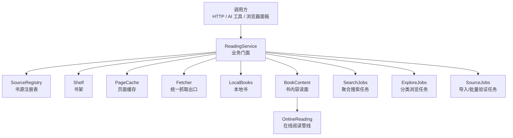

**图示来源**  
- [src/services/reading.ts:120-280](file://src/services/reading.ts#L120-L280)
- [src/services/book-content.ts:1-80](file://src/services/book-content.ts#L1-L80)

**章节来源**  
- [src/services/reading.ts:120-280](file://src/services/reading.ts#L120-L280)
- [docs/adr/0047-book-content-module.md:1-24](file://docs/adr/0047-book-content-module.md#L1-L24)

## 项目结构与定位

`src/services/reading.ts` 位于服务层，向上被 API 分发层与工具层引用，向下依赖：

| 依赖模块 | 职责 | 在门面中的使用 |
|---|---|---|
| `sources.ts` | 书源注册表、启停、凭据、公开投影 | 查询参与搜索的源、校验 sourceId、导出公开列表 |
| `shelf.ts` | 书架增删查改、进度、批量删除 | 加书、打补丁、回写进度、移除本地书副本 |
| `cache.ts` | 目录与正文页面缓存 | 目录命中、正文命中、按规则代际失效 |
| `fetcher.ts` | 出站抓取、代理、超时、解码 | 详情页、目录、正文、下一页、TocUrl 探测 |
| `localbooks.ts` | EPUB/TXT 本地书导入与资源读取 | 本地目录、本地正文、本地资源、本地告警 |
| `book-content.ts` | 书内容读面：目录/导航/正文的本地与在线分流 | 三个读动词的唯一分流点，正文文字规约的统一出口 |
| `online-reading.ts` | 在线阅读管线：缓存优先、在途去重、翻页跟进 | 在线书的目录与正文取值管线 |
| `search-job.ts` | 聚合搜索后台任务 | `startSearchJob`、`cancelSearchJob`、SSE 增量 |
| `explore.ts` | 分类派生与单源分页执行 | `startExploreJob`、`loadMoreExploreJob` |
| `import-job.ts` | 导入与批量验证后台任务 | `startImportJob`、`startBatchProbeJob`、`jobStatus` |
| `bridge.ts` | 规则上下文、字段投影、URL 解析 | 详情字段、搜索命中、目录条目、正文提取 |
| `errors.ts` | 领域错误类型 | 源不存在、请求非法、规则缺失、章节不存在 |

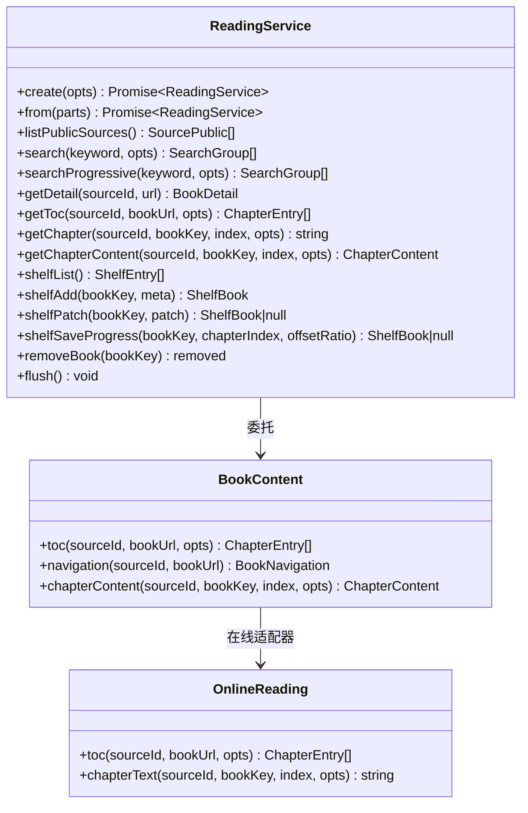

**图示来源**  
- [src/services/reading.ts:120-280](file://src/services/reading.ts#L120-L280)
- [src/services/book-content.ts:1-80](file://src/services/book-content.ts#L1-L80)
- [src/services/online-reading.ts:1-50](file://src/services/online-reading.ts#L1-L50)

**章节来源**  
- [src/services/reading.ts:120-280](file://src/services/reading.ts#L120-L280)
- [src/services/book-content.ts:1-80](file://src/services/book-content.ts#L1-L80)

## 构造方式：create 与 from

### `create`：组合根装配路径

`create` 是面向生产组合根的快捷构造器。它负责：

1. 创建数据目录，保证磁盘存在且快速失败。
2. 根据传入选项或外部 `ResolvedConfig` 组装活配置。
3. 构建 `Fetcher`、加载 `SourceRegistry`、加载 `Shelf`、初始化 `PageCache`、创建 `LocalBooks`。
4. 委托 `from` 完成最终装配。

关键行为：

- `dir` 用于注册表、书架、缓存和本地书；测试可注入临时目录。
- `config` 优先于逐字段默认值；没有 `config` 时用 `staticLiveConfig` 把直装缝数值包装成 `ResolvedConfig`。
- `proxyUrl` 通过 `ValueSource` 透传给 `Fetcher`，支持配置页热改。
- `tocMaxPages`、`contentMaxPages`、`cacheMaxBytes`、`localImportMaxBytes` 分别控制目录翻页、正文翻页、缓存上限和本地导入上限。

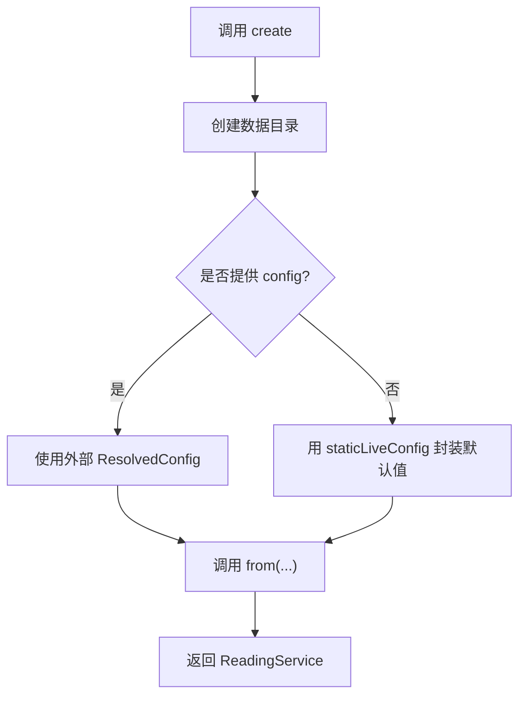

**图示来源**  
- [src/services/reading.ts:120-200](file://src/services/reading.ts#L120-L200)

### `from`：测试与组合根注入路径

`from` 接受已经创建好的子系统实例，包括：

- `registry`
- `shelf`
- `cache`
- `fetcher`
- `local`
- `jobHost`
- `config`
- 以及各类页面上限与并发配置

它的职责不是重新装配部件，而是：

- 校验 `searchParallel` 为正整数。
- 用 `staticLiveConfig` 或传入 `config` 确定运行时配置。
- 构造 `SourceRequest`（一次出站抓取的唯一装配点）。
- 构造 `OnlineReading`（在线阅读管线），注入源查找、书架镜像、文件缓存、出站请求与源求值。
- 构造 `BookContent`（书内容读面），注入本地适配器与在线适配器。
- 构造三个任务持有者：`SourceJobs`、`SearchJobs`、`ExploreJobs`。
- 把 `probe` 的实现绑定到 `SourceJobs`，让导入/批量验证探针与门面探针共用同一 `Fetcher` 与超时口径。
- 把 `jobHost` 窄面透传到宿主侧任务登记系统，缺省则不登记。

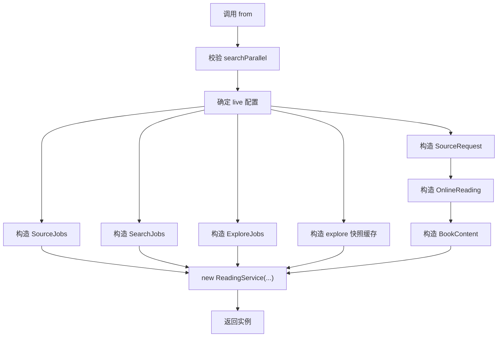

**图示来源**  
- [src/services/reading.ts:201-280](file://src/services/reading.ts#L201-L280)

**章节来源**  
- [src/services/reading.ts:120-280](file://src/services/reading.ts#L120-L280)

## 核心子系统句柄

| 句柄 | 类型 | 可见性 | 作用 |
|---|---|---|---|
| `cfg` | `{ tocMaxPages, contentMaxPages }` | private | 页面数量上限，不受配置页热改影响 |
| `live` | `ResolvedConfig` | private | 可热改配置读数口 |
| `registry` | `SourceRegistry` | private | 书源增删改查、启停、凭据、公开投影 |
| `shelf` | `Shelf` | private | 书架条目、进度、批量删除 |
| `cache` | `PageCache` | private | 目录与正文缓存 |
| `fetcher` | `Fetcher` | private | 统一抓取出口，支持代理与超时 |
| `sourceRequest` | `SourceRequest` | private | 一次出站抓取的唯一装配点（动态头 → 限速 → webview/HTTP → loginCheck） |
| `content` | `BookContent` | private | 书内容读面：目录/导航/正文的本地与在线分流与文字规约 |
| `online` | `OnlineReading` | private（通过 content 间接使用） | 在线阅读管线：缓存优先、在途去重、翻页跟进 |
| `jobs` | `SourceJobs` | private | 导入与批量验证任务 |
| `searchJobs` | `SearchJobs` | private | 聚合搜索任务 |
| `exploreJobs` | `ExploreJobs` | private | 分类浏览任务 |
| `exploreCache` | `KindCache` | private | 分类浏览进程内快照 |
| `local` | `LocalBooks|null` | private | 本地书导入与资源读取 |
| `webview` | `WebViewRuntime` | private | 真浏览器 WebView 的运行时 |

这些句柄全部在构造函数中私有化，外部只能通过 `ReadingService` 的方法访问。这样避免了 API 层或工具层绕过校验直接修改注册表或书架。

**更新** 新增 `content` 与 `sourceRequest` 两个句柄，反映书内容读面独立成模块后的新装配关系。

**章节来源**  
- [src/services/reading.ts:120-280](file://src/services/reading.ts#L120-L280)
- [src/services/book-content.ts:1-80](file://src/services/book-content.ts#L1-L80)

## 业务方法总览与调用约定

### 书源管理

| 方法 | 输入 | 返回值 | 说明 |
|---|---|---|---|
| `listPublicSources` | 无 | `SourcePublic[]` | 对外投影，隐藏 raw/rules/auth |
| `setEnabled` | `id`, `enabled` | `boolean` | 启停单个源 |
| `setEnabledMany` | `ids[]`, `enabled` | `number` | 批量启停，去重后一次 edit |
| `removeSource` | `id` | `boolean` | 删除单个源 |
| `removeSources` | `ids[]` | `number` | 批量删除 |
| `saveAuth` | `id`, `cookies`, `headers?` | `void` | 录入凭据，`acquiredAt` 由门面盖章 |
| `runLogin` | `id` | `SourceAuth|null` | 执行 JS loginUrl，空产出返回 null |
| `loginPlan` | `id` | `manual|js|null` | 判断 loginUrl 形态 |
| `hasSource` | `id` | `boolean` | 仅做存在性判断 |

### 搜索

| 方法 | 输入 | 返回值 | 说明 |
|---|---|---|---|
| `search` | `keyword`, `sourceIds?` | `SearchGroup[]` | 一次性收齐 |
| `searchProgressive` | `keyword`, `opts` | `Promise<SearchGroup[]>` | 按批增量回调 |
| `searchPlan` | 无 | `SearchPlan` | 参与搜索的源 id 清单 |
| `startSearchJob` | `keyword`, `sourceIds?` | `{ jobId }` | 提交后台搜索 |
| `cancelSearchJob` | 无 | `{ cancelled }` | 停止本轮搜索 |
| `searchJobSnapshot` | `since=0` | `SearchJobSnapshot|null` | 游标增量快照 |
| `subscribeSearchJob` | `listener` | `unsubscribe` | SSE 订阅 |

### 详情、目录、导航、正文

| 方法 | 输入 | 返回值 | 说明 |
|---|---|---|---|
| `getDetail` | `sourceId`, `url` | `BookDetail` | 详情七字段 + tocUrl |
| `getToc` | `sourceId`, `bookUrl`, `refresh?` | `ChapterEntry[]` | 目录，委托 `BookContent.toc` |
| `getNavigation` | `sourceId`, `bookUrl` | `BookNavigation` | 线性章节 + 平面树，委托 `BookContent.navigation` |
| `getChapter` | `sourceId`, `bookKey`, `index`, `refresh?` | `string` | 纯文本，经 `chapterContentToText` 投影 |
| `getChapterContent` | `sourceId`, `bookKey`, `index`, `refresh?` | `ChapterContent` | 图文契约，委托 `BookContent.chapterContent` |

### 书架

| 方法 | 输入 | 返回值 | 说明 |
|---|---|---|---|
| `shelfList` | 无 | `ShelfEntry[]` | 落盘条目 + sourceName，按最近阅读排序 |
| `shelfAdd` | `bookKey`, `meta` | `ShelfBook` | title+sourceId 必填 |
| `shelfPatch` | `bookKey`, `patch` | `ShelfBook|null` | 不在架返回 null |
| `shelfSaveProgress` | `bookKey`, `chapterIndex`, `offsetRatio` | `ShelfBook|null` | 值域校验 |
| `removeBook` | `bookKey` | `{ removed }` | 本地书连带删文件 |
| `removeBooks` | `bookKeys[]` | `{ removed }` | 批量删，只删真实在架项 |

### 任务

| 方法 | 输入 | 返回值 | 说明 |
|---|---|---|---|
| `startImportJob` | `files[]` | `{ jobId }` | 导入任务 |
| `startBatchProbeJob` | `ids[]` | `{ jobId }` | 批量验证任务 |
| `jobStatus` | 无 | `JobState|null` | 最近任务态 |

### 本地书

| 方法 | 输入 | 返回值 | 说明 |
|---|---|---|---|
| `localImport` | `bytes`, `name` | `LocalImportResponse` | TXT/EPUB 自动分流并上架 |
| `getLocalSupplement` | `bookKey`, `documentId` | `ChapterContent` | EPUB 文档补充 |
| `getLocalResource` | `bookKey`, `resourceId` | `LocalResource` | 流/MIME/字节数 |
| `getLocalImportWarnings` | `bookKey` | `LocalImportWarning[]` | 非 EPUB 恒空 |
| `removeLocalBook` | `id` | `{ removed }` | 本地+书架任一命中即删 |

**更新** 目录、导航、正文三个方法的说明改为"委托 `BookContent`"，反映分流逻辑已收口至书内容读面模块。

**章节来源**  
- [src/services/reading.ts:240-450](file://src/services/reading.ts#L240-L450)
- [src/services/reading.ts:450-750](file://src/services/reading.ts#L450-L750)
- [src/services/reading.ts:750-953](file://src/services/reading.ts#L750-L953)
- [src/services/book-content.ts:1-80](file://src/services/book-content.ts#L1-L80)

## 搜索链路详解

### 典型调用链：AI 工具 → ReadingService.search → SearchJob → 并发 probe/search → mergeBooks → SSE

这里以"AI 工具"作为任意调用方为例，实际调用方也可以是 HTTP API、浏览器面板或 agent 脚本。

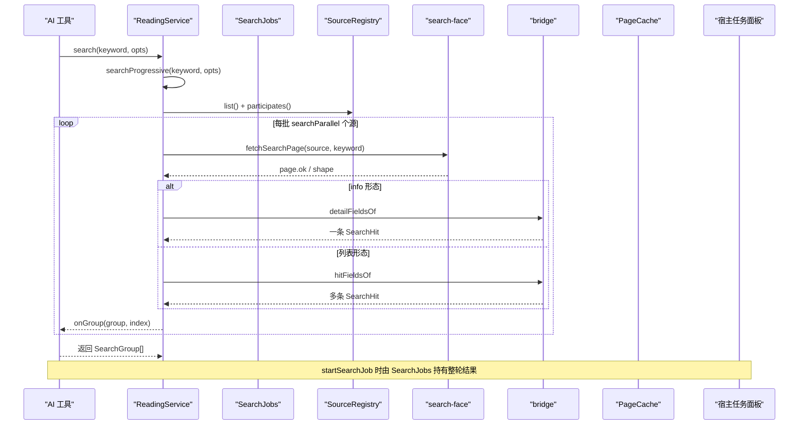

**图示来源**  
- [src/services/reading.ts:520-640](file://src/services/reading.ts#L520-L640)
- [src/services/search-job.ts:1-174](file://src/services/search-job.ts#L1-L174)

### `searchProgressive` 的行为

1. 从注册表取出全部启用源，并按 `participates` 过滤。
2. 如果传入 `sourceIds`，则再按该清单过滤。
3. 按 `searchParallel` 分批并行处理。
4. 每个源调用 `searchOne`。
5. 每完成一个源就按完成序调用 `onGroup`。
6. 如果 `shouldStop` 为真，不再开新的源；已搜出的命中保留。
7. 返回数组时去掉未完成的洞位，保持旧语义。

### `search` 与 `startSearchJob`

- `search` 是 `searchProgressive` 的薄壳，适合一次性同步消费的场景。
- `startSearchJob` 把同一份 `searchProgressive` 包装成后台任务，交给 `SearchJobs` 持有。
- 搜索结果通过 `SearchJobs.snapshot(since)` 增量推送，或通过 `subscribeSearchJob` 触发 SSE。

### `searchOne` 的关键分支

| 分支 | 条件 | 行为 |
|---|---|---|
| 规则缺失 | `page.ok === false` | 返回带 `RuleMissing` 错误的组 |
| info 形态 | 整个响应是详情页 | 用 `detailFieldsOf` 生成一条书目 |
| 列表形态 | 正常列表 | 遍历 `contexts`，按 `hitFieldsOf` 生成命中 |
| 异常 | 求值或网络异常 | 转为带 `code` 与消息的错误组 |

**章节来源**  
- [src/services/reading.ts:520-640](file://src/services/reading.ts#L520-L640)

## 分类浏览（书城）任务

分类浏览与搜索不同：它不是聚合多个源，而是"一个源、一个分类标题、一页"。

### 入口与校验

`startExploreJob(sourceId, kind)` 会：

1. 调用私有方法 `pickEntry` 解析源、分类标题与入口地址。
2. 如果解析失败，抛出 `InvalidRequestError`，HTTP 层映射为 400。
3. 成功则交给 `ExploreJobs.start`，运行体是 `runExplorePage`。

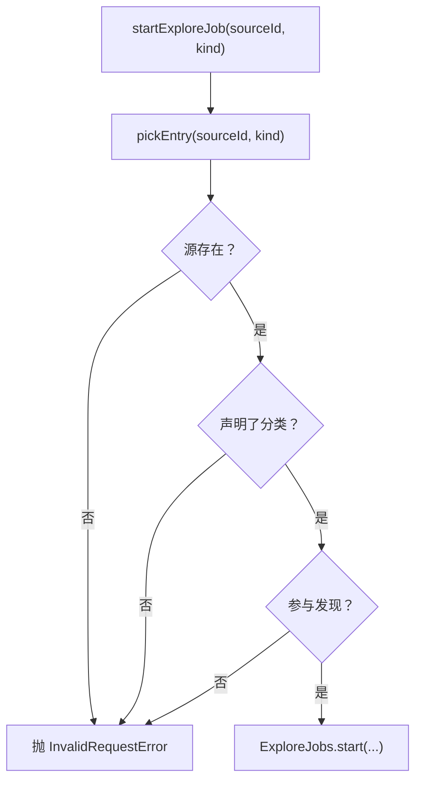

**图示来源**  
- [src/services/reading.ts:640-750](file://src/services/reading.ts#L640-L750)

### 续页策略

`loadMoreExploreJob()` 的逻辑更谨慎：

- 如果当前没有任务，或 `hasMore` 为假，返回 `null`。
- 如果此时源或分类已变化，也返回 `null`，而不是抛错。
- 只有能拿到有效入口时才推进下一页。

这是为了区分两种事实：

- "用户主动点名一个无效分类" → 报错。
- "轮次还在显示，但分类名变了或源被删" → 没得加载。

### 分类快照缓存

`fetchExploreGroup` 使用 `KindCache`：

- 缓存键包含 `sourceId`、`kindUrl`、`epoch`、`page`。
- 命中直接返回，零网络。
- 只有成功结果写入缓存；失败不缓存，避免把偶发故障钉死到 TTL 结束。
- 代际来自 `exploreEpoch`，不是 `rulesEpoch`，因为发现规则需要独立过期。

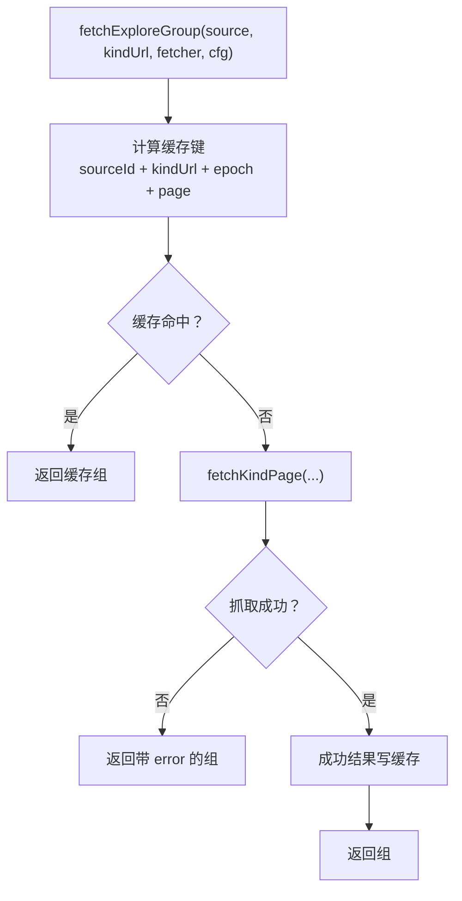

**图示来源**  
- [src/services/explore.ts:1-75](file://src/services/explore.ts#L1-L75)

**章节来源**  
- [src/services/reading.ts:640-750](file://src/services/reading.ts#L640-L750)
- [src/services/explore.ts:1-75](file://src/services/explore.ts#L1-L75)

## 导入与批量验证任务

### 同步导入 vs 后台任务

`ReadingService` 提供两条导入路径：

| 路径 | 方法 | 特点 |
|---|---|---|
| 同步导入 | `importOne`、`importSource` | 立即执行，不探针，status 恒 `unverified` |
| 后台任务 | `startImportJob` | 服务端持有，可取消，可重看 UI |

同步导入使用 `SourceIntake` 做 normalize、去重、add/replace，并把结果投影为 `ImportOutcome`。后台任务则在 `SourceJobs.runImport` 中重复同一套入库规则，同时累计计数、记录问题、写过程行。

### 批量验证

`startBatchProbeJob(ids)` 对有效 id 并发执行 `probeSource`，并发度固定为 5，与搜索并发对齐。验证失败不中断整体任务；单条失败记入 counts 与 issues。

### 任务状态

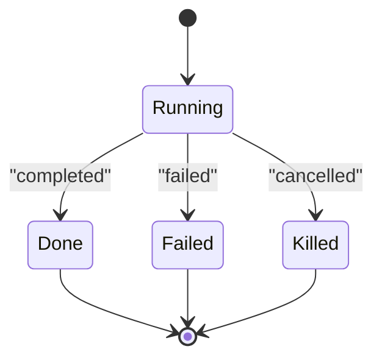

**图示来源**  
- [src/services/import-job.ts:1-200](file://src/services/import-job.ts#L1-L200)
- [src/services/search-job.ts:1-174](file://src/services/search-job.ts#L1-L174)

### owner 隔离与取消

`SearchJobs`、`ExploreJobs`、`SourceJobs` 都通过 `JobHost` 把任务登记到宿主侧。宿主的 `ctx.jobs` 提供：

- 按 owner 隔离的任务命名空间。
- 最大并发限制。
- 协作式取消。
- 终态结算。

`SearchJobs.cancel` 会立即把当前轮置为 `killed`；在途的最多 `searchParallel` 条请求不再收货，但已收到的命中仍保留在结果中。

`SourceJobs` 的取消是协作式的：每次取下一条前检查 `requested`，并在取消后先 flush 注册表，再 settle 为 `killed`。

**章节来源**  
- [src/services/import-job.ts:1-200](file://src/services/import-job.ts#L1-L200)
- [src/services/search-job.ts:1-174](file://src/services/search-job.ts#L1-L174)
- [src/services/reading.ts:400-450](file://src/services/reading.ts#L400-L450)

## 书内容读面独立成模块

### 为什么需要 BookContent 模块

目录、导航与正文的本地/在线分流此前散在 `ReadingService` 的三个读动词里，正文文字规约又只挂在在线阅读那条路上——本地 TXT 把 CRLF 与连续空行原样交给导出与 AI。现在分流与文字规约收进 `services/book-content.ts` 的 `BookContent`，门面只委托。

### BookContent 的职责

`BookContent` 收 `LocalBooks` / `OnlineReading` 两个适配器：

- **目录**：本地适配器读持久化目录；在线适配器走缓存/在途去重/翻页那条管线。
- **导航**：本地 EPUB 读原生 nav/NCX；其余按线性目录派生平面树。
- **正文**：本地 EPUB 返回 rich；TXT 与在线返回 text。text 一律在这里过行规约——这是两个适配器共同的出口契约，调用方不必知道来源。

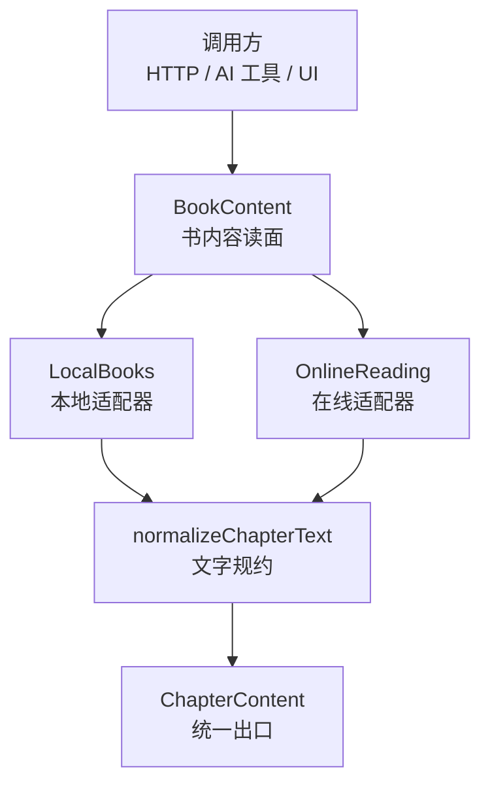

**图示来源**  
- [src/services/book-content.ts:1-80](file://src/services/book-content.ts#L1-L80)

### 文字规约的统一出口

正文 `text` 出口统一过 `chapter-content.ts` 的 `normalizeChapterText`：本地 TXT 与在线正文同一份行规约，幂等；EPUB 的 rich 树原样通过，不解释结构。`chapterContentToText` 的 text 分支调用同一函数，不另立第二份算式。

### 边界

- 来源**展示**判据（门面的 `sourceNameOf`、书架的本地筛选）仍按 `LOCAL_SOURCE_ID` 判来源身份；那是呈现层事实，不是内容读取分流。
- `book-content` 不拥有取数语义：在线缓存与翻页、本地文件解析都不搬进来。
- 在线阅读的缓存、目录在途去重、翻页、subContent 与空正文策略仍归 `OnlineReading`；本地包内解析仍归 `LocalBooks`；缓存有效性仍归 `cache-epoch`。门面保留搜索、发现、书架、导入、登录、详情等跨面动词。

### 门面委托示例

```typescript
// 目录：本地与在线的分流归 BookContent
async getToc(sourceId: string, bookUrl: string, opts?: { refresh?: boolean }): Promise<ChapterEntry[]> {
  return this.content.toc(sourceId, bookUrl, opts)
}

// 目录导航：本地书读持久化导航，其他书按目录派生平面导航
async getNavigation(sourceId: string, bookUrl: string): Promise<BookNavigation> {
  return this.content.navigation(sourceId, bookUrl)
}

// 章节正文（图文面）：本地/在线分流与正文文字规约归 BookContent
getChapterContent(sourceId: string, bookKey: string, chIndex: number, opts?: { refresh?: boolean }): Promise<ChapterContent> {
  return this.content.chapterContent(sourceId, bookKey, chIndex, opts)
}
```

**章节来源**  
- [src/services/book-content.ts:1-80](file://src/services/book-content.ts#L1-L80)
- [src/services/reading.ts:860-920](file://src/services/reading.ts#L860-L920)
- [docs/adr/0047-book-content-module.md:1-24](file://docs/adr/0047-book-content-module.md#L1-L24)
- [tests/services/book-content.test.ts:1-96](file://tests/services/book-content.test.ts#L1-L96)

## 面板期书架投影

### 为什么需要面板期投影

书架读取面、落架账与筛选/关键字此前没有同一个家：ShelfView 每次挂载整取、ReaderSession 为答一个在架布尔再整取、搜索落架账只活组件挂载期；切去阅读器再回来，行上又写"＋ 加书架"。现在这三样收进 `client/panel-shelf.ts` 的面板期投影：挂载拉一次、加架并入落架账、删除对账，面板卸载即丢；业务真相仍在服务端。

### PanelShelfState 的结构

```typescript
interface PanelShelfState {
  books: ShelfEntry[] | null      // null = 还没取过（骨架）；失败时是 [] + error
  error: string | null
  filter: ShelfFilterKey           // 筛选键
  keyword: string                  // 关键字
  landed: ReadonlySet<string>      // 已落架的架位（bookKey 即命中地址）
}
```

### 核心操作

#### loadPanelShelf：取一次书架

- 并发调用并到同一发 GET。
- 成功后以服务端列表为基线，与既有落架账取并集（写成功过、服务端列表短暂滞后也不丢账）。
- 失败时 `books=[]` + `error`，不拿空架冒充加载中。

#### ensurePanelShelf：确保读到所需数据

- 书架还没取过、上次读面失败，或指定书不在已有列表里才取。
- 已有在途刷新时先等它落地（阅读器还要从同一份列表恢复进度）。
- 等完之后仍缺当前书或上次读面失败，再重取一次。

#### markPanelShelfLanded：落架成功记入账本

- 按地址去重；幂等 PUT 的语义是"这一发成功过"。
- 作废起始更早的在途读面——否则加架前的快照落地会把这本书仍判成"不在架"。
- 只有真新增那一发才抬代际：同一地址第二次记入时，早于第一次记入的那些读面已经被作废过一轮了。

#### removePanelShelfBooks：删除成功后对账

- 架位与落架账一起移除（否则删掉再加的书会被旧账误标成"已在架"）。
- 起始早于这次删除的在途读面带的是删前快照，落地会把书带回来——按代际整发作废。

#### resetPanelShelf：面板卸载重置

- 回到"还没取过"的初始面。
- 在途响应按代际丢弃。

### 代际隔离机制

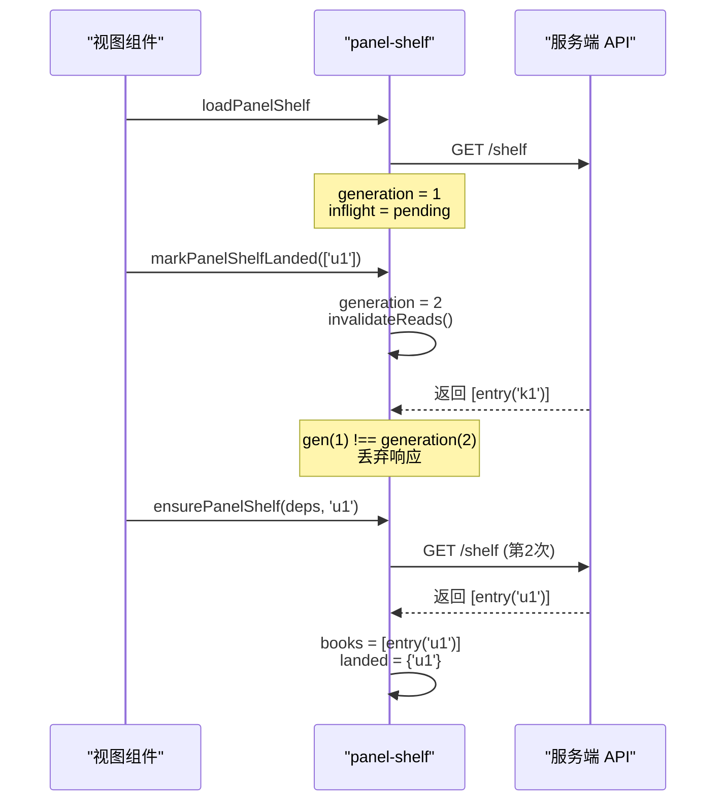

**图示来源**  
- [src/client/panel-shelf.ts:1-139](file://src/client/panel-shelf.ts#L1-L139)

### 调用方集成

- **搜索结果页**：挂载时向 `ensurePanelShelf` 要整份基线（不带当前书身份）——`routeStore` 跨卸载存活而投影随面板清空，重开面板直接落在结果页时不能指望书架 tab 或阅读器替它取。
- **阅读器**：向投影问在架读数与恢复进度（`ensurePanelShelf`；有在途刷新先等它落地，投影缺当前书或上次读面失败时重取一次）。
- **书城加书**：加架成功调用 `markPanelShelfLanded`，搜索、书城与阅读器入架三处调用方共用同一落架账。

### 不变量

- **轮次身份与游标不可分开**：每个回包先验 `job.id`；旧观察者跟随最近一轮；关键词不是身份。
- **反馈位置就是点击位置**：秒级乐观操作不进全局泳道，失败回滚并带行锚点。
- **色值与尺寸只准住 token 层**：视图与逻辑层不内联颜色字面量。

**章节来源**  
- [src/client/panel-shelf.ts:1-139](file://src/client/panel-shelf.ts#L1-L139)
- [docs/adr/0046-panel-shelf-projection.md:1-19](file://docs/adr/0046-panel-shelf-projection.md#L1-L19)
- [tests/client/panel-shelf.test.ts:1-202](file://tests/client/panel-shelf.test.ts#L1-L202)

## 错误传播与参数校验

### 参数校验位置

`ReadingService` 把大多数值域校验放在门面层，而不是只在 HTTP 路由层：

- `shelfAdd`：`title` 非空、`sourceId` 非空字符串。
- `shelfSaveProgress`：`chapterIndex` 非负整数、`offsetRatio` 为 `[0,1]` 有限数。
- `requireParallelStep`：`searchParallel` 必须是正整数。
- `pickEntry`：源不存在、分类不存在、不参与发现时返回 `null`。
- 章节索引越界：`ChapterNotFoundError`。
- 规则缺失：`RuleMissingError`。
- 正文规则未取值或零命中：`RuleEvalError`。
- 源不存在：`SourceNotFoundError`。
- 本地书未挂载：`LocalNotMountedError`。

### 错误分类

| 错误类型 | 典型场景 | 传播方式 |
|---|---|---|
| `InvalidRequestError` | 缺少 keyword、sourceId 非法、progress 值域非法 | 通常映射为 400 |
| `SourceNotFoundError` | 调用已知 sourceId 但源已删除 | 上层捕获后转业务错误 |
| `RuleMissingError` | 源缺少 ruleContent、ruleChapterList/ruleBookList 等 | 明确提示哪个 facet 缺规则 |
| `ChapterNotFoundError` | 章节索引越界 | 404 或等价语义 |
| `RuleEvalError` | 规则求值为空、正文零命中、tocUrl 解析失败 | 带 facet、segmentRaw、hits 诊断信息 |
| `LocalNotMountedError` | 在没有 LocalBooks 的实例上调用本地书方法 | 装配错误，不应出现在正常线上流程 |

### 测试覆盖的关键断言

`tests/api/dispatch-reading.test.ts` 覆盖了：

- 搜索缺 keyword 返回 400。
- 搜索结果分组与命中字段。
- 详情 Miss 字段为 null 但不报错。
- 目录两页合并、refresh 绕缓存。
- 正文显式 `{kind: 'text', text}` 契约。
- 导航线性章节与平面树。
- shelf PUT 加书、回写进度、删除。
- progress 值域非法返回 400。
- totalChapters 回写与 patch 保值。

**章节来源**  
- [src/services/reading.ts:240-450](file://src/services/reading.ts#L240-L450)
- [src/services/reading.ts:750-953](file://src/services/reading.ts#L750-L953)
- [tests/api/dispatch-reading.test.ts:1-200](file://tests/api/dispatch-reading.test.ts#L1-L200)

## 扩展新业务的复用原则

当新增一项业务能力时，应遵循以下原则：

1. **不要直接操作 `SourceRegistry`、`Shelf`、`LocalBooks`**  
   新能力应通过 `ReadingService` 的动词访问。例如加书用 `shelfAdd` 或 `shelfPatch`，而不是直接调 `shelf.update`。

2. **不要复制搜索批循环**  
   如果需要后台化搜索，应复用 `searchProgressive`，并通过 `startSearchJob` 接入 `SearchJobs`，而不是自己维护一组 `Promise.all`。

3. **不要复制分类派生逻辑**  
   分类清单应调用 `exploreSources`，分页应调用 `startExploreJob` 与 `loadMoreExploreJob`。

4. **不要在服务层 import API 层**  
   门面抛出 `InvalidRequestError`，由上层分类为 400；服务层不关心 HTTP 状态码。

5. **不要把配置值散落在多处**  
   并发、超时、JS 预算、缓存上限等应通过 `live` 或 `cfg` 读取，而不是在调用点写字面量。

6. **不要绕过 `Fetcher`**  
   所有出站请求都应经过 `Fetcher`，以便共享代理、超时、请求头拼接、解码与重试策略。

7. **不要在门面外定义 wire 形状**  
   公开类型应从 `shared/wire.ts` re-export，避免 HTTP 面与工具面出现两套结构。

8. **不要绕过 `BookContent` 做本地/在线分流**  
   目录、导航、正文的读取应通过 `BookContent` 的三个方法，而不是在调用方各自判 `__local__`。

9. **不要绕过 `panel-shelf` 做落架账管理**  
   加架、删除、筛选等操作应通过 `panel-shelf.ts` 的投影接口，而不是在各视图组件内各自维护状态。

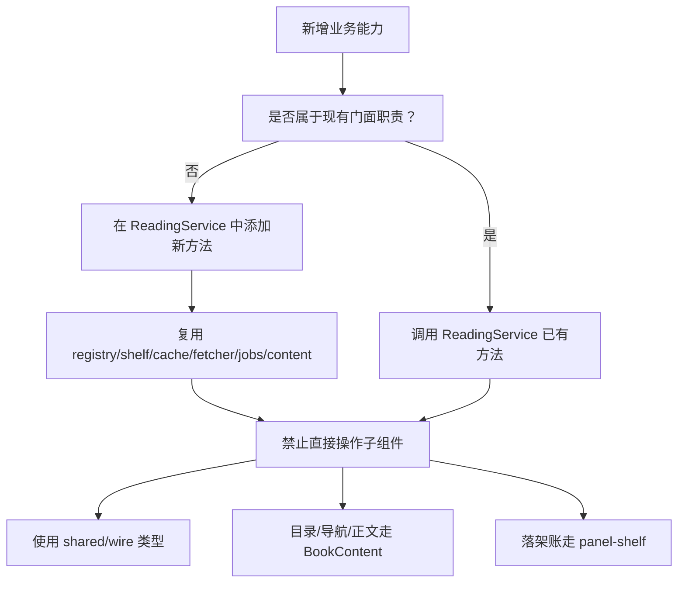

[本图为概念性复用原则图，不对应具体代码结构，因此不附"图示来源"]

## 性能与并发特性

| 维度 | 默认值或策略 | 说明 |
|---|---:|---|
| 搜索并发 | 5 | 由 `DEFAULT_SEARCH_PARALLEL` 决定，`requireParallelStep` 强制正整数 |
| JS 沙箱预算 | 15000ms | 搜索、详情、目录、正文、登录脚本共用 |
| 目录最大页数 | 200 | `tocMaxPages` |
| 正文最大页数 | 50 | `contentMaxPages` |
| 缓存上限 | 200MB | `DEFAULT_CACHE_MAX_BYTES`，通过 `PageCache` 动态上限函数控制 |
| 本地导入上限 | 50MB | `DEFAULT_MAX_IMPORT_BYTES` |
| 分类快照缓存 | 进程内 `KindCache` | 同源同分类同代际同页零请求 |
| 目录 in-flight 去重 | `tocInflight Map` | 同书并发只拉一次目录 |
| 搜索任务保留期 | 由 `SEARCH_JOB_RETENTION_MS` 控制 | 结束后仍保留一段时间，供客户端拉取 |

### 并发模型

- 搜索：每批最多 `searchParallel` 个源并行。
- 正文：单章串行翻页，但不同章节可并行。
- 目录：同书并发请求去重。
- 分类浏览：单轮单源单页，多轮之间由 `ExploreJobs` 持有。
- 导入/批量验证：导入顺序执行，批量验证并发 5。

### 缓存策略

- 目录与正文按规则代际失效。
- 正文首屏空内容视为未命中，避免写出 0 字节缓存。
- 分类浏览只缓存成功结果。
- 任务结果有保留期，避免"已结束"被误认为"无结果"。

### LRU 增量记账

缓存层引入进程级 LRU 增量记账机制：

- **增量记账**：每次写入后按落盘字节增量更新 `sizes` 索引与 `totalBytes` 总量，避免每次写入都全量扫描目录。
- **按需全扫**：估算超上限或达到 `FULL_SCAN_EVERY`（32 次）写实扫对账一次，外部增删只能靠实扫发现。
- **LRU 淘汰**：prune 时两目录总字节超上限 → 按 mtime 最旧先删（LRU 近似）。
- **索引重建**：首次写入后实扫一次建索引，之后按写增量维护；扫描期间另有写入则不重建索引，避免抹掉那笔写。
- **方向安全**：留下的只会是本次已删文件的残留条目——把总量估高、淘汰偏早，方向安全。

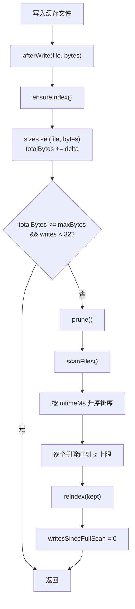

**图示来源**  
- [src/services/cache.ts:1-204](file://src/services/cache.ts#L1-L204)
- [src/services/lru.ts:1-14](file://src/services/lru.ts#L1-L14)

**章节来源**  
- [src/services/reading.ts:53-120](file://src/services/reading.ts#L53-L120)
- [src/services/reading.ts:520-750](file://src/services/reading.ts#L520-L750)
- [src/services/reading.ts:750-953](file://src/services/reading.ts#L750-L953)
- [src/services/search-job.ts:1-174](file://src/services/search-job.ts#L1-L174)
- [src/services/explore.ts:1-75](file://src/services/explore.ts#L1-L75)
- [src/services/import-job.ts:1-200](file://src/services/import-job.ts#L1-L200)
- [src/services/cache.ts:1-204](file://src/services/cache.ts#L1-L204)
- [src/services/lru.ts:1-14](file://src/services/lru.ts#L1-L14)

## 故障排查清单

| 现象 | 可能原因 | 排查方向 |
|---|---|---|
| 搜索卡住 | `searchParallel` 非正整数 | 检查 `DEFAULT_SEARCH_PARALLEL` 与 `requireParallelStep` |
| 搜索切 tab 后结果消失 | 前端自持搜索状态而非后端任务 | 改用 `startSearchJob` + `searchJobSnapshot` |
| 搜索取消后仍有少量结果 | 在途最多多达 `searchParallel` 条请求不可撤回 | 预期行为，不应视为 bug |
| 目录为空 | 缺少 `ruleChapterList/ruleBookList` 或 `ruleChapterName/ruleChapterUrl` | 查看 `RuleMissingError` 的 facet |
| 正文为空或报错 | 缺少 `ruleContent`，或规则零命中 | 查看 `RuleEvalError` 的 segmentRaw |
| 正文翻页串到其他章节 | 下一页 URL 命中其他章节 | 检查 `stopUrls` 与目录知识 |
| 分类浏览点不到类 | 源未启用、不是文本源、未声明分类或未参与发现 | 检查 `exploreParticipates` 与 `pickEntry` |
| 导入后 status 仍是 unverified | 同步导入不探针 | 使用 `startBatchProbeJob` 或 `probe` |
| 本地书删除后仍留文件 | 未通过 `removeBook`/`removeBooks` 的门面 | 检查是否直接操作 `LocalBooks` |
| 配置页改了并发不生效 | 使用了 `create` 直装缝数值而非 `config` | 确保通过 `ResolvedConfig` 的 getter 读取 |
| 加架后仍显示"＋ 加书架" | 未调用 `markPanelShelfLanded` 或面板期投影已重置 | 检查加架成功后的落架账记入与代际隔离 |
| 删除后重新加架仍显示"已在架" | 未调用 `removePanelShelfBooks` 对账 | 检查删除成功后的落架账清理 |
| 缓存占用持续增长 | LRU 增量记账未触发 prune | 检查 `cacheMaxBytes` 配置与写入频率 |

**章节来源**  
- [src/services/reading.ts:240-450](file://src/services/reading.ts#L240-L450)
- [src/services/reading.ts:520-750](file://src/services/reading.ts#L520-L750)
- [src/services/reading.ts:750-953](file://src/services/reading.ts#L750-L953)
- [src/client/panel-shelf.ts:1-139](file://src/client/panel-shelf.ts#L1-L139)
- [src/services/cache.ts:1-204](file://src/services/cache.ts#L1-L204)

## 结论

`ReadingService` 的核心价值在于"收敛业务入口、隔离底层实现、统一错误与缓存语义、集中后台任务"。它并不替代 `SourceRegistry`、`Shelf`、`Fetchers`、`SearchJobs` 等子系统，而是把它们组织成一个稳定的对外契约。

对于扩展新业务，最重要的原则是：**面向门面编程，而不是面向子系统编程**。新增能力应优先考虑：

- 是否可以通过现有动词组合实现。
- 是否需要增加一个新的门面方法。
- 是否应该引入新的后台任务持有者。
- 是否复用了统一的抓取、缓存、规则求值与错误体系。
- 是否通过 `BookContent` 做本地/在线分流，而不是在调用方各自判 `__local__`。
- 是否通过 `panel-shelf` 管理落架账，而不是在各视图组件内各自维护状态。

这样，HTTP API、AI 工具与浏览器面板才能共享同一份一致性保障，而不是各自维护一套易漂移的业务实现。

**更新** 强调 BookContent 模块与 panel-shelf 投影的复用原则，反映最新架构演进。