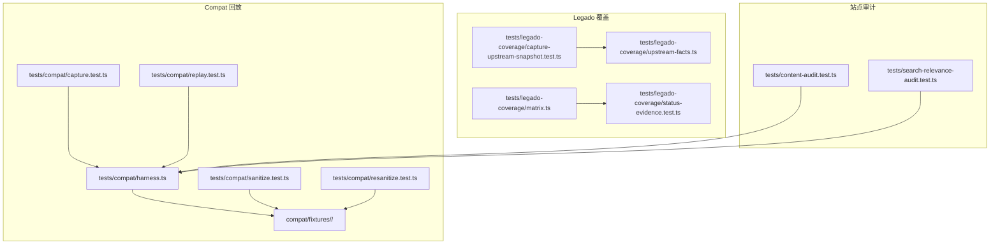
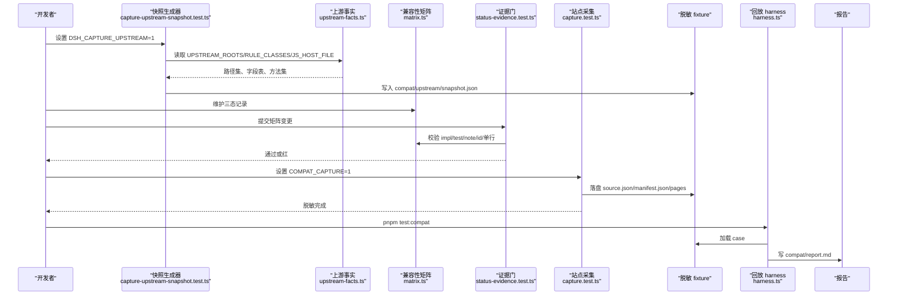
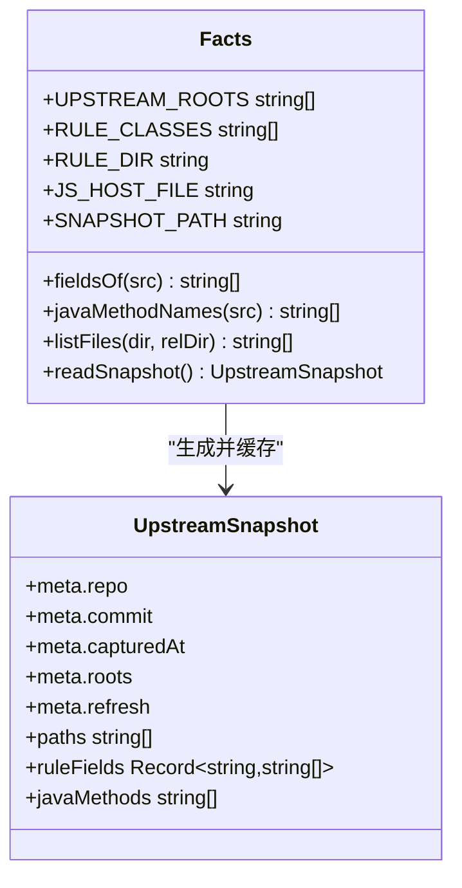
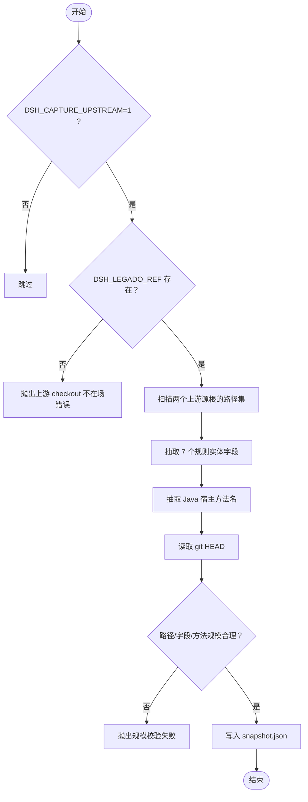
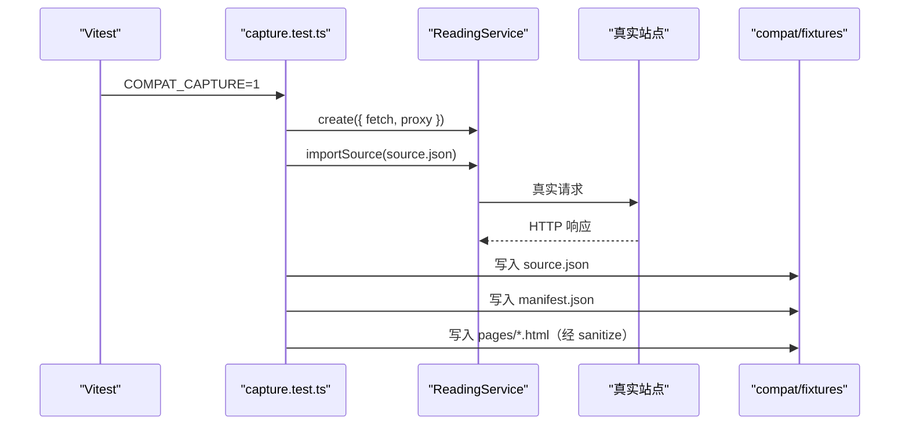
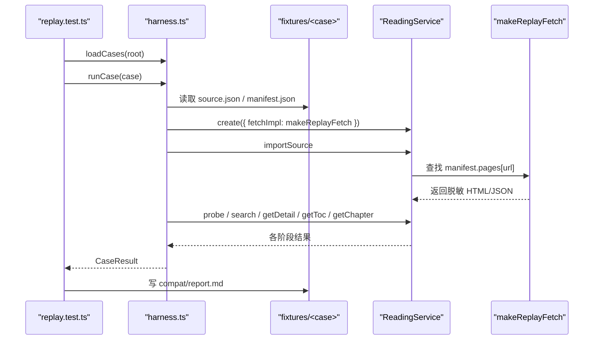
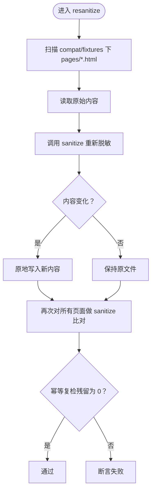
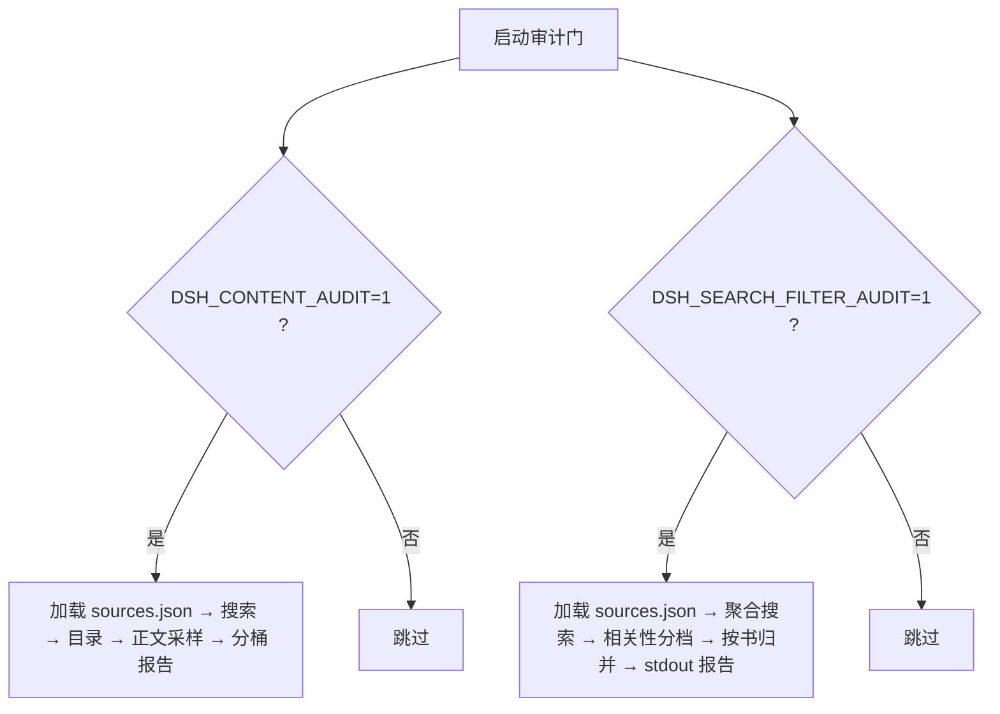
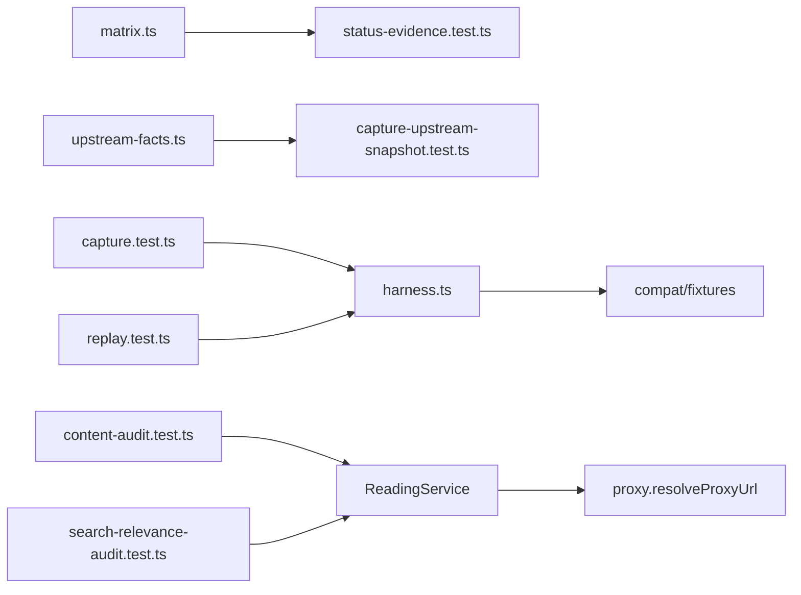

# 兼容性回放与站点审计

<cite>
**本文引用的文件**   
- [upstream-facts.ts](file://tests/legado-coverage/upstream-facts.ts)
- [capture-upstream-snapshot.test.ts](file://tests/legado-coverage/capture-upstream-snapshot.test.ts)
- [status-evidence.test.ts](file://tests/legado-coverage/status-evidence.test.ts)
- [matrix.ts](file://tests/legado-coverage/matrix.ts)
- [content-audit.test.ts](file://tests/content-audit.test.ts)
- [search-relevance-audit.test.ts](file://tests/search-relevance-audit.test.ts)
- [capture.test.ts](file://tests/compat/capture.test.ts)
- [replay.test.ts](file://tests/compat/replay.test.ts)
- [harness.ts](file://tests/compat/harness.ts)
- [sanitize.test.ts](file://tests/compat/sanitize.test.ts)
- [resanitize.test.ts](file://tests/compat/resanitize.test.ts)
- [vitest.config.ts](file://vitest.config.ts)
- [vitest.compat.config.ts](file://vitest.compat.config.ts)
</cite>

## 目录
1. [引言](#引言)
2. [项目结构](#项目结构)
3. [核心组件](#核心组件)
4. [架构总览](#架构总览)
5. [详细组件分析](#详细组件分析)
6. [依赖关系分析](#依赖关系分析)
7. [性能注意事项](#性能注意事项)
8. [故障排查指南](#故障排查指南)
9. [结论](#结论)
10. [附录：操作清单](#附录操作清单)

## 引言
本仓库的 legao 兼容性与站点审计体系围绕三个目标建立：
- 用“上游事实快照”冻结对面仓库的语法、实体字段与 Java 宿主方法，避免运行期依赖外部 checkout。
- 用 capture/replay 把真实站点请求录制为脱敏 fixture，并在离线回放中裁决 import / search / detail / toc / chapter 五步链路。
- 用 DSH_CONTENT_AUDIT 与 DSH_SEARCH_FILTER_AUDIT 对全量源进行网络审计，产出失败分桶与相关性报告，但不作为通过率门。

## 项目结构
相关代码分布在两条测试分支上：
- `tests/legado-coverage`：面向 legado 语法规则与上游事实的覆盖矩阵、上游快照生成与证据门。
- `tests/compat`：面向真实站点的 capture / replay / sanitize / resanitize 回放套件。
- `tests/content-audit.test.ts` 与 `tests/search-relevance-audit.test.ts`：两扇全量网络审计门。

**图表来源**
- [upstream-facts.ts:1-104](file://tests/legado-coverage/upstream-facts.ts#L1-L104)
- [capture-upstream-snapshot.test.ts:1-79](file://tests/legado-coverage/capture-upstream-snapshot.test.ts#L1-L79)
- [matrix.ts:1-53](file://tests/legado-coverage/matrix.ts#L1-L53)
- [status-evidence.test.ts:1-111](file://tests/legado-coverage/status-evidence.test.ts#L1-L111)
- [capture.test.ts:1-99](file://tests/compat/capture.test.ts#L1-L99)
- [harness.ts:1-200](file://tests/compat/harness.ts#L1-L200)
- [replay.test.ts:1-33](file://tests/compat/replay.test.ts#L1-L33)
- [sanitize.test.ts:1-47](file://tests/compat/sanitize.test.ts#L1-L47)
- [resanitize.test.ts:1-48](file://tests/compat/resanitize.test.ts#L1-L48)
- [content-audit.test.ts:1-200](file://tests/content-audit.test.ts#L1-L200)
- [search-relevance-audit.test.ts:1-129](file://tests/search-relevance-audit.test.ts#L1-L129)

**章节来源**
- [vitest.config.ts:1-21](file://vitest.config.ts#L1-L21)
- [vitest.compat.config.ts:1-11](file://vitest.compat.config.ts#L1-L11)

## 核心组件
- 上游事实与快照：`upstream-facts.ts` 提供上游根路径、规则类名、字段抽取器、Java 宿主方法抽取器与模块级缓存的快照读取函数；`capture-upstream-snapshot.test.ts` 是刷新快照的开发工具。
- 兼容性矩阵：`matrix.ts` 定义三态记录（implemented / not-applicable / open），由 `status-evidence.test.ts` 逐行校验实现符号、测试钉子、日期锚与单行形态。
- 站点采集与回放：`capture.test.ts` 真站录制并落盘脱敏 HTML；`replay.test.ts` + `harness.ts` 从 fixture 回放 import → search → detail → toc → chapter。
- HTML 清洗：`sanitize.test.ts` 断言脱敏门禁；`resanitize.test.ts` 支持在规则演进后对已入库 fixture 就地重洗。
- 站点审计：`content-audit.test.ts` 走搜索→目录→正文；`search-relevance-audit.test.ts` 走聚合搜索→相关性分档→按书归并。

**章节来源**
- [upstream-facts.ts:1-104](file://tests/legado-coverage/upstream-facts.ts#L1-L104)
- [capture-upstream-snapshot.test.ts:1-79](file://tests/legado-coverage/capture-upstream-snapshot.test.ts#L1-L79)
- [matrix.ts:1-53](file://tests/legado-coverage/matrix.ts#L1-L53)
- [status-evidence.test.ts:1-111](file://tests/legado-coverage/status-evidence.test.ts#L1-L111)
- [capture.test.ts:1-99](file://tests/compat/capture.test.ts#L1-L99)
- [harness.ts:1-200](file://tests/compat/harness.ts#L1-L200)
- [replay.test.ts:1-33](file://tests/compat/replay.test.ts#L1-L33)
- [sanitize.test.ts:1-47](file://tests/compat/sanitize.test.ts#L1-L47)
- [resanitize.test.ts:1-48](file://tests/compat/resanitize.test.ts#L1-L48)
- [content-audit.test.ts:1-200](file://tests/content-audit.test.ts#L1-L200)
- [search-relevance-audit.test.ts:1-129](file://tests/search-relevance-audit.test.ts#L1-L129)

## 架构总览

**图表来源**
- [capture-upstream-snapshot.test.ts:1-79](file://tests/legado-coverage/capture-upstream-snapshot.test.ts#L1-L79)
- [upstream-facts.ts:1-104](file://tests/legado-coverage/upstream-facts.ts#L1-L104)
- [status-evidence.test.ts:1-111](file://tests/legado-coverage/status-evidence.test.ts#L1-L111)
- [capture.test.ts:1-99](file://tests/compat/capture.test.ts#L1-L99)
- [replay.test.ts:1-33](file://tests/compat/replay.test.ts#L1-L33)
- [harness.ts:1-200](file://tests/compat/harness.ts#L1-L200)

## 详细组件分析

### 上游事实与快照：一行一条语义的源头
`upstream-facts.ts` 不是普通配置，而是闸门共享的“对面事实单一来源”：
- 它声明两个上游源根，用于扫描全部文件路径，形成引用活性判据的分母。
- 它声明 7 个规则实体类，对应书源 JSON 中的 rules 容器；每个类的字段由正则抽取 Kotlin data class 成员，构成字段面判据的分母。
- 它解析 Java 宿主扩展定义文件，抽取 `help/JsExtensions.kt` 中以固定缩进和修饰符模式出现的宿主方法名，构成 JS 面普查分母。
- 它导出 `UpstreamSnapshot` 类型，包含元信息、paths、ruleFields、javaMethods，并由 `readSnapshot()` 提供模块级缓存；缺失或空字段直接抛错，不允许静默降级。

**图表来源**
- [upstream-facts.ts:1-104](file://tests/legado-coverage/upstream-facts.ts#L1-L104)

**章节来源**
- [upstream-facts.ts:1-104](file://tests/legado-coverage/upstream-facts.ts#L1-L104)

### 捕获上游快照：开发阶段工具
`capture-upstream-snapshot.test.ts` 默认跳过，只有设置 `DSH_CAPTURE_UPSTREAM=1` 才执行。它会：
1. 使用 `DSH_LEGADO_REF` 指向的对面上游 checkout。
2. 递归列出两个源根下的所有相对路径。
3. 逐个读取 7 个规则实体类，提取字段并排序。
4. 读取 Java 宿主扩展文件，抽取方法名。
5. 调用 git 命令抓取 commit。
6. 校验 paths、ruleFields、javaMethods 非空且规模合理。
7. 写出 `compat/upstream/snapshot.json`。

**图表来源**
- [capture-upstream-snapshot.test.ts:1-79](file://tests/legado-coverage/capture-upstream-snapshot.test.ts#L1-L79)
- [upstream-facts.ts:1-104](file://tests/legado-coverage/upstream-facts.ts#L1-L104)

**章节来源**
- [capture-upstream-snapshot.test.ts:1-79](file://tests/legado-coverage/capture-upstream-snapshot.test.ts#L1-L79)

### 兼容性矩阵与 status-evidence：行为证据门
`matrix.ts` 维护一个 COVERAGE 数组，每行代表一条 legado 能力，必须落入以下三态之一：
- implemented：必须提供 `impl` 与 `test`，分别指向源码符号和测试标题片段。
- not-applicable：必须提供足够长度的 note，说明为何不适用。
- open：必须带 `2026-MM-DD` 复核戳，防止旧读数被误当现状。

`status-evidence.test.ts` 把这份数据表本身也变成可审计对象：
- 检查 implemented 行的 impl 文件存在，且在去除注释后的源码中包含指定符号。
- 检查 test 文件存在，并包含用例标题片段。
- 检查 not-applicable 行有裁决理由。
- 检查 open 行带日期锚。
- 检查含“N 个源”等现量读数的 note 都带日期锚。
- 检查 id 唯一。
- 检查每条记录只占源码中的一行。
- 禁止 note 里指向上线文档、上下文文件或已删除守卫。

```mermaid
flowchart TD
    Load["加载 matrix.ts 中的 COVERAGE"] --> FilterImplemented["筛选 status=implemented"]
    FilterImplemented --> CheckImpl["impl 文件存在且符号在剥注释后出现"]
    CheckImpl --> CheckTest["test 文件存在且用例标题片段在场"]
    Load --> FilterNotApplicable["筛选 status=not-applicable"]
    FilterNotApplicable --> CheckNote["note 长度足够且无悬空引用"]
    Load --> FilterOpen["筛选 status=open"]
    FilterOpen --> CheckDate["note 包含 2026-MM-DD"]
    Load --> ShapeChecks["id 唯一 / 单行记录 / 无悬空引用"]
    CheckImpl --> Result["通过或收集坏项"]
    CheckTest --> Result
    CheckNote --> Result
    CheckDate --> Result
    ShapeChecks --> Result
```

**图表来源**
- [matrix.ts:1-53](file://tests/legado-coverage/matrix.ts#L1-L53)
- [status-evidence.test.ts:1-111](file://tests/legado-coverage/status-evidence.test.ts#L1-L111)

**章节来源**
- [matrix.ts:1-53](file://tests/legado-coverage/matrix.ts#L1-L53)
- [status-evidence.test.ts:1-111](file://tests/legado-coverage/status-evidence.test.ts#L1-L111)

### 站点采集：capture 录制上游站点快照
`capture.test.ts` 使用 skip-if 门控 `COMPAT_CAPTURE=1`，对 `compat/sources` 下每个源 JSON 执行：
1. 构造带代理的 ReadingService。
2. 导入源并探针验证。
3. 搜索关键词，要求至少有一条带 url 的命中。
4. 获取详情、目录、首章正文。
5. 如果源声明了详情面 name/kind/wordCount，则断言值非空。
6. 把每次请求 URL 映射到响应体，并写入 `compat/fixtures/<case>/pages/*`。
7. 写入 `source.json` 与 `manifest.json`，其中 manifest 记录 keyword、capturedAt、pages。

关键设计点：
- 请求键必须是原始输入 URL，而不是跟随重定向后的落地地址，否则 POST 搜索 + 302 的场景会缺失 fixture。
- 解码必须走生产链（charset → content-type → meta 嗅探），避免 GBK 页在回放时变乱码。
- 页面落盘前经过 sanitize 脱敏。

**图表来源**
- [capture.test.ts:1-99](file://tests/compat/capture.test.ts#L1-L99)

**章节来源**
- [capture.test.ts:1-99](file://tests/compat/capture.test.ts#L1-L99)

### 站点回放：replay 回放并裁决 pass/fail/blocked
`replay.test.ts` 加载 `compat/fixtures` 下所有 case，并对每个 case 调用 `runCase`。回放全程零网络，使用 `makeReplayFetch` 根据 manifest 精确匹配 URL。

回放五步顺序为：
1. import：规范化导入并显式 probe。
2. search：使用 manifest 中的 keyword，要求至少有一个带 url 的命中。
3. detail：断言“声明即须到货”，包括 title/kind/wordCount。
4. toc：目录非空。
5. chapter：首章正文非空。

任一阶段失败后停止后续步骤，最终输出 CaseResult，并在 afterAll 中渲染 `compat/report.md`。

**图表来源**
- [replay.test.ts:1-33](file://tests/compat/replay.test.ts#L1-L33)
- [harness.ts:1-200](file://tests/compat/harness.ts#L1-L200)

**章节来源**
- [replay.test.ts:1-33](file://tests/compat/replay.test.ts#L1-L33)
- [harness.ts:1-200](file://tests/compat/harness.ts#L1-L200)

### HTML 清洗差异：sanitize 与 resanitize
sanitize 是入库前的自动脱敏门禁，resanitize 是在脱敏规则演进后对已入库 fixture 的就地重洗。

sanitize 需要处理多种凭据形态：
- JSON 中带引号的键值，如 Cloudflare beacon 里的 token。
- 无引号键的两种写法。
- HTTP Authorization 头。
- env 形如 `token=...`。
- `<input type="password">` 的 value，同时保留其他属性以免破坏页面结构。
- 普通文本中出现 “token” 一词不能误删。

resanitize 的行为：
- 默认跳过，只有 `COMPAT_RESANITIZE=1` 才运行。
- 遍历 fixtures 下所有 `.html` 页面。
- 对每个页面重新执行 sanitize，仅写入真正变化的字节。
- 幂等自检：同一批再跑一遍应零改动。

**图表来源**
- [sanitize.test.ts:1-47](file://tests/compat/sanitize.test.ts#L1-L47)
- [resanitize.test.ts:1-48](file://tests/compat/resanitize.test.ts#L1-L48)

**章节来源**
- [sanitize.test.ts:1-47](file://tests/compat/sanitize.test.ts#L1-L47)
- [resanitize.test.ts:1-48](file://tests/compat/resanitize.test.ts#L1-L48)

### 审计范围与环境变量：DSH_CONTENT_AUDIT 与 DSH_SEARCH_FILTER_AUDIT
两个审计都是“审计报告门”，不设置通过率断言，但会断言自身完整性。

#### DSH_CONTENT_AUDIT
控制 `tests/content-audit.test.ts`：
- 默认跳过。
- 从 `$DSH_HOME/novel/sources.json` 加载真实用户源列表。
- 将 enabled 全部置 true，以测试链路连通性。
- 使用 resolveProxyUrl 保证出站姿态与生产一致。
- 对每个源执行 import → search → toc → content，多章采样。
- 按 stage + 错误骨架分桶，落盘 `.superpowers/content-audit/report-时间.json`。
- 计算 field arrival（kind / wordCount 到货率）。
- 输出 residual（host-gap + unattributed），这是兼容目标判据关注的数字。

#### DSH_SEARCH_FILTER_AUDIT
控制 `tests/search-relevance-audit.test.ts`：
- 默认跳过。
- 使用 storage 的 readJson 加载 sources.json，允许空名册。
- 逐条 importOne，统计 rejected。
- 跑聚合搜索，分 kept / suspect 两档。
- 合并书籍，输出 total books、视图内家数分布、重复作者分歧样例。
- 打印 stdout 报告，不落盘产物，避免制造随批次漂移的 fixture。

**图表来源**
- [content-audit.test.ts:1-200](file://tests/content-audit.test.ts#L1-L200)
- [search-relevance-audit.test.ts:1-129](file://tests/search-relevance-audit.test.ts#L1-L129)

**章节来源**
- [content-audit.test.ts:1-200](file://tests/content-audit.test.ts#L1-L200)
- [search-relevance-audit.test.ts:1-129](file://tests/search-relevance-audit.test.ts#L1-L129)

## 依赖关系分析

**图表来源**
- [matrix.ts:1-53](file://tests/legado-coverage/matrix.ts#L1-L53)
- [status-evidence.test.ts:1-111](file://tests/legado-coverage/status-evidence.test.ts#L1-L111)
- [upstream-facts.ts:1-104](file://tests/legado-coverage/upstream-facts.ts#L1-L104)
- [capture-upstream-snapshot.test.ts:1-79](file://tests/legado-coverage/capture-upstream-snapshot.test.ts#L1-L79)
- [capture.test.ts:1-99](file://tests/compat/capture.test.ts#L1-L99)
- [harness.ts:1-200](file://tests/compat/harness.ts#L1-L200)
- [replay.test.ts:1-33](file://tests/compat/replay.test.ts#L1-L33)
- [content-audit.test.ts:1-200](file://tests/content-audit.test.ts#L1-L200)
- [search-relevance-audit.test.ts:1-129](file://tests/search-relevance-audit.test.ts#L1-L129)

**章节来源**
- [vitest.config.ts:1-21](file://vitest.config.ts#L1-L21)
- [vitest.compat.config.ts:1-11](file://vitest.compat.config.ts#L1-L11)

## 性能注意事项

### 网络 I/O 隔离
- 常规 vitest 集合排除 `tests/compat/**`，compat 回放由单独配置文件驱动，避免混入常规测试。
- 回放侧 `makeReplayFetch` 只读本地 fixture，全程零网络。
- capture 与两个审计门各自有独立环境变量开关，默认不进常规集。

### 重试策略
- 当前源码中没有显式 retry 逻辑；capture 与 audit 更偏向“一次真实请求 + 明确失败”。
- 这意味着网络抖动会被暴露为 fixture 缺失、正文为空或审计分桶，而不是被静默重试掩盖。
- 如果需要增强容错，应优先在 fetcher 层加指数退避与熔断，而不是在测试层吞掉错误。

### 缓存键设计
- capture 的请求键必须是原始 input URL，不能是 `res.url` 这类重定向后地址，否则 POST+302 场景回放会报 fixture 缺失。
- upstream snapshot 的 `readSnapshot()` 使用模块级缓存，一次测试进程内多个判据共用一份快照，避免反复读取 90KB 文件。
- 回放 fetch 的键是 manifest 中的 URL → 相对路径映射，属于确定性离线键。

### 并发与吞吐
- content-audit 支持 `DSH_AUDIT_WORKERS`，默认 5，并行处理选中的源。
- audit 进度每 20 条打印一次，便于长时间运行的观测。
- replay 报告在 afterAll 中二次跑完所有 case，目前未共享缓存，适合 case 数量较小的离线回放；若未来增长到百级以上，应考虑共享 fixture 缓存。

**章节来源**
- [vitest.config.ts:1-21](file://vitest.config.ts#L1-L21)
- [vitest.compat.config.ts:1-11](file://vitest.compat.config.ts#L1-L11)
- [capture.test.ts:1-99](file://tests/compat/capture.test.ts#L1-L99)
- [harness.ts:1-200](file://tests/compat/harness.ts#L1-L200)
- [upstream-facts.ts:1-104](file://tests/legado-coverage/upstream-facts.ts#L1-L104)
- [content-audit.test.ts:1-200](file://tests/content-audit.test.ts#L1-L200)
- [replay.test.ts:1-33](file://tests/compat/replay.test.ts#L1-L33)

## 故障排查指南

### 上游快照不存在
现象：
- 上游事实相关闸门直接抛错，提示 `snapshot.json` 不在场。
- 运行时不应依赖外部上游 checkout。

处理：
- 确认 `compat/upstream/snapshot.json` 是否已入库。
- 开发阶段运行 `DSH_CAPTURE_UPSTREAM=1 pnpm vitest run tests/legado-coverage/capture-upstream-snapshot.test.ts`。
- 确保 `DSH_LEGADO_REF` 指向有效的上游 checkout。

**章节来源**
- [upstream-facts.ts:1-104](file://tests/legado-coverage/upstream-facts.ts#L1-L104)
- [capture-upstream-snapshot.test.ts:1-79](file://tests/legado-coverage/capture-upstream-snapshot.test.ts#L1-L79)

### 回放报 fixture 缺失
现象：
- 回放阶段报错 fixture 缺失，通常伴随某个 URL 找不到对应页面。

常见原因：
- capture 使用了重定向后地址作为 key。
- 站点响应结构变化导致 capture 阶段没有走到该 URL。
- 手动删除或移动了 `compat/fixtures` 中的 case。

处理：
- 先确认 capture 是否成功落盘该 URL。
- 重新运行 capture，不要直接手写修复 fixture。
- 若站点已下线，应将 case 转为合成基线，并在报告中区分“真站采集”与“合成基线”。

**章节来源**
- [capture.test.ts:1-99](file://tests/compat/capture.test.ts#L1-L99)
- [harness.ts:1-200](file://tests/compat/harness.ts#L1-L200)
- [replay.test.ts:1-33](file://tests/compat/replay.test.ts#L1-L33)

### 详情面书名或字段为空
现象：
- capture 能通过，回放在 detail 阶段红。
- 或回放断言“详情书名为空”“详情字段未到货”。

原因：
- 源声明了详情面规则，但站点在当前快照里没有返回对应字段。
- capture 与回放必须使用同一份断言口径，因此 capture 阶段已经提前断言。

处理：
- 重新 capture，确认站点仍返回该字段。
- 如果站点已不再提供该字段，应更新矩阵：将该能力改为 open 或 not-applicable，并在 note 写明裁决理由。

**章节来源**
- [capture.test.ts:1-99](file://tests/compat/capture.test.ts#L1-L99)
- [harness.ts:1-200](file://tests/compat/harness.ts#L1-L200)
- [status-evidence.test.ts:1-111](file://tests/legado-coverage/status-evidence.test.ts#L1-L111)

### sanitize 规则变更后 fixture 不一致
现象：
- 新增或修改了脱敏规则后，已有 fixture 与回放断言不一致。

处理：
- 运行 `COMPAT_RESANITIZE=1 pnpm vitest run --config vitest.compat.config.ts tests/compat/resanitize.test.ts`。
- 检查输出中“幂等复检残留”是否为 0。
- 提交变更前先确认幂等检查通过。

**章节来源**
- [resanitize.test.ts:1-48](file://tests/compat/resanitize.test.ts#L1-L48)
- [sanitize.test.ts:1-47](file://tests/compat/sanitize.test.ts#L1-L47)

### 矩阵证据漂移
现象：
- `status-evidence.test.ts` 红，提示实现符号不在、测试片段不在、open 行缺日期锚，或记录被折成多行。

处理：
- implemented 行：确保 impl 指向的文件存在，且符号出现在去注释后的源码中；确保 test 指向的文件存在，且包含用例标题片段。
- not-applicable 行：补充不少于阈值的裁决理由。
- open 行：补充 `2026-MM-DD` 复核戳。
- 不要把一条记录拆成多行；id 必须唯一。

**章节来源**
- [status-evidence.test.ts:1-111](file://tests/legado-coverage/status-evidence.test.ts#L1-L111)
- [matrix.ts:1-53](file://tests/legado-coverage/matrix.ts#L1-L53)

## 结论
legado 兼容性回放与站点审计体系的核心思想是“冻结事实、离线回放、网络审计分开”：
- 上游语法与宿主面冻结在 `snapshot.json` 中，避免运行期依赖外部仓库。
- 站点行为冻结在 `compat/fixtures` 中，回放全程零网络。
- 全量网络审计通过独立环境变量开关，产出报告而非假绿。
- 兼容性矩阵既是规划文档，也是机器可执行的证据门。

## 附录：操作清单

### 新增站点
1. 在 `compat/sources` 下投放新的源 JSON。
2. 设置 `COMPAT_CAPTURE=1`，运行 compat 采集。
3. 确认 capture 成功落盘 `source.json`、`manifest.json` 与 `pages/*.html`。
4. 正常运行 `pnpm test:compat`，确认回放 pass。
5. 如需调整脱敏规则，使用 `COMPAT_RESANITIZE=1` 重洗 fixture。

**章节来源**
- [capture.test.ts:1-99](file://tests/compat/capture.test.ts#L1-L99)
- [replay.test.ts:1-33](file://tests/compat/replay.test.ts#L1-L33)
- [resanitize.test.ts:1-48](file://tests/compat/resanitize.test.ts#L1-L48)

### 新增方言
1. 确认该方言属于哪个规则实体类，例如 BookInfoRule、SearchRule 等。
2. 在 `upstream-facts.ts` 中核对 RULE_CLASSES 与 RULE_DIR 是否覆盖该方言所在类。
3. 如需新增上游源根，同步更新 UPSTREAM_ROOTS。
4. 重新生成上游快照：`DSH_CAPTURE_UPSTREAM=1 pnpm vitest run tests/legado-coverage/capture-upstream-snapshot.test.ts`。
5. 在 matrix.ts 中添加一行，状态设为 open 或 implemented，并补齐 note、impl、test。
6. 运行 `pnpm test` 或 `pnpm test:compat`，确保 status-evidence 通过。

**章节来源**
- [upstream-facts.ts:1-104](file://tests/legado-coverage/upstream-facts.ts#L1-L104)
- [capture-upstream-snapshot.test.ts:1-79](file://tests/legado-coverage/capture-upstream-snapshot.test.ts#L1-L79)
- [matrix.ts:1-53](file://tests/legado-coverage/matrix.ts#L1-L53)
- [status-evidence.test.ts:1-111](file://tests/legado-coverage/status-evidence.test.ts#L1-L111)

### 新增断言规则
1. 在 matrix.ts 新增一行，分配稳定 id、group、capability、status。
2. implemented 行填写 impl 与 test；not-applicable 行写清楚理由；open 行写欠账与 `2026-MM-DD` 复核戳。
3. 提交时确保该行仍只占源码中一行。
4. 运行证据门，确认 impl 符号与 test 片段可查。

**章节来源**
- [matrix.ts:1-53](file://tests/legado-coverage/matrix.ts#L1-L53)
- [status-evidence.test.ts:1-111](file://tests/legado-coverage/status-evidence.test.ts#L1-L111)

### 处理上游 snapshot 过期
触发条件：
- 上游仓库结构调整。
- 规则实体类改名或迁移目录。
- Java 宿主方法签名变化。
- 上游源根路径变更。

处理步骤：
1. 更新 `upstream-facts.ts` 中的 UPSTREAM_ROOTS、RULE_CLASSES、RULE_DIR 或 JS_HOST_FILE。
2. 运行 `DSH_CAPTURE_UPSTREAM=1 pnpm vitest run tests/legado-coverage/capture-upstream-snapshot.test.ts`。
3. 确认 snapshot.json 规模正常，paths、ruleFields、javaMethods 均非空。
4. 提交 snapshot.json 的 diff，供审查上游事实变化。

**章节来源**
- [upstream-facts.ts:1-104](file://tests/legado-coverage/upstream-facts.ts#L1-L104)
- [capture-upstream-snapshot.test.ts:1-79](file://tests/legado-coverage/capture-upstream-snapshot.test.ts#L1-L79)