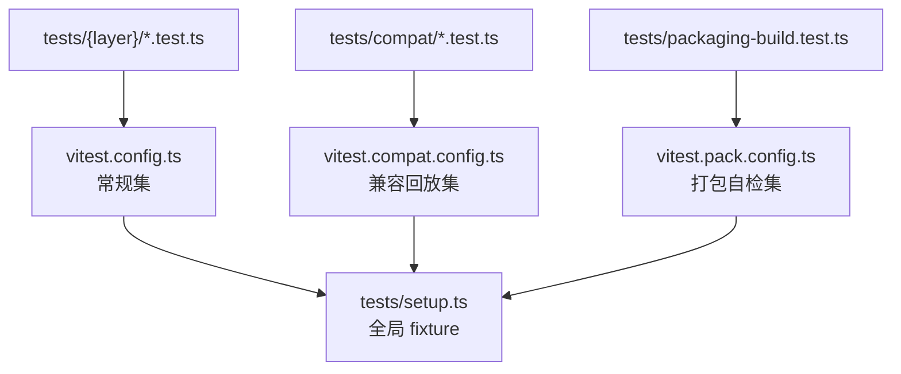
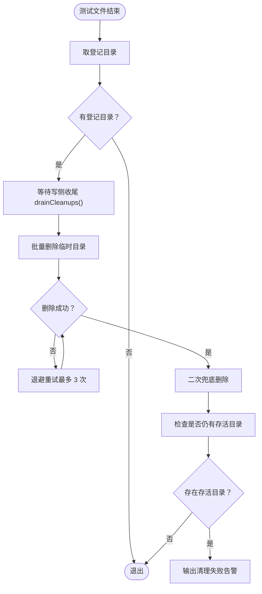
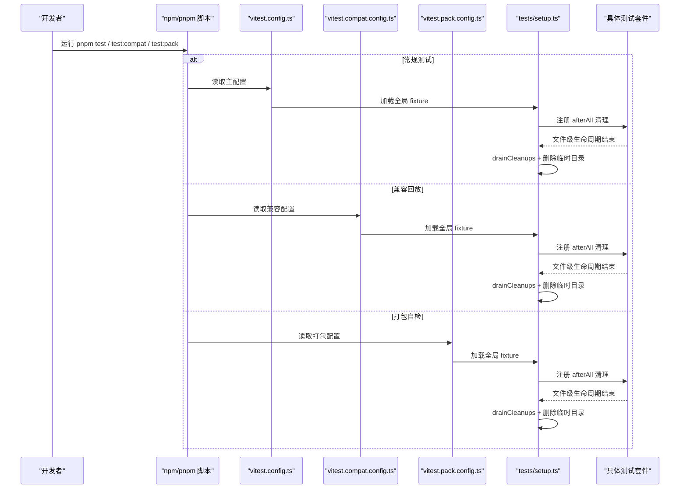
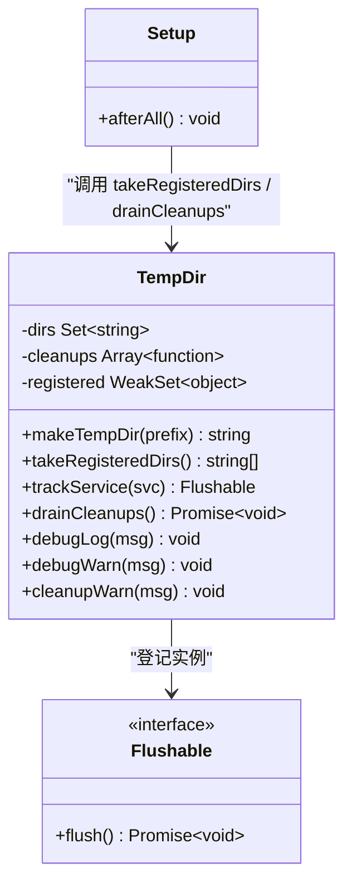
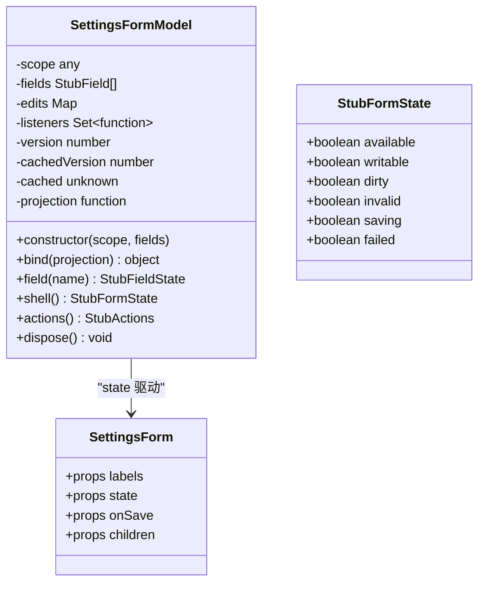
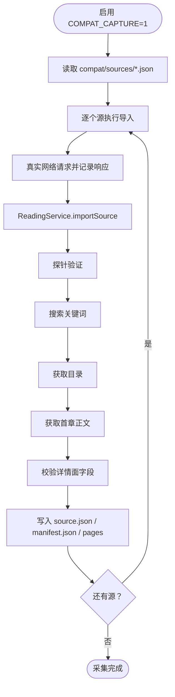
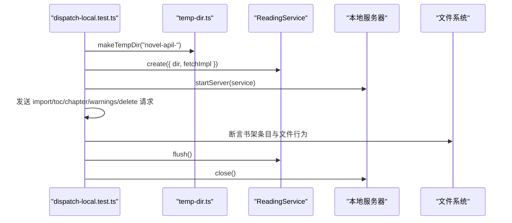
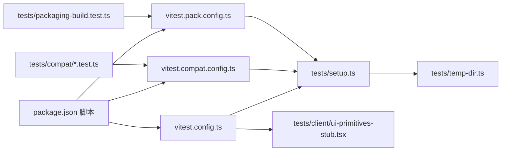

# 测试分层与配置

<cite>
**本文引用的文件**
- [vitest.config.ts](file://vitest.config.ts)
- [vitest.compat.config.ts](file://vitest.compat.config.ts)
- [vitest.pack.config.ts](file://vitest.pack.config.ts)
- [tests/setup.ts](file://tests/setup.ts)
- [tests/temp-dir.ts](file://tests/temp-dir.ts)
- [tests/client/ui-primitives-stub.tsx](file://tests/client/ui-primitives-stub.tsx)
- [package.json](file://package.json)
- [tests/packaging-build.test.ts](file://tests/packaging-build.test.ts)
- [tests/compat/capture.test.ts](file://tests/compat/capture.test.ts)
- [tests/api/dispatch-local.test.ts](file://tests/api/dispatch-local.test.ts)
</cite>

## 目录
1. [引言](#引言)
2. [项目结构](#项目结构)
3. [核心组件](#核心组件)
4. [架构总览](#架构总览)
5. [详细组件分析](#详细组件分析)
6. [依赖关系分析](#依赖关系分析)
7. [性能考虑](#性能考虑)
8. [故障排查指南](#故障排查指南)
9. [结论](#结论)

## 引言
本仓库使用 Vitest 运行多套测试，并按职责拆分为三份配置文件：

- **主门控 `vitest.config.ts`**：常规测试集，覆盖 client、engine、services、api、shared、tools 等目录，并排除 compat 回放与打包构建自检。
- **兼容回放门控 `vitest.compat.config.ts`**：仅运行 `tests/compat/**`，用于回放已采集的站点快照。
- **打包测试门控 `vitest.pack.config.ts`**：仅运行 `tests/packaging-build.test.ts`，校验 `pnpm build` 产出的 `lib/index.js`、`lib/client.js` 与类型声明。

所有配置共享 `tests/setup.ts` 作为全局 fixture 入口，负责临时目录登记、写侧收尾、清理重试与诊断告警。

## 项目结构
测试源码按业务层组织在 `tests/{layer}/*.test.ts`，与生产代码的 `src/{layer}` 保持大致对应：

| 测试目录 | 覆盖范围 | 说明 |
|---|---|---|
| `tests/api` | API 路由与 wire 契约 | 启动 HTTP 服务，断言 `/novel-api/*` 行为 |
| `tests/browser` | Playwright 浏览器端用例 | 不进入常规集，需单独驱动 |
| `tests/client` | React 客户端、UI 接线与宿主交互 | 通过 alias 替换宿主 UI 原语 |
| `tests/compat` | 兼容性采集与回放 | 由 `vitest.compat.config.ts` 单独执行 |
| `tests/engine` | 解析、选择器、JS 沙箱、变量模板等引擎逻辑 | 纯 Node 环境即可 |
| `tests/services` | 书源探索、阅读、书架、缓存、代理等服务端逻辑 | 多数依赖 mock fetch / local filesystem |
| `tests/shared` | 跨模块共享工具 | Cookie、合并策略、相关性等 |
| `tests/tools` | CLI/工程工具 | 项目元信息、schema 契约等 |
| 根级 `tests/*.test.ts` | 顶层集成、审计、打包 | 如 index、packaging、search relevance audit |

**图表来源**
- [vitest.config.ts:1-21](file://vitest.config.ts#L1-L21)
- [vitest.compat.config.ts:1-11](file://vitest.compat.config.ts#L1-L11)
- [vitest.pack.config.ts:1-10](file://vitest.pack.config.ts#L1-L10)

**章节来源**
- [vitest.config.ts:1-21](file://vitest.config.ts#L1-L21)
- [vitest.compat.config.ts:1-11](file://vitest.compat.config.ts#L1-L11)
- [vitest.pack.config.ts:1-10](file://vitest.pack.config.ts#L1-L10)

## 核心组件
本节聚焦三份 Vitest 配置与全局 setup 的职责边界。

### 主门控 `vitest.config.ts`
- **包含规则**：匹配 `tests/**/*.test.{ts,tsx}`。
- **排除规则**：继承默认 exclude，再显式排除 `tests/compat/**` 与 `tests/packaging-build.test.ts`，避免与专用配置重复运行。
- **运行环境**：`node`，不是浏览器或 jsdom。
- **全局入口**：加载 `tests/setup.ts`。
- **关键别名**：将 `@deepseek-ai/dsh-client-ui-primitives` 指向 `tests/client/ui-primitives-stub.tsx`，让配置页表单在 Vitest 中可真实驱动保存流程，而不是只断静态渲染。

**章节来源**
- [vitest.config.ts:1-21](file://vitest.config.ts#L1-L21)
- [tests/client/ui-primitives-stub.tsx:1-169](file://tests/client/ui-primitives-stub.tsx#L1-L169)

### 兼容回放门控 `vitest.compat.config.ts`
- **包含规则**：仅 `tests/compat/**/*.test.{ts,tsx}`。
- **互斥设计**：主配置已排除 `tests/compat/**`，因此两个配置不会同时扫描同一批用例。
- **环境**：`node`，setup 仍是 `tests/setup.ts`。
- **采集门控**：`capture.test.ts` 通过环境变量 `COMPAT_CAPTURE` 控制是否跳过；默认不采集，防止误写 fixtures。

**章节来源**
- [vitest.compat.config.ts:1-11](file://vitest.compat.config.ts#L1-L11)
- [tests/compat/capture.test.ts:1-99](file://tests/compat/capture.test.ts#L1-L99)

### 打包测试门控 `vitest.pack.config.ts`
- **包含规则**：仅 `tests/packaging-build.test.ts`。
- **前置条件**：该测试读取 `lib/index.js`、`lib/client.js`、`lib/index.d.ts`，因此必须先执行 `pnpm build`。
- **脚本约定**：`pnpm test:pack` 先 build 再跑打包测试；`pnpm test:pack` 是推荐入口。
- **setup 一致性**：仍加载 `tests/setup.ts`，为未来可能引入的临时目录清理保留统一纪律。

**章节来源**
- [vitest.pack.config.ts:1-10](file://vitest.pack.config.ts#L1-L10)
- [tests/packaging-build.test.ts:1-47](file://tests/packaging-build.test.ts#L1-L47)
- [package.json:85-100](file://package.json#L85-L100)

### 全局 fixture `tests/setup.ts`
`tests/setup.ts` 在每个测试文件结束时注册一个 `afterAll`，承担以下职责：

1. **取出临时目录登记簿**：调用 `takeRegisteredDirs()` 获取本次文件注册的临时目录集合。
2. **等待写侧收尾**：调用 `drainCleanups()`，确保 Shelf、ReadingService 等服务的防抖写入 flush 完成。
3. **删除临时目录**：对每个目录尝试最多三次删除，每次失败后递增退避（25ms、50ms、75ms）。
4. **二次兜底删除**：再次尝试删除登记过的目录，以捕获未登记的迟到写入。
5. **诊断与告警**：记录剩余存活目录数量，并通过 `cleanupWarn` 输出清理失败的警告。

**图表来源**
- [tests/setup.ts:1-37](file://tests/setup.ts#L1-L37)
- [tests/temp-dir.ts:1-86](file://tests/temp-dir.ts#L1-L86)

**章节来源**
- [tests/setup.ts:1-37](file://tests/setup.ts#L1-L37)
- [tests/temp-dir.ts:1-86](file://tests/temp-dir.ts#L1-L86)

## 架构总览
Vitest 在本仓库中的运行路径如下：

**图表来源**
- [package.json:85-100](file://package.json#L85-L100)
- [vitest.config.ts:1-21](file://vitest.config.ts#L1-L21)
- [vitest.compat.config.ts:1-11](file://vitest.compat.config.ts#L1-L11)
- [vitest.pack.config.ts:1-10](file://vitest.pack.config.ts#L1-L10)
- [tests/setup.ts:1-37](file://tests/setup.ts#L1-L37)

## 详细组件分析

### 全局临时目录与写侧收尾机制
`tests/temp-dir.ts` 提供一套“单一 owner”的临时目录登记簿：

| 能力 | 实现方式 | 使用场景 |
|---|---|---|
| 创建临时目录 | `makeTempDir(prefix)` | 测试需要隔离数据目录 |
| 登记目录 | 内部 `Set<string>` | 供 `setup.ts` 统一回收 |
| 清空登记 | `takeRegisteredDirs()` | 每个测试文件结束后只取一次 |
| 写侧收尾 | `trackService(svc)` 注册 `flush()` | Shelf、ReadingService 等带防抖写的服务 |
| 等待收尾 | `drainCleanups()` | 删除目录前必须 flush |
| 调试日志 | `debugLog` / `debugWarn` | 受 `NOVEL_TEST_DEBUG=1` 控制 |
| 清理告警 | `cleanupWarn` | 清理失败时默认输出 |

**图表来源**
- [tests/temp-dir.ts:1-86](file://tests/temp-dir.ts#L1-L86)
- [tests/setup.ts:1-37](file://tests/setup.ts#L1-L37)

**章节来源**
- [tests/temp-dir.ts:1-86](file://tests/temp-dir.ts#L1-L86)
- [tests/setup.ts:1-37](file://tests/setup.ts#L1-L37)

### 宿主 UI 原语替身 `ui-primitives-stub.tsx`
由于 `@deepseek-ai/dsh-client-ui-primitives` 是宿主平台模块，不在本仓库安装，Vitess 通过别名将其替换为本 stub。stub 的关键语义包括：

- `SettingsFormModel.bind` 支持投影与订阅回调。
- `shell()` 返回 available/writable/dirty/invalid/saving/failed 状态。
- `actions().save()` 根据编辑映射生成 set/unset 操作并触发变更通知。
- `SettingsForm` 根据 state 渲染不可用提示、只读提示、保存按钮与失败提示。
- 通过类型闸 `_shapeGate` 强制 stub 形状与宿主镜像双向兼容。

**图表来源**
- [tests/client/ui-primitives-stub.tsx:1-169](file://tests/client/ui-primitives-stub.tsx#L1-L169)
- [vitest.config.ts:1-21](file://vitest.config.ts#L1-L21)

**章节来源**
- [tests/client/ui-primitives-stub.tsx:1-169](file://tests/client/ui-primitives-stub.tsx#L1-L169)
- [vitest.config.ts:1-21](file://vitest.config.ts#L1-L21)

### 兼容采集 `capture.test.ts`
`capture.test.ts` 是兼容回放的“录制器”，只在 `COMPAT_CAPTURE=1` 时运行：

- 遍历 `compat/sources` 下的 `.json` 源定义。
- 使用真实 `globalThis.fetch` 请求目标站点。
- 把响应体按原始 URL 作为键存入内存表。
- 通过 `sanitize` 脱敏后写入 `compat/fixtures/<case>/pages`。
- 输出 `source.json`、`manifest.json`，其中 manifest 包含关键词、时间戳与页面映射。
- 使用 `ReadingService.create({ dir, fetchImpl, proxyUrl })` 并 `trackService`，保证 flush 后再落盘。

**图表来源**
- [tests/compat/capture.test.ts:1-99](file://tests/compat/capture.test.ts#L1-L99)

**章节来源**
- [tests/compat/capture.test.ts:1-99](file://tests/compat/capture.test.ts#L1-L99)

### API 测试示例 `dispatch-local.test.ts`
API 测试展示了典型的服务端测试模式：

- 使用 `beforeAll` 创建临时数据目录。
- 通过 `ReadingService.create` 注入自定义 `fetchImpl`，避免真实网络。
- 通过 `LocalBooks.create` 创建第二实例做文件级断言。
- 启动本地服务器，断言 `/novel-api/local/*` 路由的状态码、信封结构与错误语义。
- 使用 `trackService` 与服务 `flush` 配合，确保磁盘写入在测试结束前稳定。

**图表来源**
- [tests/api/dispatch-local.test.ts:1-90](file://tests/api/dispatch-local.test.ts#L1-L90)
- [tests/temp-dir.ts:1-86](file://tests/temp-dir.ts#L1-L86)

**章节来源**
- [tests/api/dispatch-local.test.ts:1-90](file://tests/api/dispatch-local.test.ts#L1-L90)

### 打包构建自检 `packaging-build.test.ts`
该测试直接读取构建产物，断言：

- `lib/index.js` 与 `lib/client.js` 存在。
- host 半包含插件标识与 API 前缀。
- client 半被三段式工厂包裹，footer 位于 sourcemap 注释之前。
- client 半的 `require` 白名单不被污染。
- `lib/index.d.ts` 包含 `apply`、`Config` 等导出签名。

**章节来源**
- [tests/packaging-build.test.ts:1-47](file://tests/packaging-build.test.ts#L1-L47)

## 依赖关系分析

**图表来源**
- [package.json:85-100](file://package.json#L85-L100)
- [vitest.config.ts:1-21](file://vitest.config.ts#L1-L21)
- [vitest.compat.config.ts:1-11](file://vitest.compat.config.ts#L1-L11)
- [vitest.pack.config.ts:1-10](file://vitest.pack.config.ts#L1-L10)
- [tests/setup.ts:1-37](file://tests/setup.ts#L1-L37)
- [tests/temp-dir.ts:1-86](file://tests/temp-dir.ts#L1-L86)
- [tests/client/ui-primitives-stub.tsx:1-169](file://tests/client/ui-primitives-stub.tsx#L1-L169)

**章节来源**
- [package.json:85-100](file://package.json#L85-L100)
- [vitest.config.ts:1-21](file://vitest.config.ts#L1-L21)
- [vitest.compat.config.ts:1-11](file://vitest.compat.config.ts#L1-L11)
- [vitest.pack.config.ts:1-10](file://vitest.pack.config.ts#L1-L10)

## 性能考虑
- **并行执行**：`vitest run` 默认并行执行测试文件；当前配置没有显式设置 `pool`、`threads` 或 `fileParallelism`，因此沿用 Vitest 默认并行策略。
- **隔离性优先**：所有测试都基于 Node 环境，通过 `makeTempDir` 隔离文件系统状态，避免并发下互相污染。
- **异步清理风险**：临时目录清理采用 `Promise.allSettled`，单个目录失败不会拖垮其他目录清理，但会留下诊断告警。
- **兼容采集超时较长**：`capture.test.ts` 的单条用例设置了 300 秒超时，因为涉及真实网络请求和多个站点。
- **打包测试依赖构建**：`pnpm test:pack` 先执行 `pnpm build`，构建阶段本身可能成为整体耗时瓶颈。

[本节为通用建议，不直接分析具体代码行]

## 故障排查指南

### 常见陷阱一：JS DOM 环境与宿主依赖
- 主配置明确使用 `environment: 'node'`，不是 jsdom。若测试需要 `document`、`window` 等 DOM API，应改用 jsdom 环境或使用专门的浏览器测试入口，而不是假设主配置提供 DOM。
- `@deepseek-ai/dsh-client-ui-primitives` 被 alias 到 `tests/client/ui-primitives-stub.tsx`。如果新增测试依赖宿主 UI 原语但未走主配置别名，可能出现运行时找不到模块或行为不一致。

**章节来源**
- [vitest.config.ts:1-21](file://vitest.config.ts#L1-L21)
- [tests/client/ui-primitives-stub.tsx:1-169](file://tests/client/ui-primitives-stub.tsx#L1-L169)

### 常见陷阱二：宿主依赖 mock
- 网络请求通常通过注入 `fetchImpl` 或替换 `globalThis.fetch` 来 mock。例如 `dispatch-local.test.ts` 传入返回 404 的 `fetchImpl`，`capture.test.ts` 则包装真实 fetch 进行录制。
- 不要依赖未配置的宿主全局对象；需要时应显式 mock，并在 `afterAll` 或 `teardown` 中恢复。

**章节来源**
- [tests/api/dispatch-local.test.ts:1-90](file://tests/api/dispatch-local.test.ts#L1-L90)
- [tests/compat/capture.test.ts:1-99](file://tests/compat/capture.test.ts#L1-L99)

### 常见陷阱三：SSEResponse 模拟
- 当前仓库未出现 `SSEResponse` 的引用，但若后续测试需要模拟 SSE 流式响应，应避免直接依赖宿主特有实现。
- 推荐做法：
  - 在服务层注入可控制的 fetch 或事件源实现。
  - 在 API 层断言接口契约，而不是断言宿主内部类名。
  - 若确需 DOM/SSE 行为，切换到 jsdom 或浏览器测试，并明确区分环境。

[本节为概念性指导，不包含具体代码片段]

### 常见陷阱四：临时目录未清理
症状：测试通过后仍有大量 `novel-test-*`、`compat-cap-*`、`novel-apil-*` 临时目录残留。

排查步骤：
1. 确认测试使用了 `makeTempDir`，而不是自行 `fs.mkdtemp`。
2. 确认读写服务通过 `trackService` 注册，并在 `beforeAll`/`afterAll` 中正确 `flush`。
3. 开启 `NOVEL_TEST_DEBUG=1` 查看 drained 与 still-present 日志。
4. 检查 `afterAll` 中是否提前删除目录而忘记 `drainCleanups()`。

**章节来源**
- [tests/setup.ts:1-37](file://tests/setup.ts#L1-L37)
- [tests/temp-dir.ts:1-86](file://tests/temp-dir.ts#L1-L86)

## 结论
dsh-novel 的测试体系通过三份 Vitest 配置实现职责分离：主配置覆盖常规业务层，兼容配置专注站点回放，打包配置守护构建产物。`tests/setup.ts` 与 `tests/temp-dir.ts` 共同收敛了临时目录与写侧收尾的生命周期管理，使并发测试既能快速并行，又能减少文件系统污染。

新增测试时建议遵循以下约定：

- 命名：使用 `{layer}/{feature}.test.ts` 或 `{layer}/{feature}.test.tsx`。
- 位置：与 `src/{layer}` 对应，放在 `tests/{layer}`。
- 环境：Node 测试优先；DOM 测试改用 jsdom 或浏览器测试。
- 外部依赖：通过 `fetchImpl`、别名或 mock 隔离，避免真实网络。
- 临时目录：统一使用 `makeTempDir` 与 `trackService`。
- 配置归属：常规逻辑进 `vitest.config.ts`；兼容回放进 `vitest.compat.config.ts`；构建产物校验进 `vitest.pack.config.ts`。