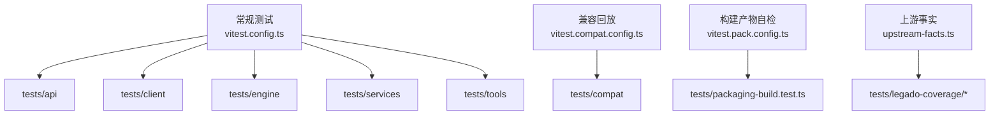
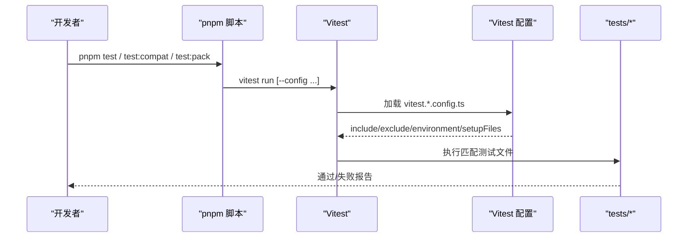
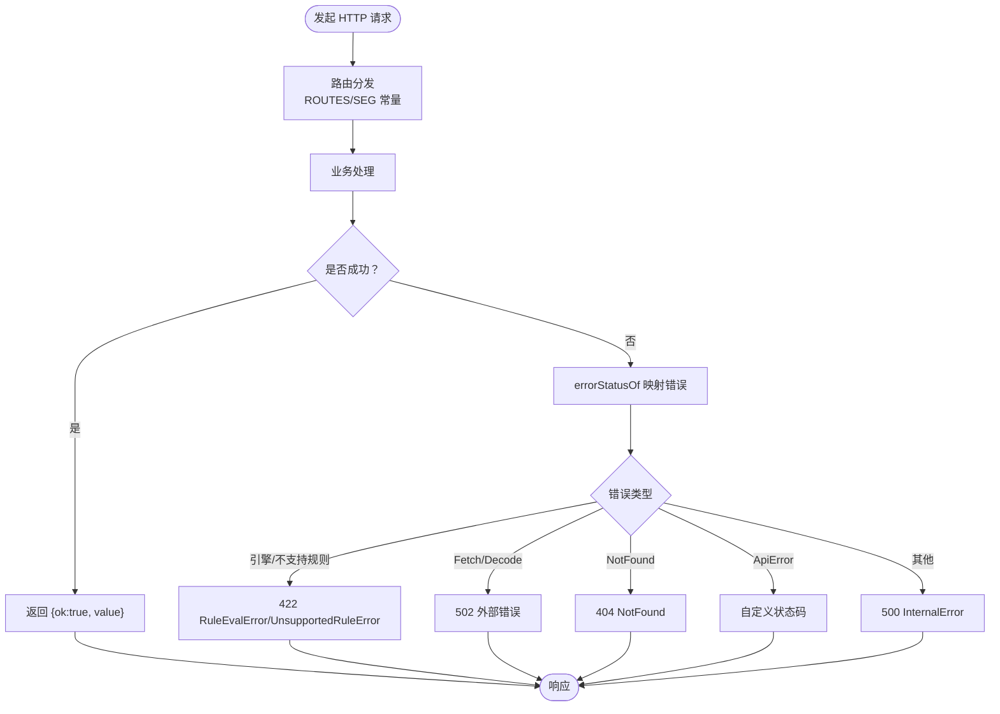
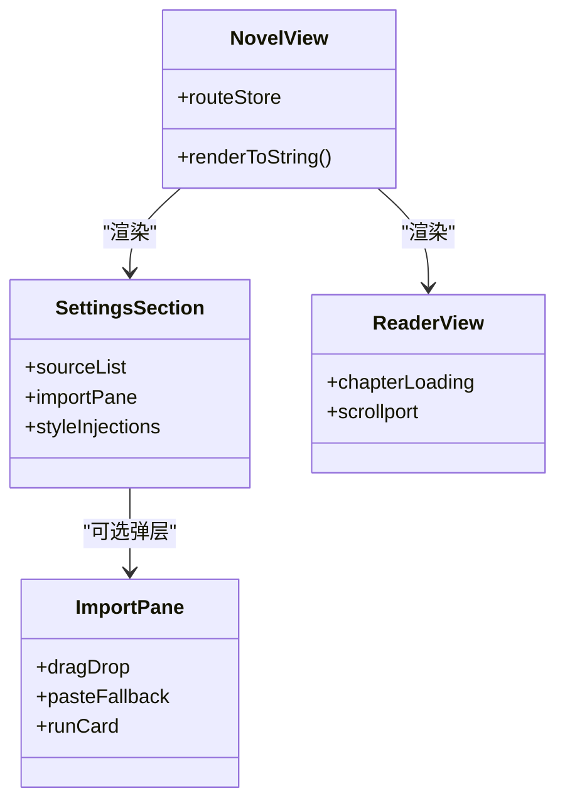
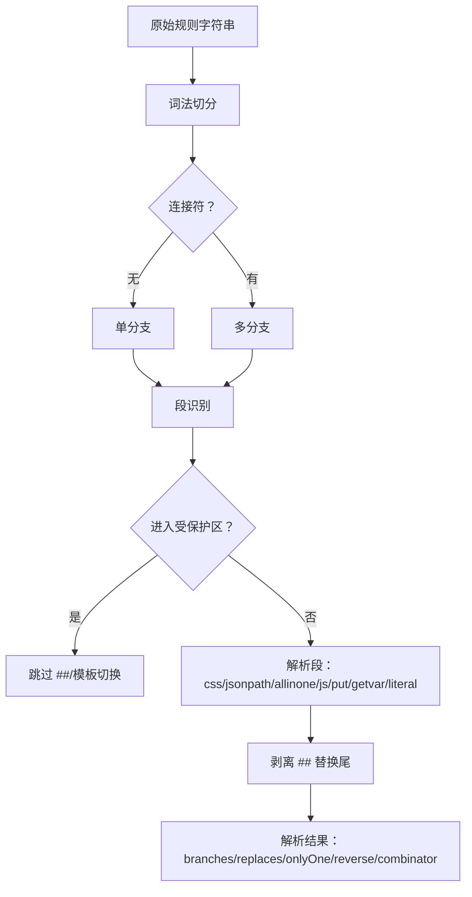
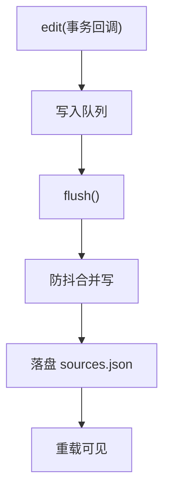
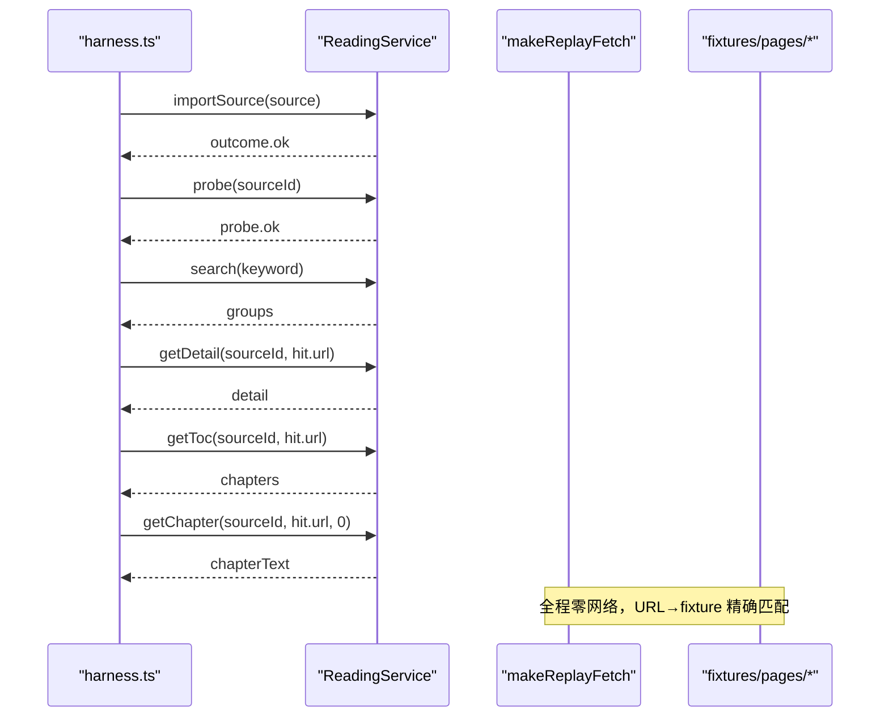
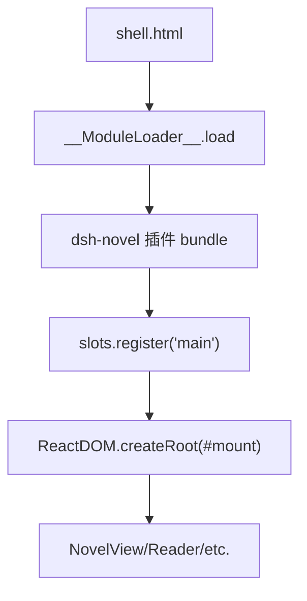
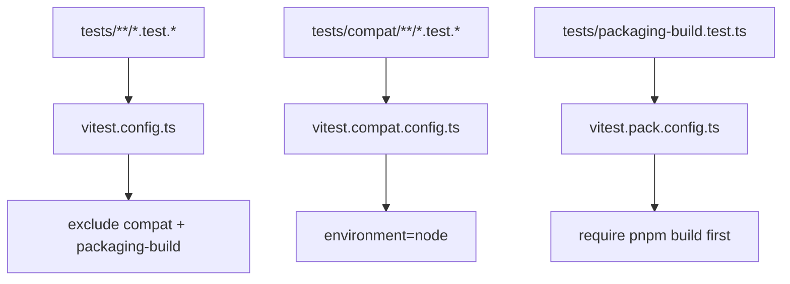

# 测试策略

<cite>
**本文引用的文件**   
- [vitest.config.ts](file://vitest.config.ts)
- [vitest.compat.config.ts](file://vitest.compat.config.ts)
- [vitest.pack.config.ts](file://vitest.pack.config.ts)
- [tests/setup.ts](file://tests/setup.ts)
- [tests/legado-coverage/upstream-facts.ts](file://tests/legado-coverage/upstream-facts.ts)
- [package.json](file://package.json)
- [tests/api/routes.test.ts](file://tests/api/routes.test.ts)
- [tests/api/wire.test.ts](file://tests/api/wire.test.ts)
- [tests/client/smoke.test.tsx](file://tests/client/smoke.test.tsx)
- [tests/engine/parse.test.ts](file://tests/engine/parse.test.ts)
- [tests/services/sources.test.ts](file://tests/services/sources.test.ts)
- [tests/compat/harness.ts](file://tests/compat/harness.ts)
- [tests/browser/shell.html](file://tests/browser/shell.html)
- [tests/tools/project.test.ts](file://tests/tools/project.test.ts)
</cite>

## 目录
1. [引言](#引言)
2. [项目结构](#项目结构)
3. [核心组件](#核心组件)
4. [架构总览](#架构总览)
5. [分层测试详解](#分层测试详解)
6. [依赖与门控分析](#依赖与门控分析)
7. [性能与回归建议](#性能与回归建议)
8. [故障排查指南](#故障排查指南)
9. [结论](#结论)

## 引言
本仓库采用 Vitest + jsdom 的单元测试矩阵，按代码分层组织测试：api 层验证 HTTP 路由与 wire 契约、client 层覆盖 React 组件与 ViewModel、engine 层校验规则解析与求值、services 层测试服务逻辑、compat 层回放 legado 上游快照、browser 层使用 Playwright 壳进行浏览器冒烟、tools 层测试打包与工具链。文档聚焦如何理解现有门控、如何新增用例、如何模拟宿主依赖，以及如何调试 SSEResponse 与 JS 沙箱。

## 项目结构
测试根目录为 `tests/`，每个源码子包对应一个测试子目录：
- `tests/api`：HTTP 路由落点与 wire 错误映射。
- `tests/client`：React SSR smoke、ViewModel、Reader、SourceList、Shelf、Search 等。
- `tests/engine`：解析器、选择器、模板、JS 绑定、JS 沙箱、Legado 方言扩展。
- `tests/services`：源注册表、缓存、搜索、导入导出、EPUB、代理等。
- `tests/compat`：基于 fixture 的上游兼容性回放。
- `tests/browser`：Playwright 驱动的浏览器壳页面。
- `tests/tools`：工具函数与打包产物自检。
- `tests/legado-coverage`：面向 leg 上游事实的门控（快照、覆盖率统计）。

**图表来源**
- [vitest.config.ts:1-21](file://vitest.config.ts#L1-L21)
- [vitest.compat.config.ts:1-11](file://vitest.compat.config.ts#L1-L11)
- [vitest.pack.config.ts:1-10](file://vitest.pack.config.ts#L1-L10)
- [tests/legado-coverage/upstream-facts.ts:1-104](file://tests/legado-coverage/upstream-facts.ts#L1-L104)

**章节来源**
- [vitest.config.ts:1-21](file://vitest.config.ts#L1-L21)
- [vitest.compat.config.ts:1-11](file://vitest.compat.config.ts#L1-L11)
- [vitest.pack.config.ts:1-10](file://vitest.pack.config.ts#L1-L10)
- [package.json:84-125](file://package.json#L84-L125)

## 核心组件
- 三套 Vitest 配置：
  - `vitest.config.ts`：默认集，排除 compat 与 packaging-build 测试，注入本地 ui-primitives 替身，全局 setup 在 `tests/setup.ts`。
  - `vitest.compat.config.ts`：仅包含 `tests/compat/**`，同样挂载 `tests/setup.ts`。
  - `vitest.pack.config.ts`：仅包含 `tests/packaging-build.test.ts`，要求先执行 `pnpm build`。
- 全局清理：`tests/setup.ts` 在所有用例结束后回收临时目录登记簿，重试删除并二次兜底，避免异步写侧复活目录。
- 上游事实：`tests/legado-coverage/upstream-facts.ts` 提供仓内冻结的快照读取、路径枚举、字段提取与 Java 方法名提取；快照缺失或分母为空时直接抛错，不允许静默降级。

**章节来源**
- [vitest.config.ts:1-21](file://vitest.config.ts#L1-L21)
- [vitest.compat.config.ts:1-11](file://vitest.compat.config.ts#L1-L11)
- [vitest.pack.config.ts:1-10](file://vitest.pack.config.ts#L1-L10)
- [tests/setup.ts:1-37](file://tests/setup.ts#L1-L37)
- [tests/legado-coverage/upstream-facts.ts:1-104](file://tests/legado-coverage/upstream-facts.ts#L1-L104)

## 架构总览
测试运行入口由 `package.json` 脚本驱动：
- `pnpm test`：运行默认 Vitest 集。
- `pnpm test:compat`：运行兼容回放集。
- `pnpm test:pack`：先构建，再运行构建产物自检。

**图表来源**
- [package.json:84-125](file://package.json#L84-L125)
- [vitest.config.ts:1-21](file://vitest.config.ts#L1-L21)
- [vitest.compat.config.ts:1-11](file://vitest.compat.config.ts#L1-L11)
- [vitest.pack.config.ts:1-10](file://vitest.pack.config.ts#L1-L10)

**章节来源**
- [package.json:84-125](file://package.json#L84-L125)

## 分层测试详解

### API 层：HTTP 路由与 wire 契约
API 层测试分为两类：
- 路由契约：用真实 `ReadingService` 启动服务器，遍历 `ROUTES` 与参数路由常量，断言每条路由都落到 dispatch 分支，而不是“未知路由”404；同时检查 POST-only 路由误用 GET 返回 405、非法百分号编码返回 400、缺少 local 部件返回 503。
- wire 契约：测试可信请求判断、JSON 体解析、大小限制、以及各类业务错误到 HTTP 状态码与统一信封体的映射。

**图表来源**
- [tests/api/routes.test.ts:1-200](file://tests/api/routes.test.ts#L1-L200)
- [tests/api/wire.test.ts:1-98](file://tests/api/wire.test.ts#L1-L98)

新增用例建议：
- 新增路由时，先在 `src/shared/wire.ts` 中维护 `ROUTES`/`SEG`/参数路由生成器，并在 `tests/api/routes.test.ts` 中补充一条调用，断言不是“未知路由”404。
- 新增错误类型时，在 `tests/api/wire.test.ts` 增加 `errorStatusOf` 分支断言，确保状态码与 `ApiErrorBody` 结构一致。

**章节来源**
- [tests/api/routes.test.ts:1-200](file://tests/api/routes.test.ts#L1-L200)
- [tests/api/wire.test.ts:1-98](file://tests/api/wire.test.ts#L1-L98)

### Client 层：React 组件与 ViewModel
Client 层以 `renderToString` 做轻量 SSR smoke，锁定关键数据属性、样式类、布局结构与行为约束；ViewModel 与 Job 逻辑则针对状态机、轮询、撤销、会话等做单元级断言。

典型断言包括：
- 各路由视图可渲染且携带 `data-novel-view` 标记。
- 设置区与导入面板的结构特征、拖放主入口、原生 file input 隐藏、状态条不占位、样式注入唯一性。
- 阅读器在未载入章节时不渲染章节块与哨兵。
- 宿主交互区域遮蔽策略与列宽拖拽把手的选择器范围。

**图表来源**
- [tests/client/smoke.test.tsx:1-154](file://tests/client/smoke.test.tsx#L1-L154)

新增用例建议：
- 新增视图或组件时，优先补一条 `renderToString` smoke，断言容器标记、占位文案、关键 data-* 属性。
- 新增状态机逻辑时，使用 `@testing-library/react` 与内存 store 模拟宿主回调，断言状态迁移与副作用触发顺序。

**章节来源**
- [tests/client/smoke.test.tsx:1-154](file://tests/client/smoke.test.tsx#L1-L154)

### Engine 层：规则解析与求值
Engine 层测试覆盖语法解析、段识别、组合符、替换尾、受保护区、模板态、正则行、XPath、CSS、AllInOne、变量、JS 绑定、JS 沙箱、Legado 方言扩展等。示例测试关注：
- 解析期把不可识别段或非法组合提前抛出 `UnsupportedRuleError`，并携带 facet、segmentIndex、segmentRaw。
- `##` 替换尾、`###` OnlyOne、`-` 反序前缀、`||/&&/%%` 组合符。
- `<js>` 块、`{{…}}`、`@put` 值区的受保护语义。
- 隐式 CSS 回落与大小写变体。

**图表来源**
- [tests/engine/parse.test.ts:1-200](file://tests/engine/parse.test.ts#L1-L200)

新增用例建议：
- 新增语法特性时，先在解析测试中增加最小输入与期望 AST，再补求值测试确认运行时行为。
- 对真实存量规则的回退行为，应保留“走查存量”注释，避免后续重构误伤。

**章节来源**
- [tests/engine/parse.test.ts:1-200](file://tests/engine/parse.test.ts#L1-L200)

### Services 层：服务逻辑
Services 层测试围绕持久化、事务、归一化、缓存、搜索、导入导出、EPUB、代理、日志、分页等。示例 `SourceRegistry` 测试重点：
- edit → flush → reload 往返一致性。
- flush 防抖计时器收尾与并发 edit 的安全边界。
- toPublic 投影不含敏感字段。
- replace/setEnabled/removeAll 的行为与持久化语义。
- 存量格式迁移：bookSourceType 数值到 type 重推、init 换根映射。

**图表来源**
- [tests/services/sources.test.ts:1-200](file://tests/services/sources.test.ts#L1-L200)

新增用例建议：
- 新增服务方法时，至少覆盖正常路径、幂等路径、未知 id 路径、flush 并发路径。
- 涉及凭据或内部结构的变更，补充 toPublic 投影测试，确保对外对象不包含敏感字段。

**章节来源**
- [tests/services/sources.test.ts:1-200](file://tests/services/sources.test.ts#L1-L200)

### Compat 层：回放 legado 上游快照
Compat 层不访问网络，而是通过 `makeReplayFetch` 将 manifest 中的 URL 映射到 fixture 文件，再以 ReadingService 跑通 import → probe → search → detail → toc → chapter 全链路。断言要点：
- 规范化入库成功。
- 探针通过。
- 搜索命中数 ≥ 1。
- 详情面声明即须到货：若源声明了详情书名、kind、wordCount，则必须非空。
- 首章正文非空。

**图表来源**
- [tests/compat/harness.ts:1-200](file://tests/compat/harness.ts#L1-L200)

新增用例建议：
- 新增 fixture：在 `compat/fixtures/<case>/` 下放置 `source.json` 与 `manifest.json`，并在 pages 中列出采集到的 URL 与相对路径。
- 若站点变化导致回放失败，应先重跑 capture 更新 fixture，再提交基线。

**章节来源**
- [tests/compat/harness.ts:1-200](file://tests/compat/harness.ts#L1-L200)

### Browser 层：Playwright 真机冒烟
Browser 层使用 `tests/browser/shell.html` 作为最小宿主壳，完成以下职责：
- 提供定高挂载点。
- 注入 `window.__ModuleLoader__.load`。
- 冻结模块表，把平台 specifier 解答为 React 与空 ui-primitives。
- 构造 cordis 上下文与 slots，取 main 槽渲染。
- 暴露 `__novelMount/__novelUnmount` 模拟宿主切走与重挂。

**图表来源**
- [tests/browser/shell.html:1-106](file://tests/browser/shell.html#L1-L106)

新增用例建议：
- 新增浏览器交互场景时，在 shell.html 中补齐必要的宿主能力 stub，避免 bundle 顶层 require 失败。
- Playwright 用例应聚焦滚动、点击、卸载重挂等真实 DOM 行为，SSR 与状态逻辑仍放在 client 层单测。

**章节来源**
- [tests/browser/shell.html:1-106](file://tests/browser/shell.html#L1-L106)

### Tools 层：打包与工具链
Tools 层测试工具函数与打包产物。例如 `project` 工具：
- 递归移除 null/undefined 字段。
- 保留空串、0、false 等“空值但非空”。
- 输出可安全过 JSON.stringify。
- 不改输入对象。

新增用例建议：
- 新增工具函数时，覆盖边界值、递归结构、序列化安全性与纯函数不变量。
- 若工具被 harness 或 CLI 消费，补充集成用例验证命令行或打包流程。

**章节来源**
- [tests/tools/project.test.ts:1-26](file://tests/tools/project.test.ts#L1-L26)

## 依赖与门控分析

### Vitest 多套门控
- 默认集：
  - include：`tests/**/*.test.{ts,tsx}`。
  - exclude：compat 集与 packaging-build 测试。
  - environment：node。
  - setupFiles：`tests/setup.ts`。
  - alias：将 `@deepseek-ai/dsh-client-ui-primitives` 指向本地 stub，让配置页接线可在 Vitest 中运行。
- 兼容回放集：
  - include：`tests/compat/**/*.test.{ts,tsx}`。
  - 与默认集互斥，由 `vitest.compat.config.ts` 单独驱动。
- 构建产物自检集：
  - include：`tests/packaging-build.test.ts`。
  - 需先执行 `pnpm build`，再由 `pnpm test:pack` 驱动。

**图表来源**
- [vitest.config.ts:1-21](file://vitest.config.ts#L1-L21)
- [vitest.compat.config.ts:1-11](file://vitest.compat.config.ts#L1-L11)
- [vitest.pack.config.ts:1-10](file://vitest.pack.config.ts#L1-L10)

**章节来源**
- [vitest.config.ts:1-21](file://vitest.config.ts#L1-L21)
- [vitest.compat.config.ts:1-11](file://vitest.compat.config.ts#L1-L11)
- [vitest.pack.config.ts:1-10](file://vitest.pack.config.ts#L1-L10)

### 全局 fixture：tests/setup.ts
- 使用 afterAll 钩子统一回收临时目录。
- 先 drainCleanups，再批量删除登记目录，带重试与二次兜底。
- 记录残留目录数量并告警，便于定位未正确释放资源的用例。

**章节来源**
- [tests/setup.ts:1-37](file://tests/setup.ts#L1-L37)

### 兼容性矩阵：upstream-facts.ts
- UPSTREAM_ROOTS：leg 上游主源与测试源根路径。
- RULE_CLASSES：leg 规则实体类集合。
- RULE_DIR：规则实体所在目录。
- fieldsOf：从 Kotlin data class 源码中提取字段名。
- javaMethodNames：从 JsExtensions.kt 中提取 Java 宿主方法名。
- SNAPSHOT_PATH：仓内快照路径 `compat/upstream/snapshot.json`。
- readSnapshot：模块级缓存快照；缺失或分母为空直接抛错，拒绝静默放行。
- listFiles：递归枚举文件相对路径，用于引用活性判据的分母。

**章节来源**
- [tests/legado-coverage/upstream-facts.ts:1-104](file://tests/legado-coverage/upstream-facts.ts#L1-L104)

## 性能与回归建议

### 覆盖率阈值
当前仓库未在 `vitest.config.ts` 中启用 coverage 配置。建议：
- 在 `vitest.config.ts` 的 `test` 段添加 coverage 选项，设置整体阈值（例如 80%）与分层阈值（engine、services、api、client 分别设定）。
- 对 engine 解析与 services 持久化路径提高阈值，因为它们是兼容性风险最高区域。
- 对 browser 层不纳入覆盖率统计，因其属于冒烟而非单元覆盖。

[本节为通用建议，不直接分析具体文件]

### CI 门禁
建议 CI 依次运行：
1. `pnpm test`：默认集。
2. `pnpm test:compat`：兼容回放集。
3. `pnpm test:pack`：构建产物自检。
4. 可选：`pnpm typecheck`：类型检查门禁。

建议在 PR 门禁中加入覆盖率阈值失败即红，并对 compat 回放失败提供详细报告（harness 已输出分母、通过率与失败原因分布）。

[本节为通用建议，不直接分析具体文件]

### 性能回归检测
- 对 reader 渲染路径增加基准用例，测量 renderToString 耗时与 DOM 节点数量，防止出现大量占位节点或重复样式注入。
- 对 SourceRegistry.flush 防抖路径增加计时断言，避免 flush 后仍有待写计时器存活。
- 对 JS 沙箱执行时间增加上限断言，防止恶意或低效规则拖慢求值。

[本节为通用建议，不直接分析具体文件]

## 故障排查指南

### 新增测试用例的步骤
1. 确定所属层：api、client、engine、services、compat、browser、tools。
2. 新建 `*.test.ts` 或 `*.test.tsx`。
3. 若是 api 层，复用 `startServer` 与 `ReadingService` 启动实例，调用 `ROUTES` 常量。
4. 若是 client 层，优先用 `renderToString` 断言结构，再用 React Testing Library 断言交互。
5. 若是 engine 层，先写解析期望，再写求值期望。
6. 若是 services 层，使用 `makeTempDir` 与 `trackService` 管理临时数据与资源回收。
7. 若是 compat 层，准备 fixture 与 manifest，确认 capture 能产出稳定基线。
8. 若是 browser 层，确认 shell.html 已提供所需宿主 stub。

**章节来源**
- [tests/api/routes.test.ts:1-200](file://tests/api/routes.test.ts#L1-L200)
- [tests/client/smoke.test.tsx:1-154](file://tests/client/smoke.test.tsx#L1-L154)
- [tests/engine/parse.test.ts:1-200](file://tests/engine/parse.test.ts#L1-L200)
- [tests/services/sources.test.ts:1-200](file://tests/services/sources.test.ts#L1-L200)
- [tests/compat/harness.ts:1-200](file://tests/compat/harness.ts#L1-L200)
- [tests/browser/shell.html:1-106](file://tests/browser/shell.html#L1-L106)

### 模拟宿主依赖
- UI 原语：通过 `vitest.config.ts` 的 alias 将 `@deepseek-ai/dsh-client-ui-primitives` 指向本地 stub，使配置页接线可在 node 环境运行。
- 宿主回调：在 client 层测试中使用 `vi.fn()` 模拟 effect、slots.inject、store 回调。
- 网络：在 services 层测试中传入自定义 fetchImpl 或 mock undici，避免真实网络。
- 浏览器宿主：在 shell.html 中冻结 `__ModuleLoader__`、React 全局与 cordis 上下文，只实现必要槽位。

**章节来源**
- [vitest.config.ts:1-21](file://vitest.config.ts#L1-L21)
- [tests/browser/shell.html:1-106](file://tests/browser/shell.html#L1-L106)

### 调试 SSEResponse 与 JS 沙箱
- SSEResponse：优先在 api 层用 `fetch` 调用真实 server，检查状态码与 `ApiEnvelope` 结构；若问题在错误映射，集中查看 `tests/api/wire.test.ts` 中 `errorStatusOf` 的断言。
- JS 沙箱：在 engine 层新增 `js-sandbox.test.ts` 用例，注入最小宿主方法，断言执行结果、异常分类与超时保护；对规则中的 `<js>` 块与 `@js:` 分别覆盖。
- 若渲染不稳定，先用 `renderToString` 缩小到静态 HTML，再逐步引入 effect 与 DOM 查询。

**章节来源**
- [tests/api/wire.test.ts:1-98](file://tests/api/wire.test.ts#L1-L98)
- [tests/client/smoke.test.tsx:1-154](file://tests/client/smoke.test.tsx#L1-L154)

## 结论
该项目的测试策略以分层为核心：api 层守护路由与 wire 契约，client 层守护组件结构与 ViewModel 状态，engine 层守护规则语法与求值语义，services 层守护持久化与服务行为，compat 层冻结 upstream 事实并离线回放，browser 层在真实浏览器环境中冒烟，tools 层保障工具链与打包产物。通过三套 Vitest 配置、全局临时目录清理与上游事实快照，项目在可演进性与稳定性之间取得平衡。新增测试时应遵循同层风格，优先补最小可复现用例，再扩展到端到端与兼容性基线。