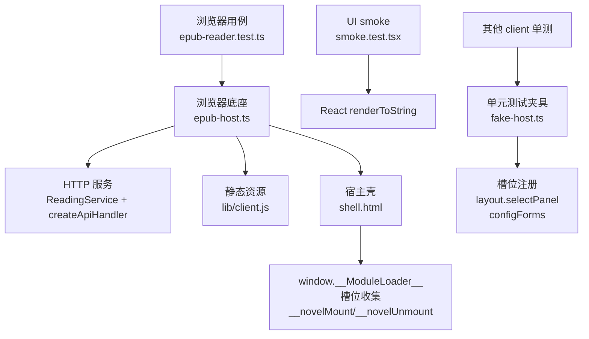
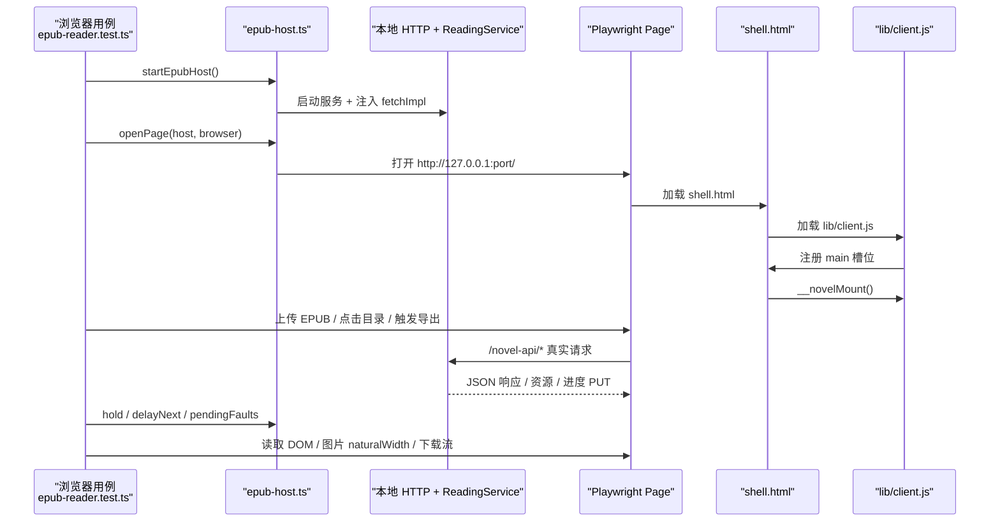
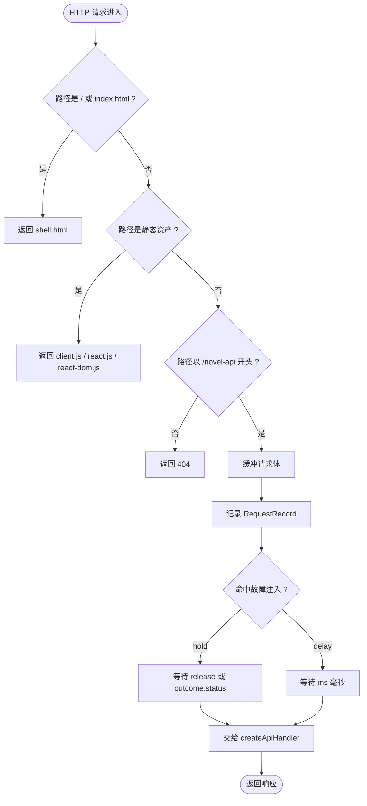
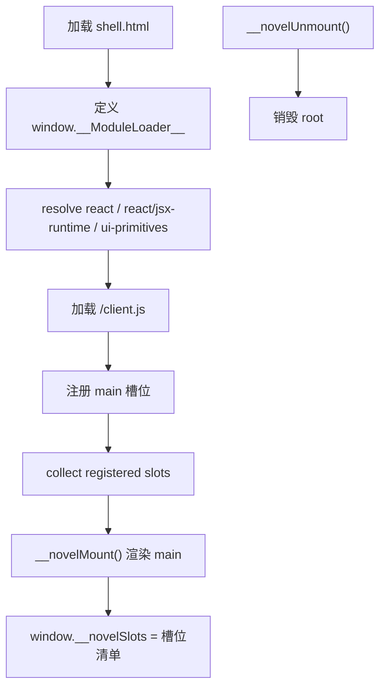
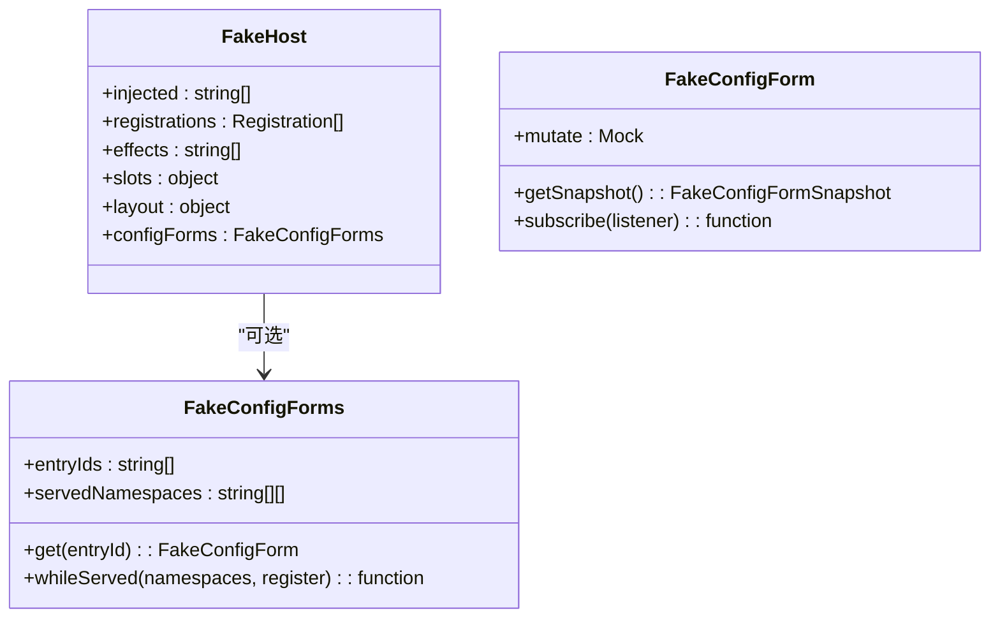
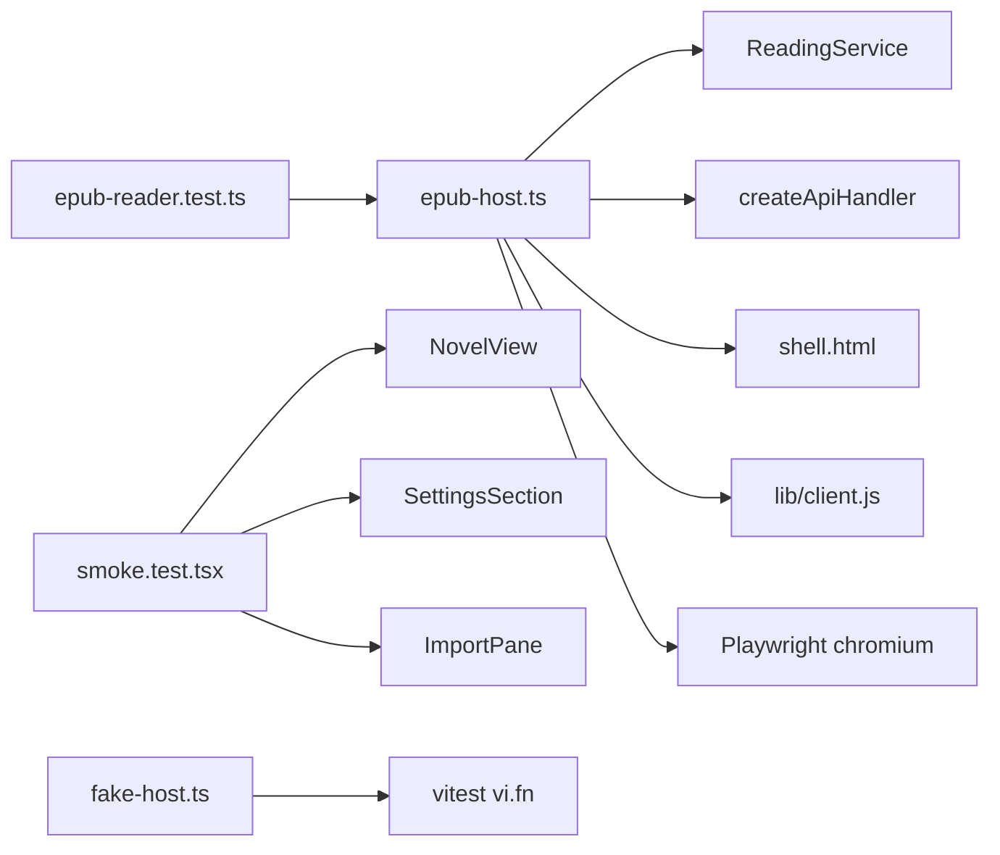
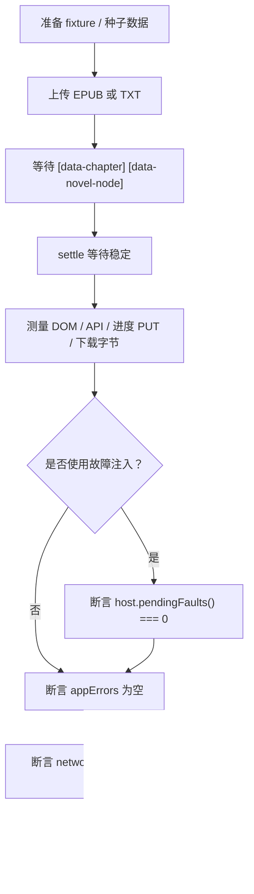

# 浏览器真机测试与单元测试

<cite>
**本文引用的文件**   
- [epub-host.ts](file://tests/browser/epub-host.ts)
- [epub-reader.test.ts](file://tests/browser/epub-reader.test.ts)
- [shell.html](file://tests/browser/shell.html)
- [smoke.test.tsx](file://tests/client/smoke.test.tsx)
- [fake-host.ts](file://tests/client/fake-host.ts)
</cite>

## 目录
1. [引言](#引言)
2. [项目结构与测试分层](#项目结构与测试分层)
3. [核心组件](#核心组件)
4. [架构总览](#架构总览)
5. [详细组件分析](#详细组件分析)
6. [依赖关系分析](#依赖关系分析)
7. [新增浏览器用例指南](#新增浏览器用例指南)
8. [调试 headless 模式](#调试-headless-模式)
9. [截图对比策略](#截图对比策略)
10. [单元测试组织原则](#单元测试组织原则)
11. [Mock 最佳实践](#mock-最佳实践)
12. [组件测试与 ViewModel 测试边界](#组件测试与-viewmodel-测试边界)
13. [常见问题排查](#常见问题排查)
14. [结论](#结论)

## 引言

本项目的浏览器测试与单元测试采用“四层隔离”的组合策略：

| 层次 | 目标 | 典型入口 | 是否启动真实浏览器 |
|---|---|---|---:|
| 服务端路由层 | 验证 API 契约、导入导出、书架、源管理 | `tests/api/*` | 否 |
| 客户端 UI smoke | 验证 React 组件可渲染、样式注入、无障碍标记 | `tests/client/smoke.test.tsx` | 否 |
| 宿主容器模拟 | 提供槽位、模块加载、挂载/卸载钩子 | `tests/browser/shell.html`、`tests/client/fake-host.ts` | 否（单元） / 是（浏览器壳） |
| 浏览器真机冒烟 | 验证 EPUB 阅读链：图片解码、排版位置、滚动落位、下载字节、在线书 | `tests/browser/epub-reader.test.ts` | 是 |

其中，`epub-host.ts` 是浏览器验收底座：它启动一台本地 HTTP 服务，挂上真实的 `ReadingService` 与 `createApiHandler`，同时加载仓库构建产物 `lib/client.js` 和最小宿主 `shell.html`。`epub-reader.test.ts` 在此基础上执行真机冒烟；`client/smoke.test.tsx` 用 `renderToString` 做轻量 UI smoke；`fake-host.ts` 则面向单元测试，模拟宿主槽位、布局与配置表单能力。

这三者共同保证：**API 契约正确、React 视图可渲染、宿主契约稳定、浏览器链路完整**。

**章节来源**
- [epub-host.ts:1-60](file://tests/browser/epub-host.ts#L1-L60)
- [epub-reader.test.ts:1-30](file://tests/browser/epub-reader.test.ts#L1-L30)
- [smoke.test.tsx:1-10](file://tests/client/smoke.test.tsx#L1-L10)
- [fake-host.ts:1-20](file://tests/client/fake-host.ts#L1-L20)

## 项目结构与测试分层



**图示来源**
- [epub-host.ts:201-420](file://tests/browser/epub-host.ts#L201-L420)
- [shell.html:1-106](file://tests/browser/shell.html#L1-L106)
- [smoke.test.tsx:1-154](file://tests/client/smoke.test.tsx#L1-L154)
- [fake-host.ts:1-127](file://tests/client/fake-host.ts#L1-L127)

### 文件职责对照

| 文件 | 角色 | 关键职责 |
|---|---|---|
| `tests/browser/epub-host.ts` | 浏览器底座 | 启动 Playwright、本地 HTTP、故障注入、假书源、页面会话封装 |
| `tests/browser/epub-reader.test.ts` | 真机冒烟 | 导入、目录、锚点、脚注、导出、图片、在线书、TXT、面板定位 |
| `tests/browser/shell.html` | 最小宿主壳 | 提供挂载点、模块表、槽位收集、`__novelMount` / `__novelUnmount` |
| `tests/client/smoke.test.tsx` | UI smoke | 各 route 下 `NovelView` 与服务端渲染结果断言 |
| `tests/client/fake-host.ts` | 宿主假体 | 模拟槽位注册、`selectPanel`、`configForms`、effect/inject |

**章节来源**
- [epub-host.ts:201-523](file://tests/browser/epub-host.ts#L201-L523)
- [epub-reader.test.ts:1-200](file://tests/browser/epub-reader.test.ts#L1-L200)
- [shell.html:1-106](file://tests/browser/shell.html#L1-L106)
- [smoke.test.tsx:1-154](file://tests/client/smoke.test.tsx#L1-L154)
- [fake-host.ts:1-127](file://tests/client/fake-host.ts#L1-L127)

## 核心组件

### epub-host.ts：浏览器底座

它是整个浏览器测试的“事实来源”，承担以下职责：

1. **启动真实浏览器**：优先使用环境变量 `DSH_BROWSER_EXECUTABLE`，其次尝试本机 Edge、Puppeteer 缓存 Chrome，最后回退到已安装的 `msedge` / `chrome` 通道。不自动下载浏览器。
2. **启动本地 HTTP 服务**：把 `shell.html` 作为首页，`lib/client.js` 与 React UMD 作为静态资源，`/novel-api/*` 走真实 API handler。
3. **注入假书源 fetch**：通过 `fetchImpl` 只允许访问 `.invalid` 域名，其它出站请求返回状态码 599，从而证明“没有真实触网”。
4. **故障注入**：支持按路径片段挂起请求或增加延迟，用于构造“图片在途”“图失败”“慢响应”等只有真实时序才有的场景。
5. **页面会话封装**：每个用例拿到独立 BrowserContext、错误收集、`reload`、`mount`、`unmount`、`slots` 等工具。
6. **构建产物新鲜度检查**：如果 `lib/client.js` 比 `src/**` 中任意文件旧，直接抛错，防止陈旧 bundle 造成假绿。

#### 关键数据结构

| 名称 | 类型 | 用途 |
|---|---|---|
| `EpubHost` | 接口 | 暴露 base、service、requests、hold、delayNext、pendingFaults、progressPuts、stop |
| `PageSession` | 接口 | 包装 Page、errors、console、url、close、reload、unmount、mount、slots |
| `RequestRecord` | 接口 | 记录 method、path、status、body/bodyBytes、fault |
| `FaultMatch` | 接口 | 按 `pathIncludes` 与可选 method 匹配注入 |
| `HoldOptions` | 接口 | 挂起释放后以指定 status/body 结束 |

**章节来源**
- [epub-host.ts:201-320](file://tests/browser/epub-host.ts#L201-L320)
- [epub-host.ts:420-523](file://tests/browser/epub-host.ts#L420-L523)

### shell.html：最小宿主容器

`shell.html` 不是真实宿主，而是浏览器验收用的“最小替身”，只做四件事：

1. 提供一个定高的 `#mount` 挂载点，使阅读器滚动容器能够工作。
2. 提供 `window.__ModuleLoader__.load`，让 `lib/client.js` 能加载 React 与 jsx-runtime。
3. 冻结模块表，把 `react`、`react/jsx-runtime`、`@deepseek-ai/dsh-client-ui-primitives` 等 specifier 解答到本页全局或空对象。
4. 创建一个最简 cordis 上下文，收集注册的槽位，并把名为 `main` 的槽位渲染进挂载点。

它还暴露两个额外钩子：

| 钩子 | 行为 |
|---|---|
| `window.__novelMount()` | 若尚未挂载，则创建 React Root 并渲染 main 槽组件 |
| `window.__novelUnmount()` | 卸载当前 Root，清空根引用 |

这两个钩子被 `epub-host.ts` 的 `openPage` 调用，用来模拟宿主“切走小说面板 → 再切回来”的场景。

**章节来源**
- [shell.html:1-106](file://tests/browser/shell.html#L1-L106)
- [epub-host.ts:420-523](file://tests/browser/epub-host.ts#L420-L523)

### fake-host.ts：宿主插槽与依赖模拟

`fake-host.ts` 面向 Vitest 单元测试，目标是让组件测试能像真实宿主一样“接收注册、选择面板、提供配置表单”，但不引入真实 DOM、真实宿主或真实网络。

它提供的能力包括：

| 能力 | 说明 |
|---|---|
| `fakeHost()` | 生成 FakeHost，记录 `injected`、`registrations`、`effects` |
| `slots.inject` | 记录注入名，立即执行回调 |
| `slots.register` | 记录 name/options/component |
| `layout.selectPanel` | 使用 `vi.fn()` 模拟面板切换 |
| `fakeConfigForms()` | 生成共享配置表单快照，记录 entryIds 与 servedNamespaces |
| `fakeCtx()` | 组合 slots/layout/configForms/effect/inject，供组件测试使用 |

特别注意：`configForms` 是可选能力。当宿主未提供时，`inject('configForms', ...)` 应静默退让，这是旧宿主的兼容语义。

**章节来源**
- [fake-host.ts:1-127](file://tests/client/fake-host.ts#L1-L127)

### smoke.test.tsx：UI 集成 smoke

`smoke.test.tsx` 使用 `react-dom/server` 的 `renderToString`，只验证 React 组件树能渲染出预期的 HTML 结构，而不运行 effect、不启动浏览器、不发起网络请求。

它覆盖的内容包括：

- 各 route（shelf、city、sources、reader、search）下 `NovelView` 可渲染。
- 书架搜索框、书城筛选骨架、导入弹层、源列表状态。
- 样式层注入、状态条绝对定位、布局 flex 列、阅读器 scrollport。
- 未知 route 兜底 shelf。
- 阅读器未载入章节不应进入 DOM。

这类测试适合快速回归 UI 形状与无障碍标记，但无法替代浏览器真机对图片解码、滚动、排版位置的断言。

**章节来源**
- [smoke.test.tsx:1-154](file://tests/client/smoke.test.tsx#L1-L154)

## 架构总览



**图示来源**
- [epub-host.ts:201-523](file://tests/browser/epub-host.ts#L201-L523)
- [shell.html:1-106](file://tests/browser/shell.html#L1-L106)
- [epub-reader.test.ts:201-431](file://tests/browser/epub-reader.test.ts#L201-L431)

## 详细组件分析

### epub-host.ts 的请求处理流程



**图示来源**
- [epub-host.ts:201-420](file://tests/browser/epub-host.ts#L201-L420)

这个流程的关键设计是：**所有 `/novel-api` 请求都先记录，再执行故障注入，最后交给真实 handler**。这样测试既能断言“请求确实到达服务端”，又能断言“故障注入确实生效”。

### epub-reader.test.ts 的用例组织

该文件是“浏览器验收门”，默认由 `DSH_EPUB_BROWSER=1` 控制是否运行。它的组织原则如下：

| 用例分组 | 内容 | 测量口径 |
|---|---|---|
| 导入链与书目面 | EPUB 文件 input → 阅读器 → 封面解码 | 真 DOM、真书架 JSON |
| 目录树与锚点 | 卷组不可点、同章多锚点、跨章锚点 | 视口偏移 ±4px |
| 脚注与返回栈 | 开面板、关闭回原位、反向链接 | 滚动位置与 progress PUT |
| 导出与资源生命周期 | 下载 TXT golden、删书后 404 | 真下载字节、HTTP 状态 |
| 图片行为 | 真解码、预留比例、失败不塌、解不开图 | naturalWidth、框高、正文偏移 |
| 会话时序 | 滚动恢复、在途卸载、面板只读 | probe、blockBox、progressPuts |
| EPUB2 NCX | 嵌套 navPoint、短书 clamp | 可视性 + 落盘 |
| 多书锚点隔离 | 同名锚点互不干扰 | DOM id 前缀含 bookKey |
| 降级行为 | 内联 SVG 锚点、外链、活动内容 | 告警可读、DOM 安全 |
| TXT 与在线书 | GBK 解码、旧存档恢复、幂等补 totalChapters | 假站点 URL、refusedOutbound |
| 面板行为 | 目录抽屉、注释面板 | 主阅读位置不变 |

用例内部统一通过 `withHost` 包裹，每个用例拥有独立服务、数据根、BrowserContext，并在 finally 中清理。

**章节来源**
- [epub-reader.test.ts:1-200](file://tests/browser/epub-reader.test.ts#L1-L200)
- [epub-reader.test.ts:201-431](file://tests/browser/epub-reader.test.ts#L201-L431)
- [epub-reader.test.ts:431-750](file://tests/browser/epub-reader.test.ts#L431-L750)
- [epub-reader.test.ts:750-1069](file://tests/browser/epub-reader.test.ts#L750-L1069)

### shell.html 的模块加载与槽位机制



**图示来源**
- [shell.html:1-106](file://tests/browser/shell.html#L1-L106)

这里需要特别关注两点：

1. `makeElement` 必须把 children 展开为可变参数，否则 React 开发版会把静态多子节点当成无 key 数组子节点产生大量告警。
2. `@deepseek-ai/dsh-client-ui-primitives` 在本壳中返回空对象，是为了模拟“旧宿主没有配置表单能力”的降级路径。

**章节来源**
- [shell.html:1-106](file://tests/browser/shell.html#L1-L106)

### fake-host.ts 的宿主契约镜像



**图示来源**
- [fake-host.ts:1-127](file://tests/client/fake-host.ts#L1-L127)

`fakeHost` 与 `fakeConfigForms` 的设计重点是“形状漂移即假红”：

- `entryIds` 记录页面实际查询过的条目 ID。
- `servedNamespaces` 记录页面声明需要的命名空间。
- `whileServed` 立刻以全部 namespace 已服务回调，确保配置页注册路径同步可达。
- `mutate` 是 `vi.fn()`，方便断言用户是否修改了表单值。

**章节来源**
- [fake-host.ts:1-127](file://tests/client/fake-host.ts#L1-L127)

## 依赖关系分析



**图示来源**
- [epub-reader.test.ts:1-30](file://tests/browser/epub-reader.test.ts#L1-L30)
- [epub-host.ts:1-60](file://tests/browser/epub-host.ts#L1-L60)
- [smoke.test.tsx:1-10](file://tests/client/smoke.test.tsx#L1-L10)
- [fake-host.ts:1-5](file://tests/client/fake-host.ts#L1-L5)

耦合关系总结：

- `epub-reader.test.ts` 强依赖 `epub-host.ts`，但不直接操作 `ReadingService`，避免测试与业务实现细节耦合过深。
- `epub-host.ts` 直接依赖真实 `ReadingService`、`createApiHandler`、Playwright、Node HTTP，因此它是最接近生产环境的测试层。
- `smoke.test.tsx` 只依赖 React 与服务端渲染，不依赖浏览器，属于快速回归层。
- `fake-host.ts` 依赖 Vitest mock，只暴露被测组件所需的宿主契约。

**章节来源**
- [epub-host.ts:1-60](file://tests/browser/epub-host.ts#L1-L60)
- [epub-reader.test.ts:1-30](file://tests/browser/epub-reader.test.ts#L1-L30)
- [smoke.test.tsx:1-10](file://tests/client/smoke.test.tsx#L1-L10)
- [fake-host.ts:1-20](file://tests/client/fake-host.ts#L1-L20)

## 新增浏览器用例指南

### 新增步骤

1. 在 `tests/browser/epub-reader.test.ts` 中新增 `it` 用例，放在合适的分组下。
2. 使用 `withHost` 获取 `s`（页面会话）与 `host`（服务与请求记录）。
3. 通过 `uploadFixture` 或 `uploadBytes` 触发真实导入链，而不是伪造 DOM。
4. 使用 `settle` 等待 rAF 双帧与防抖落地。
5. 使用 `keyOf`、`navOf`、`chapterOf` 从真实 API 取数，不要硬编码书名或章节号。
6. 如需构造异步时序，优先使用 `host.hold` 或 `host.delayNext`，不要用固定 `setTimeout` 轮询。
7. 结束时检查 `host.pendingFaults()`，确保注入器被消费。
8. 如需限制网络报告数量，给 `withHost` 传入 `{ networkReports: N }`。

### 推荐断言顺序



**图示来源**
- [epub-reader.test.ts:201-431](file://tests/browser/epub-reader.test.ts#L201-L431)
- [epub-host.ts:420-523](file://tests/browser/epub-host.ts#L420-L523)

### 注意事项

- 不要把 `browser` 变量放在 `describe` 外部复用；浏览器实例在 `beforeAll` 创建、`afterAll` 关闭，每个用例使用独立 context。
- 不要在浏览器用例里直接 import `.superpowers/` 或全局 npm 模块；浏览器只应依赖 Playwright 与已安装浏览器。
- 如果用例涉及“切走面板再切回”，使用 `s.unmount()` 与 `s.mount()`，不要自己操作 React Root。
- 如果用例涉及“在线书”，使用 `installOnlineSource` 与 `seedShelf`，并通过 `refusedOutbound` 证明没有真实出站。

**章节来源**
- [epub-reader.test.ts:1-200](file://tests/browser/epub-reader.test.ts#L1-L200)
- [epub-host.ts:201-420](file://tests/browser/epub-host.ts#L201-L420)

## 调试 headless 模式

### 启用浏览器用例

浏览器用例默认跳过，需要通过环境变量开启：

```bash
DSH_EPUB_BROWSER=1 pnpm test -- tests/browser/epub-reader.test.ts
```

### 指定浏览器可执行文件

如果系统中有多个浏览器，或 Playwright 通道解析失败，可以通过 `DSH_BROWSER_EXECUTABLE` 指定：

```bash
DSH_BROWSER_EXECUTABLE=/usr/bin/chromium-browser DSH_EPUB_BROWSER=1 pnpm test -- tests/browser/epub-reader.test.ts
```

### 调试建议

1. **先看控制台错误**：`epub-host.ts` 会收集 `pageerror` 与 `console.error`，`epub-reader.test.ts` 区分应用错误、React 已知告警与浏览器网络报告。
2. **确认构建产物新鲜**：如果 `lib/client.js` 比 `src/**` 旧，`epub-host.ts` 会直接抛错，阻止假绿。
3. **确认浏览器已安装**：如果找不到 Edge、Chrome 或通道，会抛出“找不到可用浏览器”的错误，列出已尝试路径。
4. **缩小用例范围**：先用单个 `it` 跑，确认问题不在并发用例污染。
5. **观察请求记录**：通过 `host.requests` 与 `host.progressPuts()` 判断请求是否到达、PUT 进度是否正确。
6. **临时关闭 headless**：如果需要可视化调试，可在 `launchBrowser` 中把 `headless: true` 改为 `false`，但这只适用于本地交互式排查。

**章节来源**
- [epub-host.ts:60-200](file://tests/browser/epub-host.ts#L60-L200)
- [epub-reader.test.ts:1-30](file://tests/browser/epub-reader.test.ts#L1-L30)

## 截图对比策略

当前仓库中没有看到基于视觉像素对比的截图框架集成。现有截图相关资产位于 `docs/docs/screenshots/`，而 `screenshots.json` 更可能用于记录或配置，而非浏览器测试主流程。因此，针对本项目，建议采用以下分层截图策略：

| 层级 | 方法 | 适用场景 |
|---|---|---|
| 结构化断言优先 | 使用 `data-*` 属性、文本、ARIA、DOM 几何 | 大多数 UI 行为 |
| 图片自然尺寸 | 读取 `img.naturalWidth` / `naturalHeight` | 封面与插图解码 |
| 下载字节 golden | 拼接下载流并与 golden 全文比较 | 导出 TXT |
| 视觉回归截图 | 使用 Playwright `page.screenshot()` | 仅用于视觉回归辅助，不作为唯一断言 |
| 对比工具 | 将截图存入固定目录，CI 中比较 diff | 主题、排版、字体变化 |

如果使用 Playwright 截图，建议：

1. 固定 viewport，例如与 `openPage` 一致的 `1100×900`。
2. 等待稳定后再截图，例如 `await settle(900)`。
3. 对主题切换导致的样式差异，先确认是否因主题 token 改变导致像素级不同，再决定是否纳入视觉回归。
4. 不要把截图作为“一切正常”的唯一证据；仍需配合结构化断言。

**章节来源**
- [epub-reader.test.ts:431-661](file://tests/browser/epub-reader.test.ts#L431-L661)
- [epub-host.ts:420-523](file://tests/browser/epub-host.ts#L420-L523)

## 单元测试组织原则

### 按 feature 分组

`tests/client/` 下的单测按功能域组织，例如：

| 目录/文件 | 对应功能 |
|---|---|
| `city-view-model.test.ts`、`city-view.test.tsx` | 书城视图与 ViewModel |
| `shelf-view-model.test.ts`、`shelf-batch.test.tsx` | 书架视图模型与批量操作 |
| `reader-session.test.ts`、`reader-load.test.ts`、`reader-navigation.test.tsx` | 阅读会话、加载、导航 |
| `search-view-model.test.ts`、`search-job-round-identity.test.tsx` | 搜索 ViewModel 与任务 |
| `config-page.test.tsx`、`config-page-old-host.test.tsx` | 配置页与旧宿主兼容 |
| `jobs-poll.test.tsx`、`jobs-verify.test.tsx` | JobsRuntime 轮询与校验 |
| `locale-render.test.tsx` | 本地化渲染 |
| `theme-tokens.test.ts` | 主题 token |
| `ui-system.test.tsx` | UI 系统、浮层定位、布局 |

这种组织方式的好处是：新增一个 feature 时，可以在同一目录下同时放 ViewModel 测试、组件测试和宿主兼容测试，保持单一职责。

### 单测与浏览器测的分界

| 维度 | 单元测试 | 浏览器测试 |
|---|---|---|
| 运行环境 | jsdom / Node | Playwright 真实浏览器 |
| DOM 能力 | 基础 DOM，无真实排版 | 真实图片解码、滚动、几何 |
| 网络 | 通常 mock 或注入 | 可走真实本地服务 |
| 速度 | 快 | 慢 |
| 断言重点 | 逻辑、状态、副作用 | 视觉、排版、时序、下载 |

**章节来源**
- [smoke.test.tsx:1-154](file://tests/client/smoke.test.tsx#L1-L154)
- [epub-reader.test.ts:1-200](file://tests/browser/epub-reader.test.ts#L1-L200)

## Mock 最佳实践

### 避免过度 stubbing

本项目强调“少造假象，多测真实契约”。具体体现在：

1. **浏览器用例优先用真实服务**：`epub-host.ts` 挂真实 `ReadingService` 与 `createApiHandler`，避免“测试绿但发布失败”。
2. **假书源集中定义**：`ONLINE_BASE`、`ONLINE_SOURCE_RAW`、`onlinePage` 集中在 `epub-host.ts`，别处只引用，不重复构造假站。
3. **fetchImpl 只答假书源**：其它 URL 一律 599，通过 `refusedOutbound` 证明没触网。
4. **宿主模拟只镜像契约**：`fake-host.ts` 只模拟槽位、layout、configForms，不模拟组件内部逻辑。
5. **不替宿主说话**：浏览器壳只证明挂载与槽位注册，宿主侧栏路由归真实宿主冒烟。

### 推荐做法

| 场景 | 推荐 | 避免 |
|---|---|---|
| 宿主交互 | 用 `fakeHost()` + `fakeCtx()` | 直接 mock `document.createElement` |
| 配置表单 | 用 `fakeConfigForms()` | 全量 mock 表单服务 |
| 网络请求 | 用 `epub-host.ts` 的 `apiJson` 或注入 `fetchImpl` | 全局 `vi.spyOn(globalThis.fetch)` |
| 定时器 | 用 `settle` 或 `withTimeout` | 随意 `jest.useFakeTimers` 式 hack |
| 浏览器行为 | 用 `host.hold` / `host.delayNext` | 固定 sleep 赌时序 |

**章节来源**
- [epub-host.ts:1-200](file://tests/browser/epub-host.ts#L1-L200)
- [epub-host.ts:201-420](file://tests/browser/epub-host.ts#L201-L420)
- [fake-host.ts:1-127](file://tests/client/fake-host.ts#L1-L127)

## 组件测试与 ViewModel 测试边界

### 组件测试

组件测试关注“给定 props 与宿主契约，组件能否渲染出正确的结构、样式、无障碍标记”。典型断言包括：

- `data-novel-*` 标记是否存在。
- 输入控件 placeholder、aria-label、role。
- 条件渲染：如“无任务不渲染运行卡”。
- 样式注入：如 `NOVEL_CSS` 中是否包含 `.novel-status-bar`、`.novel-file-hidden`。
- 宿主兼容：如旧宿主没有 configForms 时是否降级。

这类测试适合放在 `tests/client/views/*.test.tsx` 或 `tests/client/*-view.test.tsx`。

### ViewModel 测试

ViewModel 测试关注“业务状态如何随事件变化”，例如：

- 书架条目增删改。
- 搜索 job 身份与往返一致性。
- 阅读会话进度、章节加载。
- 源列表过滤、分组、编辑态。

这类测试通常不关心具体 DOM，而是断言 ViewModel 暴露的状态、回调副作用、以及与服务层的交互。

### 边界规则

| 问题 | 应该由谁测 |
|---|---|
| 组件是否能渲染某个按钮 | 组件测试 |
| 点击按钮后 ViewModel 状态是否更新 | ViewModel 测试 |
| 按钮点击是否触发真实保存 | 端到端或集成测试 |
| 按钮文字是否随语言切换 | locale 测试或组件测试 |
| 图片是否真正解码为 2×3 | 浏览器测试 |
| 主题切换后颜色 token 是否正确 | theme 测试 |
| 宿主切走再切回，组件是否重新挂载 | 浏览器测试 |

**章节来源**
- [smoke.test.tsx:1-154](file://tests/client/smoke.test.tsx#L1-L154)
- [fake-host.ts:1-127](file://tests/client/fake-host.ts#L1-L127)
- [epub-reader.test.ts:201-431](file://tests/browser/epub-reader.test.ts#L201-L431)

## 常见问题排查

### DOM 渲染时序问题

症状：用例偶尔红，因为组件还没渲染完就断言。

解决：

1. 使用 `page.waitForSelector('[data-chapter] [data-novel-node]', { timeout: 20_000 })` 等待内容就绪。
2. 之后调用 `await settle(ms)`，等待 rAF 双帧与防抖。
3. 对于“可能永远不来”的信号，使用 `withTimeout(promise, ms, what)`，而不是无限 await。
4. 不要把固定 `setTimeout` 当作稳定性保障；真正的稳定性来自信号驱动。

**章节来源**
- [epub-host.ts:523-540](file://tests/browser/epub-host.ts#L523-L540)
- [epub-reader.test.ts:201-431](file://tests/browser/epub-reader.test.ts#L201-L431)

### SSE 连接模拟

当前仓库中未发现显式的 SSE 客户端测试文件，但浏览器用例中关于“进度落盘”“轮询”“在途状态”的模式同样适用于 SSE 或长连接：

- 不要断言“连接一定建立了”，而是断言“收到了期望的事件或数据”。
- 如果后端推送进度，通过 `host.requests` 或专用进度读取接口验证最终落盘。
- 如果前端轮询，优先 mock 轮询源或服务端响应，而不是 mock `setTimeout`。
- 如果必须测连接建立时序，使用 `withTimeout` 限定等待上限。

**章节来源**
- [epub-reader.test.ts:431-750](file://tests/browser/epub-reader.test.ts#L431-L750)
- [epub-host.ts:201-420](file://tests/browser/epub-host.ts#L201-L420)

### 主题切换导致的样式断言失败

症状：同一份 DOM 结构在不同主题下断言失败，尤其是颜色、背景、边框等视觉属性。

解决：

1. 优先断言结构类标记，如 `data-novel-*`、`role`、`aria-*`。
2. 对主题敏感断言，明确断言 token 或 CSS 规则，而不是像素颜色。
3. 对视觉回归，单独使用截图对比，并与结构化断言并行。
4. 如果是 `smoke.test.tsx` 中的样式断言，注意它断的是 `renderToString` 输出的字符串或 `NOVEL_CSS` 常量，不代表运行时主题值。
5. 浏览器用例中若需断主题效果，应固定主题状态后再截图或读取 computed style。

**章节来源**
- [smoke.test.tsx:1-154](file://tests/client/smoke.test.tsx#L1-L154)
- [epub-reader.test.ts:750-980](file://tests/browser/epub-reader.test.ts#L750-L980)

### 浏览器找不到或构建产物陈旧

症状：

- “找不到可用浏览器——本门不下载浏览器”
- “浏览器验收台缺件：lib/client.js……”
- “浏览器验收台的 lib/client.js 是陈旧产物”

解决：

1. 安装 Edge、Chrome，或设置 `DSH_BROWSER_EXECUTABLE`。
2. 运行 `pnpm build` 或 `pnpm test:pack`，重建 `lib/client.js`。
3. 确认 React UMD 构建随 `react` / `react-dom` peerDependencies 安装。
4. 如果本地已有 Puppeteer 缓存 Chrome，脚本会自动尝试，但不会下载。

**章节来源**
- [epub-host.ts:60-200](file://tests/browser/epub-host.ts#L60-L200)
- [epub-host.ts:320-420](file://tests/browser/epub-host.ts#L320-L420)

### 假书源触网失败

症状：在线书用例报 599 或出站被拒。

原因：

- 假书源 `fetchImpl` 只对 `novel-browser.invalid` 返回假内容。
- 任何其它 URL 都会进入 `refusedOutbound`。
- 用例应通过 `expect(host.refusedOutbound).toEqual([])` 证明没有真实触网。

解决：

1. 确认使用的书源是 `ONLINE_SOURCE_RAW`。
2. 确认 `seedShelf` 传入的 `bookKey` 指向 `ONLINE_BASE`。
3. 不要手动 `fetch` 第三方地址。
4. 如果确实需要观测假站点被抓取次数，使用 `host.servedOutbound.length`。

**章节来源**
- [epub-host.ts:1-200](file://tests/browser/epub-host.ts#L1-L200)
- [epub-reader.test.ts:900-1069](file://tests/browser/epub-reader.test.ts#L900-L1069)

## 结论

这套测试体系的核心思想是：**越靠近真实运行的部分越真实，越靠近纯逻辑的部分越轻**。

- `smoke.test.tsx` 保证 React 视图不炸、样式注入正确、无障碍标记在场。
- `fake-host.ts` 保证宿主契约稳定，组件测试不因宿主形态漂移而误判。
- `shell.html` 保证浏览器端的模块加载、槽位注册、挂载卸载契约可测。
- `epub-host.ts` 保证浏览器用例面对的是真实服务、真实 bundle、真实浏览器。
- `epub-reader.test.ts` 负责捕获 jsdom 测不到的排版、图片、滚动、下载、在线书等真实行为。

新增能力时，建议遵循以下顺序：

1. 先在 ViewModel 层写逻辑测试。
2. 在组件层写结构与样式 smoke。
3. 如果涉及宿主契约，使用 `fake-host.ts`。
4. 如果涉及真实浏览器行为，新增 `epub-reader.test.ts` 用例。
5. 如果涉及真实图片解码、滚动落位、下载字节，必须走浏览器真机。
6. 如果涉及主题、语言、宿主兼容性，分别补充 theme、locale、旧宿主兼容用例。

这样既能保持测试速度快，又能在关键体验上保留真实风险暴露能力。