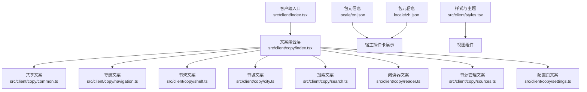
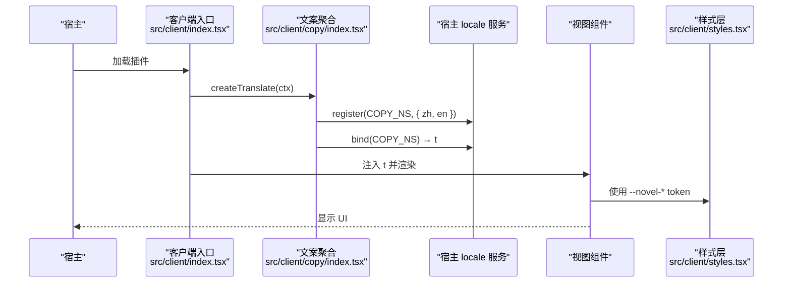
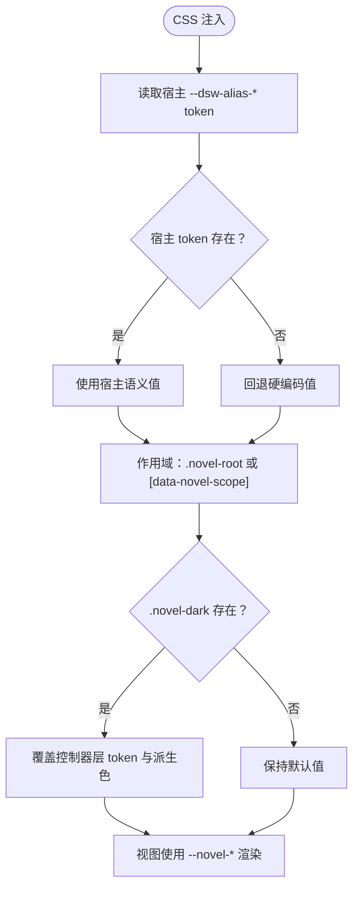
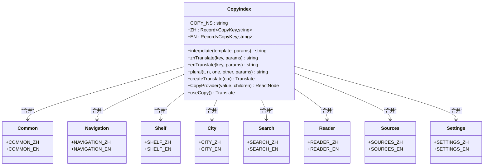
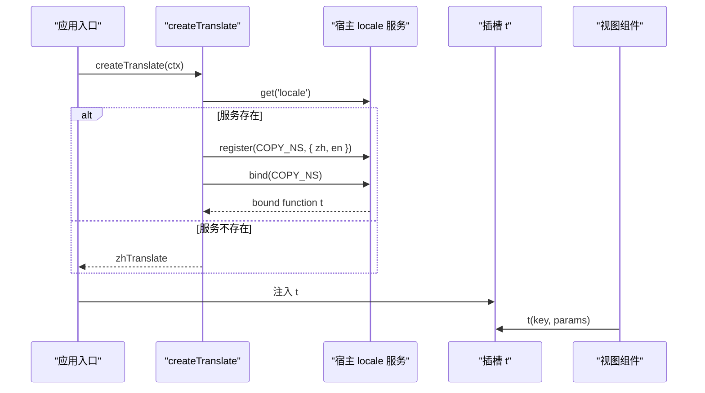
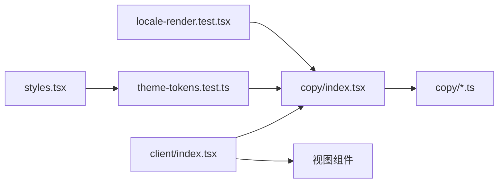

# 样式、主题与国际化

<cite>
**本文引用的文件**   
- [styles.tsx](file://src/client/styles.tsx)
- [index.tsx（客户端入口）](file://src/client/index.tsx)
- [index.tsx（文案聚合）](file://src/client/copy/index.tsx)
- [common.ts（共享文案）](file://src/client/copy/common.ts)
- [navigation.ts（导航文案）](file://src/client/copy/navigation.ts)
- [shelf.ts（书架文案）](file://src/client/copy/shelf.ts)
- [city.ts（书城文案）](file://src/client/copy/city.ts)
- [search.ts（搜索文案）](file://src/client/copy/search.ts)
- [reader.ts（阅读器文案）](file://src/client/copy/reader.ts)
- [sources.ts（书源管理文案）](file://src/client/copy/sources.ts)
- [settings.ts（配置页文案）](file://src/client/copy/settings.ts)
- [en.json（包元信息英文）](file://locale/en.json)
- [zh.json（包元信息中文）](file://locale/zh.json)
- [theme-tokens.test.ts（主题守卫测试）](file://tests/client/theme-tokens.test.ts)
- [locale-render.test.tsx（文案渲染测试）](file://tests/client/locale-render.test.tsx)
- [0038-client-copy-host-locale.md（ADR：宿主语言服务）](file://docs/adr/0038-client-copy-host-locale.md)
</cite>

## 目录
1. [引言](#引言)
2. [项目结构](#项目结构)
3. [核心组件](#核心组件)
4. [架构总览](#架构总览)
5. [详细组件分析](#详细组件分析)
6. [依赖关系分析](#依赖关系分析)
7. [性能考虑](#性能考虑)
8. [故障排查指南](#故障排查指南)
9. [新增主题色、新增文案键与新语言约定](#新增主题色新增文案键与新语言约定)
10. [结论](#结论)

## 引言
本文聚焦前端样式与主题系统、以及界面国际化实现。样式方面，重点解释 `src/client/styles.tsx` 中的 CSS-in-JS token（颜色、字号、行距、卡片阴影、边框、间距）、深浅主题切换逻辑与响应式断点；国际化方面，解释 `src/client/copy/**` 的 TS 字典、`locale/en.json` 与 `locale/zh.json` 的双语文案分工、宿主语言监听机制，以及“服务端错误原文与书源数据不翻译”的原则。文末给出新增主题色、新增文案键、适配新语言的步骤与常见问题调试方法。

## 项目结构
本项目的前端样式集中在 `src/client/styles.tsx`，通过导出模板字符串注入 CSS；文案集中在 `src/client/copy/**`，按领域拆分；包级元信息（插件卡片标题与描述）在 `locale/en.json` 与 `locale/zh.json`；客户端应用入口在 `src/client/index.tsx`，负责把文案服务接入宿主 slot。

**图表来源**
- [index.tsx（客户端入口）:1-110](file://src/client/index.tsx#L1-L110)
- [index.tsx（文案聚合）:1-90](file://src/client/copy/index.tsx#L1-L90)
- [styles.tsx:1-200](file://src/client/styles.tsx#L1-L200)

**章节来源**
- [index.tsx（客户端入口）:1-110](file://src/client/index.tsx#L1-L110)
- [index.tsx（文案聚合）:1-90](file://src/client/copy/index.tsx#L1-L90)

## 核心组件
- **样式与主题层**：`src/client/styles.tsx` 导出 `NOVEL_CSS`，把宿主设计 token、本层 token、布局规则与组件类集中注入。
- **文案聚合层**：`src/client/copy/index.tsx` 合并各域字典、提供 `createTranslate`、`CopyProvider`、`useCopy`、`interpolate`、`plural`。
- **客户端入口**：`src/client/index.tsx` 把面板注册到宿主的 `sidebar.panellist` 与 `main`，并通过 `createTranslate` 把宿主 locale 服务桥接到组件树。
- **包元信息**：`locale/en.json` 与 `locale/zh.json` 提供插件卡片标题与描述，由宿主在激活前读取。

**章节来源**
- [styles.tsx:1-200](file://src/client/styles.tsx#L1-L200)
- [index.tsx（文案聚合）:1-90](file://src/client/copy/index.tsx#L1-L90)
- [index.tsx（客户端入口）:1-110](file://src/client/index.tsx#L1-L110)
- [en.json:1-6](file://locale/en.json#L1-L6)
- [zh.json:1-6](file://locale/zh.json#L1-L6)

## 架构总览
样式层只读宿主语义 token，不判断深浅主题；文案层通过宿主 `locale` 服务注册命名空间并绑定运行时翻译函数。两者都强调“契约优先”：主题 token 名由测试守卫冻结，文案键由 TS 类型强制中英一致。

**图表来源**
- [index.tsx（客户端入口）:1-110](file://src/client/index.tsx#L1-L110)
- [index.tsx（文案聚合）:1-90](file://src/client/copy/index.tsx#L1-L90)
- [styles.tsx:1-200](file://src/client/styles.tsx#L1-L200)

## 详细组件分析

### 样式与主题系统（styles.tsx）
`styles.tsx` 以模板字符串导出 `NOVEL_CSS`，并在注释中明确三层契约：
1. **配色契约**：颜色走宿主 `@deepseek-ai/dsh-client-ui-theme` 的 alias token；不存在时回退硬编码值，避免深浅主题错乱。
2. **标度契约**：间距、字号、圆角、阴影、层级、动效全部用 `--novel-sp-*`、`--novel-fs-*`、`--novel-r-*`、`--novel-shadow-*`、`--novel-z-*`、`--novel-dur/ease`。
3. **自足契约**：每个被样式读取的 `var(--novel-*)` 必须在同一层定义，否则 token 自足守卫会报错。

#### Token 分类与用途
| 类别 | 示例 token | 含义 | 关键行为 |
|---|---|---|---|
| 背景层 | `--novel-bg`、`--novel-layer-1`、`--novel-layer-2`、`--novel-layer-3` | 页面底、容器、面板、输入件 | 映射宿主 `--dsw-alias-bg-base` / `bg-layer-1..3` |
| 边框 | `--novel-border`、`--novel-border-strong`、`--novel-border-faint` | 容器描边、强边框、发丝线 | 映射宿主 `border-l2/l4/l1`，避免写死 1px 实心灰 |
| 文字与交互 | `--novel-text`、`--novel-text-2`、`--novel-text-3`、`--novel-fg`、`--novel-hover`、`--novel-active` | 主文、次要文、三阶文、前景、悬停、激活 | 随宿主 label alias 自动深浅切换 |
| 品牌与按钮 | `--novel-brand`、`--novel-primary-fill`、`--novel-primary-hover` | 主色、主按钮填充、悬停 | 派生色通过 `color-mix` 计算 |
| 品牌派生 | `--novel-brand-soft`、`--novel-brand-tint`、`--novel-brand-line`、`--novel-brand-strong` | 选中底、编辑底、运行卡描边、亮蓝强调字 | 派生色必须留在 token 层 |
| 状态 | `--novel-ok`、`--novel-err`、`--novel-warn`、`--novel-err-weak`、`--novel-err-line` | 成功、错误、警告、弱错误底、危险描边 | 错误弱底用宿主 danger 交互态 |
| 遮罩与骨架屏 | `--novel-mask`、`--novel-skeleton` | 模态遮罩、骨架屏 | 遮罩名来自宿主 `bg-mask-1` |
| 标度 | `--novel-sp-0..7`、`--novel-fs-xs..xl`、`--novel-r-xs..lg` | 间距、字号、圆角 | 中文最小可读字号为 11px |
| 阴影与层级 | `--novel-shadow-1/2/pop`、`--novel-z-status/mask/panel/toolbar/modal` | 封面贴页、卡片浮起、模态、浮层层级 | z 序与控制器 JS 侧保持同名 |
| 正文纸墨 | `--novel-paper`、`--novel-paper-ink` | 阅读层纸张色与墨色 | 默认米黄底深字，由 ReaderView 行内写入 |
| 动态槽位 | `--novel-pct`、`--novel-measure`、`--novel-fig-ratio` | 进度条、栏宽、插图宽高比 | 由视图行内写入，但必须在词表在册 |

#### 深浅主题切换逻辑
样式层**不主动检测深浅主题**。深浅切换有两种来源：
- **宿主主题**：宿主在 `body` 或 `body[data-ds-dark-theme]` 上提供 `--dsw-alias-*` 值，`NOVEL_CSS` 通过 `var(--dsw-alias-*, fallback)` 自动跟随。
- **控制器层强制暗**：`.novel-dark` 类覆盖 `--novel-*` 局部变量，用于阅读器控制器条、Aa 面板、导出面板等控制器层。该处允许字面量，因为它是用户显式选择，不是主题推导。

需要注意：`.novel-dark` 不仅覆盖基础 token，还重钉了 `--novel-brand-soft/tint/line/strong` 与 `--novel-ring`。这是因为派生色在声明处算完即继承，仅换父级 `--novel-brand` 不会回填上层已计算的派生值。

**图表来源**
- [styles.tsx:1-200](file://src/client/styles.tsx#L1-L200)

#### 响应式断点
从当前仓库可见内容看，`styles.tsx` 没有定义传统意义上的媒体查询断点。其“响应式”主要体现为：
- **标度驱动**：通过 `--novel-fs-*`、`--novel-sp-*`、`--novel-r-*` 统一字号与间距。
- **容器宽度驱动**：例如状态条最大宽度使用 `min(420px, calc(100% - 2 * var(--novel-sp-3)))`，在小屏幕下自然收缩。
- **移动端问题定位线索**：测试与注释多次指出横滚、网格截断、定宽 modal/drawer/prefs 肥一圈等根因是 box-sizing 与 overflow 链，而不是断点缺失。

因此，新增响应式行为应优先调整标度与容器约束，而非直接引入大量媒体查询。

**章节来源**
- [styles.tsx:1-200](file://src/client/styles.tsx#L1-L200)
- [theme-tokens.test.ts:1-199](file://tests/client/theme-tokens.test.ts#L1-L199)

### 国际化系统（copy/index.tsx 与 copy 域字典）
`src/client/copy/index.tsx` 是文案系统的核心：
- 将 `common`、`navigation`、`shelf`、`city`、`search`、`reader`、`sources`、`settings` 的 ZH 与 EN 合并为单一 `ZH` 与 `EN`。
- 导出 `CopyKey = keyof typeof ZH`，使 EN 必须镜像所有键，漏键会在编译期失败。
- 提供 `interpolate(template, params)`，支持 `{name}` 参数替换；参数缺失时保留占位符。
- 提供 `zhTranslate`、`enTranslate`、`plural`、`createTranslate`、`CopyProvider`、`useCopy`。

**图表来源**
- [index.tsx（文案聚合）:1-90](file://src/client/copy/index.tsx#L1-L90)
- [common.ts:1-36](file://src/client/copy/common.ts#L1-L36)
- [navigation.ts:1-18](file://src/client/copy/navigation.ts#L1-L18)
- [shelf.ts:1-127](file://src/client/copy/shelf.ts#L1-L127)
- [city.ts:1-104](file://src/client/copy/city.ts#L1-L104)
- [search.ts:1-146](file://src/client/copy/search.ts#L1-L146)
- [reader.ts:1-137](file://src/client/copy/reader.ts#L1-L137)
- [sources.ts:1-200](file://src/client/copy/sources.ts#L1-L200)
- [settings.ts:1-105](file://src/client/copy/settings.ts#L1-L105)

#### 宿主语言监听与切换
`createTranslate` 的工作流程如下：
1. 尝试从宿主 `ctx.get('locale')` 取 locale 服务。
2. 若服务存在，则在 `ctx.effect` 中注册命名空间 `xrn1997-dsh-novel`，传入 `{ zh: ZH, en: EN }`。
3. 若 `service.bind` 可用，则返回绑定后的 `t(key, params)`；否则退回 `zhTranslate`。
4. 入口 `src/client/index.tsx` 在注册侧栏图标、主面板、状态层时，把同一个 `t` 透传给插槽。

重要限制：
- 服务是可选的；老宿主没有 locale 服务时插件仍可工作，回退中文。
- 已生成并入 transient、job、会话快照的错误文案在生成时确定语言，切换语言不会重翻存量条目。
- 视图本地 state 里的错误同样冻在生成时的语言，不为此把 store/state 改成消息对象。

**图表来源**
- [index.tsx（文案聚合）:1-90](file://src/client/copy/index.tsx#L1-L90)
- [index.tsx（客户端入口）:1-110](file://src/client/index.tsx#L1-L110)
- [0038-client-copy-host-locale.md:1-12](file://docs/adr/0038-client-copy-host-locale.md#L1-L12)

#### 包元信息与插件卡片文案
`locale/en.json` 与 `locale/zh.json` 只包含 `meta.title` 与 `meta.description`，属于宿主插件包激活前读取的清单元信息，不是运行期 UI 字典。它负责插件卡片标题与描述的双语展示，与 `src/client/copy/**` 的运行期文案体系分开。

**章节来源**
- [index.tsx（文案聚合）:1-90](file://src/client/copy/index.tsx#L1-L90)
- [en.json:1-6](file://locale/en.json#L1-L6)
- [zh.json:1-6](file://locale/zh.json#L1-L6)
- [0038-client-copy-host-locale.md:1-12](file://docs/adr/0038-client-copy-host-locale.md#L1-L12)

### 服务端错误与书源数据不翻译原则
根据 ADR 0038 与文案注释：
- 客户端自造错误（如 not-json、request-failed、stream-unavailable）进入 `common.*` 文案。
- 服务端错误原文、错误码、段级定位、书源数据、书内正文、图片替代文字、导入告警原文等作为数据透出，不翻译。
- 这一原则避免“按 message 前缀猜来源”这类脆弱判据，也避免把业务数据变成可翻译字符串。

**章节来源**
- [0038-client-copy-host-locale.md:1-12](file://docs/adr/0038-client-copy-host-locale.md#L1-L12)
- [common.ts:1-36](file://src/client/copy/common.ts#L1-L36)
- [reader.ts:1-137](file://src/client/copy/reader.ts#L1-L137)

## 依赖关系分析
- `src/client/index.tsx` 依赖 `src/client/copy/index.tsx` 提供的 `CopyProvider`、`createTranslate`、`zhTranslate`。
- `src/client/copy/index.tsx` 依赖各域字典模块，但不持有 React 状态。
- 样式层 `src/client/styles.tsx` 不依赖 React，而是以 `NOVEL_CSS` 暴露 CSS 模板字符串，供宿主或构建流程注入。
- 测试层通过 `tests/client/theme-tokens.test.ts` 扫描 `src/client/**`，确保所有 `--dsw-*` 都是宿主真名，且视图层禁止内联颜色字面量。
- 测试层通过 `tests/client/locale-render.test.tsx` 验证英文渲染、中文默认回退、以及同 `t` 字典切换后界面跟随语言变化。

**图表来源**
- [theme-tokens.test.ts:1-199](file://tests/client/theme-tokens.test.ts#L1-L199)
- [locale-render.test.tsx:1-45](file://tests/client/locale-render.test.tsx#L1-L45)
- [index.tsx（客户端入口）:1-110](file://src/client/index.tsx#L1-L110)
- [index.tsx（文案聚合）:1-90](file://src/client/copy/index.tsx#L1-L90)

**章节来源**
- [theme-tokens.test.ts:1-199](file://tests/client/theme-tokens.test.ts#L1-L199)
- [locale-render.test.tsx:1-45](file://tests/client/locale-render.test.tsx#L1-L45)

## 性能考虑
- 样式注入使用模板字符串导出，便于 renderToString 友好与 HMR 整体替换。
- 文案翻译函数是纯函数，调用时读当前 locale，避免缓存译句导致切换语言不刷新。
- 主题 token 通过宿主 alias 层统一管理，减少多处硬编码颜色带来的维护成本。
- 状态条改为绝对定位浮层，避免普通流内插入造成的 layout-shift 闪烁。

[本节为通用建议，不直接分析具体代码行]

## 故障排查指南

### 主题变量未生效
常见原因与排查步骤：
1. **引用了宿主不存在的 token**：例如旧名 `--dsw-alias-border-l` 不存在，只有 `l1..l4`。CSS 不会报错，只会静默回退 fallback，导致深浅都不跟随。
   - 对照 `tests/client/theme-tokens.test.ts` 中的 `HOST_TOKENS` 白名单检查。
2. **视图层内联颜色**：brand hex 或 `rgba()`、`color-mix()` 写在视图里，绕过 token seam，宿主换 brand 即失联。
   - 将派生色移到 `styles.tsx` 的 token 层。
3. **控制器层 `.novel-dark` 未重钉派生色**：只改 `--novel-brand` 不足以让 `--novel-brand-soft/tint/line/strong` 与 `--novel-ring` 变暗。
4. **正文纸墨层被误认为主题层**：`--novel-paper` 与 `--novel-paper-ink` 是阅读层纸墨，不应当作全局主题色。

**章节来源**
- [theme-tokens.test.ts:1-199](file://tests/client/theme-tokens.test.ts#L1-L199)
- [styles.tsx:1-200](file://src/client/styles.tsx#L1-L200)

### CSS 选择器穿透失败
常见原因与排查步骤：
1. **scope 不匹配**：样式只作用于 `.novel-root` 与 `[data-novel-scope]` 两棵树；宿主其他树不受影响。
2. **box-sizing 未生效**：若不在 scope 内，`width + padding` 会导致横向溢出、网格右侧截断。
3. **overflow 链断裂**：`.novel-root` 定高 `overflow:hidden`，`.novel-main` 才是滚动轴；不能随意放开滚动责任，否则阅读器滚动失效、进度落盘/预取/回跳受影响。
4. **宿主 composer 遮挡**：小说视图隐藏默认 composer 时使用了 `!important`，需确认宿主结构是否变化。

**章节来源**
- [styles.tsx:1-200](file://src/client/styles.tsx#L1-L200)

### 文案遗漏导致回退英文
常见原因与排查步骤：
1. **ZH/EN 键不一致**：`EN` 是 `Record<CopyKey, string>`，新增 ZH 键后未同步 EN 键会导致编译错误或回退。
2. **缺少 CopyProvider**：没有 Provider 时默认使用 `zhTranslate`；测试直渲或宿主槽位未注入 `t` 时会看到中文。
3. **宿主 locale 服务缺失**：`createTranslate` 会回退 `zhTranslate`，界面停在中文。
4. **存量错误未重翻**：已进入 transient/job/会话快照的错误在生成时定语言，切换语言不会重翻。

调试建议：
- 使用 `tests/client/locale-render.test.tsx` 的思路：分别用 `enTranslate` 与默认中文渲染，断言 role 与组名。
- 检查 `src/client/index.tsx` 是否正确把 `t` 注入 sidebar 图标、main 面板与 shell overlay。

**章节来源**
- [index.tsx（文案聚合）:1-90](file://src/client/copy/index.tsx#L1-L90)
- [index.tsx（客户端入口）:1-110](file://src/client/index.tsx#L1-L110)
- [locale-render.test.tsx:1-45](file://tests/client/locale-render.test.tsx#L1-L45)

### 移动端布局错位
常见原因与排查步骤：
1. **横滚条出现**：通常是 `box-sizing` 未生效或 width/max-width 与 padding 叠加导致外廓超宽。
2. **正文裁在首屏**：可能是 `.novel-main` 不再滚动，滚动责任被错误交给宿主 scrollport。
3. **modal/drawer/prefs 定宽偏大**：box-sizing 与 padding 叠加导致“肥一圈”。
4. **状态条遮挡**：状态条锚在右下，z-index 与 pointer-events 需要同时检查。

**章节来源**
- [styles.tsx:1-200](file://src/client/styles.tsx#L1-L200)

## 新增主题色、新增文案键与新语言约定

### 新增主题色
推荐路径：
1. 在 `src/client/styles.tsx` 的 token 层新增 `--novel-*` 别名，并通过 `var(--dsw-alias-*, fallback)` 引用宿主语义 token。
2. 如需派生色，使用 `color-mix(in srgb, var(--novel-*, ...) , transparent)`，不要在内联样式中重复计算。
3. 如果新增的是控制器层强制暗场景，需在 `.novel-dark` 中同步覆盖对应 token。
4. 在视图中只使用 `var(--novel-*)`，禁止直接写 hex 或 rgb/hsl/color-mix 字面量。
5. 运行主题守卫测试：`tests/client/theme-tokens.test.ts` 会扫描 client 源码中的 `--dsw-*` 与颜色字面量。

注意事项：
- 新增宿主 token 名必须与 `HOST_TOKENS` 保持一致；若宿主改名，先更新测试词表。
- 正文纸墨层（`--novel-paper`、`--novel-paper-ink`）是例外白名单范围，不属于主题品牌色。

**章节来源**
- [styles.tsx:1-200](file://src/client/styles.tsx#L1-L200)
- [theme-tokens.test.ts:1-199](file://tests/client/theme-tokens.test.ts#L1-L199)

### 新增文案键
推荐路径：
1. 选择一个已有域名，例如 `shelf`、`search`、`reader`、`sources`、`settings`、`city`、`navigation`、`common`。
2. 在对应 `copy/*.ts` 中新增 `*_ZH` 与 `*_EN` 键，保持 key 完全一致。
3. 如果需要数量差异，使用 `plural(t, n, oneKey, otherKey, params)`，中文两侧通常同文，英文按 one/other。
4. 参数占位符使用 `{name}`，缺失参数时原样保留。
5. 运行文案相关测试，确保渲染结果符合预期。

约定：
- 服务端错误原文、书源数据、书内正文、图片替代文字、导入告警原文不放入文案字典。
- 第三方命名空间必须带插件前缀；官方占用 `common`、`settings`、`sidebar`。

**章节来源**
- [index.tsx（文案聚合）:1-90](file://src/client/copy/index.tsx#L1-L90)
- [common.ts:1-36](file://src/client/copy/common.ts#L1-L36)
- [shelf.ts:1-127](file://src/client/copy/shelf.ts#L1-L127)
- [search.ts:1-146](file://src/client/copy/search.ts#L1-L146)
- [reader.ts:1-137](file://src/client/copy/reader.ts#L1-L137)
- [sources.ts:1-200](file://src/client/copy/sources.ts#L1-L200)
- [settings.ts:1-105](file://src/client/copy/settings.ts#L1-L105)
- [0038-client-copy-host-locale.md:1-12](file://docs/adr/0038-client-copy-host-locale.md#L1-L12)

### 适配新语言
当前仓库以中文为真源、英文为镜像，包元信息另有 `locale/en.json` 与 `locale/zh.json`。适配新语言时应区分两类文案：

| 文案类型 | 位置 | 说明 |
|---|---|---|
| 运行期 UI 文案 | `src/client/copy/*.ts` | TS 字典，ZH 为真源，EN 逐键镜像 |
| 插件包元信息 | `locale/en.json`、`locale/zh.json` | 宿主激活前读取的卡片标题与描述 |

步骤：
1. 如果是新增英文镜像：在对应 `*_EN` 中补齐键值，保持 key 与 ZH 一致。
2. 如果是新增包元信息语言：在 `locale/en.json` 或 `locale/zh.json` 中修改 `meta.title` 与 `meta.description`。
3. 如果宿主 locale 服务提供新语言：确认 `createTranslate` 仍能通过 `register` 与 `bind` 正确绑定命名空间。
4. 验证默认回退：没有 Provider 或 locale 服务缺失时仍应显示中文。

注意：
- 包元信息 JSON 不是运行期 i18n 字典；不要把 UI 句子搬进 `locale/en.json`。
- 语言切换依赖宿主 outlet 的 locale revision 重渲，组件不缓存译句。

**章节来源**
- [index.tsx（文案聚合）:1-90](file://src/client/copy/index.tsx#L1-L90)
- [en.json:1-6](file://locale/en.json#L1-L6)
- [zh.json:1-6](file://locale/zh.json#L1-L6)
- [0038-client-copy-host-locale.md:1-12](file://docs/adr/0038-client-copy-host-locale.md#L1-L12)

## 结论
本项目的样式与主题系统围绕“宿主语义 token + 本层别名 + 控制器层覆盖”展开，避免在视图层硬编码颜色；国际化系统围绕“TS 字典 + 宿主 locale 服务 + 包元信息 JSON”展开，保证编译期键一致与运行时语言切换。新增主题色应走 token 层，新增文案键应保持 ZH/EN 同步，新增语言需区分运行期 UI 文案与插件包元信息。常见问题的根因大多落在 token 名变更、选择器 scope、overflow 链、locale 服务可选回退与存量错误语言冻结上，可通过对应测试与注释快速定位。