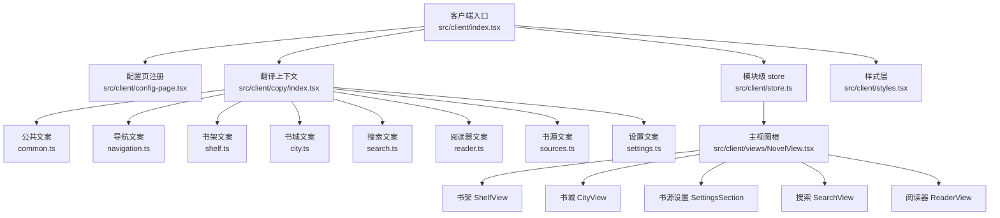
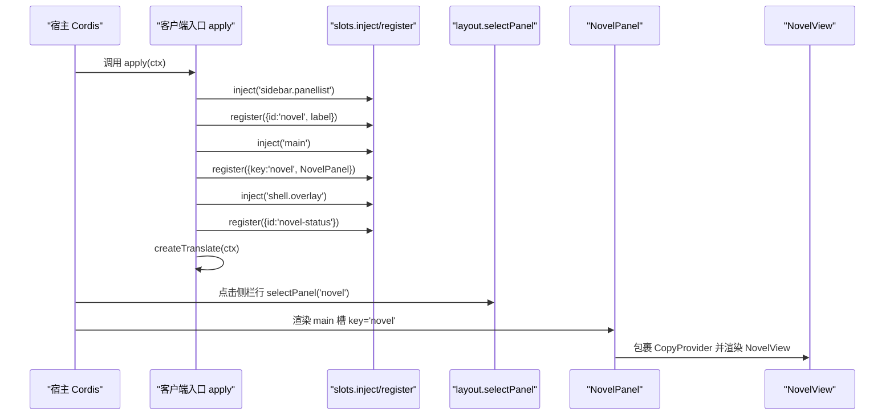
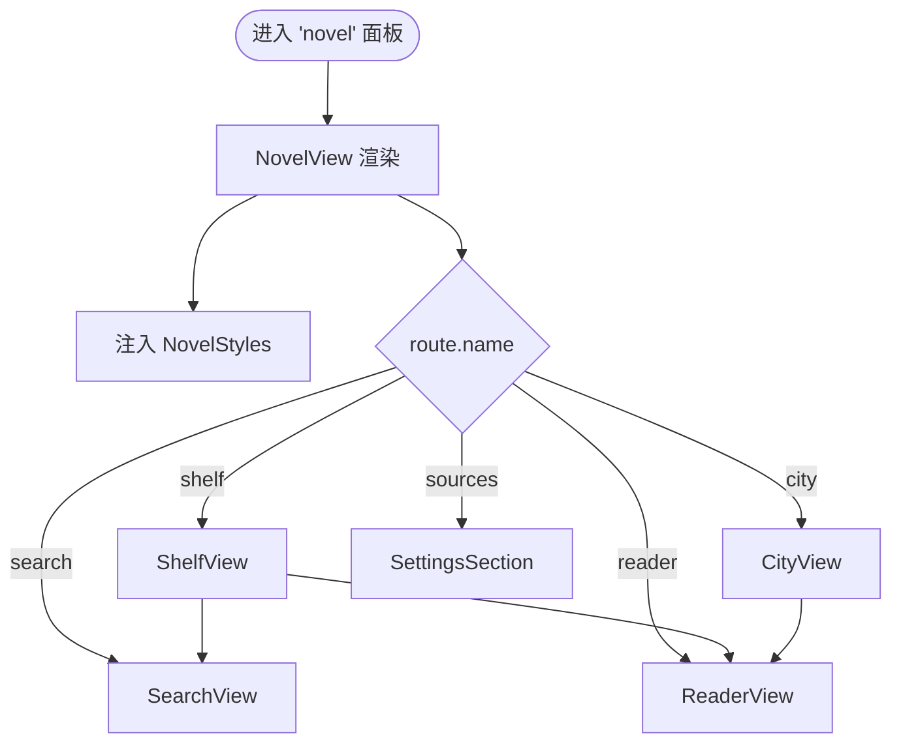
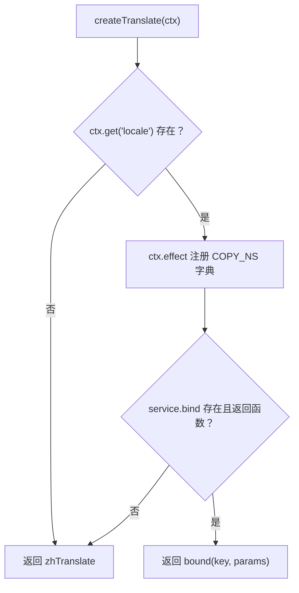
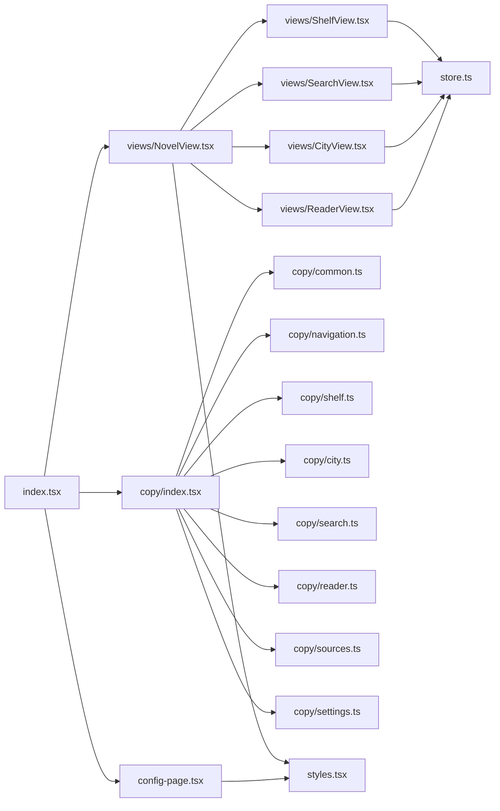

# 浏览器前端架构

<cite>
**本文引用的文件**   
- [index.tsx](file://src/client/index.tsx)
- [store.ts](file://src/client/store.ts)
- [styles.tsx](file://src/client/styles.tsx)
- [copy/index.tsx](file://src/client/copy/index.tsx)
- [common.ts](file://src/client/copy/common.ts)
- [navigation.ts](file://src/client/copy/navigation.ts)
- [shelf.ts](file://src/client/copy/shelf.ts)
- [city.ts](file://src/client/copy/city.ts)
- [search.ts](file://src/client/copy/search.ts)
- [reader.ts](file://src/client/copy/reader.ts)
- [sources.ts](file://src/client/copy/sources.ts)
- [settings.ts](file://src/client/copy/settings.ts)
- [config-page.tsx](file://src/client/config-page.tsx)
- [NovelView.tsx](file://src/client/views/NovelView.tsx)
- [ShelfView.tsx](file://src/client/views/ShelfView.tsx)
- [SearchView.tsx](file://src/client/views/SearchView.tsx)
- [CityView.tsx](file://src/client/views/CityView.tsx)
- [ReaderView.tsx](file://src/client/views/ReaderView.tsx)
</cite>

## 目录

1. [简介](#简介)
2. [项目结构](#项目结构)
3. [核心组件](#核心组件)
4. [架构总览](#架构总览)
5. [详细组件分析](#详细组件分析)
6. [依赖关系分析](#依赖关系分析)
7. [性能与响应式](#性能与响应式)
8. [无障碍](#无障碍)
9. [调试技巧](#调试技巧)
10. [新增面板、视图与主题色指南](#新增面板视图与主题色指南)
11. [结论](#结论)

## 简介

本仓库的浏览器前端是一个面向“小说”功能的 React 插件界面。它通过宿主 Cordis 提供的 `slots` 和 `layout` 能力，把“小说”注册为全局面板：侧栏图标 + 中央 keyed 槽面板；同时在宿主 `shell.overlay` 上挂一个常驻任务状态层。

整个前端围绕五个内部路由组织：书架、书城、书源管理、搜索、阅读器。其中前三个是并列顶部 tab，后两个是各自沉浸的内容流；阅读器不是 tab，而是由书架或书城触发的阅读容器。

文案全部走 `copy/` 下的键值字典，并通过宿主 locale 服务在中文与英文之间切换；样式全部走 `styles.tsx` 注入的 CSS 变量 token，跟随宿主 `@deepseek-ai/dsh-client-ui-theme` 的光/暗主题。

## 项目结构

**图表来源**
- [index.tsx:1-110](file://src/client/index.tsx#L1-L110)
- [config-page.tsx:1-200](file://src/client/config-page.tsx#L1-L200)
- [copy/index.tsx:1-90](file://src/client/copy/index.tsx#L1-L90)
- [store.ts:1-78](file://src/client/store.ts#L1-L78)
- [NovelView.tsx:1-65](file://src/client/views/NovelView.tsx#L1-L65)
- [styles.tsx:1-200](file://src/client/styles.tsx#L1-L200)

**章节来源**
- [index.tsx:1-110](file://src/client/index.tsx#L1-L110)
- [NovelView.tsx:1-65](file://src/client/views/NovelView.tsx#L1-L65)

## 核心组件

| 组件 | 职责 | 关键行为 |
|---|---|---|
| 客户端入口 `apply` | 注册侧栏、中央面板、常驻状态层、可选配置页 | 双注册同 id/key `novel`；创建 `createTranslate`；注入 `shell.overlay` |
| `CopyProvider` / `useCopy` | 提供当前语言的翻译函数 | 默认中文，宿主 locale 可用时接管 |
| `routeStore` / `prefsStore` / `cityStore` | 模块级轻量状态 | 路由、阅读偏好、书城浏览现场 |
| `NovelView` | 主视图根与 tab 分发器 | 注入一次样式层；按 route 渲染书架/书城/书源/搜索/阅读器 |
| `ShelfView` | 书架 tab | 加载书架、筛选、多选删除、本地导入、跳转搜索与阅读器 |
| `SearchView` | 聚合搜索 tab | 提交后台任务、轮询增量渲染、加架、返回书架 |
| `CityView` | 书城分类浏览 tab | 选择源与分类、分页加载、书籍详情浮层 |
| `ReaderView` | 阅读器容器 | 会话、目录、注释、导出、阅读设置、正文滚动锚定 |
| 配置页 `registerConfigPage` | 运行参数表单 | 绑定 volatile 配置字段、单位换算、预设档、保存语义 |
| 样式层 `NOVEL_CSS` | 设计 token、布局、组件类 | 只读宿主 theme alias；定义 `.novel-root`、`.novel-view`、tab、状态条等 |

**章节来源**
- [index.tsx:1-110](file://src/client/index.tsx#L1-L110)
- [copy/index.tsx:1-90](file://src/client/copy/index.tsx#L1-L90)
- [store.ts:1-78](file://src/client/store.ts#L1-L78)
- [NovelView.tsx:1-65](file://src/client/views/NovelView.tsx#L1-L65)
- [config-page.tsx:1-200](file://src/client/config-page.tsx#L1-L200)
- [styles.tsx:1-200](file://src/client/styles.tsx#L1-L200)

## 架构总览

### 面板注册与控制流

**图表来源**
- [index.tsx:1-110](file://src/client/index.tsx#L1-L110)

### 视图树与路由分发

**图表来源**
- [NovelView.tsx:1-65](file://src/client/views/NovelView.tsx#L1-L65)

## 详细组件分析

### 客户端入口与面板注册

`src/client/index.tsx` 是浏览器半入口。它不做业务逻辑，只做三件事：

1. **注册全局面板**：向宿主的 `sidebar.panellist` 注册一个侧栏图标项，向 `main` 注册一个 keyed 槽占用者，两者都使用固定 id/key `novel`。官方契约要求二者必须同批注册，否则选中缺失的 main entry 会抛错。
2. **注册常驻状态层**：向 `shell.overlay` 注册 `novel-status`，让任务读数在任何面板都能显示；状态条默认 `pointer-events: none`，条目自身再恢复点击。
3. **创建翻译函数**：通过 `createTranslate(ctx)` 对接宿主 locale 服务；服务不存在时回退到 `zhTranslate`。

侧栏图标组件只输出 SVG，不处理宿主行的选中态；选中态归宿主 sidebar shell。`NovelPanel` 负责把 `t` 放进 `CopyProvider`，再由 `NovelView` 消费。

**章节来源**
- [index.tsx:1-110](file://src/client/index.tsx#L1-L110)

### 复制文案与国际化机制

复制系统以命名空间 `xrn1997-dsh-novel` 注册字典，中文是真实源，英文是按键镜像的记录对象。所有文案被拆成多个域文件：

| 文件 | 领域 | 键前缀示例 |
|---|---|---|
| [common.ts](file://src/client/copy/common.ts) | 通用按钮、单位、网络错误 | `common.*`、`unit.*`、`count.*` |
| [navigation.ts](file://src/client/copy/navigation.ts) | 侧栏、状态层、三个顶部 tab | `nav.*` |
| [shelf.ts](file://src/client/copy/shelf.ts) | 书架 | `shelf.*` |
| [city.ts](file://src/client/copy/city.ts) | 书城分类浏览 | `city.*` |
| [search.ts](file://src/client/copy/search.ts) | 聚合搜索 | `search.*` |
| [reader.ts](file://src/client/copy/reader.ts) | 阅读器、目录、注释、导出 | `reader.*` |
| [sources.ts](file://src/client/copy/sources.ts) | 书源管理、导入、任务、状态条 | `sources.*`、`import.*`、`job.*`、`status.*` |
| [settings.ts](file://src/client/copy/settings.ts) | 配置页与阅读偏好 | `config.*`、`prefs.*` |

`createTranslate` 的工作流程如下：

**图表来源**
- [copy/index.tsx:1-90](file://src/client/copy/index.tsx#L1-L90)

关键点：

- 字典注册挂在 `ctx.effect`，避免 HMR 重挂后重复注册。
- 如果宿主没有 locale 服务、`bind` 非函数或返回非函数，一律回退中文，首帧渲染不会炸。
- 已生成并缓存的错误文案在生成时就定语言，切换语言不重翻存量条目；这是已知限制，文档里明确说明。
- `interpolate` 支持 `{name}` 占位符，缺参时保留原占位符。
- `plural` 统一单复数：中文两侧同文，英文由 one/other 决定。

**章节来源**
- [copy/index.tsx:1-90](file://src/client/copy/index.tsx#L1-L90)
- [common.ts:1-36](file://src/client/copy/common.ts#L1-L36)
- [navigation.ts:1-18](file://src/client/copy/navigation.ts#L1-L18)
- [shelf.ts:1-127](file://src/client/copy/shelf.ts#L1-L127)
- [city.ts:1-104](file://src/client/copy/city.ts#L1-L104)
- [search.ts:1-146](file://src/client/copy/search.ts#L1-L146)
- [reader.ts:1-137](file://src/client/copy/reader.ts#L1-L137)
- [sources.ts:1-200](file://src/client/copy/sources.ts#L1-L200)
- [settings.ts:1-105](file://src/client/copy/settings.ts#L1-L105)

### 状态管理与模块级 store

`src/client/store.ts` 提供一个极轻的 `createStore`，基于 `useSyncExternalStore`，对外暴露 `get`、`set(patch)`、`subscribe`。业务数据本身不进 store：每次挂载从 API 拉取，组件内用 `useState` 持有。

| Store | 类型 | 持久性 | 用途 |
|---|---|---|---|
| `routeStore` | `{ route: Route }` | 内存 | 书架/书城/书源/搜索/阅读器五分支 |
| `prefsStore` | `Prefs` | `localStorage` | 字号、行距、列宽、纸张色、控制器深色 |
| `cityStore` | `{ sourceId, kind }` | 内存 | 书城上次逛的源与分类 |

`Route` 定义清晰区分了“并列 tab”和“沉浸内容流”：

- 并列 tab：`shelf`、`city`、`sources`
- 沉浸流：`reader`（带 `sourceId`、`bookKey`、`title`）、`search`（带可选 `keyword`）

阅读偏好默认值为字号 18、行距 1.8、列宽 36em、纸张色米黄、控制器不强制深色。`measure=36em` 对应约每行 36 个中文字，是舒适区上沿。

**章节来源**
- [store.ts:1-78](file://src/client/store.ts#L1-L78)

### 样式与主题系统

`styles.tsx` 通过模板字符串注入一个 `<style data-novel-style>`，并在根节点设置 `data-novel-scope`。它的主题是“语义 token 层”，不是硬编码颜色：

- 背景、边框、交互、文字、品牌色、状态色等都先读取宿主 `--dsw-alias-*` 变量。
- 若宿主变量不存在，则落 fallback 色，保证旧宿主仍可看。
- brand 派生色用 `color-mix` 从 `--novel-brand` 算出，换品牌色自动生效。
- 控制器层单独支持 `novel-dark`，可强制暗底，但不影响正文纸张色。
- 全局 box-sizing 收口在 `.novel-root` 与 `[data-novel-scope]`，避免 padding 导致横向溢出。
- `.novel-root` 定高 `overflow:hidden`，`.novel-main` 自滚；滚动探测交给 `scrollport.ts`。
- 当小说视图在场时，隐藏宿主默认 composer 与对话列宽拖拽把手，避免输入框压在正文上。

token 守卫规则：每个被 CSS 读取的 `var(--novel-*)` 必须在词表里有定义；测试覆盖这条约束。

**章节来源**
- [styles.tsx:1-200](file://src/client/styles.tsx#L1-L200)

### 主视图与三个主面板

#### NovelView：视图根与 tab 分发器

`NovelView` 做两件事：

1. 渲染 `NovelStyles`，确保样式层只注入一次。
2. 根据 `routeStore.route.name` 分派到书架、书城、书源管理、搜索或阅读器。

顶部 tab 只有三个：书架、书城、书源管理。搜索和阅读器是各自内部的沉浸导航，不改变顶部 tab。

**章节来源**
- [NovelView.tsx:1-65](file://src/client/views/NovelView.tsx#L1-L65)

#### ShelfView：书架

书架负责：

- 从服务端加载书架条目。
- 按标题/作者关键词跳转到搜索。
- 按阅读状态筛选。
- 多选模式：全选当前筛选结果、清空选择、批量删除。
- 本地 TXT/EPUB 导入：隐藏 file input，由服务端判断格式；有警告时留在本页展示回执，不自动进阅读器。
- 单本删除与批量删除：分别走 `DELETE shelf/:key` 与 `POST shelf/batch-delete`。
- 成功导入后，如果组件仍存活，直接导航到阅读器。

书架是多选与本地导入的重要入口，但它的业务过滤逻辑抽到了 `shelf-view-model.ts`，视图只装配 UI。

**章节来源**
- [ShelfView.tsx:1-200](file://src/client/views/ShelfView.tsx#L1-L200)

#### SearchView：聚合搜索

搜索不是同步请求，而是后台任务：

1. 提交 `POST search/job`。
2. 轮询 `search/job-status`。
3. 增量渲染组头、命中行、失败源折叠。
4. 支持取消。
5. 搜索结果保存在服务端，切走再回来可从 `since=0` 恢复快照。

呈现口径包括：

- 进度条与灰字计数。
- 按书一行（默认视野）。
- 逐源分组（失败源折叠在页尾）。
- “＋ 加书架”和“都加架”两个入口，账记在视图层，防止展开收起时状态丢失。
- 空参与集与“搜了没命中”两种空态。

**章节来源**
- [SearchView.tsx:1-200](file://src/client/views/SearchView.tsx#L1-L200)

#### CityView：书城分类浏览

书城是左栏源列表 + 右侧书籍列表的分类浏览：

- 左侧列出可用源，只有选中源就地展开自己的分类。
- 分类按源声明的原样顺序列出，不排序、不合并。
- 进入即尝试恢复上次选的源和分类；如果已失效，落到第一个可用源和第一个分类。
- 轮次由 `useExploreJob` 管理，续页由用户点击触发。
- 卡片骨架最多铺 8 张，避免首屏空卡过多。
- 封面失败按轮次重置，避免坏图永久降级。
- 换源后如果展开区域被裁剪，会把展开的那一行滚到可见位置。

**章节来源**
- [CityView.tsx:1-200](file://src/client/views/CityView.tsx#L1-L200)

#### ReaderView：阅读器容器

ReaderView 是阅读器的容器，而不是单一页面。它组合：

- `ReaderSession`：阅读会话。
- `ChapterBody`：正文渲染。
- `ReaderNavigation`：目录导航。
- `ReaderNotes`：注释。
- `PrefsPanel`：字号、行距、列宽、纸张色、控制器深色。
- `ExportPanel`：导出范围选择与下载。
- `ImportNotesPanel`：EPUB 有损导入的持久告警。

阅读器还维护控制器层 z 序常量 `CTRL_Z`，保证工具栏 > 遮罩 > 面板的顺序不被 sticky stacking context 破坏。

**章节来源**
- [ReaderView.tsx:1-200](file://src/client/views/ReaderView.tsx#L1-L200)

### 书源设置面板

书源设置不是独立的宿主设置区块，而是 NovelView 的第三个顶部 tab。它由 `SettingsSection` 渲染，复用 `styles.tsx` 中的样式类。

与之配套的是配置页 `config-page.tsx`：通过宿主 `configForms` 服务注册运行时参数表单，包含搜索超时、并发源数、JS 沙箱预算、导出节流、磁盘缓存上限、本地导入上限、出站代理等字段。字段几何、单位换算、含义说明、预设档都由本仓实现，而壳层不可用/只读/保存失败语义由宿主 `SettingsForm` 承担。

**章节来源**
- [config-page.tsx:1-200](file://src/client/config-page.tsx#L1-L200)

## 依赖关系分析

**图表来源**
- [index.tsx:1-110](file://src/client/index.tsx#L1-L110)
- [NovelView.tsx:1-65](file://src/client/views/NovelView.tsx#L1-L65)
- [copy/index.tsx:1-90](file://src/client/copy/index.tsx#L1-L90)
- [store.ts:1-78](file://src/client/store.ts#L1-L78)
- [styles.tsx:1-200](file://src/client/styles.tsx#L1-L200)

耦合特点：

- 入口层只依赖插槽和 layout 契约，不直接依赖具体视图实现细节。
- 视图层通过 `deps` 注入 API 与任务能力，方便测试替换。
- 文案解耦为纯字典文件，组件只消费 `useCopy()`。
- 样式完全通过 CSS 变量和类名访问，组件不写内联主题色。
- 模块级 store 被多个视图共享，但只持有轻量现场数据；业务数据在组件 state 或服务端。

**章节来源**
- [index.tsx:1-110](file://src/client/index.tsx#L1-L110)
- [store.ts:1-78](file://src/client/store.ts#L1-L78)

## 性能与响应式

### 虚拟滚动

在当前源码中未发现专门的虚拟滚动库集成。书架、书城、搜索等列表主要采用：

- 后端分页或增量轮询。
- 骨架卡片上界控制。
- 按需加载章节内容与目录。
- 图片失败降级为首字色块。

如果需要大规模长列表优化，建议优先评估现有滚动方案是否已经足够，再考虑引入虚拟滚动；因为当前代码更强调“会话内现场 + 服务端真相”的边界，不应为了虚拟滚动引入另一份难以对齐的状态面。

### 懒加载

- 图片加载失败由视图层记录 `imgFailed` 映射，并降级到首字色块。
- 书城续页由用户点击加载更多，不预拉整本书城。
- 阅读器正文按章节加载，目录和注释单独接口。
- 搜索结果是后台任务增量落地，不是整屏一次性渲染。

### 响应式布局

响应式主要通过 CSS 网格与容器宽度实现：

- 书城卡片网格在宽屏多列、窄屏少列。
- `.novel-main` 自滚，适配不同宿主视口。
- 阅读器正文列宽由 `--novel-measure` 控制，随字号缩放。
- 控制器层、遮罩、面板、状态条等浮层通过 `z-index` token 表统一管理。

仓库中没有看到媒体查询断点的具体实现，因此响应式策略应理解为“容器自适应 + token 驱动”，而不是严格的断点切换。

**章节来源**
- [styles.tsx:1-200](file://src/client/styles.tsx#L1-L200)
- [CityView.tsx:1-200](file://src/client/views/CityView.tsx#L1-L200)
- [SearchView.tsx:1-200](file://src/client/views/SearchView.tsx#L1-L200)
- [ReaderView.tsx:1-200](file://src/client/views/ReaderView.tsx#L1-L200)

## 无障碍

前端在多处使用了 ARIA 属性：

- 侧栏图标使用 `aria-hidden="true"`，宿主行承担可读名称。
- 顶部 tab 使用 `role="group"`、`aria-label`、`aria-pressed`。
- 书架筛选簇使用 `role="group"` 与 `aria-pressed`。
- 搜索框使用 `aria-label`。
- 阅读器设置面板使用 `role="dialog"` 与 `aria-label`。
- 导出范围面板同样使用 `role="dialog"`。
- 书城源行使用 `aria-expanded`，分类按钮使用 `aria-pressed`。
- 多选状态、按钮 title、图片 alt 都有相应文本。

需要注意：

- 模态对话框的键盘焦点圈与 Esc 关闭逻辑集中在 `views/dialog.tsx`，视图层不重复实现。
- 阅读器控制器层的 Esc 共用一条快捷键处理。
- 状态条默认 `pointer-events: none`，条目自己恢复点击，避免遮住宿主 chrome。

**章节来源**
- [index.tsx:1-110](file://src/client/index.tsx#L1-L110)
- [NovelView.tsx:1-65](file://src/client/views/NovelView.tsx#L1-L65)
- [ShelfView.tsx:1-200](file://src/client/views/ShelfView.tsx#L1-L200)
- [SearchView.tsx:1-200](file://src/client/views/SearchView.tsx#L1-L200)
- [CityView.tsx:1-200](file://src/client/views/CityView.tsx#L1-L200)
- [ReaderView.tsx:1-200](file://src/client/views/ReaderView.tsx#L1-L200)

## 调试技巧

### 常见问题定位

| 现象 | 可能原因 | 排查方向 |
|---|---|---|
| 侧栏点了没进面板 | main 槽未注册或 key 不一致 | 检查 `index.tsx` 中双注册是否同 id/key |
| 切换语言无效 | 宿主 locale 服务缺失或 bind 非函数 | 检查 `createTranslate` 是否回退到 `zhTranslate` |
| 样式颜色不对 | 宿主 theme 缺少某个 alias 变量 | 检查 `styles.tsx` token 定义与守卫测试 |
| 阅读器滚动失效 | `.novel-main` overflow 被意外放开 | 检查样式层注释中关于 scrollport 链的约束 |
| 搜索切走再回来重新搜 | route.keyword 未摘除或任务恢复逻辑异常 | 检查 `SearchView` 的 consumed 闸与 `navigate` 摘词 |
| 书城换源后展开行看不见 | 展开区域被裁剪但未上滚 | 检查 `topAlignIfClipped` 与 ref 锚点 |
| 配置页无法保存 | 宿主没有 `configForms` 服务或部署为只读 | 检查 `registerConfigPage` 可选能力与字段校验 |

### 日志与状态

- 状态条是常驻浮层，适合观察任务状态、错误、定位入口。
- 搜索与书城都报告“已停止”“中断”“未响应”等中间状态，便于区分“服务重启”和“站点不可达”。
- 书源管理提供试跑、trace、批量启用/停用/验证/删除等操作，适合排查单个源问题。
- 配置页对数值字段提供人类可读的回读值，帮助发现非法输入。

**章节来源**
- [index.tsx:1-110](file://src/client/index.tsx#L1-L110)
- [SearchView.tsx:1-200](file://src/client/views/SearchView.tsx#L1-L200)
- [CityView.tsx:1-200](file://src/client/views/CityView.tsx#L1-L200)
- [config-page.tsx:1-200](file://src/client/config-page.tsx#L1-L200)

## 新增面板、视图与主题色指南

### 新增主面板（侧栏 + 中央槽）

步骤：

1. 在 `src/client/index.tsx` 的 `apply` 中新增侧栏注册项。
2. 新增对应的 main keyed 槽注册，确保 id 与 key 一致。
3. 如果需要新面板也使用翻译上下文，用 `CopyProvider` 包裹新面板组件。
4. 如果需要常驻状态，注册到 `shell.overlay`，并设置合适的 order。
5. 如果是新的独立视图，在 `NovelView` 中增加路由分支。
6. 如果需要新增文案，添加到 `copy/` 下对应域文件，并补齐 EN 镜像。

注意：

- 官方契约要求侧栏与 main 槽同批注册。
- 侧栏图标组件只负责图标，宿主行负责按钮、tooltip、选中态。
- 不要直接操作宿主 sidebar shell 的内部 DOM。

**章节来源**
- [index.tsx:1-110](file://src/client/index.tsx#L1-L110)
- [NovelView.tsx:1-65](file://src/client/views/NovelView.tsx#L1-L65)

### 新增视图组件

步骤：

1. 新建 `src/client/views/YourView.tsx`。
2. 如需内部导航，使用 `store.ts` 的 `navigate`，而不是 URL 路由。
3. 如需跨组件共享轻量状态，优先考虑组件 `useState`；仅在需要跨卸载存活时放入模块级 store。
4. 如需文案，使用 `useCopy()`。
5. 如需样式，使用 `styles.tsx` 中已有的类名，不要新增硬编码主题色。
6. 如该视图属于 NovelView 的顶部 tab，更新 `TABS` 常量与分发逻辑。
7. 如该视图属于沉浸式内容流，确保它有明确的返回路径。

**章节来源**
- [store.ts:1-78](file://src/client/store.ts#L1-L78)
- [NovelView.tsx:1-65](file://src/client/views/NovelView.tsx#L1-L65)

### 新增主题色

步骤：

1. 在 `styles.tsx` 的 token 层定义新的 CSS 变量，例如 `--novel-new-color`。
2. 变量应优先引用宿主 `--dsw-alias-*`，并给出 fallback。
3. 派生色使用 `color-mix`，避免散写 hex。
4. 在组件样式中只读局部变量，不直接写颜色。
5. 如果有新的组件类，放在 `styles.tsx` 中，保持与 token 层同文件。
6. 如果新颜色出现在封面、徽标、状态等视觉元素，确认测试中的 token 自足守卫能通过。

不要做的事：

- 不要在组件 JSX 中写死品牌色或状态色。
- 不要把正文纸张色当成主题色处理——纸张色是用户偏好，不受宿主深色主题控制。
- 不要在 CSS 中引用未定义的 `--novel-*` 变量，守卫测试会报错。

**章节来源**
- [styles.tsx:1-200](file://src/client/styles.tsx#L1-L200)

### 新增文案

步骤：

1. 确定文案所属域：导航、书架、书城、搜索、阅读器、书源、设置、通用。
2. 在对应 `copy/*.ts` 文件中添加 `*_ZH` 键。
3. 在对应 `*_EN` 镜像对象中添加相同键。
4. 中文两侧同文时，英文也要补 one/other。
5. 组件中使用 `t('your.key', params)` 或 `plural(t, n, oneKey, otherKey, params)`。
6. 如果涉及宿主 locale，确保字典已通过 `COPY_NS` 注册。

**章节来源**
- [copy/index.tsx:1-90](file://src/client/copy/index.tsx#L1-L90)
- [common.ts:1-36](file://src/client/copy/common.ts#L1-L36)

## 结论

这个浏览器前端的核心设计是“宿主契约 + 模块级轻量状态 + 组件本地状态 + 纯文案字典 + CSS token 主题”。它不追求把 React 状态当作唯一真相源，而是把业务真相放在服务端，把交互现场放在模块 store 或组件 state 中，把外观交给宿主主题与本地 token。

三个主面板的职责很清晰：

- 书架：管理已有书籍、本地导入、批量操作、跳转到搜索与阅读器。
- 书城：按源和分类发现新书，支持分页与详情浮层。
- 书源设置：管理书源、导入、验证、任务与运行参数。

阅读器是容器，不是 tab；搜索是沉浸流程，也不是 tab。文案通过命名空间与宿主 locale 服务切换，样式通过 token 跟随宿主主题。新增面板、视图或主题色都应遵循这套边界：注册走入口，视图走 NovelView 分发，文案走 copy 域，样式走 styles token。