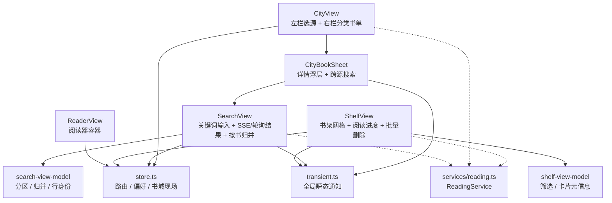
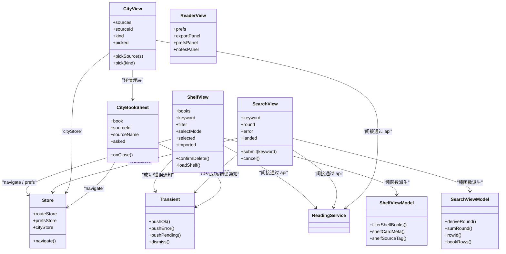
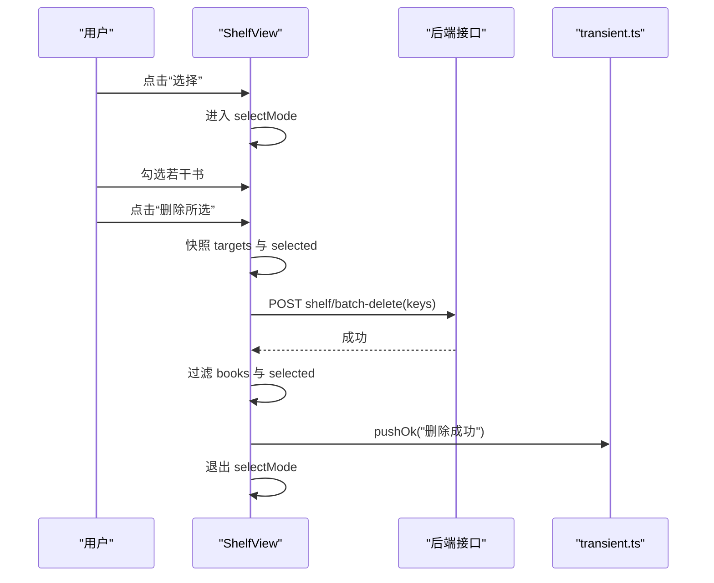
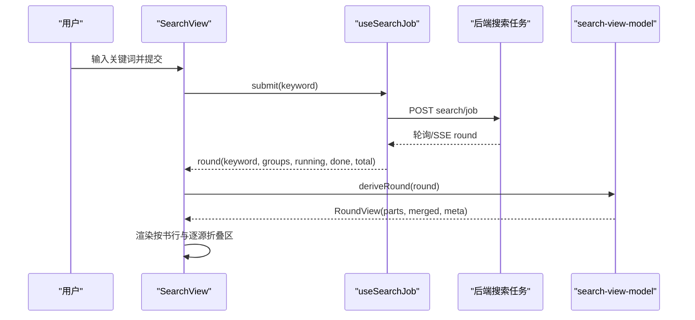
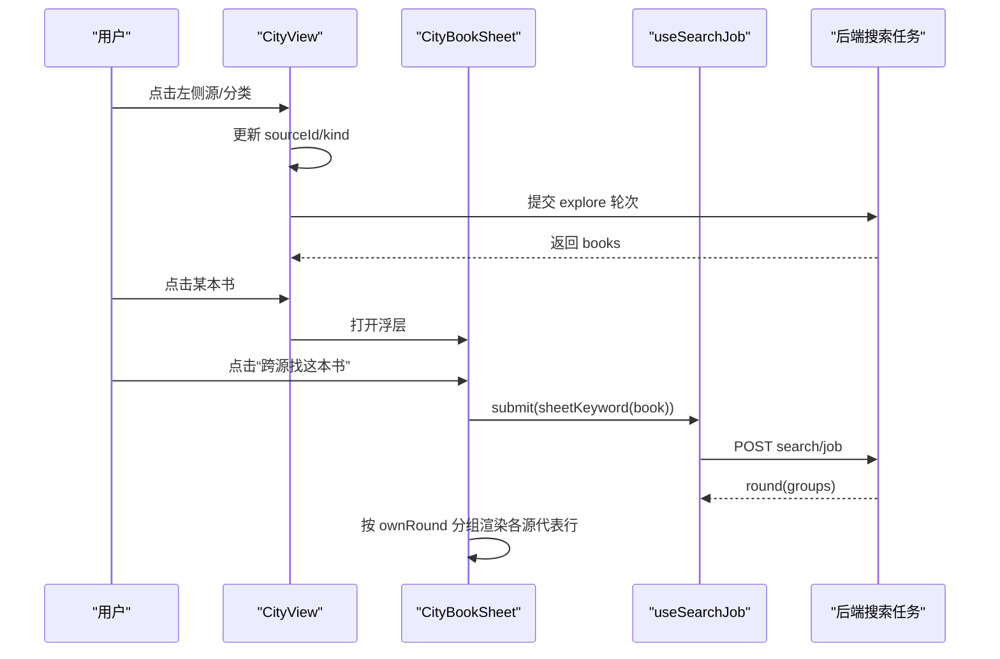

# 组件树与状态管理

<cite>
**本文引用的文件**   
- [ShelfView.tsx](file://src/client/views/ShelfView.tsx)
- [SearchView.tsx](file://src/client/views/SearchView.tsx)
- [CityView.tsx](file://src/client/views/CityView.tsx)
- [CityBookSheet.tsx](file://src/client/views/CityBookSheet.tsx)
- [ReaderView.tsx](file://src/client/views/ReaderView.tsx)
- [search-view-model.ts](file://src/client/search-view-model.ts)
- [shelf-view-model.ts](file://src/client/shelf-view-model.ts)
- [store.ts](file://src/client/store.ts)
- [transient.ts](file://src/client/transient.ts)
- [reading.ts](file://src/services/reading.ts)
</cite>

## 目录
1. [引言](#引言)
2. [项目结构](#项目结构)
3. [核心组件职责边界](#核心组件职责边界)
4. [架构总览](#架构总览)
5. [ViewModel 层如何封装服务、缓存与 UI 更新](#viewmodel-层如何封装服务缓存与-ui-更新)
6. [全局瞬态状态协作](#全局瞬态状态协作)
7. [关键交互流程](#关键交互流程)
8. [性能与虚拟滚动实践](#性能与虚拟滚动实践)
9. [常见问题排查](#常见问题排查)
10. [结论](#结论)

## 引言
本仓库的小说模块围绕四个主面板展开：书架（ShelfView）、搜索（SearchView）、书城（CityView）和阅读器（ReaderView）。它们不是并列平铺，而是由“视图 + ViewModel + 服务”分层组合：视图负责用户界面与事件装配；ViewModel 只承担纯函数派生；ReadingService 作为服务端门面承载网络、缓存、任务、书架等真实业务。`store.ts` 提供轻量 store 与路由状态，`transient.ts` 提供跨组件的临时通知队列。

## 项目结构
小说相关代码主要位于 `src/client/` 下的 views、client 工具与服务调用层，以及 `src/services/reading.ts` 中的服务端门面。

**图示来源**
- [ShelfView.tsx:1-120](file://src/client/views/ShelfView.tsx#L1-L120)
- [SearchView.tsx:1-120](file://src/client/views/SearchView.tsx#L1-L120)
- [CityView.tsx:1-120](file://src/client/views/CityView.tsx#L1-L120)
- [CityBookSheet.tsx:1-120](file://src/client/views/CityBookSheet.tsx#L1-L120)
- [ReaderView.tsx:1-120](file://src/client/views/ReaderView.tsx#L1-L120)
- [search-view-model.ts:1-156](file://src/client/search-view-model.ts#L1-L156)
- [shelf-view-model.ts:1-93](file://src/client/shelf-view-model.ts#L1-L93)
- [store.ts:1-78](file://src/client/store.ts#L1-L78)
- [transient.ts:1-89](file://src/client/transient.ts#L1-L89)
- [reading.ts:1-200](file://src/services/reading.ts#L1-L200)

**章节来源**
- [ShelfView.tsx:1-200](file://src/client/views/ShelfView.tsx#L1-L200)
- [SearchView.tsx:1-200](file://src/client/views/SearchView.tsx#L1-L200)
- [CityView.tsx:1-200](file://src/client/views/CityView.tsx#L1-L200)
- [CityBookSheet.tsx:1-200](file://src/client/views/CityBookSheet.tsx#L1-L200)
- [ReaderView.tsx:1-200](file://src/client/views/ReaderView.tsx#L1-L200)
- [search-view-model.ts:1-156](file://src/client/search-view-model.ts#L1-L156)
- [shelf-view-model.ts:1-93](file://src/client/shelf-view-model.ts#L1-L93)
- [store.ts:1-78](file://src/client/store.ts#L1-L78)
- [transient.ts:1-89](file://src/client/transient.ts#L1-L89)
- [reading.ts:1-200](file://src/services/reading.ts#L1-L200)

## 核心组件职责边界

### ShelfView：书架网格、阅读进度与批量删除
- **职责**：渲染书架卡片网格、展示阅读进度、本地书籍导入入口、单本/多选删除、书架内关键词跳转搜索。
- **状态所有权**：
  - 书籍列表、加载错误、关键词、筛选器、图片失败映射、本地导入回执与错误、选中集合、批量删除确认与忙碌态，全部是组件内部 `useState`。
  - 不直接持有 ReadingService；通过依赖注入的 `apiGet` / `apiSend` 调用后端。
- **筛选与元信息**：委托给 `shelf-view-model`，保证筛选逻辑、卡片进度百分比、来源标签、本地导入提示都是纯函数。
- **批量删除**：进入选择态后，“全选”基于当前筛选可见项；确认后一次 POST 批量删除，成功后再过滤本地列表并清空选择态。
- **本地导入**：隐藏 `<input type="file">`，由引导卡触发；格式判断交给服务端，客户端仅接受 `.txt` / `.epub` 后缀；有持久警告时不自动进阅读器，避免吞掉有损说明。

**章节来源**
- [ShelfView.tsx:1-200](file://src/client/views/ShelfView.tsx#L1-L200)
- [shelf-view-model.ts:1-93](file://src/client/shelf-view-model.ts#L1-L93)

### SearchView：关键词输入、SSE/轮询结果与按书归并
- **职责**：接收关键词、提交后台搜索任务、轮询进度、渲染按书归并视图与逐源折叠区、加架与直接阅读。
- **结果流**：
  - 使用 `useSearchJob` 发起 `POST search/job`，并通过轮询或 SSE 增量拿到 `round`。
  - `deriveRound` 对一轮结果做相关性分区、按书归并与行元数据索引。
  - 默认“按书一行”，失败源降级到页尾折叠区，保留排查轴。
- **已加架账本**：`landed` 是一个会话级 `Set<string>`，键为 `rowId(sourceId, url)`，防止展开收起时 DOM 卸载导致状态丢失。
- **幂等加架**：同一命中既可从“＋ 加书架”也可从“都加架”加架，两个入口共享同一条 PUT 路径与 `bodies.shelfAdd` 构造。

**章节来源**
- [SearchView.tsx:1-200](file://src/client/views/SearchView.tsx#L1-L200)
- [search-view-model.ts:1-156](file://src/client/search-view-model.ts#L1-L156)

### CityView：左栏选源、右栏分类书单与 CityBookSheet 详情浮层
- **职责**：加载可浏览源清单、维护当前源与分类、提交 explore 轮次、渲染分类书单骨架与分页续页、打开 CityBookSheet。
- **现场记忆**：`cityStore` 记住上次选的 `sourceId` 与 `kind`，但明确注释为“会话内，不落盘”。
- **进入即加载策略**：恢复读完成且该源+分类尚无轮次时才提交，避免重复提交替换掉服务端已有轮次。
- **封面失败表**：随每轮 `round.id` 重置，避免上一轮坏图污染下一轮同名条目。
- **CityBookSheet**：显示本源行、跨源搜索按钮、进度与三种状态说明（进行中、零命中、未响应），并以 Dialog 契约处理遮罩与焦点。

**章节来源**
- [CityView.tsx:1-200](file://src/client/views/CityView.tsx#L1-L200)
- [CityBookSheet.tsx:1-200](file://src/client/views/CityBookSheet.tsx#L1-L200)
- [store.ts:45-78](file://src/client/store.ts#L45-L78)

### ReaderView：阅读器容器
- **职责**：不负责解析 EPUB 或抓取正文，而是阅读器宿主容器：管理阅读器会话、导出范围面板、设置面板、注释面板、导航面板、z-index 控制、滚动锚点与视口计算。
- **状态协作**：通过 `prefsStore` 读取字体、行高、列宽、纸张色等偏好；通过 `navigate` 在书架、书城、搜索与阅读器之间切换。
- **控制器面板**：所有弹出面板统一挂在 sticky 工具栏内，并使用常量 `CTRL_Z.toolbar/mask/panel` 维持 z-index 不变量。

**章节来源**
- [ReaderView.tsx:1-200](file://src/client/views/ReaderView.tsx#L1-L200)
- [store.ts:1-78](file://src/client/store.ts#L1-L78)

## 架构总览
四个主面板由路由 store 驱动，ViewModel 层把复杂派生从视图中抽离，服务层集中对外暴露 ReadingService。

**图示来源**
- [ShelfView.tsx:1-200](file://src/client/views/ShelfView.tsx#L1-L200)
- [SearchView.tsx:1-200](file://src/client/views/SearchView.tsx#L1-L200)
- [CityView.tsx:1-200](file://src/client/views/CityView.tsx#L1-L200)
- [CityBookSheet.tsx:1-200](file://src/client/views/CityBookSheet.tsx#L1-L200)
- [ReaderView.tsx:1-200](file://src/client/views/ReaderView.tsx#L1-L200)
- [search-view-model.ts:1-156](file://src/client/search-view-model.ts#L1-L156)
- [shelf-view-model.ts:1-93](file://src/client/shelf-view-model.ts#L1-L93)
- [store.ts:1-78](file://src/client/store.ts#L1-L78)
- [transient.ts:1-89](file://src/client/transient.ts#L1-L89)
- [reading.ts:1-200](file://src/services/reading.ts#L1-L200)

## ViewModel 层如何封装服务、缓存与 UI 更新

### shelf-view-model：书架筛选与卡片元信息
- 把“全部/在读/未读/本地”四种筛选写成纯函数 `filterShelfBooks`，避免视图里散落 filter 条件。
- `shelfCardMeta` 根据是否本地书、是否有进度、章节数计算文案与进度百分比；未读书不渲染进度条。
- `shelfSourceTag` 处理源名缺失时的“来源已删除”降级。
- `localImportLabel` / `localImportNote` 用服务端回执中的 `format` 与 `warnings.length` 输出本地导入提示。

**章节来源**
- [shelf-view-model.ts:1-93](file://src/client/shelf-view-model.ts#L1-L93)

### search-view-model：搜索结果纯派生
- `deriveRound` 同时产出三部分：
  - `parts`：每个源的命中按相关性分区。
  - `merged`：按书归并后的书目。
  - `meta`：`(sourceId, url)` 到命中元数据的回读索引。
- `sumRound` 统计真搜完的组数、命中条数、命中源数、失败组数、默认视野下应显示的条数。
- `rowId` / `rowKeys` / `bookRowKey` / `bookRows` / `shelfSeats` / `newlyLandedSeats` 统一行身份与加架座位算式，避免视图各自实现导致“同址两行”“加架态错串”等问题。
- `shortAuthor` 在作者名单过长时截断，兼顾视觉与无障碍朗读。

**章节来源**
- [search-view-model.ts:1-156](file://src/client/search-view-model.ts#L1-L156)

### 与 ReadingService 的关系
- 前端视图不直接 import ReadingService；实际 HTTP 请求通过依赖注入的 `apiGet` / `apiSend` 走 wire 路由。
- ReadingService 在服务端聚合搜索、探索浏览、书架操作、本地书导入、章节内容读取等；前端 ViewModel 只关心“数据已经到达 UI 需要呈现的形状”。
- 因此 ViewModel 的职责不是封装 ReadingService 实例，而是封装“把原始结果变成可渲染视图对象”的纯函数。

**章节来源**
- [reading.ts:1-200](file://src/services/reading.ts#L1-L200)
- [SearchView.tsx:1-200](file://src/client/views/SearchView.tsx#L1-L200)
- [CityView.tsx:1-200](file://src/client/views/CityView.tsx#L1-L200)

## 全局瞬态状态协作
`transient.ts` 提供一个有序的通知队列，类型包括 `pending`、`ok`、`error`，并通过 `useSyncExternalStore` 订阅，避免全量重渲染。

- `pushOk`：自动 TTL 退场，适合显式保存类成功。
- `pushError`：sticky 错误，需手动 dismiss，可带 CSS anchor 定位。
- `pushPending`：返回 settle 句柄，成功或失败后移除 pending。
- `useTransientFlag`：为大量行提供布尔选择器快照，避免整表重渲染。

ShelfView、SearchView、CityBookSheet 都通过依赖注入的 `pushOk` / `pushError` 把操作反馈集中到全局通知条，而不是在多个组件中散落 toast。

**章节来源**
- [transient.ts:1-89](file://src/client/transient.ts#L1-L89)

## 关键交互流程

### 书架批量删除流程

**图示来源**
- [ShelfView.tsx:1-200](file://src/client/views/ShelfView.tsx#L1-L200)
- [transient.ts:1-89](file://src/client/transient.ts#L1-L89)

**章节来源**
- [ShelfView.tsx:1-200](file://src/client/views/ShelfView.tsx#L1-L200)

### 搜索提交与按书归并流程

**图示来源**
- [SearchView.tsx:1-200](file://src/client/views/SearchView.tsx#L1-L200)
- [search-view-model.ts:1-156](file://src/client/search-view-model.ts#L1-L156)

**章节来源**
- [SearchView.tsx:1-200](file://src/client/views/SearchView.tsx#L1-L200)
- [search-view-model.ts:1-156](file://src/client/search-view-model.ts#L1-L156)

### 书城换源与 CityBookSheet 跨源搜索

**图示来源**
- [CityView.tsx:1-200](file://src/client/views/CityView.tsx#L1-L200)
- [CityBookSheet.tsx:1-200](file://src/client/views/CityBookSheet.tsx#L1-L200)
- [SearchView.tsx:1-200](file://src/client/views/SearchView.tsx#L1-L200)

**章节来源**
- [CityView.tsx:1-200](file://src/client/views/CityView.tsx#L1-L200)
- [CityBookSheet.tsx:1-200](file://src/client/views/CityBookSheet.tsx#L1-L200)

## 性能与虚拟滚动实践

### 受控表单
- ShelfView 的搜索框使用 `value={keyword}` + `onChange={(e) => setKeyword(e.target.value)}`，提交时阻止默认行为并跳转到搜索面。
- SearchView 的搜索表单同样受控，并在提交后禁用按钮直到任务结束。
- CityView 的源搜索与分类搜索分别用 `sourceQuery` / `kindQuery` 控制输入，用于过滤左栏源列表与当前源的分类列表。
- ReaderView 的设置面板与导出面板也使用受控输入，例如字号步进、行高选择、列宽选择、自定义纸张颜色、导出起止章号。

这些模式保证了 UI 始终反映 state，不会因 React 双缓冲或 StrictMode 产生不可预期值。

**章节来源**
- [ShelfView.tsx:1-200](file://src/client/views/ShelfView.tsx#L1-L200)
- [SearchView.tsx:1-200](file://src/client/views/SearchView.tsx#L1-L200)
- [CityView.tsx:1-200](file://src/client/views/CityView.tsx#L1-L200)
- [ReaderView.tsx:1-200](file://src/client/views/ReaderView.tsx#L1-L200)

### 事件冒泡与控件结构
- 书架卡片与导入引导卡是 `<button>`，删除按钮是兄弟元素而非后代，以配合测试对焦点与可访问性的断言。
- 搜索命中行的“主按钮”和“＋ 加书架”是兄弟动作，不嵌套，避免事件冒泡把加架误判为阅读。
- 浮层统一使用 Dialog 契约处理遮罩、Esc 关闭与 Tab 圈，不在 CityBookSheet 手写焦点陷阱。

**章节来源**
- [ShelfView.tsx:1-200](file://src/client/views/ShelfView.tsx#L1-L200)
- [SearchView.tsx:1-200](file://src/client/views/SearchView.tsx#L1-L200)
- [CityBookSheet.tsx:1-200](file://src/client/views/CityBookSheet.tsx#L1-L200)

### 列表虚拟滚动与懒加载
- 仓库当前主列表（书架网格、搜索命中、书城书单）没有自行实现虚拟滚动；性能优化主要通过：
  - 搜索结果的 `useMemo` 派生：只有 `round.id`、`keyword`、`groups.length` 变化才重算 `RoundView`。
  - 搜索轮次累积只增不减，组按源只 emit 一次，减少无效重算。
  - 书城骨架卡片数量固定为上界，避免空态无限撑开。
  - 封面失败表按轮次重置，避免重复绘制坏图。
  - 书城续页通过 `loadMore` 按需加载更多，而不是拉完整大表。
- 若后续引入大列表虚拟滚动，应遵循现有 key 规则：
  - 书架：使用 `bookKey` 或稳定标识。
  - 搜索：使用 `rowId(sourceId, url)` 或 `bookRowKey(title, author)`。
  - 书城：使用 `rowKey(book, i)`，优先 `bookUrl`，其次名字+作者+下标。

**章节来源**
- [SearchView.tsx:1-200](file://src/client/views/SearchView.tsx#L1-L200)
- [search-view-model.ts:1-156](file://src/client/search-view-model.ts#L1-L156)
- [CityView.tsx:1-200](file://src/client/views/CityView.tsx#L1-L200)

## 常见问题排查

### SSE 断开后重新订阅
- 现象：搜索进度中断、不再刷新。
- 根因：SSE 或轮询连接断开，`useSearchJob` 持有的轮次可能停留在运行中或错误态。
- 排查要点：
  - 检查 SearchView 是否收到 `error`，并显示 `search.interrupted`。
  - 检查 `round.running` 是否仍为真，若是则可能是旧轮残留。
  - 新提交会创建新 jobId，旧轮应在搜索-job 层按身份丢弃。
- 修复建议：
  - 确保用户再次提交关键词时重新 `submit`。
  - 不要依赖已卸载组件的回调恢复状态。
  - 如果需要在页面切回时恢复轮次，应走 `since=0` 的恢复逻辑，而不是静默重试。

**章节来源**
- [SearchView.tsx:1-200](file://src/client/views/SearchView.tsx#L1-L200)
- [search-view-model.ts:1-156](file://src/client/search-view-model.ts#L1-L156)

### 搜索结果不同步
- 现象：搜索面与 CityBookSheet 跨源结果不一致，或跨源结果属于另一本书。
- 根因：服务端搜索槽只有一个，观察者跟随最近一轮；浮层只应显示关键词等于 `sheetKeyword(book)` 的那一轮。
- 排查要点：
  - 检查 CityBookSheet 是否用 `ownRound = round.keyword === keyword.trim()` 守卫。
  - 检查是否误把搜索面正在进行的其它轮次当作当前浮层的读数。
  - 检查浮层点击“跨源找这本书”后是否设置了 `asked=true`。
- 修复建议：
  - 不要在浮层外随意 cancel 别人的轮次。
  - 跨源结果不替用户判是否同一本书，按源逐行列出。
  - 如果关键词变化，应视为新一轮，不应复用旧组。

**章节来源**
- [CityBookSheet.tsx:1-200](file://src/client/views/CityBookSheet.tsx#L1-L200)
- [SearchView.tsx:1-200](file://src/client/views/SearchView.tsx#L1-L200)

### 书架选中态丢失
- 现象：翻页、切换筛选或切 tab 后，之前勾选的书不见了。
- 设计事实：选中态是组件现场状态，不进 store；切 tab 清零更安全，避免残留旧勾选。
- 排查要点：
  - 检查是否误把 `selected` 写入 `cityStore` 或 `routeStore`。
  - 检查“全选”是否基于当前筛选 `shown`，而不是全部 `books`。
  - 检查批量删除成功后是否调用了 `setSelectMode(false)`。
- 修复建议：
  - 保持 `selectMode` 与 `selected` 为局部 state。
  - 如需跨 tab 记住批量目标，应新增独立 store 字段，但需考虑语义与过期清理。

**章节来源**
- [ShelfView.tsx:1-200](file://src/client/views/ShelfView.tsx#L1-L200)

### 大列表渲染卡顿
- 现象：搜索 500+ 源、数百命中时明显卡顿。
- 根因：
  - 每帧 SSE 推送都产生新 `round` 对象。
  - `deriveRound` 包含分区、归并、元数据索引三趟计算。
  - 搜索命中行过多，React diff 成本上升。
- 排查要点：
  - 检查 SearchView 是否使用 `useMemo(deriveRound, [round.id, round.keyword, round.groups.length])`。
  - 检查是否频繁重建 `landed` Set。
  - 检查是否对每帧都重新计算 `sumRound`。
- 修复建议：
  - 继续把派生限制在 `useMemo` 与 ViewModel 纯函数中。
  - 对超大列表引入虚拟滚动，key 必须稳定。
  - 避免在渲染路径中做额外网络或复杂字符串拼接。
  - 对封面失败表按轮次 reset，避免长期增长。

**章节来源**
- [SearchView.tsx:1-200](file://src/client/views/SearchView.tsx#L1-L200)
- [search-view-model.ts:1-156](file://src/client/search-view-model.ts#L1-L156)

## 结论
ShelfView、SearchView、CityView 和 ReaderView 构成了小说模块的主视图层：书架负责已有收藏与批量管理，搜索负责发现与归并，书城负责按源分类浏览，阅读器负责阅读体验容器。ViewModel 层把筛选、进度、归并、行身份等易变口径收敛为纯函数，使视图更专注事件装配与渲染。全局 transient 通知与 store 路由、偏好、书城现场共同构成轻量状态底座。面对 SSE 断连、搜索结果不同步、选中态丢失与大列表卡顿等常见问题，代码已给出多处防线；进一步扩展时应继续遵守“行身份唯一、派生纯函数、UI 状态局部化、跨组件状态显式化”的原则。