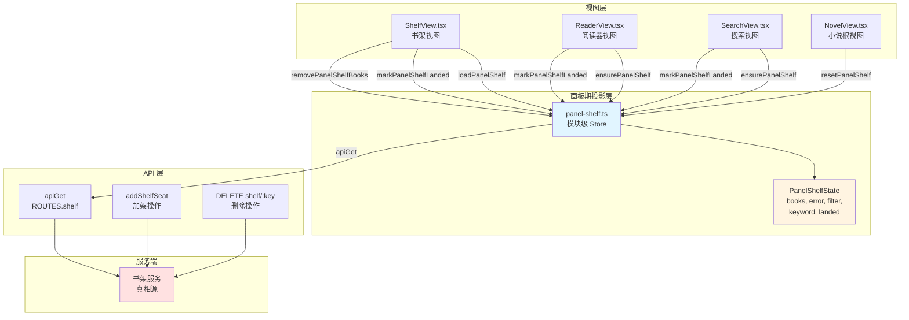
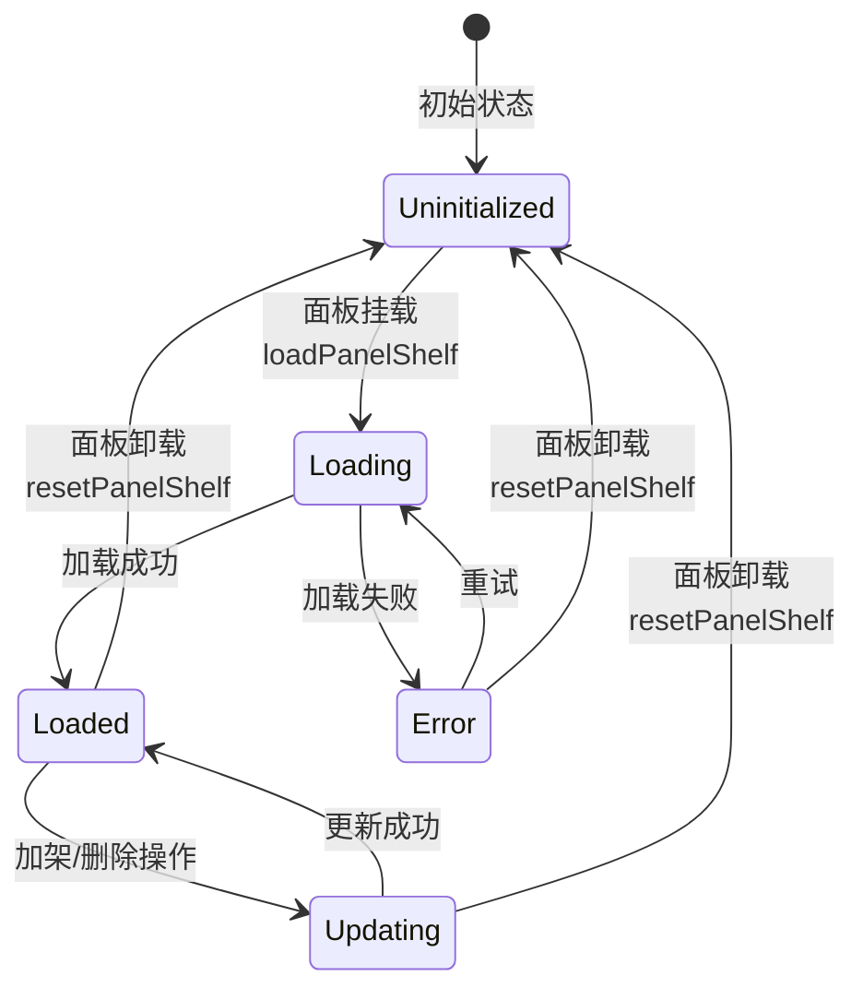

# 面板书架投影机制

<cite>
**Referenced Files in This Document **
- [panel-shelf.ts](file://src/client/panel-shelf.ts)
- [0046-panel-shelf-projection.md](file://docs/adr/0046-panel-shelf-projection.md)
- [ShelfView.tsx](file://src/client/views/ShelfView.tsx)
- [SearchView.tsx](file://src/client/views/SearchView.tsx)
- [NovelView.tsx](file://src/client/views/NovelView.tsx)
- [panel-shelf.test.ts](file://tests/client/panel-shelf.test.ts)
- [store.js](file://src/client/store.js)
- [shelf-action.ts](file://src/client/shelf-action.ts)
</cite>

## Table of Contents
1. [简介](#简介)
2. [问题背景](#问题背景)
3. [核心设计](#核心设计)
4. [架构概览](#架构概览)
5. [详细组件分析](#详细组件分析)
   - [面板期投影状态管理](#面板期投影状态管理)
   - [代际追踪与在途去重](#代际追踪与在途去重)
   - [落架账合并机制](#落架账合并机制)
   - [视图层集成](#视图层集成)
6. [生命周期管理](#生命周期管理)
7. [并发控制](#并发控制)
8. [测试策略](#测试策略)
9. [性能考虑](#性能考虑)
10. [故障排查指南](#故障排查指南)
11. [结论](#结论)

## 简介

面板书架投影机制是小说阅读器应用中的一个关键架构改进，旨在解决书架读取面、阅读器与搜索落架账三份独立生命周期导致的 stale state（陈旧状态）问题。该机制通过引入模块级的面板期投影 store，实现了代际追踪、在途去重与落架账合并，确保用户在切换不同视图时能够看到一致的书架状态。

本机制的核心思想是将书架读取面、落架账以及筛选/关键字统一存储在 `client/panel-shelf.ts` 的面板期投影中，在面板存活期间共享同一份数据。真相仍然保留在服务端，投影仅在面板卸载时被丢弃，从而避免了多个视图各自维护独立状态导致的数据不一致问题。

## 问题背景

在引入面板书架投影机制之前，系统存在以下三个独立的生命周期：

1. **ShelfView 每次挂载整取**：书架视图每次挂载时都会重新获取完整的书架列表
2. **ReaderSession 为答一个在架布尔再整取**：阅读器会话为了回答"这本书是否在架上"这个布尔值，会再次获取整个书架列表
3. **搜索落架账只活组件挂载期**：搜索结果页面中的落架账仅在组件挂载期间有效

这种分散的状态管理导致了以下问题：

- 用户从书架切换到阅读器后再返回，行上又显示"＋ 加书架"，而书其实已在架上
- 切 tab 就丢筛选与账
- 搜索页重挂载后又把已在架的书写成"＋ 加书架"
- 三个读者各取一份、各丢一份，造成不必要的网络请求和用户体验不一致

**Section sources**
- [0046-panel-shelf-projection.md:1-19](file://docs/adr/0046-panel-shelf-projection.md#L1-L19)

## 核心设计

面板书架投影机制基于以下核心设计原则：

### 设计决策

1. **统一的模块级 store**：书架读取面 + 落架账 + 筛选/关键字住在一个模块级 store 中
2. **挂载时重取**：每次面板挂载时调用 `loadPanelShelf` 重新获取数据
3. **加架并入落架账**：加架成功后调用 `markPanelShelfLanded` 将架位并入落架账
4. **删除对账**：删除成功后调用 `removePanelShelfBooks` 进行对账
5. **面板卸载即丢**：面板卸载时重置投影，但在途响应按代际丢弃
6. **真相仍在服务端**：业务真相仍然保留在服务端，投影只是客户端的临时缓存

### 被否方案

1. **每个视图各取一份（旧形态）**：三个读者三份生命周期，落架账随卸载蒸发，阅读器为布尔再取全表
2. **不建投影、继续组件 state**：切 tab 就丢筛选与账；搜索页重挂载后又把已在架的书写成"＋ 加书架"
3. **把所有业务真相搬进 store**：会把搜索轮次与任务镜像也变成第二份真相，和轮次身份裁决冲突

**Section sources**
- [0046-panel-shelf-projection.md:11-19](file://docs/adr/0046-panel-shelf-projection.md#L11-L19)
- [panel-shelf.ts:1-20](file://src/client/panel-shelf.ts#L1-L20)

## 架构概览



**Diagram sources **
- [panel-shelf.ts:1-139](file://src/client/panel-shelf.ts#L1-L139)
- [ShelfView.tsx:1-100](file://src/client/views/ShelfView.tsx#L1-L100)
- [SearchView.tsx:1-100](file://src/client/views/SearchView.tsx#L1-L100)
- [NovelView.tsx:1-71](file://src/client/views/NovelView.tsx#L1-L71)

**Section sources**
- [panel-shelf.ts:1-139](file://src/client/panel-shelf.ts#L1-L139)
- [0046-panel-shelf-projection.md:1-19](file://docs/adr/0046-panel-shelf-projection.md#L1-L19)

## 详细组件分析

### 面板期投影状态管理

面板期投影的核心是 `PanelShelfState` 接口，它定义了投影状态的完整结构：

```typescript
export interface PanelShelfState {
  /** null = 还没取过（骨架）；失败时是 [] + error，不拿空架冒充加载中 */
  books: ShelfEntry[] | null
  error: string | null
  filter: ShelfFilterKey
  keyword: string
  /** 已落架的架位（bookKey 即命中地址）；服务端列表是基线，写成功后再并进来 */
  landed: ReadonlySet<string>
}
```

状态字段说明：

- **books**: 书架列表，`null` 表示还未获取过（显示骨架屏），失败时为 `[]` 加上 `error` 信息
- **error**: 错误信息，用于显示加载失败的原因
- **filter**: 筛选条件，支持 'all'、'local' 等筛选键
- **keyword**: 搜索关键字，用于书架内的搜索过滤
- **landed**: 已落架的架位集合，以 bookKey 作为标识，服务端列表是基线，写成功后再并集

初始状态由 `initial()` 函数创建，所有字段都设置为默认值，`landed` 为空集合。

投影通过 `createStore` 创建为模块级 store，确保在整个面板生命周期内共享同一份状态。

**Section sources**
- [panel-shelf.ts:22-40](file://src/client/panel-shelf.ts#L22-L40)

### 代际追踪与在途去重

代际追踪是面板书架投影机制的核心创新之一，用于解决在途响应可能导致的状态不一致问题。

#### 代际机制

```typescript
let inflight: Promise<void> | null = null
/** 投影代际：卸载、删除对账与新记入的加架都递增，起始更早的在途响应按它丢弃 */
let generation = 0

function invalidateReads(): void {
  generation += 1
  inflight = null
}
```

代际追踪的工作原理：

1. **generation 计数器**：每次需要作废旧读面时递增
2. **invalidateReads 函数**：在三种情况下调用：
   - 面板卸载
   - 删除对账
   - 新记入的加架
3. **代际检查**：在每个异步操作的回调中检查当前代际是否与发起时一致

#### 在途去重

```typescript
export function loadPanelShelf(deps: PanelShelfDeps): Promise<void> {
  if (inflight !== null) return inflight
  const gen = generation
  inflight = deps.apiGet(ROUTES.shelf.path).then(
    (list) => {
      if (gen !== generation) return
      const landed = new Set([...panelShelf.get().landed, ...list.map((b) => b.bookKey)])
      panelShelf.set({ books: list, error: null, landed })
    },
    (e) => {
      if (gen !== generation) return
      panelShelf.set({ books: [], error: deps.describeError(e) })
    },
  ).finally(() => {
    if (gen === generation) inflight = null
  })
  return inflight
}
```

在途去重的关键点：

1. **并发合并**：如果已有在途请求，直接返回同一个 Promise，避免重复请求
2. **代际验证**：在响应处理前检查代际是否匹配，不匹配的响应直接丢弃
3. **清理句柄**：只有在当前代际的 finally 中才清空 inflight 句柄

这种机制确保了：

- 卸载后旧请求不许回写新投影
- 删前/加前快照也不许把书架读数打回去
- 同一发地址第二次记入不再抬代际

**Section sources**
- [panel-shelf.ts:42-75](file://src/client/panel-shelf.ts#L42-L75)

### 落架账合并机制

落架账合并机制确保加架操作能够正确地更新投影状态，同时保持与服务端的一致性。

#### 加架成功处理

```typescript
export function markPanelShelfLanded(urls: Iterable<string>): void {
  const current = panelShelf.get().landed
  const next = new Set(current)
  let changed = false
  for (const url of urls) {
    if (!next.has(url)) { next.add(url); changed = true }
  }
  if (!changed) return
  invalidateReads()
  panelShelf.set({ landed: next })
}
```

加架处理的关键点：

1. **幂等性**：按地址去重，同一地址多次记入只记录一次
2. **并集操作**：以现有落架账为基础，添加新的架位
3. **代际递增**：只有真正新增时才递增代际，作废起始更早的在途读面
4. **变化检测**：如果没有实际变化，不进行任何操作

#### 删除对账

```typescript
export function removePanelShelfBooks(bookKeys: Iterable<string>): void {
  const keys = new Set(bookKeys)
  if (keys.size === 0) return
  invalidateReads()
  const { books, landed } = panelShelf.get()
  const nextBooks = books === null ? null : books.filter((b) => !keys.has(b.bookKey))
  const nextLanded = new Set([...landed].filter((k) => !keys.has(k)))
  panelShelf.set({ books: nextBooks, landed: nextLanded })
}
```

删除对账的关键点：

1. **同步移除**：同时从 books 列表和 landed 集合中移除
2. **代际递增**：作废起始早于这次删除的在途读面
3. **防止误标**：删掉再加的书不会被旧账误标成"已在架"

#### 确保投影可用

```typescript
export async function ensurePanelShelf(deps: PanelShelfDeps, bookKey?: string): Promise<void> {
  if (inflight !== null) await inflight
  const { books, error } = panelShelf.get()
  const covered = books !== null && error === null
    && (bookKey === undefined || books.some((b) => b.bookKey === bookKey))
  if (covered) return
  await loadPanelShelf(deps)
}
```

`ensurePanelShelf` 的作用：

1. **等待在途刷新**：如果有在途请求，先等待其完成
2. **覆盖检查**：检查投影是否已覆盖所需数据
3. **按需加载**：只在必要时才发起新的请求
4. **两种模式**：
   - 带 bookKey：检查特定书籍是否在列表中
   - 不带 bookKey：只问"这一面板读过书架吗"

**Section sources**
- [panel-shelf.ts:77-139](file://src/client/panel-shelf.ts#L77-L139)

### 视图层集成

#### ShelfView 集成

ShelfView 是书架视图的主要组件，它直接使用面板期投影：

```typescript
const { books, error: loadError, keyword, filter } = useStore(panelShelf)

const loadShelf = (): void => {
  void loadPanelShelf({
    apiGet: deps.apiGet,
    describeError: (e) => describeError(e, t),
  })
}

useEffect(() => { loadShelf() }, [])
```

关键集成点：

1. **状态订阅**：通过 `useStore(panelShelf)` 订阅投影状态
2. **挂载加载**：在 useEffect 中调用 `loadPanelShelf`
3. **筛选控制**：使用 `setPanelShelfFilter` 和 `setPanelShelfKeyword` 更新筛选条件
4. **删除操作**：删除成功后调用 `removePanelShelfBooks` 进行对账

#### SearchView 集成

SearchView 在搜索结果页面中使用投影来获取落架基线：

```typescript
useEffect(() => {
  void ensurePanelShelf({
    apiGet: deps.apiGet,
    describeError: (e: unknown): string => describeError(e, t),
  })
}, [])
```

关键集成点：

1. **基线获取**：在挂载时调用 `ensurePanelShelf` 获取整份基线
2. **不带 bookKey**：只为基线，不为某一本书
3. **落架判断**：使用 landing.isLanded(hit) 判断书籍是否已在架上
4. **加架操作**：加架成功后通过 landing 机制自动更新投影

#### NovelView 集成

NovelView 是小说根视图，负责管理投影的生命周期：

```typescript
useEffect(() => () => { resetPanelShelf() }, [])
```

关键集成点：

1. **卸载清理**：在组件卸载时调用 `resetPanelShelf`
2. **视图分发**：根据 route 分发到不同的子视图
3. **tab 切换**：视图内切 tab 不卸载本根，现场照旧保留

**Section sources**
- [ShelfView.tsx:50-100](file://src/client/views/ShelfView.tsx#L50-L100)
- [SearchView.tsx:50-80](file://src/client/views/SearchView.tsx#L50-L80)
- [NovelView.tsx:30-45](file://src/client/views/NovelView.tsx#L30-L45)

## 生命周期管理

面板书架投影的生命周期与面板（NovelView）紧密绑定：



**Diagram sources **
- [panel-shelf.ts:100-139](file://src/client/panel-shelf.ts#L100-L139)
- [NovelView.tsx:35-40](file://src/client/views/NovelView.tsx#L35-L40)

生命周期阶段说明：

1. **Uninitialized（未初始化）**：books 为 null，显示骨架屏
2. **Loading（加载中）**：正在获取书架列表，inflight 不为 null
3. **Loaded（已加载）**：books 有数据，可以正常显示
4. **Error（错误）**：加载失败，books 为 []，error 有值
5. **Updating（更新中）**：正在进行加架或删除操作

关键生命周期事件：

- **面板挂载**：调用 `loadPanelShelf` 重新获取数据
- **面板卸载**：调用 `resetPanelShelf` 重置投影
- **加架成功**：调用 `markPanelShelfLanded` 更新落架账
- **删除成功**：调用 `removePanelShelfBooks` 进行对账

**Section sources**
- [panel-shelf.ts:120-139](file://src/client/panel-shelf.ts#L120-L139)
- [NovelView.tsx:35-40](file://src/client/views/NovelView.tsx#L35-L40)

## 并发控制

面板书架投影机制实现了多层次的并发控制：

### 请求合并

```typescript
if (inflight !== null) return inflight
```

当多个组件同时请求加载书架时，只会发起一次实际的 API 请求，其他请求共享同一个 Promise。

### 代际隔离

```typescript
const gen = generation
// ... 异步操作 ...
if (gen !== generation) return
```

每个异步操作在发起时捕获当前的 generation 值，在回调中验证是否仍然匹配。如果不匹配，说明状态已被作废，直接丢弃响应。

### 竞态条件处理

```typescript
.finally(() => {
  if (gen === generation) inflight = null
})
```

只有在当前代际的 finally 中才清空 inflight 句柄，避免旧代的 finally 清掉新一代的在途句柄。

### 测试用例验证

测试用例验证了以下并发场景：

1. **并发 load**：同一发在途，只发一次 GET
2. **删除作废在途读面**：慢 GET 的删前快照不许把书带回来
3. **加架成功作废在途读面**：加架前的快照不许落地
4. **reset 丢弃在途响应**：面板卸载后旧请求不许回写

**Section sources**
- [panel-shelf.ts:42-75](file://src/client/panel-shelf.ts#L42-L75)
- [panel-shelf.test.ts:100-202](file://tests/client/panel-shelf.test.ts#L100-L202)

## 测试策略

面板书架投影机制有完善的测试覆盖，主要测试文件为 `tests/client/panel-shelf.test.ts`。

### 测试用例分类

#### 基本功能测试

1. **load 成功**：覆写书架读取面，并把在架书 seeded 进落架账
2. **load 失败**：books=[] + error，不伪装成空架；落架账保留
3. **筛选与关键字**：跨挂载保留

#### 落架账测试

1. **markPanelShelfLanded 去重**：按地址去重
2. **removePanelShelfBooks 对账**：同时清书架与落架账

#### 代际追踪测试

1. **删除作废在途读面**：慢 GET 的删前快照不许把书带回来
2. **加架成功作废在途读面**：加架前的快照不许落地
3. **加架后的 ensure 重取**：不拿加架前的在途快照答"不在架"

#### ensure 测试

1. **已有投影覆盖**：不再发请求
2. **缺这本书则重取**：需要时重取
3. **上次读面失败时重取**：不把失败当成最终答案
4. **有在途刷新时等它落地**：不拿旧投影答复
5. **不带 bookKey**：只问"这一面板读过书架吗"

#### 并发控制测试

1. **并发 load**：同一发在途，只发一次 GET
2. **reset 丢弃在途响应**：面板卸载后旧请求不许回写

### 测试工具

```typescript
const entry = (bookKey: string, title = bookKey): ShelfEntry => ({
  bookKey, sourceId: 's1', sourceName: null, title, addedAt: 1,
  progress: { chapterIndex: 0, offsetRatio: 0, updatedAt: 1 },
})

const deps = (apiGet: (path: string) => Promise<ShelfEntry[]>) => ({ 
  apiGet, 
  describeError: String 
})

beforeEach(resetPanelShelf)
```

测试使用了模拟的 API 和依赖注入，确保测试的独立性和可重复性。

**Section sources**
- [panel-shelf.test.ts:1-202](file://tests/client/panel-shelf.test.ts#L1-L202)

## 性能考虑

面板书架投影机制在性能方面有以下优化：

### 减少网络请求

1. **请求合并**：并发调用合并到同一发，避免重复请求
2. **按需加载**：`ensurePanelShelf` 只在必要时才发起请求
3. **投影缓存**：面板存活期间共享同一份数据，避免重复获取

### 内存优化

1. **面板卸载即丢**：面板卸载时重置投影，释放内存
2. **ReadonlySet**：使用不可变集合，避免意外修改
3. **代际丢弃**：旧代际的响应直接丢弃，不回写状态

### 渲染优化

1. **状态订阅**：使用 `useStore` 进行细粒度订阅，只在相关状态变化时重新渲染
2. **骨架屏**：在加载过程中显示骨架屏，避免布局抖动
3. **错误处理**：失败时显示错误信息，而不是空状态

### 潜在优化点

1. **增量更新**：目前是全量替换，可以考虑增量更新
2. **本地缓存**：可以考虑使用 localStorage 进行持久化缓存
3. **预加载**：可以在用户可能访问时预加载数据

**Section sources**
- [panel-shelf.ts:42-75](file://src/client/panel-shelf.ts#L42-L75)
- [panel-shelf.ts:77-100](file://src/client/panel-shelf.ts#L77-L100)

## 故障排查指南

### 常见问题

#### 问题 1：书架显示"＋ 加书架"但书实际上已在架上

**原因**：投影未正确更新或代际追踪失效

**排查步骤**：
1. 检查 `markPanelShelfLanded` 是否被正确调用
2. 检查 `landed` 集合是否包含对应的 bookKey
3. 检查是否有在途请求覆盖了最新状态

**解决方案**：
- 确保加架成功后调用 `markPanelShelfLanded`
- 检查代际是否正确递增
- 验证 `ensurePanelShelf` 是否正确等待在途请求

#### 问题 2：删除书籍后仍然显示在书架上

**原因**：`removePanelShelfBooks` 未被调用或对账失败

**排查步骤**：
1. 检查删除操作是否成功
2. 检查 `removePanelShelfBooks` 是否被调用
3. 检查 `books` 和 `landed` 是否都被更新

**解决方案**：
- 确保删除成功后调用 `removePanelShelfBooks`
- 验证对账逻辑是否正确
- 检查代际是否正确递增

#### 问题 3：面板卸载后仍有旧请求回写

**原因**：代际追踪失效或 reset 未正确执行

**排查步骤**：
1. 检查 `resetPanelShelf` 是否被调用
2. 检查 `generation` 是否正确递增
3. 检查异步操作中是否有代际检查

**解决方案**：
- 确保 NovelView 卸载时调用 `resetPanelShelf`
- 验证所有异步操作都有代际检查
- 检查 `invalidateReads` 是否正确实现

### 调试技巧

1. **检查投影状态**：
   ```typescript
   console.log(panelShelf.get())
   ```

2. **监控代际变化**：
   ```typescript
   // 在关键位置打印 generation 值
   console.log('Current generation:', generation)
   ```

3. **跟踪在途请求**：
   ```typescript
   console.log('Inflight:', inflight)
   ```

4. **验证落架账**：
   ```typescript
   console.log('Landed:', [...panelShelf.get().landed])
   ```

**Section sources**
- [panel-shelf.ts:42-139](file://src/client/panel-shelf.ts#L42-L139)
- [panel-shelf.test.ts:1-202](file://tests/client/panel-shelf.test.ts#L1-L202)

## 结论

面板书架投影机制通过引入模块级的面板期投影 store，成功解决了书架读取面、阅读器与搜索落架账三份独立生命周期导致的 stale state 问题。该机制的核心创新包括：

1. **代际追踪**：通过 generation 计数器确保旧响应不会覆盖新状态
2. **在途去重**：合并并发请求，避免重复的网络调用
3. **落架账合并**：以服务端列表为基线，与写成功的架位取并集
4. **生命周期管理**：面板卸载即丢，但在途响应按代际丢弃

该机制的优势：

- **一致性**：所有视图共享同一份投影状态，避免数据不一致
- **性能**：减少不必要的网络请求，提高响应速度
- **可靠性**：通过代际追踪确保状态更新的正确性
- **可维护性**：清晰的职责分离，易于理解和维护

未来可能的改进方向：

- 增量更新机制，减少全量替换的开销
- 本地持久化缓存，提高离线体验
- 更细粒度的状态订阅，优化渲染性能

面板书架投影机制是一个成功的架构改进，为类似的状态管理问题提供了可参考的解决方案。

**Section sources**
- [0046-panel-shelf-projection.md:1-19](file://docs/adr/0046-panel-shelf-projection.md#L1-L19)
- [panel-shelf.ts:1-139](file://src/client/panel-shelf.ts#L1-L139)