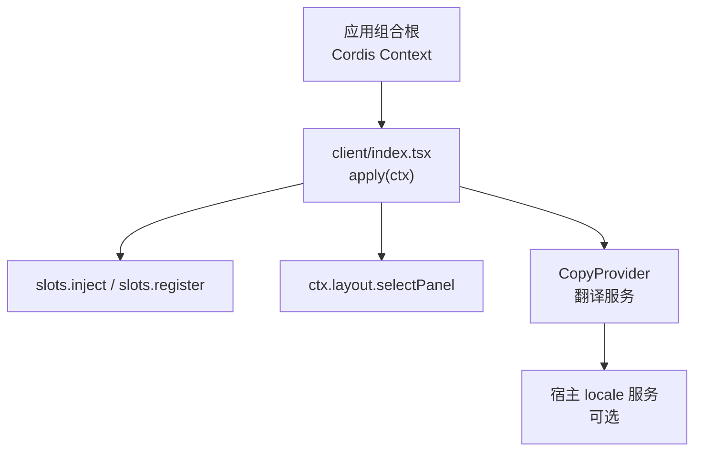
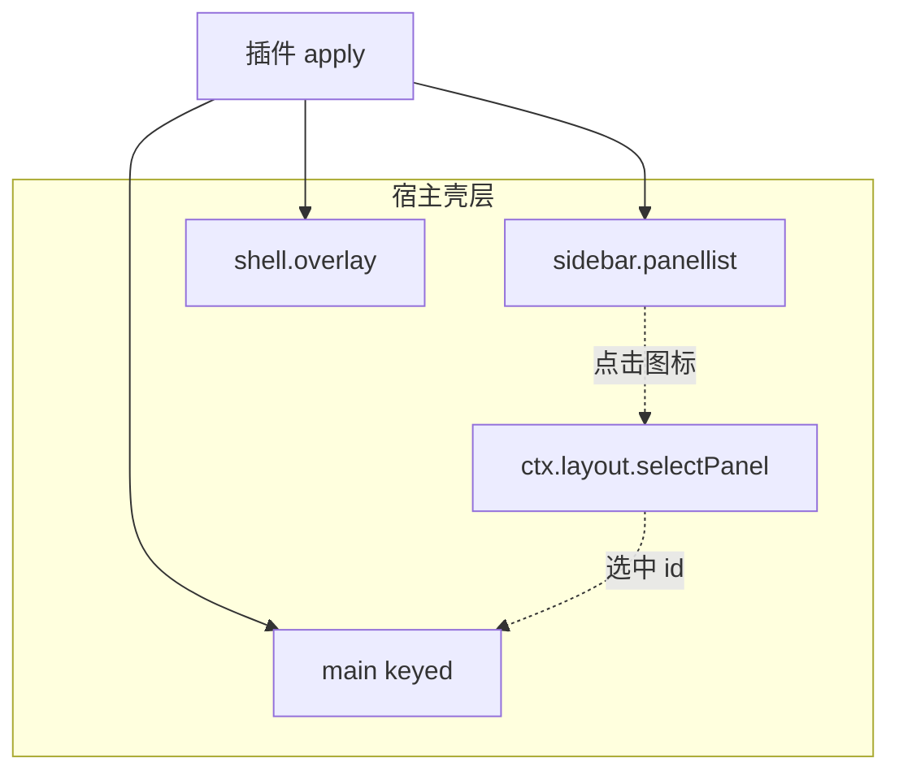
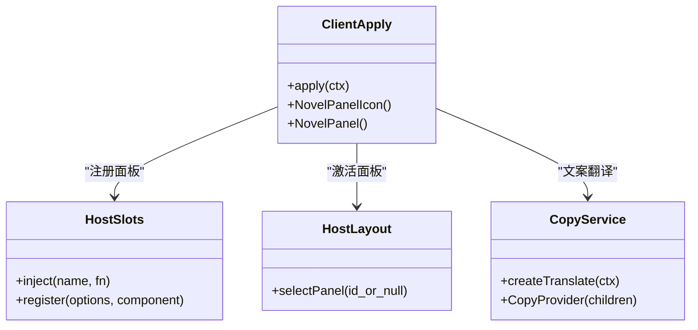
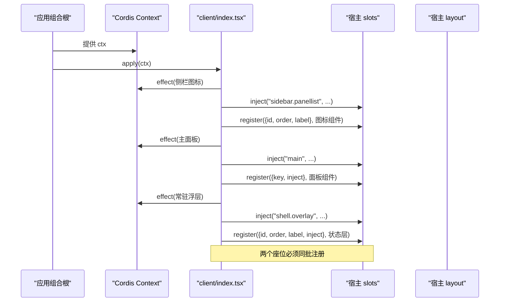
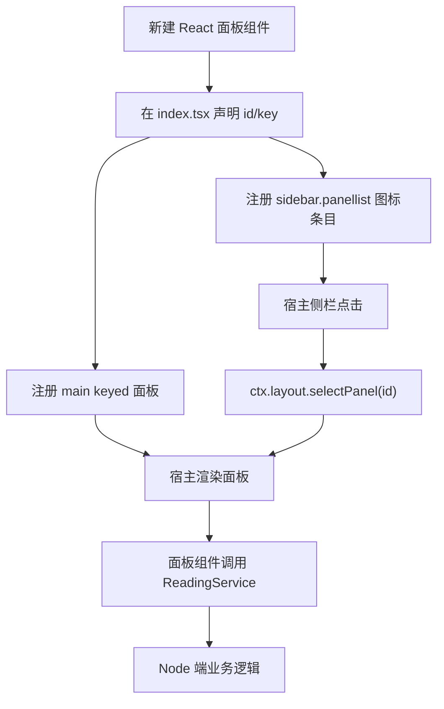
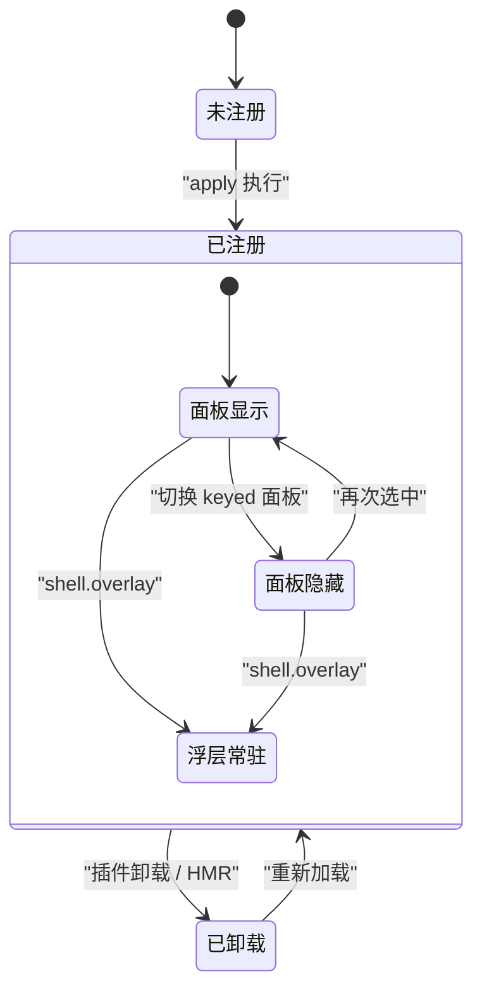
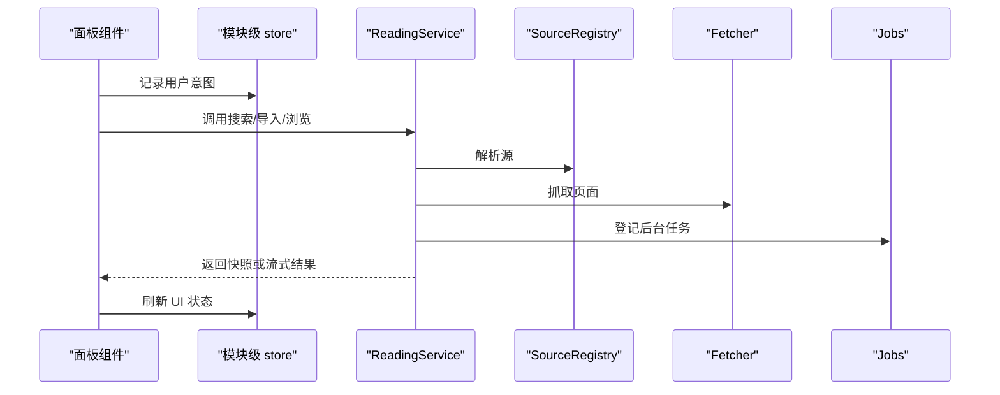
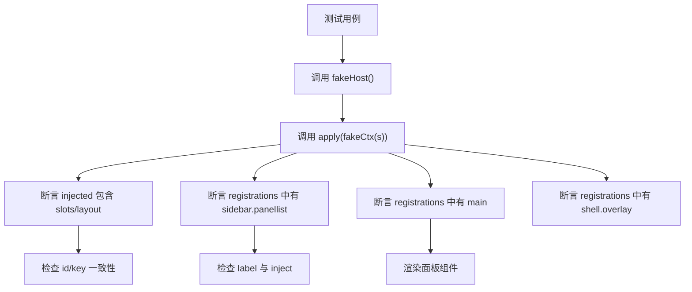

# 面板注册与插槽机制

<cite>
**本文引用的文件**   
- [src/client/index.tsx](file://src/client/index.tsx)
- [src/client/host-ui.d.ts](file://src/client/host-ui.d.ts)
- [src/client/copy/index.tsx](file://src/client/copy/index.tsx)
- [tests/client/panel-registration.test.tsx](file://tests/client/panel-registration.test.tsx)
- [tests/client/fake-host.ts](file://tests/client/fake-host.ts)
- [src/services/reading.ts](file://src/services/reading.ts)
- [docs/adr/0038-client-copy-host-locale.md](file://docs/adr/0038-client-copy-host-locale.md)
</cite>

## 目录

1. [引言](#引言)
2. [项目结构与入口](#项目结构与入口)
3. [宿主插槽总览](#宿主插槽总览)
4. [窄接口与兼容边界](#窄接口与兼容边界)
5. [面板注册核心流程](#面板注册核心流程)
6. [新增面板完整步骤](#新增面板完整步骤)
7. [面板生命周期：销毁、重建与常驻层](#面板生命周期销毁重建与常驻层)
8. [依赖与服务通信](#依赖与服务通信)
9. [插槽冲突排查](#插槽冲突排查)
10. [宿主版本兼容处理](#宿主版本兼容处理)
11. [测试与宿主插槽模拟](#测试与宿主插槽模拟)
12. [性能与健壮性建议](#性能与健壮性建议)
13. [结论](#结论)

## 引言

本文说明浏览器端插件如何通过 Cordis 宿主的插槽机制，把“小说”功能注册为三个位置：

| 插槽名 | 作用 | 行为 |
|---|---|---|
| `sidebar.panellist` | 左侧图标行 | 注册一条带 `id`、可选 `order`、`label` 的条目；点击由宿主调用 `ctx.layout.selectPanel(id)` 切到对应主面板。 |
| `main` | 内容区 | keyed 槽，按侧栏选中的 `id` 渲染同 `key` 的面板组件。 |
| `shell.overlay` | 模态/常驻浮层 | root 作用域 list，默认 click-through；用于跨面板可见的任务状态等常驻 UI。 |

该实现不是传统对话区 tab，而是全局面板：侧栏图标 + 中央 keyed 面板，同时保留一个常驻任务状态层。

**章节来源**
- [src/client/index.tsx:12-42](file://src/client/index.tsx#L12-L42)

## 项目结构与入口

客户端半入口导出 `inject = ['slots', 'layout']`，并通过 `apply(ctx)` 完成全部宿主接入。它只声明真正需要的宿主能力：

**图表来源**
- [src/client/index.tsx:10-110](file://src/client/index.tsx#L10-L110)
- [src/client/copy/index.tsx:1-90](file://src/client/copy/index.tsx#L1-L90)

**章节来源**
- [src/client/index.tsx:10-110](file://src/client/index.tsx#L10-L110)
- [src/client/copy/index.tsx:1-90](file://src/client/copy/index.tsx#L1-L90)

## 宿主插槽总览

### sidebar.panellist

这是 root 作用域的列表插槽。每条注册项形如 `{ id, order?, label? }`，占用者是一个 React 组件，宿主侧只传 `{ size, active }`。宿主负责：

- 按钮外观；
- `aria-current` 选中态；
- tooltip；
- 点击后调用 `ctx.layout.selectPanel(id)`。

插件只输出图标，不接管整行交互。

### main

这是 root 作用域的 keyed 插槽。注册项用 `key` 而非 `id`，宿主根据当前选中的侧栏项，渲染 `main` 中同 key 的占用者。官方契约明确：选中缺失的 `main` entry 会抛错，因此 `sidebar.panellist` 与 `main` 必须同批注册，不能出现半注册窗口。

### shell.overlay

这是 root 作用域、list 基数、默认 click-through 的浮层插槽。它与 sidebar/main/rightbar 并列，切换面板或会话不会卸载它，适合放任务进度、全局提示等常驻 UI。

**图表来源**
- [src/client/index.tsx:12-42](file://src/client/index.tsx#L12-L42)
- [src/client/index.tsx:82-106](file://src/client/index.tsx#L82-L106)

**章节来源**
- [src/client/index.tsx:12-42](file://src/client/index.tsx#L12-L42)
- [src/client/index.tsx:82-106](file://src/client/index.tsx#L82-L106)

## 窄接口与兼容边界

### host-ui.d.ts 的定位

`host-ui.d.ts` 是宿主表单原语类型的窄镜像，而不是面板插槽的类型定义。它的职责是：

- 让客户端只消费运行时注入的宿主模块；
- 避免把宿主包版本绑定到 devDeps；
- 通过只声明用到的成员，降低类型耦合；
- 配合测试替身做形状闸，保证宿主契约变化时能被发现。

这体现的是 ADR 0020 的窄镜像口径：类型层面两边互不相识，能红的是两处——配置页对成员的取用，以及测试替身的形状门。

### PanelDescriptor 与 WebHostLike

在当前仓库中，没有名为 `PanelDescriptor` 或 `WebHostLike` 的 TypeScript 类型。实际使用的窄接口在 `src/client/index.tsx` 中以匿名对象形式出现：

| 接口片段 | 含义 |
|---|---|
| `slots.inject(name, fn)` | 向宿主插槽挂入一个可退订的初始化函数。 |
| `slots.register(options, component)` | 向已 inject 的插槽注册一条面板或浮层。 |
| `layout.selectPanel(id | null)` | 把指定 id 的面板带到前台；null 表示回到会话。 |
| `ctx.effect(fn, label)` | 挂载 effect，并记录可读标签，便于测试验证卸载路径。 |
| `ctx.inject(deps, callback)` | 可选依赖注入，例如旧宿主缺少 `configForms` 时跳过配置页。 |

这些才是插件直接依赖的宿主契约面。

**图表来源**
- [src/client/index.tsx:43-110](file://src/client/index.tsx#L43-L110)
- [src/client/copy/index.tsx:49-90](file://src/client/copy/index.tsx#L49-L90)

**章节来源**
- [src/client/host-ui.d.ts:1-58](file://src/client/host-ui.d.ts#L1-L58)
- [src/client/index.tsx:43-110](file://src/client/index.tsx#L43-L110)

## 面板注册核心流程

### 注册顺序

`apply` 内部按以下顺序执行：

1. 从 `ctx` 取出窄化的 `slots` 和 `layout`。
2. 创建翻译入口 `t`，优先走宿主 locale 服务，否则回退中文。
3. 向 `sidebar.panellist` 注册图标条。
4. 向 `main` 注册 keyed 面板。
5. 向 `shell.overlay` 注册常驻任务状态层。
6. 可选安装配置页。

其中前两项必须同步完成，因为宿主选择缺失的 main entry 会抛错。

**图表来源**
- [src/client/index.tsx:82-106](file://src/client/index.tsx#L82-L106)

### 面板标题、图标、默认宽度与可关闭

| 属性 | 是否由本仓设置 | 说明 |
|---|---:|---|
| 标题 | 是 | `sidebar.panellist` 的 `label` 返回翻译后的文案；`shell.overlay` 也有独立 `label`。 |
| 图标 | 是 | 使用 `novel-glyph.ts` 提供的 SVG path，前景色随宿主行。 |
| 默认宽度 | 否 | 本仓未设置面板宽度；宽度由宿主 `main` 插槽布局决定。 |
| 可关闭 | 否 | 全局面板由宿主侧栏选中态控制；常驻浮层由自身 UI 逻辑控制关闭。 |

**章节来源**
- [src/client/index.tsx:43-80](file://src/client/index.tsx#L43-L80)
- [tests/client/panel-registration.test.tsx:28-49](file://tests/client/panel-registration.test.tsx#L28-L49)

## 新增面板完整步骤

如果要在同一插件内新增一个面板，应遵循以下步骤：

1. **定义 React 组件**  
   新建一个无副作用的视图组件，放在 `src/client/views/` 下，保持样式自足（参考现有 `NovelView`）。

2. **准备面板标识符**  
   选择一个稳定的字符串 id/key，例如 `'novel'`；它必须同时出现在侧栏条目和 main keyed 槽中。

3. **在 `src/client/index.tsx` 中调用注册**  
   使用 `ctx.effect(() => slots.inject(...))` 包裹两条注册：
   - `sidebar.panellist`：传入 `name`、`id`、`order`、`label` 和图标组件。
   - `main`：传入 `name`、`key`、`inject` 和面板组件。

4. **绑定路由或入口**  
   当前“小说”是全局面板，由宿主侧栏触发；若需要 URL 路由进入，应在面板内部或外部路由层调用 `ctx.layout.selectPanel(id)` 把面板带到前台。

5. **通过 ReadingService 与 Node 半通信**  
   面板组件不应直接访问 Node API，而应通过 `ReadingService` 发起搜索、导入、分类浏览、书架操作等后端能力。

**图表来源**
- [src/client/index.tsx:82-106](file://src/client/index.tsx#L82-L106)
- [src/services/reading.ts:1-200](file://src/services/reading.ts#L1-L200)

**章节来源**
- [src/client/index.tsx:82-106](file://src/client/index.tsx#L82-L106)
- [src/services/reading.ts:1-200](file://src/services/reading.ts#L1-L200)

## 面板生命周期：销毁、重建与常驻层

### 面板卸载与恢复

- 当 keyed 槽切换到其他面板时，React 会卸载当前面板组件树。
- 本项目的业务真相在服务端（后台任务、显式快照），UI 现场留在模块级 store。
- 切走再切回来时，组件重新挂载，store 仍可恢复交互现场。

### 常驻浮层的稳定性

`shell.overlay` 中的任务状态层是常驻 UI，不会因为切换面板或切换会话而被卸载。它的职责是让任务读数在任何面板都可见。

### 注册的生命周期

所有注册都放在 `ctx.effect` 中。这意味着：

- 插件卸载时，effect 对应的注入点可以退订；
- HMR 重挂时，宿主 locale 服务的 `register` disposer 也能正确释放命名空间；
- 测试可以通过读取 `effects` 数组确认注册发生在标记过的 effect 中。

**图表来源**
- [src/client/index.tsx:82-106](file://src/client/index.tsx#L82-L106)
- [src/client/copy/index.tsx:66-90](file://src/client/copy/index.tsx#L66-L90)

**章节来源**
- [src/client/index.tsx:12-42](file://src/client/index.tsx#L12-L42)
- [src/client/index.tsx:82-106](file://src/client/index.tsx#L82-L106)
- [src/client/copy/index.tsx:66-90](file://src/client/copy/index.tsx#L66-L90)

## 依赖与服务通信

### ReadingService 的角色

`ReadingService` 是阅读链路的门面，聚合搜索、抓取、缓存、书架、本地书、任务持有者等能力。浏览器面板不应绕过它直接访问 Node API。

关键约定包括：

- 公开类型集中在 wire 契约，避免重复定义；
- 配置值通过 `ResolvedConfig` 或直装缝读取；
- 任务语义通过 `JobHost` 交给宿主；
- 网络请求统一经 fetcher；
- 规则求值统一经引擎。

### 面板如何与 Node 半通信

典型调用链是：

1. 面板组件触发用户动作；
2. 调用 `ReadingService` 的公开方法；
3. ReadingService 调度 SourceRegistry、Shelf、Cache、Fetcher、Jobs；
4. 结果以 wire 契约形状返回给 UI；
5. UI 更新 store 或临时状态。

**图表来源**
- [src/services/reading.ts:1-200](file://src/services/reading.ts#L1-L200)

**章节来源**
- [src/services/reading.ts:1-200](file://src/services/reading.ts#L1-L200)

## 插槽冲突排查

### 常见症状

| 症状 | 可能原因 | 排查方向 |
|---|---|---|
| 侧栏图标不出现 | `sidebar.panellist` 未 inject 或注册失败 | 检查 `fakeHost().injected` 是否包含 `sidebar.panellist`。 |
| 点击图标无反应 | `main` 未注册同 key 的面板 | 检查 `main` 注册项的 `key` 是否与 `sidebar.panellist` 的 `id` 一致。 |
| 启动时报错 | 宿主选中了缺失的 main entry | 确认双注册在同一 `apply` 中同步完成。 |
| 面板标题错误 | `label` 函数未走翻译或命名空间写错 | 检查 `label()` 返回值与 copy 命名空间。 |
| 语言不切换 | locale 服务缺失或未生效 | 检查 `createTranslate` 回退路径与 locale 服务 availability。 |
| 测试断言假绿 | fake-host 形状漂移 | 检查 `Registration` 与 `FakeHost` 接口。 |

### 关键一致性约束

- `sidebar.panellist.id` 与 `main.key` 必须是同一个字符串。
- 两个注册必须在 `apply` 内同步完成。
- 常量 `NOVEL_PANEL_ID = 'novel'` 就是注册与激活共用的一格。

**章节来源**
- [src/client/index.tsx:12-42](file://src/client/index.tsx#L12-L42)
- [src/client/index.tsx:70-80](file://src/client/index.tsx#L70-L80)
- [tests/client/panel-registration.test.tsx:28-49](file://tests/client/panel-registration.test.tsx#L28-L49)

## 宿主版本兼容处理

### 可选服务策略

代码多处采用“可用则用，不可用则降级”的策略：

| 能力 | 兼容方式 |
|---|---|
| locale 服务 | `ctx.get('locale')` 可选；缺省回退 `zhTranslate`。 |
| configForms | 通过 `ctx.inject(['configForms'], ...)` 可选安装配置页。 |
| host-ui 表单原语 | 用 `host-ui.d.ts` 窄镜像，不装宿主包。 |
| 宿主槽位 | 测试通过 `fake-host.ts` 提供最小宿主契约。 |

### 已知限制

- 已生成并进入 transient、job 或会话快照的错误文案，在生成时定语言，切换语言不会重翻存量条目。
- 如果宿主 locale 服务晚到，界面可能停在中文，因为 `createTranslate` 只在首次调用时读一次服务。
- 不硬 inject `locale`，以免老宿主无法激活插件。

**章节来源**
- [src/client/copy/index.tsx:49-90](file://src/client/copy/index.tsx#L49-L90)
- [docs/adr/0038-client-copy-host-locale.md:1-12](file://docs/adr/0038-client-copy-host-locale.md#L1-L12)
- [src/client/index.tsx:102-106](file://src/client/index.tsx#L102-L106)

## 测试与宿主插槽模拟

### fake-host.ts

`tests/client/fake-host.ts` 提供最小宿主假体，包含：

- `slots.inject`：记录被 inject 的插槽名；
- `slots.register`：记录注册项、选项与组件；
- `layout.selectPanel`：可 spy 面板激活；
- `configForms`：可选，用于配置页测试；
- `effects`：记录 `ctx.effect` 标签；
- `injected`：记录 `ctx.inject` 声明的依赖。

### panel-registration.test.tsx

该测试钉住以下契约：

- `clientInject` 只依赖 `['slots', 'layout']`；
- `apply` 注入 `sidebar.panellist`、`main`、`shell.overlay`；
- 不再注入 `conversation.view`；
- 图标组件接收 `{ size, active }`；
- main 组件渲染 `NovelView`；
- 每个注册都在 `dsh-novel` 标记的 effect 中。

**图表来源**
- [tests/client/fake-host.ts:1-127](file://tests/client/fake-host.ts#L1-L127)
- [tests/client/panel-registration.test.tsx:1-101](file://tests/client/panel-registration.test.tsx#L1-L101)

**章节来源**
- [tests/client/fake-host.ts:1-127](file://tests/client/fake-host.ts#L1-L127)
- [tests/client/panel-registration.test.tsx:1-101](file://tests/client/panel-registration.test.tsx#L1-L101)

## 性能与健壮性建议

1. **不要为每个面板创建多个注册**  
   面板 id/key 应保持稳定，避免重复注册造成宿主状态混乱。

2. **不要把 Node API 暴露给面板组件**  
   面板只消费 `ReadingService` 等高层接口，降低浏览器与 Node 之间的耦合。

3. **文案统一走 `createTranslate`**  
   避免散落的中文硬编码，确保宿主 locale 可覆盖。

4. **常驻浮层要轻量**  
   `shell.overlay` 常驻存在，应避免在每次渲染中创建昂贵对象。

5. **测试要覆盖宿主缺失场景**  
   特别是 locale、configForms、slots 不存在时的降级路径。

[本节为通用建议，不直接分析具体代码文件]

## 结论

本项目通过 Cordis 宿主的三个插槽完成浏览器端面板接入：

- `sidebar.panellist` 提供侧栏图标入口；
- `main` 提供 keyed 内容区；
- `shell.overlay` 提供跨面板常驻浮层。

核心契约不在泛型 `PanelDescriptor` 或 `WebHostLike` 上，而在 `src/client/index.tsx` 中对 `slots`、`layout`、`ctx.effect`、`ctx.inject` 的窄化使用，以及测试替身所维持的形状契约。新增面板时应复用这一模式：定义组件 → 同 id/key 双注册 → 通过 ReadingService 与 Node 半通信，并在测试中用 `fake-host.ts` 验证插槽、选项与生命周期。

**章节来源**
- [src/client/index.tsx:10-110](file://src/client/index.tsx#L10-L110)
- [tests/client/panel-registration.test.tsx:1-101](file://tests/client/panel-registration.test.tsx#L1-L101)
- [tests/client/fake-host.ts:1-127](file://tests/client/fake-host.ts#L1-L127)
- [src/services/reading.ts:1-200](file://src/services/reading.ts#L1-L200)