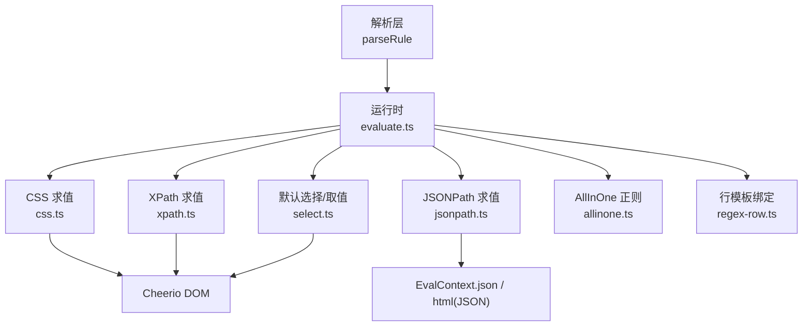
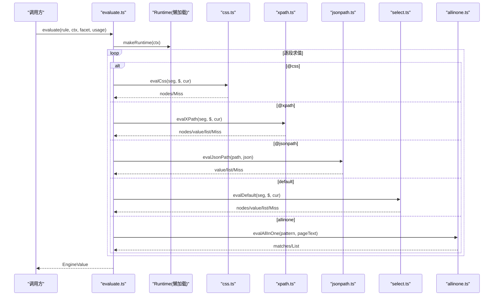
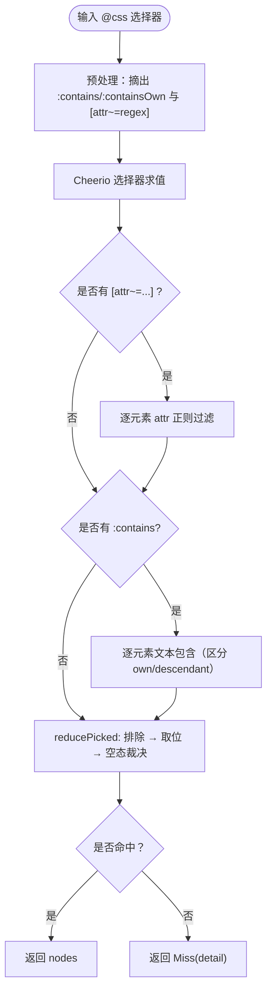
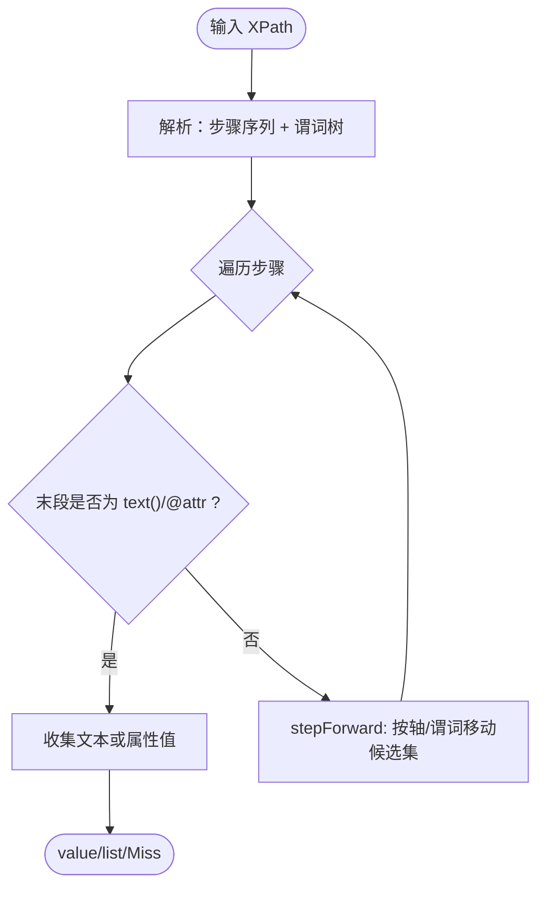
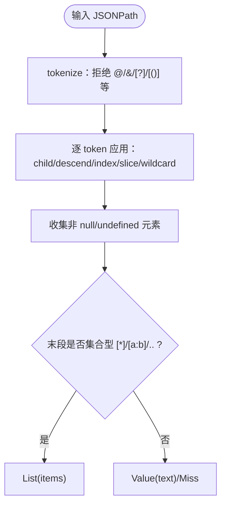
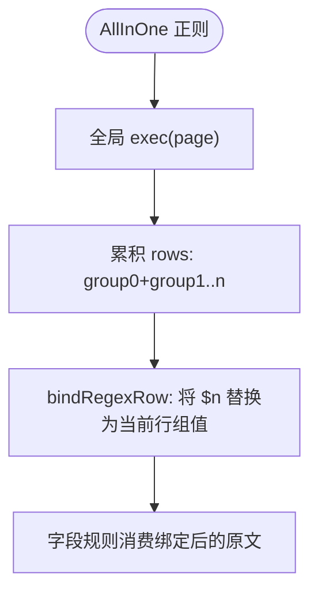
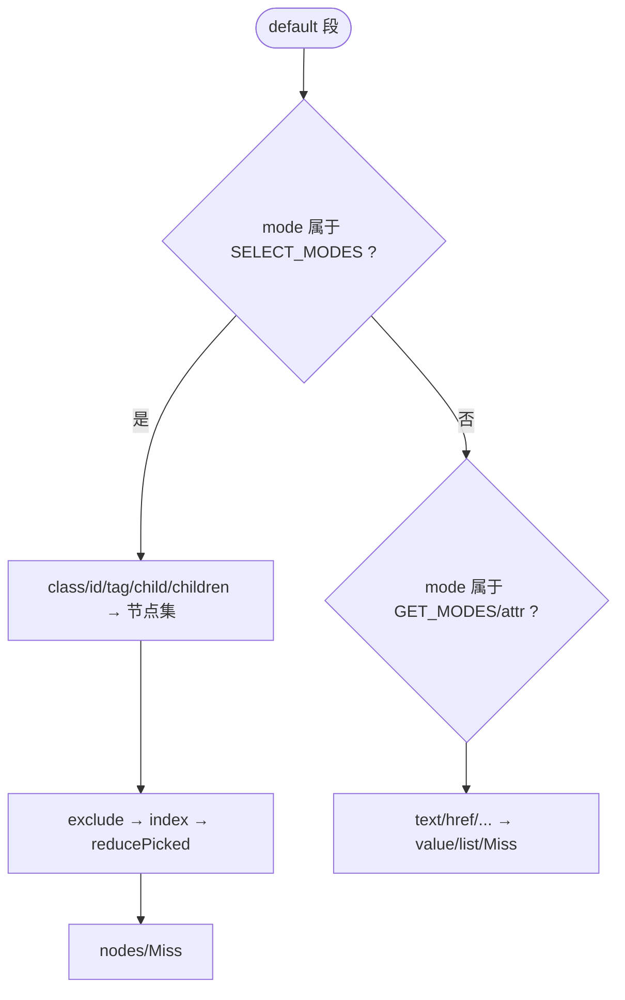
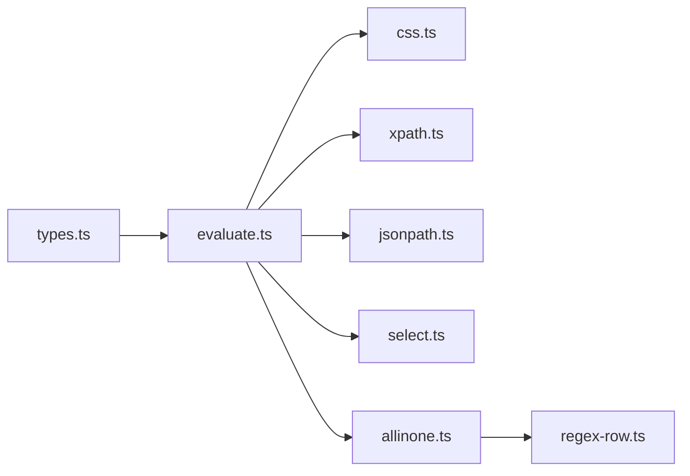
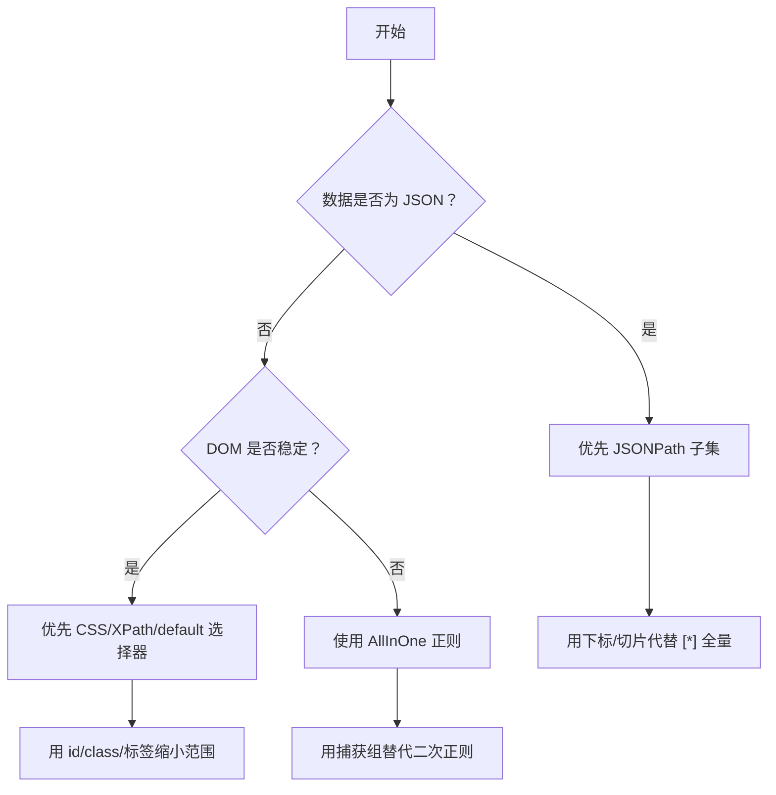

# CSS / XPath / JSONPath 选择器

<cite>
**本文引用的文件**   
- [css.ts](file://src/engine/css.ts)
- [xpath.ts](file://src/engine/xpath.ts)
- [jsonpath.ts](file://src/engine/jsonpath.ts)
- [regex-row.ts](file://src/engine/regex-row.ts)
- [allinone.ts](file://src/engine/allinone.ts)
- [select.ts](file://src/engine/select.ts)
- [evaluate.ts](file://src/engine/evaluate.ts)
- [types.ts](file://src/engine/types.ts)
- [css.test.ts](file://tests/engine/css.test.ts)
- [css-jsoup-text-pseudos.test.ts](file://tests/engine/css-jsoup-text-pseudos.test.ts)
- [xpath.test.ts](file://tests/engine/xpath.test.ts)
- [jsonpath.test.ts](file://tests/engine/jsonpath.test.ts)
- [regex-row.test.ts](file://tests/engine/regex-row.test.ts)
</cite>

## 目录
1. [引言](#引言)
2. [项目结构](#项目结构)
3. [核心组件](#核心组件)
4. [架构总览](#架构总览)
5. [详细组件分析](#详细组件分析)
6. [依赖关系分析](#依赖关系分析)
7. [性能与全量扫描规避](#性能与全量扫描规避)
8. [疑难排查](#疑难排查)
9. [结论](#结论)

## 引言
本文面向 legacy（旧式）书源作者，说明引擎支持的三类查询语言：CSS 选择器、XPath 子集、JSONPath 子集，并解释它们与原生实现（Cheerio/JQuery/jsoup 语义近似面）的差异。文档重点覆盖：
- CSS pseudo 类（`:contains`、`:containsOwn`）与 jsoup 兼容处理；
- `[attr~=正则]` 在 legacy 规则中的真实用法；
- XPath 支持的路径、轴、谓词与函数白名单；
- JSONPath 支持的标量路径、下标、切片、通配与递归下降；
- 何时优先使用 `regex-row`（AllInOne 整页正则）或 JS 表达式；
- 选择器 vs 正则 vs JS 的性能对比与避免全量扫描的方法。

## 项目结构
引擎把“规则 → 节点/字符串/列表”的求值拆成多个模块：解析层产出统一 AST，运行时按段类型分派到对应求值器，再组合结果。

**图示来源**
- [evaluate.ts:1-120](file://src/engine/evaluate.ts#L1-L120)
- [css.ts:1-123](file://src/engine/css.ts#L1-L123)
- [xpath.ts:1-60](file://src/engine/xpath.ts#L1-L60)
- [jsonpath.ts:1-40](file://src/engine/jsonpath.ts#L1-L40)
- [select.ts:1-60](file://src/engine/select.ts#L1-L60)
- [allinone.ts:1-59](file://src/engine/allinone.ts#L1-L59)
- [regex-row.ts:1-26](file://src/engine/regex-row.ts#L1-L26)

**章节来源**
- [evaluate.ts:1-120](file://src/engine/evaluate.ts#L1-L120)
- [types.ts:1-122](file://src/engine/types.ts#L1-L122)

## 核心组件
- **CSS 选择器**：基于 Cheerio 选择器引擎，并在求值前对 jsoup 兼容语法做预处理（文本伪类、属性正则匹配）。
- **XPath 子集**：自实现解析与求值，直接作用于 Cheerio 底层 domhandler 节点树，避免 HTML→XML 重解析错位。
- **JSONPath 子集**：纯手写 tokenizer + 求值，不引入 npm 依赖，明确拒绝过滤器与脚本表达式。
- **AllInOne 正则**：整页正则扫描，产出二维行表，供条目列表与 `$n` 行模板绑定。
- **默认选择/取值**：legacy 风格 `class/tag/id/child/text/href` 等模式，提供位置索引、排除、自身包含等语义。
- **运行时调度**：`evaluate.ts` 负责懒加载 Cheerio、JSON 数据、链式组合与替换尾。

**章节来源**
- [css.ts:1-123](file://src/engine/css.ts#L1-L123)
- [xpath.ts:1-60](file://src/engine/xpath.ts#L1-L60)
- [jsonpath.ts:1-40](file://src/engine/jsonpath.ts#L1-L40)
- [allinone.ts:1-59](file://src/engine/allinone.ts#L1-L59)
- [select.ts:1-120](file://src/engine/select.ts#L1-L120)
- [evaluate.ts:1-120](file://src/engine/evaluate.ts#L1-L120)

## 架构总览
引擎对外暴露统一的求值入口，内部按分支与段推进。HTML 与 JSON 两条数据通道分别进入不同求值器，最终都归一为 `EngineValue`（miss/value/list/nodes/matches）。

**图示来源**
- [evaluate.ts:1-200](file://src/engine/evaluate.ts#L1-L200)
- [css.ts:1-123](file://src/engine/css.ts#L1-L123)
- [xpath.ts:1-60](file://src/engine/xpath.ts#L1-L60)
- [jsonpath.ts:1-40](file://src/engine/jsonpath.ts#L1-L40)
- [select.ts:1-120](file://src/engine/select.ts#L1-L120)
- [allinone.ts:1-59](file://src/engine/allinone.ts#L1-L59)

## 详细组件分析

### CSS 选择器与 jsoup 兼容差异
- 选择器基础来自 Cheerio（nwsapi/css-select），非法选择器会抛错并被包装为带段定位的错误。
- 兼容层在求值前从选择器中剥离两类 jsoup 语义：
  - 文本伪类 `:contains(...)`、`:containsOwn(...)`：改为先选普通选择器，再逐元素比对文本；`:contains` 忽略大小写，`:containsOwn` 只看元素自己的直接文本节点。
  - 属性谓词 `[attr~=pattern]`：不是标准 CSS 的空白分词词表匹配，而是正则匹配；引擎将其改写为「只要该属性存在」后再用正则逐元素过滤。
- 选择结果走统一的后处理：`!` 排除 → 位置取位 → 空态裁决（零命中、排除后为空、越界均视为 Miss）。

**图示来源**
- [css.ts:1-123](file://src/engine/css.ts#L1-L123)
- [select.ts:100-200](file://src/engine/select.ts#L100-L200)

#### 关键行为与示例
- 当前节点集内选择，且命中集含当前元素自身（与 jsoup 一致）；不做全文档查找。
- `.page-link@a@href` 这类“类名长在标签自己身上”的写法能正确读到 href。
- `:contains(Abc)` 与 `:contains(abc)` 命中同一批元素；`:containsOwn` 只匹配元素直接文本。
- `[property~=category|status|update_time]` 走正则匹配，而非空白词表比较。
- 非法选择器或非法正则都会抛出错误，不会静默零命中。

**章节来源**
- [css.ts:1-123](file://src/engine/css.ts#L1-L123)
- [css.test.ts:1-179](file://tests/engine/css.test.ts#L1-L179)
- [css-jsoup-text-pseudos.test.ts:1-64](file://tests/engine/css-jsoup-text-pseudos.test.ts#L1-L64)
- [select.ts:120-200](file://src/engine/select.ts#L120-L200)

### XPath 子集
引擎自实现 XPath 子集，直接在 domhandler 节点树上求值，避免 HTML→XML 重解析带来的错位。

支持能力概览：
- 路径：`//`、`.//`、`/`。
- 节点测试：元素名、`*`、`text()`、末段 `@attr`。
- 轴：`child`（默认）、`parent(..)`、`following-sibling`、`preceding-sibling`；其他轴不支持。
- 谓词：位置数字、`@attr='v'`、`text()='v'`、`contains(...)`、`starts-with(...)`、`not(...)`、`position()` 比较、子元素存在性、相对路径存在性（如 `[.//a]`、`[.//a/@href]`）、`and`/`or`。
- 末段 `@attr` 与 `text()` 为提取步，不改变候选集合；其余步骤产出节点集。

**图示来源**
- [xpath.ts:1-60](file://src/engine/xpath.ts#L1-L60)
- [xpath.ts:60-200](file://src/engine/xpath.ts#L60-L200)

#### 关键行为与示例
- `//dt/a/@href` 从候选元素读属性，不是过滤子节点。
- `//dd[2]/text()` 按父分组取第 2 个 dd 的文本。
- `//*[contains(@class,"bookname")]/a/text()` 结合 contains 与文本提取。
- `.//a/text()` 在上下文节点内作用域，不会外溢到全文档。
- `..` 父步可跨多级，攀过文档根时零命中（不猜成 html）。
- 未支持函数（如 `count`、`sum`）与未支持轴（如 `ancestor::`）会抛 UnsupportedRuleError。

**章节来源**
- [xpath.ts:1-200](file://src/engine/xpath.ts#L1-L200)
- [xpath.test.ts:1-202](file://tests/engine/xpath.test.ts#L1-L202)

### JSONPath 子集
JSONPath 子集完全自实现，不引入第三方依赖，明确拒绝过滤器与脚本表达式。

支持能力概览：
- `$`、`.name`、`..name`（递归下降，按文档序收集）。
- `[n]`（负数从尾数）、`[a:b]`（半开区间，负数从尾数）、`[*]`、`[]`（同 `[*]`）。
- 冗余点形态 `.[*]`（真实源常见）。
- `.*` 属性通配：对象上取全部值，数组上取全部元素。
- 明确拒绝：过滤器 `[?(…)]`、脚本 `[(…)]`、`@`/`&` 特殊符号。

结果映射：
- 零命中、解析到 null/undefined、下标越界、切片裁空 → Miss。
- 空数组或键存在且值为空数组 → 空 List（合法空，区别于 Miss）。
- 非空数组 → List；直接标量 → Value；对象 → JSON.stringify 后的 Value。

**图示来源**
- [jsonpath.ts:1-195](file://src/engine/jsonpath.ts#L1-L195)

#### 关键行为与示例
- `$.title` 标量 → Value。
- `$.chapters[-1]`、`$.chapters[1:3]`、`$.chapters[*]` 支持负数与半开切片。
- `$.info.Datas` 对象元素数组 → List，元素为 JSON.stringify 后的字符串。
- `$..n` 递归下降按序收集。
- 过滤器与脚本表达式直接抛 UnsupportedRuleError。

**章节来源**
- [jsonpath.ts:1-195](file://src/engine/jsonpath.ts#L1-L195)
- [jsonpath.test.ts:1-78](file://tests/engine/jsonpath.test.ts#L1-L78)

### AllInOne 正则与行模板绑定
AllInOne 整页正则用于“整页列出条目”的场景，产物是二维行表 `rows: string[][]`，每行包含 group 0（整段匹配）与捕获组 1..n。

字段规则通过 `$n` 绑定到当前行的捕获组：
- `$0` = 整段匹配；`$n` = 第 n 组；越界组落空串。
- 行模板只在 `##` 之前的支文本生效，替换尾里的 `$n` 仍是替换段的反向引用。
- JS 区域豁免：脚本里的 `$1` 不被当行模板。

**图示来源**
- [allinone.ts:1-59](file://src/engine/allinone.ts#L1-L59)
- [regex-row.ts:1-26](file://src/engine/regex-row.ts#L1-L26)

**章节来源**
- [allinone.ts:1-59](file://src/engine/allinone.ts#L1-L59)
- [regex-row.ts:1-26](file://src/engine/regex-row.ts#L1-L26)
- [regex-row.test.ts:1-69](file://tests/engine/regex-row.test.ts#L1-L69)

### 默认选择/取值与链式组合
legacy 书源大量使用 `class/tag/id/child/children/text/href/src/content/all/textNodes/attr` 等模式，配合位置后缀（`.`、`:`、`!`、`[...]`）完成选择与取值。

要点：
- 首段未起链时取根节点集 `$('*)`；链首裸取值终端对整篇只取一次文本。
- `class.a b` 解为“元素同时含所有类”，不是后代选择器。
- 选择段含当前元素自身（与 jsoup 一致），`child/children` 不含自身。
- 位置取位失败 → Miss；`!` 排除越界者静默丢弃。
- `text.<串>` 与 `ownText.<串>` 带参数时为“按文本选元素”，不带参数才为取值终端。

**图示来源**
- [select.ts:1-200](file://src/engine/select.ts#L1-L200)

**章节来源**
- [select.ts:1-200](file://src/engine/select.ts#L1-L200)
- [select.test.ts:1-200](file://tests/engine/select.test.ts#L1-L200)

## 依赖关系分析
- CSS 依赖 Cheerio 选择器与 domhandler；文本与属性过滤在 css.ts 中后置处理。
- XPath 直接操作 domhandler 节点树，避免 Cheerio 的 HTML→XML 重解析。
- JSONPath 无外部依赖，tokenizer 严格拒绝非法语法。
- AllInOne 与 regex-row 共同支撑整页正则条目模型。
- evaluate.ts 作为总装，懒加载 Cheerio 与 JSON 数据，串联各求值器。

**图示来源**
- [types.ts:1-122](file://src/engine/types.ts#L1-L122)
- [evaluate.ts:1-200](file://src/engine/evaluate.ts#L1-L200)

**章节来源**
- [types.ts:1-122](file://src/engine/types.ts#L1-L122)
- [evaluate.ts:1-200](file://src/engine/evaluate.ts#L1-L200)

## 性能与全量扫描规避
### 选择器 vs 正则 vs JS
- **CSS/XPath/default 选择器**：优先使用结构化选择，利用 Cheerio/domhandler 的 DOM 遍历与局部选择，避免整页扫描。
- **AllInOne 正则**：整页全局扫描，适合页面结构不稳定但正则稳定的场景；代价是全量扫描与多行构建。
- **JS 表达式**：最灵活，但也最慢，应仅在无法用选择器/正则表达时使用。

### 避免全量扫描的建议
- 尽量以具体容器开头：例如 `#wrap li.clearfix`、`ul.vodlist li`，而不是 `//li`。
- 优先使用 id/class/标签限定范围，减少后代遍历。
- 使用 `@css` 或 default 选择段进行局部选择，避免在链首直接对整个文档做宽泛匹配。
- 对于 JSON API，优先使用 JSONPath 的子集（点路径、下标、切片、通配），不要退回正则。
- 当页面结构变化频繁且难以稳定选择时，才考虑 AllInOne；一旦稳定，迁移到选择器以提升性能。
- 使用位置后缀精确取位，避免后续再用正则清洗。

### 典型优化路径

**图示来源**
- [jsonpath.ts:1-195](file://src/engine/jsonpath.ts#L1-L195)
- [css.ts:1-123](file://src/engine/css.ts#L1-L123)
- [xpath.ts:1-200](file://src/engine/xpath.ts#L1-L200)
- [allinone.ts:1-59](file://src/engine/allinone.ts#L1-L59)

## 疑难排查
- **CSS 零命中**：检查是否误用 jsoup 的 `[attr~=regex]` 为标准 CSS 词表匹配；确认 `:contains` 大小写语义与 own/descendant 口径。
- **XPath 未支持函数/轴**：遇到 `count`、`sum`、`ancestor::` 等会抛 UnsupportedRuleError，需改用允许的谓词或前置选择器。
- **JSONPath 过滤器报错**：`[?(…)]`、`[(…)]`、`@`/`&` 被拒绝，应改用点路径、下标、切片或通配。
- **AllInOne 死循环**：零长度匹配会强制前进防止死循环；若仍异常，检查正则模式与标志。
- **默认选择越界**：位置索引越界返回 Miss 而非抛错；多索引越界者静默丢弃，全越界为 Miss。

**章节来源**
- [css.ts:1-123](file://src/engine/css.ts#L1-L123)
- [xpath.ts:1-200](file://src/engine/xpath.ts#L1-L200)
- [jsonpath.ts:1-195](file://src/engine/jsonpath.ts#L1-L195)
- [allinone.ts:1-59](file://src/engine/allinone.ts#L1-L59)
- [select.ts:1-200](file://src/engine/select.ts#L1-L200)

## 结论
- 对于 HTML DOM，优先使用 CSS 或 XPath 的结构化选择；只有在结构不稳定时才退而使用 AllInOne 正则。
- 对于 JSON API，优先使用 JSONPath 子集；避免过滤器与脚本表达式，保持轻量与稳定。
- legacy 书源的 jsoup 兼容点主要集中在 CSS 文本伪类与 `[attr~=regex]`，以及默认选择段含当前元素自身的语义。
- 性能方面，选择器优于正则，正则优于 JS；通过缩小选择范围、使用下标/切片与精确取位，可显著降低全量扫描成本。