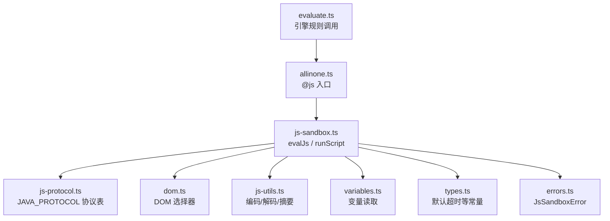
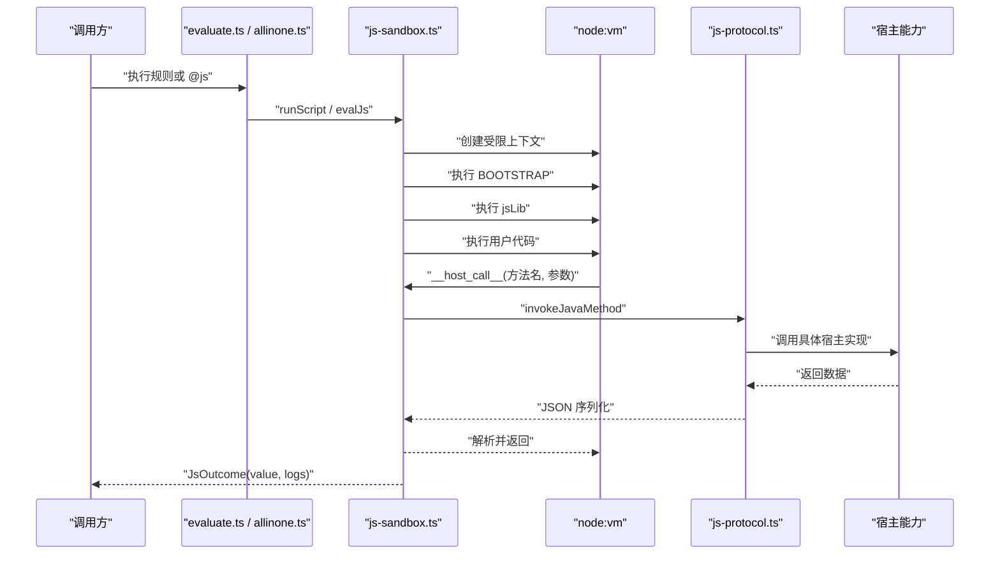
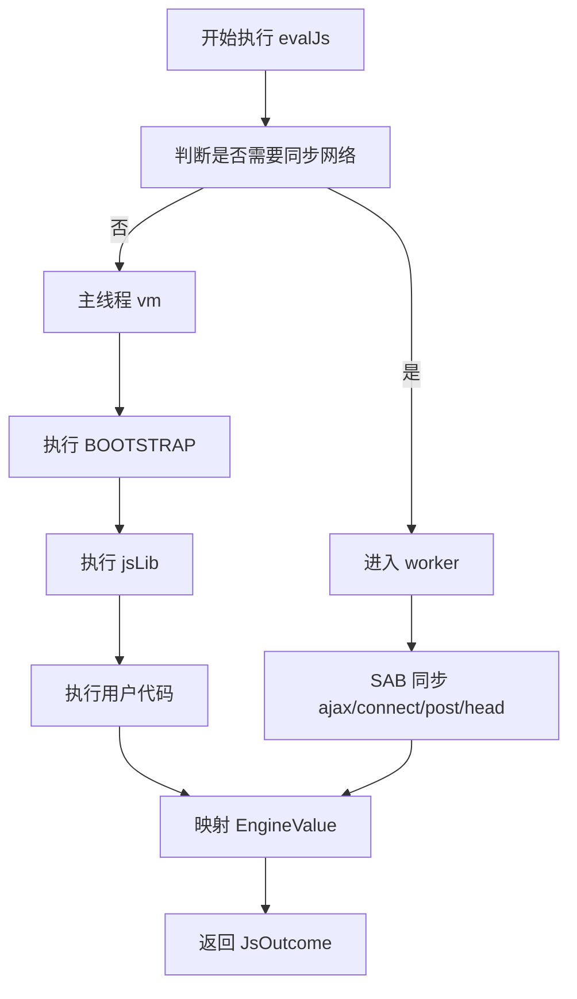
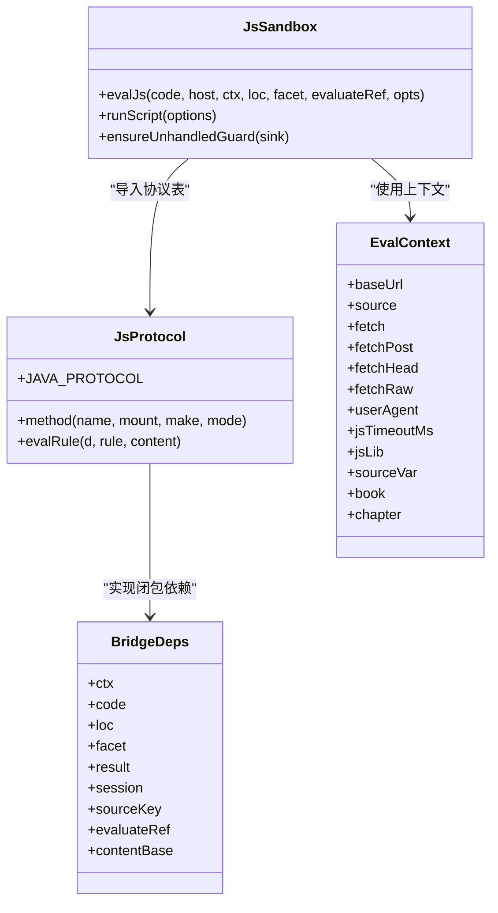

# JS 沙箱与宿主桥接

<cite>
**本文引用的文件**   
- [js-protocol.ts](file://src/engine/js-protocol.ts)
- [js-sandbox.ts](file://src/engine/js-sandbox.ts)
- [evaluate.ts](file://src/engine/evaluate.ts)
- [allinone.ts](file://src/engine/allinone.ts)
- [types.ts](file://src/engine/types.ts)
- [errors.ts](file://src/engine/errors.ts)
- [template.js](file://src/engine/template.js)
- [variables.ts](file://src/engine/variables.ts)
- [js-utils.ts](file://src/engine/js-utils.ts)
- [dom.ts](file://src/engine/dom.ts)
</cite>

## 目录
1. [引言](#引言)
2. [项目结构](#项目结构)
3. [核心组件](#核心组件)
4. [架构总览](#架构总览)
5. [详细组件分析](#详细组件分析)
6. [依赖关系分析](#依赖关系分析)
7. [性能与安全特性](#性能与安全特性)
8. [调试指南](#调试指南)
9. [故障排查](#故障排查)
10. [结论](#结论)
11. [附录：典型脚本示例](#附录典型脚本示例)

## 引言
本文件面向“书源规则中的 JS 片段”和“插件侧的 @js 动态请求头/正文生成”，系统性文档化 JS 沙箱的执行环境。重点包括：

- 受限 JavaScript 运行时（node:vm、代码生成关闭、SAB worker 同步网络）。
- 禁止 API 与逃逸边界（eval、Function、真实文件系统、任意原生对象）。
- 允许的宿主方法（Java 桥接协议表、cookie/source/cache 垫片、字节与加解密工具）。
- 模板求值与表达式求值的边界（`java.getString*` 递归求值 vs 用户脚本直接执行）。
- `js-protocol.ts` 的沙箱消息协议、`js-sandbox.ts` 的隔离策略与异常捕获。
- 如何安全扩展宿主方法、如何调试、如何避免无限循环与内存泄漏。
- 典型脚本场景：动态计算 URL、解析复杂 JSON、拼接章节标题。
- 安全加固建议与性能监控指标。

## 项目结构
JS 沙箱相关代码集中在 engine 层，核心由三个文件组成：

| 文件 | 职责 |
| --- | --- |
| `js-protocol.ts` | JavaBridge 协议表：唯一登记点，定义所有允许暴露给脚本的宿主方法及其挂载位置、同步/异步模式、参数契约。 |
| `js-sandbox.ts` | 受限运行时引导、vm 上下文隔离、worker 同步网络桥、异常与超时控制、全局变量注入（`java`/`cookie`/`cache`/`source`/`result`/`book`/`chapter`）。 |
| `evaluate.ts` / `allinone.ts` | 引擎调用入口，把规则链中的 JS 片段或 @js 块交给 `evalJs` 执行，并传递 `EvalContext`。 |
| `types.ts` / `errors.ts` | 类型定义（如默认超时）与沙箱错误封装。 |
| `template.js` / `variables.ts` / `js-utils.ts` / `dom.ts` | 被协议表与引导脚本复用的纯函数与 DOM 工具。 |

**图表来源**
- [evaluate.ts](file://src/engine/evaluate.ts)
- [allinone.ts](file://src/engine/allinone.ts)
- [js-sandbox.ts](file://src/engine/js-sandbox.ts)
- [js-protocol.ts](file://src/engine/js-protocol.ts)
- [dom.ts](file://src/engine/dom.ts)
- [js-utils.ts](file://src/engine/js-utils.ts)
- [variables.ts](file://src/engine/variables.ts)
- [types.ts](file://src/engine/types.ts)
- [errors.ts](file://src/engine/errors.ts)

**章节来源**
- [js-protocol.ts:1-50](file://src/engine/js-protocol.ts#L1-L50)
- [js-sandbox.ts:1-60](file://src/engine/js-sandbox.ts#L1-L60)
- [evaluate.ts](file://src/engine/evaluate.ts)
- [allinone.ts](file://src/engine/allinone.ts)

## 核心组件

### 受限 JavaScript 运行时
`evalJs` 使用 node:vm 创建受限上下文：

- 通过 `vm.createContext` 注入最小宿主入口：`__host_call__` 与初始化数据 `__init__`。
- 开启 `codeGeneration: { strings: false, wasm: false }`，使 `eval`、`Function`、WebAssembly 构造在 vm 内触发语法或运行时错误。
- 先运行 BOOTSTRAP 引导脚本，再运行 jsLib（源级全局函数库），最后运行用户代码。
- 顶层执行支持“完成值语义”：当 `scriptForm` 为 true 时，尝试以脚本形式执行，遇到顶层 return/await 语法错误则回落到函数体形态。
- 返回值映射到 EngineValue：字符串 → value；数组 → list；null/undefined/空串 → miss；对象 → JSON.stringify 后的 value。

关键约束：

| 维度 | 行为 |
| --- | --- |
| 上下文隔离 | 用户代码运行在独立 vm realm，无法直接访问宿主全局。 |
| 代码生成 | `eval`、`Function`、`new Function`、WebAssembly 构造被禁用。 |
| 宿主入口 | 仅 `__host_call__` 可跨边界，且从 BOOTSTRAP 内部锁定。 |
| 全局可见 | `java`、`console`、`cookie`、`cache`、`source`、`result`、`baseUrl`、`key`、`page`、`src`、`book`、`chapter`。 |
| 异常处理 | vm 超时、JSON 序列化失败、宿主调用异常均包装为 JsSandboxError。 |

**章节来源**
- [js-sandbox.ts:200-260](file://src/engine/js-sandbox.ts#L200-L260)
- [js-sandbox.ts:600-762](file://src/engine/js-sandbox.ts#L600-L762)
- [types.ts](file://src/engine/types.ts)
- [errors.ts](file://src/engine/errors.ts)

### 禁止的 API
以下能力对用户脚本不可用：

| 类别 | 说明 |
| --- | --- |
| 动态代码生成 | `eval`、`Function`、WebAssembly 构造被 vm 层拒绝。 |
| 真实文件系统 | 不暴露 Node `fs`；`downloadFile` 只写入进程内暂存表，路径形如 `/dsh-cache/<md5>.<ext>`，对脚本是令牌而非真实路径。 |
| 任意宿主对象 | 宿主函数、DOM 节点、原始 Buffer 不会直接暴露；所有跨边界数据走 JSON 序列化。 |
| 未实现 Android/WebView 能力 | `webView`、`startBrowserAwait`、`refreshTocUrl`、`ajaxAll`、`createAsymmetricCrypto`、`queryTTF`、`queryBase`、`replaceFont`、`androidId`、`createSign` 等桩方法会抛出明确错误。 |
| 非 AES/CBC/PKCS5Padding 或 PKCS7Padding | Cipher 变换名会被正则校验，不支持的名称直接报错。 |
| 非 HmacSHA1/HmacSHA256/HmacSHA512 | Mac 算法白名单限制。 |

**章节来源**
- [js-sandbox.ts:200-260](file://src/engine/js-sandbox.ts#L200-L260)
- [js-sandbox.ts:260-498](file://src/engine/js-sandbox.ts#L260-L498)
- [js-protocol.ts:201-429](file://src/engine/js-protocol.ts#L201-L429)

### 允许的宿主方法（Java 桥接）
协议表 `JAVA_PROTOCOL` 是唯一登记点。每行定义：

- 方法名。
- 同步或异步模式。
- 挂载目标：`java`、`cookie`、`source`、`cache`。
- 宿主实现工厂，接收 `BridgeDeps`。

主要分组：

| 分组 | 代表方法 | 语义 |
| --- | --- | --- |
| 网络 | `ajax`、`connect`、`post`、`head`、`getWebViewUA` | 通过 `ctx.fetch` / `ctx.fetchPost` / `ctx.fetchHead` / `ctx.fetchRaw` 发起请求。 |
| 递归求值 | `getString`、`getStringList`、`getElements`、`getElement`、`setContent` | 在规则上下文中再次求值，返回字符串、列表或元素包装。 |
| 变量 | `get`、`put` | 读/写引擎变量，未设置时按“空串”兜底。 |
| 时间/编码 | `timeFormat`、`timeFormatUTC`、`base64Encode`、`base64Decode`、`encodeURI`、`hexDecodeToString`、`hexEncodeToString` | 基于 `js-utils.ts` 的纯函数。 |
| 摘要与 HMAC | `digestHex`、`digestBase64Str`、`HMacHex`、`HMacBase64` | 调用 Node crypto。 |
| 章节标题 | `toNumChapter` | 中文数字规整。 |
| AES | `aesBase64DecodeToString`、`aesDecryptToBytes`、`createSymmetricCrypto` | 解密字符串或字节数组。 |
| Cookie | `cookie.getCookie`、`setCookie`、`removeCookie`、`java.getCookie` | 按源隔离的 cookie jar。 |
| Source | `sourceGetVariable`、`sourceSetVariable`、`sourceVarGet`、`sourceVarPut` | 按源隔离的键值存储。 |
| Cache | `cacheGet`、`cachePut`、`cacheDelete`、`cachePutMemory`、`cacheGetFromMemory`、`cacheDeleteMemory` | 进程内键值表，按源隔离。 |
| 随机 ID | `randomUUID` | 小写带连字符 UUID。 |
| 字节组 | `strToBytes`、`hexDecodeToByteArray`、`base64DecodeToByteArray`、`bytesToStr` | number[] 承载 0-255 字节。 |
| 文件下载 | `downloadFile`、`readTxtFile` | 进程内暂存，上限 64 条、单文件 64MB。 |

**章节来源**
- [js-protocol.ts:1-50](file://src/engine/js-protocol.ts#L1-L50)
- [js-protocol.ts:201-429](file://src/engine/js-protocol.ts#L201-L429)

### 模板求值与表达式求值的边界
需要区分两类“求值”：

1. **用户脚本执行**：`evalJs` 执行的是用户提供的 JS 片段，最终返回 EngineValue。
2. **规则递归求值**：`java.getString` / `java.getStringList` / `java.getElements` / `java.getElement` 内部调用 `evalRule`，再由外部注入的 `EvaluateRef` 回到引擎求值层。

边界要点：

| 场景 | 边界 |
| --- | --- |
| 用户脚本中直接 `fetch` | 不允许；必须通过 `java.ajax` / `java.connect` / `java.post` / `java.head`。 |
| 用户脚本中直接操作 DOM | 不允许；只能通过 `result`、`java.getElements`、`java.getElement` 提供的元素包装。 |
| 用户脚本中直接解析 JSON | 允许，因为 JSON.parse 是标准 JS；但跨宿主的数据仍走 JSON 序列化。 |
| 用户脚本中调用规则选择器 | 应优先用 `java.getString` / `java.getElements`，而不是自己拼装 selector 去调底层引擎。 |
| `java.setContent` | 改变后续 `getString*` 的基内容，而不是当前结果。 |
| `isUrl` 参数 | 只做 URL 绝对化，不发起网络请求。 |

**章节来源**
- [js-protocol.ts:50-120](file://src/engine/js-protocol.ts#L50-L120)
- [js-protocol.ts:201-260](file://src/engine/js-protocol.ts#L201-L260)
- [js-sandbox.ts:600-762](file://src/engine/js-sandbox.ts#L600-L762)

## 架构总览

**图表来源**
- [evaluate.ts](file://src/engine/evaluate.ts)
- [allinone.ts](file://src/engine/allinone.ts)
- [js-sandbox.ts:600-762](file://src/engine/js-sandbox.ts#L600-L762)
- [js-protocol.ts:1-50](file://src/engine/js-protocol.ts#L1-L50)

## 详细组件分析

### `js-protocol.ts`：JavaBridge 协议表
协议表的核心设计是“一行即一个方法”。添加新方法只需修改此处，类型、挂载清单、分派逻辑均由映射推导或集中消费。

关键类型：

| 类型 | 作用 |
| --- | --- |
| `BridgeDeps` | 协议实现闭包捕获的依赖：上下文、代码原文、定位信息、facet、上一段结果、SourceSession、evaluateRef、contentBase。 |
| `Mount` | 挂载目标：`java`、`cookie`、`source`、`cache`。 |
| `JavaMethod` | 方法名、模式、挂载点、实现工厂。 |
| `method` | 构建协议的辅助函数。 |

重要行为：

- `ajax`、`connect`、`post`、`head` 要求宿主提供对应 fetch 能力，缺失时抛 JsSandboxError。
- `getString` 支持三种重载形态：`(rule)`、`(rule, unescape)`、`(rule, content, isUrl)`。
- `getStringList` 支持逐项 absolute URL。
- `getElements` / `getElement` 将 nodes、list、value 统一成 `{html, text}` 或数组。
- `setContent` 覆盖后续 getString 的基内容。
- `downloadFile` 与 `readTxtFile` 使用进程内 Map 暂存，有容量与大小限制。

**章节来源**
- [js-protocol.ts:1-50](file://src/engine/js-protocol.ts#L1-L50)
- [js-protocol.ts:50-120](file://src/engine/js-protocol.ts#L50-L120)
- [js-protocol.ts:201-429](file://src/engine/js-protocol.ts#L201-L429)

### `js-sandbox.ts`：隔离策略与异常捕获
#### 引导脚本 BOOTSTRAP
BOOTSTRAP 是在 vm 内执行的模板字符串，负责：

- 锁死 `__host_call__` 与 `__init__`。
- 重写 `JSON.parse` 对已解析对象做幂等反序列化保护。
- 定义 `sync`、`invoke`、`msg` 等跨边界辅助函数。
- 根据 `d.syncAjax` 决定 ajax/connect/post/head/downloadFile 的同步桥还是哨兵换 worker。
- 挂载 `Packages`、`org`、`android`、`console`、`java`、`cookie`、`cache`、`source`、`result`、`book`、`chapter`。
- 提供元素包装对象，模拟 jsoup Element/Elements。

#### 主线程与 worker 路由
`evalJs` 会根据是否包含 JS 库或用户代码中包含特定标记决定是否进入 worker：

- worker 提供 SAB RPC 同步阻塞的网络调用。
- 主线程若检测到需要同步网络，但无同步桥，则抛出哨兵，由上层重跑 worker。
- worker 内的 Promise 等待额外宽限 `ASYNC_GRACE_MS`。
- worker 单次宿主往返有 `WORKER_RPC_DEADLINE_MS` 兜底死线。

#### 异常与日志
- `ensureUnhandledGuard` 在加载期安装 `process.on('unhandledRejection')`，防止 fire-and-forget rejection 杀死进程。
- 可注入自定义 sink，由组合根在第一次脚本前挂上。
- `logs` 收集 `console.log` / `console.error`，但不外泄到宿主控制台。

**图表来源**
- [js-sandbox.ts:600-762](file://src/engine/js-sandbox.ts#L600-L762)
- [js-sandbox.ts:1-60](file://src/engine/js-sandbox.ts#L1-L60)

**章节来源**
- [js-sandbox.ts:1-60](file://src/engine/js-sandbox.ts#L1-L60)
- [js-sandbox.ts:200-498](file://src/engine/js-sandbox.ts#L200-L498)
- [js-sandbox.ts:600-762](file://src/engine/js-sandbox.ts#L600-L762)

### `evaluate.ts` 与 `allinone.ts`：引擎调用入口
- `evaluate.ts` 负责规则链中的 JS 分支，把上下文、定位、facet、`evaluateRef` 传给 `evalJs`。
- `allinone.ts` 负责 @js 动态请求头/正文生成，同样通过 `runScript` 或 `evalJs` 执行。
- 两者共同保证：用户代码不是裸执行，而是受 `EvalContext`、`loc`、`facet`、`timeout` 约束。

**章节来源**
- [evaluate.ts](file://src/engine/evaluate.ts)
- [allinone.ts](file://src/engine/allinone.ts)

## 依赖关系分析

**图表来源**
- [js-sandbox.ts:1-60](file://src/engine/js-sandbox.ts#L1-L60)
- [js-protocol.ts:1-50](file://src/engine/js-protocol.ts#L1-L50)

**章节来源**
- [js-sandbox.ts:1-60](file://src/engine/js-sandbox.ts#L1-L60)
- [js-protocol.ts:1-50](file://src/engine/js-protocol.ts#L1-L50)

## 性能与安全特性

### 性能
| 机制 | 目的 |
| --- | --- |
| `DEFAULT_JS_TIMEOUT_MS` | 防止慢站点或恶意脚本拖住整个引擎。 |
| `ASYNC_GRACE_MS` | 给 worker 内 await 宿主调用留余量，避免误判死循环。 |
| `WORKER_RPC_DEADLINE_MS` | 防止主线程不再服务某次宿主调用。 |
| `FILE_STORE_CAP = 64` | 限制 downloadFile 产物数量，淘汰最旧条目。 |
| `FILE_BYTES_CAP = 64MB` | 限制单个下载文件大小。 |
| `SYNC_WORKER_RE` | 启发式判断是否进入 worker，减少主线程同步网络开销。 |

### 安全
| 机制 | 作用 |
| --- | --- |
| vm codeGeneration 关闭 | 阻止 eval/Function/WebAssembly。 |
| 宿主入口锁死 | `__host_call__` 从 BOOTSTRAP 内部隐藏。 |
| JSON 双向序列化 | 跨边界只传数据，不传函数或原生对象。 |
| 宿主错误 message 提取 | 用户代码拿不到宿主 Error 原型链。 |
| 桩方法明确报错 | 未实现 Android/WebView 能力时显式提示。 |
| 进程级 unhandledRejection 守卫 | 防止 fire-and-forget 异步任务崩溃进程。 |
| 进程内文件暂存 | 不暴露真实文件系统。 |

**章节来源**
- [js-sandbox.ts:200-498](file://src/engine/js-sandbox.ts#L200-L498)
- [js-sandbox.ts:600-762](file://src/engine/js-sandbox.ts#L600-L762)
- [js-protocol.ts:201-429](file://src/engine/js-protocol.ts#L201-L429)

## 调试指南

### 查看脚本日志
脚本中使用 `console.log` / `console.error`，输出会收集到 `JsOutcome.logs`，而不是直接打印到宿主控制台。适合单元测试与自动化探针。

### 定位错误
- 错误对象通常携带 `message`、`facet`、`segmentIndex`、`segmentRaw`、`script`。
- 协议表方法抛错时会带上 `loc`、`facet`、`script`，便于审计。
- 超时错误会单独标识，避免与普通脚本错误混淆。

### 调试步骤建议
1. 先在 `console.log` 中输出关键中间值：URL、headers、selected HTML、JSON 片段。
2. 用 `java.getString` 取子规则结果，确认选择器是否正确。
3. 用 `java.getWebViewUA` 检查 UA 是否与预期一致。
4. 用 `java.base64Encode` / `java.base64Decode` 验证编解码链路。
5. 对于 @js 动态请求头，先打请求 URL 与 header 对象，再逐步缩小范围。

**章节来源**
- [js-sandbox.ts:600-762](file://src/engine/js-sandbox.ts#L600-L762)
- [js-protocol.ts:201-429](file://src/engine/js-protocol.ts#L201-L429)

## 故障排查

### java.ajax 报“需要同步桥”
现象：主线程执行时报哨兵错误，随后换 worker 重跑。  
原因：脚本使用了 `java.ajax`，而主线程无法同步阻塞等待网络。  
处理：正常流程会自动重试 worker；如果反复失败，检查 `ctx.fetch` 是否缺失。

### java.post 报 header 不是 JSON
现象：传入字符串形式的 headers 无法解析。  
原因：`java.post` 接受 JSON 字符串或对象；非 JSON 字符串会抛错。  
处理：确保 headers 是合法 JSON 字符串，或直接传对象。

### readTxtFile 报文件不存在
现象：`readTxtFile` 找不到路径。  
原因：该 API 只读取本进程 `downloadFile` 产物的令牌路径，不读真实文件系统。  
处理：先用 `downloadFile(url)` 得到路径，再传给 `readTxtFile`。

### Packages 路径未知
现象：访问 `Packages.org.xxx.yyy` 报不支持。  
原因：BOOTSTRAP 对未知包路径使用 Proxy 抛出明确错误。  
处理：确认该路径是否在已实现的 `Packages` 列表中；否则属于宿主能力缺失。

**章节来源**
- [js-sandbox.ts:200-498](file://src/engine/js-sandbox.ts#L200-L498)
- [js-protocol.ts:201-429](file://src/engine/js-protocol.ts#L201-L429)

## 结论
JS 沙箱通过三层边界保障安全与稳定：

1. **运行时边界**：node:vm、代码生成关闭、受限全局。
2. **协议边界**：`JAVA_PROTOCOL` 作为唯一登记点，所有宿主能力显式声明。
3. **数据边界**：跨宿主调用走 JSON 序列化，宿主错误 message 化，不泄露原生对象。

扩展宿主方法时，应始终遵循现有协议表模式：新增一行，不手写多处 interface；对网络、文件、加密等敏感能力保持白名单与错误可见性；对性能敏感路径使用 worker 同步桥与超时守卫；对内存敏感路径使用容量与大小限制。

## 附录：典型脚本示例

### 动态计算 URL
适用场景：根据上一段结果、搜索关键词、页码、源变量、UA、header 拼出下一页 URL。

推荐做法：

- 使用 `baseUrl` 与 `java.encodeURI` 进行 URL 拼接与编码。
- 使用 `java.getString` 取规则结果作为 URL 片段。
- 使用 `java.getWebViewUA` 获取实际 UA。
- 使用 `java.ajax` 或 `java.connect` 拉取页面。
- 使用 `java.getStringList` 提取多条链接并去重绝对化。

注意：

- `java.ajax` 同步语义返回 body 字符串。
- `isUrl` 只做绝对化，不发起请求。
- 不要直接在脚本里写 `fetch`。

**章节来源**
- [js-protocol.ts:201-260](file://src/engine/js-protocol.ts#L201-L260)
- [js-sandbox.ts:600-762](file://src/engine/js-sandbox.ts#L600-L762)

### 解析复杂 JSON
适用场景：API 返回嵌套 JSON，需要取字段、遍历数组、过滤对象。

推荐做法：

- 如果 `resultKind === 'page'` 且内容为 JSON，`result` 可直接按对象字段访问。
- 更稳健的做法是用 `java.getString` 或 `java.getElements` 走规则选择器，让引擎统一处理。
- 如需本地过滤，可在脚本中用 `Array.prototype.filter/map/reduce`，但避免在大数组上过度分配。
- 对大型 JSON 响应，优先在服务层或规则层裁剪，不要在沙箱中全量展开。

注意：

- JSON.parse 是标准 JS，可用，但跨宿主数据已通过 JSON 序列化。
- 不要假设 `result` 一定是字符串；按 `resultKind` 与 `resultCtx` 理解其形态。

**章节来源**
- [js-sandbox.ts:600-762](file://src/engine/js-sandbox.ts#L600-L762)
- [js-protocol.ts:201-260](file://src/engine/js-protocol.ts#L201-L260)

### 拼接章节标题
适用场景：从 HTML 或 JSON 中提取章节标题，并规范化格式。

推荐做法：

- 使用 `java.getElement` 或 `java.getElements` 取出标题文本。
- 使用 `java.toNumChapter` 把“第五百章”这类中文数字转为“第500章”。
- 使用 `unescapeHtml4` 对应的反转义逻辑，由 `java.getString` 的 `unescape` 开关处理。
- 如需 URL 化，再用 `java.encodeURI` 或 `isUrl` 绝对化。

注意：

- `getContent` 类名称在本协议表中对应 `setContent`，用于覆盖后续 getString 的基内容。
- 标题拼接应避免在沙箱内做重型 DOM 操作，尽量委托给 `java.getElements`。

**章节来源**
- [js-protocol.ts:201-260](file://src/engine/js-protocol.ts#L201-L260)
- [js-sandbox.ts:600-762](file://src/engine/js-sandbox.ts#L600-L762)

### 安全扩展宿主方法的建议
- 新增方法只改 `JAVA_PROTOCOL`。
- 对输入做 String/Number/Array/Record 类型防御转换。
- 对 null/undefined 显式报错，不静默变成空串或假值。
- 对敏感能力（网络、文件、加密）记录 facet 与 script，便于审计。
- 对异步能力标记 `mode: 'async'`，并由 BOOTSTRAP 正确包装。
- 对未实现能力保留桩方法报错，不返回 undefined。

**章节来源**
- [js-protocol.ts:1-50](file://src/engine/js-protocol.ts#L1-L50)
- [js-sandbox.ts:200-498](file://src/engine/js-sandbox.ts#L200-L498)

### 避免无限循环与内存泄漏的建议
| 风险 | 建议 |
| --- | --- |
| 同步死循环 | 依靠 vm timeout 与 worker 同步桥限制。 |
| 异步永不 settle | 依赖 `ASYNC_GRACE_MS` 与 `WORKER_RPC_DEADLINE_MS`。 |
| fire-and-forget rejection | 使用 `ensureUnhandledGuard` 拦截未处理 rejection。 |
| 下载文件过多 | 利用 `FILE_STORE_CAP` 与 `FILE_BYTES_CAP`，避免无限增长。 |
| 大 JSON/HTML 常驻 | 避免在脚本中缓存超大对象；必要时在服务层裁剪。 |
| 字节数组过大 | 使用 `bytesToStr` 及时转字符串，避免长期持有 Uint8Array。 |

**章节来源**
- [js-sandbox.ts:200-498](file://src/engine/js-sandbox.ts#L200-L498)
- [js-protocol.ts:201-429](file://src/engine/js-protocol.ts#L201-L429)