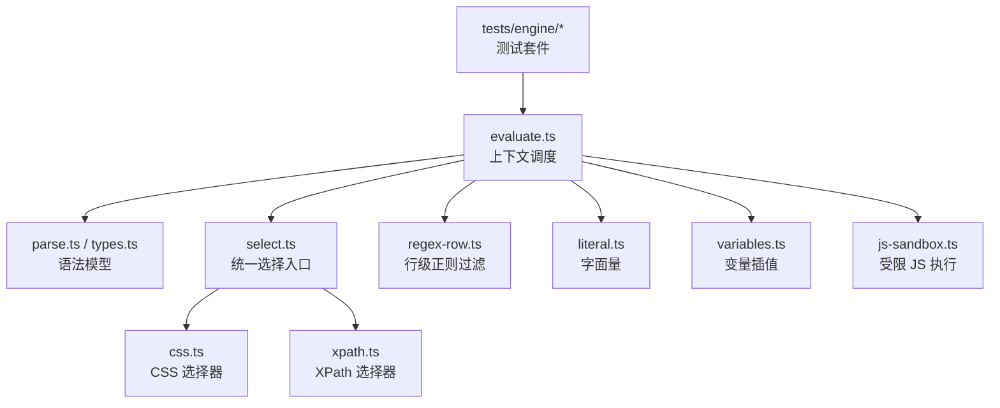
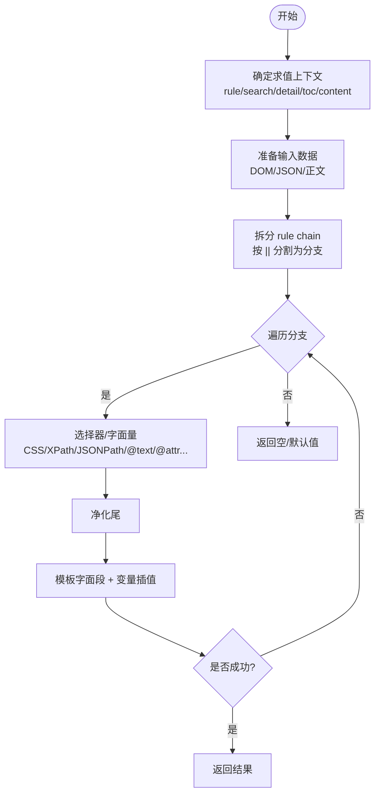
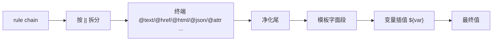
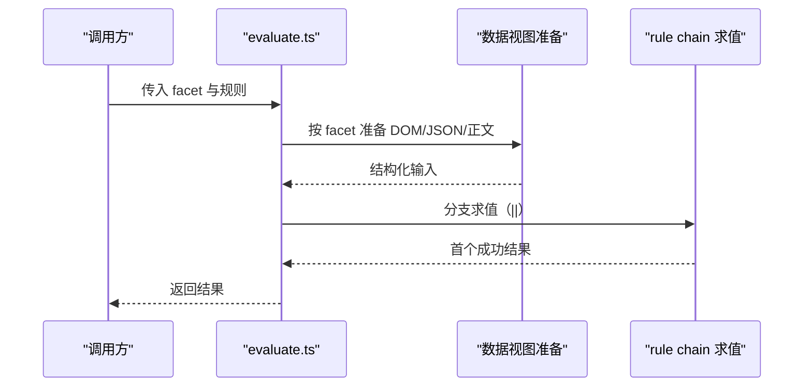
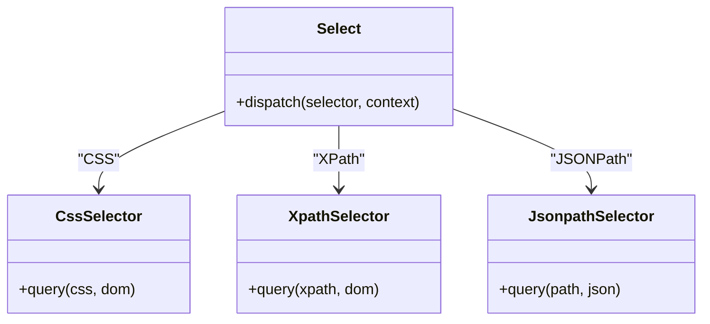
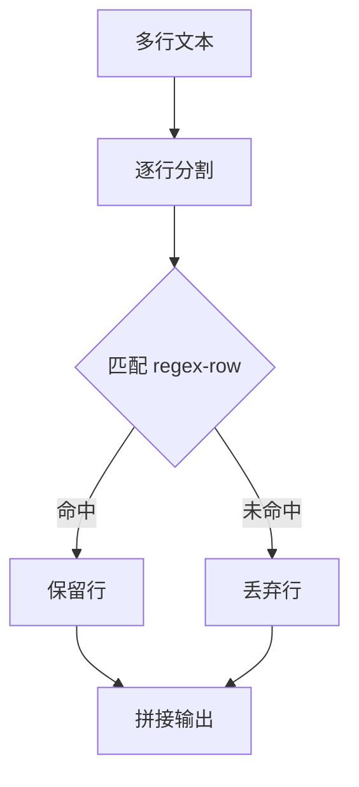
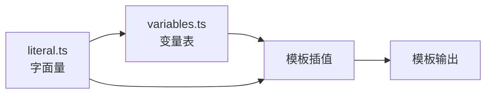
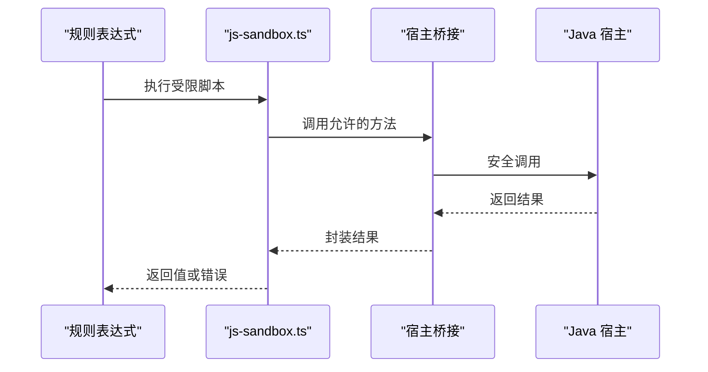
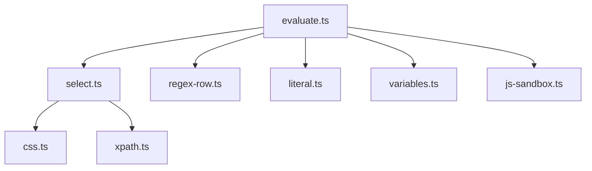

# 规则引擎与书源语法

<cite>
**本文引用的文件**   
- [src/src/engine/evaluate.ts](file://src/src/engine/evaluate.ts)
- [src/src/engine/types.ts](file://src/src/engine/types.ts)
- [src/src/engine/js-sandbox.ts](file://src/src/engine/js-sandbox.ts)
- [src/src/engine/select.ts](file://src/src/engine/select.ts)
- [src/src/engine/css.ts](file://src/src/engine/css.ts)
- [src/src/engine/xpath.ts](file://src/src/engine/xpath.ts)
- [src/src/engine/literal.ts](file://src/src/engine/literal.ts)
- [src/src/engine/variables.ts](file://src/src/engine/variables.ts)
- [src/src/engine/regex-row.ts](file://src/src/engine/regex-row.ts)
- [tests/engine/grammar.test.ts](file://tests/engine/grammar.test.ts)
- [tests/engine/value-terminal.test.ts](file://tests/engine/value-terminal.test.ts)
- [tests/engine/template.test.ts](file://tests/engine/template.test.ts)
- [tests/engine/regex-row.test.ts](file://tests/engine/regex-row.test.ts)
- [tests/engine/jsonpath.test.ts](file://tests/engine/jsonpath.test.ts)
- [tests/engine/css.test.ts](file://tests/engine/css.test.ts)
- [tests/engine/xpath.test.ts](file://tests/engine/xpath.test.ts)
- [tests/engine/js-sandbox.test.ts](file://tests/engine/js-sandbox.test.ts)
- [tests/engine/js-bindings.test.ts](file://tests/engine/js-bindings.test.ts)
- [tests/engine/content-facet.test.ts](file://tests/engine/content-facet.test.ts)
- [tests/engine/parse.test.ts](file://tests/engine/parse.test.ts)
</cite>

## 目录
1. [引言](#引言)
2. [项目结构](#项目结构)
3. [核心组件](#核心组件)
4. [架构总览](#架构总览)
5. [详细组件分析](#详细组件分析)
6. [依赖关系分析](#依赖关系分析)
7. [性能注意事项](#性能注意事项)
8. [故障诊断指南](#故障诊断指南)
9. [结论](#结论)
10. [附录：扩展指南](#附录扩展指南)

## 引言
本文面向 dsh-novel 的规则引擎与 legacy 书源语法，目标是建立一份权威参考文档。我们从文法入手，说明取值链（rule chain）的结构、五种求值上下文（facet）、选择器支持范围、正则行匹配、字面量与变量表，以及 JS 沙箱的安全边界与调试输出。文中所有实现细节均对应到 engine 源码与 tests/engine 中的真实用例，以便读者既能快速上手，又能深入定位问题。

## 项目结构
规则引擎位于 `src/src/engine` 中，围绕“解析—求值—选择—净化—模板—变量—JS 沙箱”这条管线组织代码；测试集中在 `tests/engine`，覆盖语法、终端、模板、选择器、JSONPath、JS 沙箱与绑定等维度。

**图示来源**
- [src/src/engine/evaluate.ts](file://src/src/engine/evaluate.ts)
- [src/src/engine/select.ts](file://src/src/engine/select.ts)
- [src/src/engine/css.ts](file://src/src/engine/css.ts)
- [src/src/engine/xpath.ts](file://src/src/engine/xpath.ts)
- [src/src/engine/regex-row.ts](file://src/src/engine/regex-row.ts)
- [src/src/engine/literal.ts](file://src/src/engine/literal.ts)
- [src/src/engine/variables.ts](file://src/src/engine/variables.ts)
- [src/src/engine/js-sandbox.ts](file://src/src/engine/js-sandbox.ts)

**章节来源**
- [src/src/engine/evaluate.ts](file://src/src/engine/evaluate.ts)
- [src/src/engine/types.ts](file://src/src/engine/types.ts)

## 核心组件
- 取值链（rule chain）：由多个分支通过 `||` 连接，每个分支可包含一个或多个终端（如 `@text`、`@href`、`@html`、`@json`、`@attr`），并可选择性地附加净化尾与模板片段。
- 终端（terminal）：决定如何从当前 DOM/JSON 节点上提取原始值。
- 净化尾（sanitizer tail）：对终端产出进行清洗，例如去除 HTML 标签、空白归一化等。
- 模板字面段与变量插值：在规则字符串中嵌入字面文本与 `${var}` 形式的变量。
- 选择器子系统：CSS/XPath/JSONPath 三类选择器由统一入口分派。
- 正则行匹配：用于按行过滤文本内容。
- 字面量与变量表：提供常量与运行时变量。
- JS 沙箱：受控执行环境，桥接 Java 宿主方法，限制危险 API，支持调试输出。

**章节来源**
- [src/src/engine/evaluate.ts](file://src/src/engine/evaluate.ts)
- [src/src/engine/types.ts](file://src/src/engine/types.ts)

## 架构总览
规则引擎的求值流程可以概括为：根据 facet 准备数据视图，将 rule chain 拆分为分支集合，逐个分支尝试求值；每个分支先执行选择器或字面量，再经净化尾与模板处理，最后返回第一个成功的结果。JS 表达式可在任意阶段作为终端或净化器被调用，但运行于受限沙箱内。

**图示来源**
- [src/src/engine/evaluate.ts](file://src/src/engine/evaluate.ts)
- [src/src/engine/select.ts](file://src/src/engine/select.ts)
- [src/src/engine/css.ts](file://src/src/engine/css.ts)
- [src/src/engine/xpath.ts](file://src/src/engine/xpath.ts)
- [src/src/engine/literal.ts](file://src/src/engine/literal.ts)
- [src/src/engine/variables.ts](file://src/src/engine/variables.ts)

## 详细组件分析

### 取值链与文法
- 分支组合：`||` 表示“尝试下一个分支”，即短路或式语义。
- 终端：常见终端包括文本、链接、HTML、JSON、属性等；不同终端对输入数据结构有不同的要求。
- 净化尾：可选，作用于终端输出的中间结果，用于清理多余标记、空格、换行等。
- 模板字面段：规则字符串允许嵌入普通字面文本，配合变量插值形成最终输出。
- 变量插值：`${name}` 形式，变量来自 variables 表或上下文注入。

**图示来源**
- [src/src/engine/evaluate.ts](file://src/src/engine/evaluate.ts)
- [src/src/engine/types.ts](file://src/src/engine/types.ts)

**章节来源**
- [tests/engine/grammar.test.ts](file://tests/engine/grammar.test.ts)
- [tests/engine/value-terminal.test.ts](file://tests/engine/value-terminal.test.ts)
- [tests/engine/template.test.ts](file://tests/engine/template.test.ts)

### 五种求值上下文（facet）
- rule：通用取值上下文，常用于元信息抽取。
- search：搜索列表页的数据视图。
- detail：书籍详情页的数据视图。
- toc：目录页的数据视图。
- content：章节正文的数据视图。

evaluate.ts 根据 facet 选择不同的输入源与预处理逻辑，例如 content 侧重正文清洗与段落切分，search/detail/toc 更关注列表项与分页字段，而 rule 则是最通用的取值入口。

**图示来源**
- [src/src/engine/evaluate.ts](file://src/src/engine/evaluate.ts)
- [tests/engine/content-facet.test.ts](file://tests/engine/content-facet.test.ts)

**章节来源**
- [src/src/engine/evaluate.ts](file://src/src/engine/evaluate.ts)
- [tests/engine/content-facet.test.ts](file://tests/engine/content-facet.test.ts)

### 选择器子系统：CSS/XPath/JSONPath
- CSS 选择器：基于 DOM 的类 CSS 查询，适合大多数站点结构。
- XPath：提供更强的路径表达能力，适合复杂 DOM 树或特殊布局。
- JSONPath：针对 JSON 数据结构的查询，常用于接口响应或 JSON 型书源。

统一入口 select.ts 负责识别选择器类型并路由到 css.ts、xpath.ts 或 JSONPath 实现。各选择器的支持范围与限制体现在其各自实现与测试中。

**图示来源**
- [src/src/engine/select.ts](file://src/src/engine/select.ts)
- [src/src/engine/css.ts](file://src/src/engine/css.ts)
- [src/src/engine/xpath.ts](file://src/src/engine/xpath.ts)

**章节来源**
- [src/src/engine/select.ts](file://src/src/engine/select.ts)
- [src/src/engine/css.ts](file://src/src/engine/css.ts)
- [src/src/engine/xpath.ts](file://src/src/engine/xpath.ts)
- [tests/engine/css.test.ts](file://tests/engine/css.test.ts)
- [tests/engine/xpath.test.ts](file://tests/engine/xpath.test.ts)
- [tests/engine/jsonpath.test.ts](file://tests/engine/jsonpath.test.ts)

### 正则行匹配（regex-row）
regex-row.ts 实现对多行文本的行级过滤与匹配，常用于从大段正文中提取目标行或清洗噪声行。它通常与终端和净化尾配合使用，提高规则鲁棒性。

**图示来源**
- [src/src/engine/regex-row.ts](file://src/src/engine/regex-row.ts)

**章节来源**
- [src/src/engine/regex-row.ts](file://src/src/engine/regex-row.ts)
- [tests/engine/regex-row.test.ts](file://tests/engine/regex-row.test.ts)

### 字面量与变量表
- literal.ts：提供常量字面量与基础类型解析。
- variables.ts：维护变量表，支持运行时注入与插值。

变量插值在模板阶段发生，可将静态字面量与动态变量组合成最终字符串。

**图示来源**
- [src/src/engine/literal.ts](file://src/src/engine/literal.ts)
- [src/src/engine/variables.ts](file://src/src/engine/variables.ts)

**章节来源**
- [src/src/engine/literal.ts](file://src/src/engine/literal.ts)
- [src/src/engine/variables.ts](file://src/src/engine/variables.ts)
- [tests/engine/variables.test.ts](file://tests/engine/variables.test.ts)

### JS 沙箱与安全边界
js-sandbox.ts 提供受限执行环境，关键安全特性包括：
- 禁用或隔离危险全局对象与网络能力。
- 仅暴露必要的方法与宿主桥接函数。
- 限制内存与执行时间（具体策略见实现）。
- 支持调试输出，便于定位脚本行为。

Java 宿主方法通过协议层桥接到 JS 沙箱，使规则可以在安全边界内访问平台能力。

**图示来源**
- [src/src/engine/js-sandbox.ts](file://src/src/engine/js-sandbox.ts)

**章节来源**
- [src/src/engine/js-sandbox.ts](file://src/src/engine/js-sandbox.ts)
- [tests/engine/js-sandbox.test.ts](file://tests/engine/js-sandbox.test.ts)
- [tests/engine/js-bindings.test.ts](file://tests/engine/js-bindings.test.ts)

## 依赖关系分析
engine 内部模块呈现清晰的分层：evaluate.ts 作为调度中心，依赖选择器、正则、字面量、变量与 JS 沙箱；选择器模块再分别依赖 css.ts 与 xpath.ts。测试套件覆盖各子模块的行为契约，有助于理解依赖边界。

**图示来源**
- [src/src/engine/evaluate.ts](file://src/src/engine/evaluate.ts)
- [src/src/engine/select.ts](file://src/src/engine/select.ts)
- [src/src/engine/css.ts](file://src/src/engine/css.ts)
- [src/src/engine/xpath.ts](file://src/src/engine/xpath.ts)
- [src/src/engine/regex-row.ts](file://src/src/engine/regex-row.ts)
- [src/src/engine/literal.ts](file://src/src/engine/literal.ts)
- [src/src/engine/variables.ts](file://src/src/engine/variables.ts)
- [src/src/engine/js-sandbox.ts](file://src/src/engine/js-sandbox.ts)

**章节来源**
- [src/src/engine/evaluate.ts](file://src/src/engine/evaluate.ts)
- [src/src/engine/select.ts](file://src/src/engine/select.ts)

## 性能注意事项
- 分支短路：利用 `||` 将高概率匹配的分支前置，减少无效计算。
- 选择器优化：优先使用 CSS 选择器；仅在必要时使用 XPath，避免复杂路径带来的开销。
- 正则行匹配：regex-row 应尽可能精确，避免全量扫描大文本。
- 模板与变量：减少不必要的插值与字符串拼接，复用稳定字面量。
- JS 沙箱：谨慎使用耗时操作；避免循环与深度递归；优先使用宿主桥接的高效方法。

[本节为通用指导，不直接分析具体文件]

## 故障诊断指南
- 语法错误：优先检查 rule chain 的 `||` 分隔与终端写法是否正确。
- 选择器无结果：确认 facet 对应的数据视图是否与选择器期望一致；对比 tests/engine 中同类场景的用例。
- 净化后为空：检查净化尾是否过于严格，或终端产出的结构与净化器预期不符。
- 变量未解析：检查 variables 表是否注入，以及插值语法是否符合 `${name}`。
- JS 沙箱报错：查看受限 API 使用是否越界；确认宿主桥接方法名称与参数签名。
- 正则行匹配异常：逐步缩小 regex-row 模式，确认行分割与匹配条件。

**章节来源**
- [tests/engine/parse.test.ts](file://tests/engine/parse.test.ts)
- [tests/engine/css.test.ts](file://tests/engine/css.test.ts)
- [tests/engine/xpath.test.ts](file://tests/engine/xpath.test.ts)
- [tests/engine/jsonpath.test.ts](file://tests/engine/jsonpath.test.ts)
- [tests/engine/regex-row.test.ts](file://tests/engine/regex-row.test.ts)
- [tests/engine/js-sandbox.test.ts](file://tests/engine/js-sandbox.test.ts)

## 结论
dsh-novel 的规则引擎以 evaluate.ts 为中心，围绕取值链、终端、净化尾、模板与变量构建灵活的 legacy 书源语法；选择器子系统同时支持 CSS/XPath/JSONPath，满足多样化数据源；JS 沙箱在安全边界内提供扩展能力。借助 tests/engine 的真实用例，开发者可以快速验证语法、定位问题，并按需扩展新的终端或净化器。

[本节为总结性内容，不直接分析具体文件]

## 附录：扩展指南

### 新增终端
步骤概览：
1. 在类型定义中声明新终端结构（types.ts）。
2. 在 evaluate.ts 中注册该终端的求值逻辑。
3. 在 select.ts 或相应选择器模块中接入数据源（如需）。
4. 编写 tests/engine 用例覆盖正常路径与错误路径。

提示：
- 终端应明确输入结构（DOM/JSON/正文）。
- 对异常输入返回明确的错误信息，便于上层诊断。
- 若涉及选择器，保持与现有 CSS/XPath/JSONPath 的一致性。

**章节来源**
- [src/src/engine/types.ts](file://src/src/engine/types.ts)
- [src/src/engine/evaluate.ts](file://src/src/engine/evaluate.ts)
- [src/src/engine/select.ts](file://src/src/engine/select.ts)
- [tests/engine/value-terminal.test.ts](file://tests/engine/value-terminal.test.ts)

### 新增净化器
步骤概略：
1. 在评估管线中插入净化阶段（evaluate.ts）。
2. 实现净化逻辑，确保对常见脏数据有容错处理。
3. 在模板阶段之前执行，保证后续插值与渲染的稳定。
4. 添加测试用例，覆盖典型输入与边界情况。

提示：
- 净化器应保持幂等与轻量，避免重复清洗。
- 对 HTML 净化需考虑转义与实体处理。
- 对文本净化需处理空白、换行、不可见字符。

**章节来源**
- [src/src/engine/evaluate.ts](file://src/src/engine/evaluate.ts)
- [tests/engine/template.test.ts](file://tests/engine/template.test.ts)

### 常见问题速查
- 为什么 `||` 分支没有短路？检查各分支是否都抛出错误或返回空。
- 为什么变量插值失败？检查变量名拼写与注入时机。
- 为什么 CSS 选择器失效？确认 facet 提供的 DOM 结构是否符合预期。
- 为什么 JSONPath 无法取值？检查 JSON 结构与路径语法。
- 为什么 JS 脚本无法访问某 API？确认是否在白名单或宿主桥接范围内。

**章节来源**
- [tests/engine/grammar.test.ts](file://tests/engine/grammar.test.ts)
- [tests/engine/variables.test.ts](file://tests/engine/variables.test.ts)
- [tests/engine/css.test.ts](file://tests/engine/css.test.ts)
- [tests/engine/jsonpath.test.ts](file://tests/engine/jsonpath.test.ts)
- [tests/engine/js-sandbox.test.ts](file://tests/engine/js-sandbox.test.ts)