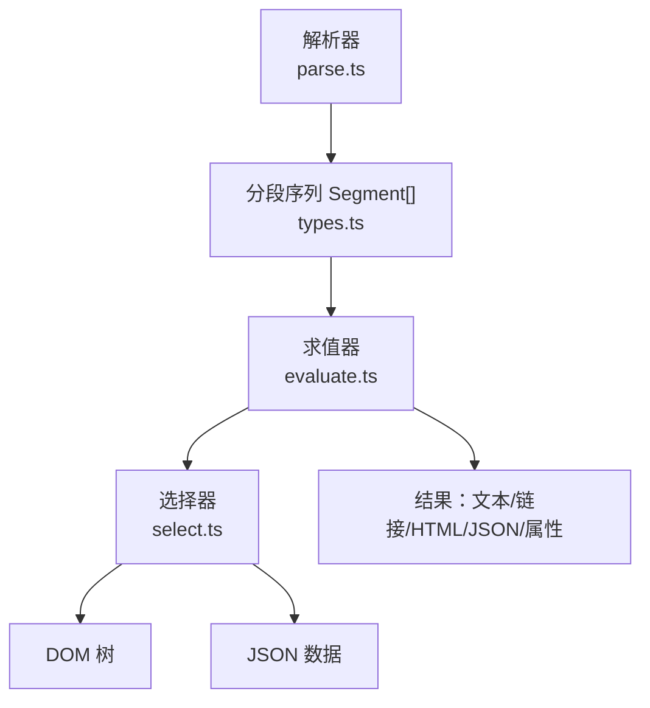
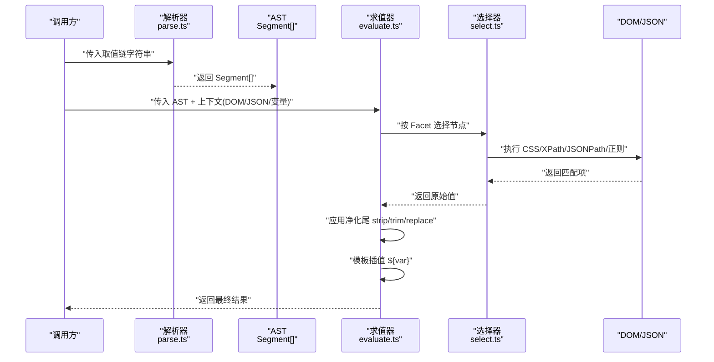
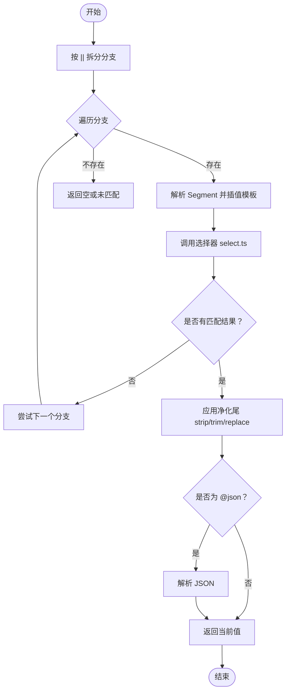
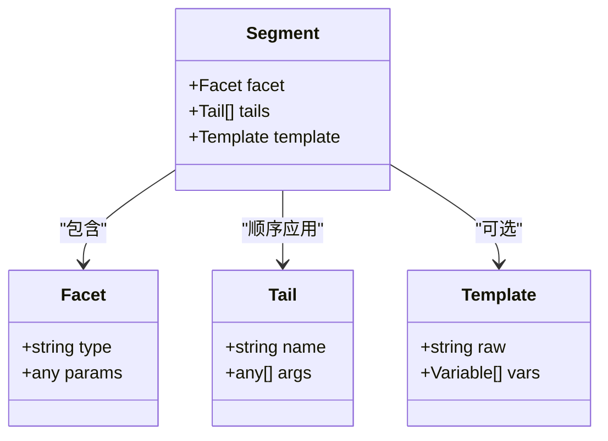
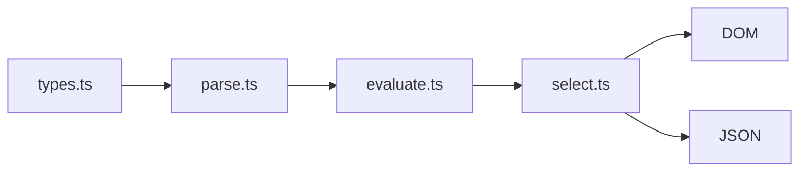

# 规则文法与取值链

<cite>
**本文引用的文件**   
- [src/src/engine/parse.ts](file://src/src/engine/parse.ts)
- [src/src/engine/select.ts](file://src/src/engine/select.ts)
- [src/src/engine/evaluate.ts](file://src/src/engine/evaluate.ts)
- [src/src/engine/types.ts](file://src/src/engine/types.ts)
- [tests/tests/engine/grammar.test.ts](file://tests/tests/engine/grammar.test.ts)
- [tests/tests/engine/parse.test.ts](file://tests/tests/engine/parse.test.ts)
- [tests/tests/engine/value-terminal.test.ts](file://tests/tests/engine/value-terminal.test.ts)
- [tests/tests/engine/template.test.ts](file://tests/tests/engine/template.test.ts)
</cite>

## 目录
1. [引言](#引言)
2. [项目结构](#项目结构)
3. [核心组件](#核心组件)
4. [架构总览](#架构总览)
5. [详细组件分析](#详细组件分析)
6. [依赖关系分析](#依赖关系分析)
7. [性能考量](#性能考量)
8. [故障排查指南](#故障排查指南)
9. [结论](#结论)

## 引言
本文聚焦“取值链”这一核心能力：它允许用紧凑字符串描述从网页或数据源中抽取值的过程，包括分支短路、终端节点选择、净化处理、模板插值和变量循环。解析阶段将字符串转为分段数组；执行阶段按 facet 调度 DOM、JSON、正则等选择器；最终输出文本、链接、HTML、JSON 或属性值。文档同时说明如何接入自定义净化器，以及解析错误、未匹配分支和循环变量的处理策略。

## 项目结构
取值链相关代码集中在引擎层：

**图示来源**
- [src/src/engine/parse.ts:1-200](file://src/src/engine/parse.ts#L1-L200)
- [src/src/engine/types.ts:1-120](file://src/src/engine/types.ts#L1-L120)
- [src/src/engine/evaluate.ts:1-200](file://src/src/engine/evaluate.ts#L1-L200)
- [src/src/engine/select.ts:1-200](file://src/src/engine/select.ts#L1-L200)

**章节来源**
- [src/src/engine/parse.ts:1-200](file://src/src/engine/parse.ts#L1-L200)
- [src/src/engine/types.ts:1-120](file://src/src/engine/types.ts#L1-L120)
- [src/src/engine/evaluate.ts:1-200](file://src/src/engine/evaluate.ts#L1-L200)
- [src/src/engine/select.ts:1-200](file://src/src/engine/select.ts#L1-L200)

## 核心组件
- 解析器 parse.ts：将取值链字符串解析为 Segment[]，识别 `||` 分支、`@text/@href/@html/@json/@attr/@match` 等终端、净化尾（strip/trim/replace）、模板字面段 `${var}` 和变量插值。
- 类型定义 types.ts：定义 Segment、Facet、Tail 等抽象语法节点。
- 选择器 select.ts：根据 Facet 类型对 DOM 节点或 JSON 数据执行 CSS/XPath/JSONPath/正则等选择。
- 求值器 evaluate.ts：按 Facet 分发到对应处理器，串联净化尾，支持模板插值与循环变量。

**章节来源**
- [src/src/engine/parse.ts:1-200](file://src/src/engine/parse.ts#L1-L200)
- [src/src/engine/types.ts:1-120](file://src/src/engine/types.ts#L1-L120)
- [src/src/engine/select.ts:1-200](file://src/src/engine/select.ts#L1-L200)
- [src/src/engine/evaluate.ts:1-200](file://src/src/engine/evaluate.ts#L1-L200)

## 架构总览
取值链的完整生命周期如下：

**图示来源**
- [src/src/engine/parse.ts:1-200](file://src/src/engine/parse.ts#L1-L200)
- [src/src/engine/evaluate.ts:1-200](file://src/src/engine/evaluate.ts#L1-L200)
- [src/src/engine/select.ts:1-200](file://src/src/engine/select.ts#L1-L200)

## 详细组件分析

### 取值链文法规则
取值链由若干片段组成，核心语素如下：

- 分支短路：以 `||` 分隔多个候选表达式，从左到右求值，一旦某分支产生有效结果就短路，不再继续后续分支。
- 终端节点：每个分支以 Facet 结尾，常见类型包括：
  - `@text`：取文本
  - `@href`：取链接
  - `@html`：取 HTML
  - `@json`：取 JSON
  - `@attr`：取属性
  - `@match`：基于正则捕获组提取
- 净化尾：紧跟在 Facet 之后的一组变换，例如：
  - `strip(...)`：去除指定字符集
  - `trim()`：去除首尾空白
  - `replace(旧, 新)`：正则替换
- 模板字面段：`${var}` 形式的字面量占位符，可在模板阶段被变量替换。
- 变量插值：`${...}` 可嵌入表达式或变量名，供循环或外部上下文注入。

解析时，`||` 仅作为分支分隔符，不被视为 Facet；Facet 必须显式写出如 `@text` 等标记。

**章节来源**
- [tests/tests/engine/grammar.test.ts:1-200](file://tests/tests/engine/grammar.test.ts#L1-L200)

### 解析流程：parse.ts 将字符串转为 Segment[]
解析器主要职责：

1. 扫描输入字符串，按 `||` 切分为候选分支。
2. 对每个分支：
   - 识别并拆分 Facet 前缀（`@text`、`@href`、`@html`、`@json`、`@attr`、`@match`）。
   - 解析 Facet 参数（如 `@attr(href)`、`@match(pattern,index)`）。
   - 解析紧随其后的净化尾（`strip(...)`、`trim()`、`replace(...)`），形成 Tail 列表。
   - 解析模板字面段与变量插值，构建模板节点。
3. 返回 Segment[]，每个 Segment 包含：
   - Facet 类型与参数
   - 净化尾列表
   - 模板信息（是否含 `${...}`）

复杂度分析：
- 单次线性扫描：O(n)，n 为字符串长度。
- 分支数量 m，Facet 与 Tail 解析均为局部常数时间，整体 O(n)。

优化点：
- 避免重复分配子串：使用偏移索引解析。
- 缓存已解析 Facet 映射表，减少字符串比较开销。

错误处理：
- 非法 Facet 名称、括号不匹配、未闭合模板字面段均抛出解析错误，便于早期失败。

**章节来源**
- [src/src/engine/parse.ts:1-200](file://src/src/engine/parse.ts#L1-L200)
- [tests/tests/engine/parse.test.ts:1-200](file://tests/tests/engine/parse.test.ts#L1-L200)

### 选择流程：select.ts 选择 DOM/JSON 节点
选择器根据 Facet 类型执行具体查询：

- DOM 选择：
  - CSS 选择器：通过浏览器 API 或兼容库选择元素。
  - XPath：用于复杂层级或轴操作。
- JSON 选择：
  - JSONPath 或对象键路径，读取嵌套字段。
- 正则匹配：
  - `@match` 使用正则捕获组，按索引返回子串。

选择器的关键行为：

- 空匹配：当无匹配项时，返回空集合或 undefined，交由上层按短路策略处理。
- 多匹配：某些 Facet 会聚合为数组，供后续处理。
- 错误传播：无效选择器或非法 JSONPath 立即报错，便于调试。

**章节来源**
- [src/src/engine/select.ts:1-200](file://src/src/engine/select.ts#L1-L200)

### 求值流程：evaluate.ts 按 Facet 调度
求值器负责将 AST 与上下文结合，产出最终值：

1. 遍历 Segment[]，对每个 Segment：
   - 若 Facet 有前置模板，先进行变量插值。
   - 调用 select.ts 获取原始值。
   - 依次应用净化尾：strip → trim → replace。
   - 若 Facet 是 `@json`，尝试解析为 JSON 对象或数组。
2. 分支短路：
   - 按 `||` 顺序评估，首个成功分支即返回，忽略后续分支。
3. 模板插值：
   - 支持 `${var}` 与 `${expr}`，变量来自循环上下文或外部注入。
4. 循环变量：
   - 对于列表型数据，支持按条目迭代，生成多条记录。

流程图：

**图示来源**
- [src/src/engine/evaluate.ts:1-200](file://src/src/engine/evaluate.ts#L1-L200)

**章节来源**
- [src/src/engine/evaluate.ts:1-200](file://src/src/engine/evaluate.ts#L1-L200)

### 类图：Segment、Facet、Tail 的关系

**图示来源**
- [src/src/engine/types.ts:1-120](file://src/src/engine/types.ts#L1-L120)

**章节来源**
- [src/src/engine/types.ts:1-120](file://src/src/engine/types.ts#L1-L120)

### 从遗留 JSON 到 AST 的转换示例
假设存在一个遗留 JSON 配置，其中字段用字符串表示取值链。转换步骤：

1. 读取遗留 JSON，定位取值链字符串字段。
2. 调用 parse.ts 将字符串解析为 Segment[]。
3. 将 Segment[] 注入到新的 AST 结构中，保留 Facet、Tail、Template 语义。
4. 校验 AST 合法性（Facet 类型、括号匹配、模板闭合）。
5. 将 AST 存入运行时环境，供 evaluate.ts 执行。

示例场景：
- 遗留 JSON 中的 `"title": "@text(strip())"` 转换为 Segment 列表：
  - Facet: `@text`
  - Tail: `strip()`
- 带分支的 `"link": "@href || @attr(href)"` 转换为两个候选 Segment，按短路求值。

**章节来源**
- [tests/tests/engine/parse.test.ts:1-200](file://tests/tests/engine/parse.test.ts#L1-L200)

### 自定义净化器的接入点
系统提供净化尾扩展机制：

- 扩展点：在 evaluate.ts 的净化尾应用处注册自定义 Tail 处理器。
- 约定：
  - 每个 Tail 由名称与参数列表组成。
  - 自定义处理器接收当前值与参数，返回处理后值。
  - 处理器需幂等且无副作用。
- 接入步骤：
  1. 实现净化函数，符合统一接口。
  2. 在初始化阶段注册到全局处理器表。
  3. 在取值链中使用自定义 Tail，如 `custom(arg)`。
  4. 单元测试覆盖边界情况（空值、异常输入）。

注意事项：
- 保持与内置 strip/trim/replace 一致的错误语义。
- 避免阻塞主线程，必要时异步化。

**章节来源**
- [src/src/engine/evaluate.ts:1-200](file://src/src/engine/evaluate.ts#L1-L200)
- [tests/tests/engine/value-terminal.test.ts:1-200](file://tests/tests/engine/value-terminal.test.ts#L1-L200)

### 解析错误、未匹配分支与循环变量的处理策略
- 解析错误：
  - 非法 Facet、括号不匹配、模板未闭合直接抛错，阻止运行期不确定性。
  - 建议配合测试用例覆盖所有非法输入。
- 未匹配分支：
  - 所有分支均失败时，返回空或未匹配状态，由上层决定默认值或降级策略。
  - 短路求值确保性能与确定性。
- 循环变量：
  - 对列表型数据，逐条注入循环变量，重复执行取值链。
  - 若循环体内出现解析错误或选择失败，按单条记录错误隔离，不影响其他记录。
  - 变量作用域限定在当前循环迭代，避免污染外层上下文。

**章节来源**
- [tests/tests/engine/grammar.test.ts:1-200](file://tests/tests/engine/grammar.test.ts#L1-L200)
- [tests/tests/engine/template.test.ts:1-200](file://tests/tests/engine/template.test.ts#L1-L200)

## 依赖关系分析
模块间依赖清晰，单向流动：

- types.ts 提供公共类型，被 parse.ts 与 evaluate.ts 引用。
- parse.ts 仅依赖 types.ts，不耦合选择器实现。
- evaluate.ts 依赖 select.ts 执行具体查询。
- select.ts 对外暴露选择接口，内部可复用 DOM/JSON/正则工具。

**图示来源**
- [src/src/engine/types.ts:1-120](file://src/src/engine/types.ts#L1-L120)
- [src/src/engine/parse.ts:1-200](file://src/src/engine/parse.ts#L1-L200)
- [src/src/engine/evaluate.ts:1-200](file://src/src/engine/evaluate.ts#L1-L200)
- [src/src/engine/select.ts:1-200](file://src/src/engine/select.ts#L1-L200)

**章节来源**
- [src/src/engine/types.ts:1-120](file://src/src/engine/types.ts#L1-L120)
- [src/src/engine/parse.ts:1-200](file://src/src/engine/parse.ts#L1-L200)
- [src/src/engine/evaluate.ts:1-200](file://src/src/engine/evaluate.ts#L1-L200)
- [src/src/engine/select.ts:1-200](file://src/src/engine/select.ts#L1-L200)

## 性能考量
- 解析阶段：
  - 线性扫描，适合长字符串与批量解析。
  - 避免重复分配，使用索引与视图。
- 选择阶段：
  - CSS 选择器优先，XPath 仅在必要时使用。
  - JSONPath 针对结构化数据，避免全量遍历。
- 求值阶段：
  - 分支短路减少不必要计算。
  - 净化尾尽量原地变换，减少中间对象。
- 缓存：
  - 对静态 AST 与常用选择器结果可缓存。
  - 模板插值结果可按变量组合缓存。

[本节为通用指导，不直接分析具体文件]

## 故障排查指南
常见问题与定位方式：

- 解析失败：
  - 检查 Facet 名称拼写、括号配对、模板字面段闭合。
  - 参考 tests/tests/engine/parse.test.ts 中的断言样例。
- 选择结果为空：
  - 确认选择器在目标 DOM/JSON 上有效。
  - 使用最小复现用例验证 CSS/XPath/JSONPath。
- 净化尾无效：
  - 检查参数格式与顺序。
  - 自定义 Tail 需注册并在 evaluate.ts 中生效。
- 模板未插值：
  - 确认变量在上下文中存在且作用域正确。
  - 检查 `${var}` 与 `${expr}` 的使用差异。
- 循环变量污染：
  - 确保循环体不修改外层变量。
  - 使用隔离作用域或副本。

**章节来源**
- [tests/tests/engine/parse.test.ts:1-200](file://tests/tests/engine/parse.test.ts#L1-L200)
- [tests/tests/engine/value-terminal.test.ts:1-200](file://tests/tests/engine/value-terminal.test.ts#L1-L200)
- [tests/tests/engine/template.test.ts:1-200](file://tests/tests/engine/template.test.ts#L1-L200)

## 结论
取值链通过解析、选择、求值三阶段，将简洁字符串转化为稳定可靠的抽取逻辑。`||` 短路提升鲁棒性，Facet 与 Tail 组合提供丰富表达能力，模板与变量支持动态化。遵循本文文法与接入规范，可安全扩展净化器并适配不同数据源。

[本节为总结，不直接分析具体文件]