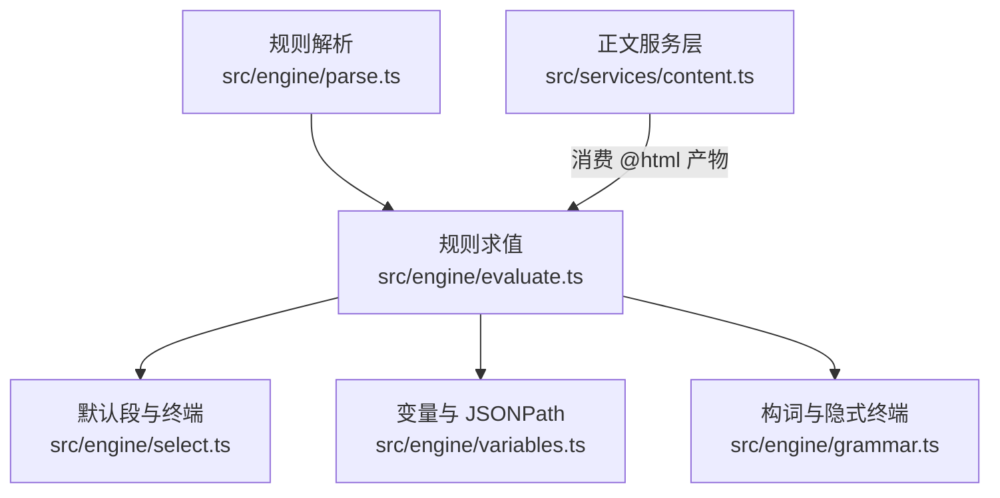
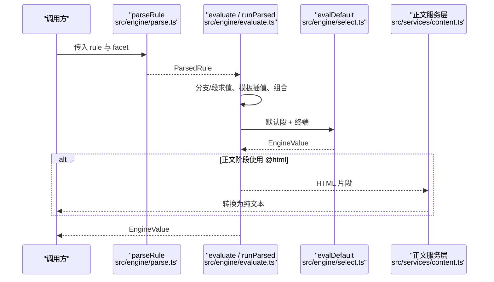
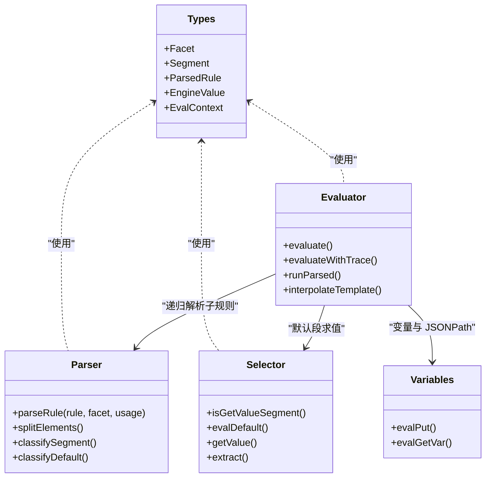
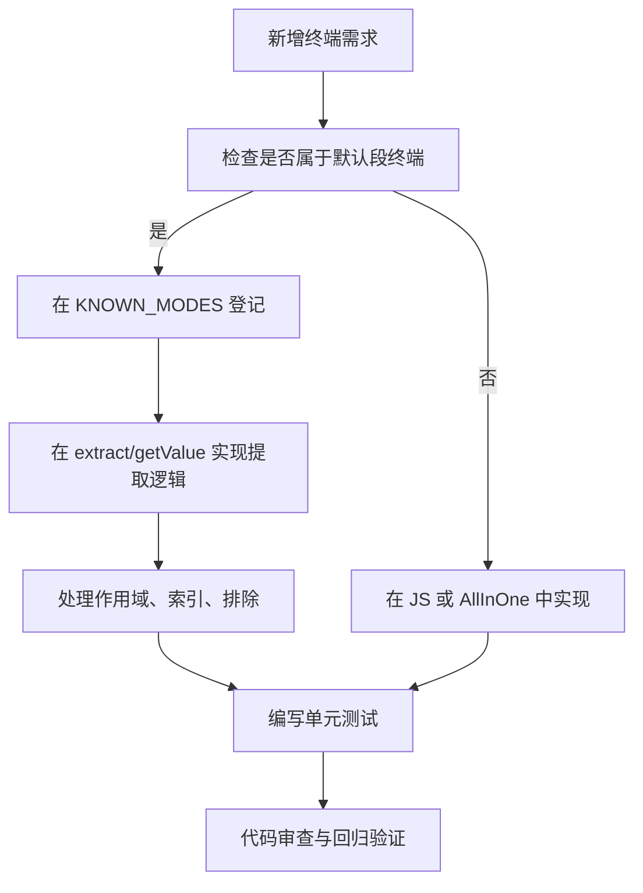

# 面（facet）与终端

<cite>
**本文引用的文件**   
- [types.ts](file://src/engine/types.ts)
- [parse.ts](file://src/engine/parse.ts)
- [select.ts](file://src/engine/select.ts)
- [evaluate.ts](file://src/engine/evaluate.ts)
- [grammar.ts](file://src/engine/grammar.ts)
- [variables.ts](file://src/engine/variables.ts)
- [content.ts](file://src/services/content.ts)
</cite>

## 目录
1. [引言](#引言)
2. [项目结构](#项目结构)
3. [核心组件](#核心组件)
4. [架构总览](#架构总览)
5. [五种面详解](#五种面详解)
6. [终端与上下文变量](#终端与上下文变量)
7. [依赖关系分析](#依赖关系分析)
8. [性能考虑](#性能考虑)
9. [常见问题与陷阱](#常见问题与陷阱)
10. [扩展新终端的实现步骤](#扩展新终端的实现步骤)
11. [结论](#结论)

## 引言
本仓库的规则引擎围绕“面（facet）+ 段（segment）+ 终端”的模型组织：  
- **面**决定规则在哪个业务阶段解析与求值，并影响链尾未知词、选择器作用域与模板变量。  
- **段**是规则链中的原子操作，包括 CSS/XPath/JSONPath/AllInOne/JS/字面模板等。  
- **终端**是取值型段的最终提取方式，例如 `@text`、`@href`、`@html`、`@json`、`@attr` 等。

本文重点说明五种面——rule、search、detail、toc、content——以及它们如何影响选择器作用域、模板变量和返回值类型；同时解释各终端的行为差异、典型用法模式，并给出扩展新终端的步骤与常见陷阱。

**章节来源**  
- [types.ts:1-122](file://src/engine/types.ts#L1-L122)

## 项目结构
与面与终端直接相关的代码集中在 engine 层与服务层内容收口处：
- `src/engine/types.ts`：定义 Facet、Segment、ParsedRule、EngineValue 等核心类型。
- `src/engine/parse.ts`：规则解析、段识别、默认段白名单、隐式 CSS 回落、属性终端判定。
- `src/engine/select.ts`：默认段选择与取值逻辑，包含所有内置终端实现。
- `src/engine/evaluate.ts`：规则求值入口、运行时、链语义、模板插值、JSONPath 求值、非 JS 段分派。
- `src/engine/grammar.ts`：构词辅助，包括隐式 `@text` 补全。
- `src/engine/variables.ts`：变量与 JSONPath 数据源，含 `@json:` 前缀语义。
- `src/services/content.ts`：正文服务层对 `@html` 产物到纯文本的转换。

**图表来源**  
- [parse.ts:1-200](file://src/engine/parse.ts#L1-L200)
- [evaluate.ts:1-200](file://src/engine/evaluate.ts#L1-L200)
- [select.ts:1-120](file://src/engine/select.ts#L1-L120)
- [variables.ts:30-145](file://src/engine/variables.ts#L30-L145)
- [content.ts:1-20](file://src/services/content.ts#L1-L20)

**章节来源**  
- [parse.ts:1-200](file://src/engine/parse.ts#L1-L200)
- [evaluate.ts:1-200](file://src/engine/evaluate.ts#L1-L200)
- [select.ts:1-120](file://src/engine/select.ts#L1-L120)
- [variables.ts:30-145](file://src/engine/variables.ts#L30-L145)
- [content.ts:1-20](file://src/services/content.ts#L1-L20)

## 核心组件
- **Facet**：取值为 `'search' | 'detail' | 'toc' | 'content' | 'explore' | 'rule'`。  
  - `rule` 是默认面，用于通用取值。  
  - 其他面由服务层调用方传入，主要用于错误定位、行为区分与模板变量注入。
- **Segment**：规则链中的段，包括 default、css、jsonpath、xpath、allinone、js、put、getvar、literal、regexRow。  
- **EngineValue**：取值结果统一为 miss/value/list/nodes/matches 五态。  
- **ParsedRule**：解析后的规则 AST，携带 branches、combinator、reverse、replaces、usage 等元信息。

**章节来源**  
- [types.ts:1-122](file://src/engine/types.ts#L1-L122)

## 架构总览
下图展示从规则字符串到最终 EngineValue 的关键流程，以及 facet 在各阶段的传递路径。

**图表来源**  
- [parse.ts:1-200](file://src/engine/parse.ts#L1-L200)
- [evaluate.ts:1-200](file://src/engine/evaluate.ts#L1-L200)
- [select.ts:1-120](file://src/engine/select.ts#L1-L120)
- [content.ts:1-20](file://src/services/content.ts#L1-L20)

## 五种面详解

### rule：通用取值面
- **用途**：作为默认面，通用取值场景不显式指定时即走 rule。  
- **解析语义**：  
  - 无 `@` 且不含 JS 区域的链体，会按构词逻辑自动补隐式 `@text`。  
  - 链尾未知词在取值用途下会被当作 HTML 属性名处理，从而走 `attr` 终端语义。  
- **选择器作用域**：  
  - 链首未起链时，若段是取值段，则以文档根 `$('*')` 为上下文取值一次。  
  - 若段是选择段，则从全集往下选择。  
- **模板变量**：  
  - 通过 `EvalContext.vars` 提供当前条目级变量。  
  - 若存在 `sourceVar`，则跨门面按 chapter→book→ruleData→source 顺序读取。  
- **返回值类型**：  
  - 单命中 → `{ kind: 'value', text }`。  
  - 多命中 → `{ kind: 'list', items }`。  
  - 零命中或位置失败 → `{ kind: 'miss', detail }`。  
  - DOM 节点集 → `{ kind: 'nodes', nodes }`。  
  - AllInOne 正则行 → `{ kind: 'matches', rows }`。

**章节来源**  
- [types.ts:1-122](file://src/engine/types.ts#L1-L122)  
- [grammar.ts:179-218](file://src/engine/grammar.ts#L179-L218)  
- [parse.ts:484-491](file://src/engine/parse.ts#L484-L491)  
- [evaluate.ts:350-400](file://src/engine/evaluate.ts#L350-L400)

### search：搜索结果面
- **用途**：搜索列表页规则。  
- **作用域影响**：  
  - 搜索面通常把 HTML 作为页面内容，JSONPath 数据源优先来自 `ctx.json`；若缺省且 html 是合法 JSON，则整份 html 被当 JSON 解析。  
  - 裸词终端在 JSON 对象上下文中会退化为属性读取，从而支持如 `url`、`href`、`src` 这类字段直读。  
- **模板变量**：  
  - 搜索面可注入 book 与 chapter 相关变量，但更关键的是规则数据层变量与 source 层变量。  
- **返回值类型**：  
  - 列表规则期望返回 list 或 nodes，供服务层展开为书目条目。  
  - 若详情页嗅探命中，可能跳过列表规则，直接按详情规则解析单条书目。

**章节来源**  
- [evaluate.ts:260-320](file://src/engine/evaluate.ts#L260-L320)  
- [evaluate.ts:420-426](file://src/engine/evaluate.ts#L420-L426)  
- [services/types.ts:1-88](file://src/services/types.ts#L1-L88)

### detail：详情页面
- **用途**：详情页规则，包括书名、作者、封面、简介、分类、字数、最后章节、详情页初始化等。  
- **作用域影响**：  
  - 详情页常以 `@html` 收正文片段，再由服务层转为纯文本。  
  - 详情页初始化规则 `ruleDetailInit` 会把结果替换后续详情规则的求值上下文，使 JSON API 形态可用 `$.data.bookInfo` 这类路径。  
- **模板变量**：  
  - 除 vars 外，还可注入 book、chapter 变量；`sourceVar` 提供源级只读访问。  
- **返回值类型**：  
  - 详情字段规则通常返回 value 或 list；初始化规则返回 JSON 后，后续规则在换根上下文上继续求值。

**章节来源**  
- [services/types.ts:1-88](file://src/services/types.ts#L1-L88)  
- [content.ts:1-20](file://src/services/content.ts#L1-L20)

### toc：目录面
- **用途**：目录列表与章节 URL/名称规则。  
- **作用域影响**：  
  - 目录列表选择器对象方言落位到 `ruleChapterList`；平铺方言缺省时回退到 `ruleBookList`。  
  - 目录面的规则通常返回 nodes 或 list，供服务层构建章节树。  
- **模板变量**：  
  - 与 detail 类似，可按书上下文注入 book/chapter 变量。  
- **返回值类型**：  
  - 期望 list 或 nodes；空目录会进入审计分类中的“目录 0 章”等状态。

**章节来源**  
- [services/types.ts:1-88](file://src/services/types.ts#L1-L88)

### content：正文面
- **用途**：正文取值规则，常见写法是用 `@html` 取元素 HTML 原样。  
- **作用域影响**：  
  - 正文面明确面向 HTML 正文段落，服务层会判断是否像 HTML，若是则用引擎层的 `htmlToText` 转纯文本。  
  - 正文纯文本路径保持幂等：已转文本再调用不会二次转换。  
- **模板变量**：  
  - 正文面注入 chapter 变量，便于正文规则引用章节身份。  
- **返回值类型**：  
  - 对外正文契约是纯文本或结构化文档树；内部规则可能产出 HTML 片段，但最终由服务层收敛为文本。

**章节来源**  
- [content.ts:1-20](file://src/services/content.ts#L1-L20)

## 终端与上下文变量

### 内置终端行为对比
默认段白名单中包含以下终端：
- `text`：全部后代文本，块级边界落成换行。  
- `ownText`：严格直系文本节点合并，排除后代元素内文本。  
- `textAll`：Cheerio 原生 `.text()` 输出，再清理空白。  
- `html`：元素 HTML 片段。  
- `all`：整元素序列化 HTML。  
- `href`：元素自身 href，为空则向下兜底第一个含 href 的后代。  
- `src`：元素自身 src，为空则向下兜底第一个含 src 的后代。  
- `content`：元素自身 content，为空则取第一个 meta 的 content。  
- `textNodes`：全部后代文本节点的文本列表，逐文本节点输出一条。  
- `attr`：取元素自身属性，为空则向下兜底第一个含该属性的后代；空值丢弃并去重。

注意：仓库中并未将 `@match` 列为默认段终端；正则捕获组更多体现在 AllInOne 行模式与模板/替换语义中。`@json` 并非默认段 mode，而是变量与 JSONPath 数据源声明的一部分。

**章节来源**  
- [select.ts:11-17](file://src/engine/select.ts#L11-L17)  
- [select.ts:241-309](file://src/engine/select.ts#L241-L309)  
- [select.ts:342-372](file://src/engine/select.ts#L342-L372)  
- [parse.ts:24-31](file://src/engine/parse.ts#L24-L31)

### 终端取值与返回类型
- 单命中 → `value`。  
- 多命中 → `list`。  
- 零命中或位置越界 → `miss`。  
- `attr`、`href`、`src`、`content` 会对空值丢弃并去重。  
- `textNodes` 总是 list，即使只有一个文本节点也返回 list。  
- `text`、`ownText`、`textAll`、`html`、`all` 在单命中时返回 value，多命中时返回 list。

**章节来源**  
- [select.ts:241-309](file://src/engine/select.ts#L241-L309)

### 上下文变量
- `EvalContext.vars`：本次调用的规则数据或章节层变量。  
- `EvalContext.sourceVar`：源级只读访问器，读序 chapter→book→ruleData→source。  
- `EvalContext.html/json/baseUrl/source`：页面 HTML、JSON 数据、基准地址、源实体。  
- `EvalContext.book/chapter`：书籍与章节身份变量，由服务层在 detail/toc/content 等面注入。  
- `EvalContext.fetch/fetchRaw/fetchPost/fetchHead`：引擎出站口，供脚本发起请求。  
- `EvalContext.jsTimeoutMs/jsLib`：脚本超时与源级全局函数库。  
- `EvalContext.regexRow`：AllInOne 行上下文，只有“按整页正则列出的条目”链路带。

**章节来源**  
- [types.ts:1-122](file://src/engine/types.ts#L1-L122)

### `@json` 与 JSONPath
- `@json:` 不是默认段 mode，而是变量值的数据源声明：`@json:` 后接 JSONPath，对 `ctx.json` 求值。  
- 变量求值时，以 `$.` 或 `@json:` 开头的值走 JSONPath；否则对当前条目取值。  
- JSONPath 段在中链时对 value 逐项解析，对 list 逐项求值并合并集合。

**章节来源**  
- [variables.ts:30-145](file://src/engine/variables.ts#L30-L145)  
- [evaluate.ts:350-400](file://src/engine/evaluate.ts#L350-L400)

### `@match` 的正则捕获组
仓库默认段白名单中没有 `match` 终端。正则捕获组主要出现在：
- AllInOne 行模式：按整页正则列出条目，每行绑定 `$n`。  
- 模板与替换：`{{expr}}`、`{$.path}`、`##` 替换尾、js 段替换。  
- `java.getString*` 等脚本调用中，可通过正则表达式提取捕获组。

因此，若需要“正则捕获组终端”，应理解为基于 AllInOne 或脚本的正则能力，而不是一个名为 `@match` 的默认段终端。

**章节来源**  
- [parse.ts:24-31](file://src/engine/parse.ts#L24-L31)  
- [evaluate.ts:200-280](file://src/engine/evaluate.ts#L200-L280)

## 依赖关系分析

**图表来源**  
- [types.ts:1-122](file://src/engine/types.ts#L1-L122)  
- [parse.ts:1-200](file://src/engine/parse.ts#L1-L200)  
- [evaluate.ts:1-200](file://src/engine/evaluate.ts#L1-L200)  
- [select.ts:1-120](file://src/engine/select.ts#L1-L120)  
- [variables.ts:30-145](file://src/engine/variables.ts#L30-L145)

**章节来源**  
- [types.ts:1-122](file://src/engine/types.ts#L1-L122)  
- [parse.ts:1-200](file://src/engine/parse.ts#L1-L200)  
- [evaluate.ts:1-200](file://src/engine/evaluate.ts#L1-L200)  
- [select.ts:1-120](file://src/engine/select.ts#L1-L120)  
- [variables.ts:30-145](file://src/engine/variables.ts#L30-L145)

## 性能考虑
- **DOM 加载惰性化**：Cheerio 实例在首次需要时才加载 HTML，避免 js-only 或 jsonpath-only 规则承担无用成本。  
- **JSON 解析惰性化**：`jsonData()` 仅解析一次，避免重复解析整页 JSON。  
- **终端去重**：`attr`、`href`、`src`、`content` 对空值丢弃并去重，防止同一条目多个链接导致 URL 拼接异常。  
- **文本清理**：`text`、`ownText`、`textAll` 使用统一清理逻辑，避免多余空白与不可见字符污染结果。  
- **正则回溯风险**：AllInOne 与脚本正则应避免过深回溯，建议先缩小选择范围再正则处理。

**章节来源**  
- [evaluate.ts:120-180](file://src/engine/evaluate.ts#L120-L180)  
- [select.ts:291-309](file://src/engine/select.ts#L291-L309)  
- [select.ts:342-372](file://src/engine/select.ts#L342-L372)

## 常见问题与陷阱

### HTML 转义与正文转换
- 正文规则常用 `@html` 保留标记，但服务层要求正文是纯文本。  
- 引擎层 `@text` 与正文服务层的 HTML→文本转换使用同一套块级边界换行口径。  
- 若直接用 `@html` 而不经过正文服务层转换，可能导致标签原样落入阅读器或导出文件。

**章节来源**  
- [content.ts:1-20](file://src/services/content.ts#L1-L20)  
- [select.ts:342-372](file://src/engine/select.ts#L342-L372)

### JSON 解析失败
- JSONPath 段对 value 进行 JSON 解析；若解析失败，会返回 miss 或按调用方策略报错。  
- 列表模式下，某一项解析失败会跳过该项，但整体仍可能返回部分结果或 miss。  
- 推荐在规则外层先用 `@json:` 或 `$.` 明确数据源，避免把非 JSON 文本误当 JSON 解析。

**章节来源**  
- [evaluate.ts:350-400](file://src/engine/evaluate.ts#L350-L400)  
- [variables.ts:30-145](file://src/engine/variables.ts#L30-L145)

### 正则回溯过深
- AllInOne 与脚本中正则捕获组适合做粗筛后再细取，避免对整个大文档执行复杂正则。  
- 对于长文档，应先通过 CSS/XPath/JSONPath 缩小候选集，再使用正则。  
- 模板替换与 `##` 替换也受正则影响，非法正则会在替换阶段抛出带段定位的错误。

**章节来源**  
- [evaluate.ts:200-280](file://src/engine/evaluate.ts#L200-L280)

### 选择器作用域与链尾未知词
- 取值用途下，链尾未知词被视为属性名，走 `attr` 终端。  
- 列表用途下，链尾未知词仍是选择器，按 CSS 求值。  
- 若写错用途，可能出现“能搜到条目但书目 URL 全空”的问题。

**章节来源**  
- [parse.ts:484-491](file://src/engine/parse.ts#L484-L491)

## 扩展新终端的实现步骤

假设要新增一个终端，例如 `@match`，用于从元素中提取正则捕获组：

1. **确认是否属于默认段终端**  
   - 若需要作为默认段 mode，需在 `KNOWN_MODES` 中加入新名称。  
   - 若不需要默认段支持，可在 JS 段或 AllInOne 中自行实现。

2. **在解析期登记模式**  
   - 修改 `parse.ts` 中的 `KNOWN_MODES`，使新终端能被识别为 default 段。  
   - 若新终端有参数（例如捕获组编号），需配合 `splitIndexSuffix` 或额外解析逻辑。

3. **在求值期实现提取逻辑**  
   - 在 `select.ts` 的 `extract` 或 `getValue` 中增加对应分支。  
   - 明确返回值：单命中返回 value，多命中返回 list，零命中返回 miss。  
   - 若需要去重或空值丢弃，参考 `href`/`src`/`attr` 的实现。

4. **处理选择器作用域与索引**  
   - 复用 `reducePicked` 的 exclude/index 逻辑，确保 `!` 排除与 `[a:b]` 区间行为一致。  
   - 若新终端是取值段，需更新 `isGetValueSegment`，使链首未起链时能以文档根为上下文。

5. **测试与回归**  
   - 覆盖单命中、多命中、零命中、空值、去重、索引越界、exclude 等用例。  
   - 验证与现有终端交互：例如 `selector@newTerm[index]`、`selector@newTerm!0`。  
   - 验证模板与替换：`{{result}}`、`##` 替换是否按预期工作。

**图表来源**  
- [parse.ts:24-31](file://src/engine/parse.ts#L24-L31)  
- [select.ts:11-17](file://src/engine/select.ts#L11-L17)  
- [select.ts:241-309](file://src/engine/select.ts#L241-L309)

**章节来源**  
- [parse.ts:24-31](file://src/engine/parse.ts#L24-L31)  
- [select.ts:11-17](file://src/engine/select.ts#L11-L17)  
- [select.ts:241-309](file://src/engine/select.ts#L241-L309)

## 结论
- 五种面 rule、search、detail、toc、content 分别对应通用取值、搜索结果、详情页、目录、正文等业务阶段，影响解析用途、选择器作用域与模板变量注入。  
- 终端行为集中在默认段白名单与 `select.ts` 的取值逻辑中；`@text`、`@href`、`@html`、`@attr` 是核心终端，`@json` 是 JSONPath 数据源声明，`@match` 并非默认段终端。  
- 扩展新终端需同时维护解析期登记与求值期提取逻辑，并复用索引、排除、去重等统一机制。  
- 常见陷阱包括 HTML 转义、JSON 解析失败、正则回溯过深、链尾未知词语义与用途不匹配。