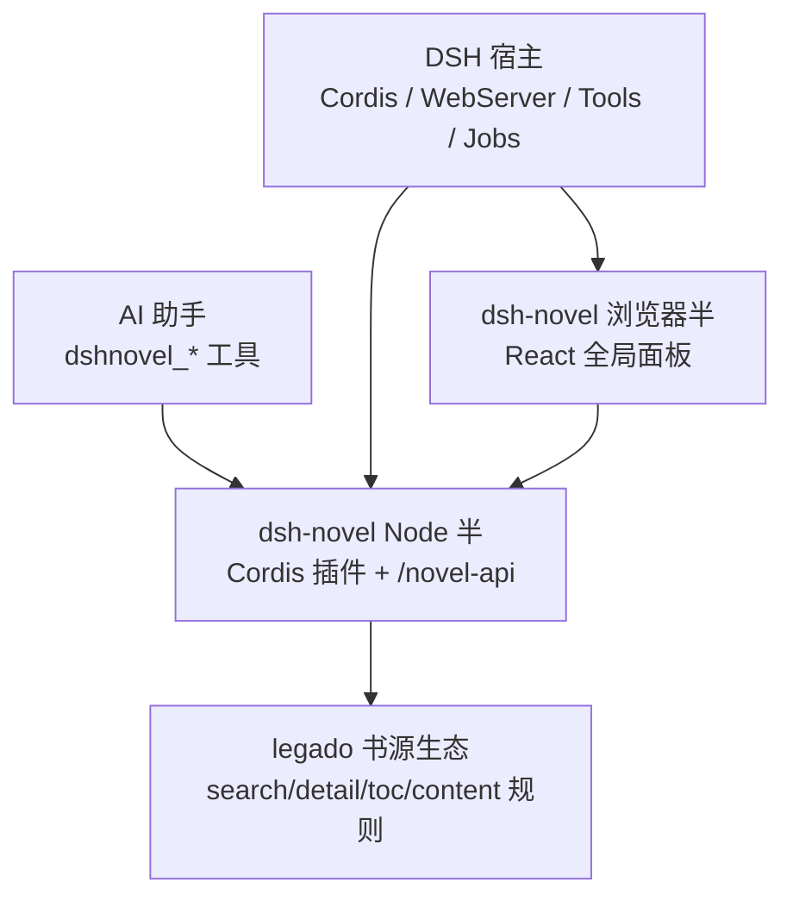
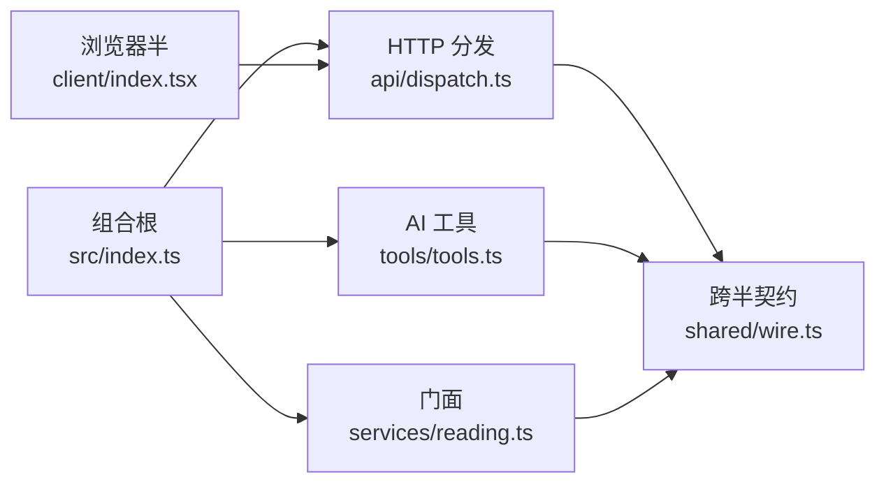
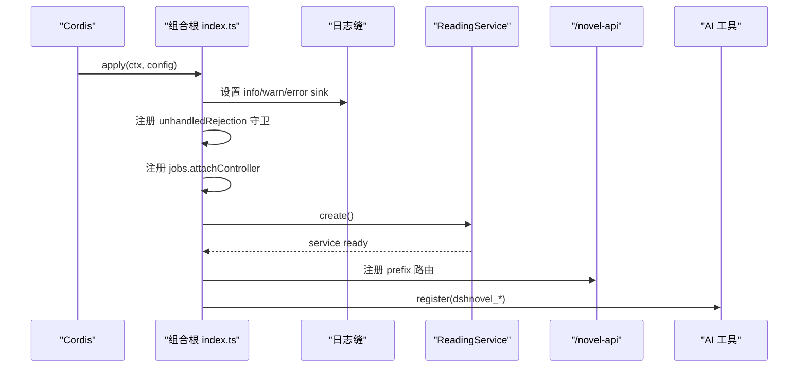
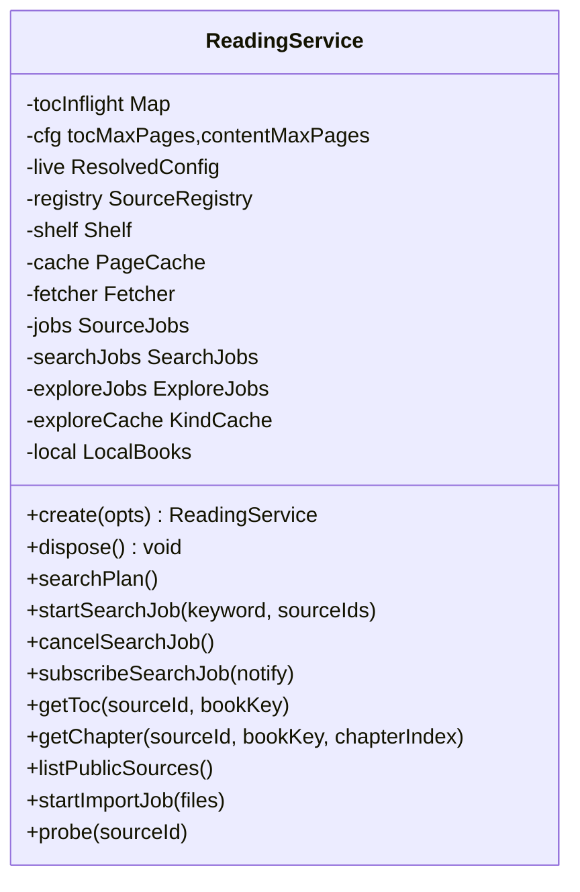
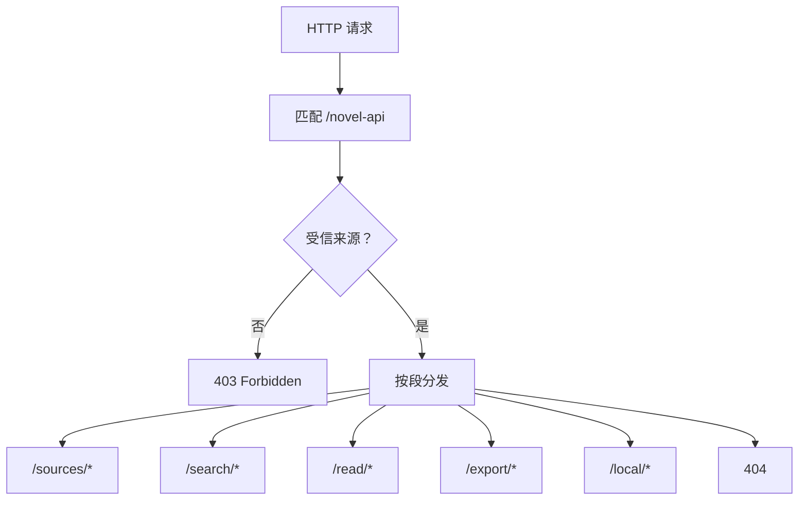
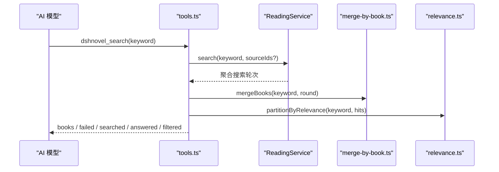
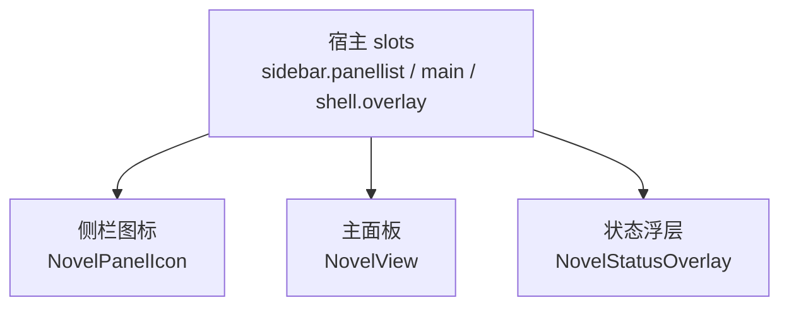
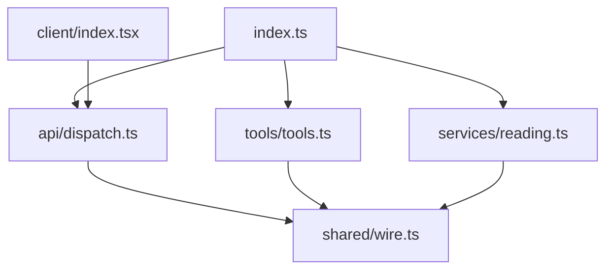

# 项目概述

<cite>
**本文引用的文件**   
- [package.json](file://package.json)
- [src/index.ts](file://src/index.ts)
- [src/services/reading.ts](file://src/services/reading.ts)
- [src/tools/tools.ts](file://src/tools/tools.ts)
- [src/api/dispatch.ts](file://src/api/dispatch.ts)
- [src/client/index.tsx](file://src/client/index.tsx)
- [src/shared/wire.ts](file://src/shared/wire.ts)
- [CONTEXT.md](file://CONTEXT.md)
- [AGENTS.md](file://AGENTS.md)
- [docs/developing.md](file://docs/developing.md)
</cite>

## 目录
1. [简介](#简介)
2. [快速开始](#快速开始)
3. [生态定位与产物形态](#生态定位与产物形态)
4. [概念引导](#概念引导)
5. [主要技术栈与运行环境](#主要技术栈与运行环境)
6. [架构总览](#架构总览)
7. [核心组件分析](#核心组件分析)
8. [依赖关系分析](#依赖关系分析)
9. [性能与可观测性](#性能与可观测性)
10. [常见问题排查](#常见问题排查)
11. [结论](#结论)

## 简介
dsh-novel（DeepSeek Harness 小说插件）把 legado 书源导入、聚合搜索、书架管理、连续滚动阅读与书城发现整合进 DSH，同时向 AI 助手暴露六个以 `dshnovel_` 前缀命名的工具。它不是独立阅读器，而是 DSH 生态中的“小说能力半”：Node 侧提供 Cordis 插件、HTTP API 与业务门面；浏览器侧提供左侧栏全局面板与阅读界面。

用户侧工作流一句话概括：**安装插件 → 导入书源 → 搜索 → 加架 → 阅读**。AI 助手侧则通过 `dshnovel_search`、`dshnovel_toc`、`dshnovel_read`、`dshnovel_shelf_*` 等工具完成同一链路，只是调用入口从浏览器面板换成了宿主工具面。

**章节来源**
- [package.json:1-125](file://package.json#L1-L125)
- [AGENTS.md:1-20](file://AGENTS.md#L1-L20)

## 快速开始
推荐顺序：

| 步骤 | 动作 | 说明 |
|---|---|---|
| 1 | 安装插件 | 在 DSH 宿主中执行 `dsh plugin add github:xrn1997/dsh-novel`；源码链入时需先 `pnpm build`，否则宿主报 `plugin tree failed to load`。 |
| 2 | 打开「小说」面板 | 宿主左侧栏出现「小说」图标；点击后进入书架 / 书城 / 书源管理三个 tab。 |
| 3 | 导入书源 | 在书源管理页选择 legacy 书源包或本地 JSON，系统会做规范化、去重与入库。 |
| 4 | 搜索 | 输入书名或作者关键词；服务端按启用的文本书源聚合搜索，并按书归并结果。 |
| 5 | 加架 | 对搜索结果中的一行或整本添加书架条目；书架身份是 `(sourceId, bookKey)`。 |
| 6 | 阅读 | 点击读这本书，进入目录与正文页面；正文支持连续滚动翻页。 |

如果偏好用 AI 助手操作，可直接让助手调用 `dshnovel_search` 拿搜索结果，再用 `dshnovel_toc` 和 `dshnovel_read` 取目录与正文。

**章节来源**
- [docs/developing.md:1-124](file://docs/developing.md#L1-L124)
- [src/client/index.tsx:1-110](file://src/client/index.tsx#L1-L110)

## 生态定位与产物形态
### 在 DSH 生态中的位置
- **宿主层**：DSH 提供 Cordis 插件生命周期、Web Server、Tool Runtime、Jobs 注册表与浏览器面板槽位。
- **插件层**：dsh-novel 通过 Cordis 的 `apply` 注入 Node 与浏览器两半，并向宿主注册路由、工具与面板。
- **legado 层**：不直接访问 legado，而是复用其书源规则语义——解析 legacy 书源、实现搜索/详情/目录/正文取值链，从而把海量社区书源搬进 DSH。
- **AI 助手层**：通过 `@deepseek-ai/dsh-tools` 暴露 `dshnovel_*` 工具，让模型能像人一样搜索、查目录、读正文、管书架。

**图表来源**
- [src/index.ts:1-200](file://src/index.ts#L1-L200)
- [src/api/dispatch.ts:1-200](file://src/api/dispatch.ts#L1-L200)
- [src/client/index.tsx:1-110](file://src/client/index.tsx#L1-L110)
- [CONTEXT.md:1-40](file://CONTEXT.md#L1-L40)

### 双半产物
| 半 | 入口 | 职责 | 关键路径 |
|---|---|---|---|
| Node 半 | `src/index.ts` 的 `apply` | 装配 ReadingService、挂 `/novel-api`、注册 AI 工具、接入任务注册表 | `src/services/reading.ts`、`src/api/dispatch.ts`、`src/tools/tools.ts` |
| 浏览器半 | `src/client/index.tsx` 的 `apply` | 注册「小说」全局面板、状态浮层、配置页、各视图 | `src/client/views/*` |

**章节来源**
- [src/index.ts:1-200](file://src/index.ts#L1-L200)
- [src/client/index.tsx:1-110](file://src/client/index.tsx#L1-L110)

## 概念引导
面向初学者，以下六个概念贯穿整个产品：

| 概念 | 含义 | 为什么重要 |
|---|---|---|
| 书源 | 一个 legao 规则包，描述某站点的搜索、详情、目录、正文如何取值。 | 没有书源就没有站点数据；导入本质是把规则规范成统一形状。 |
| 取值链 | 由分支、终端和净化尾组成的规则串，决定如何从 HTML 里抓字段。 | 它是书源的灵魂；错误取值链表现为“能搜到但没标题/正文”。 |
| 面 facet | rule / search / detail / toc / content 等求值上下文。 | 同一条规则在不同面下可能有不同行为，面是定位解析问题的坐标。 |
| 按书归并 | 一轮聚合搜索中，相同规范化书名+作者的多条命中合成一行。 | 同一本书常出现在多个源上，归并让用户一次看到所有家。 |
| 相关性分档 | exact / contains / suspect 三档，决定命中是否进入默认视野。 | 空结果不一定是“没找到”，可能是全部被划为 suspect。 |
| 活配置 | 运行时可改的配置读数口，如并发数、超时、缓存上限、代理地址。 | 配置页改动不必重启就能影响下一轮请求。 |

这些术语在仓库中都有唯一锚点，命名新模块或写文档前先对照领域词汇表，避免同一概念长出第二份抄本。

**章节来源**
- [CONTEXT.md:1-143](file://CONTEXT.md#L1-L143)

## 主要技术栈与运行环境
### 运行时依赖
| 库 | 用途 |
|---|---|
| undici | Node 侧 HTTP 抓取，受系统代理与出站代理策略影响。 |
| cheerio / domhandler / dom-serializer | 解析 HTML、CSS/XPath 选择与 DOM 结构处理。 |
| iconv-lite | 字符集解码，配合抓取链处理 GBK 等编码。 |
| yauzl | EPUB ZIP 归档解压。 |
| buffer-crc32 | EPUB 资源校验。 |
| image-size | EPUB 图片尺寸探测。 |

### 开发依赖
| 库 | 用途 |
|---|---|
| @deepseek-ai/cordis | Cordis 插件契约与宿主插槽。 |
| @deepseek-ai/dsh-tools | 定义 `dshnovel_*` 工具。 |
| react / react-dom | 浏览器半 UI。 |
| vitest | 单元测试与集成测试。 |
| playwright | 真浏览器冒烟测试。 |
| tsdown | TypeScript 构建。 |
| typescript | 类型检查。 |

### 运行环境要求
- Node.js 版本由工程工具链约束（devDependencies 使用 `@types/node ^22`）。
- pnpm 工作区：仓库根有 `pnpm-workspace.yaml` 与 `pnpm-lock.yaml`。
- 构建产物位于 `lib/`，不在版本控制中；源码链接安装必须手动 `pnpm build`。
- 运行时数据默认落在 `~/.dsh/novel/`，可通过 `dataDir` 覆盖。

**章节来源**
- [package.json:1-125](file://package.json#L1-L125)
- [docs/developing.md:1-124](file://docs/developing.md#L1-L124)

## 架构总览
dsh-novel 采用“组合根 + 门面 + 窄接口 + Wire-first 契约”的结构：

- **组合根**：`src/index.ts` 负责解析配置、设置日志、接管未捕获拒绝、挂载 job controller、创建 ReadingService、注册路由与工具。
- **门面**：`ReadingService` 是 HTTP API、AI 工具、浏览器半共享的唯一业务入口。
- **窄接口**：对外部宿主依赖（webServer、tools、jobs、logger）只镜像用到的成员，避免强耦合。
- **Wire-first**：`src/shared/wire.ts` 是跨半契约唯一真相，Node 半与浏览器半都消费同一份类型与常量。

**图表来源**
- [src/index.ts:1-200](file://src/index.ts#L1-L200)
- [src/services/reading.ts:1-200](file://src/services/reading.ts#L1-L200)
- [src/api/dispatch.ts:1-200](file://src/api/dispatch.ts#L1-L200)
- [src/tools/tools.ts:1-200](file://src/tools/tools.ts#L1-L200)
- [src/client/index.tsx:1-110](file://src/client/index.tsx#L1-L110)
- [src/shared/wire.ts:1-200](file://src/shared/wire.ts#L1-L200)

## 核心组件分析
### 组合根：`src/index.ts`
组合根是插件装载的单一入口。它做以下几件事：
1. 解析配置并设置日志 sink，同时保留宿主 logger ring buffer 与本机 console 双通道。
2. 订阅配置热更事件，仅记录变更路径并在 `proxyUrl` 变化时重新计算出站代理。
3. 安装未捕获 Promise rejection 守卫，防止 legacy 书源脚本里的异步副作用杀死宿主进程。
4. 向宿主 jobs 注册控制器，使后台任务不被拒绝。
5. 异步初始化 ReadingService，成功后分别注册 HTTP 路由与 AI 工具。
6. 在 dispose 时复位重复启用标记、清理日志 sink、关闭服务。

**图表来源**
- [src/index.ts:1-200](file://src/index.ts#L1-L200)
- [src/services/reading.ts:1-200](file://src/services/reading.ts#L1-L200)

**章节来源**
- [src/index.ts:1-200](file://src/index.ts#L1-L200)

### 门面：`ReadingService`
`ReadingService` 是本项目最重要的类。它封装了：
- 书源注册表 `SourceRegistry`
- 书架 `Shelf`
- 页面缓存 `PageCache`
- 抓取守门器 `Fetcher`
- 导入/搜索/发现后台任务持有者
- 本地书 `LocalBooks`
- 分类快照缓存 `KindCache`

门面公开的方法包括搜索计划、提交搜索、取消搜索、订阅搜索进度、获取目录、读取章节、列出公开书源、导入书源、批量探针、启用/停用源、删除源、导出等。它的构造方式有两种：
- `create(opts)`：生产快捷方式，自动建目录、加载持久化部件。
- `from(parts)`：测试与扩展入口，允许替换 registry/shelf/cache/fetcher/local。

**图表来源**
- [src/services/reading.ts:1-200](file://src/services/reading.ts#L1-L200)

**章节来源**
- [src/services/reading.ts:1-200](file://src/services/reading.ts#L1-L200)

### HTTP API：`/novel-api`
HTTP 层以单一 prefix 路由接收所有请求，再按段分发到 sources、search、read、export、local 等子面。它的关键特征：
- 健康检查返回 `GET /novel-api`。
- 所有 body 先经 wire 契约校验，失败转为 `BadRequest`。
- 搜索与发现面共用 SSE 作业流，首帧带 baseline，断连自动退订。
- 搜索走“服务端持有整轮结果 + 客户端显式快照/SSE 游标”的模式，而不是浏览器自持循环。
- 非受信请求直接返回 403。

**图表来源**
- [src/api/dispatch.ts:1-200](file://src/api/dispatch.ts#L1-L200)

**章节来源**
- [src/api/dispatch.ts:1-200](file://src/api/dispatch.ts#L1-L200)

### AI 工具：`dshnovel_*`
工具层基于 `@deepseek-ai/dsh-tools` 暴露六个工具，其中 `dshnovel_search` 是最核心的入口。工具设计遵循：
- 名字固定以 `dshnovel_` 开头，避免与宿主生态其他插件冲突。
- 参数走 schema enum，缺参直接抛错，宁炸不猜。
- 返回值走 lossless JSON 投影，null 与 undefined 按契约区分。
- 工具逻辑复用 ReadingService，不各自再写一遍抓取/取值链。

当前可见工具至少包括：
- `dshnovel_search`：聚合搜索并按书归并，报告 searched / answered / filtered。
- `dshnovel_toc`：取目录，建立 chapterIndex 与章名的映射。
- `dshnovel_read`：取指定章节纯文本。
- 书架相关工具（名称与具体 action 集合由 tests 与 tools.ts 共同钉住）。

**图表来源**
- [src/tools/tools.ts:1-200](file://src/tools/tools.ts#L1-L200)
- [src/services/reading.ts:1-200](file://src/services/reading.ts#L1-L200)

**章节来源**
- [src/tools/tools.ts:1-200](file://src/tools/tools.ts#L1-L200)

### 浏览器半：React 全局面板
浏览器半入口把「小说」注册为宿主左侧栏的全局面板，id/key 均为 `novel`。它负责：
- 注册 sidebar 图标与 main keyed 槽。
- 注册 shell.overlay 状态浮层，用于显示后台任务状态。
- 提供 CopyProvider 与翻译入口，适配宿主 locale。
- 旧宿主没有 `configForms` 时优雅降级，不影响主面板。

**图表来源**
- [src/client/index.tsx:1-110](file://src/client/index.tsx#L1-L110)

**章节来源**
- [src/client/index.tsx:1-110](file://src/client/index.tsx#L1-L110)

### 跨半契约：Wire-first
`src/shared/wire.ts` 是 Node 半与浏览器半之间的唯一真相，包含：
- 书源状态、内容类型、探针错误码。
- 公开书源投影、任务状态、搜索命中、按书归并结构。
- 搜索任务快照、发现面清单、探索书籍、导航结构。
- 路由名、参数键、SEG 分段常量。

该文件保持零运行时依赖，因为 client bundle 会把它 inline 进去；任何跨半形状变更都必须同时考虑 HTTP 面、工具面与浏览器视图。

**章节来源**
- [src/shared/wire.ts:1-200](file://src/shared/wire.ts#L1-L200)

## 依赖关系分析
### 组件耦合
- `src/index.ts` 是组合根，耦合 Cordis Context、webServer、tools、jobs 三个宿主插槽。
- `ReadingService` 聚合 services 层全部子系统，但对外只暴露动词方法，属于典型门面。
- `dispatch.ts` 与 `tools.ts` 都依赖 `ReadingService`，但不直接访问 SourceRegistry/Shelf/LocalBooks。
- `client/index.tsx` 依赖宿主 slots/layout 与 React，不直接调 Node 端。
- 浏览器半与 Node 半之间只通过 `src/shared/wire.ts` 的类型与常量耦合。

**图表来源**
- [src/index.ts:1-200](file://src/index.ts#L1-L200)
- [src/services/reading.ts:1-200](file://src/services/reading.ts#L1-L200)
- [src/api/dispatch.ts:1-200](file://src/api/dispatch.ts#L1-L200)
- [src/tools/tools.ts:1-200](file://src/tools/tools.ts#L1-L200)
- [src/client/index.tsx:1-110](file://src/client/index.tsx#L1-L110)
- [src/shared/wire.ts:1-200](file://src/shared/wire.ts#L1-L200)

**章节来源**
- [AGENTS.md:1-61](file://AGENTS.md#L1-L61)

## 性能与可观测性
### 性能要点
- 聚合搜索默认并发为 5，js 沙箱预算默认 15 秒，避免单源脚本拖垮整轮。
- 目录与正文分页上限默认分别为 200 和 50，防止超大书卡死。
- 缓存容量默认 200MB，由 PageCache 管理。
- 本地导入上限默认 50MB，传输层与 domain 层共用同一配置。
- 分类发现使用每源分类快照缓存，避免重复进入同一分类打站。
- SSE 作业流在响应断开时立即退订监听器，不保留死连接。

### 可观测性
- 日志 sink 同时输出到 console 与宿主 logger，Error 对象原样传入 stderr，避免 ring buffer 吞掉栈信息。
- 配置热更事件打印变更路径，并在 `proxyUrl` 变化时重新输出出站代理。
- 工具 `dshnovel_search` 明确报告 searched / answered / filtered / failed，帮助判断“没人答话”和“全部不相关”的区别。
- 后台任务状态在 wire 中以 phase、done、total、counts、issues 表达，UI 可展示进度而不必猜测。

**章节来源**
- [src/index.ts:1-200](file://src/index.ts#L1-L200)
- [src/services/reading.ts:1-200](file://src/services/reading.ts#L1-L200)
- [src/api/dispatch.ts:1-200](file://src/api/dispatch.ts#L1-L200)
- [src/tools/tools.ts:1-200](file://src/tools/tools.ts#L1-L200)

## 常见问题排查
| 现象 | 可能原因 | 排查建议 |
|---|---|---|
| 宿主报 `plugin tree failed to load` + `ERR_MODULE_NOT_FOUND` | 源码链入但未执行 `pnpm build`，`lib/` 缺失。 | 在插件源码目录执行 `pnpm build`。 |
| 浏览器能看到网页，插件抓不到 | Node 侧 undici 不读系统代理，未配置 `proxyUrl`。 | 检查配置项 `proxyUrl` 或环境变量与系统代理。 |
| 搜索为空但书源已启用 | 命中被划为 `suspect`，或所有源未答话。 | 看 `filtered` 与 `failed`，不要只看 books 是否为空。 |
| 搜索结果只有部分源 | 非文本源不参与聚合搜索，或源被禁用。 | 确认书源类型为 text 且 enabled。 |
| 正文可读但搜索失败 | 搜索面规则正常，详情页/目录/正文规则异常。 | 用探针与段落级错误定位具体面。 |
| 配置改了不生效 | 某些字段不是活配置，或服务层在启动期取了快照。 | 区分热改字段与启动期字段；必要时重启。 |
| 后台任务结束后看不到结果 | 任务态只在内存，切换面板或刷新后需重新查询。 | 通过任务状态接口拉最新快照。 |

**章节来源**
- [docs/developing.md:1-124](file://docs/developing.md#L1-L124)
- [AGENTS.md:1-61](file://AGENTS.md#L1-L61)

## 结论
dsh-novel 的核心价值是“把 legacy 书源生态搬进 DSH，并把阅读体验交给宿主”。它不追求自成体系，而是通过 ReadingService 门面、Wire-first 契约与窄接口，把 Node 半与浏览器半连接到 DSH 宿主的 Cordis、WebServer、Tools 与面板系统。对于新用户，最简路径是安装→导入→搜索→加架→阅读；对于开发者，最需要记住的是组合根、门面、窄接口与 shared/wire.ts 这四个锚点。