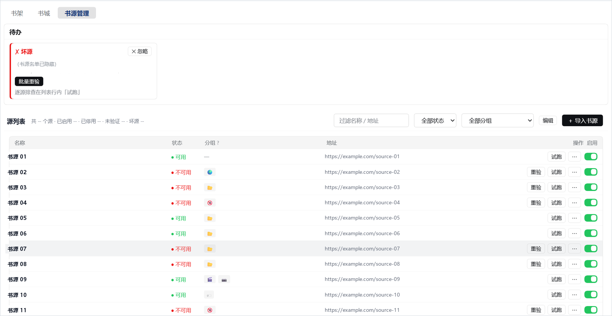
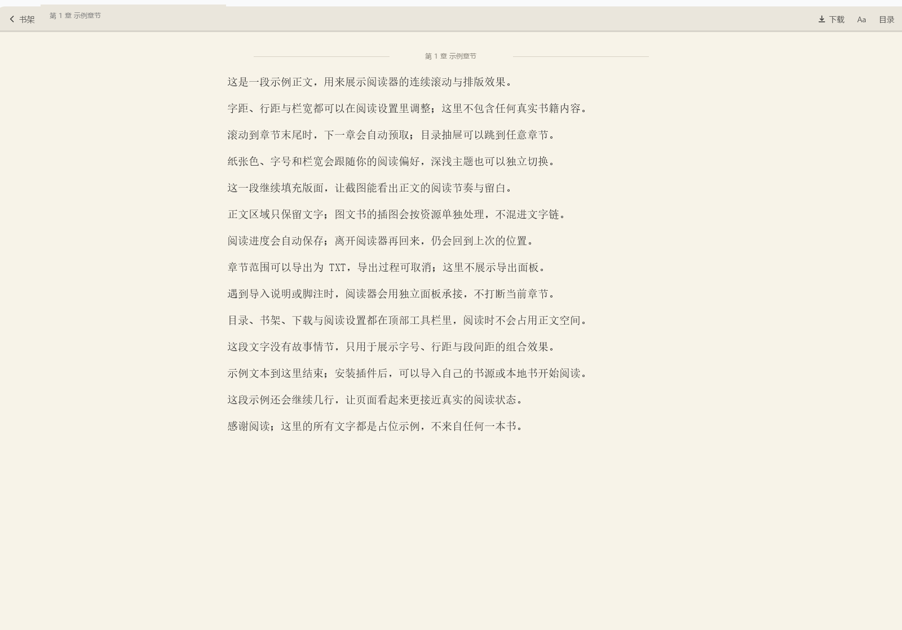

# dsh-novel

[](https://github.com/xrn1997/dsh-novel/actions/workflows/ci.yml)
[](https://www.npmjs.com/package/@xrn1997/dsh-novel)
[](LICENSE)
[](#安装)

**在 DeepSeek Harness（DSH）里读网络小说。** 导入 [legado](https://github.com/gedoor/legado) 书源，聚合搜索或按分类逛书城，把书加入书架，连续滚动阅读。它还有本地 TXT / EPUB、中英界面和六个 `dshnovel_` AI 助手工具——找书、读章、管源都可以在对话里完成。


*书城：左边选源、展开它自己声明的分类，右边是该类的书单——顺序都听源的，不跨源合并（书源与书目均为示意数据）。*

- **安装**：`dsh plugin --profile <profile> add @xrn1997/dsh-novel`
- **数据**：默认留在本机 `$DSH_HOME/novel/`（`dataDir` 可改）；插件不内置任何书源
- **许可**：[Apache-2.0](LICENSE)

## 目录

- [功能](#功能)
- [安装](#安装)
- [首次使用](#首次使用)
- [AI 助手工具](#ai-助手工具)
- [配置](#配置)
- [HTTP API](#http-api)
- [数据存储](#数据存储)
- [本地书格式（TXT / EPUB）](#本地书格式txt--epub)
- [兼容哪些书源](#兼容哪些书源)
- [常见问题](#常见问题)
- [开发](#开发)
- [文档](#文档)
- [贡献](#贡献)
- [致谢](#致谢)

## 功能

左侧栏「小说」是一个全局面板，三个并列 tab：**书架 / 书城 / 书源管理**。界面、探针与 AI 工具共用同一条链路。

### 书源：导入、去重、体检



*书源管理：待办置顶坏源 / 未验证源，过滤、启停、试跑和批量操作都在这一页（书源名称、地址与数量已脱敏）。*

拖入 / 多选 / 粘贴 legado 书源 JSON，导入在后台跑，按地址自动去重。新源先标「未验证」，「待办」把坏源和未验证源置顶，一键验证或批量重验；平时可过滤、启停、试跑、录入 cookie 或执行 `loginUrl` 脚本。

### 找书：聚合搜索 + 按源逛书城

书架顶部一次搜索所有源：结果边搜边出、可停止，按（书名，作者）归并，相关结果优先，失败源逐家点名。书城则按每个源自己声明的分类浏览，点书可读、加架，或去其他源找同名书。

### 书架与阅读：连续滚动，进度自动保存

书架按最近阅读排序，可按在读 / 未读 / 本地筛选，每本书标来源，支持批量删除。阅读器连续滚动、自动预取下一章，字号 / 行距 / 栏宽 / 纸张色可调，支持范围导出 TXT。


*书架：按最近阅读排序，顶部可在读 / 未读 / 本地筛选，末位是本地书导入入口（书名与进度为示意数据）。*



*阅读器：连续滚动、自动预取与排版设置（示例正文）。*

### 本地书、AI 与界面

TXT / EPUB 直接进书架，有损导入会留下可回看的「导入说明」（格式与边界见 [本地书格式](#本地书格式txt--epub)）。六个 `dshnovel_` 工具覆盖搜索、读章、目录、书架、书源管理和导入（详见 [AI 助手工具](#ai-助手工具)）；界面中英双语，运行参数在插件页改完即生效。

## 安装

插件装进哪个 profile，就在那个 profile 里生效——本插件不绑定宿主的发行形态，只认 DSH 的插件生态。

```powershell
dsh plugin --profile <profile> add @xrn1997/dsh-novel
```

重启宿主后，左侧栏出现「小说」全局面板入口（图标行；点击即在中央面板打开书架 / 书城 / 书源管理 tab）。侧栏入口需要宿主提供 `slots` / `layout` 的界面 bundle（通常由 `@deepseek-ai/dsh-web-app` 提供）；不带它的 profile 只挂 Node 半与 AI 工具，界面上不会多出入口。

两种装法：

- **npm 安装**（推荐）：使用预构建产物，秒装、无需构建授权。
- **从源码装**：本包没有 `prepare`，从远端源码直装（`github:` / `git:` 形态）不会自动构建，装出来缺 `lib/` 会被宿主拒绝挂载。要先从 GitHub 或 GitCode 克隆仓库并 `pnpm install && pnpm build`，再用 `dsh plugin --profile <profile> add link:<克隆目录>` 挂载。

卸载：

```powershell
dsh plugin --profile <profile> remove @xrn1997/dsh-novel
```

**宿主兼容声明分两层**：安装许可由 `package.json` 的 `peerDependencies` 决定——宿主 `dsh plugin add` 会拿运行中的宿主版本逐个比对插件的 `@deepseek-ai/dsh*` peer 区间，不满足即 `installation rejected`；peer 区间按宿主线开口，线内 rc / patch 不跟版，跨线才重验。实测记录写在 `dsh.compatibility.dshReleases`，只列真跑过的宿主版本：**DSH 0.1.5-rc.1、0.1.7-rc.1、0.1.7-rc.2、0.2.0-rc.2、0.2.1-rc.1、0.2.1-rc.2、0.2.1-rc.3**（宿主不读这个字段——安装许可只认上面那组 peer 区间；这一行是给人看的记录，文档门会核对它与 `package.json` 一致）。宿主发版、peer 区间与浏览器模块表的维护流程，以及发布冷却闸，见 [docs/development.md](docs/development.md#宿主兼容与实测名单)。

## 首次使用

1. **导入书源**：「小说」→「书源管理」tab → 选择 `.json` 文件（可多选，选中即开始导入）或粘贴 legado 书源 JSON。导入是服务端后台任务，关页面不打断；同址自动去重（已有可用源则跳过，坏源 / 未验证源被新条替换）。
2. **批量验证**：导入不逐条探针（新源状态为「未验证」）——顶部**待办收件箱**把坏源 / 未验证置顶成任务卡，「一键验证」「批量重验」即点即跑；任意集合（过滤 + 编辑态勾选 +「验证所选」）同样可发起，后台并发 5 路限流。
3. **找书读**：「书架」tab 顶部搜书名 / 作者 → 点封面进阅读器。不在书架上的书离开时会先问是否加入，加入后进度自动记住。想按分类逛就走「书城」tab：先在左栏点一个源，再点它自己声明的那几类。手上已有文件就走书架末位的**导入本地书籍**（TXT / EPUB）。
4. **让 AI 助手干活**：对话里直接说「帮我找一本《XX》读第三章」「看看 XX 书源为什么坏了」。

## AI 助手工具

| 工具 | 用途 |
| --- | --- |
| `dshnovel_search` | 在已启用的**文本**书源中聚合搜索（当前仅支持小说文本面），与界面同判据、同视图：按书返回——同一（书名，作者）多家归并成一本、逐源各留一行，`failed` 逐家点名未答话的源，`searched`/`answered`/`filtered` 自报本轮账目；返回的 `url` 就是其他工具的 `bookKey`，调 `read` / `toc` 时还要带上该行的 `sourceId` |
| `dshnovel_read` | 取某本书第 N 章（0 起）的正文纯文本（含章名）；章序从 `dshnovel_toc` 查。图文书同样只给文字：插图落成 `[图片：替代文字]` 占位（无替代文字则 `[图片]`） |
| `dshnovel_toc` | 取书籍目录：逐章返回章名与 0 起 `chapterIndex`（章名→下标的唯一映射处）与章节 URL |
| `dshnovel_shelf` | 书架与阅读进度：`list` / `add` / `save_progress` / `remove` |
| `dshnovel_source` | 书源管理：`list` / `probe`（真实搜索请求 + 失败定位）/ `enable`·`disable` / `remove` |
| `dshnovel_import_source` | 导入 legado 书源 JSON 文本（内容可为对象或数组）；只做规范化 + 落盘不探针，逐条结果在 `outcomes[]`（含 `ok` / `missing` / `dupSkipped`） |

六个工具与 UI、探针共用同一个 service 层，不存在第二套实现。工具名全部锁 `dshnovel_` 前缀——宿主对工具重名直接抛错，插件专属前缀是与生态其他插件的硬边界（名字集合由 `tests/tools/tools.test.ts` 钉住）。

## 配置

插件配置位于 profile 的 `cordis.patch.yml` 里该插件行的 `config` 字段（schemastery 校验，全部可选）：


*运行参数：搜索、阅读与导出、存储上限、网络四组，保存即生效。*

| 键 | 缺省 | 说明 |
| --- | --- | --- |
| `dataDir` | `$DSH_HOME/novel/` | 数据根目录（见「数据存储」） |
| `searchTimeoutMs` | `15000` | 单源搜索超时（毫秒） |
| `searchParallel` | `5` | 搜索并发源数 |
| `jsTimeoutMs` | `15000` | js 沙箱预算（毫秒，阅读 / 搜索 / 探针 / 登录全链路共用）。legado 的多请求目录脚本需要秒级预算 |
| `cacheMaxBytes` | `209715200`（200MB） | 目录 / 正文缓存上限（字节；按 mtime 最旧的近似 LRU 淘汰，读命中不续命） |
| `exportDelayMs` | `300` | 范围导出的章节间抓取间隔（毫秒，串行限速） |
| `localImportMaxBytes` | `52428800`（50MB） | 本地文件导入大小上限（字节，TXT / EPUB 共用） |
| `proxyUrl` | 启动时自动探测 | 出站代理，见[常见问题](#常见问题)；`'direct'` 强制直连，或显式指定如 `'http://127.0.0.1:7897'` |

除 `dataDir` 外，其余 7 项还可在宿主的「插件」页 → `@xrn1997/dsh-novel` 详情里的「运行参数」中编辑（需宿主支持插件配置页）；保存后立即生效，不需要重启插件。旧宿主没有这一页时，配置仍写在 profile 的 `cordis.patch.yml`。`dataDir` 始终需改该文件并重启。

数值项按整数校验；`proxyUrl` 只接受 `direct`、空串或 http(s) 地址（裸 `host:port` 按 `http://` 补全）。非法值（含 `NaN` / `Infinity`）在插件加载期报错；在插件页保存时被同样拒绝，页面保留草稿供修改。显式 `null` 按未设置处理、取缺省。

## HTTP API

所有路由以 `/novel-api` 为前缀（仅接受本机 loopback；Origin/Referer 在场时必须同源，缺席放行以支持本机工具 / curl）。JSON 响应使用统一信封 `{ ok, value | error }`，错误附带 `code` 与可选的规则段级定位；`GET /export`、两条 SSE 流与 `GET /local/resource` 是流式 / 二进制响应，不套信封。共 36 条路由（30 静态 + 6 参数操作，计数由 `tests/shared/wire-builders.test.ts` 钉死）。**路由身份（method + path）与值形状的代码真相在 `src/shared/wire.ts`**——Node 半与浏览器半共用同一份定义，契约测试逐条把守。

| 面 | 路由 |
| --- | --- |
| 健康检查 | `GET /novel-api` |
| 书源 | `GET /sources`、`POST /sources/import`（后台任务，body `{files:[{name,text}]}`，上限 32MB）、`GET /sources/job-status`、`POST /sources/batch-probe`、`POST /sources/batch-enabled`、`POST /sources/batch-delete`、`POST /sources/:id/probe`、`POST /sources/:id/enabled`、`POST /sources/:id/auth`、`DELETE /sources/:id` |
| 搜索与阅读 | `GET /search`（一次性收齐本轮各源命中；每源只取搜索首页，后台任务另按每源 50 条截断）、`GET /search/plan`（本次参搜源集——参与集的唯一主人在服务端）、`POST /search/job`、`GET /search/job-status?since=N`（按游标读增量）、`GET /search/job-stream?since=N`（同一份快照的 SSE 推送，首帧即 baseline）、`POST /search/job-cancel`（停止本轮：不再往下搜，已搜出的命中一律保留）、`GET /book`、`GET /toc`、`GET /navigation`（线性 `chapters` + 展示树 `items`）、`GET /chapter`（`{kind:'text'}` 或图文树 `{kind:'rich'}`；`?refresh=1` 绕过缓存） |
| 书城发现面 | `GET /explore/kinds`（**按源**给出各源自己声明的**分类标题**清单，零网络请求，入口地址不外泄：原生方言的 `ruleFind` 与 legado 的 `exploreUrl` 都认，后者接**声明式两档**（`标题::URL` 多行 / JSON 条目数组）；脚本形态（`@js:` / `<js>`）的发现入口不执行，那类书源在书城没有分类）、`POST /explore/list`（body `{sourceId, kind}`：一轮 = 点名一个源 + 它自己声明的一类，回 `{jobId}`）、`POST /explore/list/more`（续这一轮的第 page+1 页，**同一轮不换 jobId**；没得续（已到底 / 触页数上限 / 一批在途）→ 409）、`GET /explore/list/job-status`（整轮全量快照，无游标）、`GET /explore/list/job-stream`（同一份快照的 SSE 推送，首帧可能是「还没提交过」的空档） |
| 书架 | `GET /shelf`（条目附 `sourceName` 来源投影，按最近阅读排序）、`PUT /shelf/:key`（带 `title` 加书 / 带 `progress` 存进度 / 带 `patch` 改元数据）、`DELETE /shelf/:key`、`POST /shelf/batch-delete`（本地书连带删副本，未知键静默跳过） |
| 导出 | `GET /export`（流式 TXT，`from`/`to` 选段（1 基含端，缺席 = 全本），响应头 `X-Novel-Total-Chapters`（本次范围章数）/ `X-Novel-Range`（`from-to`）；倒置范围 422 `BadRange`，连接断开即停止抓取） |
| 本地书 | `POST /local/import?name=…`、`DELETE /local?id=…`（连带删整份副本）、`GET /local/document?id=&documentId=`（脚注 / 附录）、`GET /local/resource?id=&resourceId=`（插图与封面，只认不透明资源 ID）、`GET /local/warnings?id=`（持久化的导入说明） |

## 数据存储

默认存于 `$DSH_HOME/novel/`（未设置 `DSH_HOME` 时 `~/.dsh/novel/`；可用 `dataDir` 改写），与项目目录分离——阅读数据是跨项目、跨仓库的：

```
$DSH_HOME/novel/
├── sources.json   # 书源清单（含登录态，仅存本机、不会外传）
├── shelf.json     # 书架与阅读进度
├── cache/         # 目录 / 正文缓存（按 mtime 最旧的近似 LRU；默认上限 200MB）
└── local/         # 本地书：TXT 是 <uuid>.txt + <uuid>.json（章节偏移表）
                   # EPUB 是 <uuid>/ 目录（原文 + 派生文档 + 资源）+ <uuid>.json
```

## 本地书格式（TXT / EPUB）

「书架」末位的**导入本地书籍**卡收 `.txt` 与 `.epub`；分流由服务端**按内容**做（文件头是 ZIP 就按 EPUB 解析）。

| 格式 | 支持 | 明确不做 / 已知边界 |
| --- | --- | --- |
| TXT | BOM 优先 → UTF-8 严格探测 → GBK 回退；标题行切章（第X章 / 卷 / 回 / 节 / 章外篇目 …） | 自定义章名正则（legado 那套「按内容打分挑规则」未接，本仓是一条钉死的正则）；PDF / MOBI / UMD 未接 |
| EPUB 2 / 3（流式排版） | 阅读顺序按 **spine 主序列**计章；原书目录树（EPUB3 nav / EPUB2 NCX，含章内锚点与命名锚点）；封面；正文插图（JPEG/PNG/GIF/WebP 与受限静态 SVG）；基本格式（段落、标题、粗斜体、列表、引用、分隔线、基本表格、上下标、预格式文本）；脚注与附录（补充文档面板，可跟随可返回） | **不加载出版方 CSS 与字体**（排版归本插件阅读设置）；**固定版式**、需 DRM 解密的正文、脚本驱动的交互与音视频不宣称支持（明确拒绝或告警）；正文内联 `<svg>` 装饰图形剥离并记说明（整页是一棵只包一张书内图的 SVG 时按那张图读那一章）；远程图片一律拒绝 |

- **按内容分流、不互相兜底**：文件头是 ZIP 就按 EPUB 解析，失败**不会**回退成 TXT——否则一份加密压缩包会以「一本乱码书」入架；不是 ZIP 的字节才走 TXT 解码链。
- **文字输出只有文字**：图片只在 EPUB 阅读器里显示；TXT 导出与取正文的 `dshnovel_read` 把插图投影成 `[图片：替代文字]` 占位。本轮不提供 EPUB / 图片导出。
- **有损导入的交代是持久的**：`GET /local/warnings` 可回看（导入时在书架就地显示，进书后在阅读器「导入说明」重看），不静默丢内容；带持久说明的导入不自动跳进阅读器。
- **导入失败说具体原因**：固定版式 / 加密条目 / 是 ZIP 魔数但读不成归档（缺 `mimetype`、条目越界或重名、CRC 对不上、截断）/ 超限由服务端逐条点名，不折叠成「导入失败」一句泛话。

## 兼容哪些书源

兼容 legado 书源的**声明式子集**：取值链 / 组合符（`||`、`&&`、`%%`）/ `##` 替换 / AllInOne（单段整页正则） / JSONPath（含 `.*` 属性通配，页面是 JSON 文本时对内容按需解析）/ XPath 子集 / `@put` / `@get` / `@js` 沙箱（脚本完成值语义 + 顶层 `return`/`await` 回落；`eval`/`Function` 在 vm 内可用）/ `jsLib` 源级函数库 / `searchUrl` 的 `@js`/`<js>` 形态 / 对象形态方言（**含 `ruleBookInfo.init` 详情上下文初始化**）/ `url,{json}` POST 请求（选项随书 URL 与章节 URL 全程保留）/ 相对 URL / 隐式 CSS 选择器 / `!` 排除语法，以及 `@js` 宿主垫片（`java.log` / `getElement` / `setContent` / `cookie` / `source.getVariable` 等）。请求状态面还包括真实 cookie jar（`Set-Cookie` 自动落库/回带）、`loginCheckJs`、源级 `concurrentRate` 限速、`webView`/`webJs` 真浏览器抓取与源变量/cache 落盘。缺省请求带浏览器 UA（部分站点 WAF 无 UA 直接 403）。

URL 模板语义按 legado 书源格式对齐：`url,{json}` 选项的逗号两侧允许空白；模板内 `{{...}}` 按 JS 求值（`{{java.encodeURI(key)}}`、`{{page*2}}`、源级 `jsLib` 定义的全局如 `{{host}}`），变量占位 `{{key}}`/`{{page}}` 保持原有的 URL 编码口径；URL 里的 js 块可出现在任意位置（`<js>…</js>` 闭区间、`@js:` 吃到串尾、块间字面文本按 `@result` 拼接）；`charset` 同时用于**请求体编码**与响应解码（GBK 站点才搜得到）；`&&` 跳过空 / Miss 分支后按序合并，`%%` 在取值用途跳过空 / Miss、列表用途按首支驱动（首支为空则整条为空）。

遇到不认识的语法，本插件选择**报错而不是猜测**——错误定位到出错的规则段，而不是产出错误结果。`webView`/`webJs` 走本机已装的 Edge/Chrome；没有可用浏览器、或书源依赖安卓专有 API / 加密侧能力时，会明确报告不支持。

**「做到哪一步」有机器口径**：`tests/legado-coverage/matrix.ts` 一行一条 legado 语义，每行归入 实现 / 环境不适用 / 待拍板 三态之一：implemented 行带实现符号与钉住用例，not-applicable 行写裁决理由，open 行带 `2026-MM-DD` 复核戳。四门默认随 `pnpm test` 跑（见 [docs/development.md 的「兼容判据四门」](docs/development.md#兼容判据四门)）。想查某个字段支不支持：在矩阵里按 `id` 或能力名搜那一行即可。

## 常见问题

**搜索结果全是「网络错误」，或正文显示为空白？**
多半是代理问题。DSH 的 Node 进程用 undici 发请求，**不会读取系统代理设置**；对代理才可达的站点，直连会被重定向或重置。解决：在配置里显式设 `proxyUrl`（如 Clash 常用端口 `'http://127.0.0.1:7897'`）。缺省的自动探测顺序为：环境变量 `HTTPS_PROXY` / `HTTP_PROXY` / `ALL_PROXY` → Windows 系统代理 → 直连。

**某条书源报「不支持 xx」？**
本插件只实现 legado 规则的声明式子集（见上节），对无法仿真或不认识的语法会明确报错并定位到规则段，而不会静默给出错误结果。可以尝试换用不依赖安卓专有 API / 加密侧能力的同类书源。

**`webView` / `webJs` 源报「WebView 不可用」？**
本插件用 `playwright-core` 驱动本机已安装的 Edge/Chrome（不下载浏览器）。装一个 Edge 或 Chrome 即可；两者都没有时会如实报错，不会静默退回普通 HTTP 请求。

**安装后侧栏没有出现「小说」入口？**
先重启宿主。若从源码目录安装，确认已先 `pnpm build` 生成 `lib/`（构建产物缺失会让整个插件树拒绝挂载，宿主直接启动失败而非静默降级），详见 [docs/development.md 的「本地源码调试」](docs/development.md#本地源码调试)；装进了没有 `slots` / `layout` 界面 bundle 的 profile，则本就只有工具面、没有侧栏入口。

## 开发

```powershell
git clone <仓库地址>   # GitHub 或 GitCode 镜像均可
cd dsh-novel
pnpm install
pnpm build        # 构建 lib/（Node 半 + 浏览器半 + lib/types 声明）；改动源码后、重启宿主前必须执行
pnpm dev          # = tsdown --watch，日常开发建议挂着
```

本地源码调试、构建产物与热更新、宿主兼容、发版与真机验证、全部测试门控见 [docs/development.md](docs/development.md)；模块形状与语义归属见 [docs/architecture.md](docs/architecture.md)。

## 文档

本仓按「一个事实只有一个家」分工：用户面事实在本文件；agent 的常读规则在 `AGENTS.md`；文档分层、放置与生命周期在 `docs/AGENTS.md`；构建与全部门控在 `docs/development.md`；提交与发版边界在 `CONTRIBUTING.md`；决策在 `docs/adr/`（索引见 `docs/adr/README.md`）；发布历史在 `CHANGELOG.md`。

兼容裁决与真机读数住 `tests/legado-coverage/matrix.ts` 的行 `note`；局部口径的为什么住实现它的代码注释。迭代过程文档不入库，写在本机 `.superpowers/`。完整文档分层见 `docs/AGENTS.md`；全部门控与判据见 `docs/development.md`。

## 贡献

欢迎 Issue 与 PR。提交信息、PR 与发版边界见 [`CONTRIBUTING.md`](CONTRIBUTING.md)。提交改动前请确保 `pnpm test` 与 `pnpm typecheck` 通过，且**两条命令的退出码都亲眼看过**；完整的真链路门控见 [docs/development.md 的「门（自动）」](docs/development.md#门自动)，真宿主冒烟见同一份文档的「真机验证」。若扩展了书源语法，请优先补充对应的回放测试 fixture（脱敏判据见 `tests/compat/sanitize.ts`），并把新形态在 `tests/legado-coverage/matrix.ts` 里落到正确的那一态。提交即表示你同意以 [Apache-2.0](LICENSE) 协议授权你的贡献。

## 致谢

书源兼容语义的开发阶段对读，参考了 legado 及其续作 [legado-with-MD3](https://github.com/HapeLee/legado-with-MD3)。对读的结论以**仓内快照**形式留存：`compat/upstream/snapshot.json`（源根路径集 / 规则实体字段表 / java 宿主方法名集），由开发阶段的门控工具抽取一次；**运行与 CI 都不依赖任何外部 checkout**。对读结论只住本文件、覆盖矩阵与快照刷新工具；实现注释里偶有上游 `.kt` 文件名作出处点名，不构成第二份判据。

## 说明

本项目不提供、不内置任何书源，仅用于学习插件开发。

## License

[Apache-2.0](LICENSE)
