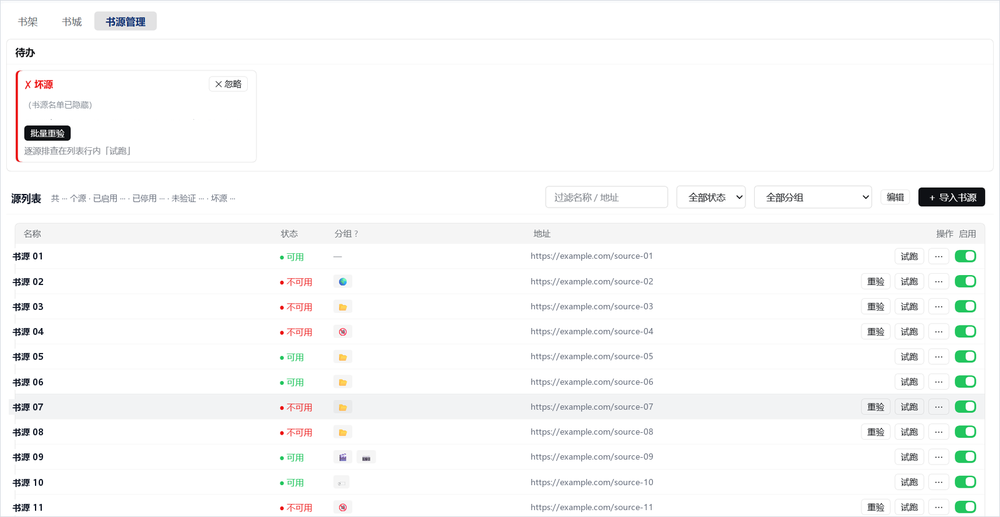
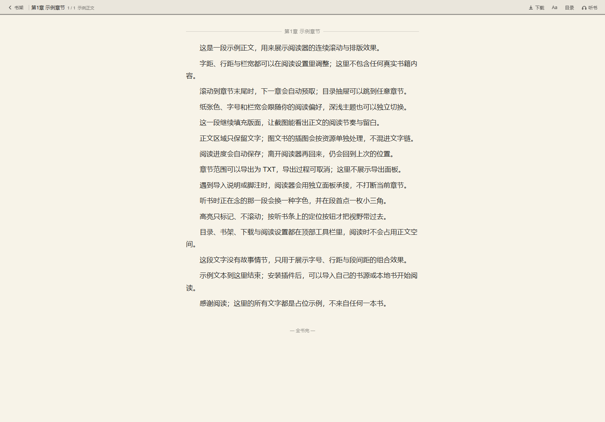
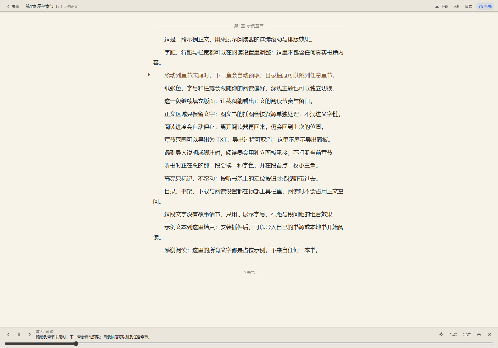
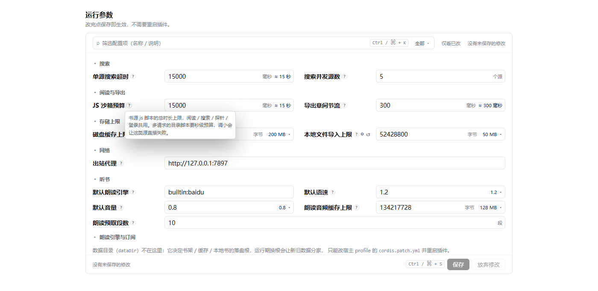

# dsh-novel

[](https://github.com/xrn1997/dsh-novel/actions/workflows/ci.yml)
[](https://www.npmjs.com/package/@xrn1997/dsh-novel)
[](LICENSE)
[](#安装)

**在 DeepSeek Harness（DSH）里读网络小说。** 导入 [legado](https://github.com/gedoor/legado) 书源，聚合搜索或按分类逛书城，把书加入书架，连续滚动阅读，也能让它念给你听。它还有本地 TXT / EPUB、中英界面和六个 `dshnovel_` AI 助手工具——找书、读章、管源都可以在对话里完成。


*书城：左边选源、展开它自己声明的分类，右边是该类的书单——顺序都听源的，不跨源合并（书源与书目均为示意数据）。*

- **安装**：`dsh plugin --profile <profile> add @xrn1997/dsh-novel`
- **数据**：默认留在本机 `$DSH_HOME/novel/`（`dataDir` 可改）；插件不内置任何书源
- **许可**：[Apache-2.0](LICENSE)

## 目录

- [功能](#功能)
- [安装](#安装)
- [首次使用](#首次使用)
- [AI 助手工具](#ai-助手工具)
- [配置](#配置)
- [HTTP API](#http-api)
- [数据存储](#数据存储)
- [本地书格式（TXT / EPUB）](#本地书格式txt--epub)
- [兼容哪些书源](#兼容哪些书源)
- [常见问题](#常见问题)
- [开发](#开发)
- [文档](#文档)
- [贡献](#贡献)
- [致谢](#致谢)

## 功能

左侧栏「小说」是一个全局面板，三个并列 tab：**书架 / 书城 / 书源管理**。界面、探针与 AI 工具共用同一条链路。

### 书源：导入、去重、体检



*书源管理：待办置顶坏源 / 未验证源，过滤、启停、AI 搜索标记、试跑和批量操作都在这一页（书源名称、地址与数量已脱敏）。*

拖入 / 多选 / 粘贴 legado 书源 JSON，导入在后台跑，按地址自动去重。新源先标「未验证」，「待办」把坏源和未验证源置顶，一键验证或批量重验；平时可过滤、启停、标记 AI 搜索源、试跑、录入 cookie 或执行 `loginUrl` 脚本。

### 找书：聚合搜索 + 按源逛书城

书架顶部一次搜索所有源：结果边搜边出、可停止，按（书名，作者）归并，相关结果优先，失败源逐家点名。书城则按每个源自己声明的分类浏览，点书可读、加架，或去其他源找同名书。

### 书架与阅读：连续滚动，进度自动保存

书架按最近阅读排序，可按在读 / 未读 / 本地筛选，每本书标来源，支持批量删除。阅读器连续滚动、自动预取下一章，字号 / 行距 / 栏宽 / 纸张色可调，支持范围导出 TXT。


*书架：按最近阅读排序，顶部可在读 / 未读 / 本地筛选，末位是本地书导入入口（书名与进度为示意数据）。*



*阅读器：连续滚动、自动预取与顶部工具栏；顶条「听书」可直接开始朗读（示例正文）。*

### 听书：从阅读位置起播，跨界面续听

阅读器顶条点「听书」即从此刻看到的那一段起播；正文里选中一段可「从本段听」，设置面板里也能直接选起播章。阅读器内的听书条负责上一段 / 下一段、播放暂停、章内段滑杆、语速与定时；设置面板换引擎、音色、音量与起播章。正在念的段在正文里换字色、段首点一枚小三角；听书推进时正文跟着走（当前段离开可视区才滚），读者自己滚动或点目录 / 内链后跟随让位，按条上的「定位到正在念的段」重新接上。



*阅读器听书：条上是上一段 / 暂停 / 下一段、章内段滑杆、语速与定时；正在念的段换字色并在段首点一枚小三角（示例正文）。*

离开阅读器后，浮在屏幕上的听书胶囊继续带着这本书：点开是能读整段的边栏，可暂停、跳段、拖章内进度、调语速与定时，或回阅读器；胶囊可拖到任意位置、靠近边缘松手自动贴边，展开后宽高可调，位置与尺寸留在本机。


*书架听书：卡片显示共用的消费进度，「正在听」标播放层此刻在放的那一本；浮窗边栏可暂停、跳段、拖章内进度、调语速与定时或回阅读器（示意数据）。*

听书与阅读共用一条进度：听到哪，书架与下次开书就恢复到哪；书架卡片只显示这一条进度，正在播放的那一本标「正在听」。音色、语速与音量按书记住。

引擎源分四类：**内置朗读**开箱即用、只合成中文、没有音色可选；**浏览器本地语音**用设备系统语音直接出声，不走网络合成；**订阅引擎**导入 legado HttpTTS 订阅（粘贴 JSON 或从 URL 拉取），导入回执按条点名坏条，坏条只剪自己；**宿主朗读服务**只在宿主装有语音合成服务插件（社区包 `dsh-xiaomi-tts`）**且已配好供应商**时列出——装了但没配好时引擎管理里留一行灰显，写明未就绪与原因码，不会让你选到一个每段都失败的口子上。语速与音色按引擎能力分工：能应用服务端语速的源由引擎自己念，念不到的那一截由播放端补，滑杆上写的就是你实际听到的速度；跳段、停止与关页都会让在途合成停下，不再为没人听的内容继续合成。订阅与登录态只留本机：`tts-engines.json` 存订阅，登录态只写不读、导出不带；订阅自带的 `header` 原样保留——若把密钥写进 `header`，导出的 JSON 里就有那把密钥。

### 本地书、AI 与界面

TXT / EPUB 直接进书架，有损导入会留下可回看的「导入说明」（格式与边界见 [本地书格式](#本地书格式txt--epub)）。六个 `dshnovel_` 工具覆盖搜索、读章、目录、书架、书源管理和导入（详见 [AI 助手工具](#ai-助手工具)）；界面中英双语，运行参数在插件页改完即生效。

## 安装

插件装进哪个 profile，就在那个 profile 里生效——本插件不绑定宿主的发行形态，只认 DSH 的插件生态。

本插件声明 `engines.node >= 24`（事实源住 `package.json`；从源码装时构建链同样要求该版本）。

```powershell
dsh plugin --profile <profile> add @xrn1997/dsh-novel
```

重启宿主后，左侧栏出现「小说」全局面板入口（图标行；点击即在中央面板打开书架 / 书城 / 书源管理 tab）。侧栏入口需要宿主提供 `slots` / `layout` 的界面 bundle；不带它的 profile 只挂 Node 半与 AI 工具，界面上不会多出入口。

三种装法：

- **npm 安装**（推荐）：使用预构建产物，秒装、无需构建授权。
- **GitHub Release 装**（不碰 npm registry，也不需要构建工具链）：发版工作流在 `V*` tag 上产出预构建 tarball。装最新 Release：
  `dsh plugin --profile <profile> add https://github.com/xrn1997/dsh-novel/releases/latest/download/dsh-novel.tgz`
  钉版本就换成 `https://github.com/xrn1997/dsh-novel/releases/download/V<版本>/xrn1997-dsh-novel-<版本>.tgz`；tarball 自带 `lib/`，装的是预构建产物，宿主能否挂载仍由兼容闸与真机验证决定。Releases 页还没有对应版本时，用 npm 或源码装。
- **从源码装**：本包没有 `prepare`，从远端源码直装（`github:` / `git:` 形态）不会自动构建，装出来缺 `lib/` 会被宿主拒绝挂载——Release 资产是另一条路，不改变这条。要先从 GitHub 或 GitCode 克隆仓库并 `pnpm install && pnpm build`，再用 `dsh plugin --profile <profile> add link:<克隆目录>` 挂载。

卸载：

```powershell
dsh plugin --profile <profile> remove @xrn1997/dsh-novel
```

**宿主兼容声明分两层**：安装许可由 `package.json` 的 `peerDependencies` 决定——宿主 `dsh plugin add` 会拿运行中的宿主版本逐个比对插件的 `@deepseek-ai/dsh*` peer 区间，不满足即 `installation rejected`。实测记录写在 `dsh.compatibility.dshReleases`，只列真跑过的宿主版本：**DSH 0.1.7-rc.1、0.1.7-rc.2、0.2.0-rc.2、0.2.1-rc.1、0.2.1-rc.2、0.2.1-rc.3、0.2.1-rc.5、0.2.2-rc.1、0.2.2-rc.3**（这一行是给人看的记录，文档门会核对它与 `package.json` 一致；安装许可与实测名单两层的关系见 `ADR-0020`）。宿主发版与 peer 区间的维护流程、发布冷却闸见 [docs/development.md](docs/development.md#宿主兼容与实测名单)。

## 首次使用

1. **导入书源**：「小说」→「书源管理」tab → 选择 `.json` 文件（可多选，选中即开始导入）或粘贴 legado 书源 JSON。导入是服务端后台任务，关页面不打断；同址自动去重（已有可用源则跳过，坏源 / 未验证源被新条替换）。
2. **批量验证**：导入不逐条探针（新源状态为「未验证」）——顶部**待办收件箱**把坏源 / 未验证置顶成任务卡，「一键验证」「批量重验」即点即跑；任意集合（过滤 + 编辑态勾选 +「验证所选」）同样可发起，后台并发 5 路限流。
3. **选择 AI 搜索源**：AI 工具不会自动搜全部启用源——在书源管理的「AI」列逐源标记，或在编辑态勾选后点「加入 AI 搜索」；状态下拉选「AI 搜索源」可复核这批源。新导入与升级前的存量源默认**不**参与 AI 搜索（重导入保留已标记），界面搜索不受影响、仍按启停走。
4. **找书读**：「书架」tab 顶部搜书名 / 作者 → 点封面进阅读器。不在书架上的书离开时会先问是否加入，加入后进度自动记住。想按分类逛就走「书城」tab：先在左栏点一个源，再点它自己声明的那几类。手上已有文件就走书架末位的**导入本地书籍**（TXT / EPUB）。
5. **让 AI 助手干活**：对话里直接说「帮我找一本《XX》读第三章」「看看 XX 书源为什么坏了」。

## AI 助手工具

| 工具 | 用途 |
| --- | --- |
| `dshnovel_search` | 在用户标记为 **AI 搜索**的已启用文本书源中聚合搜索（当前仅支持小说文本面），除参与集外与界面同判据、同视图：按书返回——同一（书名，作者）多家归并成一本、逐源各留一行，`failed` 逐家点名未答话的源，`searched`/`answered`/`filtered` 自报本轮账目；`eligible` 回报本轮 AI 候选源数（为 0 说明还没标记，去书源管理勾选）。同一标记之外的启用源不会被 AI 工具查询。返回的 `url` 就是其他工具的 `bookKey`，调 `read` / `toc` 时还要带上该行的 `sourceId` |
| `dshnovel_read` | 取某本书第 N 章（0 起）的正文纯文本（含章名）；章序从 `dshnovel_toc` 查。图文书同样只给文字：插图落成 `[图片：替代文字]` 占位（无替代文字则 `[图片]`） |
| `dshnovel_toc` | 取书籍目录：逐章返回章名与 0 起 `chapterIndex`（章名→下标的唯一映射处）与章节 URL；目录超 1000 章时规范值只含前 1000 章，`total` 仍为全书章数、`chapterIndex` 仍可读任意章 |
| `dshnovel_shelf` | 书架与阅读进度：`list` / `add` / `save_progress` / `remove` |
| `dshnovel_source` | 书源管理：`list` / `probe`（真实搜索请求 + 失败定位）/ `enable`·`disable` / `ai-enable`·`ai-disable`（加入 / 移出 AI 搜索）/ `remove` |
| `dshnovel_import_source` | 导入 legado 书源 JSON 文本（内容可为对象或数组）；只做规范化 + 落盘不探针，逐条结果在 `outcomes[]`（含 `ok` / `missing` / `dupSkipped`） |

六个工具与 UI、探针共用同一个 service 层，不存在第二套实现。工具名全部锁 `dshnovel_` 前缀——宿主对工具重名直接抛错，插件专属前缀是与生态其他插件的硬边界（名字集合由 `tests/tools/tools.test.ts` 钉住）。

## 配置

插件配置位于 profile 的 `cordis.patch.yml` 里该插件行的 `config` 字段（schemastery 校验，全部可选）：



*运行参数：一张卡、一条列表，保存条贴底常驻；每行一条框，单位与人话回读都在框内。*

| 键 | 缺省 | 说明 |
| --- | --- | --- |
| `dataDir` | `$DSH_HOME/novel/` | 数据根目录（见「数据存储」） |
| `searchTimeoutMs` | `15000` | 单源搜索超时（毫秒） |
| `searchParallel` | `5` | 搜索并发源数 |
| `jsTimeoutMs` | `15000` | js 沙箱预算（毫秒，阅读 / 搜索 / 探针 / 登录全链路共用）。目录脚本可能一次串多个请求，秒级预算才够用 |
| `cacheMaxBytes` | `209715200`（200MB） | 目录 / 正文缓存上限（字节；按 mtime 最旧的近似 LRU 淘汰，读命中不续命） |
| `exportDelayMs` | `300` | 范围导出的章节间抓取间隔（毫秒，串行限速） |
| `localImportMaxBytes` | `52428800`（50MB） | 本地文件导入大小上限（字节，TXT / EPUB 共用） |
| `proxyUrl` | 启动时自动探测 | 出站代理，见[常见问题](#常见问题)；`'direct'` 强制直连，或显式指定如 `'http://127.0.0.1:7897'` |
| `ttsDefaultEngine` | `builtin:baidu` | 默认朗读引擎标识：内置 `builtin:baidu`、浏览器直出 `browser:local`，或订阅引擎的 id；按书选择的引擎优先于它 |
| `ttsDefaultRate` | `1` | 第一次听一本书时的语速（0.5–3）；在播放器里改过之后按书记住，这一档只兜底 |
| `ttsDefaultVolume` | `0.8` | 第一次听一本书时的音量（0–1）；同上 |
| `ttsCacheMaxBytes` | `134217728`（128MB） | 合成音频缓存上限（字节）；低于 1 MiB 会被拒绝——单段音频就可能超过上限。真遇到时本轮临时超限，刚合成的段不被淘汰，下一轮才按 mtime 清 |
| `ttsPrefetchParagraphs` | `10` | 播放到本章末尾时提前合成的下一章开头段数；`0` = 不预取下一章，预取失败只影响那一段 |
| `apiAllowHosts` | 不追加 | `/novel-api` 同源 fence 的本机 Host 名单追加项，如 `['dsh.local']`；只有用自定义域名（hosts / 内部 DNS）打开宿主面板时才需要。每项只比主机名，端口只做形状校验、不参与匹配（`dsh.local:8080` 也放行 `dsh.local:9999`）。改它需重启；填进去的每个名字都是把 DNS rebinding 防线在那个域名上让掉，只填自己控制的 |

除 `dataDir` 与 `apiAllowHosts` 外，其余 12 项在宿主的「插件」页 → `@xrn1997/dsh-novel` 详情里的「运行参数」中编辑，保存即生效，不重启插件。这一页依赖宿主的设置面（`ctx.remote.settings` 的 `describe` / `mutate`）；设置面缺席时页面不出现，配置仍写 profile 的 `cordis.patch.yml`。`dataDir` 与 `apiAllowHosts` 始终改该文件并重启。

整数项按整数校验；语速与音量按一位小数档校验（语速 0.5–3、音量 0–1）；`proxyUrl` 只接受 `direct`、空串或 http(s) 地址（裸 `host:port` 按 `http://` 补全）；`apiAllowHosts` 每项只接受 `host` 或 `host:port`，且必须是 URL 解析不改写的主机名。非法值（含 `NaN` / `Infinity`）在插件加载期报错，在配置页保存时同样被拒、页面保留草稿。显式 `null` 按未设置处理、取缺省。

## HTTP API

所有路由以 `/novel-api` 为前缀。信任判据四步：请求来自本机 loopback → `Host` 在本机名单内（`localhost` / `127.0.0.1` / `[::1]`，自己的别名走 `apiAllowHosts`）→ Origin 在场必须同源 → Referer 在场必须同源；Origin / Referer 缺席放行，那是给本机工具与 curl 的承诺。被 Host 名单挡住时 403 点名是哪个 Host、并指路 `apiAllowHosts`。这层判据也意味着**远程访问宿主时插件 API 不可用**：从另一台机器打开面板，浏览器半的请求会拿到 403（面板按请求失败提示），这是「只服务本机」的既定边界，不是可配置项。JSON 响应使用统一信封 `{ ok, value | error }`，错误附带 `code` 与可选的规则段级定位；`GET /export`、两条 SSE 流、`GET /local/resource` 与 `GET /tts/audio` 是流式 / 二进制响应，不套信封。路由身份（method + path）与值形状的代码真相在 `src/shared/wire.ts`——Node 半与浏览器半共用同一份定义，契约测试逐条把守。

| 面 | 路由 |
| --- | --- |
| 健康检查 | `GET /novel-api` |
| 书源 | `GET /sources`、`POST /sources/import`（后台任务，body `{files:[{name,text}]}`，上限 32MB）、`GET /sources/job-status`、`POST /sources/batch-probe`、`POST /sources/batch-enabled`、`POST /sources/batch-ai-search`、`POST /sources/batch-delete`、`POST /sources/:id/probe`、`POST /sources/:id/enabled`、`POST /sources/:id/ai-search`、`POST /sources/:id/auth`、`DELETE /sources/:id` |
| 搜索与阅读 | `GET /search`、`GET /search/plan`、`POST /search/job`、`GET /search/job-status?since=N`、`GET /search/job-stream?since=N`（SSE，首帧即 baseline）、`POST /search/job-cancel`（保留已搜出的命中）、`GET /book`、`GET /toc`、`GET /navigation`、`GET /chapter`（`?refresh=1` 绕过缓存） |
| 书城发现面 | `GET /explore/kinds`（按源列分类标题，零网络请求）、`POST /explore/list`（body `{sourceId, kind}`）、`POST /explore/list/more`（续同一轮）、`GET /explore/list/job-status`（全量快照）、`GET /explore/list/job-stream`（SSE） |
| 书架 | `GET /shelf`、`PUT /shelf/:key`（`title` / `progress` / `listen` / `patch`）、`DELETE /shelf/:key`、`POST /shelf/batch-delete`（本地书连带删副本） |
| 听书 | `GET /tts/sources`、`POST /tts/synthesize`、`GET /tts/audio?key=…`、`GET /tts/engines`、`POST /tts/engines/import`、`PUT /tts/engines/:id`、`DELETE /tts/engines/:id` |
| 导出 | `GET /export`（流式 TXT，`from`/`to` 为 1 基含端区间，缺席 = 全本；响应头 `X-Novel-Total-Chapters` / `X-Novel-Range`；倒置范围 422，连接断开即停止抓取） |
| 本地书 | `POST /local/import?name=…`、`DELETE /local?id=…`、`GET /local/document?id=&documentId=`、`GET /local/resource?id=&resourceId=`、`GET /local/warnings?id=` |

## 数据存储

默认存于 `$DSH_HOME/novel/`（未设置 `DSH_HOME` 时 `~/.dsh/novel/`；可用 `dataDir` 改写），与项目目录分离——阅读数据是跨项目、跨仓库的：

```
$DSH_HOME/novel/
├── sources.json   # 书源清单（含登录态，仅存本机、不会外传）
├── shelf.json     # 书架、阅读进度与听书位置
├── tts-engines.json # 朗读引擎订阅（登录态 auth 仅存本机、导出剥除；订阅自带 header 原样保留）
├── source-state.json # 脚本可见的按源状态（cookie 垫片 / 变量 / 单串槽 / cache 垫片）
├── cache/         # 目录 / 正文缓存（按 mtime 最旧的近似 LRU；默认上限 200MB）
│   └── tts/       # 合成音频缓存（按 mtime 最旧的近似 LRU；默认上限 128MB）
└── local/         # 本地书：TXT 是 <uuid>.txt + <uuid>.json（章节偏移表）
                   # EPUB 是 <uuid>/ 目录（原文 + 派生文档 + 资源）+ <uuid>.json
```

## 本地书格式（TXT / EPUB）

「书架」末位的**导入本地书籍**卡收 `.txt` 与 `.epub`；分流由服务端**按内容**做（文件头是 ZIP 就按 EPUB 解析）。

| 格式 | 支持 | 明确不做 / 已知边界 |
| --- | --- | --- |
| TXT | BOM 优先 → UTF-8 严格探测 → GBK 回退；标题行切章（第X章 / 卷 / 回 / 节 / 章外篇目 …） | 自定义章名正则未接（本仓是一条钉死的标题行正则）；PDF / MOBI / UMD 在入口按具名容器头拒收 |
| EPUB 2 / 3（流式排版） | 阅读顺序按 **spine 主序列**计章；原书目录树（EPUB3 nav / EPUB2 NCX，含章内锚点与命名锚点）；封面；正文插图（JPEG/PNG/GIF/WebP 与受限静态 SVG）；基本格式（段落、标题、粗斜体、列表、引用、分隔线、基本表格、上下标、预格式文本）；脚注与附录（补充文档面板，可跟随可返回） | **不加载出版方 CSS 与字体**（排版归本插件阅读设置）；**固定版式**、需 DRM 解密的正文、脚本驱动的交互与音视频不宣称支持（明确拒绝或告警）；正文内联 `<svg>` 装饰图形剥离并记说明（整页是一棵只包一张书内图的 SVG 时按那张图读那一章）；远程图片不加载（那一处不留图并留痕） |

- **按内容分流、不互相兜底**：文件头是 ZIP 就按 EPUB 解析，失败**不会**回退成 TXT——否则一份加密压缩包会以「一本乱码书」入架；不是 ZIP 的字节才走 TXT 解码链。文件名词尾是 `.epub` 而内容不是 ZIP 的，明确拒收并指路改回 `.txt`。
- **TXT 链的兜底不等于来者不拒**：认得出的具名容器头（`%PDF-`、`BOOKMOBI`、UMD 的 `89 9B 9A DE`）在入口就拒并点名；解码之后还要求这本文件**真的是文本**：含 NUL（U+0000）或整本只有空白的文件会被拒，而不是切成「一章空白」入架；其余控制字符照旧能读——判据不是「看起来像二进制就拒」。
- **文字输出只有文字**：图片只在 EPUB 阅读器里显示；TXT 导出与取正文的 `dshnovel_read` 把插图投影成 `[图片：替代文字]` 占位。本轮不提供 EPUB / 图片导出。
- **有损导入的交代是持久的**：`GET /local/warnings` 可回看（导入时在书架就地显示，进书后在阅读器「导入说明」重看），不静默丢内容；带持久说明的导入不自动跳进阅读器。
- **导入失败说具体原因**：包级固定版式 / 加密条目 / 是 ZIP 魔数但读不成归档（缺 `mimetype`、条目越界或重名、CRC 对不上、截断）/ 超限 / 具名容器头（PDF、MOBI、UMD）/ 文件名声明 `.epub` 而内容不是 ZIP / 解出来不是可读文本，都由服务端逐条点名，不折叠成「导入失败」一句泛话。
- **一处读不出，后果只落在那一处**：一份文档读不出正文 → 那一页照样在目录里，点开是空白页并留说明；一条目录条目或一处引用指不到可读文档 → 只剪那一条；锚点找不到 → 目录落该页开头、正文链接取消可点击性（文字照留）；一张插图读不出 → 该处不留图（有替代文字就留文字）。每一处缺失都在「导入说明」里点得名。整本拒收只留给书级事实（容器 / 包文档读不出、主序列一份可读的都没有、声明了封面却读不出等，清单见 `ADR-0061`）。

## 兼容哪些书源

兼容 legado 书源的**声明式子集**：取值链 / 组合符（`||`、`&&`、`%%`）/ `##` 替换 / AllInOne（单段整页正则）/ JSONPath（含 `.*` 属性通配）/ XPath 子集 / `@put` / `@get` / `@js` 沙箱（脚本完成值语义 + 顶层 `return`/`await` 回落；`eval`/`Function` 在 vm 内可用）/ `jsLib` 源级函数库 / `searchUrl` 的 `@js`/`<js>` 形态 / 对象形态方言（**含 `ruleBookInfo.init` 详情上下文初始化**）/ `url,{json}` POST 请求 / 相对 URL / 隐式 CSS 选择器 / `!` 排除语法，以及 `@js` 宿主垫片（`java.log` / `getElement` / `setContent` / `cookie` / `source.getVariable` 等）。请求状态面还包括真实 cookie jar、`loginCheckJs`、源级 `concurrentRate` 限速、`webView`/`webJs` 真浏览器抓取与源变量 / cache 落盘。缺省请求带浏览器 UA。

URL 模板、`charset` 双用途与 `&&` / `%%` 的合并语义按 legado 书源格式对齐；逐条写法与合并口径见 `tests/legado-coverage/matrix.ts` 与 `CONTEXT.md`。

遇到不认识的语法，本插件选择**报错而不是猜测**——错误定位到出错的规则段，而不是产出错误结果。语法合法但跑得炸的正则（嵌套量词遇上不匹配的长输入）同一条路：每条用户正则都有一条随工作量放宽的时间死线，到点只废掉那一条规则并点名它。`webView`/`webJs` 走本机已装的 Edge/Chrome；没有可用浏览器、或书源依赖这份格式里需要移动端宿主能力的那类规则时，会明确报告不支持。

**「做到哪一步」有机器口径**：`tests/legado-coverage/matrix.ts` 一行一条 legado 语义，归入 实现 / 环境不适用 / 待拍板 三态之一；implemented 行带实现符号与钉住用例，not-applicable 行写裁决理由，open 行带复核戳。判据默认随 `pnpm test` 跑，说明见 [docs/development.md 的「兼容判据与桥面自证」](docs/development.md#兼容判据与桥面自证)。想查某个字段支不支持：在矩阵里按 `id` 或能力名搜那一行即可。

## 常见问题

**搜索结果全是「网络错误」，或正文显示为空白？**
多半是代理问题。DSH 的 Node 进程用 undici 发请求，**不会读取系统代理设置**；对代理才可达的站点，直连会被重定向或重置。在配置里显式设 `proxyUrl`（如常见本地代理端口 `'http://127.0.0.1:7897'`）；缺省探测顺序与代理链路细节见 `docs/development.md` 的「已知的环境坑」。

**某条书源报「不支持 xx」？**
本插件只实现 legado 规则的声明式子集（见上节），对无法仿真或不认识的语法会明确报错并定位到规则段，而不会静默给出错误结果。可以尝试换用不依赖该类移动端宿主能力（专有 API / 加密侧能力）的同类书源。

**`webView` / `webJs` 源报「WebView 不可用」？**
本插件用 `playwright-core` 驱动本机已安装的 Edge/Chrome（不下载浏览器，且**按需加载**：只有书源真要用浏览器时才载入它，普通阅读不受影响）。装一个 Edge 或 Chrome 即可；两者都没有时会如实报错，不会静默退回普通 HTTP 请求。

**某条规则报「正则求值超时（疑似灾难性回溯）」？**
那条写法语法合法，但遇上不匹配的长输入会指数级回溯。插件给它一条随页面大小放宽的时间死线，到点只废掉**这一条规则**并点名它，而不是让整台宿主卡住——所以症状是「这一源这一段报错」，不是「读不了」。解决：改源里那条正则（去掉嵌套量词），或换一家源。

**面板满屏报「非受信来源」403？**
`/novel-api` 的同源 fence 只认本机 Host（`localhost` / `127.0.0.1` / `[::1]`），这是 DNS rebinding 的防线。若你用自己的域名、hosts 别名，或用反向代理改写了 Host 打开宿主面板，把那个名字加进配置 `apiAllowHosts` 并重启插件；403 的正文会点名是哪个 Host 被拒。代价是：填进去的每个名字，都是在那个域名上把这道防线让掉——只填自己控制的。

**安装后侧栏没有出现「小说」入口？**
先重启宿主。若从源码目录安装，确认已先 `pnpm build` 生成 `lib/`（构建产物缺失会让整个插件树拒绝挂载，宿主直接启动失败而非静默降级），详见 [docs/development.md 的「本地源码调试」](docs/development.md#本地源码调试)；GitHub Release 的 tarball 自带 `lib/`，不必构建。装进了没有 `slots` / `layout` 界面 bundle 的 profile，则本就只有工具面、没有侧栏入口。

## 开发

从源码构建：`pnpm install && pnpm build`（改动源码后、重启宿主前必须重新构建）；日常开发可挂 `pnpm dev`，它只出 `lib/*.js`，要类型声明另跑一次 build。本地调试、构建产物与热更新、门控、真机验证、发版与宿主兼容见 [docs/development.md](docs/development.md)；模块形状与语义归属见 [docs/architecture.md](docs/architecture.md)。

## 文档

用户面事实在本文件；agent 常读规则在 `AGENTS.md`；文档分层、放置与生命周期在 [docs/AGENTS.md](docs/AGENTS.md)；构建与全部门控在 [docs/development.md](docs/development.md)；提交与发版边界在 [CONTRIBUTING.md](CONTRIBUTING.md)；决策在 [docs/adr/](docs/adr/README.md)；发布历史在 [CHANGELOG.md](CHANGELOG.md)。兼容裁决与真机读数住 `tests/legado-coverage/matrix.ts` 的行 `note`；局部口径的为什么住实现它的代码注释。

## 贡献

欢迎 Issue 与 PR。提交信息、PR 约定与提交前检查见 [CONTRIBUTING.md](CONTRIBUTING.md)；提交改动前至少跑 `pnpm test`、`pnpm typecheck` 与 `pnpm lint`，并确认退出码。若扩展了书源语法，请补充对应的回放测试 fixture（脱敏判据见 `tests/replay/sanitize.ts`），并把新形态在 `tests/legado-coverage/matrix.ts` 里落到正确的那一态。提交即表示你同意以 [Apache-2.0](LICENSE) 协议授权你的贡献。

## 致谢

书源兼容语义的开发阶段对读，参考了 legado 及其续作 [legado-with-MD3](https://github.com/HapeLee/legado-with-MD3)。对读结论落在代码、测试与覆盖矩阵里；仓内不保留任何外部实现的冻结快照，运行与 CI 都不依赖外部 checkout。这段来历只住本文件。

本地导入的 UMD 容器头判据参考了公开的逆向解析资料（如[这份 UMD 格式解析](https://zhuanlan.zhihu.com/p/572973436)）。该格式没有公开的官方规范，多份彼此独立的资料对「文件前四字节固定为 `89 9B 9A DE`」一致；判据以测试钉住，出处只住本文件。

## 说明

本项目不提供、不内置任何书源，仅用于学习插件开发。

## License

[Apache-2.0](LICENSE)
